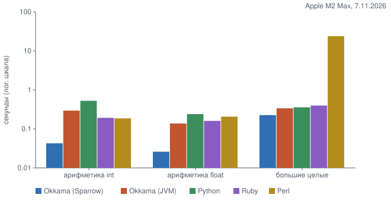
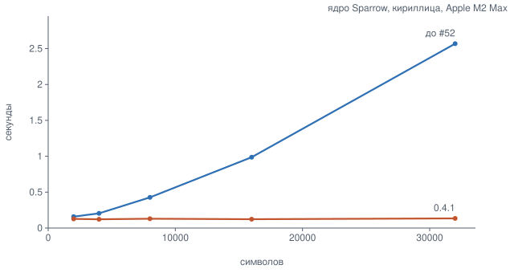
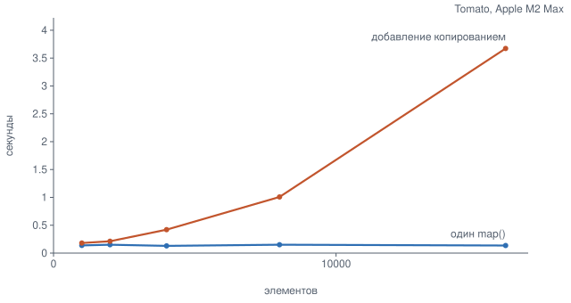

<!-- Generated by build.py from chapters/ru; edit the chapters. -->
# Библия Okkama

## Содержание

- [Часть I. Бритва](#часть-i-бритва)
- [Глава 1. Не умножай сущностей](#глава-1-не-умножай-сущностей)
  - [1.1 Францисканец из Суррея](#11-францисканец-из-суррея)
  - [1.2 Что утверждает бритва, а что — нет](#12-что-утверждает-бритва-а-что--нет)
  - [1.3 Почему простые объяснения предсказывают лучше](#13-почему-простые-объяснения-предсказывают-лучше)
  - [1.4 То же правило, открытое заново для программ](#14-то-же-правило-открытое-заново-для-программ)
  - [1.5 Другая сторона: «хуже — значит лучше»](#15-другая-сторона-хуже--значит-лучше)
  - [1.6 Бритва Okkama, сущность за сущностью](#16-бритва-okkama-сущность-за-сущностью)
  - [1.7 Первая проба](#17-первая-проба)
  - [1.8 Чего стоит бритва](#18-чего-стоит-бритва)
  - [1.9 Как читать эту книгу](#19-как-читать-эту-книгу)
- [Глава 2. Краткая история объектов](#глава-2-краткая-история-объектов)
  - [2.1 Simula: объекты для моделирования](#21-simula-объекты-для-моделирования)
  - [2.2 Smalltalk: всё — сообщение](#22-smalltalk-всё--сообщение)
  - [2.3 C++ и Java: объекты для индустрии](#23-c-и-java-объекты-для-индустрии)
  - [2.4 Беда с наследованием](#24-беда-с-наследованием)
  - [2.5 Беда с состоянием](#25-беда-с-состоянием)
  - [2.6 Объекты как поведение](#26-объекты-как-поведение)
  - [2.7 Elegant Objects: дисциплина](#27-elegant-objects-дисциплина)
  - [2.8 Композиция на практике](#28-композиция-на-практике)
  - [2.9 Что потеряно](#29-что-потеряно)
- [Глава 3. Манифест, правило за правилом](#глава-3-манифест-правило-за-правилом)
  - [3.1 Правило первое: объекты дают поведение, а не состояние](#31-правило-первое-объекты-дают-поведение-а-не-состояние)
  - [3.2 Правило второе: состояние связывается при создании, конструкторы его охраняют](#32-правило-второе-состояние-связывается-при-создании-конструкторы-его-охраняют)
  - [3.3 Правило третье: изменение — это новый объект](#33-правило-третье-изменение--это-новый-объект)
  - [3.4 Правило четвёртое: null нет](#34-правило-четвёртое-null-нет)
  - [3.5 Правило пятое: условия — это булевы значения](#35-правило-пятое-условия--это-булевы-значения)
  - [3.6 Правило шестое: числа точны, а категории не смешиваются молча](#36-правило-шестое-числа-точны-а-категории-не-смешиваются-молча)
  - [3.7 Правило седьмое: роли вместо наследования](#37-правило-седьмое-роли-вместо-наследования)
  - [3.8 Правило восьмое: отказы типизированы, а ошибки программы — не исключения](#38-правило-восьмое-отказы-типизированы-а-ошибки-программы--не-исключения)
  - [3.9 Правило девятое: ресурсы освобождаются детерминированно](#39-правило-девятое-ресурсы-освобождаются-детерминированно)
  - [3.10 Правило десятое: полномочия явны](#310-правило-десятое-полномочия-явны)
  - [3.11 Правило одиннадцатое: конкурентность структурна](#311-правило-одиннадцатое-конкурентность-структурна)
  - [3.12 Один дизайн, а не одиннадцать](#312-один-дизайн-а-не-одиннадцать)
- [Часть II. Значения](#часть-ii-значения)
- [Глава 4. Типы с высоты птичьего полёта](#глава-4-типы-с-высоты-птичьего-полёта)
  - [4.1 Зачем нужен тип](#41-зачем-нужен-тип)
  - [4.2 Перечень](#42-перечень)
  - [4.3 Где пишутся типы](#43-где-пишутся-типы)
  - [4.4 Номинальная, а не структурная](#44-номинальная-а-не-структурная)
  - [4.5 Вывод типов: локальный и точный](#45-вывод-типов-локальный-и-точный)
  - [4.6 Верхний тип `any`](#46-верхний-тип-any)
  - [4.7 Что проверяет компилятор, а что остаётся на время выполнения](#47-что-проверяет-компилятор-а-что-остаётся-на-время-выполнения)
  - [4.8 Ограничения](#48-ограничения)
- [Глава 5. Числа](#глава-5-числа)
  - [5.1 Четыре категории](#51-четыре-категории)
  - [5.2 Точные целые](#52-точные-целые)
  - [5.3 Точные рациональные](#53-точные-рациональные)
  - [5.4 Плавающая точка, всегда конечная](#54-плавающая-точка-всегда-конечная)
  - [5.5 Байты](#55-байты)
  - [5.6 Преобразования](#56-преобразования)
  - [5.7 Чего стоит точность](#57-чего-стоит-точность)
  - [5.8 Ограничения](#58-ограничения)
- [Глава 6. Текст](#глава-6-текст)
  - [6.1 Три слоя текста](#61-три-слоя-текста)
  - [6.2 Выбор Okkama: неизменяемые кодовые точки](#62-выбор-okkama-неизменяемые-кодовые-точки)
  - [6.3 Запись строк](#63-запись-строк)
  - [6.4 Что умеет строка](#64-что-умеет-строка)
  - [6.5 Равенство и нормализация](#65-равенство-и-нормализация)
  - [6.6 Текст и байты](#66-текст-и-байты)
  - [6.7 Символы](#67-символы)
  - [6.8 Чего стоит текст](#68-чего-стоит-текст)
  - [6.9 Ограничения](#69-ограничения)
- [Глава 7. Отсутствие без null](#глава-7-отсутствие-без-null)
  - [7.1 Что означает null — слишком многое](#71-что-означает-null--слишком-многое)
  - [7.2 Ответ Okkama: одна конструкция на один смысл](#72-ответ-okkama-одна-конструкция-на-один-смысл)
  - [7.3 `Maybe<T>`](#73-maybet)
  - [7.4 `Presence<T>`: три состояния для обновлений](#74-presencet-три-состояния-для-обновлений)
  - [7.5 Как отсутствие устроено в других языках](#75-как-отсутствие-устроено-в-других-языках)
  - [7.6 Чего это стоит](#76-чего-это-стоит)
  - [7.7 Ограничения](#77-ограничения)
- [Глава 8. Коллекции](#глава-8-коллекции)
  - [8.1 Массивы](#81-массивы)
  - [8.2 Функциональные операции](#82-функциональные-операции)
  - [8.3 Словари](#83-словари)
  - [8.4 Диапазоны](#84-диапазоны)
  - [8.5 Построение и изменение коллекций](#85-построение-и-изменение-коллекций)
  - [8.6 Обход пользовательских коллекций](#86-обход-пользовательских-коллекций)
  - [8.7 Ограничения](#87-ограничения)

# Часть I. Бритва

# Глава 1. Не умножай сущностей

Язык программирования — это теория программ. Он говорит, какие вещи
существуют — значения, объекты, функции, ошибки, потоки — и какие отношения
между ними допустимы. Как любая теория, он может объяснять многое
немногими сущностями, а может то же самое — многими. Okkama назван в честь
средневекового философа, сформулировавшего самое известное правило выбора
между такими теориями, и само имя — обещание: там, где два решения делают
одну и ту же работу, язык оставляет то, в котором меньше вещей.

Эта глава — об этом обещании. Откуда правило взялось, что оно утверждает и
чего не утверждает, почему у него есть серьёзные математические основания,
как к нему же пришли, независимо от Оккама, основатели программной
инженерии, и что оно значит конкретно для Okkama — включая цену. Всё
остальное в книге вытекает отсюда.

## 1.1 Францисканец из Суррея

Уильям Оккам родился около 1287 года в деревне Окем (Ockham) в графстве
Суррей, изучал и преподавал теологию в Оксфорде, а вторую половину жизни
провёл в изгнании после спора с папой Иоанном XXII о бедности
францисканского ордена; умер он в Мюнхене около 1347 года [[Spade 2019](#ref-spade-sep)]. Он
был логиком и номиналистом: считал, что существуют только единичные вещи, а
общие термины вроде «человечества» или «белизны» — это знаки, которыми мы
обозначаем многие единичные вещи, а не дополнительные сущности, стоящие за
ними.

Номинализм Оккама — это бритва в действии. Там, где предшественники
объясняли, почему две белые вещи обе белые, допуская третью вещь — реальную
универсалию, «белизну», — Оккам спрашивал, нужна ли она объяснению. Если две
белые вещи, наше понятие и слово «белый» уже объясняют всё наблюдаемое,
универсалия не добавляет ничего, кроме самой себя. Он формулировал принцип
по-разному; одна из повторяющихся в его трудах формулировок — *numquam
ponenda est pluralitas sine necessitate*, «множественность никогда не
следует допускать без необходимости» [[Spade 2019](#ref-spade-sep)].

Слов, которые обычно цитируют, — *entia non sunt multiplicanda praeter
necessitatem*, «не следует умножать сущности сверх необходимости» — в трудах
Оккама нет вовсе. Это позднейшая формулировка, и само приписывание «бритвы»
Оккаму по имени — тоже продукт последующих веков [[Thorburn 1918](#ref-thorburn1918)]. Да и
принцип старше Оккама: версиями его пользовались Аристотель и многие
схоласты. Имя Оккама прилипло, потому что он пользовался принципом так
неумолимо, что тот стал его фирменным инструментом.

Для наших целей история учит двум вещам. Во-первых, бритва — правило об
*объяснениях*, а не о мире: она не утверждает, что мир прост, только что не
следует усложнять наше описание мира без причины. Во-вторых, она режет
только в одну сторону. Она удаляет сущности, которые не делают работы, и
ничего не говорит против сущностей, которые её делают.

## 1.2 Что утверждает бритва, а что — нет

Философы различают два вида простоты, которые может означать бритва
[[Baker 2022](#ref-baker-sep)]. **Изящество** (синтаксическая простота) — это число и
сложность принципов теории: меньше аксиом, короче законы. **Экономность**
(онтологическая простота) — это число и виды вещей, существование которых
теория утверждает. Теория может быть изящной и расточительной сразу — один
короткий закон, требующий нового вида частиц, — или экономной и
неуклюжей.

Для языка важны оба прочтения. Изящество — это размер определения языка:
сколько правил программисту нужно держать в голове. Экономность — это
множество вещей, которые могут существовать во время выполнения: есть ли
null, изменяемая ячейка, иерархия классов, глобальная переменная, поток.
Okkama заботится об обоих, но прежде всего это *экономный* язык. Его
спецификация не коротка — Okkama аккуратен и явен, а аккуратные правила
требуют слов, — но перечень того, что может содержать программа, нарочно
мал.

Кроме того, бритва — **эвристика, а не доказательство**. Тщательное
исследование Эллиота Собера показывает, что «бритвой Оккама» называют
несколько разных принципов, каждый из которых обоснован — когда обоснован —
своим аргументом, и ни один не утверждает, что «более простая теория
истинна» [[Sober 2015](#ref-sober2015)]. На практике бритва — правило *выбора*, когда
данные не решают дела, и правило *бремени доказательства*: кто хочет
добавить сущность, должен показать, какую работу она делает.

Именно так ею и пользуется Okkama. Каждая конструкция, которая есть в других
языках и которой нет в Okkama, — null, наследование, сеттеры, истинность
не-булевых значений, неявные преобразования, перехват всех ошибок подряд —
должна была ответить на вопрос: «какую работу ты делаешь, которую не могут
сделать оставшиеся конструкции?» Где ответом было «экономит немного набора
текста», конструкцию убирали. Где ответом было «больше ничто этого не
выразит», конструкция оставалась или её заменяла меньшая.

## 1.3 Почему простые объяснения предсказывают лучше

Соблазнительно считать бритву эстетическим предпочтением: проще — значит
красивее. Однако есть по меньшей мере три независимых математических довода
в пользу более простой из двух теорий, одинаково хорошо согласующихся с
фактами, и все три переносятся на программы.

### Байесовский множитель Оккама

Пусть наблюдения могли породить две модели: простая H₁, способная дать
лишь узкий диапазон исходов, и гибкая H₂, способная дать почти что угодно.
Каждая модель распределяет единицу вероятности по исходам, которые может
дать. Простая модель свою единицу концентрирует, гибкая — размазывает. Если
наблюдаемые данные попали в узкий диапазон, объяснимый обеими, простая
модель приписала им бо́льшую вероятность, и правило Байеса вознаграждает её
бо́льшей апостериорной вероятностью — *без всякого априорного
предпочтения простоты* [[MacKay 2003](#ref-mackay2003)]. Маккей называет отношение, с которым
штрафуется гибкая модель, *множителем Оккама*.


*Рисунок 1.1. Байесовский множитель Оккама. Обе модели в сумме дают вероятность 1; простая концентрирует её, поэтому на данных из C₁ она выигрывает (по Маккею, 2003, гл. 28).*

Программный аналог — тип. Функция с типом `(int) is int` «предсказывает»
узкое множество поведений; функция типа `(any) is any` — почти любое. Когда
верна узкая, её тип сообщает читателю — и компилятору — гораздо больше.
Уодлер придал этому точный смысл для параметрического полиморфизма: чем
общее тип, тем меньше функций может его иметь и тем больше читатель выводит
из одного лишь типа [[Wadler 1989](#ref-wadler1989)].

### Минимальная длина описания

Риссанен предложил выбирать модель, дающую самое короткое суммарное
описание данных: длина модели плюс длина данных, закодированных с её
помощью [[Rissanen 1978](#ref-rissanen1978)]. Слишком простая модель оставляет много для
кодирования; слишком сложная стоит дороже в изложении, чем экономит. Лучшая
модель сжимает сильнее всех.

Программа — именно такое описание. Каждое понятие, которое язык заставляет
вас выписать, — проверка на null, адаптер между двумя соглашениями об
ошибках, защитная копия изменяемого объекта — это длина, добавленная к
каждой программе, длина, которая ничего не кодирует о задаче.

### Колмогоровская сложность

Предел этой идеи — длина самой короткой программы, порождающей данный
объект, его колмогоровская сложность [[Li 2019](#ref-li2019)]. Она невычислима, но даёт
интуиции твёрдую опору: объект прост, если у него есть короткое описание, а
закономерность *и есть* сжимаемость. Языки различаются тем, какие
закономерности делают короткими. Язык с неизменяемостью по умолчанию делает
«это не меняется» бесплатным, а «это меняется» — явным; язык с
изменяемостью по умолчанию делает наоборот. Okkama выбирает, какие факты
дёшево высказать, так, чтобы короткой записью оказывался частый и
безопасный случай.

## 1.4 То же правило, открытое заново для программ

Никто из основателей программной инженерии не ссылался на Оккама, но многие
пришли к его правилу с противоположной стороны — от боли сопровождения
сложных программ.

**Хоар** завершил свою тьюринговскую лекцию фразой, которая сегодня
практически стала бритвой программирования: «Есть два способа построить
программную конструкцию: один — сделать её настолько простой, чтобы в ней
очевидно не было недостатков, другой — сделать её настолько сложной, чтобы в
ней не было очевидных недостатков. Первый способ гораздо труднее»
[[Hoare 1981](#ref-hoare1981)]. В той же лекции он рассказал, как язык со слишком большим
числом возможностей (PL/I, а позже Ada) становится невозможно надёжно
реализовать и целиком выучить.

**Дейкстра** утверждал, что главное ограничение программиста — размер
собственной головы: «Компетентный программист полностью сознаёт строго
ограниченный объём своего черепа; поэтому он подходит к задаче со всем
смирением и, среди прочего, избегает хитроумных трюков как чумы»
[[Dijkstra 1972](#ref-dijkstra1972)]. За четыре года до этого он убрал из программирования одну
сущность — безусловный переход — на том основании, что тот делает
динамическое поведение программы не связанным с её текстом [[Dijkstra 1968](#ref-dijkstra1968)].

**Брукс** отделил *существенную* сложность, принадлежащую задаче, от
*случайной*, которую мы добавляем своими инструментами, и показал, что ни
один инструмент не устранит существенную часть [[Brooks 1987](#ref-brooks1987)]. Язык не
сделает налоговый кодекс проще. Но он может перестать к нему добавлять.

**Мозли и Маркс** пошли дальше и назвали главный источник случайной
сложности: *состояние*, особенно изменяемое состояние, разделяемое частями
программы, а за ним — поток управления и объём кода [[Moseley 2006](#ref-moseley2006)]. Их
статья — самый прямой аргумент в пользу объектной модели Okkama: состояние
существует, но фиксируется при создании, а каждое «изменение» — это новое
значение, существование которого текст программы обязан признать.

**Хики** провёл различие, которое спасает бритву от распространённого
недоразумения [[Hickey 2011](#ref-hickey2011)]. *Простое* (simple) — «в одну складку»: не
переплетённое с другими заботами, объективное свойство. *Лёгкое* (easy) —
«под рукой»: привычное, быстро набираемое, свойство читателя. Null — лёгок:
его знает любой программист мейнстрима, — но не прост, потому что
переплетает «значение» с «может, значения нет» в каждой ссылке программы.
Okkama выбирает простое вместо лёгкого везде, где они расходятся, и книга
каждый раз будет отмечать, когда этот выбор стоит лёгкости.

**Парнас** показал, что критерий разбиения системы на модули — сокрытие
проектных решений, которые, вероятно, изменятся [[Parnas 1972](#ref-parnas1972)], а
**Остераут** превратил это в меру: хороший модуль *глубок*, он даёт простой
интерфейс над большой реализацией, а сложность — это то, что нужно знать,
чтобы безопасно изменить систему [[Ousterhout 2018](#ref-ousterhout2018)]. Приватные поля и
номинальные роли Okkama — это сокрытие информации, сделанное обязательным.

**Вирт**, создававший Pascal, Modula-2 и Oberon путём удаления
возможностей, предупреждал, что программы растут быстрее, чем улучшается
железо, потому что никто не платит за удаление [[Wirth 1995](#ref-wirth1995)]. Каждый его
следующий язык был меньше предыдущего.

## 1.5 Другая сторона: «хуже — значит лучше»

Честный рассказ должен дать противоположному доводу всю его силу. В 1991
году Ричард Гэбриел заметил, что распространяются зачастую не самые чистые
системы [[Gabriel 1991](#ref-gabriel1991)]. Unix и C победили Lisp-машины и более принципиальные
решения, потому что их было *просто реализовать*, даже если из-за этого ими
было менее просто, менее последовательно или менее корректно пользоваться.
Он назвал это «хуже — значит лучше»: сначала простота реализации, потом
простота интерфейса, а корректность и полнота — предмет торга.

Эссе Гэбриела — не отказ от бритвы, а спор о том, *чья* простота важнее.
«Хуже — значит лучше» бреет реализацию и оставляет сложность пользователю;
«правильный подход» бреет модель в голове пользователя и оставляет
сложность реализации. Okkama твёрдо стоит на второй стороне: компилятор,
верификатор и рантайм делают огромную работу — точные числа, переходящие в
большие целые, точная сборка мусора с детерминированным разрушением,
верификатор байткода, — чтобы текст программы оставался небольшим, а
множество вещей, которые должен учитывать читатель, — маленьким.

Цена реальна. Язык, отказывающийся от удобств, труднее внедрить.
Программисты приходят с привычками языков, где есть null, изменяемые поля и
наследование, и Okkama просит их разучиться. Предупреждение Гэбриела в силе:
корректность не гарантирует популярности. Эта книга пытается ответить на
него единственным честным способом — показывая, глава за главой, что
покупает каждый отказ, и прямо говоря, где он обходится слишком дорого.

## 1.6 Бритва Okkama, сущность за сущностью

Таблица ниже — самое короткое изложение языка. Каждая строка называет
сущность, которая есть в большинстве популярных языков, то, что вместо неё
есть в Okkama, и главу, где это обосновано.

| Убранная сущность | Что делает работу вместо неё | Глава |
|---|---|---|
| `null`, `nil`, неявные optional, `?.` | `Maybe<T>` и `Presence<T>`, раскрываемые через `else`, `??`, `match` | 7 |
| Истинность не-булевых значений (`if 1`, `if ""`) | условия — ровно `bool` | 9 |
| Неявные числовые преобразования (`1 == 1.0`) | точные категории `int`, `byte`, `rat`, `float`; явные приведения | 5 |
| Переполнение целых | арифметика `int` точна и переходит в большие целые | 5 |
| Публичные поля, геттеры и сеттеры | приватные поля `has`; объекты дают поведение | 12 |
| Изменение после создания | successor-действия `is ^T` возвращают новый объект | 13 |
| Наследование, `super`, `abstract`, `protected` | роли (номинальные контракты) и композиция | 14 |
| Фреймворки моков | блоки `fake`, поставляемые с каждой ролью | 15 |
| Перехват всего подряд и `finally` | типизированный `catch`, `defer`, причины отказов | 10 |
| Финализаторы и «закрыть в finally» | блоки `destroy`, выполняемые при выходе владельца из области | 11 |
| Глобальные функции и статическое состояние | поведение живёт в объектах; модули экспортируют объявления | 12, 19 |
| Неструктурированные потоки | `async`/`await` со структурной отменой; изолированный в процессе `spawn` | 20 |
| Неявные полномочия нативного кода | natives за объявленными группами и бюджетами | 21 |

Некоторые из этих слов не просто отсутствуют, а *удалены*: `null`, `nil`,
`isa`, `super`, `abstract`, `protected`, `var` и ещё несколько
зарезервированы, чтобы программа, их использующая, не разбиралась с
понятным сообщением, а не означала что-то иное. Язык не просто оставляет
дверь открытой, за которой пусто, — он закладывает её кирпичом и вешает
табличку.

Обратите внимание, чего в таблице *нет*. Okkama — не минимальный язык в
смысле Scheme или Forth. В нём есть точные рациональные числа и большие
целые, стандартная библиотека, говорящая на HTTP/2 и PostgreSQL, структурная
конкурентность, точная сборка мусора и JIT-компилятор. Бритва применяется к
*видам сущностей в программе*, а не к размеру ящика с инструментами. У языка
может быть много инструментов и мало видов вещей; Okkama стремится быть
именно таким.

## 1.7 Первая проба

Вот полная программа. Она объявляет объект с одним приватным полем, одним
конструктором и двумя действиями и один раз его использует.

```okkama
module bible/bottle v1.0.0;

import "io/stdout" take Stdout;

// A bottle never changes: opening one gives a new, opened bottle.
object Bottle {
    has opened is bool = false;

    Bottle() {}

    open() is ^Bottle {
        confirm !opened;
        ^opened = true;
    }

    state() is string {
        if opened { "open"; } else { "closed"; }
    }
}

main() is int {
    let out = Stdout();
    let bottle = Bottle();
    let poured = bottle.open();
    out.writeln("the first bottle is " + bottle.state());
    out.writeln("its successor is " + poured.state());
    0;
}
```

Вывод:

```text
the first bottle is closed
its successor is open
```

Даже эта игрушка показывает четыре правила из таблицы. Поле `opened`
приватно: ничто вне `Bottle` не может его ни прочитать, ни записать. Объект
предоставляет поведение (`open`, `state`), а не данные. `open()` не меняет
бутылку — сигнатура `is ^Bottle` говорит, что действие возвращает
*преемника* (successor), новую бутылку, в которой `opened` равно `true`, и
вызывающий обязан взять результат (выбросить преемника — ошибка). А
`confirm !opened` утверждает инвариант: открыть открытую бутылку — отказ, а
не тихое ничего-не-делание. После `open()` существуют обе бутылки, и
программа может сказать, какую из них имеет в виду.

Программист на Java написал бы это с изменяемым полем и сеттером короче на
несколько символов. Версия на Okkama длиннее на слово-другое и снимает
целую категорию вопросов: «кто ещё держит ссылку на эту бутылку и ожидал ли
он, что она останется закрытой?»

## 1.8 Чего стоит бритва

Книга, которая только хвалит свой предмет, не стоила бы чтения, а сама
бритва требует считать издержки так же тщательно, как выгоды. Вот главные;
к каждой мы вернёмся в последующих главах.

- **Больше объектов, больше слов.** Без сеттеров и с преемниками программы
  называют больше вещей: новый объект на каждое состояние, роль на каждую
  возможность. Стандартная библиотека Okkama показывает обе стороны — ясные
  контракты и иногда конструкции вроде `BigQuotient(left: a, right:
  b).value()`, где метод читался бы лучше (тикет #190 предлагает именно это).
- **Скорость неизменяемых обновлений.** Новый объект на каждое изменение
  стоит выделений памяти; обновления коллекций без изменения на месте
  стоят копирований. Ядро Sparrow делает выделение дешёвым, а компилятор
  убирает многие выделения, но некоторые идиомы сегодня квадратичны: у
  массивов нет добавления, поэтому сборка массива по элементу копирует его
  каждый раз (тикет #145). Бритва убрала изменяемость — она не должна
  убирать эффективность, и лечение — добавить правильную *операцию*, а не
  изменяемую сущность.
- **Переучивание.** Большинство программистов думают в терминах null,
  наследования и изменяемого состояния. Okkama просит другой привычки
  мышления — той, за которую в Java ратовали *Elegant Objects*
  [[Bugayenko 2016](#ref-bugayenko2016)], — и принуждает к ней.
- **То, чего действительно не хватает.** Некоторые удаления были сделаны
  раньше, чем стали полными их замены. Аудит стандартной библиотеки в
  ноябре 2026 года завёл больше сотни тикетов там, где языку или библиотеке
  не хватает операции, которой требует меньший дизайн, — поиска в строках,
  хэширования для объектных ключей, параметров по умолчанию (тикеты
  #145–#155, #210–#216). Бритва не оправдывает этих пробелов; глава 32
  перечисляет их открыто.

## 1.9 Как читать эту книгу

В книге семь частей. Часть I, которую вы читаете, излагает философию и
историю, сформировавшие Okkama. Части II–V учат языку от значений до целых
программ: каждая глава объясняет конструкцию, показывает её в работе на
примерах, которые можно запустить, ссылается на исследования и практику, на
которые она опирается, и заканчивается её ограничениями. Часть VI открывает
реализацию: компилятор, три движка, ядро Sparrow с его JIT и сборщиком
мусора и механизмы, которые делают его безопасным и быстрым. Часть VII — о
суждении: построение настоящих программ, сравнение Okkama с другими
языками и открытые проблемы.

Каждая программа книги лежит в `docs/OkkamaBible/examples`, и каждая
проверена: `build.py --check` запускает её на IR-интерпретаторе и на ядре
Sparrow и сравнивает вывод с текстом, который вы читаете. Таблицы встроенного
поведения и стандартной библиотеки генерируются из кода. Если книга и
реализация когда-нибудь разойдутся, права реализация, а в книге — ошибка;
пожалуйста, сообщите о ней.

Об источниках: утверждения о дизайне подкреплены ссылками на работы других
авторов, перечисленные в библиографии в конце. Они здесь не для того, чтобы
занять авторитет — хороший довод стоит сам по себе, — а чтобы показать,
откуда пришла каждая идея и где прочитать полный аргумент. Okkama придумал
немногие из своих идей. Что он добавляет — это решение сделать их все
обязательными одновременно.

# Глава 2. Краткая история объектов

Okkama называет себя объектным языком — и расходится с большинством
объектных языков в том, что такое объект. Чтобы понять почему, нужно
вернуться туда, откуда объекты пришли, проследить, как идея менялась по пути
из лабораторий в индустрию, и посмотреть на проблемы, которые породила
индустриальная версия. Okkama — попытка сохранить то, что исходная идея
угадала верно, и правилом убрать то, что индустриальная версия добавила, а
потом пожалела.

## 2.1 Simula: объекты для моделирования

Первый объектный язык создавался, чтобы моделировать корабли в гавани. В
Норвежском вычислительном центре в Осло Оле-Йохан Даль и Кристен Нюгор
описывали системы из множества независимых взаимодействующих вещей —
кораблей, кранов, очередей, — у каждой из которых своё состояние и свой ход
действий во времени [[Dahl 1966](#ref-dahl1966); [Nygaard 1978](#ref-nygaard1978)]. Simula I (1962–1965) дала
каждой такой вещи *процесс*; Simula 67 обобщила это в конструкции, которые
с тех пор заимствовал каждый объектный язык: *класс*, описывающий вид
объектов; *объект* — экземпляр со своими данными; *подкласс* («префикс»),
расширяющий другой класс; и *виртуальные процедуры*, которые подкласс может
переопределить.

Для дальнейшего в Simula важны две вещи. Во-первых, объекты были придуманы,
чтобы *моделировать поведение во времени*: корабль — не запись из полей, а
нечто действующее. Во-вторых, наследование появилось вместе с объектами —
как способ сказать «танкер — это корабль с большим грузом». Две идеи
родились сросшимися, и тридцать лет большинство языков их так и держали.

## 2.2 Smalltalk: всё — сообщение

Алан Кэй увидел Simula в 1966 году и вынес из неё другой урок. В истории
Smalltalk он описывает свою идею объектов как биологических клеток или
компьютеров в сети: независимых единиц, которые общаются только посылкой
сообщений и не могут залезть друг другу внутрь [[Kay 1993](#ref-kay1993)]. Smalltalk,
созданный в Xerox PARC в 1970-х Кэем, Дэном Ингаллсом, Адель Голдберг и
другими, сделал это всеобщим: всё — объект, а всё вычисление — объекты,
посылающие сообщения объектам.

Позже Кэй подытожил, что имел в виду, фразой, которую цитируют почти так же
часто, как фразу Хоара: «ООП для меня — это только обмен сообщениями,
локальное хранение, защита и сокрытие состояния-процесса и предельно позднее
связывание всего» [[Kay 2003](#ref-kay2003)]. Обратите внимание, чего в списке *нет*:
классов, наследования, типов. Для Кэя это были решения реализации; суть же
в том, что объект скрывает своё состояние и отвечает на сообщения.

Okkama ближе к списку Кэя, чем к Simula. Его объекты скрывают состояние
абсолютно — синтаксиса, чтобы прочитать поле другого объекта, нет, — и
используются только через свои действия. С Smalltalk он расходится в
последнем пункте: Okkama связывает рано и проверяет статически, потому что
позднее связывание всего делает текст программы менее говорящим о том, что
программа делает (глава 14).

## 2.3 C++ и Java: объекты для индустрии

В индустрию идея пришла через C++ и Java. Бьёрн Страуструп начал «C с
классами» в Bell Labs в 1979 году, принеся классы Simula в C, чтобы большие
системы можно было организовать, не теряя эффективности C [[Stroustrup 1994](#ref-stroustrup1994)].
Java, выпущенная Sun в 1995 году, упростила C++ и сделала классы и объекты
единственным способом организовать программу — с одиночным наследованием
классов, множественным наследованием интерфейсов, сборкой мусора — и с
`null` [[Gosling 2023](#ref-gosling2023)].

В этих языках объект стал прежде всего *типом с данными и методами*, а
наследование — главным механизмом *повторного использования*: чтобы получить
поведение класса, расширь его. Вокруг этой модели выросли соглашения. Поля
делали приватными, но каждому полю давали публичный геттер, а часто и
сеттер, чтобы фреймворки могли наполнять объекты из баз данных и форм.
Объекты стали изменяемыми контейнерами данных с приделанными процедурами —
очень далеко от клеток Кэя.

Модель имела огромный успех и породила набор проблем настолько устойчивых,
что заметная часть объектно-ориентированной литературы 1990-х и 2000-х
посвящена тому, как избегать собственных базовых механизмов.

## 2.4 Беда с наследованием

Уже в 1986 году Алан Снайдер показал, что наследование ломает ту самую
инкапсуляцию, которую должны были дать объекты: подкласс зависит от того,
как реализован родитель, а не только от того, что родитель обещает, и
родитель больше не может свободно менять свои внутренности [[Snyder 1986](#ref-snyder1986)].
У явления появилось имя — *проблема хрупкого базового класса*: внешне
безопасное изменение базового класса — добавить метод, вызвать один метод из
другого — ломает подклассы, которых автор и не видел [[Mikhajlov 1998](#ref-mikhajlov1998)].

Барбара Лисков и Джаннет Винг дали точное условие, при котором подтип
может заменить свой супертип: он должен сохранять *поведение* супертипа —
его инварианты, предусловия и постусловия, — а не только сигнатуры методов
[[Liskov 1994](#ref-liskov1994)]. Наследование в популярных языках проверяет сигнатуры, а
поведение оставляет на удачу. `Square`, расширяющий изменяемый `Rectangle`,
отлично проходит проверку типов и ломает каждого вызывающего, который задаёт
ширину и ждёт, что высота не изменится.

«Банда четырёх» вынесла вывод в начало своего каталога паттернов:
«Предпочитайте композицию объектов наследованию классов» и «Программируйте
на уровне интерфейса, а не реализации» [[Gamma 1994](#ref-gamma1994)]. Большинство их
паттернов — Декоратор, Стратегия, Компоновщик, Заместитель — это способы
получить обещанное наследованием повторное использование через композицию
объектов. Джошуа Блох, спроектировавший значительную часть коллекций Java,
дал программистам на Java тот же совет: предпочитайте композицию
наследованию и «проектируйте и документируйте класс для наследования —
или запрещайте его» [[Bloch 2018](#ref-bloch2018)].

Когда самые цитируемые книги о парадигме советуют не пользоваться одним из
двух её основополагающих механизмов, у бритвы появляется очевидный
кандидат.

## 2.5 Беда с состоянием

Вторая проблема — изменяемое состояние, и объекты её усугубили, спрятав за
дружелюбными именами. Изменяемый объект, разделяемый двумя частями
программы, — это канал между ними: изменение, сделанное одной, видно другой
в момент, который та не выбирала. Мозли и Маркс считают такое состояние
крупнейшим источником случайной сложности в программах [[Moseley 2006](#ref-moseley2006)]: чтобы
понять, что делает метод, нужно знать каждое состояние, в котором может
оказаться объект, и каждый путь, которым он туда попал.

Геттеры и сеттеры делают проблему невидимой. Объект с геттером и сеттером
на каждое поле — это запись с лишними шагами; любая часть программы может
её изменить, а инварианты живут в головах тех, кто не забывает вызывать
сеттеры в правильном порядке. Совет Блоха — «минимизируйте изменяемость»,
делайте классы неизменяемыми, если нет очень веской причины [[Bloch 2018](#ref-bloch2018)], —
это снова совет избегать того, что язык делает самым лёгким.

Бертран Мейер атаковал ту же проблему со стороны контрактов. В Eiffel и в
*Object-Oriented Software Construction* класс объявляет свои инварианты, а
каждая процедура — пред- и постусловия, и рантайм их проверяет
[[Meyer 1992](#ref-meyer1992); [Meyer 1997](#ref-meyer1997)]. Мейер же предложил *принцип разделения команд и
запросов*: процедура либо меняет состояние (команда), либо возвращает
сведения (запрос), но не то и другое сразу. Successor-действия Okkama можно
прочитать как разделение команд и запросов, доведённое до конца: команд на
месте нет вовсе; «команда» — это запрос, возвращающий следующий объект.

## 2.6 Объекты как поведение

Что же тогда объект, если не данные с методами? Уильям Кук дал точный ответ,
противопоставив объекты *абстрактным типам данных* [[Cook 2009](#ref-cook2009)]. Абстрактный
тип данных скрывает представление за набором операций, которые все это
представление знают: модуль может сравнить два своих значения, заглянув в
оба. Объект — это *процедурная* абстракция: он знает только себя и
взаимодействует с другим объектом только через его интерфейс. Два объекта,
реализующие один интерфейс, могут иметь совершенно разные представления и
всё равно работать вместе.

Это идея Кэя в формальном облачении, и именно её Okkama сохраняет. Объект
Okkama определяется действиями, которые он предлагает; роль называет набор
действий; любой объект, объявивший, что исполняет роль, может её
заменить, и ничто — даже объект того же вида — не может посмотреть на его
поля.

## 2.7 Elegant Objects: дисциплина

В 2016 и 2017 годах Егор Бугаенко выпустил *Elegant Objects* — два коротких
и нарочито провокационных тома, превращающих изложенную критику в кодекс
практики для программистов на Java [[Bugayenko 2016](#ref-bugayenko2016); [Bugayenko 2017](#ref-bugayenko2017)]. Правила
резки: никогда не использовать `null`; никаких геттеров и сеттеров; объекты
неизменяемы; конструкторы только присваивают поля, а настоящая работа
происходит в методах; никаких статических методов и утилитных классов;
никакого наследования классов сверх неизбежного; расширять поведение
декораторами; заменять моки фейковыми реализациями интерфейсов; называть
объекты как вещи, а не как исполнителей на «-er» (`Cash`, а не
`CashFormatter`).

Многие опытные программисты считают эти правила чрезмерными, а в Java
следовать им дорого: язык, библиотеки и фреймворки тянут в другую сторону,
и ничто не проверяет, что команда действительно правилам следует.
Единственное принуждение — код-ревью, а код-ревью устаёт к пяти вечера.

Okkama начинается там, где заканчиваются *Elegant Objects*. Он берёт
дисциплину и делает её языком, так что компилятор и рантайм обеспечивают то,
что иначе должен был бы ловить рецензент:

| Правило *Elegant Objects* | Правило Okkama |
|---|---|
| Никогда не используй `null` | null нет; `null` и `nil` — зарезервированные слова, которые не разбираются |
| Никаких геттеров и сеттеров | поля всегда приватны; доступа к полю извне и синтаксиса сеттера нет |
| Объекты неизменяемы | поля связываются только при создании |
| Изменённый объект — новый объект | successor-действия `is ^T` возвращают новый объект; выбросить его — ошибка |
| Никакого наследования | нет `extends`, `super`, `abstract` и `protected` |
| Программируй через интерфейсы | роли — номинальные контракты, реализуемые через `does` |
| Фейки вместо моков | роль может нести блок `fake` — свой эталонный тестовый двойник |
| Конструкторы связывают и проверяют | конструкторы связывают поля и проверяют инварианты через `confirm` |
| Падай быстро | отказы `confirm` — паники или типизированные ошибки; частичных результатов нет |

## 2.8 Композиция на практике

Вот паттерн «Декоратор», который «Банда четырёх» предлагала как
альтернативу наследованию, на Okkama. Роль говорит, что умеет цена; один
объект хранит указанную сумму; два декоратора оборачивают любую цену и
меняют в ней одну вещь.

```okkama
module bible/decorators v1.0.0;

import "io/stdout" take Stdout;

// A price is anything that can say how many cents it is.
role Price {
    cents() is int;
}

object Listed does Price {
    has amount is int;
    Listed(amount is int) { self.amount = amount; }
    cents() is int { amount; }
}

// Decorators: each wraps another Price and adds one rule.
object Discounted does Price {
    has origin is Price;
    has percent is int;
    Discounted(:origin, :percent);
    cents() is int { origin.cents() - int(origin.cents() * percent / 100); }
}

object Taxed does Price {
    has origin is Price;
    has percent is int;
    Taxed(:origin, :percent);
    cents() is int { origin.cents() + int(origin.cents() * percent / 100); }
}

main() is int {
    let out = Stdout();
    let book is Price = Listed(2000);
    let sale is Price = Discounted(origin: book, percent: 10);
    let checkout is Price = Taxed(origin: sale, percent: 20);
    out.writeln("listed:   " + book.cents().string());
    out.writeln("on sale:  " + sale.cents().string());
    out.writeln("checkout: " + checkout.cents().string());
    0;
}
```

Вывод:

```text
listed:   2000
on sale:  1800
checkout: 2160
```

Иерархии здесь нет. `Discounted` и `Taxed` — не разновидности `Listed`; это
вещи, которые *имеют* цену и *являются* ценами. Их можно складывать в любом
порядке, оборачивать вокруг любой нынешней или будущей реализации `Price` и
тестировать с фейковой ценой вместо настоящей. У каждого объекта одна
причина существовать, и он занимает несколько строк.

Две детали показывают остальной язык в работе. Сокращённый конструктор
`Discounted(:origin, :percent);` связывает два поля из именованных
аргументов, и вызывающий обязан их назвать: `Discounted(origin: book,
percent: 10)`. А скидка вычисляется с явным `int(...)`: в Okkama деление
двух целых даёт точное рациональное число, а не усечённое целое, поэтому
превращение его обратно в центы — решение, которое программа должна
записать. Почему так — в главе 5.

## 2.9 Что потеряно

Убирая наследование, мы убираем настоящие удобства, и было бы нечестно
делать вид, что это не так.

- **Повторное использование реализации.** Подкласс получает десятки методов
  даром; декоратор обязан реализовать каждое действие своей роли, даже те,
  которые он просто передаёт дальше. Для ролей с многими действиями это
  шаблонный код. Некоторые языки отвечают на это автоматическим
  делегированием; в Okkama его нет, а тела действий по умолчанию в ролях
  рассматривались и были отклонены (тикет #146): роль остаётся чистым
  контрактом, без реализации, наследуемой с чёрного хода. Пересылка пишется
  руками.
- **Фреймворки на иерархиях.** Многие библиотеки — GUI-тулкиты,
  веб-фреймворки, ORM — устроены как базовые классы для расширения. Их
  устройство напрямую не переносится; стандартную библиотеку Okkama
  пришлось с самого начала писать в композиционном стиле, и местами это
  заметно (глава 22).
- **Привычный словарь.** «Является» (is-a) — так учебники учат
  моделированию. Okkama просит «имеет» и «исполняет роль»: танкер *имеет*
  корпус и *исполняет роль* корабля. Модель часто получается яснее, но этому
  приходится учиться.

Это тот самый обмен, который литература рекомендует уже тридцать лет. Okkama
просто перестаёт предлагать альтернативу.

# Глава 3. Манифест, правило за правилом

Глава 1 дала бритву, глава 2 — историю, через которую она прорезает путь.
Эта глава излагает правила Okkama одно за другим. Для каждого правила она
говорит, что правило убирает, почему — с сильнейшим доводом из литературы,
— что отвечает компилятор, когда программа правило нарушает, и чего
правило стоит. Последующие главы подробно учат каждой конструкции; здесь
цель — увидеть весь дизайн разом и увидеть, что это *один* дизайн: правила
поддерживают друг друга, и удаление одного ослабило бы несколько других.

Каждая отвергнутая программа в этой главе настоящая. `build.py --check`
компилирует каждую и сравнивает сообщение компилятора с текстом, напечатанным
здесь.

## 3.1 Правило первое: объекты дают поведение, а не состояние

Поля объекта видны только внутри объекта. Нет синтаксиса, чтобы прочитать
поле другого объекта, нет модификатора `public`, чтобы его открыть, и нет
геттера, порождаемого из поля. Объектом пользуются через его действия.

```okkama
module bible/rules v1.0.0;
object Bottle {
    has opened is bool = false;
    Bottle() {}
}
main() is int {
    let bottle = Bottle();
    if bottle.opened { return 1; }
    0;
}
```

Ответ компилятора:

```text
03-field-rejected.ok:8:15: semantic error: Field "opened" of object "Bottle" is private; call an action instead
```

**Почему.** Сокрытие информации — старейший принцип модульного
проектирования: Парнас показал в 1972 году, что модуль должен скрывать
решения, которые вероятнее всего изменятся, и представление данных — первое
среди них [[Parnas 1972](#ref-parnas1972)]. Анализ объектов Кука добавляет, что объект
определяется одним лишь интерфейсом: два объекта с разными представлениями,
предлагающие одни и те же действия, взаимозаменяемы [[Cook 2009](#ref-cook2009)]. Если поле
можно прочитать снаружи, его представление становится частью контракта
каждого читателя и больше никогда не сможет измениться.

Геттеры этого не решают — они это пересказывают. Геттер на каждое поле — это
публичное поле, обёрнутое вызовом функции. *Elegant Objects* утверждают, что
объект надо просить *сделать* что-то со своими данными, а не отдать их
[[Bugayenko 2016](#ref-bugayenko2016)]: не `invoice.total()` с форматированием на стороне
вызывающего, а `invoice.printed(format)`. Okkama не запрещает действие,
возвращающее значение поля, — `cents() is int { cents; }` законно и
встречается часто, — но делает это решением, записанным в объекте, а не
поведением по умолчанию.

**Цена.** Некоторые объекты действительно просто данные: точка, дата,
строка из базы данных. Для них действия, возвращающие поля, — шаблонный код.
Сегодняшний ответ Okkama — писать их; возможное сокращение обсуждается в
главе 32.

## 3.2 Правило второе: состояние связывается при создании, конструкторы его охраняют

Состояние объекта объявляется через `has` и связывается при создании
объекта; после этого оно никогда не меняется. Работа конструктора —
связать поля и проверить, что вместе они имеют смысл. Если не имеют, объект
не создаётся вовсе.

```okkama
module bible/invariant v1.0.0;

import "io/stdout" take Stdout;

enum InvalidPercent is Error = (out_of_range(value is int));

// The constructor is the only place a Percent can come from,
// so every Percent in the program is between 0 and 100.
object Percent {
    has value is int;
    Percent(value is int) {
        confirm value >= 0 && value <= 100 else throw InvalidPercent.out_of_range(value);
        self.value = value;
    }
    of(amount is int) is int { int(amount * value / 100); }
}

main() is int {
    let out = Stdout();
    out.writeln(Percent(15).of(2000).string());
    let refused = try { Percent(150).of(2000).string(); } catch InvalidPercent.out_of_range(value) { "refused " + value.string(); };
    out.writeln(refused);
    0;
}
```

Вывод:

```text
300
refused 150
```

**Почему.** Если объект может существовать только после того, как
конструктор принял его состояние, то каждый объект этого типа в программе
удовлетворяет инварианту: нет окна, в котором виден недостроенный объект, и
ни одному методу не нужно перепроверять то, что проверил конструктор.
*Проектирование по контракту* Мейера поставило инварианты классов в центр
корректности объектно-ориентированных программ [[Meyer 1992](#ref-meyer1992)]. «Разбирай, а
не проверяй» Алексис Кинг даёт современную форму того же совета: преврати
непроверенное значение в тип, который *не может* содержать недопустимое
значение, один раз, на границе, — и остальная программа больше не
спрашивает [[King 2019](#ref-king2019)]. `Percent` в программе выше — не `int`, который
кто-то, будем надеяться, проверил; это значение, которое не может быть 150.

Инструмент — `confirm условие else throw Ошибка`: без `else` проваленный
`confirm` — это *паника*, ошибка в программе; с `else throw` — это
типизированная ошибка, которую вызывающий может обработать (правило
восьмое).

**Цена.** Проверка в конструкторах означает, что создание может не
удаться, поэтому код, создающий объекты из недоверенных данных, должен быть
готов к типизированной ошибке. В этом смысл правила, но оно переносит работу
на края программы, где код на Java её часто пропускал бы.

## 3.3 Правило третье: изменение — это новый объект

Действие, которое «меняет» объект, объявляет тип-преемник `^T` и
возвращает новый объект того же вида с перевязанными полями
(`^opened = true`). Старый объект не меняется и остаётся пригодным. Тот, кто
выбрасывает преемника, почти наверняка ошибся, поэтому выбросить его —
ошибка.

```okkama
module bible/rules v1.0.0;
object Bottle {
    has opened is bool = false;
    Bottle() {}
    open() is ^Bottle { ^opened = true; }
}
main() is int {
    let bottle = Bottle();
    bottle.open();
    0;
}
```

Ответ компилятора:

```text
03-discard-rejected.ok:9:5: semantic error: Successor action result must be used
```

**Почему.** Мозли и Маркс называют изменяемое разделяемое состояние главным
источником случайной сложности [[Moseley 2006](#ref-moseley2006)]; первый совет Блоха о классах —
минимизировать изменяемость, потому что неизменяемые объекты просты (одно
состояние), потокобезопасны без блокировок и свободно разделяемы
[[Bloch 2018](#ref-bloch2018)]. Преемники дают удобство «изменения» объекта —
`cart.addition(item)` читается как изменение — без совместного доступа: кто
держал старую корзину, тот её и держит. Правило обязательного использования
закрывает самую частую ошибку неизменяемых API в других языках: вызвать
`date.plusDays(1)` и забыть, что метод возвращает ответ, а не меняет `date`.

Чисто функциональные структуры данных показывают, что это не обязано быть
медленным: персистентные списки, деревья и словари разделяют большую часть
структуры между версиями, поэтому «новая» версия стоит логарифмической
работы, а не полной копии [[Okasaki 1998](#ref-okasaki1998)].

**Цена.** Скорость и словарь. Новый объект на каждое изменение стоит
выделения памяти; ядро Sparrow делает мелкие выделения дешёвыми, а
компилятор убирает многие из них, но массивы и словари без эффективных
персистентных обновлений сегодня делают некоторые идиомы квадратичными
(тикеты #145 и #151). А каждое состояние, которое важно программе, должно
быть названо и возвращено, отчего длинные цепочки обновлений многословнее
присваиваний.

## 3.4 Правило четвёртое: null нет

Ни одно значение не означает «ничего». `null`, `nil` и `none` — не
значения; слова `null` и `nil` даже не разбираются.

```okkama
module bible/rules v1.0.0;
main() is int {
    let name = null;
    0;
}
```

Ответ компилятора:

```text
03-null-rejected.ok:3:16: syntax error at "null": Null/none/nil values are not part of Okkama v1.0 syntax.
  |
3 |     let name = null;
  |                ^^^^
```

Значение, которое может отсутствовать, имеет тип, который об этом говорит, —
`Maybe<T>` со случаями `some(value)` и `none`, — и программа должна его
раскрыть, прежде чем использовать значение внутри: через `else` для
запасного значения, через `match` или через `??`. Поиск в словаре, который
может промахнуться, принимает явное запасное значение; действие, которое не
может ответить, бросает типизированную ошибку, а `try?` превращает такую
ошибку в `Maybe`, когда отсутствие — честный ответ.

```okkama
module bible/absence v1.0.0;

import "io/stdout" take Stdout;

enum Unknown is Error = (fruit(name is string));

object Shop {
    has prices is %string:int;
    Shop(:prices);

    // A missing key is not a hidden null: the shop says what it means.
    price(name is string) is int {
        confirm prices.has(name) else throw Unknown.fruit(name);
        prices[name];
    }

    // Absence as a value the caller must open.
    maybe(name is string) is Maybe<int> {
        try? self.price(name);
    }
}

main() is int {
    let out = Stdout();
    let shop = Shop(prices: ["apple": 120, "pear": 140]);
    out.writeln("pear: " + shop.price("pear").string());
    out.writeln("fig, or 0: " + (shop.maybe("fig") else 0).string());
    let answer = try { shop.price("fig").string(); } catch Unknown.fruit(name) { "no " + name; };
    out.writeln(answer);
    0;
}
```

Вывод:

```text
pear: 140
fig, or 0: 0
no fig
```

**Почему.** Тони Хоар, введший нулевую ссылку в ALGOL W в 1965 году, назвал
её своей «ошибкой на миллиард долларов»: её было легко реализовать, и с тех
пор она вызвала бесчисленные ошибки, уязвимости и падения [[Hoare 2009](#ref-hoare2009)].
Нулевая ссылка — значение *каждого* ссылочного типа, не поддерживающее *ни
одной* из операций этого типа, — дыра в каждом типе программы. В языках
семейства ML её никогда не было: отсутствие — отдельный тип, `option` или
`Maybe`, и проверка типов заставляет программиста его обработать
[[Pierce 2002](#ref-pierce2002)]. Okkama берёт ответ ML и делает синтаксис обработки коротким,
чтобы честный вариант стоил набора не больше, чем опасный.

**Цена.** Код, переносящий дизайн, построенный на null, должен в каждом
месте решить, что *означает* отсутствие: значение по умолчанию, ошибку или
явный `Maybe`. Это работа. Работа, которую исходный дизайн пропустил и за
которую потом платили его пользователи.

## 3.5 Правило пятое: условия — это булевы значения

`if`, охранные условия `match`, `confirm`, `&&`, `||` и `!` принимают ровно
`bool`. Истинности не-булевых значений нет: ноль, пустая строка и пустой
массив — присутствующие значения, а не «ложь».

```okkama
module bible/rules v1.0.0;
main() is int {
    if 1 { return 1; }
    0;
}
```

Ответ компилятора:

```text
03-truth-rejected.ok:3:8: semantic error: If condition must be bool, got int
```

**Почему.** Истинность сливает два вопроса — «есть ли оно?» и «истинно ли
оно?» — в один, и слияние в каждом языке своё: `0` ложен в C и Python, но
истинен в Ruby; `"0"` ложна в PHP и Perl и истинна в Python; пустой массив
ложен в Python и истинен в JavaScript. Условие должно говорить, что оно
проверяет. `if count > 0` говорит; `if count` заставляет читателя вспоминать
соглашение.

**Цена.** Несколько символов на условие и иногда явное `.size() > 0` там, где
другие языки пишут одну коллекцию.

## 3.6 Правило шестое: числа точны, а категории не смешиваются молча

В Okkama четыре числовые категории — `int`, `byte`, `rat` и `float`, — и он
не преобразует их друг в друга неявно. Арифметика `int` точна: она никогда
не переполняется, потому что результат, не помещающийся в 64 бита,
становится большим целым. Деление двух целых даёт точное рациональное
(`7 / 2` — это `7/2`, а не `3`). Сравнение `int` с `float` — ошибка, а не
догадка.

```okkama
module bible/rules v1.0.0;
main() is int {
    if 1 == 1.0 { return 1; }
    0;
}
```

Ответ компилятора:

```text
03-mixed-rejected.ok:3:8: semantic error: Cannot compare int and float
```

**Почему.** Молчаливое переполнение уже приводило к знаменитым авариям:
первый полёт Ariane 5 был потерян в 1996 году, потому что 64-битное значение
с плавающей точкой преобразовывалось в 16-битное целое, не способное его
вместить [[Ariane 501 Inquiry Board 1996](#ref-lions1996)]. Молчаливое усечение в `7 / 2 == 3` и молчаливое
округление в `0.1 + 0.2 != 0.3` — среди самых частых сюрпризов начинающих, а
классический обзор Голдберга показывает, насколько тонки рассуждения о
плавающей точке даже для экспертов [[Goldberg 1991](#ref-goldberg1991); [IEEE 754](#ref-ieee754)]. Okkama
оставляет `float` для случаев, когда задаче нужна именно двоичная плавающая
точка, — физика, графика, статистика, — а точные категории делает
умолчанием для счёта и денег. Смешение категорий — решение, которое
программист записывает: `int(x)`, `x.float()`, `x.rat()`.

**Цена.** Скорость и церемонии. Точным целым нужна проверка переполнения в
каждой операции (ядро Sparrow делает её одной веткой); рациональные
медленнее плавающих; а явные приведения, понадобившиеся декоратору из
главы 2, — `int(amount * percent / 100)`, — это символы, которых другие
языки не просят. Глава 5 измеряет цену.

## 3.7 Правило седьмое: роли вместо наследования

Наследования классов нет. Поведение разделяется *композицией* — объект
держит другие объекты в своих полях — и абстрагируется *ролями*: именованными
наборами действий, исполнение которых объект объявляет через `does`. Роли
номинальны: объект, у которого случайно нашлись нужные действия, не
исполняет роль, пока не скажет этого.

**Почему.** Глава 2 рассказала историю: наследование ломает инкапсуляцию
[[Snyder 1986](#ref-snyder1986)], порождает хрупкие базовые классы [[Mikhajlov 1998](#ref-mikhajlov1998)] и безопасно
лишь тогда, когда подклассы сохраняют поведение, чего компиляторы проверить
не могут [[Liskov 1994](#ref-liskov1994)]; стандартный совет — предпочитать композицию и
программировать через интерфейсы [[Gamma 1994](#ref-gamma1994); [Bloch 2018](#ref-bloch2018)]. Okkama оставляет
интерфейс и убирает наследование реализации. Роли номинальны, а не
структурны, потому что общее имя метода — ещё не общий контракт: объект с
`close()`, закрывающим файл, и объект с `close()`, закрывающим сделку, не
должны быть взаимозаменяемы по случайности.

**Цена.** Пересылка. Декоратор обязан реализовать каждое действие своей
роли, даже те, которые он лишь передаёт. Тела действий по умолчанию в ролях
убрали бы это — и были отклонены намеренно (тикет #146): роль с кодом внутри
снова становится базовым классом.

## 3.8 Правило восьмое: отказы типизированы, а ошибки программы — не исключения

Отказ, который вызывающий может обработать, — *брошенная ошибка*: значение
перечисления ошибок, перехватываемое по имени типа или случая. Отказ,
означающий, что программа неверна, — проваленный `confirm` без `else`,
невозможное состояние, — это *паника*, и паники не перехватываются.
Перехвата всего подряд и `finally` нет; уборка — это `defer` и `destroy`
(правило девятое).

**Почему.** Статья Гуденафа 1975 года сформулировала вопросы, на которые
обязан ответить любой механизм исключений: какие отказы видит вызывающий,
можно ли продолжить выполнение, как происходит уборка [[Goodenough 1975](#ref-goodenough1975)].
Сорок лет практики дали ответ, который Джо Даффи подытожил по опыту проекта
Midori: *восстановимые* ошибки — отсутствующий файл, отказ в соединении —
принадлежат типу операции и должны обрабатываться вызывающими; *ошибки
программы* — нарушенный инвариант, индекс вне диапазона — не могут быть
осмысленно обработаны кодом, который на них наткнулся, и должны остановить
вычисление («abandonment», отказ от продолжения) [[Duffy 2016](#ref-duffy2016)]. «Пусть
падает» из Erlang приходит к тому же выводу со стороны отказоустойчивых
систем: компонент в неизвестном состоянии должен остановиться, а решать, что
делать, должен надзирающий процесс [[Armstrong 2003](#ref-armstrong2003)]. Перехват всего подряд
смешивает два вида и соблазняет программу продолжить в состоянии, которого
никто не понимает.

**Цена.** Программа должна называть то, что перехватывает, а заворачивание
ошибок одного слоя в словарь другого явное — иногда до повторяемости
(тикет #148 предлагает для этого конструкцию).

## 3.9 Правило девятое: ресурсы освобождаются детерминированно

Объект, тип которого объявляет `destroy`, — *ресурс*: открытый файл, сокет,
соединение с базой, блокировка. Ресурсами владеет область видимости,
которая их создала, и `destroy` выполняется, когда эта область завершается
— нормально, через `return` или из-за отказа, — в порядке, обратном
созданию. `defer` регистрирует уборку для текущего блока. Финализаторов нет,
и в `finally` нечего забыть.

**Почему.** RAII Страуструпа — «захват ресурса есть инициализация» —
сделал время жизни объекта временем жизни ресурса, которым он владеет, так
что освобождение нельзя забыть [[Stroustrup 1994](#ref-stroustrup1994)]. Языки со сборкой мусора
это потеряли, потому что объекты умирают, когда решит сборщик, и
компенсировали блоками `try/finally`, `using` и `with`, которые программисту
нужно не забыть написать. В Okkama есть и точный сборщик мусора для памяти,
и детерминированное разрушение для ресурсов. Его области владения
родственны управлению памятью на основе регионов Тофте и Талпена, где время
жизни групп объектов привязано к блочной структуре программы [[Tofte 1997](#ref-tofte1997)].

**Цена.** У ресурса должен быть ясный владелец. Программам, разделяющим
ресурс между независимыми владельцами, нужно сделать ответственным одного
из них или пользоваться пулами и арендами библиотеки; глава 11 объясняет
правила, и они требуют практики.

## 3.10 Правило десятое: полномочия явны

Код выходит во внешний мир — файлы, сеть, процессы, окружение, часы,
случайность, терминал — только через natives, а natives сгруппированы по
нужным им полномочиям. Встраивающая программа может запускать код Okkama,
разрешив лишь некоторые группы и задав бюджеты на шаги, память, вывод и
время; native вне разрешённых групп приводит программу к отказу.

**Почему.** Принцип наименьших привилегий Зальтцера и Шрёдера гласит, что
каждая часть системы должна работать с наименьшими нужными ей полномочиями
[[Saltzer 1975](#ref-saltzer1975)]. Системы возможностей (capabilities), от проекта Денниса и Ван
Хорна 1966 года до объектно-возможностной модели Марка Миллера, делают
полномочия тем, что программа должна *держать*, а не тем, что у неё есть по
умолчанию [[Dennis 1966](#ref-dennis1966); [Miller 2006](#ref-miller2006)]. Объектная модель Okkama уже близка к
возможностям — объект может пользоваться только тем, что ему дали, — а
группы natives продолжают эту идею на границе с хостом.

**Цена.** Инструменты командной строки по-прежнему дают программам все
полномочия запустившего их пользователя; более тонкие, пообъектные
возможности для стандартной библиотеки — дело будущего (глава 21).

## 3.11 Правило одиннадцатое: конкурентность структурна

Асинхронная работа пишется `async`-действиями и `await`; работа, начатая в
области, принадлежит ей, и область не завершается, пока её дети не
завершились или не были отменены. Работа, параллельная по процессору,
выполняется в изолированных рабочих процессах, запускаемых через `spawn`,
которые ничего не разделяют с родителем.

**Почему.** Натаниэл Смит сравнил неструктурированные операторы `go` и
`spawn` с `goto`, который убрал Дейкстра: как только функция может начать
работу, переживающую её саму, вызывающий больше не может понять, что делает
функция, глядя на её вызов [[Smith 2018](#ref-smith2018); [Dijkstra 1968](#ref-dijkstra1968)]. Структурная
конкурентность возвращает блочную структуру — у каждой задачи есть родитель,
который её ждёт, — так что ошибки распространяются, а отмена достигает
всего, что было запущено. Изоляция процессов для параллелизма следует
взаимодействующим последовательным процессам Хоара: независимые процессы
ничего не разделяют и общаются сообщениями [[Hoare 1978](#ref-hoare1978)].

**Цена.** Разделять память между параллельными рабочими невозможно по
замыслу, поэтому параллельные алгоритмы приходится выражать через сообщения;
а асинхронной стандартной библиотеке нужно больше структуры — группы,
урегулирования, сроки, — чем API «запустил и забыл» (тикет #147 обсуждает,
сколько из этого должен взять на себя язык).

## 3.12 Один дизайн, а не одиннадцать

Правила — не список независимых запретов; каждое заставляет работать
остальные. Неизменяемость (правило третье) делает сокрытие состояния
(правило первое) дешёвым, потому что защищать нечего от одновременных
писателей. Конструкторы, охраняющие инварианты (правило второе), имеют смысл
только потому, что состояние нельзя изменить позже (правило третье).
Отсутствие null (правило четвёртое) — то, что позволяет конструктору
обещать, что каждое поле связано. Типизированные отказы (правило восьмое) —
то, что конструкторы бросают, когда инвариант нарушен. Детерминированное
разрушение (правило девятое) безопасно, потому что у объектов один владелец
и нет скрытых совместных ссылок через изменение. Явные полномочия (правило
десятое) естественны в модели, где объекты пользуются только тем, что им
дали. А структурная конкурентность (правило одиннадцатое) — та же блочная
структура, что и разрушение, только применённая ко времени.

Уберите любое правило — и ослабнут несколько других. Верните null — и
конструкторы больше не смогут обещать связанные поля. Добавьте сеттеры — и
инварианты придётся перепроверять в каждом методе, совместному доступу
понадобятся блокировки, а разрушению — знание, кто ещё держит ссылку. Вот
почему Okkama принимает правила целиком, а не как опции: как утверждали
*Elegant Objects* применительно к Java, дисциплина работает, только когда
она полна, — и сделать её полной может только язык.

# Часть II. Значения

# Глава 4. Типы с высоты птичьего полёта

У каждого значения в программе на Okkama есть тип, и компилятор знает его до
запуска программы. Эта глава обозревает всю систему типов в одном месте —
какие бывают типы, где они пишутся, как компилятор находит те, которые вы не
написали, и где намеренные пробелы. Следующие главы разбирают каждый вид по
очереди.

## 4.1 Зачем нужен тип

Тип — это обещание о значении: какие операции оно поддерживает и что они
означают. Учебное определение Пирса гласит, что система типов — это
«разрешимый синтаксический метод доказательства отсутствия определённого
поведения программ путём классификации фраз по видам вычисляемых ими
значений» [[Pierce 2002](#ref-pierce2002)]. Важные слова здесь — *отсутствие* и *разрешимый*:
проверка типов не может доказать, что программа правильна, но может дёшево
доказать, что определённые ошибки невозможны, — сложить строку с числом,
вызвать действие, которого у объекта нет, забыть, что значения может не быть.

Okkama использует систему типов для трёх задач:

- **Отвергать бессмысленные программы** до запуска — так были отвергнуты все
  примеры главы 3.
- **Документировать намерение.** Сигнатура вроде `share(people is int) is rat`
  говорит читателю, что входит и что выходит, без чтения тела.
- **Делать рантайм быстрым.** Ядро Sparrow выбирает машинное представление
  каждого регистра по его типу — сырое 64-битное целое, double, указатель,
  который отслеживает сборщик мусора, — и это безопасно только потому, что
  типы проверены (глава 25).

## 4.2 Перечень

Таблица перечисляет все виды типов, которые может записать программа.

| Вид | Запись | Примеры | Глава |
|---|---|---|---|
| Точное целое | `int` | `42`, `-7`, `9223372036854775808` | 5 |
| Октет | `byte` | `byte(255)` | 5 |
| Точное рациональное | `rat` | `1 / 3`, `rat(2, 6)` | 5 |
| Двоичное с плавающей точкой | `float` | `3.14`, `0.1` | 5 |
| Истинностное значение | `bool` | `true`, `false` | 9 |
| Текст | `string` | `"Привет"` | 6 |
| Один символ | `char` | `'x'` | 6 |
| Массив | `@T` | `@int`, `@@string` | 8 |
| Словарь | `%K:V` | `%string:int` | 8 |
| Объект | его имя | `Bottle`, `Percent` | 12 |
| Роль | её имя | `Price`, `Shape` | 14 |
| Перечисление | его имя | `Unknown`, `Maybe<int>` | 16 |
| Применённый обобщённый тип | `Имя<T>` | `Maybe<int>`, `List<string>` | 17 |
| Преемник | `^T` | `^Bottle` | 13 |
| Анонимное действие | `(T1, T2) is R` | `(int) is int` | 18 |
| Будущее значение | `Future<T>` | `Future<string>` | 20 |
| Верхний тип | `any` | `any`, `@any` | 4.6 |

Нет типов-указателей, нет различия между ссылками и значениями, нет
nullable-вариантов других типов, нет беззнаковых целых, кроме `byte`, нет
зоопарка целых фиксированной ширины (`i8`…`u64`) и нет значения `void` —
действие, ничего не возвращающее, объявляется `is void`, и его «результат»
нельзя сохранить.

## 4.3 Где пишутся типы

Типы пишутся на *границах* — там, где значение попадает в имя, на которое
будет полагаться другой код:

- `let имя is T = …` — локальное связывание с объявленным типом;
- `has поле is T` — поле;
- параметры и результаты конструкторов и действий;
- `catch e is T` — что принимает обработчик;
- элементы и ключи типов коллекций.

Внутри тел большинство типов выводится. Программа ниже пишет типы только там,
где они что-то говорят, — объявленный `rat`, массив ролей, — а остальное
предоставляет найти компилятору.

```okkama
module bible/types v1.0.0;

import "io/stdout" take Stdout;

role Shape {
    area() is rat;
}

object Square does Shape {
    has side is int;
    Square(side is int) { self.side = side; }
    area() is rat { (side * side).rat(); }
}

object Triangle does Shape {
    has base, height is int;
    Triangle(base is int, height is int) { self.base = base; self.height = height; }
    area() is rat { base * height / 2; }
}

main() is int {
    let out = Stdout();
    let count = 3;                                   // inferred: int
    let ratio is rat = 1 / count;                    // declared: rat
    let names is @string = ["square", "triangle"];   // an array of strings
    let sides is %string:int = ["square": 4, "triangle": 3];
    let shapes is @Shape = [Square(3), Triangle(5, 3)];
    let total = shapes.reduce(0.rat()) -> sum, shape { sum + shape.area(); };
    out.writeln("ratio " + ratio.string());
    out.writeln(names.join(", ") + " have " + (sides["square"] + sides["triangle"]).string() + " sides");
    out.writeln("total area " + total.string());
    0;
}
```

Вывод:

```text
ratio 1/3
square, triangle have 7 sides
total area 33/2
```

Три детали стоит отметить. У `count` нет аннотации, и его тип — `int`,
потому что `3` — это `int`; вывод типов в Okkama *локальный и точный*:
связывание получает ровно тип своего инициализатора, никогда не более
широкий. `1 / count` — это `rat`, потому что деление целых точно. А `shapes`
держит два разных объекта за одной ролью: `@Shape` — массив, все элементы
которого исполняют `Shape`, поэтому `reduce` может вызывать `area()` у
каждого, не зная, какой это объект.

## 4.4 Номинальная, а не структурная

Две системы типов могут по-разному решать, когда два типа «одинаковы». В
*структурной* системе — TypeScript, интерфейсы Go, объекты OCaml — тип
совместим с другим, если у него подходящая форма: те же поля или методы. В
*номинальной* — классы Java, трейты Rust, Okkama — совместим, только если это
сказано в объявлении [[Cardelli 1985](#ref-cardelli1985); [Pierce 2002](#ref-pierce2002)].

Okkama номинален для объектов и ролей. `Triangle` исполняет `Shape`, потому
что говорит `does Shape`; объект с действием `area() is rat`, который этого не
говорит, — не `Shape`. Глава 3 назвала причину: общее имя метода — ещё не
общий контракт. Номинальные роли стоят слова в каждом объявлении и покупают
уверенность, что каждая реализация роли была написана *как* её реализация —
человеком, который мог прочитать документацию роли.

Между объектами подтипирования нет вовсе. `Square` — не подтип `Triangle`, и
ни один объект не подтип другого; единственное отношение — «исполняет роль».
Это убирает загадки вариантности, из-за которых обобщённый код в языках с
иерархиями классов так трудно писать, — является ли список квадратов списком
фигур, — ценой того, что `@Shape` приходится писать там, где иерархия вывела
бы его сама.

## 4.5 Вывод типов: локальный и точный

Okkama выводит типы локальных связываний, результатов выражений и
аргументов обобщённых типов, но только из того, что непосредственно видно, и
никогда не расширяет.

- `let x = выражение;` даёт `x` тип выражения.
- Тип элемента литерала массива — тип его элементов: `[1, 2, 3]` — это
  `@int`. Литерал со смешанными элементами вроде `[1, "two"]` сохраняет
  собственный тип каждого элемента и не превращается молча в `@any`; упаковать
  элементы может только объявленная граница `@any`.
- Аргументы типа обобщённого объекта выводятся из аргументов конструктора,
  если те их определяют; иначе их нужно написать:
  `let empty is List<string> = EmptyList();`.

Это нарочно слабее вывода Хиндли–Милнера в ML и Haskell, который находит
самый общий тип всей программы вовсе без аннотаций [[Milner 1978](#ref-milner1978)]. Глобальный
вывод мощен, но его сообщения об ошибках могут указывать далеко от ошибки, а
результаты зависят от кода, на который читатель не смотрит. Okkama аннотирует
каждое объявление — параметры, результаты, поля — и выводит внутри тел, так
что тип всегда находится в нескольких строках от места использования.

У вывода есть известные шероховатости. Анонимные действия не могут объявить
тип результата, поэтому некоторым обобщённым вызовам нужна аннотация на
связывании, которое принимает результат (тикет #214), а пустым литералам
нужен объявленный тип, потому что в них нет никаких свидетельств.

## 4.6 Верхний тип `any`

`any` — единственный тип, в который может войти любое значение. Он существует
для мест, где разнородность и есть суть: строка базы данных из столбцов
разных видов, запись лога с полями разных типов, обобщённый транспорт.

Значение, вошедшее в `any`, становится *непрозрачной коробкой*: оно помнит,
что оно такое, но программа не может заглянуть внутрь. Арифметика, сравнение,
обращение к членам, индексация и `match` на `any` отвергаются, и ничто не
превращает `any` обратно в конкретный тип неявно.

```okkama
module bible/opaque v1.0.0;

main() is int {
    let value is any = 42;
    let larger = value + 1;
    0;
}
```

Ответ компилятора:

```text
04-any-rejected.ok:5:18: semantic error: Operator + cannot be applied to any and int
```

Это делает `any` *границей*, а не выходом из типизации. В TypeScript `any`
выключает проверку для всего, чего касается; в Okkama он выключает *доступ*.
Код может передавать, хранить и возвращать упакованные значения, а открыть их
может только доверенный слой natives — который получает их распакованными —
или будущая явная конструкция сужения.

## 4.7 Что проверяет компилятор, а что остаётся на время выполнения

Компилятор Okkama проверяет до запуска:

- что каждое имя типа ссылается на объявленный тип с правильным числом
  обобщённых аргументов;
- что операторы получают операнды совместимых категорий (`int` с `float` —
  ошибка, глава 5);
- что каждый вызов действия называет действие, которое есть у типа
  получателя, с аргументами правильных типов;
- что условия — `bool`, преемники используются, поля не читаются снаружи, а
  объекты, заявившие роль, реализуют её целиком;
- что `match`, используемый как значение, покрывает все случаи своего
  перечисления и потому всегда даёт значение (неполный `match` как оператор
  допустим, и редактор помечает его lint-предупреждением).

Некоторые проверки возможны только во время работы программы, потому что
зависят от значений: индекс в пределах массива, ключ в словаре, преобразование
вроде `byte(256)` в допустимом диапазоне, деление на ненулевое число,
конечный результат операции с плавающей точкой. Это *отказы во время
выполнения* (глава 10): точные, привязанные к месту ошибки, которые
останавливают программу, — или, в случае типизированных ошибок, которые
вызывающий может перехватить.

Граница между двумя списками со временем сдвигалась. Первая реализация
Okkama, интерпретатор на Perl, проверяла большинство типов на ходу;
компилятор на Rust проверяет большинство из них статически, а оставшиеся
динамические проверки сосредоточены там, где решают значения, а не типы.

## 4.8 Ограничения

- **Нет объединений и пересечений типов.** Значение имеет один тип; выбор
  между типами выражается ролью или перечислением со случаями.
- **Нет вычислений на уровне типов.** Обобщённые типы принимают типы как
  параметры, но нет функций над типами, ассоциированных и зависимых типов
  (глава 17).
- **Аннотирование пустого и анонимного.** Пустым коллекциям и некоторым
  анонимным действиям нужны объявленные типы (тикет #214).
- **Пока нет явного сужения `any`.** Непрозрачные значения можно только
  передавать дальше (глава 32).

Ни одно из этого не случайность. Каждое добавило бы вид сущности; бритва
спрашивает, какую работу оно бы делало, и пока ответ был «экономит
аннотацию» — ровно то удобство, которое глава 1 обещала взвешивать, а не
даровать.

# Глава 5. Числа

Числа — то место, где языки программирования лгут чаще всего. Машинное целое
— не целое: это вычет по модулю 2⁶⁴, который притворяется целым, пока не
переполнится. Число с плавающей точкой — не вещественное: это ближайшая из
конечного набора двоичных дробей, и `0.1` среди них нет. Большинство языков
показывает эти представления напрямую и оставляет программисту помнить, где
они расходятся с арифметикой. Okkama делает наоборот: его числа по умолчанию
*являются* теми математическими объектами, на которые похожи, а машинные
представления используются только там, где программа их просит.

## 5.1 Четыре категории

В Okkama четыре числовые категории, и они никогда не переходят друг в друга
молча.

| Категория | Что это | Литерал | Точная? |
|---|---|---|---|
| `int` | целое любого размера | `42`, `-7`, `0xFF`, `0b1010` | да |
| `rat` | дробь двух целых, всегда несократимая | `1 / 3`, `rat(2, 6)` | да |
| `float` | число IEEE 754 binary64, всегда конечное | `3.14` | нет |
| `byte` | октет, `0..255` | `byte(255)` | да |

Арифметика принимает два операнда одной категории, с одним исключением, не
теряющим информации: `/` на двух целых даёт `rat`. Поэтому `+`, `-`, `*` и `%`
на двух `int` дают `int`, на двух `rat` — `rat`, на двух `float` — `float`, а
два `byte` в сумме дают `int`. Смешение категорий — ошибка: `1 == 1.0`,
`1.5 + 1` и даже `1 + 1 / 2`, — и программа преобразует явно:
`1.rat() + 1 / 2`. Исключений у правила нет намеренно: даже переход от `int`
к `rat`, ничего не теряющий, записывается явно (тикет #230 фиксирует это
решение).

```okkama
module bible/exact v1.0.0;

import "io/stdout" take Stdout;

object Factorial {
    Factorial() {}
    of(n is int) is int {
        if n <= 1 { 1; } else { n * self.of(n - 1); }
    }
}

main() is int {
    let out = Stdout();
    let largest = 9223372036854775807;                 // 2^63 - 1
    out.writeln("2^63 - 1 + 1 = " + (largest + 1).string());
    out.writeln("30! = " + Factorial().of(30).string());
    out.writeln("1/3 + 2/3 = " + (1 / 3 + 2 / 3).string());
    out.writeln("1/10 + 2/10 = " + (1 / 10 + 2 / 10).string());
    out.writeln("0.1 + 0.2 = " + (0.1 + 0.2).string());
    out.writeln("-7 % 3 = " + (-7 % 3).string());
    out.writeln("int(-3.9) = " + int(-3.9).string());
    out.writeln("0.125 as rat = " + 0.125.rat().string());
    out.writeln("1/3 as float = " + (1 / 3).float().string());
    0;
}
```

Вывод:

```text
2^63 - 1 + 1 = 9223372036854775808
30! = 265252859812191058636308480000000
1/3 + 2/3 = 1
1/10 + 2/10 = 3/10
0.1 + 0.2 = 0.30000000000000004
-7 % 3 = -1
int(-3.9) = -3
0.125 as rat = 1/8
1/3 as float = 0.3333333333333333
```

Каждая строка этого вывода отличается хотя бы от одного популярного языка. В
C, Java и Go `9223372036854775807 + 1` заворачивается в отрицательное число; в
Okkama это следующее целое. `30!` требует больше 64 бит и точен. `1/3 + 2/3`
— ровно `1`, а `1/10 + 2/10` — ровно `3/10`, тогда как та же сумма во `float`
показывает двоичное округление, с которым рано или поздно встречается каждый
программист. `-7 % 3` — это `-1`: остаток имеет знак делимого, как в C и Java
(Python даёт `2`). `int(-3.9)` отбрасывает дробную часть к нулю.

## 5.2 Точные целые

`int` в Okkama ведёт себя как математическое целое. Внутри реализации держат
малые значения в машинном слове и переключаются на представление
произвольной точности, когда результат не помещается; программа не может
заметить переключение иначе как по затраченному времени.

**Почему.** Переполнение — ошибка корректности, которую проверка типов не
ловит. Первый Ariane 5 был потерян в 1996 году из-за преобразования значения в
16-битное целое, слишком малое для него [[Ariane 501 Inquiry Board 1996](#ref-lions1996)]; бесчисленные уязвимости
возникают из вычисления размера, которое завернулось через границу. Языки,
заботящиеся о корректности, уходят от молчаливого заворачивания: Python в 2001
году решил объединить свои целые типы в один тип произвольной точности, и это
завершилось в Python 3 [[PEP 237](#ref-pep237)], Scheme давно различает точные и неточные
числа в своей числовой башне [[R7RS](#ref-r7rs2013)], а Rust паникует при переполнении в
отладочных сборках. Okkama идёт до конца: заворачивающегося целого типа, который
можно выбрать по ошибке, просто нет.

Алгоритмы арифметики больших целых — школьное умножение и умножение
Карацубы, деление в столбик, перевод в десятичную запись — это классические
алгоритмы *Получисленных алгоритмов* Кнута [[Knuth 1997](#ref-knuth1997)]. Произведение, чей
результат не поместится в бюджет памяти запуска, отвергается до вычисления,
так что программа не может исчерпать память одним умножением (глава 26).

**Цена.** Каждая целочисленная операция должна проверять переполнение. В ядре
Sparrow это одно сравнение с переходом после машинной инструкции, почти
никогда не срабатывающим; рисунок 5.1 показывает, что код, насыщенный
целочисленной арифметикой, всё равно в разы быстрее, чем в динамических
языках, с которыми обычно сравнивают Okkama. Там, где результаты
действительно становятся большими, они стоят столько, сколько большие целые
стоят в любом языке.

## 5.3 Точные рациональные

Деление двух целых даёт `rat` — точную дробь, хранимую в несократимом виде с
положительным знаменателем. Рациональные складываются, вычитаются,
умножаются и делятся с другими рациональными; целое присоединяется к ним
через `.rat()`. `rat(2, 6)` и `1 / 3` — одно значение и печатаются как `1/3`;
дробь, знаменатель которой сокращается до единицы, печатается как целое,
поэтому `6 / 2` печатает `3`.

Рациональные — правильные числа для величин, которые должны сходиться точно:
доли, пропорции, деньги до округления. Программа ниже делит счёт на троих, не
теряя ни цента, — и делает правило округления, которое нужно любой реальной
системе и которое большинство прячет, явной строкой кода.

```okkama
module bible/money v1.0.0;

import "io/stdout" take Stdout;

// Split a bill of 100.00 between three people, exactly.
object Bill {
    has cents is int;
    Bill(cents is int) { self.cents = cents; }

    // Each share is a rational number of cents; nothing is lost yet.
    share(people is int) is rat { cents / people; }

    // Rounding is a decision: everyone pays the truncated share and the
    // first person pays what is left over.
    shares(people is int) is @int {
        let each = int(self.share(people));
        let rest = cents - each * people;
        (0..people).map() -> index { if index == 0 { each + rest; } else { each; } };
    }
}

main() is int {
    let out = Stdout();
    let bill = Bill(10000);
    out.writeln("exact share: " + bill.share(3).string() + " cents");
    let parts = bill.shares(3);
    out.writeln("paid: " + parts.map() -> part { part.string(); }.join(" + ")
        + " = " + parts.reduce(0) -> sum, part { sum + part; }.string());
    0;
}
```

Вывод:

```text
exact share: 10000/3 cents
paid: 3334 + 3333 + 3333 = 10000
```

`bill.share(3)` — это ровно `10000/3` цента. `int(...)` отбрасывает дробь до
3333, а остаток достаётся первому плательщику. Три платежа в сумме дают счёт,
потому что каждый шаг до явного округления был точным.

**Почему.** Точные рациональные — норма в Scheme и Lisp [[R7RS](#ref-r7rs2013)] и в
системах компьютерной алгебры и отсутствуют в большинстве промышленных
языков, где `1 / 3` молча становится `0` или `0.333…`. Выбор Okkama следует из
категорий: если целочисленное деление не должно терять информацию, его
результат не может быть целым.

**Цена.** Числители и знаменатели могут расти: многократное сложение дробей с
несвязанными знаменателями делает их большими, и арифметика замедляется
вместе с ними. Программам, которые тысячи раз итерируют над рациональными
величинами, стоит округлять намеренно в известных точках, как это делает
пример со счётом.

## 5.4 Плавающая точка, всегда конечная

`float` — число IEEE 754 binary64 [[IEEE 754](#ref-ieee754)], `double` из C и Java, с одним
намеренным отличием: float в Okkama всегда *конечен*. Операция, результат
которой был бы бесконечностью или не-числом, — отказ во время выполнения
(«Float value must contain a finite number»), а не особое значение,
расползающееся по последующим вычислениям.

**Зачем вообще float.** Двоичная плавающая точка — правильный инструмент для
измерений: физика, геометрия, статистика, обработка сигналов, где входные
данные всё равно приближённы, а скорость важна. Железо делает это одной
инструкцией. Обзор Голдберга объясняет её правила и ловушки [[Goldberg 1991](#ref-goldberg1991)]:
`0.1 + 0.2` — это `0.30000000000000004`, потому что ни `0.1`, ни `0.2` не
представимы в двоичном виде; сложение не ассоциативно; вычитание близких
чисел теряет точность. Okkama оставляет float для задач, которым он нужен, и
делает его отдельной категорией, чтобы он не мог случайно просочиться в
счёт и деньги.

**Почему конечная.** IEEE 754 определяет бесконечности и NaN (не-число),
чтобы длинное вычисление могло продолжиться после исключительной операции, а
программа проверила результат в конце. Уильям Кахан, главный архитектор
стандарта, защищает такой замысел: остановка на первом исключении часто хуже,
чем выдать ∞ или NaN и дать программе решить [[Kahan 1996](#ref-kahan1996)]. Okkama намеренно
занимает в этом споре другую сторону. NaN ломает равенство (NaN ≠ NaN),
ломает упорядочение и молча распространяется туда, где далеко до причины;
бесконечности превращаются в NaN при следующем вычитании. В языке, правила
которого говорят, что значения — то, чем выглядят, а отказы сообщаются там,
где происходят, значению, не равному самому себе, нет места. Отказ на
операции, которая переполнилась, указывает на причину.

Это компромисс, а не бесплатная победа. Численный код, полагающийся на особые
значения IEEE, — например, использующий ∞ как начальный минимум, — придётся
писать иначе, а одно переполнение остановит вычисление, вместо того чтобы дать
программе изучить частичный результат. Такой код может проверять величины до
операции; глава 32 обсуждает, должен ли существовать явный тип для
неконечных значений.

**Литералы.** У литерала float есть дробная часть, экспонента или обе:
`3.14`, `6.022e23`, `1.6e-19`, `2E+10`. Экспонента всегда даёт `float` — у
точных категорий научной записи нет, потому что `1e3` в роли `int` стёрло бы
разницу между счётом и измерением. Литерал подчиняется тому же правилу, что и
арифметика: `1e400` — ошибка компиляции, а не бесконечность, как и `1e-400`,
ненулевое число, которое молча стало бы `0.0`.

## 5.5 Байты

`byte` — октет, `0..255`: единица двоичных данных — содержимое файлов, сетевые
пакеты, закодированный текст. Это отдельная категория, а не маленький `int`:
`byte(256)` — отказ, а не заворачивание, `byte(255.9)` — это 255 (сначала
отбрасывание дроби, потом проверка диапазона), а арифметика над байтами даёт
`int`. Двоичные данные — это `@byte`, неизменяемый массив октетов; глава 6
показывает, как встречаются текст и байты.

## 5.6 Преобразования

Каждое преобразование между категориями записывается. Таблица их перечисляет.

| Из → в | Запись | Смысл |
|---|---|---|
| `int` → `float` | `x.float()` или `float(x)` | ближайшее binary64; выше 2⁵³ может терять точность |
| `float` → `int` | `int(x)` или `x.int()` | отбрасывание дроби к нулю |
| `int` → `rat` | `x.rat()` | точно |
| `rat` → `int` | `int(x)` или `x.int()` | отбрасывание дроби к нулю |
| `rat` → `float` | `x.float()` | ближайшее binary64 |
| `float` → `rat` | `x.rat()` | кратчайшее десятичное значение float в виде дроби (`0.125.rat()` — это `1/8`) |
| любое → `byte` | `byte(x)` | отбрасывание дроби, затем проверка `0..255` |
| число → текст | `x.string()` | каноническая запись: `1/3`, `0.30000000000000004`, `42` |

Два выбора в таблице заслуживают слова. `float.rat()` преобразует кратчайшую
десятичную запись float, а не его точное двоичное значение: `0.1.rat()` — это
`1/10`, а не 55-значная дробь, которую `0.1` хранит на самом деле, потому что
десятичная запись — то, что программист написал и имел в виду. А перевод
float в текст даёт кратчайшую строку, которая читается обратно в тот же
float, так что печать никогда не выдумывает цифр.

## 5.7 Чего стоит точность

Рисунок 5.1 сравнивает три числовых бенчмарка из набора Okkama —
целочисленную арифметику, арифметику с плавающей точкой и арифметику больших
целых — на ядре Sparrow, на бэкенде JVM и в Python, Ruby и Perl, измеренные
для релиза 0.4.0.



*Рисунок 5.1. Время выполнения трёх числовых бенчмарков (логарифмическая шкала). Данные: data/benchmarks-0.4.0.json.*

На ядре Sparrow точная целочисленная арифметика занимает 0,043 с там, где
Python тратит 0,52 с, а Ruby — 0,19 с: проверка переполнения стоит мало
рядом с динамической диспетчеризацией. Плавающая точка быстрее всех
(0,026 с), как и положено одной машинной инструкции на операцию. Большие
целые стоят столько, сколько стоят большие целые: 0,23 с на ядре против
0,36 с в Python и 0,40 с в Ruby, которые используют зрелые библиотеки на C;
большие целые Perl на чистом Perl занимают 24 с. Урок рисунка не в том, что
Okkama быстрее всех, — против C или Rust это не так, — а в том, что
точность чисел по умолчанию не сделала их медленными.

## 5.8 Ограничения

- **`int.pow` возвращает float.** `(2).pow(100)` — это
  `1.2676506002282294e+30`, а не точное целое; это расходится с остальной
  целочисленной арифметикой (тикет #228).
- **Нет неконечных float.** Код, полагающийся на бесконечности и NaN IEEE,
  придётся перестроить (раздел 5.4).
- **Десятичная арифметика живёт в библиотеке, и её мало.** Библиотечный
  `Decimal`, в котором приходят числа JSON, пока не умеет арифметики (тикет
  #191), а строковый библиотечный `BigInt` дублирует собственный `int`
  произвольной точности (тикеты #189, #190).
- **Элементарные функции.** `abs`, `sign`, `pow` и `sqrt` встроены;
  экспоненты, логарифмов и тригонометрии пока нет (тикет #192).

Первые два пункта малы и исправимы; третий — позиция; последние два —
пробелы, которые нашёл аудит стандартной библиотеки и которые следующие
релизы должны закрыть.

# Глава 6. Текст

Текст кажется простейшим видом данных и при этом один из самых трудных.
Программист, читающий `"Привет".length()`, ждёт одного ответа; программист на
C, считающий байты, получит 12, программист на Java, считающий единицы
UTF-16, — 6, программист на Swift, считающий то, что пользователь видит как
символы, — тоже 6, а для `"👍🏽"` те же трое получат 8, 4 и 1. Каждый ответ
верен для какого-то определения «длины», и каждый язык выбрал одно
определение и позволил остальным просачиваться через свои API. Эта глава
объясняет, какое определение выбрал Okkama, почему и чего этот выбор стоит.

## 6.1 Три слоя текста

У современного текста три слоя, и большая часть путаницы со строками
возникает из-за их смешения [[Unicode 16.0](#ref-unicode16)].

| Слой | Единица | Пример: «é», записанное как e + комбинируемое ударение |
|---|---|---|
| Байты | октет кодировки | 3 байта в UTF-8 (`65 CC 81`) |
| Кодовые точки | скалярное значение Unicode | 2 кодовые точки (`U+0065 U+0301`) |
| Графемные кластеры | то, что читатель видит как один символ | 1 кластер |

*Байты* — то, что переносят файлы и сети. Их смысл зависит от кодировки;
господствующая сегодня — UTF-8, кодирующая каждую кодовую точку одним–четырьмя
байтами и сохраняющая ASCII без изменений [[RFC 3629](#ref-rfc3629)]. *Кодовые точки* — числа,
которые стандарт Unicode назначает абстрактным символам, их около 155 000 в
версии 16.0. *Графемные кластеры* — последовательности кодовых точек, которые
читатель воспринимает как один символ: буква с комбинируемыми знаками, эмодзи
с модификатором тона кожи, флаг из двух региональных индикаторов. Их границы
определяются правилами, меняющимися от версии к версии Unicode [[UAX #29](#ref-uax29)].

Язык должен выбрать один слой как смысл «символа строки».

- **C, Go и Rust** индексируют байты. Это быстро и честно по отношению к
  памяти, но `s[0..3]` на не-ASCII тексте может разрезать символ пополам, и
  Rust делает такие срезы паникой во время выполнения.
- **Java, JavaScript и C#** индексируют единицы UTF-16 — исторический
  случай: их проектировали, когда Unicode помещался в 16 бит. Символы вне
  базовой многоязычной плоскости, включая большинство эмодзи, занимают две
  единицы, и `length` считает обе.
- **Swift** индексирует графемные кластеры. Это совпадает с тем, что видит
  пользователь, но индекс перестаёт быть числом — это непрозрачная позиция, до
  которой надо дойти, — а ответ зависит от версии Unicode в рантайме.
- **Python 3 и Okkama** индексируют кодовые точки.

## 6.2 Выбор Okkama: неизменяемые кодовые точки

`string` в Okkama — неизменяемая последовательность скалярных значений
Unicode. Её `length()` — число кодовых точек; `slice(start, end)` берёт
кодовые точки `start..end-1`; `split`, `replace` и остальные работают с
кодовыми точками. Строки — значения: они никогда не меняются, и две строки с
одинаковыми кодовыми точками равны.

```okkama
module bible/text v1.0.0;

import "io/stdout" take Stdout;
import "encoding/utf" take Utf8Encoded, Utf8Decoded;
import "unicode/normalization" take Normalized, NormalizationForm;

main() is int {
    let out = Stdout();
    let word = "Привет";
    out.writeln(word + " has " + word.length().string() + " characters and "
        + Utf8Encoded(word).bytes().size().string() + " UTF-8 bytes");
    out.writeln("slice(0, 3) = " + word.slice(0, 3));
    out.writeln("split: " + "a,,b,".split(",").size().string() + " fields");
    out.writeln("replace: " + "banana".replace("na", "NA"));
    out.writeln("trim: [" + "  padded  ".trim() + "]");
    out.writeln("chomp: [" + "line\n".chomp() + "]");
    out.writeln("empty: " + "".empty().string());
    out.writeln("escape: caf\u{e9}");
    let raw = ```a "raw" \n string```;
    out.writeln("raw: " + raw);
    let letter is char = 'Ж';
    out.writeln("char equals itself: " + (letter == 'Ж').string());
    // Two spellings of "é": one code point, or "e" plus a combining accent.
    let composed = "\u{e9}";
    let decomposed = "e\u{301}";
    out.writeln("equal as written: " + (composed == decomposed).string());
    let nfc = Normalized(origin: decomposed, form: NormalizationForm.nfc).string();
    out.writeln("equal after NFC: " + (composed == nfc).string());
    out.writeln("round trip: " + Utf8Decoded(Utf8Encoded(word).bytes()).string());
    0;
}
```

Вывод:

```text
Привет has 6 characters and 12 UTF-8 bytes
slice(0, 3) = При
split: 4 fields
replace: baNANA
trim: [padded]
chomp: [line]
empty: 1
escape: café
raw: a "raw" \n string
char equals itself: 1
equal as written: 0
equal after NFC: 1
round trip: Привет
```

Первая строка вывода показывает разницу слоёв: шесть символов, двенадцать
байт, потому что каждая кириллическая буква занимает в UTF-8 два байта.
`slice(0, 3)` даёт первые три буквы и никогда — разорванную
последовательность байтов.

**Почему кодовые точки.** Это наименьшая единица, которая устойчива — у
одного и того же текста одни и те же кодовые точки в любой кодировке и любой
версии Unicode — и которую нельзя разрезать на недопустимые куски: любой срез
строки — снова допустимый текст. Байты не проходят второй проверки, единицы
UTF-16 — обеих, а графемные кластеры — первой, потому что их правила меняются
от версии к версии. Кодовые точки не всегда то, что читатель называет
символом, и раздел 6.8 показывает цену; но это наибольшая единица, на которую
операция может положиться, не сверяясь с ежегодно меняющимися таблицами.

**Почему неизменяемые.** Применимы все доводы главы 3, и текст добавляет
ещё один: неизменяемую строку можно разделять между объектами, потоками и
сборщиком мусора без копирования, а подстрока может разделять память с
родителем. Java сделала строки неизменяемыми в 1995 году по тем же причинам —
и добавила `StringBuilder` для случаев, когда текст собирается по кусочку
[[Gosling 2023](#ref-gosling2023)]; у Okkama есть первое и пока нет второго (тикет #139).

## 6.3 Запись строк

Строковые литералы пишутся в двойных кавычках и поддерживают небольшой набор
экранирований:

| Экранирование | Смысл |
|---|---|
| `\n`, `\r`, `\t` | перевод строки, возврат каретки, табуляция |
| `\"`, `\\` | кавычка, обратная косая черта |
| `\u{H…}` | скалярное значение Unicode из 1–6 шестнадцатеричных цифр, например `\u{e9}` — это é, `\u{1b}` — ESC |

Неизвестное экранирование или одинокая обратная косая черта в конце — ошибка
лексического разбора, а не буквальный символ: опечатка не может молча
изменить текст.

Для текста с кавычками и обратными косыми — JSON, регулярных выражений, путей
Windows, SQL — в Okkama есть *сырые* литералы, ограниченные тремя обратными
кавычками:

```okkama
let document = ```{"name": "Ada", "path": "C:\new"}```;
```

Всё между ограничителями сохраняется точно: ни экранирований, ни
интерполяции, ни обрезки отступов. Первый закрывающий ограничитель завершает
литерал, поэтому сырой литерал сам не может содержать три обратные кавычки.

Интерполяции строк нет. Текст собирается через `+`, который принимает только
строки, поэтому каждое число нужно явно преобразовать через `.string()`.
Правило то же, что для чисел (глава 5): `"n = " + 1` — ошибка, а не неявное
преобразование. Это стоит набора в коде вывода и убирает целый класс сюрпризов
форматирования; для длинных шаблонов библиотечный `strings/format` предлагает
позиционное форматирование.

## 6.4 Что умеет строка

Встроенных действий у `string` немного; таблица порождена из компилятора.
Поиск, префиксы и смена регистра сегодня живут в стандартной библиотеке, и
глава 32 обсуждает перенос самых частых из них в язык (тикет #210).

| Действие | Результат | Примечание |
|---|---|---|
| `length()` | `int` | число кодовых точек |
| `empty()` | `bool` | `length() == 0` |
| `slice(start, end)` | `string` | кодовые точки `start..end-1`; индексы вне диапазона — отказ, а не подрезка |
| `split(separator)` | `@string` | буквальный разделитель; пустые поля сохраняются; `""` делит на кодовые точки |
| `replace(target, replacement)` | `string` | каждое непересекающееся вхождение, слева направо |
| `replace_first(target, replacement)` | `string` | первое вхождение |
| `trim()` | `string` | убирает пробельные символы в начале и в конце |
| `chomp()` | `string` | убирает один завершающий перевод строки |
| `string()` | `string` | сама строка |
| `order(other)` | `Order` | порядок по кодовым точкам |

В этой таблице повторяются два проектных решения. Операции *буквальны*:
`split` и `replace` никогда не толкуют аргумент как регулярное выражение,
поэтому `"a.b".split(".")` делит по точкам; шаблоны идут через модуль
`regex`, явно. И операции не угадывают: `slice` за концом — отказ, а не более
короткая строка, потому что вызывающий, который просил десять символов и
молча получил семь, носит в себе ошибку, которая всплывёт далеко отсюда.

## 6.5 Равенство и нормализация

Две строки равны, когда содержат одинаковые кодовые точки. Читатель не всегда
имеет в виду именно это. «é» можно записать одной кодовой точкой (U+00E9) или
как «e» с последующим комбинируемым акутом (U+0065 U+0301); выглядят они
одинаково, и пример выше показывает, что Okkama — как Python, Java и Rust —
считает их разными строками, пока их не *нормализовали*.

Unicode определяет четыре формы нормализации [[UAX #15](#ref-uax15)]. NFC по возможности
собирает последовательности в составные символы; NFD их раскладывает; NFKC и
NFKD вдобавок заменяют *совместимые* символы — лигатуры вроде «ffi»,
полноширинные буквы, надстрочные знаки — их простыми эквивалентами.
Библиотечный `unicode/normalization` реализует все четыре для Unicode 16.0.0.

Okkama не нормализует неявно, и причина — снова бритва. Неявная нормализация
сделала бы равенство зависимым от таблиц, меняющихся с версиями Unicode,
сделала бы `length()` строки отличным от длины текста, из которого она
собрана, и спрятала бы решение, принадлежащее программе: сравнение
идентификаторов хочет NFKC, а текстовый редактор хочет сохранить то, что ввёл
пользователь. Правило такое: нормализуйте на границе, где текст входит в
программу, в нужной программе форме, и сравнивайте потом нормализованные
строки — тот же принцип «разбирай, а не проверяй», что и для чисел
[[King 2019](#ref-king2019)].

## 6.6 Текст и байты

Текст переходит в байты только через явные кодировщики и декодировщики, и
только там:

```okkama
let bytes is @byte = Utf8Encoded(word).bytes();
let back is string = Utf8Decoded(bytes).string();
```

`encoding/utf` даёт UTF-8, UTF-16 и UTF-32 (две последние — с явным порядком
байтов: сериализованные данные никогда не наследуют машинный), а
`encoding/single_byte` — ASCII и Latin-1. Декодирование *строгое*: неверный
вход — ошибка с указанием смещения, а не молчаливая замена на символ U+FFFD.
Программа, которой замена нужна, — например, просмотрщик логов, — просит её
явно.

Это разделение — урок двух десятилетий ошибок с кодировками. Python 2
позволял байтовым строкам и тексту смешиваться неявно, и код работал, пока не
встречал первого пользователя с не-ASCII; Python 3 их разделил ценой
печально известной миграции. Okkama начинается по ту сторону этой миграции:
неявного преобразования нет ни в одну сторону, и сигнатура функции говорит,
принимает ли она текст (`string`) или данные (`@byte`).

## 6.7 Символы

`char` — одна кодовая точка, записываемая в одинарных кавычках: `'x'`, `'Ж'`,
`'\u{1F44D}'`. Литерал `char` после экранирований должен содержать ровно одну
кодовую точку, поэтому `'é'`, записанное с комбинируемым ударением,
отвергается. Символы сравниваются и упорядочиваются, как строки.

Почти больше они сегодня ничего и не умеют. `char` нельзя превратить ни в
строку, ни в его кодовую точку, а строку нельзя разобрать на `char` — `slice`
возвращает односимвольные *строки*, — поэтому большая часть кода, включая
стандартную библиотеку, работает с односимвольными строками (тикет #231).
Это случай, когда бритва не закончила работу: в языке две полусущности там,
где хватило бы одной целой. Глава 32 к этому вернётся.

## 6.8 Чего стоит текст

У индексации кодовыми точками есть цена, которой нет у байтовой: чтобы найти
1000-ю кодовую точку строки в UTF-8, нужно пройти первые 999, потому что
кодовые точки имеют разную длину в байтах. Ядро Sparrow держит быстрый путь —
у строки, о которой известно, что она ASCII, на кодовую точку приходится один
байт, так что `length()` и `slice()` работают за константу, — а в остальных
случаях проходит строку.

Один проход дёшев, а в цикле — дорог. Программа, обходящая каждый символ
строки через `slice(i, i + 1)`, делает проход на каждом шаге, поэтому её общая
стоимость квадратична по длине не-ASCII текста. Рисунок 6.1 измеряет ровно
такую программу на ядре 0.4.1.



*Рисунок 6.1. Обход каждого символа через slice(i, i + 1): константа на символ для ASCII, квадратичный рост для кириллицы (тикет #52). Данные: data/slice-cost.json.*

Для 32 000 символов ASCII программа занимает 0,15 с — почти всё на запуск
процесса; для 32 000 кириллических букв — 2,6 с, и удвоение текста учетверяет
время. Лекарство принадлежит языку и рантайму, а не каждой программе: курсор,
проходящий строку один раз (тикет #52 его планирует), или встроенный обход по
символам (тикет #210). До тех пор программам, сканирующим длинный не-ASCII
текст, стоит делить его, кодировать в байты или пользоваться модулем
`regex` — всё это проходит строку один раз.

Аудит стандартной библиотеки в ноябре 2026 года нашёл тот же приём —
посимвольную нарезку — примерно в сорока модулях, от разбора заголовков MIME
до компиляции шаблонов, и завёл тикет на каждый горячий. Это лучший в книге
пример цены, которую проектное решение переложило с языка на его
пользователей, — и того, почему за решение нужно платить правильной
операцией.

## 6.9 Ограничения

- **Нет встроенного поиска и смены регистра.** `contains`, `starts_with`,
  `ends_with`, `find`, `lower` и `upper` пока не встроены (тикет #210).
- **Символы — полусущность.** `char` нельзя превратить в текст или кодовую
  точку (тикет #231).
- **Нет построителя строк.** Сборка длинного текста из многих кусков через `+`
  квадратична; нативного построителя в библиотеке пока нет (тикет #139).
- **Посимвольные циклы квадратичны на не-ASCII тексте**, пока нет курсора
  (тикет #52).
- **Булевы значения печатаются как `1` и `0`.** `true.string()` — это `"1"`;
  выбор, унаследованный от первой реализации и удивляющий читателей вывода
  (глава 9 его обсуждает).

# Глава 7. Отсутствие без null

«Я называю это своей ошибкой на миллиард долларов. Это было изобретение
нулевой ссылки в 1965 году». Признание Тони Хоара [[Hoare 2009](#ref-hoare2009)] — самая
цитируемая фраза о проектировании языков программирования за последние
двадцать лет, и не зря: почти каждая программа на популярном языке содержит
код, единственная цель которого — спросить, не null ли ссылка, и почти
каждая такая программа где-нибудь падала, потому что один такой вопрос не
задали. Эта глава объясняет, что пытался выразить null, как Okkama выражает
каждую из этих вещей отдельно и чего стоит замена.

## 7.1 Что означает null — слишком многое

Хоар добавил null в ALGOL W, потому что это было легко реализовать: ссылка,
указывающая в никуда, стоит одного зарезервированного адреса. Беда не в
реализации, а в смысле. В реальных программах нулевая ссылка обозначает по
меньшей мере пять разных ситуаций:

| Ситуация | Пример |
|---|---|
| Значение, которого законно может не быть | пользователь без отчества |
| Поиск, который ничего не нашёл | `map.get(key)` для отсутствующего ключа |
| Отказ | файл, который не удалось открыть |
| Ещё не инициализированное значение | поле, заполняемое позже в жизни объекта |
| Явное «очисти это» | JSON `null` в запросе на обновление |

Язык с null использует одно значение для всех пяти, поэтому тип ссылки не
может сказать читателю, какая ситуация имеет место, — и имеет ли место
какая-то вообще. Любая ссылка любого типа может быть null; система типов,
которая должна говорить, какие операции поддерживает значение, молчит о
самом частом способе, которым эти операции ломаются.

## 7.2 Ответ Okkama: одна конструкция на один смысл

В Okkama null нет, а зарезервированные слова `null` и `nil` не разбираются
(глава 3). Вместо этого у каждой из пяти ситуаций своя конструкция.

| Ситуация | Конструкция Okkama | Глава |
|---|---|---|
| Значение, которого может не быть | `Maybe<T>`: `some(value)` или `none` | эта |
| Поиск, ничего не нашедший | явное запасное значение (`map[key] else default`) или `Maybe` | 7, 8 |
| Отказ | типизированная ошибка, бросаемая и перехватываемая по типу | 10 |
| Ещё не инициализированное значение | невозможно: объект существует только после того, как конструктор связал каждое поле | 12 |
| Явное «очисти» рядом с «оставь как есть» | `Presence<T>`: `some(value)`, `none`, `missing` | эта |

Две из этих строк не представляют проблему, а убирают её. Отказ — вообще не
значение: это типизированная ошибка, которая поднимается по стеку вызовов к
обработчику, называющему её тип. А неинициализированное поле нельзя
наблюдать, потому что нет момента, когда объект существует с несвязанным
полем.

Остаются значения, которых может не быть, и Okkama даёт им тип, который
об этом говорит.

## 7.3 `Maybe<T>`

`Maybe<T>` — обычное перечисление, доступное без импорта, с двумя случаями:
`some(value)` и `none`. Действие, у которого может не быть ответа, говорит об
этом в типе результата, и вызывающий не может использовать значение, не решив
сначала, что делать, когда его нет. Okkama предлагает четыре способа решить,
по возрастанию церемоний; программа ниже использует все четыре.

```okkama
module bible/maybe v1.0.0;

import "io/stdout" take Stdout;

enum Missing is Error = (user(id is int));

object Directory {
    has names is %int:string;
    Directory(:names);

    // Absence is part of the answer, and the type says so.
    find(id is int) is Maybe<string> {
        if names.has(id) { Maybe.some(names[id]); } else { Maybe.none; }
    }

    // The caller who cannot continue without a user gets a typed error.
    require(id is int) is string {
        confirm names.has(id) else throw Missing.user(id);
        names[id];
    }
}

main() is int {
    let out = Stdout();
    let users = Directory(names: [1: "Ada", 2: "Grace"]);

    // 1. A fallback with else.
    out.writeln("user 3 is " + (users.find(3) else "nobody"));

    // 2. A compact choice over the two cases.
    let greeting = users.find(1)
        ?? .some(name): "hello, " + name
        !! .none: "hello, stranger";
    out.writeln(greeting);

    // 3. match, when each case needs more than an expression.
    match users.find(2) {
        case Maybe.some(name) { out.writeln(name + " is registered"); }
        case Maybe.none { out.writeln("not registered"); }
    }

    // 4. try? turns a typed error into absence.
    let found = try? users.require(4);
    out.writeln("require(4) gave " + (found ?? .some(name): name !! .none: "none"));
    0;
}
```

Вывод:

```text
user 3 is nobody
hello, Ada
Grace is registered
require(4) gave none
```

1. **`else` даёт запасное значение.** `users.find(3) else "nobody"` — это
   значение, если оно есть, и запасное иначе. Запасное вычисляется только
   при необходимости и может быть `else throw Ошибка...` или `else panic
   "..."`, когда отсутствие в этом месте недопустимо.
2. **Компактный выбор** `?? … !!` сопоставляет каждому случаю значение,
   связывая полезную нагрузку случая по имени: `?? .some(name): "hello, " +
   name !! .none: "hello, stranger"`. Он обязан покрыть все случаи и не может
   быть вложенным: вложенные выборы — известный источник нечитаемого кода, а
   отдельная переменная всегда яснее.
3. **`match`** обрабатывает каждый случай блоком, когда случаям нужны
   операторы, а не только выражения.
4. **`try?`** превращает типизированную ошибку в отсутствие: `try?
   users.require(4)` — это `Maybe.some(name)`, если вызов вернул значение, и
   `Maybe.none`, если он бросил любую ошибку. Его пара `try!` утверждает, что
   вызов не может отказать, и превращает брошенную ошибку в панику.

Обратите внимание, чего в списке *нет*: способа достать значение, не решив.
Нет `.get()`, который бросает, нет `!`, который утверждает, нет неявного
разворачивания при присваивании. Каждый выход из `Maybe` называет, что
происходит в случае `none`, и это название видно в коде.

### Без автоматической упаковки и без схлопывания

Два правила делают `Maybe` предсказуемым. Результаты не упаковываются
автоматически: действие, объявленное `is Maybe<string>`, возвращает
`Maybe.some(name)`, а не `name`, так что читатель видит, какие операторы
возврата дают ответ, а какие — его отсутствие. И вложенные значения `Maybe`
никогда не схлопываются: `Maybe<Maybe<int>>` сохраняет оба уровня, потому что
«в кэше нет записи» и «в кэше есть запись, что значения нет» — разные факты.
Языки, схлопывающие вложенные optional, — `undefined` в TypeScript,
опциональные цепочки JavaScript, — теряют ровно это различие.

## 7.4 `Presence<T>`: три состояния для обновлений

Некоторым данным нужны три состояния, и самый частый пример — частичное
обновление. Когда клиент присылает JSON PATCH для записи пользователя, каждое
поле может означать одно из трёх: установить новое значение, очистить поле
или оставить как есть. JSON Merge Patch кодирует их значением, `null` и
отсутствующим ключом [[RFC 7396](#ref-rfc7396); [RFC 8259](#ref-rfc8259)]. Язык с одним только null не может
представить третье состояние без лишнего флага на каждое поле; язык с одним
только `Maybe` — тоже.

У `Presence<T>` три случая — `some(value)`, `none` и `missing` — ровно для
этого.

```okkama
module bible/presence v1.0.0;

import "io/stdout" take Stdout;

// A PATCH request distinguishes three intents for a field:
// set it (some), clear it (none), or leave it alone (missing).
object NicknamePatch {
    has nickname is Presence<string>;
    NicknamePatch(:nickname);

    applied(current is string) is string {
        nickname
            ?? .some(value): value
            !! .none: ""
            !! .missing: current;
    }
}

main() is int {
    let out = Stdout();
    let patches is @NicknamePatch = [
        NicknamePatch(nickname: Presence.some("ace")),
        NicknamePatch(nickname: Presence<string>.none),
        NicknamePatch(nickname: Presence<string>.missing)
    ];
    for patches -> patch {
        out.writeln("[" + patch.applied("old") + "]");
    }
    0;
}
```

Вывод:

```text
[ace]
[]
[old]
```

Действие `applied` объекта-патча отображает «установить» в новое значение,
«очистить» — в пустую строку, а «оставить» — в текущее значение. Компактный
выбор обязан назвать все три случая; забытый `missing` — ошибка компиляции, а
не сообщение об ошибке от первого клиента, приславшего частичное обновление.

Поскольку `Presence` несёт больше сведений, чем `Maybe`, Okkama не даёт ему
молча деградировать. `else` работает только на `Maybe`; на `Presence` он
отвергается, и программа должна сказать, как слить два вида отсутствия.

```okkama
module bible/presence_else v1.0.0;

main() is int {
    let nickname is Presence<string> = Presence<string>.missing;
    let shown = nickname else "anonymous";
    0;
}
```

Ответ компилятора:

```text
07-presence-rejected.ok:5:17: semantic error: Optional fallback requires Maybe<T>; fold Presence explicitly
```

`nickname.fold() else "anonymous"` — явная форма: `fold()` превращает
`missing` и `none` в `Maybe.none` — намеренно, на письме. (В обратную сторону
`Maybe.as_presence()` сохраняет `some` и `none` и никогда не выдумывает
`missing`.)

## 7.5 Как отсутствие устроено в других языках

Подход Okkama принадлежит семейству, начатому типом `option` в ML и `Maybe`
в Haskell [[Pierce 2002](#ref-pierce2002); [Haskell 2010](#ref-haskell2010)]. Таблица сравнивает популярные решения.

| Язык | Отсутствие | Может ли значение типа T отсутствовать? | Разворачивание без решения |
|---|---|---|---|
| Java | `null`; `Optional<T>` в библиотеках | да, любая ссылка | `.get()` бросает; разыменование null бросает |
| C# 8+ | `null`; nullable reference types как предупреждения | да, с предупреждениями | `!` гасит предупреждение |
| Kotlin | nullable-типы `T?` | нет, если не объявлен `T?` [[Kotlin specification](#ref-kotlinspec)] | `!!` бросает |
| Swift | `Optional<T>`, пишется `T?` | нет, если не объявлен `T?` | `!` аварийно останавливает |
| Rust | `Option<T>` | нет [[Klabnik 2023](#ref-klabnik2023)] | `.unwrap()` паникует |
| Haskell | `Maybe a` | нет | `fromJust` даёт ошибку |
| Okkama | `Maybe<T>`, `Presence<T>` | нет | нет: каждый выход называет случай `none` |

Kotlin, Swift и Rust сделали решающий шаг — простой `T` не может
отсутствовать, — и их опыт показывает, что это убирает большинство падений,
связанных с null. Каждый из них при этом оставил лазейку для «я знаю, что оно
там»: `!!`, `!`, `.unwrap()`. Единственный аналог в Okkama — `else panic
"причина"`, который стоит сообщения, а значит, минуты размышления. Разница
мала в символах и велика в культуре: самый короткий способ достать значение
из `Maybe` — сказать, что означает отсутствие.

## 7.6 Чего это стоит

- **Церемонии на границах.** Каждому поиску, который может промахнуться,
  нужно запасное значение, `match` или `try?`. Код, читающий много
  необязательных полей, — конфигурацию, параметры запроса, JSON, — длиннее,
  чем в языке с null. Ответ стандартной библиотеки — API чтения в стиле json:
  `maybe(name).text() else "default"` читает необязательное поле одной строкой
  (глава 22), и аудит библиотеки просит того же стиля в каждом модуле,
  читающем данные.
- **Решать, что означает отсутствие.** Перенос дизайна, построенного на null,
  заставляет принять решение у каждой ссылки, которая может быть null: это
  `Maybe`, ошибка, значение по умолчанию или знак, что объект собран неверно?
  Решение — работа; и та самая работа, которую исходный дизайн пропустил.
- **Два типа вместо одного.** `Maybe` и `Presence` — разные типы, и
  преобразование между ними явное (`fold()`, `as_presence()`). Это цена
  третьего состояния; большинству программ `Presence` не понадобится никогда.

## 7.7 Ограничения

- У `Maybe` сегодня нет в языке библиотеки комбинаторов вроде `map`,
  `and_then` или `filter`; цепочки вычислений с отсутствием пишутся
  компактными выборами или `match`. Добавлять ли их — открытый вопрос: каждый
  удобен, и каждый — ещё один способ сказать то, что уже говорит `??`.
- API стандартной библиотеки пока не единообразны: одни модули возвращают
  `Maybe`, другие бросают типизированную ошибку на отсутствующее значение,
  третьи принимают явное запасное. Стиль модуля json — образец, к которому
  библиотеку приводят.

# Глава 8. Коллекции

В Okkama три встроенные коллекции — массивы, словари и диапазоны, — а
стандартная библиотека добавляет поверх них списки, множества, деки, кучи и
ленивые представления. Все они неизменяемы. Этот единственный факт решает
большую часть главы: как коллекции строятся, как меняются, сколько стоят и
чего пока не хватает.

## 8.1 Массивы

Массив — неизменяемая упорядоченная последовательность значений одного типа,
записываемая `@T`. Литералы пишутся в квадратных скобках, элементы
индексируются с нуля, а каждая операция, «меняющая» массив, возвращает новый.

```okkama
module bible/collections v1.0.0;

import "io/stdout" take Stdout;
import "compare" take Comparing;     // ordering() needs the Comparing role in scope

main() is int {
    let out = Stdout();

    // Arrays: immutable, typed, indexed from zero.
    let primes = [2, 3, 5, 7, 11, 13];
    out.writeln("size " + primes.size().string()
        + ", first " + primes.first().string()
        + ", last " + primes.last().string());
    out.writeln("slice(1, 4) = " + primes.slice(1, 4).map() -> p { p.string(); }.join(" "));
    out.writeln("index 9, or 0: " + (primes[9] else 0).string());

    // Ranges expand inside literals; ordering() sorts.
    let mixed = [9, 0, 2..=4, 1];
    out.writeln("expanded " + mixed.map() -> n { n.string(); }.join(" "));
    out.writeln("sorted " + mixed.ordering().map() -> n { n.string(); }.join(" "));

    // Functional operations make new arrays; nothing is changed in place.
    let squares = (1..=5).map() -> n { n * n; };
    let odd = squares.filter() -> n { n % 2 == 1; };
    let total = squares.reduce(0) -> sum, n { sum + n; };
    out.writeln("squares " + squares.map() -> n { n.string(); }.join(" ")
        + "; odd " + odd.map() -> n { n.string(); }.join(" ")
        + "; total " + total.string());

    // Maps: keys are expressions, iteration is in sorted key order.
    let stock is %string:int = ["pear": 3, "apple": 5, "fig": 0];
    out.writeln("keys " + stock.keys().join(", "));
    out.writeln("has kiwi: " + stock.has("kiwi").string() + ", kiwi or 0: " + (stock["kiwi"] else 0).string());
    let available = stock.filter() -> name, count { count > 0; };
    out.writeln("in stock " + available.keys().join(", "));
    let units = stock.reduce(0) -> sum, name, count { sum + count; };
    out.writeln("units " + units.string());
    0;
}
```

Вывод:

```text
size 6, first 2, last 13
slice(1, 4) = 3 5 7
index 9, or 0: 0
expanded 9 0 2 3 4 1
sorted 0 1 2 3 4 9
squares 1 4 9 16 25; odd 1 9 25; total 55
keys apple, fig, pear
has kiwi: 0, kiwi or 0: 0
in stock apple, pear
units 8
```

Первые строки программы показывают встроенные действия массивов: `size()`,
`first()`, `last()`, `slice(start, end)`, `join(separator)` для массивов
строк, `ordering()` для сортировки и `item(index)` — или оператор индексации
`array[index]`. Индекс за пределами массива — отказ во время выполнения, если
только выражение не даёт запасного значения: `primes[9] else 0` — это `0`.
Как и у `slice` строк, ничего молча не подрезается.

Диапазоны разворачиваются внутри литералов массивов: `[9, 0, 2..=4, 1]` — это
массив `9 0 2 3 4 1`. `a..b` исключает конец, `a..=b` включает его; границы —
целые, и начало не может превышать конец.

`ordering()` сортирует массив, элементы которого можно сравнивать.
Комментарий в примере фиксирует шероховатость нынешнего компилятора:
встроенное действие признаёт числа и строки сравнимыми, только если в области
видимости есть роль `Comparing` из модуля `compare` (тикет #233).

### Типовая идентичность

Массив помнит тип своих элементов. Как только он пересекает объявленную
границу — `let names is @string = ...`, параметр, поле, — он помечается этим
типом, и даже пустой результат `slice` или `keys` сохраняет его.
Нетипизированный пустой литерал `[]` не несёт свидетельств о типе, поэтому
может один раз пересечь любую совместимую границу, и эта граница фиксирует
его тип. Вот почему пустым коллекциям иногда нужна аннотация (глава 4).

### Равенство

Массивы сравниваются глубоко: два массива равны, если у них одинаковая длина и
равные элементы в том же порядке. Словари сравниваются по ключам и значениям,
диапазоны — по границам и виду, объекты — по типу и *всем* полям. Сравнение
значений разных категорий — ошибка, а не `false`: то же правило, что для
`1 == 1.0` в главе 5.

## 8.2 Функциональные операции

Три операции — `map`, `filter` и `reduce` — работают с массивами,
диапазонами, словарями и любым объектом, исполняющим роль `Iterating`. Они
пишутся особым блочным синтаксисом:

```okkama
let squares = (1..=5).map() -> n { n * n; };
let odd = squares.filter() -> n { n % 2 == 1; };
let total = squares.reduce(0) -> sum, n { sum + n; };
```

Блок после `->` называет свои связывания и вычисляет одно значение. У
словаря `map` и `filter` связывают `key, value`, а `reduce` — `accumulator,
key, value`. Операции **энергичные**: каждая порождает полный массив (или, для
`filter` на словаре, словарь). Они обходят элементы по порядку — словари в
порядке отсортированных ключей — ровно один раз, и первый отказ внутри блока
останавливает операцию.

Почему только три и почему особый синтаксис? `map`, `filter` и `reduce` —
классическая тройка, из которой строится большинство алгоритмов над
коллекциями, и они покрывают подавляющее большинство циклов, производящих
значение. Особый синтаксис делает блок частью вызова, а не обычным
аргументом: блок может пользоваться окружающими именами, его нельзя сохранить
или передать дальше, а компилятор может превратить его в простой цикл без
выделения замыкания. Ленивые представления — `Taken`, `Filtered`, `Chunked` и
родственные — живут в `collections/views` для случаев, когда материализация
каждого шага расточительна (глава 22).

Операции не умеют выходить досрочно: внутри функционального блока нет `last`,
поэтому `reduce(false) -> found, x { found || x == y; }` обходит каждый
элемент, даже найдя нужный. Операции с ранним выходом — `any`, `all`, `find`
— среди открытых предложений к языку (тикет #150).

## 8.3 Словари

Словарь `%K:V` сопоставляет ключам значения. Литералы словарей пишутся в
квадратных скобках парами `ключ: значение`, и ключи — это *выражения*:
`["apple": 5]` сопоставляет строку `"apple"`; `[apple: 5]` использовал бы
значение переменной с именем `apple`. Неявной записи строковых ключей нет,
поэтому опечатка не может тихо превратить переменную в строку или наоборот.

Ключи должны быть скалярными значениями — целыми, строками, булевыми и
другими скалярными категориями, кроме `byte` и `any`, — и словарь хранит их
**в отсортированном порядке**. `keys()` и `values()` возвращают массивы в этом
порядке, и каждая функциональная операция обходит записи в нём. Поэтому
порядок обхода никогда не зависит от хэширования, истории вставок или
раскладки памяти конкретного запуска: одна и та же программа каждый раз и на
каждом движке печатает одно и то же. Python в версии 3.7 стал сохранять в
словарях порядок вставки по той же причине — предсказуемости, — а многие
наборы тестов в языках с неупорядоченными словарями содержат обходные пути
для недетерминированного вывода.

Поиск отсутствующего ключа — отказ во время выполнения, если нет запасного
значения: `stock["kiwi"] else 0`. `has(key)` спрашивает, не ища, а `Maybe` в
одном `if`, когда действие хочет вернуть отсутствие (глава 7).

## 8.4 Диапазоны

Диапазон — значение: `1..5` и `1..=5` можно хранить, передавать и
сравнивать. Это источник большинства счётных циклов (`for 0..n -> i`), они
разворачиваются в литералах массивов и принимают функциональные операции,
порождая массивы. Цепочки вроде `1..5..9` отвергаются, а диапазон с началом
больше конца — ошибка, а не пустой диапазон: перевёрнутый диапазон чаще
ошибка, чем намерение.

## 8.5 Построение и изменение коллекций

Неизменяемость ставит практический вопрос: как построить коллекцию по
элементу или изменить одну запись словаря?

Ответ языка сегодня состоит из трёх частей.

1. **Строить за один шаг, когда возможно.** `map`, `filter` и развёртка
   диапазонов строят полные массивы за один проход. Большинство коллекций в
   реальных программах — преобразования других коллекций, и они линейны.
2. **Накапливать через `reduce` или библиотечную коллекцию.** В стандартной
   библиотеке есть персистентные коллекции — `List` (связный список с
   добавлением в начало за константу), `Deque`, `OrderedSet`, `Heap`, — чьи
   «обновления» возвращают новые версии, разделяющие структуру со старыми.
3. **Перевязывать локальное имя, хранящее объект с преемниками.** Локальное
   имя можно перевязать (`counter = counter.increment();`), только если его
   тип — объект с successor-действиями; `let n = 1; n = 2;` отвергается.
   Скалярные и коллекционные локальные имена перевязать нельзя вовсе,
   поэтому накопление идёт через `reduce` или библиотечные объекты.

Не хватает самой частой операции: добавления в массив и установки одного
ключа словаря. Без них код, который действительно строит массив шаг за шагом,
— парсер, собирающий токены, сервер, регистрирующий соединения, — вынужден на
каждом шаге копировать весь массив. Стандартная библиотека делает ровно это
примерно в сорока местах, приёмом вроде

```okkama
let following = (0..old.size() + 1).map() -> index {
    if index < old.size() { old[index]; } else { item; }
};
```

который копирует `old`, чтобы добавить один элемент. Рисунок 8.1 измеряет
последствия.



*Рисунок 8.1. Построение массива из n целых: один map() не растёт; добавление по одному элементу копированием квадратично (тикет #145). Данные: data/append-cost.json.*

Один `map()` строит 16 000 элементов за время запуска процесса; добавление их
по одному копированием занимает 3,7 секунды, и удвоение размера примерно
учетверяет время. Это самый ясный в языке пример правила из главы 1: убирая
изменяемость, нельзя убирать эффективность, и лекарство — операция, а не
изменяемая сущность.

Лекарство хорошо известно. Персистентные векторы и хэш-словари —
префиксные деревья хэш-массивов Бэгвелла [[Bagwell 2001](#ref-bagwell2001)], как в Clojure
[[Hickey 2008](#ref-hickey2008)], и структуры из книги Окасаки [[Okasaki 1998](#ref-okasaki1998)] — дают
неизменяемым коллекциям добавление и обновление практически за константу,
разделяя между версиями всё, кроме логарифмического пути по структуре. Тикеты
#145 (добавление и склейка массивов) и #151 (обновление словаря) предлагают
внести эти операции в язык, назвав их как существующие преемники стандартной
библиотеки: `array.addition(x)`, `map.addition(key, value)`,
`map.difference(key)`; слово `with`, обычное для этого в других языках, в
Okkama зарезервировано.

## 8.6 Обход пользовательских коллекций

`for` обходит массивы, диапазоны, ключи словарей через `keys()` и любой
объект, исполняющий стандартную роль `Iterating<T>` из
`collections/iteration`:

```okkama
role Cursor<T> {
    available() is bool;
    item() is T;
    successor() is Cursor<T>;
}

role Iterating<T> {
    cursor() is Cursor<T>;
}
```

Курсор неизменяем: `successor()` возвращает следующий курсор и оставляет
текущий на месте, поэтому два цикла по одной коллекции не мешают друг другу, а
курсор можно сохранить, чтобы продолжить позже. Исчерпание — обычный `false`
из `available()`: ни метки, ни null, ни исключения. Роль номинальна:
коллекция должна объявить `does Iterating<T>`; подходящих имён методов
недостаточно.

## 8.7 Ограничения

- **Нет добавления и склейки массивов**, поэтому пошаговое построение
  копирует (тикет #145, рисунок 8.1).
- **Нет обновления словаря**: изменение одной записи перестраивает словарь
  (тикет #151).
- **Ключи словаря — только скаляры.** Объекты не могут быть ключами, и
  контракта хэширования нет, поэтому множества и словари с объектными ключами
  в библиотеке линейны (тикет #212).
- **Мало встроенных действий массивов.** `contains`, `index_of`, `reversed`
  и родственные сегодня пишутся через `reduce` (тикет #211).
- **Нет раннего выхода из функциональных операций** (тикет #150).
- **`ordering()` требует `compare.Comparing` в области видимости** (тикет
  #233).

Большинство из этого — один и тот же пробел, увиденный с разных сторон:
неизменяемому языку нужны эффективные персистентные операции, а у Okkama
неизменяемость уже есть, а операций пока нет.

# Литература

- <a id="ref-lions1996"></a>Jacques-Louis Lions et al. (1996). *ARIANE 5 Flight 501 Failure: Report by the Inquiry Board*. European Space Agency, Paris, 19 July 1996. https://www.esa.int/Newsroom/Press_Releases/Ariane_501_-_Presentation_of_Inquiry_Board_report
- <a id="ref-armstrong2003"></a>Joe Armstrong (2003). *Making Reliable Distributed Systems in the Presence of Software Errors*. PhD thesis, Royal Institute of Technology (KTH), Stockholm.
- <a id="ref-aycock2003"></a>John Aycock (2003). A Brief History of Just-In-Time. *ACM Computing Surveys* 35(2): 97–113. https://doi.org/10.1145/857076.857077
- <a id="ref-bagwell2001"></a>Phil Bagwell (2001). *Ideal Hash Trees*. Technical report, École Polytechnique Fédérale de Lausanne. https://infoscience.epfl.ch/record/64398
- <a id="ref-baker-sep"></a>Alan Baker (2022). Simplicity. In *The Stanford Encyclopedia of Philosophy* (Summer 2022 edition), E. N. Zalta (ed.). https://plato.stanford.edu/entries/simplicity/
- <a id="ref-bloch2018"></a>Joshua Bloch (2018). *Effective Java*, 3rd edition. Addison-Wesley.
- <a id="ref-braun2013"></a>Matthias Braun, Sebastian Buchwald, Sebastian Hack, Roland Leißa, Christoph Mallon, Andreas Zwinkau (2013). Simple and Efficient Construction of Static Single Assignment Form. In *Compiler Construction (CC 2013)*, LNCS 7791: 102–122. Springer. https://doi.org/10.1007/978-3-642-37051-9_6
- <a id="ref-brooks1987"></a>Frederick P. Brooks, Jr. (1987). No Silver Bullet — Essence and Accidents of Software Engineering. *Computer* 20(4): 10–19. https://doi.org/10.1109/MC.1987.1663532
- <a id="ref-bugayenko2016"></a>Yegor Bugayenko (2016). *Elegant Objects*, Volume 1. Self-published (CreateSpace).
- <a id="ref-bugayenko2017"></a>Yegor Bugayenko (2017). *Elegant Objects*, Volume 2. Self-published (CreateSpace).
- <a id="ref-cardelli1985"></a>Luca Cardelli, Peter Wegner (1985). On Understanding Types, Data Abstraction, and Polymorphism. *ACM Computing Surveys* 17(4): 471–523. https://doi.org/10.1145/6041.6042
- <a id="ref-claessen2000"></a>Koen Claessen, John Hughes (2000). QuickCheck: A Lightweight Tool for Random Testing of Haskell Programs. In *Proceedings of ICFP 2000*: 268–279. ACM. https://doi.org/10.1145/351240.351266
- <a id="ref-cook2009"></a>William R. Cook (2009). On Understanding Data Abstraction, Revisited. In *Proceedings of OOPSLA 2009*, *ACM SIGPLAN Notices* 44(10): 557–572. https://doi.org/10.1145/1640089.1640133
- <a id="ref-cytron1991"></a>Ron Cytron, Jeanne Ferrante, Barry K. Rosen, Mark N. Wegman, F. Kenneth Zadeck (1991). Efficiently Computing Static Single Assignment Form and the Control Dependence Graph. *ACM TOPLAS* 13(4): 451–490. https://doi.org/10.1145/115372.115320
- <a id="ref-dahl1966"></a>Ole-Johan Dahl, Kristen Nygaard (1966). SIMULA — an ALGOL-Based Simulation Language. *Communications of the ACM* 9(9): 671–678. https://doi.org/10.1145/365813.365819
- <a id="ref-dennis1966"></a>Jack B. Dennis, Earl C. Van Horn (1966). Programming Semantics for Multiprogrammed Computations. *Communications of the ACM* 9(3): 143–155. https://doi.org/10.1145/365230.365252
- <a id="ref-dijkstra1968"></a>Edsger W. Dijkstra (1968). Go To Statement Considered Harmful. *Communications of the ACM* 11(3): 147–148. https://doi.org/10.1145/362929.362947
- <a id="ref-dijkstra1972"></a>Edsger W. Dijkstra (1972). The Humble Programmer. *Communications of the ACM* 15(10): 859–866. https://doi.org/10.1145/355604.361591
- <a id="ref-duffy2016"></a>Joe Duffy (2016). The Error Model. Blog post, 7 February 2016. http://joeduffyblog.com/2016/02/07/the-error-model/
- <a id="ref-fowler2007"></a>Martin Fowler (2007). Mocks Aren't Stubs. https://martinfowler.com/articles/mocksArentStubs.html
- <a id="ref-gabriel1991"></a>Richard P. Gabriel (1991). The Rise of "Worse is Better". In *Lisp: Good News, Bad News, How to Win Big*. https://www.dreamsongs.com/RiseOfWorseIsBetter.html
- <a id="ref-gamma1994"></a>Erich Gamma, Richard Helm, Ralph Johnson, John Vlissides (1994). *Design Patterns: Elements of Reusable Object-Oriented Software*. Addison-Wesley.
- <a id="ref-goldberg1991"></a>David Goldberg (1991). What Every Computer Scientist Should Know About Floating-Point Arithmetic. *ACM Computing Surveys* 23(1): 5–48. https://doi.org/10.1145/103162.103163
- <a id="ref-goodenough1975"></a>John B. Goodenough (1975). Exception Handling: Issues and a Proposed Notation. *Communications of the ACM* 18(12): 683–696. https://doi.org/10.1145/361227.361230
- <a id="ref-gosling2023"></a>James Gosling, Bill Joy, Guy Steele, Gilad Bracha, Alex Buckley, Daniel Smith, Gavin Bierman (2023). *The Java Language Specification, Java SE 21 Edition*. Oracle. https://docs.oracle.com/javase/specs/jls/se21/html/
- <a id="ref-haskell2010"></a>Simon Marlow (ed.) (2010). *Haskell 2010 Language Report*. https://www.haskell.org/onlinereport/haskell2010/
- <a id="ref-hickey2008"></a>Rich Hickey (2008). The Clojure Programming Language. In *Proceedings of the 2008 Symposium on Dynamic Languages (DLS '08)*. ACM. https://doi.org/10.1145/1408681.1408682
- <a id="ref-hickey2011"></a>Rich Hickey (2011). Simple Made Easy. Talk at Strange Loop, 20 September 2011. https://www.infoq.com/presentations/Simple-Made-Easy/
- <a id="ref-hoare1978"></a>C. A. R. Hoare (1978). Communicating Sequential Processes. *Communications of the ACM* 21(8): 666–677. https://doi.org/10.1145/359576.359585
- <a id="ref-hoare1981"></a>C. A. R. Hoare (1981). The Emperor's Old Clothes. *Communications of the ACM* 24(2): 75–83. https://doi.org/10.1145/358549.358561
- <a id="ref-hoare2009"></a>Tony Hoare (2009). Null References: The Billion Dollar Mistake. Talk at QCon London, March 2009. https://www.infoq.com/presentations/Null-References-The-Billion-Dollar-Mistake-Tony-Hoare/
- <a id="ref-ieee754"></a>IEEE (2019). *IEEE Standard for Floating-Point Arithmetic* (IEEE Std 754-2019). https://doi.org/10.1109/IEEESTD.2019.8766229
- <a id="ref-jones2023"></a>Richard Jones, Antony Hosking, Eliot Moss (2023). *The Garbage Collection Handbook: The Art of Automatic Memory Management*, 2nd edition. CRC Press.
- <a id="ref-kahan1996"></a>William Kahan (1996). *Lecture Notes on the Status of IEEE Standard 754 for Binary Floating-Point Arithmetic*. University of California, Berkeley. https://people.eecs.berkeley.edu/~wkahan/ieee754status/IEEE754.PDF
- <a id="ref-kay1993"></a>Alan C. Kay (1993). The Early History of Smalltalk. *ACM SIGPLAN Notices* 28(3): 69–95 (HOPL-II). https://doi.org/10.1145/155360.155364
- <a id="ref-kay2003"></a>Alan Kay (2003). On the Meaning of "Object-Oriented Programming". E-mail to Stefan Ram, 23 July 2003. https://www.purl.org/stefan_ram/pub/doc_kay_oop_en
- <a id="ref-king2019"></a>Alexis King (2019). Parse, Don't Validate. Blog post, 5 November 2019. https://lexi-lambda.github.io/blog/2019/11/05/parse-don-t-validate/
- <a id="ref-klabnik2023"></a>Steve Klabnik, Carol Nichols (2023). *The Rust Programming Language*, 2nd edition. No Starch Press. https://doc.rust-lang.org/book/
- <a id="ref-knuth1974"></a>Donald E. Knuth (1974). Structured Programming with go to Statements. *ACM Computing Surveys* 6(4): 261–301. https://doi.org/10.1145/356635.356640
- <a id="ref-knuth1997"></a>Donald E. Knuth (1997). *The Art of Computer Programming, Volume 2: Seminumerical Algorithms*, 3rd edition. Addison-Wesley.
- <a id="ref-kotlinspec"></a>JetBrains (2024). *Kotlin Language Specification*, chapter Type System: Nullable Types. https://kotlinlang.org/spec/type-system.html
- <a id="ref-li2019"></a>Ming Li, Paul Vitányi (2019). *An Introduction to Kolmogorov Complexity and Its Applications*, 4th edition. Springer. https://doi.org/10.1007/978-3-030-11298-1
- <a id="ref-liskov1994"></a>Barbara H. Liskov, Jeannette M. Wing (1994). A Behavioral Notion of Subtyping. *ACM TOPLAS* 16(6): 1811–1841. https://doi.org/10.1145/197320.197383
- <a id="ref-mackay2003"></a>David J. C. MacKay (2003). *Information Theory, Inference, and Learning Algorithms*. Cambridge University Press. Chapter 28: Model Comparison and Occam's Razor.
- <a id="ref-mccarthy1960"></a>John McCarthy (1960). Recursive Functions of Symbolic Expressions and Their Computation by Machine, Part I. *Communications of the ACM* 3(4): 184–195. https://doi.org/10.1145/367177.367199
- <a id="ref-meszaros2007"></a>Gerard Meszaros (2007). *xUnit Test Patterns: Refactoring Test Code*. Addison-Wesley.
- <a id="ref-meyer1992"></a>Bertrand Meyer (1992). Applying "Design by Contract". *Computer* 25(10): 40–51. https://doi.org/10.1109/2.161279
- <a id="ref-meyer1997"></a>Bertrand Meyer (1997). *Object-Oriented Software Construction*, 2nd edition. Prentice Hall.
- <a id="ref-mikhajlov1998"></a>Leonid Mikhajlov, Emil Sekerinski (1998). A Study of the Fragile Base Class Problem. In *ECOOP'98*, LNCS 1445: 355–382. Springer. https://doi.org/10.1007/BFb0054099
- <a id="ref-miller1990"></a>Barton P. Miller, Lars Fredriksen, Bryan So (1990). An Empirical Study of the Reliability of UNIX Utilities. *Communications of the ACM* 33(12): 32–44. https://doi.org/10.1145/96267.96279
- <a id="ref-miller2006"></a>Mark S. Miller (2006). *Robust Composition: Towards a Unified Approach to Access Control and Concurrency Control*. PhD thesis, Johns Hopkins University.
- <a id="ref-milner1978"></a>Robin Milner (1978). A Theory of Type Polymorphism in Programming. *Journal of Computer and System Sciences* 17(3): 348–375. https://doi.org/10.1016/0022-0000(78)90014-4
- <a id="ref-moseley2006"></a>Ben Moseley, Peter Marks (2006). Out of the Tar Pit. Software Practice Advancement (SPA) 2006. https://curtclifton.net/papers/MoseleyMarks06a.pdf
- <a id="ref-nygaard1978"></a>Kristen Nygaard, Ole-Johan Dahl (1978). The Development of the SIMULA Languages. *ACM SIGPLAN Notices* 13(8): 245–272 (HOPL I). https://doi.org/10.1145/960118.808391
- <a id="ref-okasaki1998"></a>Chris Okasaki (1998). *Purely Functional Data Structures*. Cambridge University Press. https://doi.org/10.1017/CBO9780511530104
- <a id="ref-ousterhout2018"></a>John Ousterhout (2018). *A Philosophy of Software Design*. Yaknyam Press.
- <a id="ref-parnas1972"></a>David L. Parnas (1972). On the Criteria To Be Used in Decomposing Systems into Modules. *Communications of the ACM* 15(12): 1053–1058. https://doi.org/10.1145/361598.361623
- <a id="ref-pep237"></a>Moshe Zadka, Guido van Rossum (2001). PEP 237 — Unifying Long Integers and Integers. Python Enhancement Proposals. https://peps.python.org/pep-0237/
- <a id="ref-pierce2002"></a>Benjamin C. Pierce (2002). *Types and Programming Languages*. MIT Press.
- <a id="ref-poletto1999"></a>Massimiliano Poletto, Vivek Sarkar (1999). Linear Scan Register Allocation. *ACM TOPLAS* 21(5): 895–913. https://doi.org/10.1145/330249.330250
- <a id="ref-r7rs2013"></a>Alex Shinn, John Cowan, Arthur A. Gleckler (eds.) (2013). *Revised⁷ Report on the Algorithmic Language Scheme*. https://small.r7rs.org/attachment/r7rs.pdf
- <a id="ref-rfc3629"></a>François Yergeau (2003). *UTF-8, a Transformation Format of ISO 10646*. RFC 3629, Internet Engineering Task Force. https://www.rfc-editor.org/rfc/rfc3629
- <a id="ref-rfc7396"></a>Paul Hoffman, James Snell (2014). *JSON Merge Patch*. RFC 7396, Internet Engineering Task Force. https://www.rfc-editor.org/rfc/rfc7396
- <a id="ref-rfc8259"></a>Tim Bray (ed.) (2017). *The JavaScript Object Notation (JSON) Data Interchange Format*. RFC 8259, Internet Engineering Task Force. https://www.rfc-editor.org/rfc/rfc8259
- <a id="ref-rissanen1978"></a>Jorma Rissanen (1978). Modeling by Shortest Data Description. *Automatica* 14(5): 465–471. https://doi.org/10.1016/0005-1098(78)90005-5
- <a id="ref-saltzer1975"></a>Jerome H. Saltzer, Michael D. Schroeder (1975). The Protection of Information in Computer Systems. *Proceedings of the IEEE* 63(9): 1278–1308. https://doi.org/10.1109/PROC.1975.9939
- <a id="ref-smith2018"></a>Nathaniel J. Smith (2018). Notes on Structured Concurrency, or: Go Statement Considered Harmful. Blog post, 25 April 2018. https://vorpus.org/blog/notes-on-structured-concurrency-or-go-statement-considered-harmful/
- <a id="ref-snyder1986"></a>Alan Snyder (1986). Encapsulation and Inheritance in Object-Oriented Programming Languages. In *Proceedings of OOPSLA '86*: 38–45. ACM. https://doi.org/10.1145/28697.28702
- <a id="ref-sober2015"></a>Elliott Sober (2015). *Ockham's Razors: A User's Manual*. Cambridge University Press. https://doi.org/10.1017/CBO9781107705937
- <a id="ref-spade-sep"></a>Paul Vincent Spade, Claude Panaccio (2019). William of Ockham. In *The Stanford Encyclopedia of Philosophy* (Spring 2019 edition), E. N. Zalta (ed.). https://plato.stanford.edu/entries/ockham/
- <a id="ref-strom1986"></a>Robert E. Strom, Shaula Yemini (1986). Typestate: A Programming Language Concept for Enhancing Software Reliability. *IEEE Transactions on Software Engineering* SE-12(1): 157–171. https://doi.org/10.1109/TSE.1986.6312929
- <a id="ref-stroustrup1994"></a>Bjarne Stroustrup (1994). *The Design and Evolution of C++*. Addison-Wesley.
- <a id="ref-thorburn1918"></a>W. M. Thorburn (1918). The Myth of Occam's Razor. *Mind* 27(107): 345–353. https://doi.org/10.1093/mind/XXVII.3.345
- <a id="ref-tofte1997"></a>Mads Tofte, Jean-Pierre Talpin (1997). Region-Based Memory Management. *Information and Computation* 132(2): 109–176. https://doi.org/10.1006/inco.1996.2613
- <a id="ref-uax15"></a>The Unicode Consortium (2024). *Unicode Standard Annex #15: Unicode Normalization Forms* (for Unicode 16.0.0). https://www.unicode.org/reports/tr15/
- <a id="ref-uax29"></a>The Unicode Consortium (2024). *Unicode Standard Annex #29: Unicode Text Segmentation* (for Unicode 16.0.0). https://www.unicode.org/reports/tr29/
- <a id="ref-unicode16"></a>The Unicode Consortium (2024). *The Unicode Standard, Version 16.0.0*. https://www.unicode.org/versions/Unicode16.0.0/
- <a id="ref-wadler1989"></a>Philip Wadler (1989). Theorems for Free! In *Proceedings of FPCA 1989*: 347–359. ACM. https://doi.org/10.1145/99370.99404
- <a id="ref-wirth1995"></a>Niklaus Wirth (1995). A Plea for Lean Software. *Computer* 28(2): 64–68. https://doi.org/10.1109/2.348001
