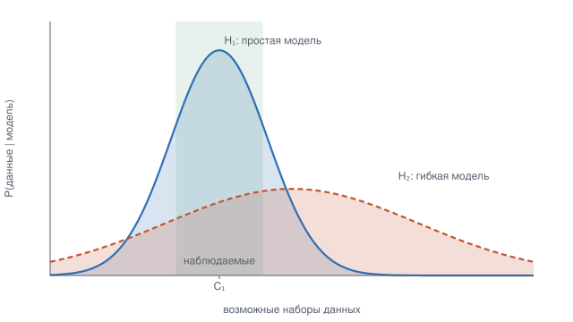

<!-- Generated by build.py from chapters/ru; edit the chapters. -->
# Библия Okkama

## Содержание

- [Часть I. Бритва](#часть-i-бритва)
- [Глава 1. Не умножай сущностей](#глава-1-не-умножай-сущностей)
  - [1.1 Францисканец из Суррея](#11-францисканец-из-суррея)
  - [1.2 Что утверждает бритва, а что — нет](#12-что-утверждает-бритва-а-что--нет)
  - [1.3 Почему простые объяснения предсказывают лучше](#13-почему-простые-объяснения-предсказывают-лучше)
  - [1.4 То же правило, открытое заново для программ](#14-то-же-правило-открытое-заново-для-программ)
  - [1.5 Другая сторона: «хуже — значит лучше»](#15-другая-сторона-хуже--значит-лучше)
  - [1.6 Бритва Okkama, сущность за сущностью](#16-бритва-okkama-сущность-за-сущностью)
  - [1.7 Первая проба](#17-первая-проба)
  - [1.8 Чего стоит бритва](#18-чего-стоит-бритва)
  - [1.9 Как читать эту книгу](#19-как-читать-эту-книгу)
- [Глава 2. Краткая история объектов](#глава-2-краткая-история-объектов)
  - [2.1 Simula: объекты для моделирования](#21-simula-объекты-для-моделирования)
  - [2.2 Smalltalk: всё — сообщение](#22-smalltalk-всё--сообщение)
  - [2.3 C++ и Java: объекты для индустрии](#23-c-и-java-объекты-для-индустрии)
  - [2.4 Беда с наследованием](#24-беда-с-наследованием)
  - [2.5 Беда с состоянием](#25-беда-с-состоянием)
  - [2.6 Объекты как поведение](#26-объекты-как-поведение)
  - [2.7 Elegant Objects: дисциплина](#27-elegant-objects-дисциплина)
  - [2.8 Композиция на практике](#28-композиция-на-практике)
  - [2.9 Что потеряно](#29-что-потеряно)
- [Глава 3. Манифест, правило за правилом](#глава-3-манифест-правило-за-правилом)
  - [3.1 Правило первое: объекты дают поведение, а не состояние](#31-правило-первое-объекты-дают-поведение-а-не-состояние)
  - [3.2 Правило второе: состояние связывается при создании, конструкторы его охраняют](#32-правило-второе-состояние-связывается-при-создании-конструкторы-его-охраняют)
  - [3.3 Правило третье: изменение — это новый объект](#33-правило-третье-изменение--это-новый-объект)
  - [3.4 Правило четвёртое: null нет](#34-правило-четвёртое-null-нет)
  - [3.5 Правило пятое: условия — это булевы значения](#35-правило-пятое-условия--это-булевы-значения)
  - [3.6 Правило шестое: числа точны, а категории не смешиваются молча](#36-правило-шестое-числа-точны-а-категории-не-смешиваются-молча)
  - [3.7 Правило седьмое: роли вместо наследования](#37-правило-седьмое-роли-вместо-наследования)
  - [3.8 Правило восьмое: отказы типизированы, а ошибки программы — не исключения](#38-правило-восьмое-отказы-типизированы-а-ошибки-программы--не-исключения)
  - [3.9 Правило девятое: ресурсы освобождаются детерминированно](#39-правило-девятое-ресурсы-освобождаются-детерминированно)
  - [3.10 Правило десятое: полномочия явны](#310-правило-десятое-полномочия-явны)
  - [3.11 Правило одиннадцатое: конкурентность структурна](#311-правило-одиннадцатое-конкурентность-структурна)
  - [3.12 Один дизайн, а не одиннадцать](#312-один-дизайн-а-не-одиннадцать)
- [Часть II. Значения](#часть-ii-значения)
- [Глава 4. Типы с высоты птичьего полёта](#глава-4-типы-с-высоты-птичьего-полёта)
  - [4.1 Зачем нужен тип](#41-зачем-нужен-тип)
  - [4.2 Перечень](#42-перечень)
  - [4.3 Где пишутся типы](#43-где-пишутся-типы)
  - [4.4 Номинальная, а не структурная](#44-номинальная-а-не-структурная)
  - [4.5 Вывод типов: локальный и точный](#45-вывод-типов-локальный-и-точный)
  - [4.6 Верхний тип `any`](#46-верхний-тип-any)
  - [4.7 Что проверяет компилятор, а что остаётся на время выполнения](#47-что-проверяет-компилятор-а-что-остаётся-на-время-выполнения)
  - [4.8 Ограничения](#48-ограничения)
- [Глава 5. Числа](#глава-5-числа)
  - [5.1 Четыре категории](#51-четыре-категории)
  - [5.2 Точные целые](#52-точные-целые)
  - [5.3 Точные рациональные](#53-точные-рациональные)
  - [5.4 Плавающая точка, всегда конечная](#54-плавающая-точка-всегда-конечная)
  - [5.5 Байты](#55-байты)
  - [5.6 Преобразования](#56-преобразования)
  - [5.7 Чего стоит точность](#57-чего-стоит-точность)
  - [5.8 Ограничения](#58-ограничения)
- [Глава 6. Текст](#глава-6-текст)
  - [6.1 Три слоя текста](#61-три-слоя-текста)
  - [6.2 Выбор Okkama: неизменяемые кодовые точки](#62-выбор-okkama-неизменяемые-кодовые-точки)
  - [6.3 Запись строк](#63-запись-строк)
  - [6.4 Что умеет строка](#64-что-умеет-строка)
  - [6.5 Равенство и нормализация](#65-равенство-и-нормализация)
  - [6.6 Текст и байты](#66-текст-и-байты)
  - [6.7 Символы](#67-символы)
  - [6.8 Чего стоит текст](#68-чего-стоит-текст)
  - [6.9 Ограничения](#69-ограничения)
- [Глава 7. Отсутствие без null](#глава-7-отсутствие-без-null)
  - [7.1 Что означает null — слишком многое](#71-что-означает-null--слишком-многое)
  - [7.2 Ответ Okkama: одна конструкция на один смысл](#72-ответ-okkama-одна-конструкция-на-один-смысл)
  - [7.3 `Maybe<T>`](#73-maybet)
  - [7.4 `Presence<T>`: три состояния для обновлений](#74-presencet-три-состояния-для-обновлений)
  - [7.5 Как отсутствие устроено в других языках](#75-как-отсутствие-устроено-в-других-языках)
  - [7.6 Чего это стоит](#76-чего-это-стоит)
  - [7.7 Ограничения](#77-ограничения)
- [Глава 8. Коллекции](#глава-8-коллекции)
  - [8.1 Массивы](#81-массивы)
  - [8.2 Функциональные операции](#82-функциональные-операции)
  - [8.3 Словари](#83-словари)
  - [8.4 Диапазоны](#84-диапазоны)
  - [8.5 Построение и изменение коллекций](#85-построение-и-изменение-коллекций)
  - [8.6 Обход пользовательских коллекций](#86-обход-пользовательских-коллекций)
  - [8.7 Ограничения](#87-ограничения)
- [Глава 9. Выражения и управление потоком](#глава-9-выражения-и-управление-потоком)
  - [9.1 У блоков есть значения](#91-у-блоков-есть-значения)
  - [9.2 Имя связывается один раз](#92-имя-связывается-один-раз)
  - [9.3 Операторы](#93-операторы)
  - [9.4 Выбор](#94-выбор)
  - [9.5 Циклы](#95-циклы)
  - [9.6 `return`](#96-return)
  - [9.7 Порядок вычисления](#97-порядок-вычисления)
  - [9.8 Чего нет](#98-чего-нет)
  - [9.9 Ограничения](#99-ограничения)
- [Глава 10. Отказ: throw, panic, try/catch, причины, confirm](#глава-10-отказ-throw-panic-trycatch-причины-confirm)
  - [10.1 Кому нужно узнать об отказе](#101-кому-нужно-узнать-об-отказе)
  - [10.2 Краткая история: коды, исключения, значения](#102-краткая-история-коды-исключения-значения)
  - [10.3 Возобновление: непройденная дорога](#103-возобновление-непройденная-дорога)
  - [10.4 Ошибки программы — не значения: panic и ошибки исполнения](#104-ошибки-программы--не-значения-panic-и-ошибки-исполнения)
  - [10.5 Перечисления ошибок](#105-перечисления-ошибок)
  - [10.6 throw](#106-throw)
  - [10.7 try и catch](#107-try-и-catch)
  - [10.8 Причины](#108-причины)
  - [10.9 confirm: контракт внутри кода](#109-confirm-контракт-внутри-кода)
  - [10.10 try? и try!](#1010-try-и-try)
  - [10.11 Отказы хоста](#1011-отказы-хоста)
  - [10.12 Граница на практике](#1012-граница-на-практике)
  - [10.13 Бюджеты — не отказы](#1013-бюджеты--не-отказы)
  - [10.14 Отказы через задачи](#1014-отказы-через-задачи)
  - [10.15 Что доходит до верха](#1015-что-доходит-до-верха)
  - [10.16 Как движки несут отказ](#1016-как-движки-несут-отказ)
  - [10.17 Как проектировать словарь ошибок](#1017-как-проектировать-словарь-ошибок)
  - [10.18 Тестирование отказов](#1018-тестирование-отказов)
  - [10.19 Okkama среди других языков](#1019-okkama-среди-других-языков)
  - [10.20 Чего стоит такой замысел](#1020-чего-стоит-такой-замысел)
- [Глава 11. defer, destroy, регионы: детерминированные ресурсы](#глава-11-defer-destroy-регионы-детерминированные-ресурсы)
  - [11.1 Память и ресурсы — разные задачи](#111-память-и-ресурсы--разные-задачи)
  - [11.2 Родословная](#112-родословная)
  - [11.3 defer](#113-defer)
  - [11.4 destroy](#114-destroy)
  - [11.5 Кто чем владеет](#115-кто-чем-владеет)
  - [11.6 Ресурсы в коллекциях и замыканиях](#116-ресурсы-в-коллекциях-и-замыканиях)
  - [11.7 Уборка на пути отказа](#117-уборка-на-пути-отказа)
  - [11.8 async destroy](#118-async-destroy)
  - [11.9 Ресурсы и задачи](#119-ресурсы-и-задачи)
  - [11.10 Закройте раньше, destroy подстрахует](#1110-закройте-раньше-destroy-подстрахует)
  - [11.11 Регионы: как работает владение](#1111-регионы-как-работает-владение)
  - [11.12 Цена обхода](#1112-цена-обхода)
  - [11.13 Чего не обещают](#1113-чего-не-обещают)
  - [11.14 Чего стоит такой замысел](#1114-чего-стоит-такой-замысел)
- [Глава 12. Объекты, поля и конструкторы](#глава-12-объекты-поля-и-конструкторы)
  - [12.1 Объявление объекта](#121-объявление-объекта)
  - [12.2 Поля частные и постоянные](#122-поля-частные-и-постоянные)
  - [12.3 Конструкторы явные](#123-конструкторы-явные)
  - [12.4 Сокращённые конструкторы](#124-сокращённые-конструкторы)
  - [12.5 Несколько конструкторов](#125-несколько-конструкторов)
  - [12.6 Проверке место в конструкторе](#126-проверке-место-в-конструкторе)
  - [12.7 Действия и частные действия](#127-действия-и-частные-действия)
  - [12.8 cap: вид объекта только для чтения](#128-cap-вид-объекта-только-для-чтения)
  - [12.9 Объекты — значения](#129-объекты--значения)
  - [12.10 Во что компилируется конструктор](#1210-во-что-компилируется-конструктор)
  - [12.11 Отдать `self` из конструктора](#1211-отдать-self-из-конструктора)
  - [12.12 Как движки хранят объект](#1212-как-движки-хранят-объект)
  - [12.13 Объекты в других языках](#1213-объекты-в-других-языках)
  - [12.14 Чего стоит такой замысел](#1214-чего-стоит-такой-замысел)
- [Глава 13. Действия, преемники и неизменяемость](#глава-13-действия-преемники-и-неизменяемость)
  - [13.1 Действие — типизированный запрос](#131-действие--типизированный-запрос)
  - [13.2 Параметры и вызовы](#132-параметры-и-вызовы)
  - [13.3 Перегрузки](#133-перегрузки)
  - [13.4 Вариадические действия](#134-вариадические-действия)
  - [13.5 Преемники](#135-преемники)
  - [13.6 Результат нужно использовать](#136-результат-нужно-использовать)
  - [13.7 Перепривязка имени](#137-перепривязка-имени)
  - [13.8 Преемники и провал](#138-преемники-и-провал)
  - [13.9 Как назвать переход](#139-как-назвать-переход)
  - [13.10 Композиция](#1310-композиция)
  - [13.11 Когда значение должно меняться: `Cell`](#1311-когда-значение-должно-меняться-cell)
  - [13.12 Чего стоит преемник](#1312-чего-стоит-преемник)
  - [13.13 Неизменяемость в других языках](#1313-неизменяемость-в-других-языках)
  - [13.14 Чего стоит такой замысел](#1314-чего-стоит-такой-замысел)
- [Глава 14. Роли: номинальные контракты и композиция](#глава-14-роли-номинальные-контракты-и-композиция)
  - [14.1 Объявление роли](#141-объявление-роли)
  - [14.2 Номинальность, а не структура](#142-номинальность-а-не-структура)
  - [14.3 Ссылка через роль ограничивает держателя](#143-ссылка-через-роль-ограничивает-держателя)
  - [14.4 Переход между ролями](#144-переход-между-ролями)
  - [14.5 Преемники через роль](#145-преемники-через-роль)
  - [14.6 Композиция вместо наследования](#146-композиция-вместо-наследования)
  - [14.7 Как выполняется вызов через роль](#147-как-выполняется-вызов-через-роль)
  - [14.8 Операторы — это роли](#148-операторы--это-роли)
  - [14.9 Роли в других языках](#149-роли-в-других-языках)
  - [14.10 Чего стоит такой замысел](#1410-чего-стоит-такой-замысел)
- [Глава 15. Фейки, тесты и свойства](#глава-15-фейки-тесты-и-свойства)
  - [15.1 Тесты живут рядом с кодом](#151-тесты-живут-рядом-с-кодом)
  - [15.2 Привязка `test`](#152-привязка-test)
  - [15.3 Почему фейк, а не мок](#153-почему-фейк-а-не-мок)
  - [15.4 Как написать фейк](#154-как-написать-фейк)
  - [15.5 Состояние в фейке](#155-состояние-в-фейке)
  - [15.6 Свойства](#156-свойства)
  - [15.7 Остальной инструментарий](#157-остальной-инструментарий)
  - [15.8 Что пока не работает](#158-что-пока-не-работает)
  - [15.9 Чего стоит такой замысел](#159-чего-стоит-такой-замысел)
- [Глава 16. Перечисления и сопоставление с образцом](#глава-16-перечисления-и-сопоставление-с-образцом)
  - [16.1 Закрытый набор имён](#161-закрытый-набор-имён)
  - [16.2 Варианты с данными](#162-варианты-с-данными)
  - [16.3 `match`](#163-match)
  - [16.4 Компактный выбор](#164-компактный-выбор)
  - [16.5 Закрытое или открытое: перечисления и роли](#165-закрытое-или-открытое-перечисления-и-роли)
  - [16.6 Как исполняются перечисления](#166-как-исполняются-перечисления)
  - [16.7 Перечисления в других языках](#167-перечисления-в-других-языках)
  - [16.8 Ограничения](#168-ограничения)
  - [16.9 Чего стоит такой замысел](#169-чего-стоит-такой-замысел)
- [Глава 17. Обобщённые типы](#глава-17-обобщённые-типы)
  - [17.1 Параметры у объектов, ролей и перечислений](#171-параметры-у-объектов-ролей-и-перечислений)
  - [17.2 Один `T` — один тип](#172-один-t--один-тип)
  - [17.3 Вывод при конструировании](#173-вывод-при-конструировании)
  - [17.4 Ограничения](#174-ограничения)
  - [17.5 Параметры-ключи словарей](#175-параметры-ключи-словарей)
  - [17.6 Специализация — это тип](#176-специализация--это-тип)
  - [17.7 Как исполняются обобщённые типы: копия на специализацию](#177-как-исполняются-обобщённые-типы-копия-на-специализацию)
  - [17.8 Параметр или роль?](#178-параметр-или-роль)
  - [17.9 Разобранный пример: лучшие N](#179-разобранный-пример-лучшие-n)
  - [17.10 Обобщённые типы в стандартной библиотеке](#1710-обобщённые-типы-в-стандартной-библиотеке)
  - [17.11 Okkama среди других языков](#1711-okkama-среди-других-языков)
  - [17.12 Ограничения](#1712-ограничения)
  - [17.13 Чего стоит такой дизайн](#1713-чего-стоит-такой-дизайн)
- [Глава 18. Анонимные действия и замыкания](#глава-18-анонимные-действия-и-замыкания)
  - [18.1 Как пишется анонимное действие](#181-как-пишется-анонимное-действие)
  - [18.2 Что помнит замыкание](#182-что-помнит-замыкание)
  - [18.3 Типы точны](#183-типы-точны)
  - [18.4 Значения-действия как данные](#184-значения-действия-как-данные)
  - [18.5 Замыкания или объекты](#185-замыкания-или-объекты)
  - [18.6 Как исполняются замыкания](#186-как-исполняются-замыкания)
  - [18.7 Откуда пришли замыкания](#187-откуда-пришли-замыкания)
  - [18.8 Okkama среди других языков](#188-okkama-среди-других-языков)
  - [18.9 Ограничения](#189-ограничения)
  - [18.10 Чего стоит такой дизайн](#1810-чего-стоит-такой-дизайн)
- [Глава 19. Модули, импорты, пакеты и blade](#глава-19-модули-импорты-пакеты-и-blade)
  - [19.1 Модуль — это файл](#191-модуль--это-файл)
  - [19.2 Три формы импорта](#192-три-формы-импорта)
  - [19.3 Где ищется импорт](#193-где-ищется-импорт)
  - [19.4 Что пересекает границу](#194-что-пересекает-границу)
  - [19.5 Скрытые объявления](#195-скрытые-объявления)
  - [19.6 Константы модуля](#196-константы-модуля)
  - [19.7 Пакеты и blade](#197-пакеты-и-blade)
  - [19.8 Как модули становятся одной программой](#198-как-модули-становятся-одной-программой)
  - [19.9 Откуда взялись модули](#199-откуда-взялись-модули)
  - [19.10 Okkama среди других языков](#1910-okkama-среди-других-языков)
  - [19.11 Ограничения](#1911-ограничения)
  - [19.12 Чего стоит такой дизайн](#1912-чего-стоит-такой-дизайн)
- [Глава 20. Async, Future и структурная конкурентность](#глава-20-async-future-и-структурная-конкурентность)
  - [20.1 Future — значение, которое ещё не вычислено](#201-future--значение-которое-ещё-не-вычислено)
  - [20.2 Откуда взялись Future](#202-откуда-взялись-future)
  - [20.3 Один планировщик, одна задача за раз](#203-один-планировщик-одна-задача-за-раз)
  - [20.4 `spawn`: работа рядом с тем, кто её начал](#204-spawn-работа-рядом-с-тем-кто-её-начал)
  - [20.5 Структурный await и отмена](#205-структурный-await-и-отмена)
  - [20.6 Каналы и владелец состояния](#206-каналы-и-владелец-состояния)
  - [20.7 Fan-out, гонки и дедлайны](#207-fan-out-гонки-и-дедлайны)
  - [20.8 Ожидание друг друга: события, блокировки, семафоры, барьеры](#208-ожидание-друг-друга-события-блокировки-семафоры-барьеры)
  - [20.9 Ресурсы через приостановку](#209-ресурсы-через-приостановку)
  - [20.10 Потоки значений: `for await`](#2010-потоки-значений-for-await)
  - [20.11 Разобранный пример: пул соединений](#2011-разобранный-пример-пул-соединений)
  - [20.12 Отказы между задачами](#2012-отказы-между-задачами)
  - [20.13 Как движки исполняют задачи](#2013-как-движки-исполняют-задачи)
  - [20.14 Сколько стоит async, измеренно](#2014-сколько-стоит-async-измеренно)
  - [20.15 Okkama среди других языков](#2015-okkama-среди-других-языков)
  - [20.16 Ограничения](#2016-ограничения)
  - [20.17 Чего стоит такой замысел](#2017-чего-стоит-такой-замысел)

# Часть I. Бритва

# Глава 1. Не умножай сущностей

Язык программирования — это теория программ. Он говорит, какие вещи
существуют — значения, объекты, функции, ошибки, потоки — и какие отношения
между ними допустимы. Как любая теория, он может объяснять многое
немногими сущностями, а может то же самое — многими. Okkama назван в честь
средневекового философа, сформулировавшего самое известное правило выбора
между такими теориями, и само имя — обещание: там, где два решения делают
одну и ту же работу, язык оставляет то, в котором меньше вещей.

Эта глава — об этом обещании. Откуда правило взялось, что оно утверждает и
чего не утверждает, почему у него есть серьёзные математические основания,
как к нему же пришли, независимо от Оккама, основатели программной
инженерии, и что оно значит конкретно для Okkama — включая цену. Всё
остальное в книге вытекает отсюда.

## 1.1 Францисканец из Суррея

Уильям Оккам родился около 1287 года в деревне Окем (Ockham) в графстве
Суррей, изучал и преподавал теологию в Оксфорде, а вторую половину жизни
провёл в изгнании после спора с папой Иоанном XXII о бедности
францисканского ордена; умер он в Мюнхене около 1347 года [[Spade 2019](#ref-spade-sep)]. Он
был логиком и номиналистом: считал, что существуют только единичные вещи, а
общие термины вроде «человечества» или «белизны» — это знаки, которыми мы
обозначаем многие единичные вещи, а не дополнительные сущности, стоящие за
ними.

Номинализм Оккама — это бритва в действии. Там, где предшественники
объясняли, почему две белые вещи обе белые, допуская третью вещь — реальную
универсалию, «белизну», — Оккам спрашивал, нужна ли она объяснению. Если две
белые вещи, наше понятие и слово «белый» уже объясняют всё наблюдаемое,
универсалия не добавляет ничего, кроме самой себя. Он формулировал принцип
по-разному; одна из повторяющихся в его трудах формулировок — *numquam
ponenda est pluralitas sine necessitate*, «множественность никогда не
следует допускать без необходимости» [[Spade 2019](#ref-spade-sep)].

Слов, которые обычно цитируют, — *entia non sunt multiplicanda praeter
necessitatem*, «не следует умножать сущности сверх необходимости» — в трудах
Оккама нет вовсе. Это позднейшая формулировка, и само приписывание «бритвы»
Оккаму по имени — тоже продукт последующих веков [[Thorburn 1918](#ref-thorburn1918)]. Да и
принцип старше Оккама: версиями его пользовались Аристотель и многие
схоласты. Имя Оккама прилипло, потому что он пользовался принципом так
неумолимо, что тот стал его фирменным инструментом.

Для наших целей история учит двум вещам. Во-первых, бритва — правило об
*объяснениях*, а не о мире: она не утверждает, что мир прост, только что не
следует усложнять наше описание мира без причины. Во-вторых, она режет
только в одну сторону. Она удаляет сущности, которые не делают работы, и
ничего не говорит против сущностей, которые её делают.

## 1.2 Что утверждает бритва, а что — нет

Философы различают два вида простоты, которые может означать бритва
[[Baker 2022](#ref-baker-sep)]. **Изящество** (синтаксическая простота) — это число и
сложность принципов теории: меньше аксиом, короче законы. **Экономность**
(онтологическая простота) — это число и виды вещей, существование которых
теория утверждает. Теория может быть изящной и расточительной сразу — один
короткий закон, требующий нового вида частиц, — или экономной и
неуклюжей.

Для языка важны оба прочтения. Изящество — это размер определения языка:
сколько правил программисту нужно держать в голове. Экономность — это
множество вещей, которые могут существовать во время выполнения: есть ли
null, изменяемая ячейка, иерархия классов, глобальная переменная, поток.
Okkama заботится об обоих, но прежде всего это *экономный* язык. Его
спецификация не коротка — Okkama аккуратен и явен, а аккуратные правила
требуют слов, — но перечень того, что может содержать программа, нарочно
мал.

Кроме того, бритва — **эвристика, а не доказательство**. Тщательное
исследование Эллиота Собера показывает, что «бритвой Оккама» называют
несколько разных принципов, каждый из которых обоснован — когда обоснован —
своим аргументом, и ни один не утверждает, что «более простая теория
истинна» [[Sober 2015](#ref-sober2015)]. На практике бритва — правило *выбора*, когда
данные не решают дела, и правило *бремени доказательства*: кто хочет
добавить сущность, должен показать, какую работу она делает.

Именно так ею и пользуется Okkama. Каждая конструкция, которая есть в других
языках и которой нет в Okkama, — null, наследование, сеттеры, истинность
не-булевых значений, неявные преобразования, перехват всех ошибок подряд —
должна была ответить на вопрос: «какую работу ты делаешь, которую не могут
сделать оставшиеся конструкции?» Где ответом было «экономит немного набора
текста», конструкцию убирали. Где ответом было «больше ничто этого не
выразит», конструкция оставалась или её заменяла меньшая.

## 1.3 Почему простые объяснения предсказывают лучше

Соблазнительно считать бритву эстетическим предпочтением: проще — значит
красивее. Однако есть по меньшей мере три независимых математических довода
в пользу более простой из двух теорий, одинаково хорошо согласующихся с
фактами, и все три переносятся на программы.

### Байесовский множитель Оккама

Пусть наблюдения могли породить две модели: простая H₁, способная дать
лишь узкий диапазон исходов, и гибкая H₂, способная дать почти что угодно.
Каждая модель распределяет единицу вероятности по исходам, которые может
дать. Простая модель свою единицу концентрирует, гибкая — размазывает. Если
наблюдаемые данные попали в узкий диапазон, объяснимый обеими, простая
модель приписала им бо́льшую вероятность, и правило Байеса вознаграждает её
бо́льшей апостериорной вероятностью — *без всякого априорного
предпочтения простоты* [[MacKay 2003](#ref-mackay2003)]. Маккей называет отношение, с которым
штрафуется гибкая модель, *множителем Оккама*.



*Рисунок 1.1. Байесовский множитель Оккама. Обе модели в сумме дают вероятность 1; простая концентрирует её, поэтому на данных из C₁ она выигрывает (по Маккею, 2003, гл. 28).*

Программный аналог — тип. Функция с типом `(int) is int` «предсказывает»
узкое множество поведений; функция типа `(any) is any` — почти любое. Когда
верна узкая, её тип сообщает читателю — и компилятору — гораздо больше.
Уодлер придал этому точный смысл для параметрического полиморфизма: чем
общее тип, тем меньше функций может его иметь и тем больше читатель выводит
из одного лишь типа [[Wadler 1989](#ref-wadler1989)].

### Минимальная длина описания

Риссанен предложил выбирать модель, дающую самое короткое суммарное
описание данных: длина модели плюс длина данных, закодированных с её
помощью [[Rissanen 1978](#ref-rissanen1978)]. Слишком простая модель оставляет много для
кодирования; слишком сложная стоит дороже в изложении, чем экономит. Лучшая
модель сжимает сильнее всех.

Программа — именно такое описание. Каждое понятие, которое язык заставляет
вас выписать, — проверка на null, адаптер между двумя соглашениями об
ошибках, защитная копия изменяемого объекта — это длина, добавленная к
каждой программе, длина, которая ничего не кодирует о задаче.

### Колмогоровская сложность

Предел этой идеи — длина самой короткой программы, порождающей данный
объект, его колмогоровская сложность [[Li 2019](#ref-li2019)]. Она невычислима, но даёт
интуиции твёрдую опору: объект прост, если у него есть короткое описание, а
закономерность *и есть* сжимаемость. Языки различаются тем, какие
закономерности делают короткими. Язык с неизменяемостью по умолчанию делает
«это не меняется» бесплатным, а «это меняется» — явным; язык с
изменяемостью по умолчанию делает наоборот. Okkama выбирает, какие факты
дёшево высказать, так, чтобы короткой записью оказывался частый и
безопасный случай.

## 1.4 То же правило, открытое заново для программ

Никто из основателей программной инженерии не ссылался на Оккама, но многие
пришли к его правилу с противоположной стороны — от боли сопровождения
сложных программ.

**Хоар** завершил свою тьюринговскую лекцию фразой, которая сегодня
практически стала бритвой программирования: «Есть два способа построить
программную конструкцию: один — сделать её настолько простой, чтобы в ней
очевидно не было недостатков, другой — сделать её настолько сложной, чтобы в
ней не было очевидных недостатков. Первый способ гораздо труднее»
[[Hoare 1981](#ref-hoare1981)]. В той же лекции он рассказал, как язык со слишком большим
числом возможностей (PL/I, а позже Ada) становится невозможно надёжно
реализовать и целиком выучить.

**Дейкстра** утверждал, что главное ограничение программиста — размер
собственной головы: «Компетентный программист полностью сознаёт строго
ограниченный объём своего черепа; поэтому он подходит к задаче со всем
смирением и, среди прочего, избегает хитроумных трюков как чумы»
[[Dijkstra 1972](#ref-dijkstra1972)]. За четыре года до этого он убрал из программирования одну
сущность — безусловный переход — на том основании, что тот делает
динамическое поведение программы не связанным с её текстом [[Dijkstra 1968](#ref-dijkstra1968)].

**Брукс** отделил *существенную* сложность, принадлежащую задаче, от
*случайной*, которую мы добавляем своими инструментами, и показал, что ни
один инструмент не устранит существенную часть [[Brooks 1987](#ref-brooks1987)]. Язык не
сделает налоговый кодекс проще. Но он может перестать к нему добавлять.

**Мозли и Маркс** пошли дальше и назвали главный источник случайной
сложности: *состояние*, особенно изменяемое состояние, разделяемое частями
программы, а за ним — поток управления и объём кода [[Moseley 2006](#ref-moseley2006)]. Их
статья — самый прямой аргумент в пользу объектной модели Okkama: состояние
существует, но фиксируется при создании, а каждое «изменение» — это новое
значение, существование которого текст программы обязан признать.

**Хики** провёл различие, которое спасает бритву от распространённого
недоразумения [[Hickey 2011](#ref-hickey2011)]. *Простое* (simple) — «в одну складку»: не
переплетённое с другими заботами, объективное свойство. *Лёгкое* (easy) —
«под рукой»: привычное, быстро набираемое, свойство читателя. Null — лёгок:
его знает любой программист мейнстрима, — но не прост, потому что
переплетает «значение» с «может, значения нет» в каждой ссылке программы.
Okkama выбирает простое вместо лёгкого везде, где они расходятся, и книга
каждый раз будет отмечать, когда этот выбор стоит лёгкости.

**Парнас** показал, что критерий разбиения системы на модули — сокрытие
проектных решений, которые, вероятно, изменятся [[Parnas 1972](#ref-parnas1972)], а
**Остераут** превратил это в меру: хороший модуль *глубок*, он даёт простой
интерфейс над большой реализацией, а сложность — это то, что нужно знать,
чтобы безопасно изменить систему [[Ousterhout 2018](#ref-ousterhout2018)]. Приватные поля и
номинальные роли Okkama — это сокрытие информации, сделанное обязательным.

**Вирт**, создававший Pascal, Modula-2 и Oberon путём удаления
возможностей, предупреждал, что программы растут быстрее, чем улучшается
железо, потому что никто не платит за удаление [[Wirth 1995](#ref-wirth1995)]. Каждый его
следующий язык был меньше предыдущего.

## 1.5 Другая сторона: «хуже — значит лучше»

Честный рассказ должен дать противоположному доводу всю его силу. В 1991
году Ричард Гэбриел заметил, что распространяются зачастую не самые чистые
системы [[Gabriel 1991](#ref-gabriel1991)]. Unix и C победили Lisp-машины и более принципиальные
решения, потому что их было *просто реализовать*, даже если из-за этого ими
было менее просто, менее последовательно или менее корректно пользоваться.
Он назвал это «хуже — значит лучше»: сначала простота реализации, потом
простота интерфейса, а корректность и полнота — предмет торга.

Эссе Гэбриела — не отказ от бритвы, а спор о том, *чья* простота важнее.
«Хуже — значит лучше» бреет реализацию и оставляет сложность пользователю;
«правильный подход» бреет модель в голове пользователя и оставляет
сложность реализации. Okkama твёрдо стоит на второй стороне: компилятор,
верификатор и рантайм делают огромную работу — точные числа, переходящие в
большие целые, точная сборка мусора с детерминированным разрушением,
верификатор байткода, — чтобы текст программы оставался небольшим, а
множество вещей, которые должен учитывать читатель, — маленьким.

Цена реальна. Язык, отказывающийся от удобств, труднее внедрить.
Программисты приходят с привычками языков, где есть null, изменяемые поля и
наследование, и Okkama просит их разучиться. Предупреждение Гэбриела в силе:
корректность не гарантирует популярности. Эта книга пытается ответить на
него единственным честным способом — показывая, глава за главой, что
покупает каждый отказ, и прямо говоря, где он обходится слишком дорого.

## 1.6 Бритва Okkama, сущность за сущностью

Таблица ниже — самое короткое изложение языка. Каждая строка называет
сущность, которая есть в большинстве популярных языков, то, что вместо неё
есть в Okkama, и главу, где это обосновано.

| Убранная сущность | Что делает работу вместо неё | Глава |
|---|---|---|
| `null`, `nil`, неявные optional, `?.` | `Maybe<T>` и `Presence<T>`, раскрываемые через `else`, `??`, `match` | 7 |
| Истинность не-булевых значений (`if 1`, `if ""`) | условия — ровно `bool` | 9 |
| Неявные числовые преобразования (`1 == 1.0`) | точные категории `int`, `byte`, `rat`, `float`; явные приведения | 5 |
| Переполнение целых | арифметика `int` точна и переходит в большие целые | 5 |
| Публичные поля, геттеры и сеттеры | приватные поля `has`; объекты дают поведение | 12 |
| Изменение после создания | successor-действия `is ^T` возвращают новый объект | 13 |
| Наследование, `super`, `abstract`, `protected` | роли (номинальные контракты) и композиция | 14 |
| Фреймворки моков | блоки `fake`, поставляемые с каждой ролью | 15 |
| Перехват всего подряд и `finally` | типизированный `catch`, `defer`, причины отказов | 10 |
| Финализаторы и «закрыть в finally» | блоки `destroy`, выполняемые при выходе владельца из области | 11 |
| Глобальные функции и статическое состояние | поведение живёт в объектах; модули экспортируют объявления | 12, 19 |
| Неструктурированные потоки | `async`/`await` со структурной отменой; изолированный в процессе `spawn` | 20 |
| Неявные полномочия нативного кода | natives за объявленными группами и бюджетами | 21 |

Некоторые из этих слов не просто отсутствуют, а *удалены*: `null`, `nil`,
`isa`, `super`, `abstract`, `protected`, `var` и ещё несколько
зарезервированы, чтобы программа, их использующая, не разбиралась с
понятным сообщением, а не означала что-то иное. Язык не просто оставляет
дверь открытой, за которой пусто, — он закладывает её кирпичом и вешает
табличку.

Обратите внимание, чего в таблице *нет*. Okkama — не минимальный язык в
смысле Scheme или Forth. В нём есть точные рациональные числа и большие
целые, стандартная библиотека, говорящая на HTTP/2 и PostgreSQL, структурная
конкурентность, точная сборка мусора и JIT-компилятор. Бритва применяется к
*видам сущностей в программе*, а не к размеру ящика с инструментами. У языка
может быть много инструментов и мало видов вещей; Okkama стремится быть
именно таким.

## 1.7 Первая проба

Вот полная программа. Она объявляет объект с одним приватным полем, одним
конструктором и двумя действиями и один раз его использует.

```okkama
module bible/bottle v1.0.0;

import "io/stdout" take Stdout;

// A bottle never changes: opening one gives a new, opened bottle.
object Bottle {
    has opened is bool = false;

    Bottle() {}

    open() is ^Bottle {
        confirm !opened;
        ^opened = true;
    }

    state() is string {
        if opened { "open"; } else { "closed"; }
    }
}

main() is int {
    let out = Stdout();
    let bottle = Bottle();
    let poured = bottle.open();
    out.writeln("the first bottle is " + bottle.state());
    out.writeln("its successor is " + poured.state());
    0;
}
```

Вывод:

```text
the first bottle is closed
its successor is open
```

Даже эта игрушка показывает четыре правила из таблицы. Поле `opened`
приватно: ничто вне `Bottle` не может его ни прочитать, ни записать. Объект
предоставляет поведение (`open`, `state`), а не данные. `open()` не меняет
бутылку — сигнатура `is ^Bottle` говорит, что действие возвращает
*преемника* (successor), новую бутылку, в которой `opened` равно `true`, и
вызывающий обязан взять результат (выбросить преемника — ошибка). А
`confirm !opened` утверждает инвариант: открыть открытую бутылку — отказ, а
не тихое ничего-не-делание. После `open()` существуют обе бутылки, и
программа может сказать, какую из них имеет в виду.

Программист на Java написал бы это с изменяемым полем и сеттером короче на
несколько символов. Версия на Okkama длиннее на слово-другое и снимает
целую категорию вопросов: «кто ещё держит ссылку на эту бутылку и ожидал ли
он, что она останется закрытой?»

## 1.8 Чего стоит бритва

Книга, которая только хвалит свой предмет, не стоила бы чтения, а сама
бритва требует считать издержки так же тщательно, как выгоды. Вот главные;
к каждой мы вернёмся в последующих главах.

- **Больше объектов, больше слов.** Без сеттеров и с преемниками программы
  называют больше вещей: новый объект на каждое состояние, роль на каждую
  возможность. Стандартная библиотека Okkama показывает обе стороны — ясные
  контракты и иногда конструкции вроде `BigQuotient(left: a, right:
  b).value()`, где метод читался бы лучше (тикет #190 предлагает именно это).
- **Скорость неизменяемых обновлений.** Новый объект на каждое изменение
  стоит выделений памяти; обновления коллекций без изменения на месте
  стоят копирований. Sparrow делает выделение дешёвым, а
  компилятор убирает многие выделения, но некоторые идиомы сегодня
  квадратичны: у массивов нет добавления, поэтому сборка массива по элементу
  копирует его каждый раз (тикет #145). Бритва убрала изменяемость — она не должна
  убирать эффективность, и лечение — добавить правильную *операцию*, а не
  изменяемую сущность.
- **Переучивание.** Большинство программистов думают в терминах null,
  наследования и изменяемого состояния. Okkama просит другой привычки
  мышления — той, за которую в Java ратовали *Elegant Objects*
  [[Bugayenko 2016](#ref-bugayenko2016)], — и принуждает к ней.
- **То, чего действительно не хватает.** Некоторые удаления были сделаны
  раньше, чем стали полными их замены. Аудит стандартной библиотеки в
  ноябре 2026 года завёл больше сотни тикетов там, где языку или библиотеке
  не хватает операции, которой требует меньший дизайн, — поиска в строках,
  хэширования для объектных ключей, параметров по умолчанию (тикеты
  #145–#155, #210–#216). Бритва не оправдывает этих пробелов; глава 32
  перечисляет их открыто.

## 1.9 Как читать эту книгу

В книге семь частей. Часть I, которую вы читаете, излагает философию и
историю, сформировавшие Okkama. Части II–V учат языку от значений до целых
программ: каждая глава объясняет конструкцию, показывает её в работе на
примерах, которые можно запустить, ссылается на исследования и практику, на
которые она опирается, и заканчивается её ограничениями. Часть VI открывает
реализацию: компилятор, три движка, Sparrow с его JIT и сборщиком
мусора и механизмы, которые делают его безопасным и быстрым. Часть VII — о
суждении: построение настоящих программ, сравнение Okkama с другими
языками и открытые проблемы.

Каждая программа книги лежит в `docs/OkkamaBible/examples`, и каждая
проверена: `build.py --check` запускает её на IR-интерпретаторе и на Sparrow и
сравнивает вывод с текстом, который вы читаете. Таблицы встроенного
поведения и стандартной библиотеки генерируются из кода. Если книга и
реализация когда-нибудь разойдутся, права реализация, а в книге — ошибка;
пожалуйста, сообщите о ней.

Об источниках: утверждения о дизайне подкреплены ссылками на работы других
авторов, перечисленные в библиографии в конце. Они здесь не для того, чтобы
занять авторитет — хороший довод стоит сам по себе, — а чтобы показать,
откуда пришла каждая идея и где прочитать полный аргумент. Okkama придумал
немногие из своих идей. Что он добавляет — это решение сделать их все
обязательными одновременно.

# Глава 2. Краткая история объектов

Okkama называет себя объектным языком — и расходится с большинством
объектных языков в том, что такое объект. Чтобы понять почему, нужно
вернуться туда, откуда объекты пришли, проследить, как идея менялась по пути
из лабораторий в индустрию, и посмотреть на проблемы, которые породила
индустриальная версия. Okkama — попытка сохранить то, что исходная идея
угадала верно, и правилом убрать то, что индустриальная версия добавила, а
потом пожалела.

## 2.1 Simula: объекты для моделирования

Первый объектный язык создавался, чтобы моделировать корабли в гавани. В
Норвежском вычислительном центре в Осло Оле-Йохан Даль и Кристен Нюгор
описывали системы из множества независимых взаимодействующих вещей —
кораблей, кранов, очередей, — у каждой из которых своё состояние и свой ход
действий во времени [[Dahl 1966](#ref-dahl1966); [Nygaard 1978](#ref-nygaard1978)]. Simula I (1962–1965) дала
каждой такой вещи *процесс*; Simula 67 обобщила это в конструкции, которые
с тех пор заимствовал каждый объектный язык: *класс*, описывающий вид
объектов; *объект* — экземпляр со своими данными; *подкласс* («префикс»),
расширяющий другой класс; и *виртуальные процедуры*, которые подкласс может
переопределить.

Для дальнейшего в Simula важны две вещи. Во-первых, объекты были придуманы,
чтобы *моделировать поведение во времени*: корабль — не запись из полей, а
нечто действующее. Во-вторых, наследование появилось вместе с объектами —
как способ сказать «танкер — это корабль с большим грузом». Две идеи
родились сросшимися, и тридцать лет большинство языков их так и держали.

## 2.2 Smalltalk: всё — сообщение

Алан Кэй увидел Simula в 1966 году и вынес из неё другой урок. В истории
Smalltalk он описывает свою идею объектов как биологических клеток или
компьютеров в сети: независимых единиц, которые общаются только посылкой
сообщений и не могут залезть друг другу внутрь [[Kay 1993](#ref-kay1993)]. Smalltalk,
созданный в Xerox PARC в 1970-х Кэем, Дэном Ингаллсом, Адель Голдберг и
другими, сделал это всеобщим: всё — объект, а всё вычисление — объекты,
посылающие сообщения объектам.

Позже Кэй подытожил, что имел в виду, фразой, которую цитируют почти так же
часто, как фразу Хоара: «ООП для меня — это только обмен сообщениями,
локальное хранение, защита и сокрытие состояния-процесса и предельно позднее
связывание всего» [[Kay 2003](#ref-kay2003)]. Обратите внимание, чего в списке *нет*:
классов, наследования, типов. Для Кэя это были решения реализации; суть же
в том, что объект скрывает своё состояние и отвечает на сообщения.

Okkama ближе к списку Кэя, чем к Simula. Его объекты скрывают состояние
абсолютно — синтаксиса, чтобы прочитать поле другого объекта, нет, — и
используются только через свои действия. С Smalltalk он расходится в
последнем пункте: Okkama связывает рано и проверяет статически, потому что
позднее связывание всего делает текст программы менее говорящим о том, что
программа делает (глава 14).

## 2.3 C++ и Java: объекты для индустрии

В индустрию идея пришла через C++ и Java. Бьёрн Страуструп начал «C с
классами» в Bell Labs в 1979 году, принеся классы Simula в C, чтобы большие
системы можно было организовать, не теряя эффективности C [[Stroustrup 1994](#ref-stroustrup1994)].
Java, выпущенная Sun в 1995 году, упростила C++ и сделала классы и объекты
единственным способом организовать программу — с одиночным наследованием
классов, множественным наследованием интерфейсов, сборкой мусора — и с
`null` [[Gosling 2023](#ref-gosling2023)].

В этих языках объект стал прежде всего *типом с данными и методами*, а
наследование — главным механизмом *повторного использования*: чтобы получить
поведение класса, расширь его. Вокруг этой модели выросли соглашения. Поля
делали приватными, но каждому полю давали публичный геттер, а часто и
сеттер, чтобы фреймворки могли наполнять объекты из баз данных и форм.
Объекты стали изменяемыми контейнерами данных с приделанными процедурами —
очень далеко от клеток Кэя.

Модель имела огромный успех и породила набор проблем настолько устойчивых,
что заметная часть объектно-ориентированной литературы 1990-х и 2000-х
посвящена тому, как избегать собственных базовых механизмов.

## 2.4 Беда с наследованием

Уже в 1986 году Алан Снайдер показал, что наследование ломает ту самую
инкапсуляцию, которую должны были дать объекты: подкласс зависит от того,
как реализован родитель, а не только от того, что родитель обещает, и
родитель больше не может свободно менять свои внутренности [[Snyder 1986](#ref-snyder1986)].
У явления появилось имя — *проблема хрупкого базового класса*: внешне
безопасное изменение базового класса — добавить метод, вызвать один метод из
другого — ломает подклассы, которых автор и не видел [[Mikhajlov 1998](#ref-mikhajlov1998)].

Барбара Лисков и Джаннет Винг дали точное условие, при котором подтип
может заменить свой супертип: он должен сохранять *поведение* супертипа —
его инварианты, предусловия и постусловия, — а не только сигнатуры методов
[[Liskov 1994](#ref-liskov1994)]. Наследование в популярных языках проверяет сигнатуры, а
поведение оставляет на удачу. `Square`, расширяющий изменяемый `Rectangle`,
отлично проходит проверку типов и ломает каждого вызывающего, который задаёт
ширину и ждёт, что высота не изменится.

«Банда четырёх» вынесла вывод в начало своего каталога паттернов:
«Предпочитайте композицию объектов наследованию классов» и «Программируйте
на уровне интерфейса, а не реализации» [[Gamma 1994](#ref-gamma1994)]. Большинство их
паттернов — Декоратор, Стратегия, Компоновщик, Заместитель — это способы
получить обещанное наследованием повторное использование через композицию
объектов. Джошуа Блох, спроектировавший значительную часть коллекций Java,
дал программистам на Java тот же совет: предпочитайте композицию
наследованию и «проектируйте и документируйте класс для наследования —
или запрещайте его» [[Bloch 2018](#ref-bloch2018)].

Когда самые цитируемые книги о парадигме советуют не пользоваться одним из
двух её основополагающих механизмов, у бритвы появляется очевидный
кандидат.

## 2.5 Беда с состоянием

Вторая проблема — изменяемое состояние, и объекты её усугубили, спрятав за
дружелюбными именами. Изменяемый объект, разделяемый двумя частями
программы, — это канал между ними: изменение, сделанное одной, видно другой
в момент, который та не выбирала. Мозли и Маркс считают такое состояние
крупнейшим источником случайной сложности в программах [[Moseley 2006](#ref-moseley2006)]: чтобы
понять, что делает метод, нужно знать каждое состояние, в котором может
оказаться объект, и каждый путь, которым он туда попал.

Геттеры и сеттеры делают проблему невидимой. Объект с геттером и сеттером
на каждое поле — это запись с лишними шагами; любая часть программы может
её изменить, а инварианты живут в головах тех, кто не забывает вызывать
сеттеры в правильном порядке. Совет Блоха — «минимизируйте изменяемость»,
делайте классы неизменяемыми, если нет очень веской причины [[Bloch 2018](#ref-bloch2018)], —
это снова совет избегать того, что язык делает самым лёгким.

Бертран Мейер атаковал ту же проблему со стороны контрактов. В Eiffel и в
*Object-Oriented Software Construction* класс объявляет свои инварианты, а
каждая процедура — пред- и постусловия, и рантайм их проверяет
[[Meyer 1992](#ref-meyer1992); [Meyer 1997](#ref-meyer1997)]. Мейер же предложил *принцип разделения команд и
запросов*: процедура либо меняет состояние (команда), либо возвращает
сведения (запрос), но не то и другое сразу. Successor-действия Okkama можно
прочитать как разделение команд и запросов, доведённое до конца: команд на
месте нет вовсе; «команда» — это запрос, возвращающий следующий объект.

## 2.6 Объекты как поведение

Что же тогда объект, если не данные с методами? Уильям Кук дал точный ответ,
противопоставив объекты *абстрактным типам данных* [[Cook 2009](#ref-cook2009)]. Абстрактный
тип данных скрывает представление за набором операций, которые все это
представление знают: модуль может сравнить два своих значения, заглянув в
оба. Объект — это *процедурная* абстракция: он знает только себя и
взаимодействует с другим объектом только через его интерфейс. Два объекта,
реализующие один интерфейс, могут иметь совершенно разные представления и
всё равно работать вместе.

Это идея Кэя в формальном облачении, и именно её Okkama сохраняет. Объект
Okkama определяется действиями, которые он предлагает; роль называет набор
действий; любой объект, объявивший, что исполняет роль, может её
заменить, и ничто — даже объект того же вида — не может посмотреть на его
поля.

## 2.7 Elegant Objects: дисциплина

В 2016 и 2017 годах Егор Бугаенко выпустил *Elegant Objects* — два коротких
и нарочито провокационных тома, превращающих изложенную критику в кодекс
практики для программистов на Java [[Bugayenko 2016](#ref-bugayenko2016); [Bugayenko 2017](#ref-bugayenko2017)]. Правила
резки: никогда не использовать `null`; никаких геттеров и сеттеров; объекты
неизменяемы; конструкторы только присваивают поля, а настоящая работа
происходит в методах; никаких статических методов и утилитных классов;
никакого наследования классов сверх неизбежного; расширять поведение
декораторами; заменять моки фейковыми реализациями интерфейсов; называть
объекты как вещи, а не как исполнителей на «-er» (`Cash`, а не
`CashFormatter`).

Многие опытные программисты считают эти правила чрезмерными, а в Java
следовать им дорого: язык, библиотеки и фреймворки тянут в другую сторону,
и ничто не проверяет, что команда действительно правилам следует.
Единственное принуждение — код-ревью, а код-ревью устаёт к пяти вечера.

Okkama начинается там, где заканчиваются *Elegant Objects*. Он берёт
дисциплину и делает её языком, так что компилятор и рантайм обеспечивают то,
что иначе должен был бы ловить рецензент:

| Правило *Elegant Objects* | Правило Okkama |
|---|---|
| Никогда не используй `null` | null нет; `null` и `nil` — зарезервированные слова, которые не разбираются |
| Никаких геттеров и сеттеров | поля всегда приватны; доступа к полю извне и синтаксиса сеттера нет |
| Объекты неизменяемы | поля связываются только при создании |
| Изменённый объект — новый объект | successor-действия `is ^T` возвращают новый объект; выбросить его — ошибка |
| Никакого наследования | нет `extends`, `super`, `abstract` и `protected` |
| Программируй через интерфейсы | роли — номинальные контракты, реализуемые через `does` |
| Фейки вместо моков | роль может нести блок `fake` — свой эталонный тестовый двойник |
| Конструкторы связывают и проверяют | конструкторы связывают поля и проверяют инварианты через `confirm` |
| Падай быстро | отказы `confirm` — паники или типизированные ошибки; частичных результатов нет |

## 2.8 Композиция на практике

Вот паттерн «Декоратор», который «Банда четырёх» предлагала как
альтернативу наследованию, на Okkama. Роль говорит, что умеет цена; один
объект хранит указанную сумму; два декоратора оборачивают любую цену и
меняют в ней одну вещь.

```okkama
module bible/decorators v1.0.0;

import "io/stdout" take Stdout;

// A price is anything that can say how many cents it is.
role Price {
    cents() is int;
}

object Listed does Price {
    has amount is int;
    Listed(amount is int) { self.amount = amount; }
    cents() is int { amount; }
}

// Decorators: each wraps another Price and adds one rule.
object Discounted does Price {
    has origin is Price;
    has percent is int;
    Discounted(:origin, :percent);
    cents() is int { origin.cents() - int(origin.cents() * percent / 100); }
}

object Taxed does Price {
    has origin is Price;
    has percent is int;
    Taxed(:origin, :percent);
    cents() is int { origin.cents() + int(origin.cents() * percent / 100); }
}

main() is int {
    let out = Stdout();
    let book is Price = Listed(2000);
    let sale is Price = Discounted(origin: book, percent: 10);
    let checkout is Price = Taxed(origin: sale, percent: 20);
    out.writeln("listed:   " + book.cents().string());
    out.writeln("on sale:  " + sale.cents().string());
    out.writeln("checkout: " + checkout.cents().string());
    0;
}
```

Вывод:

```text
listed:   2000
on sale:  1800
checkout: 2160
```

Иерархии здесь нет. `Discounted` и `Taxed` — не разновидности `Listed`; это
вещи, которые *имеют* цену и *являются* ценами. Их можно складывать в любом
порядке, оборачивать вокруг любой нынешней или будущей реализации `Price` и
тестировать с фейковой ценой вместо настоящей. У каждого объекта одна
причина существовать, и он занимает несколько строк.

Две детали показывают остальной язык в работе. Сокращённый конструктор
`Discounted(:origin, :percent);` связывает два поля из именованных
аргументов, и вызывающий обязан их назвать: `Discounted(origin: book,
percent: 10)`. А скидка вычисляется с явным `int(...)`: в Okkama деление
двух целых даёт точное рациональное число, а не усечённое целое, поэтому
превращение его обратно в центы — решение, которое программа должна
записать. Почему так — в главе 5.

## 2.9 Что потеряно

Убирая наследование, мы убираем настоящие удобства, и было бы нечестно
делать вид, что это не так.

- **Повторное использование реализации.** Подкласс получает десятки методов
  даром; декоратор обязан реализовать каждое действие своей роли, даже те,
  которые он просто передаёт дальше. Для ролей с многими действиями это
  шаблонный код. Некоторые языки отвечают на это автоматическим
  делегированием; в Okkama его нет, а тела действий по умолчанию в ролях
  рассматривались и были отклонены (тикет #146): роль остаётся чистым
  контрактом, без реализации, наследуемой с чёрного хода. Пересылка пишется
  руками.
- **Фреймворки на иерархиях.** Многие библиотеки — GUI-тулкиты,
  веб-фреймворки, ORM — устроены как базовые классы для расширения. Их
  устройство напрямую не переносится; стандартную библиотеку Okkama
  пришлось с самого начала писать в композиционном стиле, и местами это
  заметно (глава 22).
- **Привычный словарь.** «Является» (is-a) — так учебники учат
  моделированию. Okkama просит «имеет» и «исполняет роль»: танкер *имеет*
  корпус и *исполняет роль* корабля. Модель часто получается яснее, но этому
  приходится учиться.

Это тот самый обмен, который литература рекомендует уже тридцать лет. Okkama
просто перестаёт предлагать альтернативу.

# Глава 3. Манифест, правило за правилом

Глава 1 дала бритву, глава 2 — историю, через которую она прорезает путь.
Эта глава излагает правила Okkama одно за другим. Для каждого правила она
говорит, что правило убирает, почему — с сильнейшим доводом из литературы,
— что отвечает компилятор, когда программа правило нарушает, и чего
правило стоит. Последующие главы подробно учат каждой конструкции; здесь
цель — увидеть весь дизайн разом и увидеть, что это *один* дизайн: правила
поддерживают друг друга, и удаление одного ослабило бы несколько других.

Каждая отвергнутая программа в этой главе настоящая. `build.py --check`
компилирует каждую и сравнивает сообщение компилятора с текстом, напечатанным
здесь.

## 3.1 Правило первое: объекты дают поведение, а не состояние

Поля объекта видны только внутри объекта. Нет синтаксиса, чтобы прочитать
поле другого объекта, нет модификатора `public`, чтобы его открыть, и нет
геттера, порождаемого из поля. Объектом пользуются через его действия.

```okkama
module bible/rules v1.0.0;
object Bottle {
    has opened is bool = false;
    Bottle() {}
}
main() is int {
    let bottle = Bottle();
    if bottle.opened { return 1; }
    0;
}
```

Ответ компилятора:

```text
03-field-rejected.ok:8:15: semantic error: Field "opened" of object "Bottle" is private; call an action instead
```

**Почему.** Сокрытие информации — старейший принцип модульного
проектирования: Парнас показал в 1972 году, что модуль должен скрывать
решения, которые вероятнее всего изменятся, и представление данных — первое
среди них [[Parnas 1972](#ref-parnas1972)]. Анализ объектов Кука добавляет, что объект
определяется одним лишь интерфейсом: два объекта с разными представлениями,
предлагающие одни и те же действия, взаимозаменяемы [[Cook 2009](#ref-cook2009)]. Если поле
можно прочитать снаружи, его представление становится частью контракта
каждого читателя и больше никогда не сможет измениться.

Геттеры этого не решают — они это пересказывают. Геттер на каждое поле — это
публичное поле, обёрнутое вызовом функции. *Elegant Objects* утверждают, что
объект надо просить *сделать* что-то со своими данными, а не отдать их
[[Bugayenko 2016](#ref-bugayenko2016)]: не `invoice.total()` с форматированием на стороне
вызывающего, а `invoice.printed(format)`. Okkama не запрещает действие,
возвращающее значение поля, — `cents() is int { cents; }` законно и
встречается часто, — но делает это решением, записанным в объекте, а не
поведением по умолчанию.

**Цена.** Некоторые объекты действительно просто данные: точка, дата,
строка из базы данных. Для них действия, возвращающие поля, — шаблонный код.
Сегодняшний ответ Okkama — писать их; возможное сокращение обсуждается в
главе 32.

## 3.2 Правило второе: состояние связывается при создании, конструкторы его охраняют

Состояние объекта объявляется через `has` и связывается при создании
объекта; после этого оно никогда не меняется. Работа конструктора —
связать поля и проверить, что вместе они имеют смысл. Если не имеют, объект
не создаётся вовсе.

```okkama
module bible/invariant v1.0.0;

import "io/stdout" take Stdout;

enum InvalidPercent is Error = (out_of_range(value is int));

// The constructor is the only place a Percent can come from,
// so every Percent in the program is between 0 and 100.
object Percent {
    has value is int;
    Percent(value is int) {
        confirm value >= 0 && value <= 100 else throw InvalidPercent.out_of_range(value);
        self.value = value;
    }
    of(amount is int) is int { int(amount * value / 100); }
}

main() is int {
    let out = Stdout();
    out.writeln(Percent(15).of(2000).string());
    let refused = try { Percent(150).of(2000).string(); } catch InvalidPercent.out_of_range(value) { "refused " + value.string(); };
    out.writeln(refused);
    0;
}
```

Вывод:

```text
300
refused 150
```

**Почему.** Если объект может существовать только после того, как
конструктор принял его состояние, то каждый объект этого типа в программе
удовлетворяет инварианту: нет окна, в котором виден недостроенный объект, и
ни одному методу не нужно перепроверять то, что проверил конструктор.
*Проектирование по контракту* Мейера поставило инварианты классов в центр
корректности объектно-ориентированных программ [[Meyer 1992](#ref-meyer1992)]. «Разбирай, а
не проверяй» Алексис Кинг даёт современную форму того же совета: преврати
непроверенное значение в тип, который *не может* содержать недопустимое
значение, один раз, на границе, — и остальная программа больше не
спрашивает [[King 2019](#ref-king2019)]. `Percent` в программе выше — не `int`, который
кто-то, будем надеяться, проверил; это значение, которое не может быть 150.

Инструмент — `confirm условие else throw Ошибка`: без `else` проваленный
`confirm` — это *паника*, ошибка в программе; с `else throw` — это
типизированная ошибка, которую вызывающий может обработать (правило
восьмое).

**Цена.** Проверка в конструкторах означает, что создание может не
удаться, поэтому код, создающий объекты из недоверенных данных, должен быть
готов к типизированной ошибке. В этом смысл правила, но оно переносит работу
на края программы, где код на Java её часто пропускал бы.

## 3.3 Правило третье: изменение — это новый объект

Действие, которое «меняет» объект, объявляет тип-преемник `^T` и
возвращает новый объект того же вида с перевязанными полями
(`^opened = true`). Старый объект не меняется и остаётся пригодным. Тот, кто
выбрасывает преемника, почти наверняка ошибся, поэтому выбросить его —
ошибка.

```okkama
module bible/rules v1.0.0;
object Bottle {
    has opened is bool = false;
    Bottle() {}
    open() is ^Bottle { ^opened = true; }
}
main() is int {
    let bottle = Bottle();
    bottle.open();
    0;
}
```

Ответ компилятора:

```text
03-discard-rejected.ok:9:5: semantic error: Successor action result must be used
```

**Почему.** Мозли и Маркс называют изменяемое разделяемое состояние главным
источником случайной сложности [[Moseley 2006](#ref-moseley2006)]; первый совет Блоха о классах —
минимизировать изменяемость, потому что неизменяемые объекты просты (одно
состояние), потокобезопасны без блокировок и свободно разделяемы
[[Bloch 2018](#ref-bloch2018)]. Преемники дают удобство «изменения» объекта —
`cart.addition(item)` читается как изменение — без совместного доступа: кто
держал старую корзину, тот её и держит. Правило обязательного использования
закрывает самую частую ошибку неизменяемых API в других языках: вызвать
`date.plusDays(1)` и забыть, что метод возвращает ответ, а не меняет `date`.

Чисто функциональные структуры данных показывают, что это не обязано быть
медленным: персистентные списки, деревья и словари разделяют большую часть
структуры между версиями, поэтому «новая» версия стоит логарифмической
работы, а не полной копии [[Okasaki 1998](#ref-okasaki1998)].

**Цена.** Скорость и словарь. Новый объект на каждое изменение стоит
выделения памяти; Sparrow делает мелкие выделения дешёвыми, а
компилятор убирает многие из них, но массивы и словари без эффективных
персистентных обновлений сегодня делают некоторые идиомы квадратичными
(тикеты #145 и #151). А каждое состояние, которое важно программе, должно
быть названо и возвращено, отчего длинные цепочки обновлений многословнее
присваиваний.

## 3.4 Правило четвёртое: null нет

Ни одно значение не означает «ничего». `null`, `nil` и `none` — не
значения; слова `null` и `nil` даже не разбираются.

```okkama
module bible/rules v1.0.0;
main() is int {
    let name = null;
    0;
}
```

Ответ компилятора:

```text
03-null-rejected.ok:3:16: syntax error at "null": Null/none/nil values are not part of Okkama v1.0 syntax.
  |
3 |     let name = null;
  |                ^^^^
```

Значение, которое может отсутствовать, имеет тип, который об этом говорит, —
`Maybe<T>` со случаями `some(value)` и `none`, — и программа должна его
раскрыть, прежде чем использовать значение внутри: через `else` для
запасного значения, через `match` или через `??`. Поиск в словаре, который
может промахнуться, принимает явное запасное значение; действие, которое не
может ответить, бросает типизированную ошибку, а `try?` превращает такую
ошибку в `Maybe`, когда отсутствие — честный ответ.

```okkama
module bible/absence v1.0.0;

import "io/stdout" take Stdout;

enum Unknown is Error = (fruit(name is string));

object Shop {
    has prices is %string:int;
    Shop(:prices);

    // A missing key is not a hidden null: the shop says what it means.
    price(name is string) is int {
        confirm prices.has(name) else throw Unknown.fruit(name);
        prices[name];
    }

    // Absence as a value the caller must open.
    maybe(name is string) is Maybe<int> {
        try? self.price(name);
    }
}

main() is int {
    let out = Stdout();
    let shop = Shop(prices: ["apple": 120, "pear": 140]);
    out.writeln("pear: " + shop.price("pear").string());
    out.writeln("fig, or 0: " + (shop.maybe("fig") else 0).string());
    let answer = try { shop.price("fig").string(); } catch Unknown.fruit(name) { "no " + name; };
    out.writeln(answer);
    0;
}
```

Вывод:

```text
pear: 140
fig, or 0: 0
no fig
```

**Почему.** Тони Хоар, введший нулевую ссылку в ALGOL W в 1965 году, назвал
её своей «ошибкой на миллиард долларов»: её было легко реализовать, и с тех
пор она вызвала бесчисленные ошибки, уязвимости и падения [[Hoare 2009](#ref-hoare2009)].
Нулевая ссылка — значение *каждого* ссылочного типа, не поддерживающее *ни
одной* из операций этого типа, — дыра в каждом типе программы. В языках
семейства ML её никогда не было: отсутствие — отдельный тип, `option` или
`Maybe`, и проверка типов заставляет программиста его обработать
[[Pierce 2002](#ref-pierce2002)]. Okkama берёт ответ ML и делает синтаксис обработки коротким,
чтобы честный вариант стоил набора не больше, чем опасный.

**Цена.** Код, переносящий дизайн, построенный на null, должен в каждом
месте решить, что *означает* отсутствие: значение по умолчанию, ошибку или
явный `Maybe`. Это работа. Работа, которую исходный дизайн пропустил и за
которую потом платили его пользователи.

## 3.5 Правило пятое: условия — это булевы значения

`if`, охранные условия `match`, `confirm`, `&&`, `||` и `!` принимают ровно
`bool`. Истинности не-булевых значений нет: ноль, пустая строка и пустой
массив — присутствующие значения, а не «ложь».

```okkama
module bible/rules v1.0.0;
main() is int {
    if 1 { return 1; }
    0;
}
```

Ответ компилятора:

```text
03-truth-rejected.ok:3:8: semantic error: If condition must be bool, got int
```

**Почему.** Истинность сливает два вопроса — «есть ли оно?» и «истинно ли
оно?» — в один, и слияние в каждом языке своё: `0` ложен в C и Python, но
истинен в Ruby; `"0"` ложна в PHP и Perl и истинна в Python; пустой массив
ложен в Python и истинен в JavaScript. Условие должно говорить, что оно
проверяет. `if count > 0` говорит; `if count` заставляет читателя вспоминать
соглашение.

**Цена.** Несколько символов на условие и иногда явное `.size() > 0` там, где
другие языки пишут одну коллекцию.

## 3.6 Правило шестое: числа точны, а категории не смешиваются молча

В Okkama четыре числовые категории — `int`, `byte`, `rat` и `float`, — и он
не преобразует их друг в друга неявно. Арифметика `int` точна: она никогда
не переполняется, потому что результат, не помещающийся в 64 бита,
становится большим целым. Деление двух целых даёт точное рациональное
(`7 / 2` — это `7/2`, а не `3`). Сравнение `int` с `float` — ошибка, а не
догадка.

```okkama
module bible/rules v1.0.0;
main() is int {
    if 1 == 1.0 { return 1; }
    0;
}
```

Ответ компилятора:

```text
03-mixed-rejected.ok:3:8: semantic error: Cannot compare int and float
```

**Почему.** Молчаливое переполнение уже приводило к знаменитым авариям:
первый полёт Ariane 5 был потерян в 1996 году, потому что 64-битное значение
с плавающей точкой преобразовывалось в 16-битное целое, не способное его
вместить [[Ariane 501 Inquiry Board 1996](#ref-lions1996)]. Молчаливое усечение в `7 / 2 == 3` и молчаливое
округление в `0.1 + 0.2 != 0.3` — среди самых частых сюрпризов начинающих, а
классический обзор Голдберга показывает, насколько тонки рассуждения о
плавающей точке даже для экспертов [[Goldberg 1991](#ref-goldberg1991); [IEEE 754](#ref-ieee754)]. Okkama
оставляет `float` для случаев, когда задаче нужна именно двоичная плавающая
точка, — физика, графика, статистика, — а точные категории делает
умолчанием для счёта и денег. Смешение категорий — решение, которое
программист записывает: `int(x)`, `x.float()`, `x.rat()`.

**Цена.** Скорость и церемонии. Точным целым нужна проверка переполнения в
каждой операции (Sparrow делает её одной веткой); рациональные
медленнее плавающих; а явные приведения, понадобившиеся декоратору из
главы 2, — `int(amount * percent / 100)`, — это символы, которых другие
языки не просят. Глава 5 измеряет цену.

## 3.7 Правило седьмое: роли вместо наследования

Наследования классов нет. Поведение разделяется *композицией* — объект
держит другие объекты в своих полях — и абстрагируется *ролями*: именованными
наборами действий, исполнение которых объект объявляет через `does`. Роли
номинальны: объект, у которого случайно нашлись нужные действия, не
исполняет роль, пока не скажет этого.

**Почему.** Глава 2 рассказала историю: наследование ломает инкапсуляцию
[[Snyder 1986](#ref-snyder1986)], порождает хрупкие базовые классы [[Mikhajlov 1998](#ref-mikhajlov1998)] и безопасно
лишь тогда, когда подклассы сохраняют поведение, чего компиляторы проверить
не могут [[Liskov 1994](#ref-liskov1994)]; стандартный совет — предпочитать композицию и
программировать через интерфейсы [[Gamma 1994](#ref-gamma1994); [Bloch 2018](#ref-bloch2018)]. Okkama оставляет
интерфейс и убирает наследование реализации. Роли номинальны, а не
структурны, потому что общее имя метода — ещё не общий контракт: объект с
`close()`, закрывающим файл, и объект с `close()`, закрывающим сделку, не
должны быть взаимозаменяемы по случайности.

**Цена.** Пересылка. Декоратор обязан реализовать каждое действие своей
роли, даже те, которые он лишь передаёт. Тела действий по умолчанию в ролях
убрали бы это — и были отклонены намеренно (тикет #146): роль с кодом внутри
снова становится базовым классом.

## 3.8 Правило восьмое: отказы типизированы, а ошибки программы — не исключения

Отказ, который вызывающий может обработать, — *брошенная ошибка*: значение
перечисления ошибок, перехватываемое по имени типа или случая. Отказ,
означающий, что программа неверна, — проваленный `confirm` без `else`,
невозможное состояние, — это *паника*, и паники не перехватываются.
Перехвата всего подряд и `finally` нет; уборка — это `defer` и `destroy`
(правило девятое).

**Почему.** Статья Гуденафа 1975 года сформулировала вопросы, на которые
обязан ответить любой механизм исключений: какие отказы видит вызывающий,
можно ли продолжить выполнение, как происходит уборка [[Goodenough 1975](#ref-goodenough1975)].
Сорок лет практики дали ответ, который Джо Даффи подытожил по опыту проекта
Midori: *восстановимые* ошибки — отсутствующий файл, отказ в соединении —
принадлежат типу операции и должны обрабатываться вызывающими; *ошибки
программы* — нарушенный инвариант, индекс вне диапазона — не могут быть
осмысленно обработаны кодом, который на них наткнулся, и должны остановить
вычисление («abandonment», отказ от продолжения) [[Duffy 2016](#ref-duffy2016)]. «Пусть
падает» из Erlang приходит к тому же выводу со стороны отказоустойчивых
систем: компонент в неизвестном состоянии должен остановиться, а решать, что
делать, должен надзирающий процесс [[Armstrong 2003](#ref-armstrong2003)]. Перехват всего подряд
смешивает два вида и соблазняет программу продолжить в состоянии, которого
никто не понимает.

**Цена.** Программа должна называть то, что перехватывает, а заворачивание
ошибок одного слоя в словарь другого явное — иногда до повторяемости
(тикет #148 предлагает для этого конструкцию).

## 3.9 Правило девятое: ресурсы освобождаются детерминированно

Объект, тип которого объявляет `destroy`, — *ресурс*: открытый файл, сокет,
соединение с базой, блокировка. Ресурсами владеет область видимости,
которая их создала, и `destroy` выполняется, когда эта область завершается
— нормально, через `return` или из-за отказа, — в порядке, обратном
созданию. `defer` регистрирует уборку для текущего блока. Финализаторов нет,
и в `finally` нечего забыть.

**Почему.** RAII Страуструпа — «захват ресурса есть инициализация» —
сделал время жизни объекта временем жизни ресурса, которым он владеет, так
что освобождение нельзя забыть [[Stroustrup 1994](#ref-stroustrup1994)]. Языки со сборкой мусора
это потеряли, потому что объекты умирают, когда решит сборщик, и
компенсировали блоками `try/finally`, `using` и `with`, которые программисту
нужно не забыть написать. В Okkama есть и точный сборщик мусора для памяти,
и детерминированное разрушение для ресурсов. Его области владения
родственны управлению памятью на основе регионов Тофте и Талпена, где время
жизни групп объектов привязано к блочной структуре программы [[Tofte 1997](#ref-tofte1997)].

**Цена.** У ресурса должен быть ясный владелец. Программам, разделяющим
ресурс между независимыми владельцами, нужно сделать ответственным одного
из них или пользоваться пулами и арендами библиотеки; глава 11 объясняет
правила, и они требуют практики.

## 3.10 Правило десятое: полномочия явны

Код выходит во внешний мир — файлы, сеть, процессы, окружение, часы,
случайность, терминал — только через natives, а natives сгруппированы по
нужным им полномочиям. Встраивающая программа может запускать код Okkama,
разрешив лишь некоторые группы и задав бюджеты на шаги, память, вывод и
время; native вне разрешённых групп приводит программу к отказу.

**Почему.** Принцип наименьших привилегий Зальтцера и Шрёдера гласит, что
каждая часть системы должна работать с наименьшими нужными ей полномочиями
[[Saltzer 1975](#ref-saltzer1975)]. Системы возможностей (capabilities), от проекта Денниса и Ван
Хорна 1966 года до объектно-возможностной модели Марка Миллера, делают
полномочия тем, что программа должна *держать*, а не тем, что у неё есть по
умолчанию [[Dennis 1966](#ref-dennis1966); [Miller 2006](#ref-miller2006)]. Объектная модель Okkama уже близка к
возможностям — объект может пользоваться только тем, что ему дали, — а
группы natives продолжают эту идею на границе с хостом.

**Цена.** Инструменты командной строки по-прежнему дают программам все
полномочия запустившего их пользователя; более тонкие, пообъектные
возможности для стандартной библиотеки — дело будущего (глава 21).

## 3.11 Правило одиннадцатое: конкурентность структурна

Асинхронная работа пишется `async`-действиями и `await`; работа, начатая в
области, принадлежит ей, и область не завершается, пока её дети не
завершились или не были отменены. Работа, параллельная по процессору,
выполняется в изолированных рабочих процессах, запускаемых через `spawn`,
которые ничего не разделяют с родителем.

**Почему.** Натаниэл Смит сравнил неструктурированные операторы `go` и
`spawn` с `goto`, который убрал Дейкстра: как только функция может начать
работу, переживающую её саму, вызывающий больше не может понять, что делает
функция, глядя на её вызов [[Smith 2018](#ref-smith2018); [Dijkstra 1968](#ref-dijkstra1968)]. Структурная
конкурентность возвращает блочную структуру — у каждой задачи есть родитель,
который её ждёт, — так что ошибки распространяются, а отмена достигает
всего, что было запущено. Изоляция процессов для параллелизма следует
взаимодействующим последовательным процессам Хоара: независимые процессы
ничего не разделяют и общаются сообщениями [[Hoare 1978](#ref-hoare1978)].

**Цена.** Разделять память между параллельными рабочими невозможно по
замыслу, поэтому параллельные алгоритмы приходится выражать через сообщения;
а асинхронной стандартной библиотеке нужно больше структуры — группы,
урегулирования, сроки, — чем API «запустил и забыл» (тикет #147 обсуждает,
сколько из этого должен взять на себя язык).

## 3.12 Один дизайн, а не одиннадцать

Правила — не список независимых запретов; каждое заставляет работать
остальные. Неизменяемость (правило третье) делает сокрытие состояния
(правило первое) дешёвым, потому что защищать нечего от одновременных
писателей. Конструкторы, охраняющие инварианты (правило второе), имеют смысл
только потому, что состояние нельзя изменить позже (правило третье).
Отсутствие null (правило четвёртое) — то, что позволяет конструктору
обещать, что каждое поле связано. Типизированные отказы (правило восьмое) —
то, что конструкторы бросают, когда инвариант нарушен. Детерминированное
разрушение (правило девятое) безопасно, потому что у объектов один владелец
и нет скрытых совместных ссылок через изменение. Явные полномочия (правило
десятое) естественны в модели, где объекты пользуются только тем, что им
дали. А структурная конкурентность (правило одиннадцатое) — та же блочная
структура, что и разрушение, только применённая ко времени.

Уберите любое правило — и ослабнут несколько других. Верните null — и
конструкторы больше не смогут обещать связанные поля. Добавьте сеттеры — и
инварианты придётся перепроверять в каждом методе, совместному доступу
понадобятся блокировки, а разрушению — знание, кто ещё держит ссылку. Вот
почему Okkama принимает правила целиком, а не как опции: как утверждали
*Elegant Objects* применительно к Java, дисциплина работает, только когда
она полна, — и сделать её полной может только язык.

# Часть II. Значения

# Глава 4. Типы с высоты птичьего полёта

У каждого значения в программе на Okkama есть тип, и компилятор знает его до
запуска программы. Эта глава обозревает всю систему типов в одном месте —
какие бывают типы, где они пишутся, как компилятор находит те, которые вы не
написали, и где намеренные пробелы. Следующие главы разбирают каждый вид по
очереди.

## 4.1 Зачем нужен тип

Тип — это обещание о значении: какие операции оно поддерживает и что они
означают. Учебное определение Пирса гласит, что система типов — это
«разрешимый синтаксический метод доказательства отсутствия определённого
поведения программ путём классификации фраз по видам вычисляемых ими
значений» [[Pierce 2002](#ref-pierce2002)]. Важные слова здесь — *отсутствие* и *разрешимый*:
проверка типов не может доказать, что программа правильна, но может дёшево
доказать, что определённые ошибки невозможны, — сложить строку с числом,
вызвать действие, которого у объекта нет, забыть, что значения может не быть.

Okkama использует систему типов для трёх задач:

- **Отвергать бессмысленные программы** до запуска — так были отвергнуты все
  примеры главы 3.
- **Документировать намерение.** Сигнатура вроде `share(people is int) is rat`
  говорит читателю, что входит и что выходит, без чтения тела.
- **Делать рантайм быстрым.** Sparrow выбирает машинное представление
  каждого регистра по его типу — сырое 64-битное целое, double, указатель,
  который отслеживает сборщик мусора, — и это безопасно только потому, что
  типы проверены (глава 25).

## 4.2 Перечень

Таблица перечисляет все виды типов, которые может записать программа.

| Вид | Запись | Примеры | Глава |
|---|---|---|---|
| Точное целое | `int` | `42`, `-7`, `9223372036854775808` | 5 |
| Октет | `byte` | `byte(255)` | 5 |
| Точное рациональное | `rat` | `1 / 3`, `rat(2, 6)` | 5 |
| Двоичное с плавающей точкой | `float` | `3.14`, `0.1` | 5 |
| Истинностное значение | `bool` | `true`, `false` | 9 |
| Текст | `string` | `"Привет"` | 6 |
| Один символ | `char` | `'x'` | 6 |
| Массив | `@T` | `@int`, `@@string` | 8 |
| Словарь | `%K:V` | `%string:int` | 8 |
| Объект | его имя | `Bottle`, `Percent` | 12 |
| Роль | её имя | `Price`, `Shape` | 14 |
| Перечисление | его имя | `Unknown`, `Maybe<int>` | 16 |
| Применённый обобщённый тип | `Имя<T>` | `Maybe<int>`, `List<string>` | 17 |
| Преемник | `^T` | `^Bottle` | 13 |
| Анонимное действие | `(T1, T2) is R` | `(int) is int` | 18 |
| Будущее значение | `Future<T>` | `Future<string>` | 20 |
| Верхний тип | `any` | `any`, `@any` | 4.6 |

Нет типов-указателей, нет различия между ссылками и значениями, нет
nullable-вариантов других типов, нет беззнаковых целых, кроме `byte`, нет
зоопарка целых фиксированной ширины (`i8`…`u64`) и нет значения `void` —
действие, ничего не возвращающее, объявляется `is void`, и его «результат»
нельзя сохранить.

## 4.3 Где пишутся типы

Типы пишутся на *границах* — там, где значение попадает в имя, на которое
будет полагаться другой код:

- `let имя is T = …` — локальное связывание с объявленным типом;
- `has поле is T` — поле;
- параметры и результаты конструкторов и действий;
- `catch e is T` — что принимает обработчик;
- элементы и ключи типов коллекций.

Внутри тел большинство типов выводится. Программа ниже пишет типы только там,
где они что-то говорят, — объявленный `rat`, массив ролей, — а остальное
предоставляет найти компилятору.

```okkama
module bible/types v1.0.0;

import "io/stdout" take Stdout;

role Shape {
    area() is rat;
}

object Square does Shape {
    has side is int;
    Square(side is int) { self.side = side; }
    area() is rat { (side * side).rat(); }
}

object Triangle does Shape {
    has base, height is int;
    Triangle(base is int, height is int) { self.base = base; self.height = height; }
    area() is rat { base * height / 2; }
}

main() is int {
    let out = Stdout();
    let count = 3;                                   // inferred: int
    let ratio is rat = 1 / count;                    // declared: rat
    let names is @string = ["square", "triangle"];   // an array of strings
    let sides is %string:int = ["square": 4, "triangle": 3];
    let shapes is @Shape = [Square(3), Triangle(5, 3)];
    let total = shapes.reduce(0.rat()) -> sum, shape { sum + shape.area(); };
    out.writeln("ratio " + ratio.string());
    out.writeln(names.join(", ") + " have " + (sides["square"] + sides["triangle"]).string() + " sides");
    out.writeln("total area " + total.string());
    0;
}
```

Вывод:

```text
ratio 1/3
square, triangle have 7 sides
total area 33/2
```

Три детали стоит отметить. У `count` нет аннотации, и его тип — `int`,
потому что `3` — это `int`; вывод типов в Okkama *локальный и точный*:
связывание получает ровно тип своего инициализатора, никогда не более
широкий. `1 / count` — это `rat`, потому что деление целых точно. А `shapes`
держит два разных объекта за одной ролью: `@Shape` — массив, все элементы
которого исполняют `Shape`, поэтому `reduce` может вызывать `area()` у
каждого, не зная, какой это объект.

## 4.4 Номинальная, а не структурная

Две системы типов могут по-разному решать, когда два типа «одинаковы». В
*структурной* системе — TypeScript, интерфейсы Go, объекты OCaml — тип
совместим с другим, если у него подходящая форма: те же поля или методы. В
*номинальной* — классы Java, трейты Rust, Okkama — совместим, только если это
сказано в объявлении [[Cardelli 1985](#ref-cardelli1985); [Pierce 2002](#ref-pierce2002)].

Okkama номинален для объектов и ролей. `Triangle` исполняет `Shape`, потому
что говорит `does Shape`; объект с действием `area() is rat`, который этого не
говорит, — не `Shape`. Глава 3 назвала причину: общее имя метода — ещё не
общий контракт. Номинальные роли стоят слова в каждом объявлении и покупают
уверенность, что каждая реализация роли была написана *как* её реализация —
человеком, который мог прочитать документацию роли.

Между объектами подтипирования нет вовсе. `Square` — не подтип `Triangle`, и
ни один объект не подтип другого; единственное отношение — «исполняет роль».
Это убирает загадки вариантности, из-за которых обобщённый код в языках с
иерархиями классов так трудно писать, — является ли список квадратов списком
фигур, — ценой того, что `@Shape` приходится писать там, где иерархия вывела
бы его сама.

## 4.5 Вывод типов: локальный и точный

Okkama выводит типы локальных связываний, результатов выражений и
аргументов обобщённых типов, но только из того, что непосредственно видно, и
никогда не расширяет.

- `let x = выражение;` даёт `x` тип выражения.
- Тип элемента литерала массива — тип его элементов: `[1, 2, 3]` — это
  `@int`. У литерала со смешанными элементами вроде `[1, "two"]` нет типа
  элемента, и молча `@any` он не становится: он компилируется только там, где
  его ждёт объявленная граница `@any` (`let mixed is @any = [1, "two"];`), а в
  любом другом месте компилятор отвергает его и называет оба типа.
- Аргументы типа обобщённого объекта выводятся из аргументов конструктора,
  если те их определяют; иначе их нужно написать:
  `let empty is List<string> = EmptyList();`.

Это нарочно слабее вывода Хиндли–Милнера в ML и Haskell, который находит
самый общий тип всей программы вовсе без аннотаций [[Milner 1978](#ref-milner1978)]. Глобальный
вывод мощен, но его сообщения об ошибках могут указывать далеко от ошибки, а
результаты зависят от кода, на который читатель не смотрит. Okkama аннотирует
каждое объявление — параметры, результаты, поля — и выводит внутри тел, так
что тип всегда находится в нескольких строках от места использования.

У вывода есть известные шероховатости. Анонимные действия не могут объявить
тип результата, поэтому некоторым обобщённым вызовам нужна аннотация на
связывании, которое принимает результат (тикет #214), а пустым литералам
нужен объявленный тип, потому что в них нет никаких свидетельств.

## 4.6 Верхний тип `any`

`any` — единственный тип, в который может войти любое значение. Он существует
для мест, где разнородность и есть суть: строка базы данных из столбцов
разных видов, запись лога с полями разных типов, обобщённый транспорт.

Значение, вошедшее в `any`, становится *непрозрачной коробкой*: оно помнит,
что оно такое, но программа не может заглянуть внутрь. Арифметика, сравнение,
обращение к членам, индексация и `match` на `any` отвергаются, и ничто не
превращает `any` обратно в конкретный тип неявно.

```okkama
module bible/opaque v1.0.0;

main() is int {
    let value is any = 42;
    let larger = value + 1;
    0;
}
```

Ответ компилятора:

```text
04-any-rejected.ok:5:18: semantic error: Operator + cannot be applied to any and int
```

Это делает `any` *границей*, а не выходом из типизации. В TypeScript `any`
выключает проверку для всего, чего касается; в Okkama он выключает *доступ*.
Код может передавать, хранить и возвращать упакованные значения, а открыть их
может только доверенный слой natives — который получает их распакованными —
или будущая явная конструкция сужения.

## 4.7 Что проверяет компилятор, а что остаётся на время выполнения

Компилятор Okkama проверяет до запуска:

- что каждое имя типа ссылается на объявленный тип с правильным числом
  обобщённых аргументов;
- что операторы получают операнды совместимых категорий (`int` с `float` —
  ошибка, глава 5);
- что каждый вызов действия называет действие, которое есть у типа
  получателя, с аргументами правильных типов;
- что условия — `bool`, преемники используются, поля не читаются снаружи, а
  объекты, заявившие роль, реализуют её целиком;
- что `match`, используемый как значение, покрывает все случаи своего
  перечисления и потому всегда даёт значение (неполный `match` как оператор
  допустим, и редактор помечает его lint-предупреждением).

Некоторые проверки возможны только во время работы программы, потому что
зависят от значений: индекс в пределах массива, ключ в словаре, преобразование
вроде `byte(256)` в допустимом диапазоне, деление на ненулевое число,
конечный результат операции с плавающей точкой. Это *отказы во время
выполнения* (глава 10): точные, привязанные к месту ошибки, которые
останавливают программу, — или, в случае типизированных ошибок, которые
вызывающий может перехватить.

Граница между двумя списками со временем сдвигалась. Первая реализация
Okkama, интерпретатор на Perl, проверяла большинство типов на ходу;
компилятор на Rust проверяет большинство из них статически, а оставшиеся
динамические проверки сосредоточены там, где решают значения, а не типы.

## 4.8 Ограничения

- **Нет объединений и пересечений типов.** Значение имеет один тип; выбор
  между типами выражается ролью или перечислением со случаями.
- **Нет вычислений на уровне типов.** Обобщённые типы принимают типы как
  параметры, но нет функций над типами, ассоциированных и зависимых типов
  (глава 17).
- **Аннотирование пустого и анонимного.** Пустым коллекциям и некоторым
  анонимным действиям нужны объявленные типы (тикет #214).
- **Пока нет явного сужения `any`.** Непрозрачные значения можно только
  передавать дальше (глава 32).

Ни одно из этого не случайность. Каждое добавило бы вид сущности; бритва
спрашивает, какую работу оно бы делало, и пока ответ был «экономит
аннотацию» — ровно то удобство, которое глава 1 обещала взвешивать, а не
даровать.

# Глава 5. Числа

Числа — то место, где языки программирования лгут чаще всего. Машинное целое
— не целое: это вычет по модулю 2⁶⁴, который притворяется целым, пока не
переполнится. Число с плавающей точкой — не вещественное: это ближайшая из
конечного набора двоичных дробей, и `0.1` среди них нет. Большинство языков
показывает эти представления напрямую и оставляет программисту помнить, где
они расходятся с арифметикой. Okkama делает наоборот: его числа по умолчанию
*являются* теми математическими объектами, на которые похожи, а машинные
представления используются только там, где программа их просит.

## 5.1 Четыре категории

В Okkama четыре числовые категории, и они никогда не переходят друг в друга
молча.

| Категория | Что это | Литерал | Точная? |
|---|---|---|---|
| `int` | целое любого размера | `42`, `-7`, `0xFF`, `0b1010` | да |
| `rat` | дробь двух целых, всегда несократимая | `1 / 3`, `rat(2, 6)` | да |
| `float` | число IEEE 754 binary64, всегда конечное | `3.14` | нет |
| `byte` | октет, `0..255` | `byte(255)` | да |

Арифметика принимает два операнда одной категории, с одним исключением, не
теряющим информации: `/` на двух целых даёт `rat`. Поэтому `+`, `-`, `*` и `%`
на двух `int` дают `int`, на двух `rat` — `rat`, на двух `float` — `float`, а
два `byte` в сумме дают `int`. Смешение категорий — ошибка: `1 == 1.0`,
`1.5 + 1` и даже `1 + 1 / 2`, — и программа преобразует явно:
`1.rat() + 1 / 2`. Исключений у правила нет намеренно: даже переход от `int`
к `rat`, ничего не теряющий, записывается явно (тикет #230 фиксирует это
решение).

```okkama
module bible/exact v1.0.0;

import "io/stdout" take Stdout;

object Factorial {
    Factorial() {}
    of(n is int) is int {
        if n <= 1 { 1; } else { n * self.of(n - 1); }
    }
}

main() is int {
    let out = Stdout();
    let largest = 9223372036854775807;                 // 2^63 - 1
    out.writeln("2^63 - 1 + 1 = " + (largest + 1).string());
    out.writeln("30! = " + Factorial().of(30).string());
    out.writeln("1/3 + 2/3 = " + (1 / 3 + 2 / 3).string());
    out.writeln("1/10 + 2/10 = " + (1 / 10 + 2 / 10).string());
    out.writeln("0.1 + 0.2 = " + (0.1 + 0.2).string());
    out.writeln("-7 % 3 = " + (-7 % 3).string());
    out.writeln("int(-3.9) = " + int(-3.9).string());
    out.writeln("0.125 as rat = " + 0.125.rat().string());
    out.writeln("1/3 as float = " + (1 / 3).float().string());
    0;
}
```

Вывод:

```text
2^63 - 1 + 1 = 9223372036854775808
30! = 265252859812191058636308480000000
1/3 + 2/3 = 1
1/10 + 2/10 = 3/10
0.1 + 0.2 = 0.30000000000000004
-7 % 3 = -1
int(-3.9) = -3
0.125 as rat = 1/8
1/3 as float = 0.3333333333333333
```

Каждая строка этого вывода отличается хотя бы от одного популярного языка. В
C, Java и Go `9223372036854775807 + 1` заворачивается в отрицательное число; в
Okkama это следующее целое. `30!` требует больше 64 бит и точен. `1/3 + 2/3`
— ровно `1`, а `1/10 + 2/10` — ровно `3/10`, тогда как та же сумма во `float`
показывает двоичное округление, с которым рано или поздно встречается каждый
программист. `-7 % 3` — это `-1`: остаток имеет знак делимого, как в C и Java
(Python даёт `2`). `int(-3.9)` отбрасывает дробную часть к нулю.

## 5.2 Точные целые

`int` в Okkama ведёт себя как математическое целое. Внутри реализации держат
малые значения в машинном слове и переключаются на представление
произвольной точности, когда результат не помещается; программа не может
заметить переключение иначе как по затраченному времени.

**Почему.** Переполнение — ошибка корректности, которую проверка типов не
ловит. Первый Ariane 5 был потерян в 1996 году из-за преобразования значения в
16-битное целое, слишком малое для него [[Ariane 501 Inquiry Board 1996](#ref-lions1996)]; бесчисленные уязвимости
возникают из вычисления размера, которое завернулось через границу. Языки,
заботящиеся о корректности, уходят от молчаливого заворачивания: Python в 2001
году решил объединить свои целые типы в один тип произвольной точности, и это
завершилось в Python 3 [[PEP 237](#ref-pep237)], Scheme давно различает точные и неточные
числа в своей числовой башне [[R7RS](#ref-r7rs2013)], а Rust паникует при переполнении в
отладочных сборках. Okkama идёт до конца: заворачивающегося целого типа, который
можно выбрать по ошибке, просто нет.

Алгоритмы арифметики больших целых — школьное умножение и умножение
Карацубы, деление в столбик, перевод в десятичную запись — это классические
алгоритмы *Получисленных алгоритмов* Кнута [[Knuth 1997](#ref-knuth1997)]. Произведение, чей
результат не поместится в бюджет памяти запуска, отвергается до вычисления,
так что программа не может исчерпать память одним умножением (глава 26).
Степени тоже точные: `(2).pow(100)` — это `1267650600228229401496703205376`;
`int` нельзя возвести в отрицательную степень — результат не целый, — а
`rat.pow` её принимает и обращает результат (тикет #228).

**Цена.** Каждая целочисленная операция должна проверять переполнение. В
Sparrow это одно сравнение с переходом после машинной инструкции, почти
никогда не срабатывающим; рисунок 5.1 показывает, что код, насыщенный
целочисленной арифметикой, всё равно в разы быстрее, чем в динамических
языках, с которыми обычно сравнивают Okkama. Там, где результаты
действительно становятся большими, они стоят столько, сколько большие целые
стоят в любом языке.

## 5.3 Точные рациональные

Деление двух целых даёт `rat` — точную дробь, хранимую в несократимом виде с
положительным знаменателем. Рациональные складываются, вычитаются,
умножаются и делятся с другими рациональными; целое присоединяется к ним
через `.rat()`. `rat(2, 6)` и `1 / 3` — одно значение и печатаются как `1/3`;
дробь, знаменатель которой сокращается до единицы, печатается как целое,
поэтому `6 / 2` печатает `3`.

Рациональные — правильные числа для величин, которые должны сходиться точно:
доли, пропорции, деньги до округления. Программа ниже делит счёт на троих, не
теряя ни цента, — и делает правило округления, которое нужно любой реальной
системе и которое большинство прячет, явной строкой кода.

```okkama
module bible/money v1.0.0;

import "io/stdout" take Stdout;

// Split a bill of 100.00 between three people, exactly.
object Bill {
    has cents is int;
    Bill(cents is int) { self.cents = cents; }

    // Each share is a rational number of cents; nothing is lost yet.
    share(people is int) is rat { cents / people; }

    // Rounding is a decision: everyone pays the truncated share and the
    // first person pays what is left over.
    shares(people is int) is @int {
        let each = int(self.share(people));
        let rest = cents - each * people;
        (0..people).map() -> index { if index == 0 { each + rest; } else { each; } };
    }
}

main() is int {
    let out = Stdout();
    let bill = Bill(10000);
    out.writeln("exact share: " + bill.share(3).string() + " cents");
    let parts = bill.shares(3);
    out.writeln("paid: " + parts.map() -> part { part.string(); }.join(" + ")
        + " = " + parts.reduce(0) -> sum, part { sum + part; }.string());
    0;
}
```

Вывод:

```text
exact share: 10000/3 cents
paid: 3334 + 3333 + 3333 = 10000
```

`bill.share(3)` — это ровно `10000/3` цента. `int(...)` отбрасывает дробь до
3333, а остаток достаётся первому плательщику. Три платежа в сумме дают счёт,
потому что каждый шаг до явного округления был точным.

**Почему.** Точные рациональные — норма в Scheme и Lisp [[R7RS](#ref-r7rs2013)] и в
системах компьютерной алгебры и отсутствуют в большинстве промышленных
языков, где `1 / 3` молча становится `0` или `0.333…`. Выбор Okkama следует из
категорий: если целочисленное деление не должно терять информацию, его
результат не может быть целым.

**Цена.** Числители и знаменатели могут расти: многократное сложение дробей с
несвязанными знаменателями делает их большими, и арифметика замедляется
вместе с ними. Программам, которые тысячи раз итерируют над рациональными
величинами, стоит округлять намеренно в известных точках, как это делает
пример со счётом.

## 5.4 Плавающая точка, всегда конечная

`float` — число IEEE 754 binary64 [[IEEE 754](#ref-ieee754)], `double` из C и Java, с одним
намеренным отличием: float в Okkama всегда *конечен*. Операция, результат
которой был бы бесконечностью или не-числом, — отказ во время выполнения
(«Float value must contain a finite number»), а не особое значение,
расползающееся по последующим вычислениям.

**Зачем вообще float.** Двоичная плавающая точка — правильный инструмент для
измерений: физика, геометрия, статистика, обработка сигналов, где входные
данные всё равно приближённы, а скорость важна. Железо делает это одной
инструкцией. Обзор Голдберга объясняет её правила и ловушки [[Goldberg 1991](#ref-goldberg1991)]:
`0.1 + 0.2` — это `0.30000000000000004`, потому что ни `0.1`, ни `0.2` не
представимы в двоичном виде; сложение не ассоциативно; вычитание близких
чисел теряет точность. Okkama оставляет float для задач, которым он нужен, и
делает его отдельной категорией, чтобы он не мог случайно просочиться в
счёт и деньги.

**Почему конечная.** IEEE 754 определяет бесконечности и NaN (не-число),
чтобы длинное вычисление могло продолжиться после исключительной операции, а
программа проверила результат в конце. Уильям Кахан, главный архитектор
стандарта, защищает такой замысел: остановка на первом исключении часто хуже,
чем выдать ∞ или NaN и дать программе решить [[Kahan 1996](#ref-kahan1996)]. Okkama намеренно
занимает в этом споре другую сторону. NaN ломает равенство (NaN ≠ NaN),
ломает упорядочение и молча распространяется туда, где далеко до причины;
бесконечности превращаются в NaN при следующем вычитании. В языке, правила
которого говорят, что значения — то, чем выглядят, а отказы сообщаются там,
где происходят, значению, не равному самому себе, нет места. Отказ на
операции, которая переполнилась, указывает на причину.

Это компромисс, а не бесплатная победа. Численный код, полагающийся на особые
значения IEEE, — например, использующий ∞ как начальный минимум, — придётся
писать иначе, а одно переполнение остановит вычисление, вместо того чтобы дать
программе изучить частичный результат. Такой код может проверять величины до
операции; глава 32 обсуждает, должен ли существовать явный тип для
неконечных значений.

**Литералы.** У литерала float есть дробная часть, экспонента или обе:
`3.14`, `6.022e23`, `1.6e-19`, `2E+10`. Экспонента всегда даёт `float` — у
точных категорий научной записи нет, потому что `1e3` в роли `int` стёрло бы
разницу между счётом и измерением. Литерал подчиняется тому же правилу, что и
арифметика: `1e400` — ошибка компиляции, а не бесконечность, как и `1e-400`,
ненулевое число, которое молча стало бы `0.0`.

## 5.5 Байты

`byte` — октет, `0..255`: единица двоичных данных — содержимое файлов, сетевые
пакеты, закодированный текст. Это отдельная категория, а не маленький `int`:
`byte(256)` — отказ, а не заворачивание, `byte(255.9)` — это 255 (сначала
отбрасывание дроби, потом проверка диапазона), а арифметика над байтами даёт
`int`. Двоичные данные — это `@byte`, неизменяемый массив октетов; глава 6
показывает, как встречаются текст и байты.

## 5.6 Преобразования

Каждое преобразование между категориями записывается. Таблица их перечисляет.

| Из → в | Запись | Смысл |
|---|---|---|
| `int` → `float` | `x.float()` или `float(x)` | ближайшее binary64; выше 2⁵³ может терять точность |
| `float` → `int` | `int(x)` или `x.int()` | отбрасывание дроби к нулю |
| `int` → `rat` | `x.rat()` | точно |
| `rat` → `int` | `int(x)` или `x.int()` | отбрасывание дроби к нулю |
| `rat` → `float` | `x.float()` | ближайшее binary64 |
| `float` → `rat` | `x.rat()` | кратчайшее десятичное значение float в виде дроби (`0.125.rat()` — это `1/8`) |
| любое → `byte` | `byte(x)` | отбрасывание дроби, затем проверка `0..255` |
| число → текст | `x.string()` | каноническая запись: `1/3`, `0.30000000000000004`, `42` |

Два выбора в таблице заслуживают слова. `float.rat()` преобразует кратчайшую
десятичную запись float, а не его точное двоичное значение: `0.1.rat()` — это
`1/10`, а не 55-значная дробь, которую `0.1` хранит на самом деле, потому что
десятичная запись — то, что программист написал и имел в виду. А перевод
float в текст даёт кратчайшую строку, которая читается обратно в тот же
float, так что печать никогда не выдумывает цифр.

## 5.7 Чего стоит точность

Рисунок 5.1 сравнивает три числовых бенчмарка из набора Okkama —
целочисленную арифметику, арифметику с плавающей точкой и арифметику больших
целых — на Sparrow, на бэкенде JVM и в Python, Ruby и Perl, измеренные
для релиза 0.4.0.


*Рисунок 5.1. Время выполнения трёх числовых бенчмарков (логарифмическая шкала). Данные: data/benchmarks-0.4.0.json.*

На Sparrow точная целочисленная арифметика занимает 0,043 с там, где
Python тратит 0,52 с, а Ruby — 0,19 с: проверка переполнения стоит мало
рядом с динамической диспетчеризацией. Плавающая точка быстрее всех
(0,026 с), как и положено одной машинной инструкции на операцию. Большие
целые стоят столько, сколько стоят большие целые: 0,23 с на Sparrow против
0,36 с в Python и 0,40 с в Ruby, которые используют зрелые библиотеки на C;
большие целые Perl на чистом Perl занимают 24 с. Урок рисунка не в том, что
Okkama быстрее всех, — против C или Rust это не так, — а в том, что
точность чисел по умолчанию не сделала их медленными.

## 5.8 Ограничения

- **Нет неконечных float.** Код, полагающийся на бесконечности и NaN IEEE,
  придётся перестроить (раздел 5.4).
- **Десятичная арифметика живёт в библиотеке, и её мало.** Библиотечный
  `Decimal`, в котором приходят числа JSON, пока не умеет арифметики (тикет
  #191), а строковый библиотечный `BigInt` дублирует собственный `int`
  произвольной точности (тикеты #189, #190).
- **Элементарные функции.** `abs`, `sign`, `pow` и `sqrt` встроены;
  экспоненты, логарифмов и тригонометрии пока нет (тикет #192).

Первые два пункта малы и исправимы; третий — позиция; последние два —
пробелы, которые нашёл аудит стандартной библиотеки и которые следующие
релизы должны закрыть.

# Глава 6. Текст

Текст кажется простейшим видом данных и при этом один из самых трудных.
Программист, читающий `"Привет".length()`, ждёт одного ответа; программист на
C, считающий байты, получит 12, программист на Java, считающий единицы
UTF-16, — 6, программист на Swift, считающий то, что пользователь видит как
символы, — тоже 6, а для `"👍🏽"` те же трое получат 8, 4 и 1. Каждый ответ
верен для какого-то определения «длины», и каждый язык выбрал одно
определение и позволил остальным просачиваться через свои API. Эта глава
объясняет, какое определение выбрал Okkama, почему и чего этот выбор стоит.

## 6.1 Три слоя текста

У современного текста три слоя, и большая часть путаницы со строками
возникает из-за их смешения [[Unicode 16.0](#ref-unicode16)].

| Слой | Единица | Пример: «é», записанное как e + комбинируемое ударение |
|---|---|---|
| Байты | октет кодировки | 3 байта в UTF-8 (`65 CC 81`) |
| Кодовые точки | скалярное значение Unicode | 2 кодовые точки (`U+0065 U+0301`) |
| Графемные кластеры | то, что читатель видит как один символ | 1 кластер |

*Байты* — то, что переносят файлы и сети. Их смысл зависит от кодировки;
господствующая сегодня — UTF-8, кодирующая каждую кодовую точку одним–четырьмя
байтами и сохраняющая ASCII без изменений [[RFC 3629](#ref-rfc3629)]. *Кодовые точки* — числа,
которые стандарт Unicode назначает абстрактным символам, их около 155 000 в
версии 16.0. *Графемные кластеры* — последовательности кодовых точек, которые
читатель воспринимает как один символ: буква с комбинируемыми знаками, эмодзи
с модификатором тона кожи, флаг из двух региональных индикаторов. Их границы
определяются правилами, меняющимися от версии к версии Unicode [[UAX #29](#ref-uax29)].

Язык должен выбрать один слой как смысл «символа строки».

- **C, Go и Rust** индексируют байты. Это быстро и честно по отношению к
  памяти, но `s[0..3]` на не-ASCII тексте может разрезать символ пополам, и
  Rust делает такие срезы паникой во время выполнения.
- **Java, JavaScript и C#** индексируют единицы UTF-16 — исторический
  случай: их проектировали, когда Unicode помещался в 16 бит. Символы вне
  базовой многоязычной плоскости, включая большинство эмодзи, занимают две
  единицы, и `length` считает обе.
- **Swift** индексирует графемные кластеры. Это совпадает с тем, что видит
  пользователь, но индекс перестаёт быть числом — это непрозрачная позиция, до
  которой надо дойти, — а ответ зависит от версии Unicode в рантайме.
- **Python 3 и Okkama** индексируют кодовые точки.

## 6.2 Выбор Okkama: неизменяемые кодовые точки

`string` в Okkama — неизменяемая последовательность скалярных значений
Unicode. Её `length()` — число кодовых точек; `slice(start, end)` берёт
кодовые точки `start..end-1`; `split`, `replace` и остальные работают с
кодовыми точками. Строки — значения: они никогда не меняются, и две строки с
одинаковыми кодовыми точками равны.

```okkama
module bible/text v1.0.0;

import "io/stdout" take Stdout;
import "encoding/utf" take Utf8Encoded, Utf8Decoded;
import "unicode/normalization" take Normalized, NormalizationForm;

main() is int {
    let out = Stdout();
    let word = "Привет";
    out.writeln(word + " has " + word.length().string() + " characters and "
        + Utf8Encoded(word).bytes().size().string() + " UTF-8 bytes");
    out.writeln("slice(0, 3) = " + word.slice(0, 3));
    out.writeln("split: " + "a,,b,".split(",").size().string() + " fields");
    out.writeln("replace: " + "banana".replace("na", "NA"));
    out.writeln("trim: [" + "  padded  ".trim() + "]");
    out.writeln("chomp: [" + "line\n".chomp() + "]");
    out.writeln("contains: " + (word.contains("иве") ?? "yes" !! "no"));
    out.writeln("find_last: " + ("мир и мир".find_last("мир") ?? .some(at): at.string() !! .none: "none"));
    out.writeln("upper: " + "Straße".upper());
    out.writeln("empty: " + "".empty().string());
    out.writeln("escape: caf\u{e9}");
    let raw = ```a "raw" \n string```;
    out.writeln("raw: " + raw);
    let letter is char = 'Ж';
    out.writeln("char equals itself: " + (letter == 'Ж').string());
    out.writeln("char: " + letter.string() + " is " + letter.code().string() + ", and back: " + char(1046).string());
    out.writeln("characters: " + word.characters().map() -> c { c.code().string(); }.join(" "));
    // Two spellings of "é": one code point, or "e" plus a combining accent.
    let composed = "\u{e9}";
    let decomposed = "e\u{301}";
    out.writeln("equal as written: " + (composed == decomposed).string());
    let nfc = Normalized(origin: decomposed, form: NormalizationForm.nfc).string();
    out.writeln("equal after NFC: " + (composed == nfc).string());
    out.writeln("round trip: " + Utf8Decoded(Utf8Encoded(word).bytes()).string());
    0;
}
```

Вывод:

```text
Привет has 6 characters and 12 UTF-8 bytes
slice(0, 3) = При
split: 4 fields
replace: baNANA
trim: [padded]
chomp: [line]
contains: yes
find_last: 6
upper: STRASSE
empty: true
escape: café
raw: a "raw" \n string
char equals itself: true
char: Ж is 1046, and back: Ж
characters: 1055 1088 1080 1074 1077 1090
equal as written: false
equal after NFC: true
round trip: Привет
```

Первая строка вывода показывает разницу слоёв: шесть символов, двенадцать
байт, потому что каждая кириллическая буква занимает в UTF-8 два байта.
`slice(0, 3)` даёт первые три буквы и никогда — разорванную
последовательность байтов.

**Почему кодовые точки.** Это наименьшая единица, которая устойчива — у
одного и того же текста одни и те же кодовые точки в любой кодировке и любой
версии Unicode — и которую нельзя разрезать на недопустимые куски: любой срез
строки — снова допустимый текст. Байты не проходят второй проверки, единицы
UTF-16 — обеих, а графемные кластеры — первой, потому что их правила меняются
от версии к версии. Кодовые точки не всегда то, что читатель называет
символом, и раздел 6.8 показывает цену; но это наибольшая единица, на которую
операция может положиться, не сверяясь с ежегодно меняющимися таблицами.

**Почему неизменяемые.** Применимы все доводы главы 3, и текст добавляет
ещё один: неизменяемую строку можно разделять между объектами, потоками и
сборщиком мусора без копирования, а подстрока может разделять память с
родителем. Java сделала строки неизменяемыми в 1995 году по тем же причинам —
и добавила `StringBuilder` для случаев, когда текст собирается по кусочку
[[Gosling 2023](#ref-gosling2023)]; у Okkama есть первое и пока нет второго (тикет #139).

## 6.3 Запись строк

Строковые литералы пишутся в двойных кавычках и поддерживают небольшой набор
экранирований:

| Экранирование | Смысл |
|---|---|
| `\n`, `\r`, `\t` | перевод строки, возврат каретки, табуляция |
| `\"`, `\\` | кавычка, обратная косая черта |
| `\u{H…}` | скалярное значение Unicode из 1–6 шестнадцатеричных цифр, например `\u{e9}` — это é, `\u{1b}` — ESC |

Неизвестное экранирование или одинокая обратная косая черта в конце — ошибка
лексического разбора, а не буквальный символ: опечатка не может молча
изменить текст.

Для текста с кавычками и обратными косыми — JSON, регулярных выражений, путей
Windows, SQL — в Okkama есть *сырые* литералы, ограниченные тремя обратными
кавычками:

```okkama
let document = ```{"name": "Ada", "path": "C:\new"}```;
```

Всё между ограничителями сохраняется точно: ни экранирований, ни
интерполяции, ни обрезки отступов. Первый закрывающий ограничитель завершает
литерал, поэтому сырой литерал сам не может содержать три обратные кавычки.

Интерполяции строк нет. Текст собирается через `+`, который принимает только
строки, поэтому каждое число нужно явно преобразовать через `.string()`.
Правило то же, что для чисел (глава 5): `"n = " + 1` — ошибка, а не неявное
преобразование. Это стоит набора в коде вывода и убирает целый класс сюрпризов
форматирования; для длинных шаблонов библиотечный `strings/format` предлагает
позиционное форматирование.

## 6.4 Что умеет строка

Встроенные действия `string` покрывают измерение, нарезку, поиск, обрезку
пробелов, регистр и повтор. До 0.4.1 поиск и регистр жили в стандартной
библиотеке, которая обходила их отсутствие примерно в сорока модулях; самые
частые теперь встроены (тикет #210).

| Действие | Результат | Примечание |
|---|---|---|
| `length()` | `int` | число кодовых точек |
| `empty()` | `bool` | `length() == 0` |
| `slice(start, end)` | `string` | кодовые точки `start..end-1`; индексы вне диапазона — отказ, а не подрезка |
| `split(separator)` | `@string` | буквальный разделитель; пустые поля сохраняются; `""` делит на кодовые точки |
| `replace(target, replacement)` | `string` | каждое непересекающееся вхождение, слева направо |
| `replace_first(target, replacement)` | `string` | первое вхождение |
| `trim()` | `string` | убирает пробельные символы в начале и в конце |
| `trim_start()`, `trim_end()` | `string` | убирает их с одного края |
| `chomp()` | `string` | убирает один завершающий перевод строки |
| `contains(part)` | `bool` | буквальный поиск |
| `starts_with(part)`, `ends_with(part)` | `bool` | буквальные префикс и суффикс |
| `find(part)`, `find_last(part)` | `Maybe<int>` | индекс кодовой точки первого или последнего вхождения; `""` находится в начале, соответственно в конце |
| `lower()`, `upper()` | `string` | полное Unicode-отображение регистра, без локали: `"ß".upper()` — это `"SS"` |
| `repeat(count)` | `string` | отрицательное число или результат больше 1 ГиБ — отказ |
| `characters()` | `@char` | кодовые точки, за один проход |
| `string()` | `string` | сама строка |
| `order(other)` | `Order` | порядок по кодовым точкам |
| `less(other)`, `less_or_equal(other)` | `bool` | тот же порядок: `order(other) == Order.less`, `!= Order.greater` (до 0.4.2 сравнивали длины) |

В этой таблице повторяются два проектных решения. Операции *буквальны*:
`split`, `replace` и `contains` никогда не толкуют аргумент как регулярное
выражение, поэтому `"a.b".split(".")` делит по точкам; шаблоны идут через
модуль `regex`, явно. И операции не угадывают: `slice` за концом — отказ, а не
более короткая строка, потому что вызывающий, который просил десять символов
и молча получил семь, носит в себе ошибку, которая всплывёт далеко отсюда;
поиск, который ничего не нашёл, говорит об этом через `Maybe.none`, а не
через `-1`.

Смена регистра — единственное место, где «не угадывать» требует оговорки.
`lower()` и `upper()` применяют отображение регистра Unicode по умолчанию —
одинаковое везде и не требующее локали, — но у турецкого, азербайджанского и
литовского свои правила (в турецком `"I".lower()` должно давать бесточечное
`"ı"`), а регистра с учётом локали в Okkama пока нет (тикет #261).

## 6.5 Равенство и нормализация

Две строки равны, когда содержат одинаковые кодовые точки. Читатель не всегда
имеет в виду именно это. «é» можно записать одной кодовой точкой (U+00E9) или
как «e» с последующим комбинируемым акутом (U+0065 U+0301); выглядят они
одинаково, и пример выше показывает, что Okkama — как Python, Java и Rust —
считает их разными строками, пока их не *нормализовали*.

Unicode определяет четыре формы нормализации [[UAX #15](#ref-uax15)]. NFC по возможности
собирает последовательности в составные символы; NFD их раскладывает; NFKC и
NFKD вдобавок заменяют *совместимые* символы — лигатуры вроде «ffi»,
полноширинные буквы, надстрочные знаки — их простыми эквивалентами.
Библиотечный `unicode/normalization` реализует все четыре для Unicode 16.0.0.

Okkama не нормализует неявно, и причина — снова бритва. Неявная нормализация
сделала бы равенство зависимым от таблиц, меняющихся с версиями Unicode,
сделала бы `length()` строки отличным от длины текста, из которого она
собрана, и спрятала бы решение, принадлежащее программе: сравнение
идентификаторов хочет NFKC, а текстовый редактор хочет сохранить то, что ввёл
пользователь. Правило такое: нормализуйте на границе, где текст входит в
программу, в нужной программе форме, и сравнивайте потом нормализованные
строки — тот же принцип «разбирай, а не проверяй», что и для чисел
[[King 2019](#ref-king2019)].

## 6.6 Текст и байты

Текст переходит в байты только через явные кодировщики и декодировщики, и
только там:

```okkama
let bytes is @byte = Utf8Encoded(word).bytes();
let back is string = Utf8Decoded(bytes).string();
```

`encoding/utf` даёт UTF-8, UTF-16 и UTF-32 (две последние — с явным порядком
байтов: сериализованные данные никогда не наследуют машинный), а
`encoding/single_byte` — ASCII и Latin-1. Декодирование *строгое*: неверный
вход — ошибка с указанием смещения, а не молчаливая замена на символ U+FFFD.
Программа, которой замена нужна, — например, просмотрщик логов, — просит её
явно.

Это разделение — урок двух десятилетий ошибок с кодировками. Python 2
позволял байтовым строкам и тексту смешиваться неявно, и код работал, пока не
встречал первого пользователя с не-ASCII; Python 3 их разделил ценой
печально известной миграции. Okkama начинается по ту сторону этой миграции:
неявного преобразования нет ни в одну сторону, и сигнатура функции говорит,
принимает ли она текст (`string`) или данные (`@byte`).

## 6.7 Символы

`char` — одна кодовая точка, записываемая в одинарных кавычках: `'x'`, `'Ж'`,
`'\u{1F44D}'`. Литерал `char` после экранирований должен содержать ровно одну
кодовую точку, поэтому `'é'`, записанное с комбинируемым ударением,
отвергается. Символы сравниваются и упорядочиваются, как строки.

`char` преобразуется в обе стороны: `letter.code()` — его кодовая точка как
`int`, `letter.string()` (или `string(letter)`) — его текст, а `char(1046)`
строит символ из кодовой точки; число, не являющееся скалярным значением
Unicode (больше `0x10FFFF` или суррогат), — ошибка времени выполнения, а не
символ замены. `text.characters()` разбирает строку на её `@char`, так что
цикл по символам строки — это `for text.characters() -> letter`.

До 0.4.1 ничего этого не было: `char` можно было записать и сравнить, и
только; код — включая стандартную библиотеку — работал с односимвольными
строками (тикет #231). Бритва оставила две полусущности там, где хватило бы
одной целой; лекарством стало достроить сущность, а не убрать её, потому что
кодовая точка и строка из одной кодовой точки — разные вещи: одна — число с
именем, другая — последовательность.

## 6.8 Чего стоит текст

У индексации кодовыми точками есть цена, которой нет у байтовой: чтобы найти
1000-ю кодовую точку строки в UTF-8, нужно пройти первые 999, потому что
кодовые точки имеют разную длину в байтах. Sparrow держит быстрый путь —
у строки, о которой известно, что она ASCII, на кодовую точку приходится один
байт, так что `length()` и `slice()` работают за константу, — а в остальных
случаях проходит строку.

Один проход дёшев, а в цикле — дорог. Программа, обходящая каждый символ
строки через `slice(i, i + 1)`, проходила строку с начала на каждом шаге,
поэтому её общая стоимость была квадратичной по длине не-ASCII текста.
Рисунок 6.1 измеряет эту программу на Sparrow до исправления и после.


*Рисунок 6.1. Обход каждого кириллического символа через slice(i, i + 1): квадратичный рост до тикета #52, линейный после. Данные: data/slice-cost.json.*

До исправления 32 000 кириллических букв обходились за 2,6 с, и удвоение
текста учетверяло время; текст ASCII и тогда стоил константу на символ. После
исправления та же программа занимает 0,13 с — время запуска процесса.
Исправление оставляет строки индексированными по кодовым точкам и помнит для
четырёх последних индексированных длинных строк последнюю достигнутую позицию
(её кодовую точку и байтовое смещение); каждый поиск позиции идёт от
ближайшей из трёх точек: начала, конца и этой позиции. Последовательный обход
поэтому проходит текст один раз, а произвольный доступ стоит расстояния до
ближайшей известной точки. Так делает каждый движок (тикет #52).

`characters()` кэш вообще не нужен: он проходит строку один раз и отдаёт все
кодовые точки. На тех же 32 000 букв он тоже занимает 0,13 с, и это тот цикл,
который стоит писать, когда программе нужны символы, а не позиции.

Аудит стандартной библиотеки в ноябре 2026 года нашёл тот же приём —
посимвольную нарезку — примерно в сорока модулях, от разбора заголовков MIME
до компиляции шаблонов, и завёл тикет на каждый горячий. Это лучший в книге
пример цены, которую проектное решение переложило с языка на его
пользователей, — и того, почему за решение нужно платить правильной
операцией.

## 6.9 Ограничения

- **`+` делит память только в Sparrow.** С 0.4.3 цепочка `text + piece` в
  Sparrow дописывает в общий для версий текстовый буфер (тикет #255): длинный
  текст, собранный из многих кусков, стоит константу на кусок, а не копию
  всего собранного. IR-движок и JVM копируют до 0.5.2 (тикеты #335, #336).
  Нативного построителя строк в библиотеке нет (тикет #139).
- **Регистр без локали.** `lower()` и `upper()` следуют умолчанию Unicode;
  турецких, азербайджанских и литовских правил нет (тикет #261).
- **В стандартной библиотеке ещё остались обходные пути.** Примерно сорок
  модулей ищут, сравнивают префиксы и обходят символы через нарезку; перевод
  их на встроенные действия запланирован на 0.5 (тикет #260).

# Глава 7. Отсутствие без null

«Я называю это своей ошибкой на миллиард долларов. Это было изобретение
нулевой ссылки в 1965 году». Признание Тони Хоара [[Hoare 2009](#ref-hoare2009)] — самая
цитируемая фраза о проектировании языков программирования за последние
двадцать лет, и не зря: почти каждая программа на популярном языке содержит
код, единственная цель которого — спросить, не null ли ссылка, и почти
каждая такая программа где-нибудь падала, потому что один такой вопрос не
задали. Эта глава объясняет, что пытался выразить null, как Okkama выражает
каждую из этих вещей отдельно и чего стоит замена.

## 7.1 Что означает null — слишком многое

Хоар добавил null в ALGOL W, потому что это было легко реализовать: ссылка,
указывающая в никуда, стоит одного зарезервированного адреса. Беда не в
реализации, а в смысле. В реальных программах нулевая ссылка обозначает по
меньшей мере пять разных ситуаций:

| Ситуация | Пример |
|---|---|
| Значение, которого законно может не быть | пользователь без отчества |
| Поиск, который ничего не нашёл | `map.get(key)` для отсутствующего ключа |
| Отказ | файл, который не удалось открыть |
| Ещё не инициализированное значение | поле, заполняемое позже в жизни объекта |
| Явное «очисти это» | JSON `null` в запросе на обновление |

Язык с null использует одно значение для всех пяти, поэтому тип ссылки не
может сказать читателю, какая ситуация имеет место, — и имеет ли место
какая-то вообще. Любая ссылка любого типа может быть null; система типов,
которая должна говорить, какие операции поддерживает значение, молчит о
самом частом способе, которым эти операции ломаются.

## 7.2 Ответ Okkama: одна конструкция на один смысл

В Okkama null нет, а зарезервированные слова `null` и `nil` не разбираются
(глава 3). Вместо этого у каждой из пяти ситуаций своя конструкция.

| Ситуация | Конструкция Okkama | Глава |
|---|---|---|
| Значение, которого может не быть | `Maybe<T>`: `some(value)` или `none` | эта |
| Поиск, ничего не нашедший | явное запасное значение (`map[key] else default`) или `Maybe` | 7, 8 |
| Отказ | типизированная ошибка, бросаемая и перехватываемая по типу | 10 |
| Ещё не инициализированное значение | невозможно: объект существует только после того, как конструктор связал каждое поле | 12 |
| Явное «очисти» рядом с «оставь как есть» | `Presence<T>`: `some(value)`, `none`, `missing` | эта |

Две из этих строк не представляют проблему, а убирают её. Отказ — вообще не
значение: это типизированная ошибка, которая поднимается по стеку вызовов к
обработчику, называющему её тип. А неинициализированное поле нельзя
наблюдать, потому что нет момента, когда объект существует с несвязанным
полем.

Остаются значения, которых может не быть, и Okkama даёт им тип, который
об этом говорит.

## 7.3 `Maybe<T>`

`Maybe<T>` — обычное перечисление, доступное без импорта, с двумя случаями:
`some(value)` и `none`. Действие, у которого может не быть ответа, говорит об
этом в типе результата, и вызывающий не может использовать значение, не решив
сначала, что делать, когда его нет. Okkama предлагает четыре способа решить,
по возрастанию церемоний; программа ниже использует все четыре.

```okkama
module bible/maybe v1.0.0;

import "io/stdout" take Stdout;

enum Missing is Error = (user(id is int));

object Directory {
    has names is %int:string;
    Directory(:names);

    // Absence is part of the answer, and the type says so.
    find(id is int) is Maybe<string> {
        if names.has(id) { Maybe.some(names[id]); } else { Maybe.none; }
    }

    // The caller who cannot continue without a user gets a typed error.
    require(id is int) is string {
        confirm names.has(id) else throw Missing.user(id);
        names[id];
    }
}

main() is int {
    let out = Stdout();
    let users = Directory(names: [1: "Ada", 2: "Grace"]);

    // 1. A fallback with else.
    out.writeln("user 3 is " + (users.find(3) else "nobody"));

    // 2. A compact choice over the two cases.
    let greeting = users.find(1)
        ?? .some(name): "hello, " + name
        !! .none: "hello, stranger";
    out.writeln(greeting);

    // 3. match, when each case needs more than an expression.
    match users.find(2) {
        case Maybe.some(name) { out.writeln(name + " is registered"); }
        case Maybe.none { out.writeln("not registered"); }
    }

    // 4. try? turns a typed error into absence.
    let found = try? users.require(4);
    out.writeln("require(4) gave " + (found ?? .some(name): name !! .none: "none"));
    0;
}
```

Вывод:

```text
user 3 is nobody
hello, Ada
Grace is registered
require(4) gave none
```

1. **`else` даёт запасное значение.** `users.find(3) else "nobody"` — это
   значение, если оно есть, и запасное иначе. Запасное вычисляется только
   при необходимости и может быть `else throw Ошибка...` или `else panic
   "..."`, когда отсутствие в этом месте недопустимо.
2. **Компактный выбор** `?? … !!` сопоставляет каждому случаю значение,
   связывая полезную нагрузку случая по имени: `?? .some(name): "hello, " +
   name !! .none: "hello, stranger"`. Он обязан покрыть все случаи и не может
   быть вложенным: вложенные выборы — известный источник нечитаемого кода, а
   отдельная переменная всегда яснее.
3. **`match`** обрабатывает каждый случай блоком, когда случаям нужны
   операторы, а не только выражения.
4. **`try?`** превращает типизированную ошибку в отсутствие: `try?
   users.require(4)` — это `Maybe.some(name)`, если вызов вернул значение, и
   `Maybe.none`, если он бросил любую ошибку. Его пара `try!` утверждает, что
   вызов не может отказать, и превращает брошенную ошибку в панику.

Обратите внимание, чего в списке *нет*: способа достать значение, не решив.
Нет `.get()`, который бросает, нет `!`, который утверждает, нет неявного
разворачивания при присваивании. Каждый выход из `Maybe` называет, что
происходит в случае `none`, и это название видно в коде.

### Без автоматической упаковки и без схлопывания

Два правила делают `Maybe` предсказуемым. Результаты не упаковываются
автоматически: действие, объявленное `is Maybe<string>`, возвращает
`Maybe.some(name)`, а не `name`, так что читатель видит, какие операторы
возврата дают ответ, а какие — его отсутствие. И вложенные значения `Maybe`
никогда не схлопываются: `Maybe<Maybe<int>>` сохраняет оба уровня, потому что
«в кэше нет записи» и «в кэше есть запись, что значения нет» — разные факты.
Языки, схлопывающие вложенные optional, — `undefined` в TypeScript,
опциональные цепочки JavaScript, — теряют ровно это различие.

## 7.4 `Presence<T>`: три состояния для обновлений

Некоторым данным нужны три состояния, и самый частый пример — частичное
обновление. Когда клиент присылает JSON PATCH для записи пользователя, каждое
поле может означать одно из трёх: установить новое значение, очистить поле
или оставить как есть. JSON Merge Patch кодирует их значением, `null` и
отсутствующим ключом [[RFC 7396](#ref-rfc7396); [RFC 8259](#ref-rfc8259)]. Язык с одним только null не может
представить третье состояние без лишнего флага на каждое поле; язык с одним
только `Maybe` — тоже.

У `Presence<T>` три случая — `some(value)`, `none` и `missing` — ровно для
этого.

```okkama
module bible/presence v1.0.0;

import "io/stdout" take Stdout;

// A PATCH request distinguishes three intents for a field:
// set it (some), clear it (none), or leave it alone (missing).
object NicknamePatch {
    has nickname is Presence<string>;
    NicknamePatch(:nickname);

    applied(current is string) is string {
        nickname
            ?? .some(value): value
            !! .none: ""
            !! .missing: current;
    }
}

main() is int {
    let out = Stdout();
    let patches is @NicknamePatch = [
        NicknamePatch(nickname: Presence.some("ace")),
        NicknamePatch(nickname: Presence<string>.none),
        NicknamePatch(nickname: Presence<string>.missing)
    ];
    for patches -> patch {
        out.writeln("[" + patch.applied("old") + "]");
    }
    0;
}
```

Вывод:

```text
[ace]
[]
[old]
```

Действие `applied` объекта-патча отображает «установить» в новое значение,
«очистить» — в пустую строку, а «оставить» — в текущее значение. Компактный
выбор обязан назвать все три случая; забытый `missing` — ошибка компиляции, а
не сообщение об ошибке от первого клиента, приславшего частичное обновление.

Поскольку `Presence` несёт больше сведений, чем `Maybe`, Okkama не даёт ему
молча деградировать. `else` работает только на `Maybe`; на `Presence` он
отвергается, и программа должна сказать, как слить два вида отсутствия.

```okkama
module bible/presence_else v1.0.0;

main() is int {
    let nickname is Presence<string> = Presence<string>.missing;
    let shown = nickname else "anonymous";
    0;
}
```

Ответ компилятора:

```text
07-presence-rejected.ok:5:17: semantic error: Optional fallback requires Maybe<T>; fold Presence explicitly
```

`nickname.fold() else "anonymous"` — явная форма: `fold()` превращает
`missing` и `none` в `Maybe.none` — намеренно, на письме. (В обратную сторону
`Maybe.as_presence()` сохраняет `some` и `none` и никогда не выдумывает
`missing`.)

## 7.5 Как отсутствие устроено в других языках

Подход Okkama принадлежит семейству, начатому типом `option` в ML и `Maybe`
в Haskell [[Pierce 2002](#ref-pierce2002); [Haskell 2010](#ref-haskell2010)]. Таблица сравнивает популярные решения.

| Язык | Отсутствие | Может ли значение типа T отсутствовать? | Разворачивание без решения |
|---|---|---|---|
| Java | `null`; `Optional<T>` в библиотеках | да, любая ссылка | `.get()` бросает; разыменование null бросает |
| C# 8+ | `null`; nullable reference types как предупреждения | да, с предупреждениями | `!` гасит предупреждение |
| Kotlin | nullable-типы `T?` | нет, если не объявлен `T?` [[Kotlin specification](#ref-kotlinspec)] | `!!` бросает |
| Swift | `Optional<T>`, пишется `T?` | нет, если не объявлен `T?` | `!` аварийно останавливает |
| Rust | `Option<T>` | нет [[Klabnik 2023](#ref-klabnik2023)] | `.unwrap()` паникует |
| Haskell | `Maybe a` | нет | `fromJust` даёт ошибку |
| Okkama | `Maybe<T>`, `Presence<T>` | нет | нет: каждый выход называет случай `none` |

Kotlin, Swift и Rust сделали решающий шаг — простой `T` не может
отсутствовать, — и их опыт показывает, что это убирает большинство падений,
связанных с null. Каждый из них при этом оставил лазейку для «я знаю, что оно
там»: `!!`, `!`, `.unwrap()`. Единственный аналог в Okkama — `else panic
"причина"`, который стоит сообщения, а значит, минуты размышления. Разница
мала в символах и велика в культуре: самый короткий способ достать значение
из `Maybe` — сказать, что означает отсутствие.

## 7.6 Чего это стоит

- **Церемонии на границах.** Каждому поиску, который может промахнуться,
  нужно запасное значение, `match` или `try?`. Код, читающий много
  необязательных полей, — конфигурацию, параметры запроса, JSON, — длиннее,
  чем в языке с null. Ответ стандартной библиотеки — API чтения в стиле json:
  `maybe(name).text() else "default"` читает необязательное поле одной строкой
  (глава 22), и аудит библиотеки просит того же стиля в каждом модуле,
  читающем данные.
- **Решать, что означает отсутствие.** Перенос дизайна, построенного на null,
  заставляет принять решение у каждой ссылки, которая может быть null: это
  `Maybe`, ошибка, значение по умолчанию или знак, что объект собран неверно?
  Решение — работа; и та самая работа, которую исходный дизайн пропустил.
- **Два типа вместо одного.** `Maybe` и `Presence` — разные типы, и
  преобразование между ними явное (`fold()`, `as_presence()`). Это цена
  третьего состояния; большинству программ `Presence` не понадобится никогда.

## 7.7 Ограничения

- У `Maybe` сегодня нет в языке библиотеки комбинаторов вроде `map`,
  `and_then` или `filter`; цепочки вычислений с отсутствием пишутся
  компактными выборами или `match`. Добавлять ли их — открытый вопрос: каждый
  удобен, и каждый — ещё один способ сказать то, что уже говорит `??`.
- API стандартной библиотеки пока не единообразны: одни модули возвращают
  `Maybe`, другие бросают типизированную ошибку на отсутствующее значение,
  третьи принимают явное запасное. Стиль модуля json — образец, к которому
  библиотеку приводят.

# Глава 8. Коллекции

В Okkama три встроенные коллекции — массивы, словари и диапазоны, — а
стандартная библиотека добавляет поверх них списки, множества, деки, кучи и
ленивые представления. Все они неизменяемы. Этот единственный факт решает
большую часть главы: как коллекции строятся, как меняются, сколько стоят и
чего пока не хватает.

## 8.1 Массивы

Массив — неизменяемая упорядоченная последовательность значений одного типа,
записываемая `@T`. Литералы пишутся в квадратных скобках, элементы
индексируются с нуля, а каждая операция, «меняющая» массив, возвращает новый.

```okkama
module bible/collections v1.0.0;

import "io/stdout" take Stdout;
import "compare" take Comparing;     // ordering() needs the Comparing role in scope

main() is int {
    let out = Stdout();

    // Arrays: immutable, typed, indexed from zero.
    let primes = [2, 3, 5, 7, 11, 13];
    out.writeln("size " + primes.size().string()
        + ", first " + primes.first().string()
        + ", last " + primes.last().string());
    out.writeln("slice(1, 4) = " + primes.slice(1, 4).map() -> p { p.string(); }.join(" "));
    out.writeln("index 9, or 0: " + (primes[9] else 0).string());
    out.writeln("contains 7: " + (primes.contains(7) ?? "yes" !! "no")
        + ", reversed " + primes.reversed().map() -> p { p.string(); }.join(" ")
        + ", take(2) " + primes.take(2).map() -> p { p.string(); }.join(" ")
        + ", drop(4) " + primes.drop(4).map() -> p { p.string(); }.join(" "));

    // Ranges expand inside literals; ordering() sorts.
    let mixed = [9, 0, 2..=4, 1];
    out.writeln("expanded " + mixed.map() -> n { n.string(); }.join(" "));
    out.writeln("sorted " + mixed.ordering().map() -> n { n.string(); }.join(" "));

    // Functional operations make new arrays; nothing is changed in place.
    let squares = (1..=5).map() -> n { n * n; };
    let odd = squares.filter() -> n { n % 2 == 1; };
    let total = squares.reduce(0) -> sum, n { sum + n; };
    out.writeln("squares " + squares.map() -> n { n.string(); }.join(" ")
        + "; odd " + odd.map() -> n { n.string(); }.join(" ")
        + "; total " + total.string());

    // Maps: keys are expressions, iteration is in sorted key order.
    let stock is %string:int = ["pear": 3, "apple": 5, "fig": 0];
    out.writeln("keys " + stock.keys().join(", "));
    out.writeln("has kiwi: " + stock.has("kiwi").string() + ", kiwi or 0: " + (stock["kiwi"] else 0).string());
    let available = stock.filter() -> name, count { count > 0; };
    out.writeln("in stock " + available.keys().join(", "));
    let units = stock.reduce(0) -> sum, name, count { sum + count; };
    out.writeln("units " + units.string());
    0;
}
```

Вывод:

```text
size 6, first 2, last 13
slice(1, 4) = 3 5 7
index 9, or 0: 0
contains 7: yes, reversed 13 11 7 5 3 2, take(2) 2 3, drop(4) 11 13
expanded 9 0 2 3 4 1
sorted 0 1 2 3 4 9
squares 1 4 9 16 25; odd 1 9 25; total 55
keys apple, fig, pear
has kiwi: false, kiwi or 0: 0
in stock apple, pear
units 8
```

Первые строки программы показывают встроенные действия массивов: `size()`,
`first()`, `last()`, `slice(start, end)`, `join(separator)` для массивов
строк, `ordering()` для сортировки и `item(index)` — или оператор индексации
`array[index]`. Индекс за пределами массива — отказ во время выполнения, если
только выражение не даёт запасного значения: `primes[9] else 0` — это `0`.
Как и у `slice` строк, ничего молча не подрезается.

Ещё пять встроенных действий ищут и меняют форму (тикет #211):
`contains(value)` и `index_of(value)` — `Maybe<int>` — сравнивают элементы
через `==`, так что объект-значение находится по своим полям; `reversed()`
разворачивает массив; `take(count)` и `drop(count)` оставляют, соответственно
убирают, не больше `count` элементов с начала. В отличие от `slice`, эти два
определены для любого неотрицательного числа — `[1, 2].take(5)` — это
`[1, 2]`, — потому что «не больше `count`» и обещают их имена; отрицательное
число — отказ.

Ещё два действия дают копию, изменённую в одном месте (тикеты #250, #251).
- `replaced(index, value)` — массив, в котором на месте `index` стоит `value`.
- `removed_at(index)` — массив без элемента с индексом `index`.

Исходный массив, как и везде, остаётся прежним. Индекс за пределами массива —
тот же отказ, что у индексации. `value` приводится к типу элементов по
правилам границы параметра: массив роли принимает её исполнителя, а `@any`
упаковывает значение. Других преобразований нет.

Диапазоны разворачиваются внутри литералов массивов: `[9, 0, 2..=4, 1]` — это
массив `9 0 2 3 4 1`. `a..b` исключает конец, `a..=b` включает его; границы —
целые, и начало не может превышать конец.

`ordering()` сортирует массив, элементы которого можно сравнивать.
Комментарий в примере фиксирует шероховатость нынешнего компилятора:
встроенное действие признаёт числа и строки сравнимыми, только если в области
видимости есть роль `Comparing` из модуля `compare` (тикет #233).

### Типовая идентичность

Массив помнит тип своих элементов. Как только он пересекает объявленную
границу — `let names is @string = ...`, параметр, поле, — он помечается этим
типом, и даже пустой результат `slice` или `keys` сохраняет его.
Нетипизированный пустой литерал `[]` не несёт свидетельств о типе, поэтому
может один раз пересечь любую совместимую границу, и эта граница фиксирует
его тип. Внутри большего выражения таким свидетельством служат соседи, на
любой глубине и в любом порядке: `[[1], []]` и `[[], [1]]` — это `@@int`,
`["a": [1], "b": []]` — `%string:@int`, а `[[1]] == [[]]` и
`if c { [[]]; } else { [[2]]; }` проходят проверку типов. Так заполняются
только части `never`. Два конкретных типа по-прежнему расходятся
(`[[1], ["s"]]`), а выражение, пустое на всю глубину, ждёт границы. Вот почему
пустым коллекциям иногда нужна аннотация (глава 4).

### Равенство

Массивы сравниваются глубоко: два массива равны, если у них одинаковая длина и
равные элементы в том же порядке. Словари сравниваются по ключам и значениям,
диапазоны — по границам и виду, объекты — по типу и *всем* полям. Сравнение
значений разных категорий — ошибка, а не `false`: то же правило, что для
`1 == 1.0` в главе 5.

## 8.2 Функциональные операции

Три операции — `map`, `filter` и `reduce` — работают с массивами,
диапазонами, словарями и любым объектом, исполняющим роль `Iterating`. Они
пишутся особым блочным синтаксисом:

```okkama
let squares = (1..=5).map() -> n { n * n; };
let odd = squares.filter() -> n { n % 2 == 1; };
let total = squares.reduce(0) -> sum, n { sum + n; };
```

Блок после `->` называет свои связывания и вычисляет одно значение. У
словаря `map` и `filter` связывают `key, value`, а `reduce` — `accumulator,
key, value`. Операции **энергичные**: каждая порождает полный массив (или, для
`filter` на словаре, словарь). Они обходят элементы по порядку — словари в
порядке отсортированных ключей — ровно один раз, и первый отказ внутри блока
останавливает операцию.

Почему только три и почему особый синтаксис? `map`, `filter` и `reduce` —
классическая тройка, из которой строится большинство алгоритмов над
коллекциями, и они покрывают подавляющее большинство циклов, производящих
значение. Особый синтаксис делает блок частью вызова, а не обычным
аргументом: блок может пользоваться окружающими именами, его нельзя сохранить
или передать дальше, а компилятор может превратить его в простой цикл без
выделения замыкания. Ленивые представления — `Taken`, `Filtered`, `Chunked` и
родственные — живут в `collections/views` для случаев, когда материализация
каждого шага расточительна (глава 22).

Внутри функционального блока нет `last`: `reduce` всегда обходит каждый
элемент. Поэтому у поиска свои операции, которые останавливаются на первом
решающем элементе: `any` (есть ли такой?), `all` (все ли такие?) и `find`
(`Maybe` первого совпадения) — `xs.any() -> x { x.overdue(); }` там, где
иначе пришлось бы писать `reduce(false) -> found, x { found || x.overdue(); }`
и обходить весь массив (тикет #150). Поиску равного элемента блок вообще не
нужен: `xs.contains(y)`.

## 8.3 Словари

Словарь `%K:V` сопоставляет ключам значения. Литералы словарей пишутся в
квадратных скобках парами `ключ: значение`, и ключи — это *выражения*:
`["apple": 5]` сопоставляет строку `"apple"`; `[apple: 5]` использовал бы
значение переменной с именем `apple`. Неявной записи строковых ключей нет,
поэтому опечатка не может тихо превратить переменную в строку или наоборот.

Ключи — скалярные значения (целые, строки, булевы и другие скалярные
категории, кроме `byte` и `any`) или объекты-значения. Ключ `rat` — его
точное значение: `rat(1, 2)` и `2 / 4` — один ключ (с 0.4.2).
Объекты-значения — это объекты, все поля которых — скаляры, enum или такие же
объекты, без `destroy`. Объекты
неизменяемы, поэтому объект-ключ — это его поля: две равные карты — один
ключ, ровно как говорит `==`. Словарь хранит ключи **в отсортированном
порядке** — объекты по полям в порядке объявления. `keys()` и `values()` возвращают массивы в этом
порядке, и каждая функциональная операция обходит записи в нём. Поэтому
порядок обхода никогда не зависит от хэширования, истории вставок или
раскладки памяти конкретного запуска: одна и та же программа каждый раз и на
каждом движке печатает одно и то же. Python в версии 3.7 стал сохранять в
словарях порядок вставки по той же причине — предсказуемости, — а многие
наборы тестов в языках с неупорядоченными словарями содержат обходные пути
для недетерминированного вывода.

Поиск отсутствующего ключа — отказ во время выполнения, если нет запасного
значения: `stock["kiwi"] else 0`. `has(key)` спрашивает, не ища, а `Maybe` в
одном `if`, когда действие хочет вернуть отсутствие (глава 7).

Обобщённый объект может держать словарь, ключ которого — его собственный
параметр типа: `object Index<T> { has entries is %T:int; … }`. Такой `T` —
*ключевой параметр*, и компилятор требует от каждой специализации того же
правила ключей: `Index<string>` и `Index<Card>` компилируются, `Index<@int>` —
нет, как и `Wrap<U>`, который передаёт свой `U` в `Index<U>`, если дать ему
массив (тикет #242). Так устроены `KeyedSet<T>` и `KeyedFrequencies<T>`
стандартной библиотеки — логарифмические проверка членства и подсчёт, обход в
порядке ключей, — рядом с `OrderedSet` и `Frequencies`, которые принимают
любой `T` с равенством, включая массивы, и платят за это линейным поиском.

## 8.4 Диапазоны

Диапазон — значение: `1..5` и `1..=5` можно хранить, передавать и
сравнивать. Это источник большинства счётных циклов (`for 0..n -> i`), они
разворачиваются в литералах массивов и принимают функциональные операции,
порождая массивы. Цепочки вроде `1..5..9` отвергаются, а диапазон с началом
больше конца — ошибка, а не пустой диапазон: перевёрнутый диапазон чаще
ошибка, чем намерение.

## 8.5 Построение и изменение коллекций

Неизменяемость ставит практический вопрос: как построить коллекцию по
элементу или изменить одну запись словаря?

Ответ языка сегодня состоит из трёх частей.

1. **Строить за один шаг, когда возможно.** `map`, `filter` и развёртка
   диапазонов строят полные массивы за один проход. Большинство коллекций в
   реальных программах — преобразования других коллекций, и они линейны.
2. **Накапливать через `reduce` или библиотечную коллекцию.** В стандартной
   библиотеке есть персистентные коллекции — `List` (связный список с
   добавлением в начало за константу), `Deque`, `OrderedSet`, `KeyedSet`, `Heap`, — чьи
   «обновления» возвращают новые версии, разделяющие структуру со старыми.
3. **Перевязывать локальное имя, хранящее объект с преемниками.** Локальное
   имя можно перевязать (`counter = counter.increment();`), только если его
   тип — объект с successor-действиями; `let n = 1; n = 2;` отвергается.
   Скалярные и коллекционные локальные имена перевязать нельзя вовсе,
   поэтому накопление идёт через `reduce` или, в синхронном коде, через
   `cell::Cell` — единственный явный изменяемый контейнер, который компилятор
   не пускает в async-действия и поля объектов (тикет #152).

Самые частые операции — добавление в массив, установка или удаление одного
ключа словаря — это `+` и `-` (тикет #145): `items + [item]`, `a + b + c`,
`prices + ["fig": 90]`, `prices - ["pear": 0]`. Цепочка — одно выделение
результата, без промежуточных массивов. Внутри `reduce` аккумулятор к тому же
растёт на месте, когда его больше никто не видит (тикет #243): блок, который
только возвращает `acc` или `acc + [item]`, дописывает за амортизированное
константное время, как изменяемый вектор, потому что промежуточные массивы
никому не видны.

В остальных местах `+` раньше копировал. До 0.4.3 результатом была свежая
копия, и код, который строил массив шаг за шагом через поля объекта или общую
ячейку, копировал весь массив на каждом шаге.

С 0.4.3 Sparrow даёт этим операциям представления, которые делят структуру
между версиями (тикеты #246–#255). В программах, которые ими пользуются, не
меняется ни строки.
- **Добавление в конец и в начало.** Цепочка `items + [x]` или `[x] + items`
  на массиве от 32 элементов пишет в общий для версий буфер: в его конец или
  перед его началом, если продолжаемая версия там кончается (или
  начинается). Каждая старая версия сохраняет свои элементы. Вторая версия от
  той же самой копирует, как раньше.
- **Срезы.** `slice`, `take` и `drop` делят хранилище исходного массива, если
  оставляют не меньше половины, поэтому срез удерживает не больше двойного
  объёма.
- **Замены.** Цепочка `replaced` на массиве от 64 элементов превращает его в
  32-ричное префиксное дерево, и замена копирует один путь от корня. Дерево,
  которое только читают, после двух проходов само переписывается в плоский
  массив.
- **Словари.** Словарь больше 64 записей превращается в персистентное
  B+-дерево, когда от него впервые делают новую версию. Следующие версии
  делят его узлы.
- **Строки.** Цепочки `+` на строках так же делят текстовые буферы (глава 6).

Массивы и словари, которые построили один раз и дальше только читают,
остаются плоскими, и чтение стоит столько же, сколько раньше.

Один приём по-прежнему копирует на всех движках, потому что на каждом шаге
строит новый массив через `map`. Им пользовалась стандартная библиотека, пока
не было `+`:

```okkama
let following = (0..old.size() + 1).map() -> index {
    if index < old.size() { old[index]; } else { item; }
};
```

IR-движок и JVM копируют всё по-прежнему до 0.5.2 (тикеты #335, #336).
Рисунок 8.1 измеряет разницу.

![Рисунок 8.1. Построение массива из n целых в Sparrow: один map() не растёт; приём через map() и items + [x] копированием (0.4.2) квадратичны; items + [x] на общих буферах 0.4.3 не растёт (тикеты #145, #246). Данные: data/append-cost.json.](figures/append-cost-ru.svg)

*Рисунок 8.1. Построение массива из n целых в Sparrow: один map() не растёт; приём через map() и items + [x] копированием (0.4.2) квадратичны; items + [x] на общих буферах 0.4.3 не растёт (тикеты #145, #246). Данные: data/append-cost.json.*

Один `map()` строит 64 000 элементов за время запуска процесса, около 11
миллисекунд. Добавление их по одному через `+` занимало 1,1 секунды, пока
каждый шаг копировал, и удвоение размера примерно учетверяло время. В 0.4.3
на это уходит 15 миллисекунд. Приём через `map()`, который на каждом шаге
строит новый массив, по-прежнему тратит 0,85 секунды на 16 000 элементов и
3,4 — на 32 000.

Это самый ясный в языке пример правила из главы 1: убирая изменяемость,
нельзя убирать эффективность, и лекарство — операция, а не изменяемая
сущность.

Лекарство хорошо известно. Персистентные векторы и хэш-словари дают
неизменяемым коллекциям добавление и обновление практически за константу,
разделяя между версиями всё, кроме логарифмического пути по структуре.
Примеры — префиксные деревья хэш-массивов Бэгвелла [[Bagwell 2001](#ref-bagwell2001)], как в
Clojure [[Hickey 2008](#ref-hickey2008)], и структуры из книги Окасаки [[Okasaki 1998](#ref-okasaki1998)].

Okkama сделала этот шаг в 0.4.3 без новой операции: `+` и `-` остались, а
изменилось только их представление. Лекарство взято по частям, а не
целиком.
- **Деревья только там, где они окупаются.** Замеры на Sparrow показали, что
  префиксное дерево в цикле по индексам читается на 45–75% медленнее
  плоского массива, а программы читают гораздо чаще, чем пишут. Поэтому
  деревья служат только цепочкам `replaced` и уплощаются обратно, как только
  их начинают только читать.
- **Буферы для добавления.** Добавление получило плоский буфер с фронтиром,
  который читается как любой плоский массив.
- **Упорядоченное дерево для словарей.** Словари получили упорядоченное
  B+-дерево, а не хэш-дерево, потому что словари Okkama упорядочены.

## 8.6 Обход пользовательских коллекций

`for` обходит массивы, диапазоны, ключи словарей через `keys()` и любой
объект, исполняющий стандартную роль `Iterating<T>` из
`collections/iteration`:

```okkama
role Cursor<T> {
    available() is bool;
    item() is T;
    successor() is Cursor<T>;
}

role Iterating<T> {
    cursor() is Cursor<T>;
}
```

Курсор неизменяем: `successor()` возвращает следующий курсор и оставляет
текущий на месте, поэтому два цикла по одной коллекции не мешают друг другу, а
курсор можно сохранить, чтобы продолжить позже. Исчерпание — обычный `false`
из `available()`: ни метки, ни null, ни исключения. Роль номинальна:
коллекция должна объявить `does Iterating<T>`; подходящих имён методов
недостаточно.

## 8.7 Ограничения

- **На других движках копии остались.** IR-движок и JVM по-прежнему
  копируют на каждом шаге цепочки (тикеты #335, #336, запланированы на
  0.5.2). На всех движках копируют две вещи: приём через `map()` и `a + b`
  двух больших массивов (от тикета #248 отказались).
- **Первая версия большого словаря копирует.** Словарь больше 64 записей
  становится персистентным при первой новой версии: она стоит одной копии,
  следующие — одного пути. Словари до 64 записей копируются целиком, и при
  таком размере это дешевле.
- **`ordering()` требует `compare.Comparing` в области видимости** (тикет
  #233).

Первые два пункта — то, что осталось от пробела, который вёл майлстоун
«Persistence Operations». Неизменяемость и операторы в Okkama уже были. С
0.4.3 у Sparrow есть и представления, а другие движки последуют.

# Глава 9. Выражения и управление потоком

Управление потоком в Okkama умещается в одно предложение. В языке два
условных оператора, `if` и `match`, и компактный выбор из двух, `?? !!`. Два
цикла: `for` по источнику и неограниченный `loop`. Три выхода — `next`, `last`
и `return` — и постфиксное условие. Нет `while`, нет `do`, нет `switch` с
проваливанием, нет `goto`, меток, `+=` и `++`. Почти всё остальное —
выражения: у них есть значения.

Глава описывает эти конструкции, операторы и порядок вычисления выражений.
Остальное разобрано в других главах:

- отказы (`throw`, `try`) — глава 10;
- освобождение ресурсов (`defer`) — глава 11;
- образцы над перечислениями — глава 16;
- `for await` — глава 20.

Программа ниже использует почти всё перечисленное.

```okkama
module bible/expressions v1.0.0;

import "io/stdout" take Stdout;

object Gradebook {
    has scores is %string:int;
    Gradebook(:scores);

    names() is @string { scores.keys(); }
    score(name is string) is int { scores[name]; }

    // An if chain in tail position is the value of the action.
    letter(score is int) is string {
        if score >= 90 { "A" } else if score >= 75 { "B" } else if score >= 60 { "C" } else { "F" }
    }

    // `return` leaves the action from inside the loop.
    first_below(limit is int) is Maybe<string> {
        for scores.keys() -> name {
            return Maybe.some(name) if scores[name] < limit;
        }
        Maybe.none;
    }
}

main() is int {
    let out = Stdout();
    let book = Gradebook(scores: ["Grace": 58, "Ada": 97, "Edsger": 60, "Alan": 74]);

    for book.names() -> name {
        let score = book.score(name);
        let letter = book.letter(score);
        // `match` compares values; `else` takes the rest.
        let verdict = match letter {
            case "A", "B" { "good"; }
            case "C" { "pass"; }
            else { "retake"; }
        };
        // `?? !!` is a two-way choice; both branches have one type.
        let honours = score >= 95 ?? ", with honours" !! "";
        out.writeln(name + ": " + score.string() + " " + letter + ", " + verdict + honours);
    }

    // `next` and `last` take a postfix condition.
    for 1..=20 -> n {
        next if n % 3 != 0;
        last if n > 12;
        out.writeln("multiple of 3: " + n.string());
    }

    out.writeln("first below 60: " + (book.first_below(60) else "nobody"));
    out.writeln("first below 50: " + (book.first_below(50) else "nobody"));
    0;
}
```

Вывод:

```text
Ada: 97 A, good, with honours
Alan: 74 C, pass
Edsger: 60 C, pass
Grace: 58 F, retake
multiple of 3: 3
multiple of 3: 6
multiple of 3: 9
multiple of 3: 12
first below 60: Grace
first below 50: nobody
```

## 9.1 У блоков есть значения

Значение блока — значение его последнего выражения, поэтому действию не нужен
`return`, чтобы вернуть результат. `letter` выше — одна цепочка `if`: строку
даёт та ветвь, которая выполнилась. Точка с запятой после последнего
выражения необязательна. `{ "A" }` и `{ "A"; }` — один и тот же блок, а
форматировщик сохраняет написание, которое выбрал автор.

Идея старше большинства нынешних языков:

- в LISP Маккарти появилось условное *выражение* [[McCarthy 1960](#ref-mccarthy1960)];
- Лэндин в статье «The Next 700 Programming Languages» предлагал строить язык
  из выражений, а оператор считать частным случаем выражения, значение
  которого никому не нужно [[Landin 1966](#ref-landin1966)];
- по этому пути пошли ML, Haskell, Scala, Kotlin и Rust.

C и Java пошли за ALGOL 60. В них `if` — оператор, а условное значение
программам всё равно нужно, поэтому оба языка завели для него вторую
конструкцию, `cond ? a : b`. Два написания одной идеи — ровно то умножение
сущностей, против которого выступает глава 1.

Значения дают `if`, `match`, `loop` и `try` (глава 10), а также любой вызов.
Голый блок `{ … }` значения не даёт: это оператор, открывающий область
видимости, и `let v = { … };` — синтаксическая ошибка. Область, которая должна
вычислить значение, становится действием, а у действия есть имя, тип и тест.

## 9.2 Имя связывается один раз

`let` связывает имя со значением; тип можно объявить:

```okkama
let limit = 60;                 // выведен: int
let names is @string = [];      // объявлен: типизированная граница (глава 4)
```

Объявить имя дважды в одной области нельзя. Вложенный блок может его
затенить, и после блока возвращается прежний смысл. Перенаправить имя на новое
значение тоже нельзя:

```okkama
module bible/rebind v1.0.0;

main() is int {
    let total = 0;
    for 1..=3 -> n {
        total = total + n;
    }
    total;
}
```

Ответ компилятора:

```text
09-rebind-rejected.ok:6:9: semantic error: Cannot rebind variable "total": type "int" has no successor actions
```

Правило идёт из манифеста (глава 3): имя значит то, с чем его связали, и
читателю не нужно искать дальше по тексту присваивание, которое его поменяло.
Скаляры и коллекции — значения, и «той же суммы, только побольше» не бывает. У
цикла выше три идиоматичные замены:

- **`reduce`**, когда цикл вычисляет одно значение по коллекции:
  `(1..=3).reduce(0) -> sum, n { sum + n; }` (глава 8);
- **объект с преемником**, когда меняющееся состояние — сущность предметной
  области программы. Локальное имя, тип которого объявляет successor-действие,
  *можно* перевязать на преемника (раздел 9.5 и глава 13);
- **`Cell`** — единственный явный изменяемый контейнер, он разрешён только в
  синхронном коде (глава 13).

Без переприсваивания составному присваиванию нечего сокращать. Поэтому `+=`,
`-=` и прочих нет, как нет и `++` и `--`.

## 9.3 Операторы

Операторы от самого слабого связывания к самому сильному:

| Операторы | Смысл |
|---|---|
| `?? … !!` | компактный выбор (9.4) |
| `else` | запасное значение для `Maybe`, отсутствующего индекса или ключа |
| `\|\|` | логическое «или» |
| `&&` | логическое «и» |
| `<-` | запись в поток |
| `==  !=` | равенство |
| `..  ..=` | диапазон |
| `<  <=  >  >=` | порядок |
| `\|`  `^`  `&` | побитовые «или», «исключающее или», «и» (в этом порядке) |
| `<<  >>  >>>` | сдвиги |
| `+  -` | сложение, склейка, `+` и `-` над коллекциями (глава 8) |
| `*  /  %` | умножение, деление, остаток |
| `!  -  ~` | отрицание, минус, побитовое дополнение |
| постфикс | вызовы, доступ к членам, индексация, распаковка `...` |

Таблица расходится с C в двух местах:

- **Побитовые операторы связывают сильнее сравнений.** `flags & mask != 0`
  означает `(flags & mask) != 0` — то, что программист и имел в виду. В C тот
  же текст означает `flags & (mask != 0)`. Ричи возводил это правило к B, где
  `&` служил и логическим «и», и писал, что задним числом поднять `&` выше
  `==` было бы лучше [[Ritchie 1993](#ref-ritchie1993)].
- **Для записи в поток есть свой оператор**, `<-`. Поэтому `<<` — всегда
  сдвиг.

Каждый оператор требует операндов нужной категории и ничего не преобразует:

- `&&`, `||`, `!` и любое условие принимают `bool`. Это относится и к
  условиям `if`, `next if`, `confirm` и `??`. `if count { … }` — ошибка, а не
  проверка на ноль.
- `==` и `!=` сравнивают значения одной категории. `1 == 1.0` отвергается
  (глава 5), как и сравнение `int` с диапазоном.
- `<` и другие сравнения порядка требуют одной числовой категории с обеих
  сторон. `1 < 2.5` отвергается; пишется `1.float() < 2.5`.
- `+` складывает числа, склеивает строки и коллекции и никогда их не
  смешивает: `"n = " + 1` — ошибка (глава 6).
- `/` над двумя целыми даёт точный `rat`. Оператора `**` нет; степень
  записывается через `pow` (глава 5).
- Объект участвует в арифметике и сравнениях порядка только через
  объявленные им роли: `a + b` — это `a.plus(b)`, если тип `a` делает
  `Adding`, а `a < b` спрашивает `a.order(b)` через `Comparing` (§14.8). У
  объекта без этих ролей операторов нет.

## 9.4 Выбор

### `if`

Условие `if` — `bool`, фигурные скобки обязательны: формы
`if (c) statement;` нет. Форма без скобок стоит за одной из самых известных
уязвимостей последнего десятилетия. В 2014 году в TLS-коде Apple под одним
`if` без скобок оказались две строки `goto fail;` подряд. Вторая выполнялась
всегда, и подпись сервера в обмене ключами не проверялась [[Langley 2014](#ref-langley2014)].
Когда скобки обязательны, отступы не могут исказить, какие строки охраняет
условие.

В роли выражения `if` обязан иметь `else`:

```okkama
module bible/if_value v1.0.0;

main() is int {
    let ready = true;
    let code = if ready { 0; };
    code;
}
```

Ответ компилятора:

```text
09-if-rejected.ok:5:31: syntax error at ";": If expression requires else branch.
  |
5 |     let code = if ready { 0; };
  |                               ^
```

Kotlin и Rust тоже это отвергают. Если разрешить ненаписанную ветвь, ей
понадобилось бы значение, а такого значения в Okkama нет (глава 7).

Цепочка `else if` работает в любой позиции: как оператор, как хвост
действия (как в `letter`) и как значение после `let x =`. У каждого звена свой
`else`, и все ветви дают один тип (тикет #257).

### `match`

`match` сравнивает субъект со значениями каждой ветви через `==`. Ветвь может
перечислять несколько значений, а `else` забирает остальное. Проваливания и
`break` нет: у каждой ветви свой блок, а ветви с общим телом перечисляют свои
значения в одном `case`, как `case "A", "B"` выше.

Значение ветви сравнивается, а не проверяется. `case 1..5` сравнивает `int` с
диапазоном и поэтому отвергается; условие на значение пишется через `if`.
`match`, дающему значение, нужен `else`, если только ветви не покрывают все
случаи, а покрыть все случаи могут лишь перечисления (глава 16). Все ветви
должны давать один тип.

### `?? !!`

`cond ?? a !! b` — типизированный выбор из двух:

- условие — `bool`;
- обе ветви одного типа;
- вычисляется только выбранная ветвь.

На перечислении тот же оператор выбирает по варианту и связывает полезную
нагрузку (глава 7 использовала его на `Maybe`, остальное — в главе 16):

```okkama
let greeting = users.find(1) ?? .some(name): "hello, " + name !! .none: "hello, stranger";
```

Выборы нельзя вкладывать — ни в ветвь, ни в условие, ни через скобки:

```text
syntax error: Nested ?? / !! choices are not allowed; use a local variable or match.
```

Вложенный тернарный оператор в C и Java допустим, и в обоих языках его трудно
читать. Okkama превращает обычный совет из руководств по стилю в правило, и
соблюдение этого правила стоит одного именованного локального имени.

До 0.4.1 `true.string()` было `"1"`, а `false.string()` — `"0"`: правило
пришло из первой реализации на Perl, где истина печатается как `1`, а ложь —
как пустая строка. Оно было точным, стабильным и удивляло каждого читателя
вывода, ждавшего слова, поэтому программы выбирали слова через `?? !!`, как
до сих пор делает пример о порядке вычисления ниже. С 0.4.1 `string()` даёт
`"true"` и `"false"` (тикет #262); `?? !!` остаётся способом сказать `"yes"` и
`"no"` или `"on"` и `"off"`.

`?? !!` — единственное место, где Okkama сознательно держит два написания
одной идеи. Форма для перечислений выбирает по образцу в одном выражении, а
без неё понадобился бы полный `match`. Булева форма идёт в комплекте: язык с
формой для перечислений и без булевой был бы страннее языка с обеими.

## 9.5 Циклы

### `for`

`for source -> name { … }` выполняет тело по разу на элемент. Источником
может быть:

- массив;
- диапазон;
- объект, исполняющий роль `Iterating<T>` (глава 8).

Словарь обходят через `keys()` или `values()`, в порядке отсортированных
ключей. Строка сама по себе источником не бывает, а её символы — да:
`for text.characters() -> letter` (глава 6). Связывание ровно одно. Индекс берётся из диапазона:
`for 0..names.size() -> i`.

### `loop`

`loop { … }` повторяется, пока его не покинут `last`, `return` или отказ. Это
выражение: `last value` выходит из цикла с этим значением. Каждая итерация
выполняется в свежей области видимости, а хвостовое значение тела
игнорируется. Голый `last` значения не даёт, поэтому `loop`, значение которого
используется, должен завершаться через `last value`; иначе компилятор
сообщает «Bare `last` cannot produce the value of this loop».

```okkama
module bible/dice v1.0.0;

import "io/stdout" take Stdout;

// A deterministic die: a linear congruential generator. Rolling does not
// change the die; it returns its successor, with the next seed and one more
// roll counted.
object Die {
    has seed is int;
    has rolls is int;
    Die(:seed, :rolls);
    rolled() is ^Die {
        ^seed = (seed * 1103515245 + 12345) % 2147483648;
        ^rolls = rolls + 1;
    }
    face() is int { seed % 6 + 1; }
    count() is int { rolls; }
}

main() is int {
    let out = Stdout();
    let die = Die(seed: 2026, rolls: 0);
    // `loop` is an expression: `last value` leaves it with that value.
    let attempts = loop {
        die = die.rolled();
        out.writeln("rolled " + die.face().string());
        last die.count() if die.face() == 6;
    };
    out.writeln("a six after " + attempts.string() + " rolls");
    0;
}
```

Вывод:

```text
rolled 4
rolled 5
rolled 4
rolled 3
rolled 4
rolled 1
rolled 2
rolled 1
rolled 4
rolled 1
rolled 6
a six after 11 rolls
```

Кубик — вторая замена из раздела 9.2. Он никогда не меняется: `rolled()`
возвращает преемника, и локальное имя `die` перевязывается на этого преемника.
Перевязка разрешена, потому что `Die` объявляет successor-действие
(`is ^Die`). Перевязка в теле цикла обновляет `die`, объявленный снаружи, а
значение цикла — число бросков.

`while` нет, потому что `loop` уже его покрывает:

- `while c { body }` — это `loop { last if !c; body }`;
- `do { body } while c` — это `loop { body; last if !c; }`.

Кнут в обзоре структурного программирования разбирал цикл, выход из которого
находится в середине [[Knuth 1974](#ref-knuth1974)]. Ни `while`, ни `do` не выражают такой цикл
без дублирования кода; `loop` с `last if` записывает его прямо, а два
классических цикла становятся его частными случаями. Одна конструкция делает
работу трёх.

### `next`, `last` и постфиксное условие

`next` переходит к следующей итерации, `last` выходит из цикла. Оба принимают
постфиксное условие, а `last` может ещё и нести значение. В
`last value if found;` сначала вычисляется условие, а значение — только если
условие выполнено. Постфиксный `if` работает и на операторе-выражении,
`out.writeln(line) if verbose;`, и на `return` и `throw`:
`return found if done;`, `throw Empty.list if items.size() == 0;`
(тикет #258). Сразу после `return` запись `if c;` — голая форма с условием, а
`return if a { 1 } else { 2 };` возвращает выражение `if`.

`next` и `last` действуют на ближайший `for` или `loop`; меток нет. Чтобы
выйти из двух циклов сразу, внутренний цикл выносят в действие и делают из
него `return` — или делают внутренний цикл `loop`, значение которого говорит
внешнему, что делать.

Кроме того, `next` и `last` отвергаются вне цикла и прямо внутри
функционального блока. `map` обходит каждый элемент, а у поисков есть свои
операции, `any`, `all` и `find` (глава 8). Эти проверки выполняются при
компиляции, даже в коде, который никогда не выполнится.

### Бесконечные циклы и бюджеты

`loop` без `last` работает, пока его что-нибудь не остановит. Бюджет шагов
(глава 26) считает каждый переход назад, к более ранней точке программы.
Поэтому `okkama run --max-steps N` останавливает любой цикл на любом движке с
одним и тем же отчётом.

## 9.6 `return`

`return value;` выходит из действия с любой глубины. Большинству действий он
не нужен, потому что результат — хвостовое значение. `return` нужен для
ранних выходов: поиску, который уже нашёл элемент, как `first_below` в первом
примере, или проверке, после которой делать больше нечего.

Функциональный блок — часть своего вызова, а не отдельная функция (глава 8).
Поэтому `return` внутри блока `map` или `filter` выходит из *объемлющего
действия* — так же, как return из блока Smalltalk выходит из метода, где блок
написан, а `return` из inline-лямбды Kotlin — из вызывающей функции.

## 9.7 Порядок вычисления

```okkama
module bible/order v1.0.0;

import "io/stdout" take Stdout;

// Every call says that it was evaluated.
object Trace {
    has out is Stdout;
    Trace(:out);
    flag(name is string, value is bool) is bool {
        out.writeln("  " + name);
        value;
    }
    number(name is string, value is int) is int {
        out.writeln("  " + name);
        value;
    }
    sum(a is int, b is int, c is int) is int { a + b + c; }
}

main() is int {
    let out = Stdout();
    let t = Trace(out: out);

    out.writeln("arguments, left to right:");
    let total = t.sum(t.number("a", 1), t.number("b", 2), t.number("c", 3));

    out.writeln("operands, left to right:");
    let product = t.number("x", 6) * t.number("y", 7);

    out.writeln("&& stops at false:");
    let both = t.flag("left", false) && t.flag("right", true);

    out.writeln("|| stops at true:");
    let either = t.flag("left", true) || t.flag("right", false);

    out.writeln("?? !! evaluates one branch:");
    let chosen = t.flag("condition", true) ?? t.number("then", 1) !! t.number("otherwise", 2);

    out.writeln(total.string() + " " + product.string() + " "
        + (both ?? "true" !! "false") + " " + (either ?? "true" !! "false") + " " + chosen.string());
    0;
}
```

Вывод:

```text
arguments, left to right:
  a
  b
  c
operands, left to right:
  x
  y
&& stops at false:
  left
|| stops at true:
  left
?? !! evaluates one branch:
  condition
  then
6 42 false true 1
```

Выражение вычисляется по таким правилам:

- сначала получатель, затем аргументы слева направо, каждый ровно один раз,
  всё — до вызова;
- для любого бинарного оператора — левый операнд, затем правый. Только `&&` и
  `||` могут пропустить правый операнд, как только ответ известен;
- для `if`, `match` и `?? !!` — один раз условие или субъект, затем одна
  ветвь;
- для `else` — запасное значение только тогда, когда значения нет;
- для `last value if c` — сначала `c`, а `value` только если `c` выполнено.

C оставляет порядок операндов и аргументов неуточнённым. `f() + g()` может
вызвать любую из функций первой, и программа, вывод которой зависит от этого
порядка, законна и непредсказуема. Java зафиксировала порядок слева направо
[[Gosling 2023](#ref-gosling2023)], и Okkama делает так же.

У Okkama есть и вторая причина. Одну и ту же программу исполняют три движка —
интерпретатор IR, JVM и Sparrow, — а набор conformance сравнивает их
вывод побайтно. При неуточнённом порядке ожидаемым ответом теста было бы
множество выводов, а не один.

## 9.8 Чего нет

| В других языках | В Okkama |
|---|---|
| `while (c) { … }` | `loop { last if !c; … }` |
| `do { … } while (c)` | `loop { …; last if !c; }` |
| `break`, `continue` | `last`, `next` |
| `break outer` (метки) | действие и `return` или значение цикла |
| `x = x + 1`, `x += 1`, `x++` | новое имя, `reduce`, преемник или `Cell` |
| `c ? a : b` | `if c { a } else { b }` или `c ?? a !! b` |
| `switch` с проваливанием | `match`, несколько значений в `case` |
| `goto` | нет [[Dijkstra 1968](#ref-dijkstra1968)] |
| `if (c) statement;` | всегда скобки |

Компилятор знает эту таблицу. `while`, `do`, `+=` и родственники, `++`, `--`,
`break` и `continue` отвергаются с сообщением, которое называет форму Okkama
(тикет #256):

```text
syntax error at "while": Okkama has no `while`: write `loop { last if !(condition); ... }`.
syntax error at "=": Okkama has no compound assignment: a name is bound once; bind a new name, or use `reduce` or a successor.
semantic error: Undefined variable "break"; Okkama leaves a loop with `last`
```

## 9.9 Ограничения

- **Одно связывание на `for`.** Индекс берётся из диапазона, а не из второго
  связывания.

Пока писалась эта глава, нашлись ещё три: сообщения на `while`, `+=` и
`break`, не называвшие форму Okkama; `else if`, работавший только там, где
`if` — оператор; `return` и `throw` без постфиксного условия. Все три
исправлены в 0.4.1 (тикеты #256, #257, #258).

# Глава 10. Отказ: throw, panic, try/catch, причины, confirm

Любая программа встречает неприятности двух родов, и общего у них мало.

- **Мир отвечает «нет».** Файла нет, сервер не принимает соединение,
  пользователь вводит `sixty` там, где ждали число, счёт ушёл бы в минус.
  С программой всё в порядке. Это исход, который она обязана ожидать, и
  кто-то — вызывающий или тот, кто вызвал его, — знает, что с ним делать.
- **Ошибка в самой программе.** Индекс вышел за конец массива, инвариант, в
  котором автор был уверен, оказался ложным, делитель равен нулю там, где
  код считал это невозможным. Вызывающий это не починит: он не знает, какое
  именно допущение сломалось. Полезный ответ один: остановиться, прибрать за
  собой и точно сообщить, где.

Okkama даёт этим двум родам два канала и не позволяет им смешиваться.
Ожидаемые отказы — **значения**: случаи *перечисления ошибок*, которые
бросает `throw` и ловит типизированный `catch`. Ошибки программы — **не
значения**: `panic`, проваленный голый `confirm` или ошибка исполнения
завершают запуск после уборки, и ни одна ветка `catch` их не видит. Всё в
этой главе вытекает из этого разделения.

Программа ниже загружает крошечную книгу учёта. Каждая строка —
`account,amount`. Загрузка может провалиться четырьмя способами, о которых
вызывающему важно знать: пустая строка, строка не того вида, сумма не
число и перерасход. Каждый — случай перечисления ошибок, контекст лежит в
его полезной нагрузке. `report` превращает каждый отказ в фразу, а `try?`
превращает отказ в запасное значение.

```okkama
module bible/failure v1.0.0;

// A ledger import: every failure the import can report is a case of one
// error enum, and the context travels in the payload.
import "io/stdout" take Stdout;
import "strings/parse" take ParsedInt, InvalidInteger;

enum LineError is Error = (blank(line is int), shape(line is int, text is string), amount(line is int, cause is InvalidInteger));
enum LedgerError is Error = (line(cause is LineError), overdraft(account is string, short is int));

object Entry {
    has account is string;
    has amount is int;
    Entry(:account, :amount);
    name() is string { account; }
    value() is int { amount; }
}

object Lines {
    Lines();
    entry(number is int, text is string) is Entry {
        confirm text.length() > 0 else throw LineError.blank(number);
        let parts = text.split(",");
        confirm parts.size() == 2 else throw LineError.shape(number, text);
        let amount = try { ParsedInt(parts[1]).value(); } catch e is InvalidInteger { throw LineError.amount(number, e); };
        Entry(account: parts[0], amount: amount);
    }
}

object Ledger {
    has balance is int;
    Ledger(:balance);
    after(entry is Entry) is Ledger {
        let after = balance + entry.value();
        confirm after >= 0 else throw LedgerError.overdraft(entry.name(), 0 - after);
        Ledger(balance: after);
    }
    total() is int { balance; }
}

object Import {
    has lines is @string;
    Import(:lines);
    run(start is int) is int {
        let parser = Lines();
        let ledger = (0..lines.size()).reduce(Ledger(balance: start)) -> book, i {
            let entry = try { parser.entry(i + 1, lines[i]); } catch e is LineError { throw LedgerError.line(e); };
            book.after(entry);
        };
        ledger.total();
    }
}

main() is int {
    let out = Stdout();
    let report = (lines is @string, start is int) is string {
        try {
            "balance " + Import(lines: lines).run(start).string();
        }
        catch LedgerError.overdraft(account, short) {
            "overdraft on " + account + " by " + short.string();
        }
        catch LedgerError.line(cause) {
            match cause {
                case LineError.shape(line, text) { "line " + line.string() + " is not account,amount: " + text; }
                else { "rejected: " + cause.text(); }
            }
        }
        catch e is LedgerError {
            "rejected: " + e.text();
        }
    };
    out.writeln(report(["cash,100", "rent,-60", "food,-25"], 0));
    out.writeln(report(["cash,100", "rent,-160"], 0));
    out.writeln(report(["cash,100", "rent -60"], 0));
    out.writeln(report(["cash,100", "rent,sixty"], 0));
    out.writeln(report(["cash,100", ""], 0));
    let quick = try? Import(lines: ["cash,ten"]).run(0) else -1;
    out.writeln("quick " + quick.string());
    0;
}
```

Вывод:

```text
balance 15
overdraft on rent by 60
line 2 is not account,amount: rent -60
rejected: LineError.amount(2, InvalidInteger.source("sixty"))
rejected: LineError.blank(2)
quick -1
```

Остальная глава разбирает её по частям:

- два канала и то, почему к ним привела история обработки ошибок;
- перечисления ошибок и `throw`;
- `try`/`catch` и то, чего в нём намеренно нет;
- причины, `confirm`, `try?` и `try!`;
- отказы хоста;
- что доходит до верха программы.

Уборка — `defer`, `destroy`, регионы — выполняется на каждом из этих путей;
о ней глава 11.

## 10.1 Кому нужно узнать об отказе

Прежде чем выбирать механизм, полезно разложить отказы по тому, кто может
на них ответить.

| Род | Пример | Кто может ответить | В Okkama |
|---|---|---|---|
| Ожидаемый отказ | нет файла, плохой ввод, отказ в соединении | вызывающий | перечисление ошибок, `throw`, типизированный `catch` |
| Ошибка программы | индекс за границей, нарушенный инвариант | разработчик, прочитав отчёт | `panic`, `confirm`, ошибка исполнения: не ловится |
| Исчерпание | истрачен бюджет шагов, памяти или времени | тот, кто запустил программу | остановка по бюджету: не ловится и не считается отказом программы |
| Отмена | задача, ждавшая эту работу, исчезла | планировщик | `Cancelled` (глава 20) |

Только в первой строке код *внутри* программы может сделать что-то лучше,
чем остановиться. Механизм, который обращается со всеми четырьмя строками
одинаково — один `catch (Exception e)`, видящий в одной переменной и выход
за границу, и отсутствующий файл, — подталкивает к коду, который
«обрабатывает» ошибку программы записью в журнал и продолжает работать с
испорченным состоянием. Разделение в Okkama — это таблица выше, ставшая
синтаксисом.

## 10.2 Краткая история: коды, исключения, значения

Обработку ошибок изобретали заново примерно раз в десятилетие, и каждое
новое изобретение чинило настоящую беду предыдущего.

**Коды возврата.** C сообщает об отказе через возвращаемое значение и
глобальный `errno`. Это ничего не стоит во время исполнения, и ничто не
заставляет вызывающего посмотреть на результат. `close` в Unix возвращает
ошибку, которую почти никто не проверяет, и переполненный диск,
обнаруженный при `close`, теряется молча. Отказ и обычный результат делят
один канал: `-1` — это и «ошибка», и для некоторых функций законное
значение.

**Исключения.** Статья Джона Гудинафа 1975 года описала пространство
решений, которым пользуются до сих пор: как поднимается отказ, как ищется
обработчик и *продолжается* ли выполнение после обработчика или
*прекращается* неудавшаяся операция [[Goodenough 1975](#ref-goodenough1975)]. CLU в 1979 году
выбрал прекращение и заставил каждую процедуру объявлять исключения, которые
она может сигнализировать; необъявленное превращается в `failure`
[[Liskov 1979](#ref-liskov1979)]. Эта пара решений — прекращение и различие между объявленными
исключениями и всем остальным — предок почти всех современных моделей,
включая модель Okkama.

**Иерархии исключений.** C++ и Java сделали исключения объектами иерархии
классов, которые ловят по типу [[Stroustrup 1994](#ref-stroustrup1994)]. Java пошла дальше и ввела
*проверяемые* исключения: метод объявляет в сигнатуре проверяемые
исключения, которые может бросить, а компилятор следит, чтобы каждое было
поймано или передано дальше [[Gosling 2023](#ref-gosling2023)]. Спорят о них с тех пор. Обычная
жалоба: сигнатуры обрастают типами исключений, которые меняются вместе с
реализацией, и вызывающие оборачивают или глушат их, лишь бы компилятор
замолчал. Java сохранила и второе, непроверяемое семейство —
`RuntimeException` и `Error`. Это снова различие CLU, только обработчик
`catch (Exception e)` видит оба.

**Ошибки как значения.** Go вернулся к возвращаемым значениям, но как к
соглашению, а не к случайности: функция возвращает `(result, error)`, а
вызывающий проверяет `err != nil`. Роб Пайк в «Errors are values»
доказывает, что ошибка — это данные, с которыми программа может считать, а
не особый путь управления [[Pike 2015](#ref-pike2015)]. Плата — повторение и старая слабость
кодов возврата: проверку ничто не требует. Rust сохраняет подход значений,
но делает его неизбежным: функция, которая может провалиться, возвращает
`Result<T, E>`, его нужно развернуть или передать дальше через `?`, а для
ошибок программы есть отдельный механизм, `panic!` [[Klabnik 2023](#ref-klabnik2023)]. Снова два
канала.

**Пусть падает.** Резче всех провёл границу Erlang. Процесс, встретивший
условие, на которое он не рассчитан, не пытается восстановиться. Он падает,
а супервизор, который видит картину шире, перезапускает его в известном
состоянии [[Armstrong 2003](#ref-armstrong2003)]. Оборонительный код, пытающийся на месте
обработать все мыслимые отказы, — по Армстронгу, то место, где умирает
надёжность.

**Отказ от процесса.** Ближе всего к Okkama модель, которую Джо Даффи
описывает для Midori, исследовательской операционной системы Microsoft.
Ошибки программы — нарушения контрактов, выход за границы, арифметическое
переполнение — *обрывают* весь процесс, и локальный код не может их
перехватить. Восстановимые ошибки объявляются в сигнатурах и обрабатываются
лёгким `try` [[Duffy 2016](#ref-duffy2016)]. Довод Даффи: этим двум нужны разные механизмы.
Код, который считает ошибку программы восстановимой, продолжает работу в
состоянии, на которое никто не рассчитывал, а модель без такой возможности
и проще, и надёжнее.

Наблюдения за системами вне исследовательских лабораторий говорят то же.
Юань с коллегами изучили 198 отказов пяти широко используемых
распределённых систем, о которых сообщили пользователи (Cassandra, HBase,
HDFS, Hadoop MapReduce и Redis). В 92% катастрофических отказов последним
шагом была неверная обработка нефатальной ошибки, о которой код явно
сообщил. Многие из ошибочных обработчиков были пусты, или только писали в
журнал, или содержали `TODO` [[Yuan 2014](#ref-yuan2014)]. Урок неудобный. Обработчики
ошибок — код, который выполняется редко, поэтому его редко тестируют,
поэтому ошибки живут именно там. Язык не сделает обработчики правильными,
но может сделать их немногочисленными, типизированными и невозможными по
случайности.

Okkama берёт от каждого шага:

- от CLU и Midori — прекращение и жёсткую границу между объявленными
  отказами и ошибками программы;
- от Go и Rust — объявленные отказы как обычные значения;
- от Erlang — ошибки программы вообще не обрабатываются на месте;
- от Юаня и соавторов — никакой конструкции, ловящей «что угодно».

## 10.3 Возобновление: непройденная дорога

Статья Гудинафа допускала два исхода после обработчика. *Прекращение*
бросает неудавшуюся операцию; *возобновление* позволяет обработчику
исправить положение, и операция продолжается с места остановки
[[Goodenough 1975](#ref-goodenough1975)]. ON-условия PL/I возобновляли, как и условия Common Lisp —
самая выразительная система ошибок из широко используемых. В Lisp сигнал
условия не разматывает стек: обработчики выполняются *поверх* кода,
подавшего сигнал, а этот код предлагает именованные *перезапуски* — взять
другое значение, повторить, пропустить запись, — из которых выбирает
обработчик выше по стеку [[Pitman 1996](#ref-hyperspec)]. Политику решает код, который видит
картину шире, механизм — код, который знает подробности, и ничего не
разматывается, пока выбор не сделан.

C++ рассматривал возобновление и отказался от него. Страуструп рассказывает,
что комитет выслушал людей, пользовавшихся возобновлением в больших
системах: применялось оно редко, а там, где применялось, прекращение с
повтором вокруг него служило не хуже [[Stroustrup 1994](#ref-stroustrup1994)]. Все широко
используемые языки с тех пор выбрали прекращение.

Okkama тоже прекращает — по двум собственным причинам.

- **Возобновлённый обработчик выполняется внутри провалившейся области.**
  Её ресурсы всё ещё во владении и живы, включая недостроенные объекты.
  Прекращение сначала закрывает эту область, и её ресурсы уничтожаются до
  того, как выполнится какой-либо обработчик.
- **Перезапуски были бы вторым словарём хода выполнения.** То, что
  предлагает перезапуск, выражается тем, что в Okkama уже есть: ролью,
  которую передаёт вызывающий. Низкоуровневый код спрашивает политику, что
  делать, и решает политика вызывающего.

```okkama
module bible/policy v1.0.0;

// What a Lisp restart offers, as a role: the code that meets a bad amount
// asks a policy the caller passed in, and the caller's policy decides.
import "io/stdout" take Stdout;
import "strings/parse" take ParsedInt;

enum AmountError is Error = (invalid(text is string));

role BadAmount {
    replacement(text is string) is Maybe<int>;
}

object Strict does BadAmount {
    Strict();
    replacement(text is string) is Maybe<int> { Maybe<int>.none; }
}

object Zero does BadAmount {
    Zero();
    replacement(text is string) is Maybe<int> { Maybe.some(0); }
}

object Amounts {
    has policy is BadAmount;
    Amounts(:policy);
    total(texts is @string) is int {
        texts.reduce(0) -> sum, text {
            let parsed = try? ParsedInt(text).value() else -1;
            let amount = if parsed >= 0 { parsed; } else {
                policy.replacement(text) ?? .some(n): n !! .none: throw AmountError.invalid(text);
            };
            sum + amount;
        };
    }
}

main() is int {
    let out = Stdout();
    let texts = ["10", "x", "5"];
    out.writeln(Amounts(policy: Zero()).total(texts).string());
    out.writeln(try { Amounts(policy: Strict()).total(texts).string(); } catch e is AmountError { e.text(); });
    0;
}
```

Вывод:

```text
15
AmountError.invalid("x")
```

`Amounts` не знает, считать ли плохую сумму нулём или остановить загрузку.
Он спрашивает свой `BadAmount`, и ошибкой становится только ответ `.none`.
Решение остаётся за вызывающим, как и с перезапуском. Оно видно в типе,
передаётся обычным значением, его можно подделать в тесте, и пока оно
принимается, никакой стек не держится открытым.

## 10.4 Ошибки программы — не значения: panic и ошибки исполнения

Эти конструкции завершают запуск, какие бы ветки `catch` их ни окружали:

- `panic "message"` — собственное заявление программы, что случилось
  невозможное. Сообщение должно быть строковым литералом: паника несёт
  готовую фразу, а не данные.
- Голый `confirm condition;`, условие которого ложно (§10.9).
- **Ошибки исполнения.** Индекс или срез за границей, деление или остаток
  от деления на ноль, неудавшееся сужение значения роли или `any`. Их
  обнаруживает движок и сообщает как `RuntimeError: …`.

Запуск не просто останавливается. Он *разматывается*: каждая область между
местом отказа и верхом выполняет свои `defer` и уничтожает ресурсы, которыми
владеет, в обратном порядке (глава 11). Затем отчёт уходит в стандартный
поток ошибок, а процесс завершается с кодом 1. Вот снятие денег, в котором
программа бросает ожидаемую ошибку для нулевой суммы и паникует в случае,
который считает невозможным:

```okkama
module bible/panic v1.0.0;

// A panic is not an error value: no catch clause sees it, and the run ends
// with exit status 1 after cleanup.
import "io/stdout" take Stdout;

enum Rejected is Error = (rejected);

object Account {
    has balance is int;
    Account(:balance);
    withdraw(amount is int) is Account {
        confirm amount > 0 else throw Rejected.rejected;
        confirm amount <= balance else panic "Withdrawal checked above, still overdrawn";
        Account(balance: balance - amount);
    }
    left() is int { balance; }
}

main() is int {
    let out = Stdout();
    let account = Account(balance: 50);
    out.writeln(try { account.withdraw(0).left().string(); } catch e is Rejected { "rejected: " + e.text(); });
    out.writeln(try { account.withdraw(80).left().string(); } catch e is Error { "never printed"; });
    0;
}
```

Вывод:

```text
rejected: Rejected.rejected
exit 1
```

У второго `try` есть `catch e is Error` — самая широкая типизированная ветка,
какая бывает, — и она всё равно не выполняется. Отчёт называет панику,
место и стек вызовов:

```text
Panic: Withdrawal checked above, still overdrawn
  --> 10-panic.ok:14:9
   |
14 |         confirm amount <= balance else panic "Withdrawal checked above, still overdrawn";
   |         ^^^^^^^^^^^^^^^^^^^^^^^^^^^^^^^^^^^^^^^^^^^^^^^^^^^^^^^^^^^^^^^^^^^^^^^^^^^^^^^^^
Stack trace (most recent call first):
  at Account.withdraw (10-panic.ok:14:9)
  at main (10-panic.ok:24:23)
```

Ошибка исполнения выглядит так же, только вместо `Panic:` стоит
`RuntimeError:`. Индекс за концом массива печатает
`RuntimeError: Array index out of bounds`, а `7 % d` при нулевом `d` —
`RuntimeError: Modulo by zero`, и в обоих случаях виновное выражение
подчёркнуто.

Почему не дать программе ловить и это? Потому что пойманная ошибка
программы — спрятанная ошибка. Обработчик, поймавший выход за границу, не
может знать, какое допущение не выполнилось и в каком состоянии осталась
недоделанная операция. На практике такой обработчик пишет в журнал и даёт
программе работать дальше с этим состоянием. Именно этот образец Юань и
соавторы нашли в корне катастрофических отказов. Остановка сохраняет улики.
Долго живущий сервис, который обязан пережить собственные ошибки, делает
как Erlang: выполняет рискованную работу в отдельной единице (задаче или
процессе-воркере) и даёт надзирающему коду реагировать на гибель единицы, а
не на ошибку внутри неё.

## 10.5 Перечисления ошибок

Ожидаемый отказ — значение, и его тип — **перечисление ошибок**:
перечисление, объявленное `is Error`. Его случаи — способы, которыми может
провалиться компонент, а их нагрузки несут контекст.

```okkama
enum LineError is Error = (
    blank(line is int),
    shape(line is int, text is string),
    amount(line is int, cause is InvalidInteger)
);
enum LedgerError is Error = (line(cause is LineError), overdraft(account is string, short is int));
```

Правила короткие.

- **`is Error` — единственная роль, которую может объявить перечисление.**
  Перечисление ошибок не бывает обобщённым и всегда *вариантное*: `match`
  по нему обязан покрыть все случаи или иметь `else`, даже если ни у одного
  случая нет нагрузки.
- **Нагрузки — значения.** Поле нагрузки может хранить `string`, `int`,
  `byte`, `float`, `rat`, `bool` и перечисления, чьи нагрузки подчиняются
  тому же правилу. Это включает другие перечисления ошибок: так один отказ
  несёт другой (`LedgerError.line(cause)`). Объекты, роли, коллекции, `char`,
  действия и `any` запрещены. Ошибка должна пережить область, в которой её
  бросили, а ресурсы этой области — нет, поэтому ошибка не может держать
  ресурс.
- **`text()` генерируется.** Он записывает случай так, как его записал бы
  исходник: `LineError.blank(2)`,
  `LineError.amount(2, InvalidInteger.source("sixty"))`. Строки
  записываются литералами Okkama, с экранированием: нагрузка с кавычкой и
  переводом строки печатается как `Ferr.text("a \"q\"\n")`, ровно как в
  исходнике, поэтому одна нагрузка не читается как два аргумента, а отчёт
  остаётся в одну строку (#306). Числа через `string()`, булевы как `true`/`false`, вложенные
  перечисления выписываются рекурсивно. С него начинается отчёт о
  непойманной ошибке.

Роль `Error` встроена в язык и требует публичного `text() is string`. Её
выполняют три рода значений:

- перечисления ошибок;
- `NativeFailure`, отказ хоста (§10.11);
- `Cancelled`, отменённая задача (глава 20).

Объект — не может. `object Fault does Error` — ошибка компиляции:
``Object "Fault" cannot do Error: errors are enums, declare `enum Fault is Error = (...)` `` (с подсказкой, как надо).

Это правило — самое заметное отличие от Java или C#, и оно намеренное. Там
исключение — объект иерархии классов. Вызывающие ловят надкласс, имея в
виду «любое из этих», иерархия растёт вместе с реализацией, а поля
добавляются, чтобы нести то, что однажды кому-то понадобилось. Перечисление
ошибок — закрытый список, видный в одном объявлении. Новый случай —
изменение, которое замечает каждый исчерпывающий `match`. Группировка
явная: компонент, оборачивающий отказы другого компонента, говорит об этом
нагрузкой, а не надклассом. А поскольку значение — это данные, две ошибки
сравниваются по значению и печатаются одинаково на всех движках.

Задуманная гранулярность — одно перечисление на компонент. `LineError` —
всё, о чём может сообщить разбор строки, `LedgerError` — всё, о чём может
сообщить загрузка, включая «строка оказалась плохой» как случай, несущий
`LineError`.

## 10.6 throw

`throw` поднимает ожидаемый отказ. Он принимает значение перечисления
ошибок, ссылку `Error` — обычно пойманную ошибку, которую передают дальше —
или `NativeFailure`:

```okkama
throw LineError.blank(number);
throw LedgerError.line(e);        // новая ошибка, несущая пойманную
throw e;                          // передать пойманную ошибку дальше
throw;                            // повторно бросить обрабатываемую ошибку
```

Голый `throw;` существует только внутри тела `catch`, и компилятор
проверяет это лексически. Действие, вызванное из тела `catch`, не может
бросить повторно неявно: оно не знает, что сейчас обрабатывается. Голый
`throw;` сохраняет идентичность и происхождение брошенного значения: отчёт
по-прежнему указывает на место, где ошибку бросили впервые, а не на
повторный бросок.

`throw` никогда не даёт значения, как и `return`, поэтому телу `catch`,
которое бросает, своё значение не нужно. Разбор строки в начальном примере
на это и опирается:

```okkama
let amount = try { ParsedInt(parts[1]).value(); }
             catch e is InvalidInteger { throw LineError.amount(number, e); };
```

`try` даёт `int`. Тело `catch` значения не даёт: оно бросает.

`confirm condition else throw value;` (§10.9) — защищённая форма, и на
практике большинство ошибок поднимается именно так: проверка и отказ, если
проверка не выполнена.

## 10.7 try и catch

`try` вычисляет блок и, если блок бросил, выбирает ветку `catch` по типу
брошенного:

```okkama
let message = try {
    "balance " + Import(lines: lines).run(start).string();
}
catch LedgerError.overdraft(account, short) {
    "overdraft on " + account + " by " + short.string();
}
catch e is LedgerError {
    "rejected: " + e.text();
};
```

Правила:

- **`try` — выражение и инструкция.** Как `if`, он даёт значение
  выполнившегося блока — тела `try` или выбранной ветки `catch`. Может он
  стоять и сам по себе, как инструкция.
- **Хотя бы одна типизированная ветка.** Каждая ветка называет свои типы, и
  типы обязаны гарантировать `Error`: сам `Error`, перечисление ошибок,
  `NativeFailure` или `Cancelled`. Ветка может назвать несколько типов,
  `catch e is DbError, NetError { … }`, и тогда привязка имеет тип `Error`.
- **Образцы вместо привязки.** Ветка может перечислить случаи перечисления
  ошибок с позиционно привязанными нагрузками, `_` — пропущенное поле:
  `catch LedgerError.overdraft(account, short) { … }`. Случай нужного
  перечисления, не подошедший под образец, идёт к следующей ветке того же
  `try`. Образцы одноуровневые:
  `catch LedgerError.line(LineError.shape(line, text))` отвергается с
  `Expected a binding or _ in variant pattern`. Вложенную причину разбирает
  `match` в теле ветки, как делает `report` в начальном примере.
- **Порядок исходника.** Ветки проверяются сверху вниз, побеждает первая
  подходящая. Отказ, к которому не подошла ни одна ветка, покидает `try` без
  изменений — с тем же типом, значением и происхождением.
- **Отдельные области.** Тело `try` и каждое тело `catch` — отдельные
  дочерние области. Имена, связанные в теле, в ветке не видны, а привязка
  ветки существует только в этой ветке.
- **Сначала уборка.** До выбора ветки область тела `try` закрывается: её
  `defer` выполняются, а ресурсы, которыми она владеет, уничтожаются, самые
  новые первыми. В ветку переживает только нагрузка самой брошенной
  ошибки. Отказ во время этой уборки не заменяет отказ тела, а
  присоединяется к нему (§10.8).

То, чего в `try` нет, не менее важно, чем то, что в нём есть.

**Нет «поймать всё».** Нет ни `catch e { }`, ни `catch (...)`. Самый узкий
способ поймать любой ожидаемый отказ — `catch e is Error`. Даже эта ветка
видит только брошенные ошибки, никогда — панику, ошибку исполнения или
остановку по бюджету, и читатель видит в исходнике, что это самая широкая
сеть. Одно имя в нижнем регистре не компилируется:

```okkama
module bible/catch_all v1.0.0;

import "io/stdout" take Stdout;

main() is int {
    let text = try { "ok"; } catch e { "anything"; };
    Stdout().writeln(text);
    0;
}
```

Ответ компилятора:

```text
10-catchall-rejected.ok:6:38: syntax error at "{": Expect "is" after catch error name.
  |
6 |     let text = try { "ok"; } catch e { "anything"; };
  |                                      ^
```

**Нет `finally`.** Работа, которая должна выполниться и при успехе, и при
отказе блока, — это `defer` в этом блоке (глава 11). Ветка `finally` была бы
вторым написанием той же идеи и выполнялась бы в другой области, чем код,
за которым она убирает.

**Нет охранных условий.** Ветка не может добавить условие (`catch e is
DbError if e.retryable()`). Условию место в случае перечисления ошибок:
решает его бросающий, один раз, а не каждый обработчик.

## 10.8 Причины

У отказа часто есть причина, которая сама — отказ. Ошибка хранилища
проваливает заказ, ошибка разбора проваливает строку. Okkama хранит
причину двумя способами.

**Как нагрузку.** Когда причина нужна вызывающему для решения, положите её в
ошибку: `enum OrderError is Error = (storage(cause is StoreError), …)`.
Тогда причина — обычное значение. Вызывающий может сопоставить её с
образцом, `text()` её печатает, и на всех движках она значит одно и то же.

```okkama
module bible/cause v1.0.0;

// Two ways to keep the cause of a failure: as a payload (a value the
// program can match), and as the runtime link a new error gets when it
// leaves a catch (for the report).
import "io/stdout" take Stdout;

enum StoreError is Error = (closed, full(limit is int));
enum OrderError is Error = (storage(cause is StoreError), rejected(reason is string));

object Store {
    Store();
    save(id is int) is int {
        if id > 2 { throw StoreError.full(2); }
        id;
    }
}

object Orders {
    has store is Store;
    Orders(:store);
    place(id is int) is int {
        try { store.save(id); } catch e is StoreError { throw OrderError.storage(e); }
    }
    explain(id is int) is string {
        try {
            self.place(id).string();
        }
        catch OrderError.storage(cause) {
            match cause {
                case StoreError.full(limit) { "store holds " + limit.string(); }
                case StoreError.closed { "store closed"; }
            }
        }
        catch e is OrderError { e.text(); }
    }
}

main() is int {
    let orders = Orders(store: Store());
    let out = Stdout();
    out.writeln(orders.explain(1));
    out.writeln(orders.explain(3));
    out.writeln(OrderError.storage(StoreError.full(2)).text());
    0;
}
```

Вывод:

```text
1
store holds 2
OrderError.storage(StoreError.full(2))
```

**Как связь времени исполнения.** Каждая новая ошибка, поднятая, пока тело
`catch` обрабатывает другую, хранит обрабатываемую ошибку как свою
*причину* — со значением, происхождением и стеком. Это происходит,
упоминает ли новая ошибка старую или нет, так что `catch`, бросающий менее
подробную ошибку, улики не теряет. Работает это и после `await`. Связь
диагностическая: программа её не читает, но отчёт о непойманном отказе её
печатает. На Sparrow:

```text
OrderError: OrderError.failed(7)
Caused by:
  StoreError: StoreError.closed
  --> uncaught.ok:10:56
```

Тело `catch`, завершившееся нормально, связи не оставляет, так что
позднейший, не относящийся к делу бросок не будет приписан старому отказу.
Голый `throw;` сохраняет исходный носитель, а не создаёт новый.

Третий род дополнительных отказов — **вторичный**. Когда во время размотки
после отказа проваливается сама уборка, отказ уборки не заменяет исходный, а
присоединяется к нему как вторичный и печатается после него. Читать обычно
стоит первый отказ, и код уборки не должен иметь возможности его спрятать.

## 10.9 confirm: контракт внутри кода

`confirm` формулирует условие, на которое опирается код. Это форма Okkama
для утверждений проектирования по контракту, где предусловия, постусловия и
инварианты — часть текста программы, а не её комментариев [[Meyer 1992](#ref-meyer1992)].
Форм три, по одной на канал отказа:

```okkama
confirm items.size() == 3;                            // ошибка программы, если ложно
confirm amount > 0 else throw Rejected.rejected;      // ожидаемый отказ
confirm amount <= balance else panic "Overdrawn";     // ошибка программы с фразой
```

- **Голый `confirm`** — внутренний инвариант. Если он не выполнен, запуск
  останавливается с `RuntimeError: confirm failed` и местом `confirm`.
- **`confirm … else throw`** — предусловие публичного действия, проверяемое
  на данных, которые дал вызывающий. Ложное условие бросает указанную
  ошибку, и вызывающий может её поймать. Большинство ошибок стандартной
  библиотеки поднимается именно так. `ParsedInt` начинается с
  `confirm self.source.length() > 0 && self.source != "-" else throw InvalidInteger.source(self.source);`.
- **`confirm … else panic`** — инвариант, заслуживающий фразы в отчёте.

Условие должно быть `bool`, и выключить `confirm` нельзя. Контракт, который
исчезает в рабочей сборке, — контракт, который никто не проверяет, а
`confirm` стоит одного вычисления своего условия.

## 10.10 try? и try!

Две префиксные формы приспосабливают выражение, которое может провалиться,
к коду, который хочет считать отказ значением — или невозможностью:

```okkama
module bible/marks v1.0.0;

// try? turns a thrown error into Maybe.none; try! turns it into a panic.
import "io/stdout" take Stdout;
import "strings/parse" take ParsedInt;

main() is int {
    let out = Stdout();
    let port = try? ParsedInt("8080").value() else 80;
    let fallback = try? ParsedInt("http").value() else 80;
    out.writeln(port.string() + " " + fallback.string());
    let parsed = try? ParsedInt("12").value();
    out.writeln(parsed ?? .some(n): "some " + n.string() !! .none: "none");
    let sure = try! ParsedInt("42").value();
    out.writeln(sure.string());
    let broken = try! ParsedInt("forty-two").value();
    out.writeln(broken.string());
    0;
}
```

Вывод:

```text
8080 80
some 12
42
exit 1
```

- **`try? value`** имеет тип `Maybe<T>`: `Maybe.some(value)` или `.none`,
  если при вычислении брошена любая ошибка. Он сочетается с `else`, дающим
  запасное значение, и с двусторонним выбором `?? !!` из главы 7. Обернуть
  вызов без значения нельзя — класть в `Maybe` нечего, — как нельзя и
  результат-преемник: его обязательство использования потерялось бы.
- **`try! value`** сохраняет тип значения и превращает брошенную ошибку в
  панику `Unexpected error: <text()>` с местом `try!`. Он говорит «здесь
  провала быть не может». Если автор ошибся, запуск останавливается с
  исходной ошибкой в отчёте, а не с молча неверным значением.

`T` — тип успешных путей операнда. Бросающая ветвь его не стирает, даже
когда её выбирает литеральное условие:
`try? (if true { throw E.a; } else { 2; }) else 7` — это `7`. Если успешного
пути нет, `T` берётся из границы `Maybe<T>` или из фолбэка после `else`, а без
них компилятор просит одно из двух. Перехваченная ошибка оставляет `none`,
поэтому код после `try?` достижим, даже если операнд никогда не завершается
обычно. `throw` заканчивает свой путь, а не выражение, которое его
обрабатывает (#307).

Обе формы видят только брошенные ошибки. Паника и ошибки исполнения
проходят сквозь них, уборка выполняется как для `try`. `try?` отбрасывает
ошибку, поэтому он для случаев, когда *почему* что-то не удалось, неважно:
запасной порт, необязательная настройка. Где причина важна, ошибка остаётся
ошибкой.

## 10.11 Отказы хоста

Код, выходящий за пределы программы — файлы, сокеты, процессы, базы данных,
криптография, — тоже получает отказы хоста как значения. Нативный провайдер
сообщает об отказе как `NativeFailure` со стабильным `domain` (`core.fs`,
`core.crypto`, …), стабильным `code` (`not_found`, `already_closed`,
`invalid_input`, `permission_denied`, …), каноническим именем `operation`,
которая не удалась, и диагностическим `message`:

```okkama
try { open(path, 1, 0); }
catch failure is NativeFailure {
    failure.domain();     // "core.fs"
    failure.code();       // "not_found"
    failure.message();    // для людей, никогда для ветвления
}
```

Ветвиться стоит только по `domain` и `code`. Сырые значения `errno`, классы
исключений хоста и локализованные сообщения ОС никогда не становятся
значениями языка, поэтому программа ведёт себя одинаково на macOS, Linux и
JVM.

Большинство программ никогда не видят `NativeFailure` напрямую. Стандартная
библиотека ловит его на границе и бросает типизированную ошибку из словаря
самого модуля. `crypto/error` превращает `NativeFailure` с `invalid_input`
в `InvalidCryptoInput.because(message)`, `permission_denied` — в
`AuthenticationFailed.failed`, а всё остальное — в `CryptoUnavailable`.
Программа, пользующаяся `crypto/kdf`, ловит криптографические ошибки, а не
коды хоста.

*Неожиданная* ошибка хоста — та, для которой у провайдера нет стабильного
кода, — не `NativeFailure`. Это ошибка исполнения, и запуск
завершается.

`Cancelled` — отказ, который видит задача, когда ожидаемую ею работу
отменили. Глава 20 объясняет его вместе со структурной конкурентностью.

## 10.12 Граница на практике

Части встречаются на границах модулей. Ниже — загрузчик настроек. Чтение
файла может провалиться в терминах файловой системы, разбор — в
собственных терминах загрузчика. Вызывающий должен видеть только термины
загрузчика.

```okkama
module bible/config v1.0.0;

// A settings loader at a module boundary: the file system's failures arrive
// as FileSystemFailure (std turned the host's NativeFailure into it), and
// the loader answers in its own vocabulary, ConfigError.
import "io/stdout" take Stdout;
import "fs/path" take Path;
import "fs/file" take FileEntry, FileContent, FileSystemFailure;
import "encoding/utf" take Utf8Decoded;

enum ConfigError is Error = (missing(path is string), unreadable(path is string, code is string), syntax(line is int, text is string));

object Settings {
    has pairs is %string:string;
    Settings(:pairs);
    value(key is string, fallback is string) is string { pairs[key] else fallback; }
    size() is int { pairs.size(); }
}

object SettingsText {
    has text is string;
    SettingsText(:text);
    settings() is Settings {
        let lines = text.split("\n").filter() -> line { line.length() > 0; };
        let pairs is %string:string = (0..lines.size()).reduce([:]) -> found, i {
            let parts = lines[i].split("=");
            confirm parts.size() == 2 else throw ConfigError.syntax(i + 1, lines[i]);
            found + [parts[0]: parts[1]];
        };
        Settings(pairs: pairs);
    }
}

object SettingsFile {
    has path is string;
    SettingsFile(:path);
    settings() is Settings {
        let bytes = try {
            FileContent(FileEntry(Path(path))).bytes();
        }
        catch FileSystemFailure.detailed(code, message) {
            confirm code != "not_found" else throw ConfigError.missing(path);
            throw ConfigError.unreadable(path, code);
        };
        SettingsText(text: Utf8Decoded(bytes).string()).settings();
    }
}

main() is int {
    let out = Stdout();
    let parsed = SettingsText(text: "port=8080\nhost=example.org\n").settings();
    out.writeln(parsed.value("host", "localhost") + ":" + parsed.value("port", "80"));
    let describe = (load is () is Settings) is string {
        try { "loaded " + load().size().string(); }
        catch ConfigError.missing(path) { "no file " + path + ", using defaults"; }
        catch ConfigError.syntax(line, text) { "line " + line.string() + " is not key=value: " + text; }
        catch e is ConfigError { e.text(); }
    };
    out.writeln(describe(() is Settings { SettingsFile(path: "no-such-settings.conf").settings(); }));
    out.writeln(describe(() is Settings { SettingsText(text: "port=8080\nverbose\n").settings(); }));
    0;
}
```

Вывод:

```text
example.org:8080
no file no-such-settings.conf, using defaults
line 2 is not key=value: verbose
```

На границе происходят три вещи.

1. `fs/file` уже поймал `NativeFailure` хоста и бросил его заново как
   `FileSystemFailure.detailed(code, message)`. Загрузчик никогда не
   касается кода хоста напрямую.
2. Загрузчик переводит один раз, в одном месте. Отсутствующий файл
   становится `ConfigError.missing(path)` — случаем, который вызывающий,
   скорее всего, обработает, перейдя на значения по умолчанию. Любой другой
   отказ файловой системы становится `ConfigError.unreadable(path, code)`:
   стабильный код сохраняется, сообщение хоста отбрасывается.
3. `describe` у вызывающего называет случаи, которые он обрабатывает, а
   остальное печатает через `catch e is ConfigError`. Ничто вне загрузчика
   не упоминает `FileSystemFailure`. Если однажды загрузчик станет читать
   настройки из базы данных, вызывающие не изменятся.

`confirm … else throw` в теле `catch` читается как фраза: код не должен
быть `not_found`, иначе файла нет. Тело `catch` — обычный код, и защищённый
бросок там так же естествен, как в любом другом месте.

## 10.13 Бюджеты — не отказы

Запуску можно дать бюджеты: `--max-steps`, `--max-memory`, `--max-output` и
`--timeout`. Исчерпание бюджета — ни ожидаемый отказ, ни ошибка программы.
Это окружение отзывает разрешение продолжать. Запуск завершается с
`Execution budget exhausted: steps` (`memory`, `output`) или
`Execution interrupted` и кодом 1. Его не видит ни один `catch`, даже
`catch e is Error`, и `destroy` не выполняется: уборка снова тратила бы
бюджет.

Остановка происходит в ближайшей точке, где движок смотрит на бюджет:

- на каждом шаге, входе в функцию и итерации цикла;
- внутри долгой сортировки;
- между раундами вычисления PBKDF2.

Нативная операция, которая смотреть не умеет, — хеш Argon2, блокирующее
чтение — заканчивается, когда заканчивается. С `--timeout` командная строка
тогда останавливает запуск не позже чем через секунду после срока.

## 10.14 Отказы через задачи

`await` передаёт отказ задачи ожидающему коду без изменений: тот же тип, то
же значение, то же происхождение. Ожидающий код ловит его как любой другой:

```okkama
module bible/tasks v1.0.0;

// A failure crosses await unchanged: the awaiting task catches it by type.
import "io/stdout" take Stdout;

enum FetchError is Error = (timeout(host is string), refused(host is string));

object Fetcher {
    has host is string;
    Fetcher(:host);
    async body() is string {
        if host == "slow.example" { throw FetchError.timeout(host); }
        "page from " + host;
    }
}

async main() is int {
    let out = Stdout();
    let fast = spawn Fetcher(host: "fast.example").body();
    let slow = spawn Fetcher(host: "slow.example").body();
    out.writeln(await fast);
    let text = try { await slow; } catch FetchError.timeout(host) { "gave up on " + host; };
    out.writeln(text);
    0;
}
```

Вывод:

```text
page from fast.example
gave up on slow.example
```

Два правила делают конкурентные отказы такими же строгими, как
последовательные.

- **Отказ не теряется.** Если порождённая задача провалилась и её никто не
  ждёт, проваливается сам запуск: отчёт печатается, процесс завершается с
  кодом 1, даже если `main` вернул 0. Забытая задача не может спрятать
  ошибку. Это сознательное решение, и набор соответствия его закрепляет
  (`ASYNC.UNOBSERVED-FAILURE`).
- **Отмена — отдельное значение отказа.** Когда работу, которую ждала
  задача, отменяют, задача видит `Cancelled`. Он выполняет `Error`, и его
  можно поймать. Структурный `await` (глава 20) гарантирует, что задача
  продолжится только после того, как отменённая работа закончит уборку.

В пределах одного запуска ошибка программы в любой задаче завершает
запуск, как и в последовательном коде. Программе, которая должна пережить
собственные ошибки, нужна граница, через которую ошибка не пройдёт: снова
урок Erlang. В Okkama эта граница — отдельный процесс, за которым надзирают
снаружи (глава 21).

## 10.15 Что доходит до верха

Ошибка, которую не поймал ни один `catch`, разматывает весь запуск, как
паника: уборка выполняется область за областью, процесс завершается с
кодом 1. Отчёт начинается с типа ошибки и её `text()`, затем даёт место
`throw`, цепочку причин и стек вызовов:

```text
OrderError: OrderError.failed(7)
Caused by:
  StoreError: StoreError.closed
  --> uncaught.ok:10:56
   |
10 |         try { self.save(id); } catch e is StoreError { throw OrderError.failed(id); }
   |                                                        ^^^^^^^^^^^^^^^^^^^^^^^^^^^^
Stack trace (most recent call first):
  at Orders.place (uncaught.ok:10:56)
  at main (uncaught.ok:14:17)
```

`main` возвращает код завершения успешного запуска, и он должен лежать в
пределах 0–255. Большее значение сообщается как `RuntimeError: main() must
return an int in 0..255, got N`, так что и здесь канал успеха и канал отказа
остаются раздельными.

## 10.16 Как движки несут отказ

Два канала существуют в скомпилированной программе, а не только в
исходнике. В OIR, промежуточной форме компилятора (глава 23), каждый базовый
блок может назвать *цель размотки* — блок, который получает отказ,
поднятый любой его инструкцией, последним параметром. Вот конец небольшого
метода, владеющего регионом ресурсов:

```text
^b1 unwind ^b4:
    region.adopt %1, %0
    br ^b2
...
^b4(%6: failure):
    %7: failure = region.unwind %1, %6
    raise %7
```

`^b4` — посадочный блок. Он закрывает регион метода на пути отказа, то есть
выполняет `defer` и уничтожает то, чем регион владеет, и передаёт отказ
дальше через `raise`. `try` опускается так же: блоки тела разматываются в
посадочный блок, который закрывает области тела и затем по порядку
проверяет типы веток `catch`. Паника идёт по тем же рёбрам, но ни одна ветка
её не принимает.

Каждый движок несёт отказ по этим рёбрам по-своему.

- **IR-движок** интерпретирует блоки. Отказ — ветка ошибки результата Rust,
  которая поднимается по кадрам интерпретатора.
- **Sparrow** компилирует в машинный код. Провалившийся помощник
  записывает поля `status` и `failure` контекста запуска, а каждый
  вызывающий после каждого вызова или помощника проверяет `status` и уходит
  в свой посадочный блок. Так отказ пересекает машинные кадры без размотки
  Rust и без `setjmp`. `try`, который ничего не бросил, стоит только этих
  проверок.
- **JVM** бросает исключение Java, `okkama.rt.Failure` — `RuntimeException`,
  который запоминает стек JVM с места создания. Каждый метод программы
  нумерует свои места в исходнике в LineNumberTable, а таблица рядом с
  классами, `okkama-debug.tsv`, переводит эти номера обратно в файлы,
  строки и колонки, так что отчёт о непойманном отказе показывает стек
  Okkama и никогда — кадры Java. Запомнить стек — цена броска: цикл,
  бросающий 500 000 отказов на глубине двенадцати вызовов, идёт 0,48 с
  вместо 0,27 с — столько же, сколько в Sparrow. Регионы
  закрываются в блоках `catch` Java.

Набор соответствия гоняет одни и те же программы на всех трёх движках и
требует одинаковых вывода, кода завершения и поведения `catch`. С 0.4.2
одинаков и отчёт о непойманном отказе, байт в байт: сам отказ, вторичные
отказы уборки и причины, место и стек (#270). К движкам вернутся главы 24
и 25.

## 10.17 Как проектировать словарь ошибок

Перечисления ошибок модуля — часть его публичного API, наравне с
действиями. Стандартная библиотека следует нескольким правилам, и вне её
они работают так же.

- **Одно перечисление на каждый род отказа, который вызывающий различает.**
  В `strings/parse` есть `InvalidInteger`. В `crypto/error` —
  `InvalidCryptoInput`, `AuthenticationFailed` и `CryptoUnavailable`:
  на плохой ввод, поддельное сообщение и отсутствующий алгоритм вызывающий
  отвечает по-разному.
- **Называйте случай по тому, что произошло, а не по тому, кто заметил.**
  `ConfigError.missing(path)`, а не `ConfigError.file_system_error`.
  Вызывающий решает по тому, что произошло; кто заметил — видно в стеке.
- **Кладите в нагрузку то, что нужно вызывающему для действия, и ничего
  больше.** Номер строки для синтаксической ошибки, недостающую сумму для
  перерасхода. Сообщение хоста — в лучшем случае в диагностическую
  нагрузку: оно нестабильно между платформами, и ветвиться по нему нельзя.
- **Переводите на границе, один раз.** Модуль ловит отказы модулей, которыми
  пользуется, и бросает их заново в своих терминах, как загрузчик настроек.
  Отказы, проходящие без изменений через много слоёв, привязывают каждого
  вызывающего к нижнему слою.
- **Оборачивайте, когда вызывающему нужна причина, передавайте дальше,
  когда нет.** `LedgerError.line(cause)` оборачивает, потому что
  вызывающему может понадобиться знать, какая строка провалилась и как.
  `throw e;` передаёт дальше, когда модулю нечего добавить.
- **Не управляйте ошибками ходом выполнения.** Поиск, который может ничего
  не найти, возвращает `Maybe` (глава 7), а не ошибку. Ошибка говорит, что
  операция не смогла сделать обещанное. Отсутствующее необязательное
  значение — не тот случай.

## 10.18 Тестирование отказов

Отказ — часть контракта действия, поэтому его тестируют так же, как
успешный путь. Средство тестов (`okkama run -t`) даёт
`test.throws(Type) { … }`: тест проходит, если блок бросает значение этого
типа, и проваливается иначе. Когда важна нагрузка, `try` с образцом точно
говорит, какой случай ожидается:

```okkama
test "an overdraft is refused with the missing amount" {
    test.throws(LedgerError) { Account(balance: 50).withdraw(80); };
    let short = try { Account(balance: 50).withdraw(80).left(); }
                catch LedgerError.overdraft(missing) { missing; };
    test.is(short, 30);
}
```

Паника или ошибка исполнения внутри теста проваливает этот тест, а не весь
прогон: средство тестов изолирует каждый тест, печатает `--- FAIL` с
сообщением и переходит к следующему.

Обработчики ошибок в рабочей системе выполняются редко, и именно там Юань
и соавторы нашли катастрофические ошибки. Путь отказа, который ни разу не
выполнил ни один тест, — догадка. К тестам, подделкам и свойствам вернётся
глава 15.

## 10.19 Okkama среди других языков

| Язык | Ожидаемый отказ | Ошибка программы | Принуждение к обработке | Поймать всё | Уборка |
|---|---|---|---|---|---|
| Java | проверяемое исключение (объявлено) | `RuntimeException`, `Error` | для проверяемых, компилятором | `catch (Throwable t)` | `finally`, try-with-resources |
| Kotlin | исключение (все непроверяемые); `Result` в библиотеке | исключение | нет | `catch (e: Throwable)` | `finally`, `use { }` |
| Go | значение `error` | `panic` | нет, по соглашению | `recover()` в отложенном вызове | `defer` |
| Rust | `Result<T, E>` | `panic!` | предупреждение, если не использовано (`#[must_use]`) | `catch_unwind`, не поощряется | `Drop` |
| Haskell | `Either`, `Maybe`; исключения в `IO` | `error`, исключения | типом, для `Either` | `catch` по `SomeException` | `bracket` |
| Okkama | значение перечисления ошибок, бросается | `panic`, `confirm`, ошибка исполнения | нет | нет (`catch e is Error` видит только брошенные ошибки) | `defer`, `destroy` |

Okkama выделяют два столбца. В столбце ошибок программы это единственный
язык таблицы, где ошибку программы нельзя поймать вовсе; ближе всех Rust. В
столбце «поймать всё» — единственный, где никакая конструкция не ловит всё.
Слабее Okkama в столбце принуждения: ничто не заставляет вызывающего
заняться ошибкой, и компилятор не знает, какие ошибки может бросить
действие.

## 10.20 Чего стоит такой замысел

Два канала — сильное мнение, а за мнения платят.

- **Больше объявлений.** Каждый компонент, который может провалиться,
  объявляет перечисление ошибок. Программист на Java тянется к
  `IllegalArgumentException`, программист на Okkama пишет случай.
- **Нет «поймать всё».** Код, который действительно имеет в виду «любой
  ожидаемый отказ», пишет `catch e is Error`, а код, который хочет пережить
  ошибки программы, должен вынести рискованную работу в отдельную задачу или
  процесс. Это больше структуры, чем `catch (Throwable t)`. Okkama считает
  это достоинством; тому, кому нужен быстрый скрипт, может казаться иначе.
- **Сигнатура не говорит, что бросает действие.** CLU и проверяемые
  исключения Java помещают отказы в сигнатуру, Midori тоже. Okkama — нет:
  какие перечисления ошибок может бросить действие, вызывающий узнаёт из
  документации и исходника, и компилятор не проверяет, что вызывающий их
  обработал. Объявление вернуло бы ту самую текучку, которой известны
  проверяемые исключения; его отсутствие оставляет пробел, который читателю
  приходится заполнять.
- **Ошибки не несут объектов.** Ошибка, которой естественно было бы держать
  провалившийся запрос, держит вместо этого идентифицирующие его значения.
- **Образцы одноуровневые.** Вложенную причину разбирает `match` в теле
  ветки.
- **Цепочка причин времени исполнения — только для отчётов.** Программа не
  может по ней пройти. Причину, которую программа должна разобрать, нужно
  сделать нагрузкой.
- **JVM хранит не больше 1 024 кадров стека.** Отказ глубже показывает
  самые свежие кадры и сообщает, что старые потеряны; остальные движки
  показывают весь стек в сжатом виде
  ([#270](https://github.com/shootnix/okkama/issues/270)).
- **Пока нет именованных обработчиков.** Обработчик, общий для нескольких
  блоков `try`, приходится делать действием, которое вызывает каждая ветка.
  Именованные обработчики предлагались и отложены как слишком магические для
  0.4.1 ([#148](https://github.com/shootnix/okkama/issues/148)).

Против этих издержек стоит то, что замысел убирает:

- обработчики, которые глушат ошибки программы;
- иерархии исключений, растущие вместе с реализацией;
- блоки `finally`, убирающие не в той области;
- сообщения об ошибках, различающиеся от платформы к платформе;
- догадки у каждого `catch` о том, что туда может прийти.

Следующая глава — о другой половине истории: что выполняется, когда область
заканчивается, успешно или с отказом.

# Глава 11. defer, destroy, регионы: детерминированные ресурсы

Память — не единственное, что программа берёт у системы взаймы. Файловый
дескриптор, сокет, транзакция базы данных, блокировка, временный каталог и
дочерний процесс тоже нужно вернуть, причём вернуть в предсказуемый момент:
до того, как следующий запрос займёт порт, до истечения времени транзакции,
до того, как диск заполнится временными файлами. Памятью в Okkama
распоряжается не программист — сборщик или счётчики ссылок, в зависимости
от движка. Ресурсы сборщику Okkama не оставляет.

Ресурсы возвращают две конструкции:

- **`defer`** регистрирует работу, которая выполнится в конце текущего
  блока.
- **`destroy`** объявляет в объекте, что значит освободить этот объект.
  Выполняет его область, которая объектом *владеет*, когда заканчивается.

Обе выполняются при любом выходе из области: обычном завершении, `return`,
`last`, `next`, брошенной ошибке, панике и отмене асинхронной задачи.
Программа ниже открывает дескрипторы в блоке, в вызванном действии и в
цикле и печатает каждое открытие и закрытие:

```okkama
module bible/resources v1.0.0;

// A resource is an object with destroy. The scope that owns it destroys it
// when the scope ends, newest first, after the scope's defer blocks.
import "io/stdout" take Stdout;

object Log {
    Log();
    line(text is string) is void { Stdout().writeln(text); }
}

object Handle {
    has name is string;
    has log is Log;
    Handle(:name, :log) { log.line("open " + name); }
    label() is string { name; }
    destroy { log.line("close " + name); }
}

object Opener {
    has log is Log;
    Opener(:log);
    kept(name is string) is Handle {
        let temp = Handle(name: name + ".tmp", log: log);
        Handle(name: name, log: log);
    }
}

main() is int {
    let log = Log();
    {
        let a = Handle(name: "a", log: log);
        let b = Handle(name: "b", log: log);
        defer log.line("defer 1, sees " + a.label());
        defer log.line("defer 2");
        let alias = a;
        log.line("body uses " + alias.label() + " and " + b.label());
    }
    log.line("after the block");
    let kept = Opener(log: log).kept("report");
    log.line("caller holds " + kept.label());
    for [1, 2] -> i {
        let step = Handle(name: "step" + i.string(), log: log);
    }
    log.line("end of main");
    0;
}
```

Вывод:

```text
open a
open b
body uses a and b
defer 2
defer 1, sees a
close b
close a
after the block
open report.tmp
open report
close report.tmp
caller holds report
open step1
close step1
open step2
close step2
end of main
close report
```

Вывод читается как договор.

- Сначала выполняются `defer` блока, самые новые первыми. Затем
  уничтожаются его ресурсы, тоже самые новые первыми: `b` раньше `a`.
- `alias` называет тот же объект, что и `a`, и `a` закрывается один раз.
- Действие `kept` закрывает свой временный дескриптор при возврате, а
  возвращённый им дескриптор живёт в `main` до конца `main`.
- Каждая итерация цикла закрывает свой дескриптор до начала следующей.

Эта глава объясняет каждое из этих правил: откуда оно, как его реализуют
компилятор и движки и чего оно стоит.

## 11.1 Память и ресурсы — разные задачи

Сборка мусора хорошо решила задачу памяти, потому что у памяти есть
свойство, которого нет у других ресурсов: её нехватка — сигнал сборщику
действовать. Сборщик работает, когда памяти мало, а это ровно тот момент,
когда её надо возвращать. Для файловых дескрипторов или соединений с базой
такого сигнала нет. Программа может исчерпать дескрипторы при избытке
свободной памяти, и сборщик, которому ничего не нужно, ничего не сделает.

Первым ответом были *финализаторы* — код, который сборщик выполняет, когда
освобождает объект, — и они не сработали. Ханс Бём показал, что
финализатор выполняется в непредсказуемый момент, в непредсказуемом
потоке, возможно, после того как финализированы нужные ему объекты, и что
корректность финализаторов требует синхронизации, которую большинство
программистов не пишет [[Boehm 2003](#ref-boehm2003)]. Java объявила `Object.finalize`
устаревшим, а затем пометила финализацию к удалению [[Christian 2021](#ref-jep421)]. Её замена
явная: `try`-with-resources, закрывающий `AutoCloseable` в конце блока.

Okkama никогда не связывает ресурс со сборщиком. Момент, когда выполнится
`destroy`, — свойство текста программы, одинаковое на всех движках и при
любом размере кучи. У Sparrow точный неперемещающий сборщик, IR-движок
считает ссылки, у JVM свой сборщик. Все три выполняют одни и те же
`destroy` в одном и том же порядке.

## 11.2 Родословная

У детерминированной уборки три предка, и Okkama берёт у каждого.

- **Деструкторы.** C++ связывает ресурс со временем жизни объекта в
  области: конструктор захватывает ресурс, деструктор освобождает его в
  конце области при любом выходе. Страуструп называет эту идиому
  «захват ресурса есть инициализация» [[Stroustrup 1994](#ref-stroustrup1994)]. Rust сохраняет
  идею в виде `Drop` и добавляет владение, проверяемое при компиляции:
  значение освобождает ровно один раз его единственный владелец
  [[Klabnik 2023](#ref-klabnik2023)].
- **Освобождение в границах блока.** Оператор `with` в Python [[Rossum 2005](#ref-pep343)],
  `try`-with-resources в Java и `using` в C# освобождают ресурс в конце
  блока. Место вызова должно помнить о конструкции, а забытая конструкция
  компилируется.
- **`defer`.** Go и Swift регистрируют вызов, который выполнится при
  выходе из функции (Go) или блока (Swift). Он годится для работы, которая
  не касается одного объекта: строки аудита, восстановления настройки,
  удаления файла.

`destroy` в Okkama — деструктор: объект сам говорит, как его освободить, и
вызывающим не нужно об этом помнить. `defer` в Okkama — как в Swift:
относится к блоку, а не к функции. Владение, то есть ответ на вопрос «кто
выполнит деструктор», следует за идентичностью объекта во время исполнения,
а не за статической проверкой заимствований (§11.5).

## 11.3 defer

```okkama
defer log.line("defer 1, sees " + a.label());
```

Достигнутый `defer` регистрирует своё выражение и выполняет его ровно один
раз, когда заканчивается содержащий его блок.

- **Выражение вычисляется на выходе, а не при регистрации.** Получатель и
  аргументы читаются, когда блок заканчивается. В начальном примере первый
  `defer` видит `a`, который ещё жив: `defer` выполняются до уничтожения
  ресурсов блока.
- **Считаются только достигнутые `defer`.** `defer` в ветке, которая не
  выполнялась, ничего не регистрирует.
- **Самые новые первыми.** `defer` блока выполняются в обратном порядке
  регистрации, затем уничтожаются ресурсы, которыми блок владеет, тоже
  самые новые первыми.
- **Текущий блок, а не функция.** `defer` в теле цикла выполняется в конце
  этой итерации, а во внутреннем блоке — когда заканчивается этот блок.
  Это правило Swift, не Go.
- **Выполняется каждый `defer`.** Если один провалился, остальные всё равно
  выполняются. Уже случившийся отказ тела главнее. Отказ `defer` отменяет
  ожидающий `return`, а в остальных случаях побеждает первый отказ `defer`.
- **`defer` может ждать.** В асинхронном действии
  `defer await audit.flush();` откладывает выход из области до окончания
  работы, в том числе при отмене.
- **Правила отбрасывания по-прежнему действуют.** `defer` не может молча
  выбросить значение, которое обязано быть использовано, например
  результат действия-преемника.

`defer` — для работы, которая принадлежит блоку. Освобождение ресурса
принадлежит ресурсу, и это `destroy`.

## 11.4 destroy

```okkama
object Handle {
    has name is string;
    Handle(:name) { Stdout().writeln("open " + name); }
    destroy { Stdout().writeln("close " + name); }
}
```

У объекта не больше одного блока `destroy`. Это не действие: вызвать его
нельзя. Движок выполняет его один раз, когда заканчивается область,
владеющая объектом. Он может читать `self` и поля и вызывать действия.
Присваивать поля через преемника он не может: объект освобождают, а не
обновляют.

Порядок уничтожения фиксирован:

1. Внутри одной области объекты уничтожаются в обратном порядке создания:
   ресурс, открытый позже и, возможно, зависящий от более раннего,
   освобождается первым.
2. Владелец уничтожается раньше объектов в его полях. Его `destroy` ещё
   видит целые поля, а поля уничтожаются после него, самые новые первыми.
   Сессия в §11.7 показывает этот порядок: `end session`, `close s2.out`,
   `close s2.in`.
3. Каждая идентичность входит в уничтожение не больше одного раза. Это
   верно, даже если её `destroy` провалился и даже если `destroy` создаёт
   псевдоним `self`.

Провалившийся `destroy` не останавливает остальные. Все оставшиеся ресурсы
всё равно уничтожаются, а отказ сообщается. Если область уже разматывалась
после отказа, отказ уборки присоединяется к нему как вторичный (глава 10), а
не встаёт на его место.

Ресурсы стандартной библиотеки сочетают `destroy` с явным `close()`. `File`
или `TlsConnection` выполняет `Closing`, чей `close()` идемпотентен, и их
`destroy` тоже закрывает ресурс. Код, которому нужно освободить раньше,
вызывает `close()`, а код, который забыл, получает то же освобождение в
конце области.

## 11.5 Кто чем владеет

«Область, владеющая объектом» требует определения, и в Okkama оно — об
идентичностях, а не об именах.

- **Связывание владеет новым объектом.** `let a = Handle(...)` делает блок
  этого `let` владельцем нового дескриптора.
- **Псевдоним заимствует.** `let alias = a;` создаёт второе имя для объекта,
  которым область уже владеет. Второго владельца не появляется, поэтому нет
  и двойного уничтожения.
- **Параметры и получатели заимствуют.** Действие, получившее существующий
  объект, им не владеет. *Новый* аргумент, которым ещё никто не владеет,
  например `use(Handle(...))`, принимает во владение вызванное действие и
  уничтожает при возврате, если только не вернёт его.
- **Возвращённый объект переходит к вызывающему.** Когда действие
  заканчивается, ресурсы, достижимые из его результата, освобождаются из
  его владения и переходят к вызывающему. В начальном примере `kept`
  закрывает `report.tmp` и передаёт `report` в `main`.
- **Агрегаты несут идентичности.** Массив, словарь, поля объекта и коробка
  `any` хранят содержащиеся в них идентичности. Новым ресурсом, положенным
  в новый массив, владеет тот, кто владеет массивом, а повторные ссылки
  никогда не удваивают владение.
- **Преемники независимы.** Действие-преемник возвращает новый объект с
  новой идентичностью и собственным временем жизни (глава 13).
- **Итерации цикла — области.** То, чем владеет итерация, уничтожается в её
  конце. Значение, которое даёт цикл через `last value` или как результат
  `map`, `reduce` и других функциональных операций, переходит во
  внешнюю область.
- **Ветви — области.** Ветвь `if`, `match`, `try` или `catch` уничтожает то,
  чем владеет, когда заканчивается, включая последний `let`, в обратном
  порядке. Наружу переходит только значение ветви, которое программа
  использует: `let log = if verbose { File.create(a); } else { File.create(b); };`
  (#308; до 0.4.2 последний `let` ветви жил до конца внешней области).

Набор соответствия закрепляет эти правила:

- `L07.ownership.alias-borrows`;
- `L07.ownership.returned-object-survives`;
- `L07.ownership.successor-independent`;
- `L07.destroy.branch-scope`;
- кейсы регионов, добавленные с #9 и #266, среди них
  `L07.ownership.reduce-builder`, где ресурсы собирает `reduce`.

## 11.6 Ресурсы в коллекциях и замыканиях

Контейнеры не владеют, а несут. Словарь дескрипторов, массив соединений и
замыкание, захватившее сокет, хранят идентичности, и тот, кто владеет
контейнером, владеет и тем, что в нём лежит.

```okkama
module bible/containers v1.0.0;

// Resources inside a map, and inside a closure: the container carries their
// identities, so whoever owns the container owns them.
import "io/stdout" take Stdout;

object Handle {
    has name is string;
    Handle(:name) { Stdout().writeln("open " + name); }
    label() is string { name; }
    destroy { Stdout().writeln("close " + name); }
}

object Pool {
    Pool();
    named(names is @string) is %string:Handle {
        let first is %string:Handle = [names[0]: Handle(name: names[0])];
        (1..names.size()).reduce(first) -> found, i { found + [names[i]: Handle(name: names[i])]; };
    }
    greeter(name is string) is () is string {
        let handle = Handle(name: name);
        () is string { "hello from " + handle.label(); };
    }
}

main() is int {
    let out = Stdout();
    {
        let handles = Pool().named(["db", "cache"]);
        out.writeln("using " + handles["cache"].label());
    }
    out.writeln("map released");
    {
        let greet = Pool().greeter("socket");
        out.writeln(greet());
    }
    out.writeln("closure released");
    0;
}
```

Вывод:

```text
open db
open cache
using cache
close cache
close db
map released
open socket
hello from socket
close socket
closure released
```

Словарь, построенный в `named`, покидает действие как результат, поэтому
обоими дескрипторами владеет внутренний блок `main`, и он закрывает их,
когда заканчивается, самые новые первыми. Замыкание, которое возвращает
`greeter`, захватило `handle`. Поэтому дескриптор уходит вместе с
замыканием, замыкание поддерживает его годным к работе, и закрывается он,
когда заканчивается блок, держащий замыкание, а не когда возвращается
`greeter`.

Стоит назвать два следствия.

- **Удаление элемента его не освобождает.** Словари и массивы — значения:
  удаление ключа через `-` строит новый словарь, а старый, по-прежнему во
  владении, держит дескриптор. Ресурс освобождается, когда заканчивается
  область его владельца, а не когда вычислена последняя коллекция, которая
  его упоминает.
- **Замыкание — такой же инструмент владельца, как поле.** Колбэк,
  поддерживающий соединение, поддерживает его ровно столько, сколько колбэк
  достижим из владеющей области. Обычно именно это автор и имел в виду, а
  когда нет, лекарство — передать соединение аргументом, а не захватывать
  его.

## 11.7 Уборка на пути отказа

Уборка не зависит от того, как заканчивается область. Брошенная ошибка
разматывает те же `defer` и `destroy`, что и обычный выход, как и паника и
ошибка исполнения. `try` закрывает область своего тела *до* выбора ветки
`catch`, так что ветка никогда не выполняется, пока провалившееся тело ещё
держит ресурсы.

```okkama
module bible/unwind v1.0.0;

// On a failure the same cleanup runs: the try body's resources are closed
// before a catch clause is chosen. A constructor that fails cleans what it
// opened, and its unfinished object is never destroyed.
import "io/stdout" take Stdout;

enum Refused is Error = (refused(name is string));

object Handle {
    has name is string;
    Handle(:name) { Stdout().writeln("open " + name); }
    destroy { Stdout().writeln("close " + name); }
}

object Session {
    has input is Handle;
    has output is Handle;
    Session(name is string, allowed is bool) {
        input = Handle(name: name + ".in");
        confirm allowed else throw Refused.refused(name);
        output = Handle(name: name + ".out");
    }
    destroy { Stdout().writeln("end session"); }
}

main() is int {
    let out = Stdout();
    let result = try {
        let first = Handle(name: "first");
        defer out.writeln("defer in try");
        throw Refused.refused("body");
        "unreachable";
    }
    catch Refused.refused(name) {
        "caught " + name;
    };
    out.writeln(result);
    out.writeln(try { Session("s1", false); "made"; } catch e is Refused { "session refused: " + e.text(); });
    {
        let ok = Session("s2", true);
        out.writeln("session open");
    }
    0;
}
```

Вывод:

```text
open first
defer in try
close first
caught body
open s1.in
close s1.in
session refused: Refused.refused("s1")
open s2.in
open s2.out
session open
end session
close s2.out
close s2.in
```

Здесь видны три правила.

- В первом `try` строки `defer in try` и `close first` печатаются раньше
  `caught body`. Ветка `catch` выполняется после уборки тела.
- `Session("s1", false)` открывает `s1.in`, а затем проваливает свой
  `confirm`. Открытый им дескриптор закрывается. Сама сессия так и не была
  достроена, поэтому её `destroy` не выполняется: недостроенный объект
  никогда не освобождают так, будто он готов.
- Достроенная сессия уничтожается начиная с владельца: `end session`, затем
  её поля, самые новые первыми.

Нагрузка брошенной ошибки переживает уборку: она переходит в подошедшую
ветку `catch`. Ресурса она держать в любом случае не может (глава 10), так
что этот переход ничего не освобождает раньше времени.

## 11.8 async destroy

Некоторые ресурсы нельзя освободить мгновенно. Соединение должно
дописать буфер, сервер — дать запросам завершиться. Их `destroy` должен
ждать, и Okkama это позволяет: `async destroy` (#154).

```okkama
module bible/async_destroy v1.0.0;

// A destroy that must wait is async: it is awaited where the owning scope
// of an async action ends, before the action's result is delivered.
import "io/stdout" take Stdout;

object Channel {
    has name is string;
    Channel(:name);
    async flush() is int { Stdout().writeln("flush " + name); 1; }
}

object Connection {
    has channel is Channel;
    Connection(:channel);
    send(text is string) is void { Stdout().writeln("send " + text); }
    async destroy {
        let flushed = await channel.flush();
        Stdout().writeln("closed after " + flushed.string() + " flush");
    }
}

object Client {
    Client();
    async talk() is string {
        let connection = Connection(channel: Channel(name: "c1"));
        connection.send("hello");
        "talked";
    }
}

async main() is int {
    let said = await Client().talk();
    Stdout().writeln(said);
    0;
}
```

Вывод:

```text
send hello
flush c1
closed after 1 flush
talked
```

- **Его ждут там, где заканчивается область владельца**, в том же обратном
  порядке, что и другие `destroy`, при любом выходе, включая отказ. `talk`
  отдаёт результат только после того, как соединение дописало буфер и
  закрылось.
- **Отмена его не прерывает.** Задача, которую отменили, пока выполняется
  асинхронный `destroy`, получает `Cancelled` на следующем `await`, после
  закрытия области. Уборка, которую можно прервать на полпути, хуже, чем
  никакой.
- **Владеть таким объектом может только асинхронный код.** Синхронной
  области нечего приостанавливать, поэтому владение там — ошибка
  компиляции:

```okkama
module bible/async_owner v1.0.0;

object Connection {
    Connection();
    async destroy { 0; }
}

object Client {
    Client();
    talk() is int {
        let connection = Connection();
        1;
    }
}

main() is int { Client().talk(); }
```

Ответ компилятора:

```text
11-async-owner-rejected.ok:11:26: semantic error: Connection has an async destroy; own it in an async action
```

Правило транзитивно. Объектом, который держит ресурс с асинхронным
`destroy` в поле, массиве или словаре, тоже должен владеть асинхронный
код. Заимствовать его — передать синхронному действию, которое его не
сохраняет, — можно.

Асинхронный `destroy` заменяет образец, которому требовалось два `defer`:
`close` и ожидаемый `settled()`. В стандартной библиотеке ещё остаются
вспомогательные объекты, существующие только для ожидания при уборке. Их
перевод на `async destroy` — [#264](https://github.com/shootnix/okkama/issues/264).

## 11.9 Ресурсы и задачи

Задача — тоже область. То, что асинхронное действие создаёт и оставляет у
себя, освобождается, когда заканчивается задача действия. То, что оно
возвращает, переходит в область, которая его ждёт, — точно так же, как
синхронный результат переходит к вызывающему:

```okkama
module bible/task_resources v1.0.0;

// Tasks own what they make: a resource a task keeps to itself is released
// when the task ends; one it returns moves to the scope that awaits it.
import "io/stdout" take Stdout;

object Handle {
    has name is string;
    Handle(:name) { Stdout().writeln("open " + name); }
    label() is string { name; }
    destroy { Stdout().writeln("close " + name); }
}

object Worker {
    has name is string;
    Worker(:name);
    async count() is int {
        let scratch = Handle(name: name + ".scratch");
        scratch.label().length();
    }
    async opened() is Handle {
        let temp = Handle(name: name + ".tmp");
        Handle(name: name);
    }
}

async main() is int {
    let out = Stdout();
    let length = await Worker(name: "w1").count();
    out.writeln("counted " + length.string());
    {
        let handle = await Worker(name: "w2").opened();
        out.writeln("awaited " + handle.label());
    }
    out.writeln("end");
    0;
}
```

Вывод:

```text
open w1.scratch
close w1.scratch
counted 10
open w2.tmp
open w2
close w2.tmp
awaited w2
close w2
end
```

`w1.scratch` закрывается раньше, чем печатается `counted`: создавшая его
задача закончилась. `w2.tmp` закрывается внутри `opened`, а `w2` живёт в
блоке, который его дождался, до конца этого блока.

Задача, которую так и не дождались, всё равно освобождает то, чем владеет,
когда заканчивается, а отменённая задача разматывает свои области, как при
отказе, вместе с асинхронными `destroy` (глава 20). Ресурс не может
незаметно пережить владельца, ускользнув в забытый Future.

## 11.10 Закройте раньше, destroy подстрахует

Конец области — самый поздний момент освобождения ресурса, а не
единственный. Ресурсы стандартной библиотеки следуют одному образцу:

- идемпотентный `close()` из роли `Closing`;
- `closed()`, чтобы спросить, не случилось ли это уже;
- `destroy`, вызывающий `close()`.

Код, который знает, что закончил, освобождает раньше. Код, который забыл
или провалился на полпути, всё равно получает освобождение в конце области.

```okkama
module bible/closing v1.0.0;

// The standard library's resources pair an idempotent close() with a destroy
// that calls it: release early when you can, and the scope still releases
// whatever you forgot.
import "io/stdout" take Stdout;
import "fs/directory" take Directory;
import "fs/path" take Path;
import "fs/file" take FileEntry;
import "fs/temp" take TemporaryDirectory;

object Workspace {
    Workspace();
    used(parent is Directory) is bool {
        let scratch = TemporaryDirectory(parent, "bible-");
        let where = scratch.path();
        let before = FileEntry(where).existence();
        scratch.close();
        scratch.close();
        before && !FileEntry(where).existence() && scratch.closed();
    }
    forgotten(parent is Directory) is Path {
        let scratch = TemporaryDirectory(parent, "bible-");
        scratch.path();
    }
}

main() is int {
    let out = Stdout();
    let parent = Directory(Path("."));
    out.writeln("closed early, twice: " + Workspace().used(parent).string());
    let left = Workspace().forgotten(parent);
    out.writeln("closed by destroy: " + (!FileEntry(left).existence()).string());
    0;
}
```

Вывод:

```text
closed early, twice: true
closed by destroy: true
```

`used` закрывает свой временный каталог дважды. Второй вызов ничего не
делает, и каталога уже нет до того, как действие вернёт результат.
`forgotten` никогда не вызывает `close()`: каталог удаляется, когда
`forgotten` заканчивается, потому что действие им владело, а вернуло лишь
путь — простое значение.

Образец стоит одного правила для авторов объектов-ресурсов: `close()`
должен быть идемпотентным, а любое другое действие закрытого ресурса
должно проваливаться перехватываемым `already_closed`, а не вести себя
как попало.

## 11.11 Регионы: как работает владение

Компилятор реализует владение **регионами**: множествами идентичностей
времени исполнения, по одному на область, которая может владеть ресурсом.
Какие области в нём нуждаются, он решает при компиляции, и это решение —
большая часть модели стоимости.

Тип **простой**, если ни одно его значение не может достичь объекта с
`destroy`. Большинство типов простые: числа, текст, записи из простых полей,
массивы и словари простых значений. Простые значения регионов не касаются.
Вот два действия, которые различаются только создаваемым типом:

```text
func @Use.plain(%0: Use, %1: int) -> int [method Use] {
^b0:
    br ^b1
^b1:
    br ^b2
^b2:
    %2: Point = call @Point.new#0(%1)
    %3: int = call @Point.value(%2)
    %4: int = const 1
    %5: int = int.add %3, %4
    br ^b3
^b3:
    ret %5
}
func @Use.owned(%0: Use, %1: int) -> int [method Use] {
^b0:
    br ^b1
^b1:
    %2: region = region.enter
    br ^b2
^b2 unwind ^b5:
    %3: Handle = call @Handle.new#0(%1)
    region.track %2, %3
    region.adopt %2, %3
    %4: int = call @Handle.value(%3)
    %5: int = const 1
    %6: int = int.add %4, %5
    br ^b3
^b3:
    region.leave %2
    br ^b4
^b4:
    ret %6
^b5(%7: failure):
    %8: failure = region.unwind %2, %7
    raise %8
}
```

У `Point` нет `destroy`, поэтому у `plain` нет никакого региона. У `Handle`
он есть, и `owned` получает полный набор. Инструкций немного.

| Инструкция | Смысл |
|---|---|
| `region.enter` | новый пустой регион этой области |
| `region.track r, v` | запомнить свободные идентичности, достижимые из `v`, пока не владея ими (результат вызова, временное значение) |
| `region.adopt r, v` | принять во владение свободные идентичности, достижимые из `v` (`let`, новый аргумент) |
| `region.transfer from, to, v` | передать то, чем `from` владеет в `v`, региону `to` (значение покидает вложенную область) |
| `region.leave r [, keep v]` | закрыть: выполнить `destroy`, самые новые первыми; то, что достижимо из `keep`, снова свободно (результат) |
| `region.unwind r, f` | закрыть на пути отказа; отказы уборки присоединяются к `f` как вторичные |
| `region.settle`, `region.settle_unwind` | то же в асинхронных функциях, с ожиданием асинхронных `destroy` (#154) |

Проход оптимизации убирает регионы, которые заведомо остаются пустыми.
Простота в компиляторе определяется по объявлению. Одна роль, которую
выполняет один объект с `destroy`, делает непростым каждое значение этой
роли, даже там, где такой объект никогда не создаётся. Уточнить это
предлагает [#268](https://github.com/shootnix/okkama/issues/268).

Регионы названы в честь регионов из управления памятью на регионах Тофте и
Талпина [[Tofte 1997](#ref-tofte1997)], но это не они. Те хранят память и освобождают её
целиком. Регионы Okkama хранят *идентичности, которые предстоит
освободить*. Память остаётся за сборщиком, а регион лишь решает, когда
выполнится каждый `destroy`.

## 11.12 Цена обхода

Чтобы учесть значение или принять его во владение, движок обходит то, что
из него достижимо, в поисках идентичностей, которые ещё свободны, то есть
никому не принадлежат. Обход останавливается на объектах, которыми владеет
другая область, на простых значениях и на объектах без идентичности. До
0.4.1 он не останавливался на массивах, словарях и замыканиях — у них нет
владельца. Новое значение, указывающее на большую структуру во владении,
стоило обхода всей структуры при каждом учёте и каждом закрытии. Цикл,
создающий такие значения, был квадратичным.

С #9 движки запоминают контейнеры, обход которых не встретил свободной
идентичности. Контейнеры неизменяемы, поэтому всё, что достижимо из
контейнера, не новее его. Запомненный контейнер пропускается, пока снова не
освободится идентичность не новее его — это случается, когда область
возвращает её, — и тогда сбрасываются все сводки. На бенчмарке, сделанном
для этого (`11-ownership`: 100 000 записей в массиве и словаре, 300
раундов), изменение ускорило Sparrow на 85%, IR-движок на 86%, JVM на
75%.

Урок для проектирования программ скромный. Для простых данных владение ничего
не стоит. Непростые данные стоят обхода, когда структура встречается впервые,
и почти ничего после. Программа, держащая миллион записей, достигающих
сокета, платит один раз, а не на каждый запрос.

## 11.13 Чего не обещают

У детерминированной уборки есть пределы, и их стоит знать.

- **Область, которая не заканчивается, не убирает.** `loop` без выхода
  держит свои ресурсы до конца процесса.
- **Убитый процесс ничего не выполняет.** `kill -9`, отключение питания или
  убийство операционной системой при нехватке памяти пропускают все
  `destroy`. Надёжному состоянию нужна транзакция или журнал упреждающей
  записи, а не деструктор.
- **Остановка по бюджету не выполняет `destroy`.** Когда `--timeout` или
  другой бюджет завершает запуск, уборка не выполняется: она снова тратила
  бы бюджет (глава 10). Процесс завершается, и то, что он держал, закрывает
  операционная система.
- **`destroy` нельзя повторить.** Он выполняется не больше одного раза. Если
  он провалился, отказ сообщается, а идентичность считается освобождённой.

## 11.14 Чего стоит такой замысел

- **Владение проверяется во время исполнения, а не при компиляции.** Rust
  отвергает программу, которая освободила бы значение дважды или
  воспользовалась бы им после освобождения. Okkama исключает двойное
  освобождение по построению (не больше одного раза на идентичность), но
  программа всё ещё может воспользоваться закрытым ресурсом. Объекты
  `Closing` стандартной библиотеки отвечают на это перехватываемым отказом
  `already_closed`, а не неопределённым поведением.
- **Непростые значения стоят обхода.** С #9 немного, но не ноль, а простота
  по объявлению делает непростыми больше значений, чем строго нужно (#268).
- **Асинхронный `destroy` ограничивает владельца.** Синхронная библиотека не
  может владеть ресурсом, освобождение которого требует ожидания. Ей
  придётся заимствовать его или стать асинхронной.
- **Порядок уборки фиксирован.** Самые новые первыми, владелец раньше полей.
  Программе, которой нужен другой порядок, придётся выразить его через
  `defer` или вложенные области.

Против этого стоит то, что замысел убирает:

- блоки `finally`;
- забытые вызовы `close()`;
- финализаторы и их сюрпризы;
- утечки ресурсов, которые проявляются только под нагрузкой.

Всё это даёт пара конструкций и одно правило: ресурс освобождает та
область, которая им владеет.

# Глава 12. Объекты, поля и конструкторы

Часть IV — об объектах, и ни во что другое поведение в Okkama не поместить.
Нет свободных функций, нет статических методов, нет классов с состоянием
уровня класса и нет наследования. Программа — это объекты, вызывающие
объекты, и `main`, создающий первый из них. Глава 2 рассказала историю,
которая привела сюда, глава 3 — правила. Эта глава показывает, что такое
объект в языке: его поля, конструкторы, действия и немногое, чего ему
нельзя.

```okkama
module bible/objects v1.0.0;

// An object: private fields, explicit constructors that check their input,
// public behaviour, private helpers. Its state never changes.
import "io/stdout" take Stdout;

enum InvalidCash is Error = (negative(cents is int));

object Cash {
    has digit is int;
    has cents is int = 0;
    has currency is string = "USD";

    Cash(digit is int, cents is int) {
        self.digit = digit;
        self.cents = cents;
        confirm digit * 100 + cents >= 0 else throw InvalidCash.negative(digit * 100 + cents);
    }
    Cash(:digit, :currency);

    total() is int { self.in_cents(digit) + cents; }
    label() is string { currency + " " + self.total().string(); }

    private:
    in_cents(units is int) is int { units * 100; }
}

object Bag {
    has items is @int;
    Bag() { items = []; }
    Bag(items is ...int) { self.items = items...; }
    size() is int { items.size(); }
}

main() is int {
    let out = Stdout();
    out.writeln(Cash(3, 25).label());
    out.writeln(Cash(digit: 2, currency: "EUR").label());
    out.writeln(Bag().size().string() + " " + Bag(1, 2, 3).size().string());
    out.writeln((Cash(1, 0) == Cash(1, 0)).string());
    out.writeln(try { Cash(-1, 50).label(); } catch e is InvalidCash { e.text(); });
    0;
}
```

Вывод:

```text
USD 325
EUR 200
0 3
true
InvalidCash.negative(-50)
```

Остальная глава разбирает эту программу:

- `Cash` держит три поля и никогда их не меняет;
- у него два конструктора, один из которых проверяет вход;
- он открывает поведение (`total`, `label`), но не поля;
- частный помощник стоит ниже строки `private:`;
- два `Cash` с одинаковыми полями равны;
- `Bag` показывает пустой и вариадический конструкторы рядом.

## 12.1 Объявление объекта

```okkama
object Cash {
    has digit is int;
    has cents is int = 0;
    has currency is string = "USD";
    Cash(digit is int, cents is int) { … }
    total() is int { … }
    private:
    in_cents(units is int) is int { … }
}
```

У объявления объекта есть имя и тело, и больше ничего: заголовок не
принимает параметров, потому что состояние объявляет только `has`. Имя —
имя типа и начинается с заглавной буквы. Два объекта одного модуля не могут
называться одинаково. Тело может содержать:

- поля `has`;
- конструкторы, хотя бы один;
- публичные действия;
- секцию `private:` с частными действиями;
- не больше одного `destroy` (глава 11);
- контракты `cap` (§12.8);
- блоки тестов.

Порядок этих частей компилятору не важен. Стиль стандартной библиотеки и
этой книги: сначала поля, затем конструкторы, затем публичные действия,
затем `private:`.

Объект — не класс в смысле Java. Нет `extends`, нет `super`, нет
`protected`, нет абстрактных или виртуальных методов, нет статических
членов. Поведение между объектами разделяют композицией: объект держит
другой и вызывает его. Контракт между объектами разделяют ролями
(глава 14). Обоснование — из главы 2: наследование реализации привязывает
подкласс к каждой подробности надкласса, и итог — проблема хрупкого
базового класса [[Mikhajlov 1998](#ref-mikhajlov1998)]. Композиция привязывает только к контракту.

## 12.2 Поля частные и постоянные

`has` — единственный способ объявить состояние.

```okkama
has digit is int;                 // обязательное: конструктор должен связать
has cents is int = 0;             // необязательное: значение по умолчанию
has given, family is string;      // несколько имён, один тип
```

Два правила отличают поля от полей в большинстве языков.

**Поле принадлежит своему объекту.** Код вне объекта не может его прочесть,
даже с тем же типом в том же модуле:

```okkama
module bible/private_field v1.0.0;

object Cash {
    has cents is int;
    Cash(:cents);
}

main() is int {
    Cash(cents: 1).cents;
}
```

Ответ компилятора:

```text
12-field-rejected.ok:9:20: semantic error: Field "cents" of object "Cash" is private; call an action instead
```

Сообщение говорит, что делать вместо этого: вызвать действие. Это правило
Elegant Objects «никаких геттеров», ставшее ошибкой компиляции
[[Bugayenko 2016](#ref-bugayenko2016)]. Вызывающий, которому нужно что-то производное от
состояния, просит у объекта *поведение* (`total()`, `label()`), а объект
решает, как его вычислить. Идея — сокрытие информации по Парнасу:
представление данных модуля — решение, которое скорее всего изменится,
поэтому его и надо прятать [[Parnas 1972](#ref-parnas1972)].

**Поле никогда не меняется.** Вне конструктора присваивания полю нет вовсе:

```okkama
module bible/assign v1.0.0;

object Counter {
    has count is int;
    Counter(:count);
    bump() is int {
        count = count + 1;
        count;
    }
}

main() is int { 0; }
```

Ответ компилятора:

```text
12-assign-rejected.ok:7:9: semantic error: Field "count" cannot be assigned after construction: objects are immutable; return a successor instead (`is ^Counter` and `^count = …`)
```

Решение, которое предлагает сообщение, — тема главы 13: действие,
возвращающее *преемника*, новый объект с обновлёнными полями. Значение
остаётся тем же значением, пока его кто-то держит. Параллельные задачи
могут делить его без блокировки, и вызывающего не удивит изменение,
сделанное у него за спиной.

Внутри объекта поле читают по голому имени (`cents`) или как `self.cents`.
Параметр или локальное имя может заслонить голое имя, и тогда `self.cents`
по-прежнему означает поле. Значения полей по умолчанию вычисляются при
каждом создании, до тела конструктора, в области объявления: умолчание может
использовать литералы, другие объявления и импорты, но не локальные имена
вызывающего и не другие поля строящегося объекта.

## 12.3 Конструкторы явные

Каждый объект объявляет хотя бы один конструктор, даже объект без полей. Из
полей конструктор не порождается:

```okkama
object Marker {
    Marker();
}
```

Объект с полями и без конструктора — ошибка,
`Object "Marker" must declare a constructor`, даже если его никто никогда
не создаёт. Правило намеренное. Порождённый конструктор сделал бы список
полей частью кода каждого вызывающего, и новое поле молча меняло бы то, как
объект создаётся.

**Полный конструктор** имеет параметры и тело. Тело связывает поля через
`field = value;` или `self.field = value;` и может выполнять любые другие
инструкции:

```okkama
Cash(digit is int, cents is int) {
    self.digit = digit;
    self.cents = cents;
    confirm digit * 100 + cents >= 0 else throw InvalidCash.negative(digit * 100 + cents);
}
```

- Связывание поля законно только внутри тела конструктора и вложенных в него
  блоков. Это не присваивание: каждое поле связывается один раз, а других
  присваиваний в языке нет.
- К концу конструктора каждое поле должно быть связано или иметь значение
  по умолчанию. Иначе компилятор сообщит
  `Object "Cash" field "cents" was not initialized`.
- Вызов использует позиционные или именованные аргументы, но не смесь:
  `Cash(3, 25)` или `Cash(digit: 3, cents: 25)`. Позиционные аргументы
  связываются с *параметрами* конструктора, а не с порядком полей.

## 12.4 Сокращённые конструкторы

Большинство конструкторов только переписывают аргументы в поля. Сокращение
говорит это одной строкой:

```okkama
Cash(:digit, :currency);
```

`:digit` называет поле, и конструктор принимает аргумент с именем и типом
этого поля и связывает его. Список — закрытый перечень разрешённого:

- **Только именованные аргументы.** `Cash(digit: 2, currency: "EUR")`
  работает, а `Member(7)` отвергается с `No constructor of "Member"
  accepts (int)` до вычисления аргументов.
- **Неперечисленные поля передать нельзя.** Они получают умолчания, или их
  должно связать тело конструктора.
- **Сокращение без тела должно достроить объект.** Если у неперечисленного
  поля нет умолчания, объявление — ошибка:
  `Constructor shorthand for "Member" cannot initialize required field "name"`.
- **У сокращения может быть тело.** Сначала связываются перечисленные поля,
  затем выполняется тело. Оно может связать остальные поля и проверить вход:
  `Score(:value) { confirm value >= 0 else throw InvalidScore.negative(value); }`.

`Marker();` — сокращение без полей, обычный конструктор объекта без
состояния.

## 12.5 Несколько конструкторов

У объекта может быть несколько конструкторов, и они перегружаются как
действия: по числу аргументов, их типам и, для сокращений, по переданным
именам. У `Cash` есть полный конструктор `(int, int)` и сокращение,
принимающее `digit` и `currency` по имени, и каждый вызов выбирает
подходящий. Два одинаково подходящих кандидата — ошибка неоднозначности.
Порядок объявления ничью никогда не разрешает.

Полный конструктор может заканчиваться **вариадическим** параметром, как
`Bag(items is ...int)`. Его вызовы позиционные, а внутри тела параметр
распаковывают через `items...`. Фиксированный конструктор, подходящий к
вызову, побеждает вариадический, поэтому `Bag()` берёт пустой конструктор, а
`Bag(1, 2, 3)` — вариадический.

Цепочек конструкторов нет: нет вызова `this(...)` одного конструктора из
другого. Каждый конструктор связывает и проверяет сам, и проверки не
наследуются между перегрузками. Когда у двух конструкторов общая логика,
общая часть становится отдельным объектом или частным действием, которое
вызывают оба.

## 12.6 Проверке место в конструкторе

Объект не должен существовать в недопустимом состоянии. Гарантировать это
может только конструктор, поэтому проверка — там:

```okkama
confirm digit * 100 + cents >= 0 else throw InvalidCash.negative(digit * 100 + cents);
```

Последняя строка начального примера показывает итог: `Cash(-1, 50)`
бросает `InvalidCash.negative(-50)`, и никакой `Cash` не создаётся. Всё после
конструктора может полагаться на инвариант, не проверяя его снова. Это совет
Elegant Objects «проваливаться рано, в конструкторе» и инвариант класса
Мейера из проектирования по контракту — условие, которому каждый экземпляр
удовлетворяет между публичными вызовами [[Meyer 1997](#ref-meyer1997)]. Поскольку объекты
Okkama после создания не меняются, инвариант достаточно установить один
раз.

Когда конструктор проваливается, выполняются его `defer` и освобождаются
ресурсы, которыми он уже владел. Недостроенный объект никогда не
уничтожается как готовый (глава 11, §11.7).

Сколько работы место в конструкторе? Стандартная библиотека держит
конструкторы дешёвыми: связать, нормализовать, проверить. Дорогая или
побочная работа — чтение файла, разбор документа, открытие соединения —
идёт в действии, часто в первом вызванном. `ParsedIni(text)` запоминает
текст и проверяет лимиты, а разбор происходит в `value()`, поэтому создание
`ParsedIni` никогда не проваливается из-за синтаксической ошибки в
документе. Так создание остаётся предсказуемым: оно проверяет то, что
получило, и больше ничего не делает.

## 12.7 Действия и частные действия

Публичные действия — интерфейс объекта: `total() is int { … }`. Их полное
описание, с перегрузкой, аргументами по умолчанию и преемниками, — глава 13.
Здесь важны два момента.

- **Собственные действия объекта вызываются через `self`.** Внутри `Cash`
  помощника вызывает `self.in_cents(digit)`. Голый `in_cents(digit)` —
  это `Undefined action "in_cents"`. Свободных функций в Okkama нет, так
  что голому вызову не на что ссылаться.
- **`private:` открывает частную секцию.** Всё ниже этой строки может
  вызывать только сам объект. Частное действие — подробность реализации,
  свободная меняться; публичное — обещание.

## 12.8 cap: вид объекта только для чтения

Иногда вызывающему нужно увидеть несколько производных фактов об объекте и
ничего больше. Передача всего объекта отдаёт всё его поведение. **cap** —
именованный контракт вычисляемых полей, который объект явно выдаёт:

```okkama
module bible/caps v1.0.0;

// A cap is a named, read-only view of an object: a few computed fields,
// acquired explicitly with `::`, and nothing else of the owner.
import "io/stdout" take Stdout;

object Customer {
    has given, family is string;
    has card_number is string;
    Customer(:given, :family, :card_number);
    cap BusinessCard {
        full_name is string { given + " " + family; }
        initials is string { given.slice(0, 1) + family.slice(0, 1); }
    }
    charge(amount is int) is string { "charged " + amount.string() + " to " + card_number.slice(card_number.length() - 4, card_number.length()); }
}

object Printer {
    Printer();
    print(card is Customer::BusinessCard) is string { card::full_name + " (" + card::initials + ")"; }
}

main() is int {
    let customer = Customer(given: "Ada", family: "Lovelace", card_number: "4000123412341234");
    Stdout().writeln(Printer().print(customer::BusinessCard));
    Stdout().writeln(customer.charge(10));
    0;
}
```

Вывод:

```text
Ada Lovelace (AL)
charged 10 to 1234
```

- `cap BusinessCard { full_name is string { … } }` объявляет вычисляемые
  поля. Их тела читают поля владельца по имени, но у них нет `self` и они
  не могут вызывать действия владельца.
- `customer::BusinessCard` получает вид, и его тип —
  `Customer::BusinessCard`. Функция, принимающая этот тип, как
  `Printer.print`, может читать `card::full_name` и `card::initials`. Она
  не может вызвать `charge`, прочесть `card_number` или превратить вид
  обратно в `Customer`.
- cap вычисляется при каждом чтении, ничего не кешируется. Он не может
  держать состояние, объявлять конструкторы или действия и не может ждать.

cap — объектный ответ на «мне нужен геттер для этого одного вызывающего».
Ответ не в том, чтобы открыть поле всем, а в том, чтобы выдать именованный
типизированный вид тому, кому его вручили.

## 12.9 Объекты — значения

Два объекта `Cash` с одинаковыми полями равны: `Cash(1, 0) == Cash(1, 0)` в
начальном примере — `true`. Okkama сравнивает объекты структурно, поле за
полем, не вызывая их действий. У объекта есть и идентичность: она решает,
кто владеет ресурсом (глава 11), а преемник получает новую (глава 13). Но
`==` сравнивает не идентичность. Нет `equals`, который нужно переопределить,
и нет `hashCode`, который нужно держать в согласии с ним.

Это соответствует тому, как используют неизменяемые объекты. Значение,
которое не может измениться, характеризуется тем, что оно держит. Две копии
одной суммы денег — одна и та же сумма, где бы их ни создали. Это же делает
объекты-значения пригодными ключами словаря: `%Card:int` ключуется по полям
карты, упорядочиваясь по ним, поэтому `more[Card(10, Suit.hearts)]` находит
запись, созданную другим `Card` того же достоинства и масти. Объект-ключ
должен быть значением насквозь: каждое поле — скаляр, enum или такой же
объект, без `destroy` и без cap. `%Tagged:int` для объекта с полем
`tags is @string` отвергается: `Map key type Tagged cannot be a key: field
"tags" is @string`. Объекты, которые надо сравнивать по чему-то другому,
например по бизнес-ключу, открывают для этого действие, и словарь ключуется
по его результату.

## 12.10 Во что компилируется конструктор

Компилятор превращает каждый конструктор в функцию IR с пометкой `[ctor]`.
`okkama ir` их печатает. Для `Point` с проверяющим полным конструктором и
сокращением:

```okkama
object Point {
    has x is int;
    has y is int = 0;

    Point(x is int, y is int) {
        self.x = x;
        self.y = y;
        confirm x >= 0 else throw InvalidPoint.negative(x);
    }
    Point(:x);

    sum() is int { x + y; }
}
```

оба конструктора выглядят так:

```text
func @Point.new#0(%0: int, %1: int) -> Point [ctor Point] {
^b0:
    %2: int = call @Point.default.y()
    %3: int = const 0
    %4: bool = int.ge %0, %3
    cond %4, ^b1, ^b2
^b1:
    %5: Point = obj.new Point { x: %0, y: %1 }
    ret %5
^b2:
    %6: int = const 0
    %7: array<int> = array.new [%0]
    %8: InvalidPoint = call @InvalidPoint.new(%6, %7)
    throw %8
}
func @Point.new#1(%0: int) -> Point [ctor Point] {
^b0:
    %1: int = call @Point.default.y()
    %2: Point = obj.new Point { x: %0, y: %1 }
    ret %2
}
```

Здесь видны четыре вещи.

- **Перегрузки — отдельные функции.** `new#0` и `new#1` — два
  конструктора. Перегрузка выбрана при компиляции, и место вызова прямо
  называет одну из них: `call @Point.new#0(%1, %2)`.
- **Связывание поля — не запись.** `self.x = x` не порождает ни одной
  инструкции. Компилятор держит связанное значение в регистре, а объект
  создаётся одним `obj.new` сразу со всеми полями. Так дёшево обеспечивается
  «каждое поле связывается один раз»: наполовину заполненного объекта, в
  который можно было бы писать, просто нет.
- **Объект появляется только после проверок.** `obj.new` стоит в ветке, где
  `confirm` выполнилось. В другой ветке никакого `Point` нет, есть только
  брошенный `InvalidPoint`. «Никакой `Cash` не создаётся» (§12.6) надо
  понимать буквально.
- **Умолчания — функции.** `@Point.default.y` вызывается при каждом
  создании, до тела, как сказано в §12.2. Полный конструктор вызывает её
  тоже, хотя его тело связывает `y` само.

Чтение поля — `obj.get %0, x`. Действие `sum` — функция, первый параметр
которой — объект:

```text
func @Point.sum(%0: Point) -> int [method Point] {
^b0:
    %1: int = obj.get %0, x
    %2: int = obj.get %0, y
    %3: int = int.add %1, %2
    ret %3
}
```

## 12.11 Отдать `self` из конструктора

Конструктор не может вызывать собственные действия. `self.initials()`
внутри конструктора отвергается, даже когда поля, которые читает
`initials`, уже связаны:

```okkama
module bible/self_call v1.0.0;

object Account {
    has owner is string;
    has code is string;

    Account(owner is string) {
        self.owner = owner;
        code = self.initials() + "-1";
    }

    initials() is string { owner.slice(0, 2); }
}

main() is int { 0; }
```

Ответ компилятора:

```text
12-self-call-rejected.ok:9:16: semantic error: Cannot call actions on self before construction completes
```

Действие вправе полагаться на всё, что устанавливает конструктор, включая
проверки, которые ещё не выполнились. Компилятор не видит, какие поля
действие читает через вызываемые им действия, поэтому запрещает вызов
целиком.

Сам `self` конструктор передать сотруднику *может*. Только так два
неизменяемых объекта могут ссылаться друг на друга: второй создаётся, пока
первый ещё строится.

```okkama
module bible/escape v1.0.0;

// A constructor may hand its unfinished `self` to a collaborator. This is the
// only way two immutable objects can refer to each other.
import "io/stdout" take Stdout;

object Leaf {
    has up is Tree;
    Leaf(:up);
    describe() is string { "leaf of " + up.name(); }
}

object Tree {
    has name is string;
    has leaf is Maybe<Leaf>;

    Tree(name is string) {
        self.name = name;
        leaf = Maybe.some(Leaf(up: self));
    }

    name() is string { name; }
    describe() is string {
        match leaf {
            case Maybe.some(l) { name + " has a " + l.describe(); }
            case Maybe.none { name; }
        }
    }
}

main() is int {
    let out = Stdout();
    out.writeln(Tree("oak").describe());
    0;
}
```

Вывод:

```text
oak has a leaf of oak
```

`Leaf(up: self)` получает `Tree`, поле `leaf` которого ещё не связано.
Компилятор справляется с этим второй формой создания. Когда `self`
используется как значение, объект создаётся в этой точке, а несвязанные
поля остаются неопределёнными. Каждое последующее связывание становится
`obj.init` того же объекта:

```text
func @Tree.new#0(%0: str) -> Tree [ctor Tree] {
^b0:
    %1: int = const 0
    %2: $variant_Maybe_2 = undef
    %3: Tree = obj.new Tree { name: %0, leaf: %2 }
    %4: Leaf = call @Leaf.new#0(%3)
    %5: array<Leaf> = array.new [%4]
    %6: $variant_Maybe_2 = call @$variant_Maybe_2.new(%1, %5)
    obj.init %3, leaf, %6
    ret %3
}
```

Сотрудник держит недостроенный объект, и правило из начала раздела следует
за ним туда. Спецификация запрещает вызывать *любое* действие получателя,
чьё создание не завершено, «через псевдонимы, ссылки на роли, связанные
действия и сотрудников», и требует, чтобы время выполнения отвергало такой
вызов до вычисления аргументов. `Leaf` выше только запоминает `up`; вызов
`up.describe()` в конструкторе `Leaf` нарушил бы правило. Прямой вызов
`self.` ловит компилятор, а остальное каждый движок ловит во время
выполнения:

```okkama
module bible/escape_call v1.0.0;

import "io/stdout" take Stdout;

object Echo {
    Echo();
    said(text is string) is string {
        Stdout().writeln(text);
        text;
    }
}

object Leaf {
    has up is Tree;
    has seen is string = "";
    Leaf(up is Tree) {
        self.up = up;
        seen = up.greeted(Echo().said("argument"));
    }
}

object Tree {
    has name is string;
    has leaf is Maybe<Leaf>;
    Tree(name is string) {
        self.name = name;
        leaf = Maybe.some(Leaf(self));
    }
    greeted(text is string) is string { text + " " + name; }
}

main() is int {
    Tree("oak");
    0;
}
```

Ответ компилятора:

```text
RuntimeError: Action "greeted" on object "Tree" was called before its construction completed
```

Вызов проваливается до вычисления `Echo().said("argument")`, как требует
спецификация, и так же — через роль или связанное действие. До 0.4.1 такой
проверки не было: вызов, читавший ещё не связанное поле, на каждом движке
проваливался по-своему, а на Sparrow ронял процесс (#271). Если конструктор
проваливается после ухода `self`, ушедший объект так и не достраивается, и
каждый последующий вызов у него отвергается так же.

Первый `self` может стоять в операторе где угодно: в блоке `map`, `filter`
или `reduce`, во вложенном блоке или в одной ветви `if`. Объект строится
один раз, перед тем оператором конструктора, где этот `self` впервые
встречается, так что каждый лист, созданный в цикле, указывает на один и тот
же объект. До 0.4.2 такой конструктор ронял компилятор, и обходили это,
называя `self` заранее: `let me = self;` (#279).

Проблема старая. Java позволяет `this` утечь из конструктора и оставляет
последствия программисту. Ненулевое поле строящегося объекта ещё может
читаться как `null`. Фендрих и Лейно дали таким объектам собственные
«сырые» (raw) типы [[Fähndrich 2003](#ref-fahndrich2003)]. «Freedom Before Commitment» Саммерса и
Мюллера отслеживает, какие объекты полностью инициализированы, а какие ещё
могут быть «свободными», с небольшим числом аннотаций [[Summers 2011](#ref-summers2011)].
Okkama идёт более дешёвым путём: одно статическое правило для `self` и
проверка во время выполнения для косвенных случаев.

## 12.12 Как движки хранят объект

Три движка держат один и тот же объект в трёх разных формах. Программа их
не различит, различается цена.

**IR-движок** (`okkama-runtime-core`) хранит объект как структуру Rust со
счётчиком ссылок:

- номер объявления;
- вектор значений полей;
- серийный номер, место идентичности в порядке создания;
- ячейка владельца, регион, который его уничтожит (глава 11);
- необязательная боковая часть, выделяемая только при надобности.

Боковая часть держит поля, связанные `obj.init`, и состояние рантайма у
объектов std со встроенными действиями, например у каналов. У объекта, чей
конструктор отдаёт `self`, на одно поле больше, чем объявлено: скрытое
`$pending`, не связанное до возврата конструктора. Проверка из §12.11 читает
его инструкцией `obj.pending`. У объектов, конструктор которых `self` не
отдаёт, нет ни поля, ни проверки. Вектор полей
после `obj.new` никогда не пишется. Поле `undef`, связанное позже, ищется в
боковой части. Большинство объектов её никогда не выделяет.

**Sparrow** хранит объект в собственной неперемещающей куче. Объект —
одно слово заголовка и по одному 8-байтовому слову на поле. Заголовок
держит вид (`OBJECT`), бит пометки для сборщика, несколько флагов и номер
дескриптора объекта в старших 32 битах. Представление каждого слова поля
задаёт дескриптор:

- `Int`: тегированное малое целое или указатель на большое;
- `Raw`: биты числа с плавающей точкой, `bool`, байта или символа;
- `Ref`: указатель на другую ячейку кучи.

Сборщик идёт по словам `Ref` и по тем словам `Int`, что указывают на
большие целые; внутрь слов `Raw` он не заглядывает. `Point(3, 4)` — три
слова, 24 байта, оба целых хранятся прямо в объекте. Малые ячейки берутся
из списков свободных ячеек по размерам, в страницах по 64 КиБ: 2, 3, 4, 5,
6, 8 … 128 слов. Машинный код, порождённый JIT, может снять ячейку со
списка, не обращаясь к рантайму. Чтение поля — одна загрузка по адресу
`object + 8 + 8 × index`.

**JVM-бэкенд** делает каждый объект `final`-классом, наследующим
`okkama.rt.Obj` из рантайма. `Obj` держит серийный номер, регион-владелец и
место для встроенного состояния. Каждая роль объекта становится
Java-интерфейсом, который класс реализует. Поля становятся полями
экземпляра. В class-файле они не `final`, потому что `obj.init` должен
суметь связать их после раннего `self`. Неизменяемость гарантирует язык, а
не class-файл. Класс получает порождённые `equals` и `hashCode`, поле за
полем и согласованные друг с другом, так что Java-коллекции рантайма видят
то же структурное равенство, что и программа. Дальше JIT виртуальной машины
обращается с объектом как с любым маленьким Java-объектом.

## 12.13 Объекты в других языках

Большинство языков, всерьёз взявшихся за неизменяемость, добавили
сокращение для «объекта, который и есть свои поля». Сравнение показывает,
что Okkama решила не брать.

| | Объект Okkama | Запись Java | Data-класс Kotlin | Структура Rust |
|---|---|---|---|---|
| Поля читаются снаружи | никогда | через порождённые методы доступа | да (свойства) | внутри модуля или если `pub` |
| Конструктор | пишется руками; сокращение `(:x)` | порождённый канонический, может быть компактным | первичный конструктор | нет; функция `new` по соглашению |
| Проверка | `confirm` в каждом конструкторе | в компактном конструкторе | блок `init` | в функции `new` |
| Равенство | структурное, всегда | порождённое по компонентам | порождённое по первичному конструктору | `#[derive(PartialEq)]` |
| Изменение | нет | нет (поля `final`) | `var` разрешён | привязка `mut` |
| Копия с изменениями | действия-преемники (глава 13) | встроенной нет | `copy(x = …)` | обновление структуры `..old` |

Ближе всего записи Java (JEP 395): поля `final`, канонический конструктор,
порождённые `equals`, `hashCode` и `toString` [[Bierman 2021](#ref-jep395)]. Разница — в
методах доступа. Запись публикует каждый компонент, так что её
представление *и есть* её API. Data-классы Kotlin делают то же, и в
порождённом `equals` участвуют только свойства первичного конструктора
[[Kotlin documentation](#ref-kotlindata)]. Rust прячет поля за приватностью модуля, а это грубее
объекта: любой код того же модуля может их читать [[Klabnik 2023](#ref-klabnik2023)].

Okkama оставляет порождённое равенство и отказывается от порождённого
доступа. Запись — кортеж с именами. Объект Okkama — значение с поведением,
и его поля никого больше не касаются. Совет Блоха для Java, «сводите
изменяемость к минимуму» и «предпочитайте композицию наследованию», здесь
не требует дисциплины: язык просто не позволяет иного [[Bloch 2018](#ref-bloch2018)].

## 12.14 Чего стоит такой замысел

- **Больше объектов.** Без свободных функций небольшое вычисление, которое
  в другом языке было бы функцией, становится объектом с одним действием
  или действием существующего объекта. Стандартная библиотека полна
  маленьких объектов: `ParsedInt`, `Utf8Decoded`, `HexEncoded`. Каждый —
  существительное для одного вычисления. К этому привыкаешь, и после этого
  читается хорошо, а до этого — многословно.
- **Нет наследования.** Семейство похожих объектов делит код композицией, а
  контракты — ролями. Гибкости больше, но больше и кода перенаправления
  (глава 14).
- **Конструкторы пишут руками.** Никакой синтаксис записей их не порождает.
  Сокращения делают обычный случай одной строкой, а остальные — явными.
- **Нет изменения.** Объект, который естественно меняется, — счётчик,
  буфер, — становится цепочкой преемников или держит изменяемую часть в
  специальной изменяемой ячейке из библиотеки (`Atomic` в `async/atomic`).
  Глава 13 показывает первое, глава 20 — второе.

Взамен:

- каждый объект допустим с момента появления;
- его можно свободно делить и сравнивать по значению;
- его поля могут сменить представление, не затронув ни одного вызывающего.

# Глава 13. Действия, преемники и неизменяемость

Глава 12 построила объекты, которые никогда не меняются. Эта глава — о том,
что они делают. Действия отвечают на вопросы об объекте. Преемники отвечают
на вопрос «каким был бы этот объект после …?» новым объектом. Вдвоём они
покрывают всё, что другие языки делают методами, сеттерами и изменяемыми
полями.

```okkama
module bible/successors v1.0.0;

// State changes are successors: `is ^Type` actions that stage new field
// values with `^field = …` and return a new object. The original stays.
import "io/stdout" take Stdout;

enum TabError is Error = (closed, over_limit(total is int));

object Tab {
    has items is int = 0;
    has total is int = 0;
    has limit is int;
    has open is bool = true;

    Tab(:limit);

    ordered(price is int) is ^Tab {
        confirm open else throw TabError.closed;
        confirm total + price <= limit else throw TabError.over_limit(total + price);
        ^items = items + 1;
        ^total = total + price;
    }

    closed() is ^Tab {
        ^open = false;
    }

    summary() is string {
        items.string() + " items, " + total.string() + (if open { " (open)"; } else { " (closed)"; });
    }
}

main() is int {
    let out = Stdout();
    let empty = Tab(limit: 100);
    let two = empty.ordered(30).ordered(25);
    out.writeln(empty.summary());
    out.writeln(two.summary());

    let tab = Tab(limit: 100);
    for [10, 20, 30] -> price {
        tab = tab.ordered(price);
    }
    out.writeln(tab.summary());

    let refused = try { tab.ordered(50).summary(); } catch e is TabError { e.text(); };
    out.writeln(refused);
    out.writeln(tab.summary());

    let done = tab.closed();
    out.writeln(done.summary());
    out.writeln(try { done.ordered(1).summary(); } catch e is TabError { e.text(); });
    0;
}
```

Вывод:

```text
0 items, 0 (open)
2 items, 55 (open)
3 items, 60 (open)
TabError.over_limit(110)
3 items, 60 (open)
3 items, 60 (closed)
TabError.closed
```

Программа ведёт счёт в баре:

- `ordered` и `closed` — преемники. Каждый возвращает новый `Tab` и
  оставляет тот, у которого его вызвали, каким он был;
- у `empty` по-прежнему нет позиций после того, как из него сделали `two`;
- цикл передвигает имя `tab` от одного преемника к следующему;
- отклонённый заказ бросает ошибку, и после неё `tab` не изменился;
- закрытый счёт отклоняет любой заказ.

## 13.1 Действие — типизированный запрос

```okkama
summary() is string {
    items.string() + " items, " + total.string() + …;
}
```

У действия есть имя, список параметров и объявленный результат. Объявление
результата обязательно: `is <тип>` или `is void` для действия, которое
вызывают ради эффекта. Без него — синтаксическая ошибка. Вывода результата
через объявление нет. Читатель сигнатуры знает, что вернётся, не читая
тела.

Значение действия — его последнее выражение. `return value;` выходит
раньше:

```okkama
first_negative(values is @int) is int {
    for values -> value {
        if value < 0 { return value; }
    }
    return 0;
}
```

- `return` выходит из *действия*, а не из блока, в котором стоит. Блоки,
  циклы, `if`, `match` и `try` границами возврата не являются. Анонимное
  действие — является.
- Блок функциональной итерации (`map`, `reduce` и подобные, с `->`) тоже не
  граница. `return` внутри него возвращает из объемлющего действия, а не из
  блока.
- `return` принимает ровно одно выражение. Чтобы вернуть два значения,
  верните массив или объект.
- Значение вычисляется до очистки. Затем выполняются достигнутые `defer` и
  уничтожаются принадлежащие объекты (глава 11). Сам возвращаемый объект
  остаётся жив для вызывающего.
- Прямо в конструкторе, в `destroy` и в теле теста `return` запрещён.

`void` — маркер результата, а не тип. За ним нет ни значения `void`, ни
`Unit`, ни `null`. Поле, параметр, переменная или элемент коллекции не
могут иметь этот тип. Использовать отсутствующий результат void-вызова как
значение — ошибка компиляции. Последнее выражение void-тела вычисляется и
отбрасывается.

Действие, возвращающее собственного получателя, говорит об этом явно:
`touch() is Cash { self; }`. Это единственный способ вернуть `self`, и
нужны оба признака: явный результат и явный `self`.

## 13.2 Параметры и вызовы

```okkama
module bible/actions v1.0.0;

// Actions: typed results, defaults, named arguments, overloads by type,
// a variadic tail and an early return.
import "io/stdout" take Stdout;

object Greeter {
    has greeting is string;
    Greeter(:greeting);

    greet(name is string, mark is string = "!") is string {
        greeting + ", " + name + mark;
    }

    describe(value is int) is string { "int " + value.string(); }
    describe(value is string) is string { "string " + value; }
    describe(value is any) is string { "something else"; }

    total(values is ...int) is int {
        let all is @int = values...;
        all.reduce(0) -> sum, value { sum + value; };
    }

    first_negative(values is @int) is int {
        for values -> value {
            if value < 0 { return value; }
        }
        return 0;
    }
}

main() is int {
    let out = Stdout();
    let hello = Greeter(greeting: "Hello");
    out.writeln(hello.greet("Ada"));
    out.writeln(hello.greet("Ada", "?"));
    out.writeln(hello.greet(mark: ".", name: "Alan"));
    out.writeln(hello.describe(7) + " / " + hello.describe("x") + " / " + hello.describe(1.5));
    out.writeln(hello.total().string() + " " + hello.total(1, 2, 3).string());
    out.writeln(hello.first_negative([3, -2, -5]).string());
    0;
}
```

Вывод:

```text
Hello, Ada!
Hello, Ada?
Hello, Alan.
int 7 / string x / something else
0 6
-2
```

- **Сгруппированные имена.** Имена перед одним типом делят его:
  `full(separator, suffix is string)`. Группировка работает в любом списке
  параметров, кроме вариадического параметра, у которого свой тип.
- **Позиционные или именованные, но не вместе.** `hello.greet("Ada", "?")`
  и `hello.greet(mark: ".", name: "Alan")` — вызовы; смесь — ошибка.
  Именованные аргументы можно давать в любом порядке.
- **Значения по умолчанию.** Хвостовые параметры могут объявить умолчание:
  `greet(name is string, mark is string = "!")`. Вызов опускает их
  позиционно с конца или в любом сочетании по имени. Параметр после
  параметра с умолчанием тоже должен его иметь.
- **Где вычисляется умолчание.** Умолчание вычисляется при каждом вызове, в
  *объявляющем* модуле. Оно видит имена модуля, но не локальные имена
  вызывающего и не `self`. Перенос вызова в другой модуль никогда не меняет
  смысл умолчания.
- **Порядок вычисления.** Получатель и аргументы вычисляются по одному
  разу, слева направо, в области вызывающего.

У вариадических действий, сигнатур ролей, нативов и полезной нагрузки enum
умолчаний нет.

## 13.3 Перегрузки

Объект может объявить несколько действий с одним именем. Они различаются
числом параметров, их типами, а для именованных вызовов — именами
параметров. `describe(int)`, `describe(string)` и `describe(any)` в примере —
три действия. Вызов с `1.5` берёт вариант с `any`, потому что ни один
другой не принимает число с плавающей точкой.

Правила короткие и никогда не угадывают:

1. Кандидаты с неверной арностью или неверными именами отсеиваются. Затем
   типы аргументов сверяются с объявленными.
2. Если подходит фиксированный кандидат, вариадические не рассматриваются.
3. Точные конкретные типы бьют совместимые по роли, и те и другие бьют
   `any`.
4. Кандидат побеждает, только если он не менее специфичен в *каждой*
   позиции и строго специфичнее хотя бы в одной.
5. Порядок объявления ничью никогда не разрешает. Ничья — ошибка.
6. Перегрузки одного имени и арности могут объявлять разные результаты,
   если типы их параметров различаются. Вызов получает результат выбранной
   перегрузки: `minus(duration is Duration) is Instant` и
   `minus(other is Instant) is Duration` уживаются рядом (§14.8).

Из правила 4 следует, что `(int, any)` и `(any, int)` неоднозначны для
вызова с двумя целыми. Каждый лучше в одной позиции и хуже в другой:

```okkama
module bible/ambiguous v1.0.0;

object Pairing {
    Pairing();
    joined(left is int, right is any) is string { "left"; }
    joined(left is any, right is int) is string { "right"; }
}

main() is int {
    Pairing().joined(1, 2);
    0;
}
```

Ответ компилятора:

```text
13-ambiguous-rejected.ok:10:5: semantic error: Ambiguous call of action "joined" on object "Pairing" with (int, int): joined(int, any) and joined(any, int) fit equally well
```

Сообщение называет типы аргументов и сошедшихся кандидатов, так что видно,
что исправить: преобразовать один аргумент или сузить одну перегрузку. До
0.4.2 оно не называло ни того, ни другого (#273). Сообщение об отсутствии
подходящего кандидата типы тоже называет: `No action "joined" on object
"Pairing" accepts (string, string)`.

Перегрузка разрешается при компиляции по статическим типам. Значение типа
`any` при выборе перегрузки не сужается обратно до того, что в нём лежит.
IR показывает результат: каждая перегрузка — отдельная функция,
`@Greeter.describe#0`, `#1`, `#2`, и вызов прямо называет одну из них.
Динамической диспетчеризации по типам аргументов (мультиметодов) в Okkama
нет. Диспетчеризация по получателю происходит только через роли (глава 14).

## 13.4 Вариадические действия

`total(values is ...int)` принимает после фиксированного префикса ноль или
больше целых:

- Вариадический параметр — последний, единственный, явно типизированный и
  без умолчания.
- Вызовы к нему позиционные. Каждое значение хвоста сверяется с типом
  элемента.
- Внутри тела `values` — не массив. Это непрозрачная привязка, которую
  можно только распаковать через `values...`: как всё значение `let`, как
  всё значение связывания поля в конструкторе, как источник `for` или как
  последний аргумент другого вариадического вызова.
- Подходящий фиксированный кандидат побеждает вариадический. Если есть оба,
  `total(1)` выбирает `total(a is int)`, а `total()` или `total(1, 2)` —
  хвост.

`hello.total()` в примере равно `0`: хвост пуст, а `reduce(0)` по пустому
массиву возвращает начальное значение.

## 13.5 Преемники

Поля никогда не меняются (глава 12). Значит, изменение состояния — это
новый объект, и в языке есть конструкция для его создания: действие, тип
результата которого — `^Type`.

```okkama
ordered(price is int) is ^Tab {
    confirm open else throw TabError.closed;
    confirm total + price <= limit else throw TabError.over_limit(total + price);
    ^items = items + 1;
    ^total = total + price;
}
```

- `^field = value;` *подготавливает* новое значение поля. Это разрешено
  только в действии-преемнике. Везде остальном — ошибка:

  ```okkama
module bible/staged v1.0.0;

object Counter {
    has count is int = 0;
    Counter();
    bump() is int {
        ^count = count + 1;
        count;
    }
}

main() is int { 0; }
```

Ответ компилятора:

```text
13-staged-rejected.ok:7:9: semantic error: `^field = value` is allowed only in successor actions
```

- Когда действие завершается, результат — новый объект. Каждое поле
  копируется из получателя, подготовленные заменяются. Получатель не
  тронут: `empty` остаётся с `0 items` после того, как из него сделан `two`.
- Преемник — новая идентичность со своим временем жизни (глава 11).
- На объекте преемник возвращает собственный тип объекта. `is ^Tab` у `Tab`
  законно; `is ^Package` — нет, а результат `^Role` принадлежит сигнатуре
  роли (глава 14).
- Последнее выражение тела отбрасывается, как в void-действии. Закончить
  преемника значением его собственного типа — ошибка: это читалось бы как
  результат-замена, который потом выброшен:

  ```okkama
module bible/replacement v1.0.0;

object Counter {
    has count is int = 0;
    Counter();
    reset() is ^Counter {
        Counter();
    }
}

main() is int { 0; }
```

Ответ компилятора:

```text
13-replacement-rejected.ok:7:9: semantic error: A successor action cannot return a replacement value; its final expression would be discarded
```

Когда тело подготавливает несколько полей, важны две подробности.

**Чтения видят получателя, а не подготовленные значения.** После
`^items = items + 1;` имя `items` по-прежнему означает поле получателя.
Скомпилированный код делает это наглядным: каждое чтение — `obj.get` у
получателя, а подготовленные значения ждут в регистрах.

```text
func @Tab.ordered(%0: Tab, %1: int) -> ^Tab [successor Tab] {
    …
^b2:
    %7: int = obj.get %0, items
    %8: int = const 1
    %9: int = int.add %7, %8
    %10: int = obj.get %0, total
    %11: int = int.add %10, %1
    %12: Tab = obj.next %0 { items: %9, total: %11 }
    ret %12
    …
}
```

Преемник, который делает `^count = count + 1; ^twice = count * 2;`,
вычисляет `twice` из *старого* значения count. Порядок подготовок не меняет
того, что видят чтения.

**Побеждает последняя подготовка.** `^count = 10; ^count = 20;` даёт
преемника с `count`, равным 20. Каждая подготовка заменяет предыдущую;
ошибки нет.

`obj.next` — инструкция IR для «копии с заменой этих полей». `Tab.closed`
компилируется в две инструкции: константу и один `obj.next`.

## 13.6 Результат нужно использовать

Преемник, который вызвали и бросили, — почти всегда ошибка: вызывающий
хотел изменить счёт и оставил старый. Okkama делает обычную форму этой
ошибки ошибкой компиляции:

```okkama
module bible/unused v1.0.0;

object Bottle {
    has opened is bool = false;
    Bottle();
    open() is ^Bottle { ^opened = true; }
}

main() is int {
    let bottle = Bottle();
    bottle.open();
    0;
}
```

Ответ компилятора:

```text
13-unused-rejected.ok:11:5: semantic error: Successor action result must be used
```

Компилятор отслеживает каждый результат преемника от места создания до
места, где он *потреблён*. Результат потреблён, когда он:

- возвращён, явно или как последнее выражение;
- стал получателем другого вызова, как в `empty.ordered(30).ordered(25)`;
- передан аргументом;
- связан с полем в конструкторе или подготовлен в преемнике;
- положен в массив, словарь или другой агрегат;
- использован в допустимой перепривязке (§13.7).

`let unused = bottle.open();` недостаточно, если `unused` затем покидает
область без использования. Каждый нормальный путь должен потребить
значение. Использование только внутри `try` не засчитывается пути через
его `catch`: тот начинается с того, что было не потреблено на входе в
`try`. Поэтому пример вызывает `done.summary()` один раз до `try`. Без этой
строки компилятор сообщит, что `done` «can leave scope without
consumption», и укажет на привязку (до 0.5.0 сообщение указывало на первую
строку `main`, #272).

Это не линейные типы. Потреблённый преемник можно использовать снова.
Псевдонимы делят одно обязательство, и потребления любого из них
достаточно. Правило о том, чтобы на результат *посмотрели*, а не о том,
чтобы его использовали ровно один раз.

## 13.7 Перепривязка имени

Циклу, продвигающему значение, нужно имя, которое движется вместе с ним.
Голое `name = expr;` без `let` перепривязывает существующее локальное имя:

```okkama
let tab = Tab(limit: 100);
for [10, 20, 30] -> price {
    tab = tab.ordered(price);
}
```

Правило перепривязки намеренно узкое. Локальное имя должно уже
существовать, а его объявленный тип должен быть объектом хотя бы с одним
настоящим действием-преемником с пометкой `^`. Обычное действие, которое
случайно возвращает тот же тип, не подходит. Не подходят и скаляры,
массивы, словари и enum:

```okkama
module bible/rebind v1.0.0;

main() is int {
    let n = 1;
    n = 2;
    n;
}
```

Ответ компилятора:

```text
13-rebind-rejected.ok:5:5: semantic error: Cannot rebind variable "n": type "int" has no successor actions
```

В узости весь смысл. Перепривязка разрешена ровно там, где автор типа
объявил, что у типа есть преемники, поэтому имя может двигаться только по
пути состояний, который автор спроектировал. У `n = n + 1` такого пути
нет: `int` — значение, а не автомат состояний.

- Новое значение должно удовлетворять объявленному типу привязки.
- Перепривязка во вложенной области обновляет область, объявившую имя.
  Именно поэтому работает цикл выше: каждая итерация — своя область.
- Прежнее значение не уничтожается раньше времени. Если оно владеет
  ресурсами, его `destroy` выполнится в обычном конце области владельца
  (глава 11).

## 13.8 Преемники и провал

Провалившийся преемник ничего не производит. Если `confirm` бросает в
середине `ordered`, частичного `Tab` не существует. Подготовленные значения
отбрасываются, ресурсы, которыми владел сам преемник, уничтожаются, а
получатель остаётся тем, чем был:

```text
TabError.over_limit(110)
3 items, 60 (open)
```

Поэтому преемники безопасно вызывать в `try`. Откатывать ничего не нужно,
потому что ничего не менялось. В языке с изменяемыми полями метод, который
провалился, обновив два поля из трёх, оставляет объект изменённым
наполовину. Обычное средство — сначала скопировать состояние и подменить его
в конце. Преемник делает это копирование с подменой по построению.

## 13.9 Как назвать переход

Преемник описывает переход предметной области: `opened()`,
`ordered(price)`, `closed()`, `enqueued(item)`. Это не замаскированный
сеттер. Самую частую маску парсер отвергает сразу:

```okkama
module bible/setter v1.0.0;

object Tab {
    has limit is int;
    Tab(:limit);
    with_limit(limit is int) is ^Tab { ^limit = limit; }
}

main() is int { 0; }
```

Ответ компилятора:

```text
13-with-rejected.ok:6:5: syntax error at "with_limit": Action names "with" and "with_*" are forbidden; use domain composition or an explicitly named result.
  |
6 |     with_limit(limit is int) is ^Tab { ^limit = limit; }
  |     ^^^^^^^^^^
```

Другие имена скомпилируются, так что остальное правило — вопрос
проектирования. Один преемник на поле или цепочка преемников, шаг за шагом
настраивающая объект, — это публичный API сеттеров с лишними копиями.
Elegant Objects утверждает, что геттеры и сеттеры превращают объект в
структуру данных с приделанными методами [[Bugayenko 2016](#ref-bugayenko2016)]. `Tab` с
`with_limit`, `with_items` и `with_total` позволил бы любому вызывающему
собрать любое сочетание, включая те, что `ordered` отклоняет.

Альтернативы:

- полное состояние в конструкторе, когда значения известны вместе;
- преемник, названный по событию, которое их меняет, и проверяющий переход
  (`ordered` проверяет лимит);
- новый составной объект, когда часть состояния меняется независимо.

Разделение команд и запросов у Мейера отличает запросы, которые возвращают
значение и ничего не меняют, от команд, которые меняют состояние и ничего не
возвращают [[Meyer 1997](#ref-meyer1997)]. Okkama сохраняет разделение, но меняет то, что
такое команда. Запрос — обычное действие. Команда — преемник: она
возвращает изменённый объект вместо того, чтобы менять этот.

## 13.10 Композиция

Объект, часть которого меняется, подготавливает преемника этой части:

```okkama
module bible/composition v1.0.0;

// A successor of an outer object stages a successor of its part. Where a
// value must change in synchronous code, a Cell holds it.
import "io/stdout" take Stdout;
import "cell" take Cell;

object Lamp {
    has on is bool = false;
    Lamp();
    switched() is ^Lamp {
        if on { ^on = false; } else { ^on = true; }
    }
    lit() is bool { on; }
    state() is string { if on { "on"; } else { "off"; } }
}

object Room {
    has name is string;
    has lamp is Lamp = Lamp();
    has visits is int = 0;
    Room(:name);

    entered() is ^Room {
        ^visits = visits + 1;
        if !lamp.lit() { ^lamp = lamp.switched(); }
    }
    left() is ^Room {
        if lamp.lit() { ^lamp = lamp.switched(); }
    }
    report() is string { name + ": lamp " + lamp.state() + ", " + visits.string() + " visits"; }
}

main() is int {
    let out = Stdout();
    let hall = Room(name: "hall");
    let busy = hall.entered().left().entered();
    out.writeln(hall.report());
    out.writeln(busy.report());

    let lengths = Cell(0);
    for ["ab", "cde", "f"] -> word {
        lengths.replace(lengths.value() + word.length());
    }
    out.writeln(lengths.value().string());
    0;
}
```

Вывод:

```text
hall: lamp off, 0 visits
hall: lamp on, 2 visits
6
```

`entered` подготавливает два поля: `visits` и `lamp`, заменённый на
`lamp.switched()`. Преемник `Room` держит преемника своей `Lamp`. Исходный
`hall` по-прежнему держит старую лампу, выключенную. Изменение
поднимается по цепочке владельцев. Каждый уровень создаёт новый объект, а
всё, чего изменение не касается, остаётся общим.

Преемник может быть частным. Тогда это переход, который совершают только
собственные действия объекта через `self`:

```okkama
object Door {
    has open is bool = false;
    Door();
    toggled() is Door { if open { self.shut(); } else { self.opened(); } }

    private:
    opened() is ^Door { ^open = true; }
    shut() is ^Door { ^open = false; }
}
```

`toggled` — обычное действие, возвращающее `Door`. Оно не преемник,
поэтому само ничего подготовить не может. Оно выбирает переход и
возвращает его результат. Частный преемник сохраняет правило обязательного
использования и не может реализовать действие роли.

## 13.11 Когда значение должно меняться: `Cell`

Некоторое состояние действительно переменная: нарастающий итог, позиция
парсера, заголовки, собранные при чтении. `reduce` покрывает большинство
накоплений. Там, где с ним читается плохо, в стандартной библиотеке есть
один явный изменяемый контейнер, `cell::Cell`:

```okkama
let lengths = Cell(0);
for ["ab", "cde", "f"] -> word {
    lengths.replace(lengths.value() + word.length());
}
lengths.value();    // 6
```

Ячейка — огороженное исключение из неизменяемости:

- У неё три операции: `Cell(value: initial)`, `value()` и
  `replace(value)`. Значения в ней — обычные неизменяемые значения. Ячейки
  сравниваются по идентичности, а не по содержимому.
- Она остаётся в синхронном коде. Асинхронное действие не может её создать,
  получить или использовать. Синхронное действие, использующее ячейку, при
  этом можно вызывать из асинхронного кода. В синхронном коде нет точек
  приостановки, поэтому ни одна задача не увидит ячейку между чтением и
  записью.
- Объект не может её держать:

  ```okkama
module bible/cell_field v1.0.0;

import "cell" take Cell;

object Meter {
    has reading is Cell<int>;
    Meter() { reading = Cell(0); }
}

main() is int { 0; }
```

Ответ компилятора:

```text
13-cell-field-rejected.ok:6:9: semantic error: Field "reading" cannot hold a Cell: a cell stays in synchronous code; state an object shares with tasks is an Atomic
```

Сообщение указывает на второе исключение: состояние, общее для задач, — это
`Atomic` из `async/atomic` со сравнением-и-заменой и явным `close()`
(глава 20). Поля объекта и тогда остаются неизменными. Объект держит один и
тот же `Atomic` всю жизнь, а меняется только то, что внутри `Atomic`.

## 13.12 Чего стоит преемник

Преемник — поверхностная копия. `obj.next` выделяет объект того же размера
и копирует каждое поле. Поля, держащие другие объекты, копируют ссылку, а
не объект. В Sparrow JIT разворачивает копию в одну запись на слово,
включая заголовок. Неизменённые слова загружаются из получателя,
подготовленные берутся прямо из регистров. Для `Tab` с четырьмя полями
`ordered` — это выделение, три загрузки и пять записей. В IR-движке это
новый вектор значений полей. В JVM — вызов конструктора со старыми полями и
новыми.

Значит, цена перехода пропорциональна числу полей копируемого объекта, а не
размеру всего, что он достигает. Изменение глубоко внутри композиции
копирует путь от изменённой части до внешнего объекта. Так же копируют
путь персистентные структуры данных: новая версия делит со старой каждую
нетронутую ветвь [[Okasaki 1998](#ref-okasaki1998)]. Clojure построил на этом разделении всю
модель состояния [[Hickey 2008](#ref-hickey2008)].

Два следствия для проектирования:

- **Широкий объект делает дорогим каждый переход.** Объект с тридцатью
  полями копирует тридцать слов при каждом изменении одного из них.
  Группировка полей, меняющихся вместе, в отдельную часть делает переходы
  маленькими, и обычно такая группировка — ещё и лучшая модель.
- **Длинный цикл преемников выделяет память на каждом шаге.** Для тысяч
  шагов это дёшево. Быстрый путь выделения в Sparrow — снятие ячейки со
  списка свободных, а преемник, заменённый на следующем шаге, сразу
  становится мусором: сборщик его даже не помечает. Для горячего
  внутреннего цикла на большом числе шагов `reduce` по диапазону или `Cell`
  со скаляром обходятся без объектов вовсе.

## 13.13 Неизменяемость в других языках

| | Okkama | Java | Kotlin | Rust | Clojure |
|---|---|---|---|---|---|
| Поля меняются после создания | никогда | если не `final` | `var` да, `val` нет | через `mut` | нет (значения) |
| Копия с изменениями | преемник (`^field`) | вручную | `copy(x = …)` | `Struct { x, ..old }` | `assoc` |
| Изменяемый запасной выход | `Cell` (синхронно), `Atomic` (задачи) | любое поле | `var` | `Cell`, `RefCell`, `Mutex` | `atom`, `ref` |

Okkama отличают две вещи. Копия — именованный переход, который может
проверить вход, а не обобщённая копия выбранных полей. И брошенное новое
значение — ошибка компиляции. Большинство языков об отброшенном результате
молчат; Rust предупреждает, но только для функций и типов с пометкой
`#[must_use]`. `copy` в Kotlin и синтаксис обновления структур в Rust
делают любое сочетание полей достижимым для любого вызывающего
[[Kotlin documentation](#ref-kotlindata); [Klabnik 2023](#ref-klabnik2023)]. Преемник делает достижимым только то, что
назвал его автор.

## 13.14 Чего стоит такой замысел

- **Больше выделений памяти.** Каждое изменение состояния — объект.
  Большинство из них маленькие и короткоживущие, но замысел, не учитывающий
  цену широких объектов (§13.12), платит её на каждом шаге.
- **Церемония для простых счётчиков.** `^count = count + 1` в действии с
  `is ^Counter` плюс перепривязка в месте вызова там, где другой язык пишет
  `count++`. `Cell` существует для случаев, где эта церемония ничего не
  даёт.
- **Проверка использования консервативна.** Использование только внутри
  `try` не засчитывается пути через `catch`, а цикл не может доказать
  использование, упомянув значение в теле, которое может не выполниться.
  Иногда решение — лишнее использование, ненужность которого видна
  человеку.
- **Сеттеров нет, по правилу.** Команде, привыкшей к билдерам и методам
  `withX`, придётся искать переходы предметной области. Это и есть
  замысел, и это тоже работа.

Взамен:

- объект никогда не меняется под кодом, который его держит;
- провалившийся переход не оставляет ничего для отката;
- забытое изменение состояния — ошибка компиляции;
- у каждого законного изменения состояния есть имя, выбранное автором.

# Глава 14. Роли: номинальные контракты и композиция

Без наследования две вещи, которые другие языки получают от базового
класса, должны браться откуда-то ещё. Первая — контракт: «всё, что можно
открыть и подписать». Вторая — общее поведение. Okkama отвечает на первое
**ролями**, на второе — композицией. Эта глава — об обеих, а ещё о третьем,
что делает роль и чего не делает большинство интерфейсов: она ограничивает
то, что может её держатель.

```okkama
module bible/roles v1.0.0;

// A role is a named contract. Objects declare that they do it; code that
// holds a role sees only the role's actions, and successors stay successors.
import "io/stdout" take Stdout;

role Package {
    label() is string;
    opened() is ^Package;
}

object Bottle does Package {
    has open is bool = false;
    has volume is int;
    Bottle(:volume);

    label() is string { "bottle " + volume.string() + (if open { " open"; } else { " sealed"; }); }
    opened() is ^Bottle { ^open = true; }
    poured() is int { volume; }
}

object Crate does Package {
    has count is int;
    has open is bool = false;
    Crate(:count);

    label() is string { "crate of " + count.string() + (if open { " open"; } else { " sealed"; }); }
    opened() is ^Crate { ^open = true; }
}

object Shelf {
    has packages is @Package;
    Shelf(packages is ...Package) { self.packages = packages...; }

    labels() is string {
        packages.map() -> p { p.label(); }.join(", ");
    }
    unpacked() is @Package {
        packages.map() -> p { p.opened(); };
    }
}

main() is int {
    let out = Stdout();
    let shelf = Shelf(Bottle(volume: 500), Crate(count: 12));
    out.writeln(shelf.labels());
    out.writeln(Shelf(shelf.unpacked()...).labels());
    let one is Package = Bottle(volume: 330);
    let unsealed = one.opened();
    out.writeln(unsealed.label());
    0;
}
```

Вывод:

```text
bottle 500 sealed, crate of 12 sealed
bottle 500 open, crate of 12 open
bottle 330 open
```

- `Package` — роль: две сигнатуры и никаких тел.
- `Bottle` и `Crate` объявляют `does Package` и реализуют оба действия.
- `Shelf` держит `@Package`. Каких объектов он держит, он никогда не знает.
- `opened()` — преемник на роли. Каждый объект реализует его собственным
  `^Bottle` или `^Crate`, а вызывающий получает обратно `^Package`.
- `poured()` есть у `Bottle`, но ничто, держащее `Package`, вызвать его не
  может.

## 14.1 Объявление роли

```okkama
role Package {
    label() is string;
    opened() is ^Package;
}
```

Роль — список сигнатур действий: имена, параметры и результаты. У неё нет
полей, конструкторов и тел. (Единственное исключение — блок `fake` для
тестов, тема главы 15.) Роль может объявить несколько сигнатур с одним
именем, если их типы параметров различаются, а результаты совпадают.

Объект реализует роль, заявив об этом:

```okkama
object Bottle does Package { … }
object Wallet does Account, Labelled { … }
```

Компилятор проверяет заявление:

- каждое действие роли есть у объекта;
- типы параметров, а также фиксированная или вариадическая форма,
  совпадают *точно*;
- типы результатов совместимы: `^Bottle` удовлетворяет `^Package`, потому
  что `Bottle does Package`.

«Точно» значит точно. Действие роли, принимающее `int`, не реализуется
действием, принимающим `float`, хотя версия с float могла бы принять любое
целое:

```okkama
module bible/mismatch v1.0.0;

role Meter { reading(scale is int) is int; }

object Thermometer does Meter {
    has degrees is int;
    Thermometer(:degrees);
    reading(scale is float) is int { degrees; }
}

main() is int { 0; }
```

Ответ компилятора:

```text
14-mismatch-rejected.ok:5:8: semantic error: Action "reading" parameter 1 on object "Thermometer" must be int for role "Meter", got float
```

Подтипизация функций в теории типов это бы разрешила: параметры
контравариантны [[Pierce 2002](#ref-pierce2002)]. Okkama держит параметры инвариантными по
той же причине, по которой строги перегрузки (глава 13): вызов через роль
и прямой вызов должны выбрать один и тот же код без преобразования
посередине.

## 14.2 Номинальность, а не структура

Объект, у которого есть нужные действия, но который не объявил роль, ей не
удовлетворяет:

```okkama
module bible/nominal v1.0.0;

role Presentation { label() is string; }

object Invoice {
    has number is int;
    Invoice(:number);
    label() is string { "invoice " + number.string(); }
}

main() is int {
    let shown is Presentation = Invoice(number: 7);
    0;
}
```

Ответ компилятора:

```text
14-nominal-rejected.ok:12:33: semantic error: Cannot initialize variable "shown" of type Presentation with Invoice
```

У `Invoice` есть `label() is string` — ровно то, что просит
`Presentation`. И всё же использовать его в этом качестве нельзя: никто
этого не заявил. Go делает противоположный выбор: тип удовлетворяет
интерфейсу всякий раз, когда его набор методов содержит методы интерфейса,
без всякого объявления [[Go specification](#ref-gospec)]. TypeScript поступает так же. Java, C# и
Rust номинальны: класс `implements` интерфейс, у типа есть `impl Trait`
[[Klabnik 2023](#ref-klabnik2023)]. Пирс излагает компромисс: структурная типизация гибче, а
номинальная заставляет имена типов нести намерение и даёт проверяющему, о
чём сообщать [[Pierce 2002](#ref-pierce2002)].

Довод Okkama — тот же, что стоит за поведенческой подтипизацией Лисков и
Винг. Контракт — больше, чем набор сигнатур. В него входит то, что
действия *означают*: их предусловия, результаты, состояния, к которым они
ведут [[Liskov 1994](#ref-liskov1994)]. Два действия `label()` с одной сигнатурой могут
обещать разное. `does Presentation` — заявление автора, что объект держит
обещания роли, и компилятор держит его к ответу в той части, которую может
проверить.

Цена — церемония на границе модулей. Объект, написанный до появления роли,
задним числом ей не удовлетворит. Реализовать роль можно только в модуле,
объявляющем объект. Чтобы использовать чужой объект как роль, его
оборачивают в маленький объект, который делает (`does`) роль и
переадресует ему вызовы (§14.6).

## 14.3 Ссылка через роль ограничивает держателя

В Java переменную типа интерфейса можно привести обратно к классу, а
`instanceof` скажет, какой это класс. В Okkama значение с типом роли — это
*ограниченная ссылка*. Она указывает на тот же объект, ничего не
копируется, и через неё достижимы только действия роли:

```okkama
module bible/restricted v1.0.0;

role Presentation { label() is string; }

object Customer does Presentation {
    has number is int;
    Customer(:number);
    label() is string { "customer " + number.string(); }
    id() is int { number; }
}

main() is int {
    let shown is Presentation = Customer(number: 7);
    shown.id();
}
```

Ответ компилятора:

```text
14-restricted-rejected.ok:14:11: semantic error: Role "Presentation" has no action "id"
```

Объект становится такой ссылкой только там, где роль уже ожидаемый тип:
типизированный `let`, поле, параметр действия или встроенного действия
(`shapes.contains(Square(side: 2))` у `@Shape`), результат, фолбэк
`Maybe<Shape>` или `find()` и ветви `if`, `match` или выбора, значение
которых имеет объявленный тип-роль. Okkama никогда не ищет роль, которая
случайно оказалась общей у двух значений. `shape == Square(side: 2)`
отвергается: операнды сохраняют точные типы, а сравнение идёт через
привязку с типом роли. `if c { Rect(w: 1, h: 2); } else { Square(side: 2); }`
без объявленного типа тоже отвергается, хотя оба объекта реализуют `Shape`.
Преобразование происходит там, где программа объявила контракт, и больше
нигде.

Обратного пути к конкретному типу нет:

```okkama
module bible/downcast v1.0.0;

role Presentation { label() is string; }

object Customer does Presentation {
    has number is int;
    Customer(:number);
    label() is string { "customer " + number.string(); }
    id() is int { number; }
}

main() is int {
    let shown is Presentation = Customer(number: 7);
    let customer is Customer = shown;
    customer.id();
}
```

Ответ компилятора:

```text
14-downcast-rejected.ok:14:32: semantic error: Cannot initialize variable "customer" of type Customer with Presentation
```

Ограничение сохраняется на всём, через что проходит ссылка:

- псевдонимы, параметры, поля, результаты и коллекции;
- связанные действия, `Maybe` и `Presence`, полезная нагрузка enum;
- вывод обобщений: `T`, выведенный из ссылки через роль, — это роль, а не
  скрытый класс;
- упаковка в `any`. `any` никогда не сужается, поэтому упаковка сохраняет
  ограничение.

Реализация по-прежнему выполняется с полным `self`. `Bottle.label` читает
`volume` и `open` как обычно. Ограничение наложено на *держателя*, а не на
объект.

Ограничение неглубокое. Результат разрешённого действия доступен согласно
собственному объявленному типу. Если бы у `Package` было действие,
возвращающее `Bottle`, держатель мог бы пользоваться этим `Bottle`
полностью. Роль ограничивает ровно то, что открывают её сигнатуры.

Это делает ссылку через роль возможностью (capability) в смысле
объектно-возможностной безопасности. Обладание ссылкой и есть разрешение
ею пользоваться, а выдача более узкой ссылки выдаёт меньше прав. Это
ослабление (attenuation), термин Марка Миллера для встраивания наименьших
полномочий в программу [[Miller 2006](#ref-miller2006); [Saltzer 1975](#ref-saltzer1975)]. Функция, получившая
`Labelled`, может напечатать подпись. Узнать баланс она не может даже
приведением типа, потому что в языке нет приведения, которое можно было бы
попробовать.

Исключения тоже не снимают ограничения. Объекты не могут делать `Error`:

```okkama
module bible/object_error v1.0.0;

object Failure does Error {
    Failure();
    text() is string { "failed"; }
}

main() is int { 0; }
```

Ответ компилятора:

```text
14-error-rejected.ok:3:21: semantic error: Object "Failure" cannot do Error: errors are enums, declare `enum Failure is Error = (...)`
```

Ошибки — это enum (глава 10), поэтому `catch` никогда не называет тип
объекта и не может извлечь конкретный объект из роли.

## 14.4 Переход между ролями

Ссылка через роль может перейти в другую роль при двух условиях:

- объект за ней *номинально* делает целевую роль;
- каждое действие целевой роли уже достижимо через текущую.

Это сужение: переход от больших прав к меньшим.

```okkama
module bible/narrowing v1.0.0;

import "io/stdout" take Stdout;

role Account { label() is string; balance() is int; }
role Labelled { label() is string; }

object Wallet does Account, Labelled {
    has owner is string;
    has cents is int;
    Wallet(:owner, :cents);
    label() is string { owner; }
    balance() is int { cents; }
}

object Printer {
    Printer();
    print(item is Labelled) is string { "[" + item.label() + "]"; }
}

main() is int {
    let out = Stdout();
    let account is Account = Wallet(owner: "Ada", cents: 250);
    out.writeln(Printer().print(account));
    let tag is Labelled = account;
    out.writeln(tag.label());
    0;
}
```

Вывод:

```text
[Ada]
Ada
```

У `Account` есть `label` и `balance`; у `Labelled` — только `label`.
`Wallet` делает обе, поэтому ссылка `Account` проходит как `Labelled` в
`Printer.print` и связывается с локальным именем типа `Labelled`. Обратное —
расширение, и оно отвергается, хотя объект за ссылкой делает `Account`:

```okkama
module bible/widen v1.0.0;

role Account { label() is string; balance() is int; }
role Labelled { label() is string; }

object Wallet does Account, Labelled {
    has owner is string;
    has cents is int;
    Wallet(:owner, :cents);
    label() is string { owner; }
    balance() is int { cents; }
}

main() is int {
    let tag is Labelled = Wallet(owner: "Ada", cents: 250);
    let account is Account = tag;
    account.balance();
}
```

Ответ компилятора:

```text
14-widen-rejected.ok:16:30: semantic error: Cannot initialize variable "account" of type Account with Labelled
```

Если бы `Wallet` делал только `Account`, сужение тоже было бы отвергнуто, с
тем же сообщением для `Labelled`. Роль — номинальный контракт, и
подмножество сигнатур — не контракт, который объект подписал.

## 14.5 Преемники через роль

Роль может объявлять действия-преемники. `opened() is ^Package` говорит:
вызов даёт следующее состояние, и оно по-прежнему `Package`. Каждая
реализация возвращает собственный тип, `^Bottle` или `^Crate`. Вызывающий,
держащий `Package`, получает ограниченный `^Package`. Правило обязательного
использования из главы 13 действует и через роль.

На объекте преемник всегда возвращает собственный тип объекта. `is
^Package` у `Bottle` — ошибка. Что видит вызывающий, решает роль; что
строится, решает объект.

Преемники на ролях превращают роли в **виды состояний**. Дайте каждому
состоянию протокола собственную роль, открывающую только то, что допустимо
в этом состоянии, и пусть каждый переход возвращает роль следующего
состояния:

```okkama
module bible/states v1.0.0;

// Typestate with roles: each state is a role that exposes only what is valid
// in it, and a successor declared on a role returns the next state.
import "io/stdout" take Stdout;

role Created    { id() is string; authorize(approve is bool) is Authorization; }
role Authorized { id() is string; capture() is ^Captured; }
role Captured   { id() is string; refund() is ^Refunded; }
role Refunded   { id() is string; }
role Declined   { id() is string; reason() is string; }

enum Authorization = (approved(payment is Authorized), declined(payment is Declined));

enum Stage = (created, authorized, captured, refunded, declined(reason is string));
enum PaymentError is Error = (invalid_transition(action is string));

object Payment does Created, Authorized, Captured, Refunded, Declined {
    has key is string;
    has stage is Stage = Stage.created;
    Payment(:key);

    id() is string { key; }
    authorize(approve is bool) is Authorization {
        confirm stage == Stage.created else throw PaymentError.invalid_transition("authorize");
        if approve {
            Authorization.approved(self.approved());
        } else {
            Authorization.declined(self.rejected("card declined"));
        }
    }
    capture() is ^Payment {
        confirm stage == Stage.authorized else throw PaymentError.invalid_transition("capture");
        ^stage = Stage.captured;
    }
    refund() is ^Payment {
        confirm stage == Stage.captured else throw PaymentError.invalid_transition("refund");
        ^stage = Stage.refunded;
    }
    reason() is string {
        match stage {
            case Stage.declined(text) { text; }
            else { ""; }
        }
    }

    private:
    approved() is ^Payment { ^stage = Stage.authorized; }
    rejected(reason is string) is ^Payment { ^stage = Stage.declined(reason); }
}

object Payments {
    Payments();
    open(id is string) is Created { Payment(key: id); }
}

main() is int {
    let out = Stdout();
    for [true, false] -> approve {
        let result = match Payments().open("p-" + approve.string()).authorize(approve) {
            case Authorization.approved(payment) { payment.capture().refund().id() + " refunded"; }
            case Authorization.declined(payment) { payment.id() + " declined: " + payment.reason(); }
        };
        out.writeln(result);
    }
    0;
}
```

Вывод:

```text
p-true refunded
p-false declined: card declined
```

- `Payments.open` возвращает `Created`. Всё, что с ним может сделать
  вызывающий, — `id()` и `authorize(...)`.
- `authorize` возвращает enum, два варианта которого несут *разные* виды:
  `Authorized` или `Declined`. `match` обязан обработать оба.
- `capture()` есть только у `Authorized` и возвращает `^Captured`.
  `refund()` есть только у `Captured`.
- Один неизменяемый объект, `Payment`, реализует все пять ролей. Частное
  поле `stage` хранит настоящее состояние, и каждый переход проверяет его
  через `confirm`.

Перескочить состояние не получится, программа не скомпилируется:

```okkama
module bible/skip_state v1.0.0;


role Created    { id() is string; authorize(approve is bool) is Authorization; }
role Authorized { id() is string; capture() is ^Captured; }
role Captured   { id() is string; refund() is ^Refunded; }
role Refunded   { id() is string; }
role Declined   { id() is string; reason() is string; }

enum Authorization = (approved(payment is Authorized), declined(payment is Declined));

enum Stage = (created, authorized, captured, refunded, declined(reason is string));
enum PaymentError is Error = (invalid_transition(action is string));

object Payment does Created, Authorized, Captured, Refunded, Declined {
    has key is string;
    has stage is Stage = Stage.created;
    Payment(:key);

    id() is string { key; }
    authorize(approve is bool) is Authorization {
        confirm stage == Stage.created else throw PaymentError.invalid_transition("authorize");
        if approve {
            Authorization.approved(self.approved());
        } else {
            Authorization.declined(self.rejected("card declined"));
        }
    }
    capture() is ^Payment {
        confirm stage == Stage.authorized else throw PaymentError.invalid_transition("capture");
        ^stage = Stage.captured;
    }
    refund() is ^Payment {
        confirm stage == Stage.captured else throw PaymentError.invalid_transition("refund");
        ^stage = Stage.refunded;
    }
    reason() is string {
        match stage {
            case Stage.declined(text) { text; }
            else { ""; }
        }
    }

    private:
    approved() is ^Payment { ^stage = Stage.authorized; }
    rejected(reason is string) is ^Payment { ^stage = Stage.declined(reason); }
}

object Payments {
    Payments();
    open(id is string) is Created { Payment(key: id); }
}

main() is int {
    let payment = Payments().open("p-1");
    payment.capture().id();
    0;
}
```

Ответ компилятора:

```text
14-state-rejected.ok:56:13: semantic error: Role "Created" has no action "capture"
```

Стром и Емини назвали эту идею **typestate** в 1986 году: допустимые над
значением операции зависят от его состояния, и состояние отслеживает
компилятор [[Strom 1986](#ref-strom1986)]. Typestate в Rust и похожих языках опирается на
семантику перемещения, чтобы старое состояние нельзя было использовать после
перехода. Okkama обходится без неё. Старое состояние — неизменяемый объект и
остаётся действительным: `authorized.capture()` можно вызвать дважды на
одном `Authorized`, и каждый вызов вернёт `Captured`. Должен ли второй
захват удаться — вопрос о внешнем мире (ушли ли деньги?), и место ему — в
долговременном состоянии с ключами идемпотентности, а не в системе типов.
`confirm` в каждом переходе — вторая линия обороны внутри модуля.

В настоящей программе `Payment` и `Stage` объявляются `hidden`, чтобы
другие модули вообще не могли назвать класс. Они всегда держат лишь один из
пяти видов.

## 14.6 Композиция вместо наследования

Роль — контракт; кода она не несёт. Общее поведение берётся из объектов,
которые держат другие объекты. Основная форма — **декоратор**: объект,
который делает роль, держит другую реализацию той же роли и добавляет
вокруг неё одно поведение [[Gamma 1994](#ref-gamma1994)].

```okkama
module bible/decorators v1.0.0;

// Composition through a role: each decorator does the role it wraps, holds
// another implementation of it, and adds one behaviour.
import "io/stdout" take Stdout;

role Pricing {
    price(item is string) is int;
}

object Catalog does Pricing {
    has prices is %string:int;
    Catalog(:prices);
    price(item is string) is int { prices[item] else 0; }
}

object Discounted does Pricing {
    has origin is Pricing;
    has percent is int;
    Discounted(:origin, :percent);
    price(item is string) is int {
        let full = origin.price(item);
        full - (full * percent / 100).int();
    }
}

object Rounded does Pricing {
    has origin is Pricing;
    Rounded(:origin);
    price(item is string) is int {
        let exact = origin.price(item);
        exact - exact % 10;
    }
}

main() is int {
    let out = Stdout();
    let base = Catalog(prices: ["tea": 345, "cake": 520]);
    let sale is Pricing = Rounded(origin: Discounted(origin: base, percent: 15));
    for ["tea", "cake", "soup"] -> item {
        out.writeln(item + ": " + base.price(item).string() + " -> " + sale.price(item).string());
    }
    0;
}
```

Вывод:

```text
tea: 345 -> 290
cake: 520 -> 440
soup: 0 -> 0
```

`Catalog` знает цены. `Discounted` снимает 15 процентов с того, что говорит
его `origin`. `Rounded` округляет вниз до десятков. Каждый — несколько
строк, каждый можно протестировать отдельно, и они сочетаются в любом
порядке. Вызывающий держит `Pricing` и не может сказать, сколько в нём
слоёв. `sale.price("tea")` проходит через три объекта: 345, затем 294,
затем 290.

Сравните иерархию классов для той же задачи: `Catalog`,
`DiscountedCatalog`, `RoundedDiscountedCatalog`. Каждое новое поведение
умножает классы, а каждый подкласс зависит от подробностей родителя — это
проблема хрупкого базового класса из главы 12. «Предпочитайте композицию
объектов наследованию классов» — собственный совет «Банды четырёх»
[[Gamma 1994](#ref-gamma1994)]. Okkama делает его единственным вариантом. Elegant Objects
повсюду опирается на такие декораторы: маленькие объекты, каждый
оборачивает другой за общим интерфейсом [[Bugayenko 2016](#ref-bugayenko2016)].

Цена — переадресация. Роль с десятью действиями требует десяти
переадресующих действий в каждом декораторе, даже если декоратор меняет
одно из них. Сокращения для делегирования («реализуй `Pricing`,
переадресуя `origin`») в Okkama нет. Код переадресации легко читать и
скучно писать. Маленькие роли делают его коротким: роль с одним-двумя
действиями — обычный случай в стандартной библиотеке.

## 14.7 Как выполняется вызов через роль

Граница роли и вызов через роль явно видны в IR:

```text
%19: Bottle = call @Bottle.new#0(%18)
%20: Package = role.wrap %19
%21: Package = call.role %20, Package.opened()
%22: str = call.role %21, Package.label()
```

`role.wrap` отмечает границу, где `Bottle` становится `Package`.
`call.role` вызывает слот `opened` роли `Package` у того объекта, что
стоит за ссылкой. Объявление каждого объекта перечисляет для каждой роли,
которую он делает, функцию, заполняющую каждый слот:
`does Package { label = @Bottle.label, opened = @Bottle.opened }`.

Движки различаются тем, как находят эту функцию:

- **IR-движок** при каждом вызове читает объявление получателя и ищет в нём
  свидетеля (witness) для роли.
- **Sparrow** компилирует `role.wrap` в ничто: ссылка через роль — тот
  же указатель. `call.role` загружает заголовок объекта, выдвигает номер
  дескриптора и индексирует таблицу, построенную один раз на слот роли. В
  таблице по одной функции на тип объекта. Затем вызывается эта функция. По
  сравнению с прямым вызовом это несколько загрузок и косвенный вызов.
- **JVM-бэкенд** превращает каждую роль в Java-интерфейс. Классы объектов,
  которые её делают, реализуют интерфейс, `role.wrap` снова ничего не
  делает, а `call.role` — это `invokeinterface`. Встроенные кэши и
  спекулятивная подстановка JVM затем обращаются с местом вызова, которое
  видит один-два типа объектов, как с прямым вызовом.

Ни в одном из них ограничение ничего не стоит во время выполнения. Оно
проверяется при компиляции и верификации программы, а ссылка — это
обычный объект.

## 14.8 Операторы — это роли

Арифметика над объектами тоже идёт через роли. Стандартный модуль
`operators` объявляет по роли на оператор (#215). Первый параметр типа —
правый операнд, второй — результат:

| Роль | Действие | Оператор |
|---|---|---|
| `Adding<T, R>` | `plus(other is T) is R` | `a + b` |
| `Subtracting<T, R>` | `minus(other is T) is R` | `a - b` |
| `Multiplying<T, R>` | `times(other is T) is R` | `a * b` |
| `Dividing<T, R>` | `divided(other is T) is R` | `a / b` |
| `Remaindering<T, R>` | `remainder(other is T) is R` | `a % b` |
| `Negating<R>` | `negated() is R` | `-a` |

```okkama
module bible/operators v1.0.0;

// Arithmetic on an object is a call to a role action: a + b is a.plus(b)
// when the type does Adding<…>, and a < b asks Comparing for an Order.
import "io/stdout" take Stdout;
import "operators" take Adding, Subtracting, Multiplying, Negating;
import "compare" take Comparing, Order;

object Money does Adding<Money, Money>, Subtracting<Money, Money>, Multiplying<int, Money>,
        Negating<Money>, Comparing<Money> {
    has cents is int;
    Money(:cents);

    cents() is int { cents; }
    plus(other is Money) is Money { Money(cents: cents + other.cents()); }
    minus(other is Money) is Money { Money(cents: cents - other.cents()); }
    times(count is int) is Money { Money(cents: cents * count); }
    negated() is Money { Money(cents: -cents); }
    order(other is Money) is Order { cents.order(other.cents()); }
}

main() is int {
    let out = Stdout();
    let price = Money(cents: 1250);
    let total = price * 3 + Money(cents: 499);      // price.times(3).plus(…)
    let refund = -Money(cents: 300);                // Money(cents: 300).negated()
    out.writeln(total.cents().string() + " " + (total + refund).cents().string());
    out.writeln(if total > price && price <= price { "ordered"; } else { "not ordered"; });
    0;
}
```

Вывод:

```text
4249 3949
ordered
```

Если слева объект, `a + b` — это вызов `a.plus(b)`, и ничего больше.
Компилятор переписывает оператор в этот вызов и проверяет его как любой
другой: правый операнд не преобразуется, а выбранная перегрузка должна быть
экземпляром роли, который тип объявил. Движки оператор над объектом не
видят никогда. Сравнения порядка `<`, `<=`, `>` и `>=` используют роль,
которая для них уже была, `compare.Comparing<T>`: `a < b` — это
`a.order(b) == Order.less`. `==` остаётся структурным (глава 12).

Роли номинальны, как и любые роли (§14.2). Действие с именем `plus` не даёт
объекту `+`:

```okkama
module bible/undeclared v1.0.0;

object Weight {
    has grams is int;
    Weight(:grams);
    grams() is int { grams; }
    plus(other is Weight) is Weight { Weight(grams: grams + other.grams()); }
}

main() is int {
    let both = Weight(grams: 300) + Weight(grams: 200);
    0;
}
```

Ответ компилятора:

```text
14-operator-undeclared-rejected.ok:11:16: semantic error: Operator + cannot be applied to Weight and Weight: Weight does not do Adding
```

Одну роль можно объявить несколько раз с разными аргументами. `Instant`
делает `Subtracting<Duration, Instant>` и `Subtracting<Instant, Duration>`:
момент минус длительность — момент, момент минус момент — длительность. Два
его действия `minus` — перегрузки с разными результатами, и §13.3 это
разрешает, потому что типы их параметров различаются. В стандартной
библиотеке `BigInt` делает все шесть ролей и `Comparing`; `Duration`,
`Instant` и `MonotonicInstant` — те, что нужны арифметике времени.

Другие языки находят операторы одним из трёх способов. C++ и Python ищут
их по имени: функция `operator+` [[Stroustrup 1994](#ref-stroustrup1994)] или метод `__add__`.
Haskell кладёт их в класс, и `Num` связывает вместе `+`, `-`, `*`, `negate`,
`abs`, `signum` и `fromInteger` [[Haskell 2010](#ref-haskell2010)]. Тип, который можно
складывать, но не умножать, — например, длительность — честным `Num` быть не
может. В Rust по трейту на оператор, `Add`, `Sub`, `Mul`, с правым операндом
в параметре и результатом в ассоциированном типе [[Klabnik 2023](#ref-klabnik2023)]. Okkama
ближе всего к Rust: роль на оператор, результат выписан, соответствие
заявлено. Поиск по имени отвергнут, потому что в имени ничто не говорит,
что `plus` означает сложение, — это довод §14.2. Один класс на всю
арифметику отвергнут, потому что контракт не должен требовать действий,
которых объект выполнить не может.

## 14.9 Роли в других языках

| | Роль Okkama | Интерфейс Java | Интерфейс Go | Трейт Rust |
|---|---|---|---|---|
| Соответствие | заявленное (`does`) | заявленное (`implements`) | неявное, по набору методов | заявленное (`impl`) |
| Тела методов по умолчанию | нет | да | нет | да |
| Приведение вниз от контракта | невозможно | приведение, `instanceof` | утверждение типа, type switch | только через `Any` |
| Сопоставление параметров | точное | точное (переопределение) | точное | точное |
| Результаты-преемники (следующее состояние) | да (`^Role`) | нет | нет | метод, поглощающий `self` и возвращающий новый тип |
| Соответствие чужого типа | нет; оберните его | нет | автоматически, если методы совпадают | если трейт или тип локальны |
| Операторы для своих типов | через роли (`Adding`, …) | нет | нет | через трейты (`Add`, …) |

Важнее всего две строки. **Тела по умолчанию**: Java и Rust позволяют
интерфейсу нести код, а это возвращает часть наследования, вместе с
вопросом, чьё умолчание побеждает, когда его дают два интерфейса. Роль не
несёт ни одного; общий код живёт в объекте. **Приведение вниз**: у всех
остальных языков таблицы есть путь назад от контракта к конкретному типу.
У Okkama его нет, и именно это делает ссылку через роль возможностью, а не
аннотацией типа.

## 14.10 Чего стоит такой замысел

- **Код переадресации.** Декораторы повторяют каждое действие роли.
  Синтаксиса делегирования, который бы это сократил, нет (§14.6).
- **Нет соответствия задним числом.** Добавить роль объекту извне его
  модуля нельзя. Обычное средство, объект-адаптер, — ещё один объект.
- **Никакого приведения вниз, никогда.** Код, которому «просто нужно
  проверить, что это на самом деле», придётся перепроектировать: действие
  роли, отвечающее на вопрос, или enum, несущий варианты.
- **Инвариантные параметры.** Реализация не может принимать больше, чем
  просит роль. Обычно ей это и не нужно.
- **Операторы смотрят только налево.** `price * 3` работает, `3 * price` —
  нет: `int` роль не получит. Python спрашивает правый операнд через
  `__rmul__`, а Rust разрешает `impl Mul<Money> for i64` в крейте Money. У
  Okkama нет ни того, ни другого (нет соответствия задним числом, выше).
- **Одна диспетчеризация на вызов.** Вызов через роль — косвенный вызов. В
  горячих циклах по одному типу его избегают, держа конкретный тип; JVM с
  её встроенными кэшами возвращает большую часть разницы.

Взамен:

- контракт выражает намерение, а не случайность формы;
- ссылку можно сузить, и сужение окончательно;
- поведение складывается из маленьких объектов, а не растёт вниз по
  иерархии;
- протоколы можно типизировать по состояниям без линейных типов.

# Глава 15. Фейки, тесты и свойства

Язык, запрещающий изменение, сеттеры, приведение вниз и наследование,
запрещает и большинство трюков, на которых построены тестовые фреймворки.
Нет подмены кода на лету (monkey-patching), нет библиотеки моков,
переписывающей класс во время выполнения, нет способа залезть в объект и
выставить поле. Ответ Okkama — не фреймворк, а три части языка и небольшая
библиотека:

- тесты объявляются рядом с кодом, который проверяют;
- каждая роль может нести собственный **фейк** — работающую реализацию для
  тестов;
- утверждения — это привязка, существующая только пока идёт тест;
- `testing/property` проверяет утверждение на сгенерированных входах и
  сжимает первый контрпример.

```okkama
module bible/library v1.0.0;

// A role ships its own fake. Tests use the fake; production code only ever
// sees the role.
enum Refused is Error = (because(reason is string));

role Books {
    remember(id is int, title is string) is void;
    title(id is int) is string;
    has(id is int) is bool;

    fake {
        remember(id is int, title is string) is void { fake.storage.set(id, title); }
        title(id is int) is string { fake.storage.get(id); }
        has(id is int) is bool { fake.storage.has(id); }
    }
}

role Door {
    opened() is ^Door;
    open() is bool;

    fake {
        has times is int = 0;
        opened() is ^Door { ^times = times + 1; }
        open() is bool { times > 0; }
    }
}

object Library {
    has books is Books;
    Library(:books);

    shelve(id is int, title is string) is string {
        confirm id > 0 else throw Refused.because("non-positive id");
        confirm !books.has(id) else throw Refused.because("id " + id.string() + " is taken");
        books.remember(id, title);
        books.title(id);
    }

    test "a shelved title can be read back" {
        let books = Books.fake();
        test.is(Library(books: books).shelve(7, "Dune"), "Dune");
        test.ok(books.has(7));
    }
}

test "a bad id is refused" {
    let refused = test.throws(Refused) { Library(books: Books.fake()).shelve(0, "x"); };
    test.is(refused, Refused.because("non-positive id"));
}

test "an id cannot be shelved twice" {
    let library = Library(books: Books.fake());
    library.shelve(3, "Emma");
    let refused = test.throws(Refused) { library.shelve(3, "Persuasion"); };
    test.is(refused, Refused.because("id 3 is taken"));
}

test "a fake keeps its state through successors" {
    let door is Door = Door.fake();
    test.ok(!door.open());
    test.ok(door.opened().open());
}

main() is int { 0; }
```

Вывод:

```text
=== RUN   Library :: a shelved title can be read back
--- PASS: Library :: a shelved title can be read back
=== RUN   a bad id is refused
--- PASS: a bad id is refused
=== RUN   an id cannot be shelved twice
--- PASS: an id cannot be shelved twice
=== RUN   a fake keeps its state through successors
--- PASS: a fake keeps its state through successors
PASS
```

## 15.1 Тесты живут рядом с кодом

```okkama
test "a bad id is refused" {
    let refused = test.throws(Refused) { Library(books: Books.fake()).shelve(0, "x"); };
    test.is(refused, Refused.because("non-positive id"));
}
```

У блока `test` есть имя и тело. Он может стоять на уровне модуля, внутри
объекта или внутри роли. `okkama run -t` выполняет тесты переданного файла
в порядке объявления и не вызывает `main`:

```text
=== RUN   Library :: a shelved title can be read back
--- PASS: Library :: a shelved title can be read back
=== RUN   a bad id is refused
--- PASS: a bad id is refused
…
PASS
```

- Тест внутри объекта или роли показывается как `Owner :: name`. Это лишь
  пространство имён. Тест не получает ни `self`, ни доступа к частным
  действиям и полям владельца; он пользуется объектом как любой другой
  вызывающий.
- Имена уникальны в пределах модуля, а для тестов объектов и ролей — в
  пределах владельца. Дубликат — ошибка компиляции до запуска любого теста.
- Каждый тест использует импорты файла, в котором объявлен.
- При обычном запуске парсер пропускает блоки тестов и фейков, не строя
  их. Код только для тестов не может повлиять на рабочую программу и ничего
  ей не стоит.

Тесты выполняются в том же процессе, на движке, выбранном `--engine`.
`okkama run -t --filter TEXT` запускает только тесты, в имени которых есть
`TEXT`; с несколькими `--filter` — те, где есть любой из текстов. Тест
может стоять и среди действий после строки `private:` объекта. Он остаётся
тестом объекта и приватным не становится; до 0.5.0 парсер читал его как
начало действия (#277). Стандартная библиотека умеет выводить отчёт о
тестах как текст для человека, TAP, JSON или JUnit (`testing/report`), но
командная строка пока не даёт ни форматов отчёта, ни seed, ни параллельных
исполнителей. Они запланированы вместе с переписанной стандартной
библиотекой (#339).

## 15.2 Привязка `test`

Внутри идущего теста имя `test` связано с текущим случаем. Его не
импортируют, и вне теста оно не существует:

- `test.ok(condition)` требует точно `bool`;
- `test.is(actual, expected)` и `test.isnt(actual, expected)` используют
  структурное равенство языка, вглубь коллекций и объектов;
- `test.fail("объяснение")` записывает провал;
- `test.skip("причина")` завершает тест и отмечает его пропущенным;
- `test.throws(Type) { … }` требует, чтобы блок бросил `Type`, и
  возвращает пойманную ошибку для дальнейших проверок.

`test.skip` нужен тесту, который здесь не может выполниться: нет тома,
не настроен сервис. Код после него не выполняется, и ни один `catch` его не
перехватывает, так что вызвавший код не может отменить пропуск, сделанный
помощником. Очистка идёт как при любом отказе. Пропущенный тест не
проваливает прогон, если до этого не провалилось утверждение: пропуск
провала не стирает. В примере ещё и тест среди приватных действий:

```okkama
module skip_tests;

object Ledger {
    has entries is int;

    Ledger(entries is int) {
        self.entries = entries;
    }

    count() is int {
        self.checked();
    }

    private:

    checked() is int {
        entries;
    }

    test "a test among the private actions" {
        test.is(Ledger(3).count(), 3);
    }
}

test "the archive is not mounted" {
    test.skip("needs the archive volume");
    test.ok(false);
}
```

Вывод:

```text
=== RUN   Ledger :: a test among the private actions
--- PASS: Ledger :: a test among the private actions
=== RUN   the archive is not mounted
--- SKIP: the archive is not mounted
    needs the archive volume
PASS
```

Проваленное утверждение тест не останавливает. Остальные утверждения
выполняются, и каждый провал попадает в отчёт:

```text
=== RUN   a failing one
--- FAIL: a failing one
    expected 3, got 2
FAIL
```

Непойманный throw, паника или провал в очистке завершают только текущий
случай. Его `defer` и `destroy` выполняются, и начинается следующий случай.
Процесс выходит с кодом 0, если ни один случай не провалился; пропущенный
случай не проваливает.

`test.throws(Refused) { … }` означает ровно `try { …; panic …; } catch e is
Refused { e; }`. Возвращаемая ошибка — обычное значение enum, поэтому
`test.is(refused, Refused.because("non-positive id"))` сравнивает и
вариант, и нагрузку. `test.panics` нет. Паника — нарушенный инвариант, а не
исход, который проверяют (глава 10), и её ничто не ловит.

Привязка следует за всем динамическим ходом теста, поэтому
объект-помощник из другого модуля может вызвать `test.is` от имени теста,
который его вызвал. На этом строится поставляемый модуль `test/more`: его
объект `Assertions()` выстраивает в цепочку `ok`, `is` и `isnt` и
записывает их в текущий случай.

## 15.3 Почему фейк, а не мок

Месарош делит тестовых двойников на пять видов: пустышка (dummy),
заглушка (stub), шпион (spy), мок (mock) и фейк (fake) [[Meszaros 2007](#ref-meszaros2007)].
**Мок** программируют ожиданиями: «ожидай, что `remember(7, "Dune")`
вызовут один раз». Затем тест проверяет, что вызовы были. **Фейк** —
работающая реализация, срезающая угол, например держащая данные в памяти
вместо базы. Эссе Фаулера выводит следствие. Моки заставляют тест
проверять, *как* проверяемый код разговаривает с сотрудниками, и такие
тесты ломаются, когда меняется разговор, даже если результат прежний
[[Fowler 2007](#ref-fowler2007)].

Elegant Objects идёт дальше: каждый интерфейс должен поставляться с
собственным фейком, чтобы тесты никогда не строили моки на месте
[[Bugayenko 2016](#ref-bugayenko2016)]. Okkama делает это свойством языка. Роль может содержать
один блок `fake`:

```okkama
role Books {
    remember(id is int, title is string) is void;
    title(id is int) is string;
    has(id is int) is bool;

    fake {
        remember(id is int, title is string) is void { fake.storage.set(id, title); }
        title(id is int) is string { fake.storage.get(id); }
        has(id is int) is bool { fake.storage.has(id); }
    }
}
```

`Books.fake()` создаёт его. Фейк — это `Books`. Код, принимающий `Books`,
как `Library`, не отличит его от настоящего, и причин отличать у него нет.
Тест проверяет *результаты*: заголовок возвращается, повторное размещение
под тем же id отклонено. Какие вызовы и в каком порядке были сделаны, он
не проверяет.

Фейк живёт рядом с ролью, его один раз пишет автор роли, и все тесты всех
пользователей роли его разделяют. Когда роль меняется, компилятор проверяет
фейк по новому контракту, как любую другую реализацию.

## 15.4 Как написать фейк

- У роли не больше одного блока `fake`.
- Его действия должны реализовывать роль точно, как это делал бы объект:
  имена, типы параметров, фиксированная или вариадическая форма,
  результаты.
- Он может объявлять поля через `has`, и каждому полю нужно умолчание.
  Фейк не принимает аргументов конструктора, так что больше их установить
  нечему. Умолчания вычисляются при каждом `Role.fake()`.
- Он может готовить преемников через `^field`, как преемник объекта
  (§15.5).

`Role.fake()` работает только в режиме тестов. В любом другом месте
компилятор его отвергает:

```okkama
module bible/fake_production v1.0.0;

role Clock {
    now() is int;
    fake {
        now() is int { 1700000000; }
    }
}

main() is int {
    Clock.fake().now();
    0;
}
```

Ответ компилятора:

```text
15-fake-production-rejected.ok:11:5: semantic error: Clock.fake() is available only in test mode
```

Поэтому рабочая программа не может добраться до фейка даже случайно, на
пути выполнения, который покрыт тестами. Ошибки внутри блока фейка
сообщаются при компиляции тестов — в терминах роли и в месте самого кода
фейка: `Fake field "value" of role "Counter" needs a default: a fake takes
no constructor arguments`, `Action "count" of the fake of role "Counter" must
return int, got string`. До 0.5.0 они называли порождённый объект
`Counter$fake` (#276).

## 15.5 Состояние в фейке

Фейк, возвращающий только константы, — заглушка. Полезному фейку часто
нужно что-то помнить: что сохранили, сколько раз открывали дверь. Хранить
это есть где в двух местах.

**Поля и преемники.** Поля фейка — обычные неизменяемые поля, а его
преемники создают новые фейки, ровно как у объектов:

```okkama
role Door {
    opened() is ^Door;
    open() is bool;

    fake {
        has times is int = 0;
        opened() is ^Door { ^times = times + 1; }
        open() is bool { times > 0; }
    }
}
```

`Door.fake().opened().open()` — `true`; исходный фейк по-прежнему говорит
`false`. Это подходит для состояния, которое несут собственные преемники
роли.

**`fake.storage`.** Для фейка, изображающего хранилище, язык даёт
маленькое хранилище ключ–значение, доступное только как
`fake.storage.<op>(…)` внутри собственных действий фейка. Операции:
`set(key, value)`, `get(key)`, `has(key)`, `remove(key)`, `clear()` и
`size()`.

- Каждый `Role.fake()` получает собственное хранилище. Фейк и все его
  преемники делят одно, поэтому данные переживают переход без копирования.
- Отсутствующий ключ в `get` или `remove` — ошибка программиста.
  Результата `Maybe` нет; сначала спросите `has`.
- Ключи подчиняются правилам ключей словаря; значения могут быть любыми,
  включая объекты.
- Хранилище нельзя сохранить, передать, вернуть или сравнить. Оно не входит
  в поля фейка, поэтому два фейка с разным содержимым всё ещё могут быть
  равны.

Это единственное место, где у Okkama есть скрытое изменяемое состояние, и
оно огорожено со всех сторон: только режим тестов, только внутри действий
фейка, одно хранилище на фейк.

## 15.6 Свойства

Тест на примерах проверяет случаи, о которых подумал автор. Свойство
утверждает нечто о *каждом* входе и даёт машине искать контрпример.
QuickCheck Классена и Хьюза сделал идею практичной: сгенерировать
случайные входы, выполнить утверждение, а при провале *сжать* вход до
минимального, прежде чем о нём сообщить [[Claessen 2000](#ref-claessen2000)].

`testing/property` следует этому замыслу:

```okkama
module bible/properties v1.0.0;

// A property states a claim about every input; the library generates
// inputs from a seed and shrinks the first counterexample.

import "testing/generation" take IntegerGeneration;
import "testing/property" take Property;

object Cents {
    has total is int;
    Cents(:total);
    digit() is int { (total / 100).int(); }
    rest() is int { total - self.digit() * 100; }
}

test "digit and rest rebuild the amount" {
    let property is Property<int> = Property(
        IntegerGeneration(-100000, 100001), 42, 200, 1000, 64,
        (value is int) is bool {
            let cents = Cents(total: value);
            cents.digit() * 100 + cents.rest() == value;
        },
    );
    property.check();
}

test "rest is never negative" {
    let property is Property<int> = Property(
        IntegerGeneration(-100000, 100001), 42, 200, 1000, 64,
        (value is int) is bool { Cents(total: value).rest() >= 0; },
    );
    property.check();
}

main() is int { 0; }
```

Вывод:

```text
=== RUN   digit and rest rebuild the amount
--- PASS: digit and rest rebuild the amount
=== RUN   rest is never negative
--- FAIL: rest is never negative
    property failed: seed=42 case=1 size=5 value=-1 false condition
FAIL
exit 1
```

`Property(generation, seed, cases, maximum_size, shrink_limit, condition)`:

- `IntegerGeneration(-100000, 100001)` порождает целые от −100000 до
  100001, не включая его.
- `42` — зерно собственного потока PCG свойства. Одно и то же зерно даёт
  одни и те же входы на каждом движке и при каждом запуске.
- `200` случаев, размер растёт от 0 до `1000`, так что первые случаи
  маленькие.
- Когда случай проваливается, пробуется до `64` упрощений, и сообщается
  наименьший вход, который всё ещё проваливается.

Второе свойство ложно. `Cents(total: -1).rest()` равно `-1`, потому что
`int(...)` отбрасывает дробную часть к нулю (глава 5): цифра −1 цента — 0, а
остаток — −1. Отчёт даёт всё, что нужно для воспроизведения: зерно, номер
случая, размер и сжатое значение. Значение — `-1`, проще контрпримера не
бывает.

Условие, бросившее типизированную ошибку, считается провалом и попадает в
отчёт с текстом ошибки. Свойство — это `Checking`, как и другие проверки
`testing/check`, а `AsyncProperty` принимает асинхронное условие.

## 15.7 Остальной инструментарий

Стандартная библиотека добавляет ещё несколько частей, все — только внутри
идущего теста:

- **`testing/check`**: проверки с читаемым выводом при провале.
  `TextEquals` показывает разницу двух текстов, `SequenceEquals` сравнивает
  последовательности поэлементно, `CloseTo` сравнивает числа с плавающей
  точкой с допуском, `MatchingRegex` сопоставляет текст, а `Eventually`
  опрашивает асинхронное условие по явным часам.
- **`testing/time`**: `ManualClock` — часы, которые тест двигает вручную.
  Они делают роль `Timing`, поэтому код, принимающий `Timing` вместо
  чтения часов хоста, можно тестировать без ожидания.
- **`testing/double`**: `RecordedCalls<T>` записывает значения по порядку,
  а `Stub<T>` выдаёт заданные значения по одному. Это строительные блоки
  для фейков, которым они нужны. Порождаемых моков, сброса и неявных
  ожиданий намеренно нет.
- **`testing/generation`**: генераторы булевых значений, целых, конечных
  чисел с плавающей точкой, выбора из списка, отфильтрованных значений и
  последовательностей, каждый со своим сжатием.
- **`testing/snapshot`**: сравнивает текст с сохранённым файлом. Проверка
  и обновление снимков — разные команды, так что запуск тестов никогда не
  переписывает собственные ожидания.

Асинхронный код тестируют через `async test "…" { … }`. Запускающий ждёт
тело и его очистку, прежде чем записать результат. Задачи, оставшиеся
незавершёнными в конце, отменяются и дожидаются. Неявного таймаута нет,
поэтому тест, который может зависнуть, должен ограничить себя бюджетом или
сроком.

## 15.8 Что пока не работает

- Форматов отчёта, seed и параллельных исполнителей в командной строке
  нет; они запланированы вместе с переписанной стандартной библиотекой
  (#339).

До 0.4.1 преемник, переданный в `test.is`, ронял компилятор и не считался
использованным (#275). Теперь это обычный аргумент:
`test.is(bottle.open().close(), bottle)` сравнивает две бутылки.

## 15.9 Чего стоит такой замысел

- **Фейк надо написать.** Библиотека моков порождает двойника из
  интерфейса одной строкой. Фейк — это код, и для большой роли его много.
  Автор роли пишет его один раз; каждый пользователь экономит эту работу.
- **Нет проверки взаимодействий.** На вопрос «вызвали ли `flush` до
  `close`?» прямого ответа нет. Фейк может записывать вызовы через
  `RecordedCalls`, а тест — проверять запись, но ничего для этого не
  порождается. Большинство таких вопросов лучше задавать результату.
- **Нет доступа к частному состоянию.** Тест видит объект так же, как его
  вызывающие. Если что-то нельзя проверить через публичные действия, объект
  делает слишком много или в роли не хватает действия. Это задуманное
  давление, и иногда оно просто неудобно.
- **Свойства требуют размышления.** Хорошее свойство написать труднее, чем
  пример. Библиотека делает запуск дешёвым; придумать утверждение она не
  может.

Взамен:

- тесты стоят рядом с кодом и исчезают из рабочей программы;
- у каждой роли есть двойник, поддерживаемый вместе с ролью и проверяемый
  компилятором;
- проваленное свойство возвращается зерном и минимальным входом, которые
  воспроизводят его на любом движке.

# Глава 16. Перечисления и сопоставление с образцом

Некоторые значения берутся из короткого списка, известного заранее:
приоритет бывает низким, обычным или срочным; заказ — черновиком, оплаченным,
отправленным или отменённым. У части вариантов есть собственные данные: у
оплаченного заказа — сумма, у отправленного — перевозчик и трек-номер, а у
черновика нет ничего. Okkama описывает и то и другое одним объявлением,
`enum`, а разбирает конструкциями `match` и компактным выбором `?? !!`.
Компилятор знает каждый вариант и поэтому замечает, когда код какой-то из них
забыл.

```okkama
module bible/enums v1.0.0;

// A payload-free enum names a closed set; a variant carries data in some of
// its cases. match takes either apart, and the compiler checks the cases.
import "io/stdout" take Stdout;

enum Priority = (low, normal, urgent);

enum Stage = (draft, paid(amount is int), shipped(carrier is string, tracking is string),
    cancelled(reason is string));

object Order {
    has number is int;
    has priority is Priority;
    has stage is Stage;
    Order(:number, :priority, :stage);

    line() is string {
        let flag = priority ?? .urgent: "!" !! _: " ";
        let state = match stage {
            case Stage.draft { "draft"; }
            case Stage.paid(amount) { "paid " + amount.string(); }
            case Stage.shipped(carrier, tracking) { "shipped by " + carrier + ", " + tracking; }
            case Stage.cancelled(reason) { "cancelled: " + reason; }
        };
        flag + " #" + number.string() + " " + state;
    }
}

main() is int {
    let out = Stdout();
    let orders is @Order = [
        Order(number: 1, priority: Priority.normal, stage: Stage.draft),
        Order(number: 2, priority: Priority.urgent, stage: Stage.paid(4250)),
        Order(number: 3, priority: Priority.low, stage: Stage.shipped("DHL", "JD0142")),
        Order(number: 4, priority: Priority.normal, stage: Stage.cancelled("out of stock"))
    ];
    for orders -> order { out.writeln(order.line()); }
    0;
}
```

Вывод:

```text
  #1 draft
! #2 paid 4250
  #3 shipped by DHL, JD0142
  #4 cancelled: out of stock
```

- `Priority` — **перечисление без данных**: три имени и больше ничего.
- `Stage` — **перечисление с вариантами**: у некоторых его вариантов есть
  типизированные поля.
- `match stage` разбирает каждый вариант отдельной ветвью и связывает его
  поля с именами. Уберите ветвь `cancelled`, и программа перестанет
  компилироваться.
- `priority ?? .urgent: "!" !! _: " "` — однострочная форма: один образец и
  `_` для всего остального.

Глава описывает оба вида перечислений и правила сопоставления, а затем
задаёт вопрос, общий для перечислений и ролей: когда набор вариантов должен
быть закрытым, а когда открытым?

## 16.1 Закрытый набор имён

```okkama
enum Priority = (low, normal, urgent);
```

Объявление перечисления даёт имя типу и перечисляет его варианты. Имя типа
пишется с заглавной буквы, как у любого типа; варианты — идентификаторы со
строчной (`enum Status = (Ready, failed)` — синтаксическая ошибка: `Expect
enum case name`). Вариант всегда пишется вместе с типом: `Priority.urgent`.
Голого `urgent` в области видимости нет, поэтому два перечисления могут иметь
варианты с одним именем без конфликта. Повтор варианта — ошибка: `Enum
"Status" already has case "ready"`.

Чего у значения перечисления в Okkama *нет*, так же важно, как то, что есть:

- **Нет номера.** У варианта нет порядкового номера, который можно прочесть,
  и нет преобразования в `int` или из него.
- **Нет порядка.** `Priority.low < Priority.urgent` отвергается:

```okkama
module bible/order v1.0.0;

enum Priority = (low, normal, urgent);

main() is int {
    let first = Priority.low < Priority.urgent;
    0;
}
```

Ответ компилятора:

```text
16-order-rejected.ok:6:17: semantic error: Operator < cannot be applied to Priority and Priority
```

- **Нет действий.** Значение перечисления — не объект. `Priority.low.string()`
  — ошибка `Can only call actions on objects`, и нет `values()`, который
  перечислил бы варианты.
- **Нет смешения.** Два варианта равны, только если они из одного
  перечисления и это один и тот же вариант. `Status.ready == Other.ready` —
  не `false`, а ошибка компиляции `Cannot compare Status and Other`, как и
  любое сравнение разных категорий (глава 4).

Зато у перечисления есть равенство и право быть ключом словаря и элементом
массива. `[Unit.celsius: 2, Unit.kelvin: 1]` — это `%Unit:int`, а `@Status` —
массив состояний.

У каждого отказа есть история. В C перечислитель — константа типа `int`. Её
можно складывать, сравнивать, хранить в любой целочисленной переменной и
печатать как число [[Kernighan 1988](#ref-kernighan1988)]: перечисление даёт числу имя, но не тип.
Pascal сделал перечислимый тип отдельным типом, но *порядковым*: его значения
упорядочены, `succ` и `pred` переходят от одного к другому, ими индексируют
массивы и управляют циклами `for` [[Wirth 1971](#ref-wirth1971)]. Java превратила каждый вариант
в объект с методами, полями, `ordinal()` и сгенерированным `values()`
[[Gosling 2023](#ref-gosling2023)]. Блох в *Effective Java* советует заменять перечислениями
константы `int` и никогда ничего не выводить из `ordinal()` [[Bloch 2018](#ref-bloch2018)]. В Go
объявления перечисления нет вовсе: блок констант с `iota` нумерует их
[[Go specification](#ref-gospec)].

Okkama берёт у Pascal тип и оставляет арифметику за бортом. Порядковый номер
провоцирует код, зависящий от порядка объявления: `if level >
Priority.normal` молча меняет смысл, когда кто-то вставит `high` между `normal`
и `urgent`. Если в предметной области порядок есть, это факт предметной
области, и программа его формулирует: `match`, сопоставляющий каждому варианту
вес, или объект, который делает `Comparing` (глава 14). С текстом так же.
Слово, которым печатается вариант, — решение о представлении. Оно зависит от
аудитории и языка, и `string()` у перечисления выбирал бы его молча. `?? !!`
или `match` делают этот выбор там, где значение используется.

Порядок объявления всё же не совсем невидим. Словарь хранит ключи
отсортированными, и ключи-перечисления сортируются по месту в объявлении — на
всех движках:

```okkama
enum Unit = (celsius, kelvin, fahrenheit);
let units = [Unit.fahrenheit: 3, Unit.kelvin: 2, Unit.celsius: 1];
// units.keys(): celsius, kelvin, fahrenheit
```

Так у обхода есть устойчивый порядок, но порядок не становится оператором.

## 16.2 Варианты с данными

```okkama
enum Stage = (draft, paid(amount is int), shipped(carrier is string, tracking is string),
    cancelled(reason is string));
```

Вариант может объявить поля. Тогда перечисление — это **размеченное
объединение** (tagged union), или, как говорят в семействе ML, алгебраический
тип данных. Значение `Stage` — ровно одно из четырёх, и от варианта зависит,
какие поля существуют:

- `Stage.paid(4250)` строит значение. Поля данных передаются по позиции, в
  порядке объявления. `Stage.paid(amount: 4250)` отвергается: `Variant
  Stage.paid expects 1 positional payload field(s)`.
- Поля данных неизменяемы, и аксессоров у них нет. `stage.amount` не
  существует: у `draft` вернуть было бы нечего. Прочитать поле можно только
  образцом, который сначала установил вариант.
- Равенство сравнивает перечисление, вариант и данные, поле за полем.

Перечисление с вариантами может быть обобщённым:

```okkama
module bible/variants v1.0.0;

// A variant may be generic. Equality compares the enum, the case and the
// payload; a payload-free enum is also a map key.
import "io/stdout" take Stdout;

enum Reading<T> = (missing, single(value is T), range(low is T, high is T));
enum Unit = (celsius, kelvin);

object Sensor {
    has name is string;
    has unit is Unit;
    has reading is Reading<int>;
    Sensor(:name, :unit, :reading);

    text() is string {
        let suffix = unit ?? .celsius: " C" !! .kelvin: " K";
        let shown = match reading {
            case Reading.missing { "no data"; }
            case Reading.single(value) { value.string() + suffix; }
            case Reading.range(low, high) { low.string() + ".." + high.string() + suffix; }
        };
        name + ": " + shown;
    }
}

main() is int {
    let out = Stdout();
    let sensors is @Sensor = [
        Sensor(name: "hall", unit: Unit.celsius, reading: Reading.single(21)),
        Sensor(name: "cellar", unit: Unit.celsius, reading: Reading.range(8, 11)),
        Sensor(name: "probe", unit: Unit.kelvin, reading: Reading<int>.missing)
    ];
    for sensors -> sensor { out.writeln(sensor.text()); }
    let same = Reading.single(21) == Reading.single(21);
    let other = Reading.single(21) == Reading.range(21, 21);
    out.writeln(same.string() + " " + other.string());
    let units = [Unit.celsius: 2, Unit.kelvin: 1];
    out.writeln(units.has(Unit.kelvin).string());
    0;
}
```

Вывод:

```text
hall: 21 C
cellar: 8..11 C
probe: no data
true false
true
```

`Reading.single(21)` выводит `Reading<int>` из аргумента. У варианта без полей
выводить не из чего, и без ожидаемого типа ему нужны явные аргументы:
`Reading<int>.missing`. Просто `Reading.missing` отвергается: `Cannot infer
type arguments for Reading.missing; provide an expected type or explicit type
arguments`. В конструкторе `Sensor` контекст даёт тип поля.

Два перечисления стандартной прелюдии — именно такие:
`Maybe<T> = (some(value), none)` и `Presence<T>`, добавляющий `missing`
(глава 7). Перечисления ошибок, объявленные `is Error`, тоже считаются
перечислениями с вариантами, даже если данных нет ни у одного варианта, и
`catch` разбирает их теми же образцами (глава 10).

Вариантные записи Pascal широко распространили эту идею, но в небезопасной
форме [[Wirth 1971](#ref-wirth1971)]. Метка была обычным полем, и язык не проверял, что программа
читает поля того варианта, который метка называет. HOPE соединил типы данных,
определённые вариантами, с функциями, определёнными образцами над ними
[[Burstall 1980](#ref-burstall1980)], а ML сделал эту пару стандартом, и компилятор проверял
образцы [[Milner 1997](#ref-milner1997)]. Haskell её сохранил [[Haskell 2010](#ref-haskell2010)], Rust принёс в
системное программирование как `enum` с `match` [[Klabnik 2023](#ref-klabnik2023)]. Java шла к
ней по шагам: записи, затем запечатанные интерфейсы, закрывающие иерархию,
затем `switch` с образцами, проверяющий, что иерархия покрыта
[[Bierman 2021](#ref-jep395); [Bierman 2021](#ref-jep409); [Bierman 2023](#ref-jep441)].

Вариант в Okkama — это вариант ML с именами полей, как у записи. Поля
названы в объявлении и позиционны при использовании, а компилятор проверяет и
их число, и типы.

## 16.3 `match`

```okkama
let state = match stage {
    case Stage.draft { "draft"; }
    case Stage.paid(amount) { "paid " + amount.string(); }
    case Stage.shipped(carrier, tracking) { "shipped by " + carrier + ", " + tracking; }
    case Stage.cancelled(reason) { "cancelled: " + reason; }
};
```

Предмет сопоставления вычисляется один раз. Каждый `case` перечисляет один
или несколько образцов, и выполняется первый `case`, образец которого подошёл.
Проваливания (fall-through) и `break` нет: ветвь — блок, и её последнее
значение — значение `match`. `else` забирает всё, что не подошло ни под один
`case`.

Образцы бывают двух видов:

- **Значение.** `case Priority.low, Priority.normal`, `case 404`, `case
  "GET"`. Предмет сравнивается через `==`, поэтому действуют правила
  равенства: значение должно быть той же категории, а `case 1..5` против
  `int` отвергается, а не читается как проверка диапазона (глава 9).
- **Образец варианта.** `case Stage.shipped(carrier, tracking)` проверяет
  вариант и связывает каждое поле с именем или пропускает его через `_`.
  Число связываний должно совпадать с числом полей: `Wrong number of variant
  pattern bindings`. Связанное имя существует только внутри своей ветви.

Все ветви `match`, дающего значение, должны давать один тип:

```text
semantic error: Branches produce different types: int and string
```

Ветвь, которая выполняет `return`, бросает ошибку или паникует, значения не
даёт и в проверке не участвует.

### Полнота

Компилятор знает все варианты перечисления и проверяет, что `match` их
покрывает:

```okkama
module bible/missing v1.0.0;

enum Stage = (draft, paid(amount is int), cancelled(reason is string));

object Report {
    Report();
    text(stage is Stage) is string {
        match stage {
            case Stage.draft { "draft"; }
            case Stage.paid(amount) { "paid " + amount.string(); }
        }
    }
}

main() is int { 0; }
```

Ответ компилятора:

```text
16-missing-rejected.ok:8:9: semantic error: Non-exhaustive match: missing cancelled
```

Правило зависит от вида перечисления:

- `match` над **перечислением с вариантами** — с данными хоть у одного
  варианта, перечислением ошибок, `Maybe`, `Presence` — обязан покрыть все
  варианты или иметь `else`. Это относится и к `match`-оператору, и к
  `match`, дающему значение.
- `match` над **перечислением без данных**, дающий значение, обязан покрыть
  все варианты или иметь `else`: иначе значения бы не было:

```okkama
module bible/value v1.0.0;

enum Priority = (low, normal, urgent);

object Queue {
    Queue();
    weight(priority is Priority) is int {
        let weight = match priority {
            case Priority.low { 1; }
            case Priority.normal { 2; }
        };
        weight;
    }
}

main() is int { 0; }
```

Ответ компилятора:

```text
16-value-rejected.ok:8:22: semantic error: match over enum `Priority` does not cover urgent, so it has no value here; add the cases or an `else` branch
```

То же сообщение называет варианты, когда `match` — последнее значение
действия. До 0.5.0 эта ошибка называла только действие («must produce a return
value», issue #291):

```okkama
module bible/tail v1.0.0;

enum Priority = (low, normal, urgent);

object Queue {
    Queue();

    weight(priority is Priority) is int {
        match priority {
            case Priority.low { 1; }
            case Priority.normal { 2; }
        }
    }
}

main() is int { 0; }
```

Ответ компилятора:

```text
16-tail-rejected.ok:9:9: semantic error: match over enum `Priority` does not cover urgent, so it has no value here; add the cases or an `else` branch
```

- `match`-*оператор* над перечислением без данных может пропустить варианты;
  для них он ничего не делает. `okkama lint` об этом сообщает:

```text
warning[non-exhaustive-match]: match over enum `Status` does not handle failed, done; add the cases or an `else` branch
```

Второе и третье правила различаются потому, что перечисление без данных
раньше считалось набором констант, а оператор над константами вправе
действовать лишь на часть из них. Линтер держит эту старую свободу на виду. У
вариантов её никогда не было: пропущенный вариант — пропущенная обработка
данных, и компилятор считает это ошибкой.

Больше всего полнота окупается, когда перечисление меняется. Добавьте в
`Stage` вариант `refunded(amount is int)`, и каждый `match` по стадиям,
перечисляющий варианты, станет ошибкой, называющей `refunded`. Список мест,
которые нужно обновить, даёт компилятор, а не поиск по коду. Поэтому
перечислять варианты лучше, чем писать `else`. `else` покрывает и сегодняшние
оставшиеся варианты, и все будущие, а значит, прячет именно те места, куда
должен дойти новый вариант. Маранже описывает две проверки, которые компилятор
может выполнить над сопоставлением: *полноту* — есть ли значение, которое не
подходит ни под один `case`, и *полезность* — может ли `case` вообще
сработать [[Maranget 2007](#ref-maranget2007)]. Okkama реализует первую. Вторую — частично: повтор
образца варианта — ошибка (`Duplicate variant pattern`), но повтор варианта
перечисления без данных, повтор литерала или `else` после всех вариантов
принимаются молча (issue #286).

## 16.4 Компактный выбор

Глава 9 ввела `?? !!` над булевыми значениями, глава 7 — над `Maybe`. Над любым
перечислением это `match`, записанный одним выражением:

```okkama
let suffix = unit ?? .celsius: " C" !! .kelvin: " K";
let flag = priority ?? .urgent: "!" !! _: " ";
let label = reading ?? .single(value): value.string() !! _: "no single value";
```

- После `??` и каждого `!!` идут образец, двоеточие и результат. В образцах
  имя типа опускается (`.urgent`, а не `Priority.urgent`): тип уже задан
  предметом.
- `_` покрывает неназванные варианты.
- Покрытие должно быть полным, и вариант не может повторяться. В отличие от
  `match`, оба правила действуют и для перечислений без данных. Выборы не
  вкладываются друг в друга.

Компактный выбор с пропущенным вариантом называет его: ``match over enum
`Priority` does not cover normal, so it has no value here; add the cases or a
`_:` branch``. До 0.5.0 сообщение описывало форму, а не вариант (issue #291).
Для всего, что длиннее строки, `match` читается лучше.

## 16.5 Закрытое или открытое: перечисления и роли

Перечисление и роль — два ответа на один вопрос: как описать значение,
которое может быть одного из нескольких видов.

- **Перечисление** перечисляет виды в одном месте. Использующий его код
  ветвится по виду. Добавить новую *операцию* над стадиями легко: ещё одна
  функция с `match`, и больше ничего не меняется. Добавить новый *вид*
  труднее: его должен узнать каждый `match`, и компилятор их перечислит.
- **Роль** оставляет виды открытыми. Каждый вид — объект, который делает
  роль и несёт своё поведение. Добавить новый *вид* легко: ещё один объект, и
  больше ничего не меняется. Добавить новую *операцию* труднее: у роли
  появляется действие, и его должен реализовать каждый объект.

Рейнольдс описал эту двойственность в 1975 году, а Кук возвращается к ней как к
различию между абстрактными типами данных и объектами [[Cook 2009](#ref-cook2009)]. Вадлер
назвал её *проблемой выражений* (expression problem): определить тип данных
вариантами так, чтобы можно было добавлять и новые варианты, и новые функции,
не перекомпилируя существующий код и не теряя статической типобезопасности
[[Wadler 1998](#ref-wadler1998)]. Okkama проблему выражений не решает; мало какой язык решает её
без дополнительных механизмов. Она даёт обе стороны и просит выбирать по тому,
что будет меняться:

| Набор видов… | …а операции… | Что использовать |
|---|---|---|
| закрыт, входит в определение предметной области (состояния заказа, виды лексем, сообщения протокола) | многочисленны и добавляются со временем (отрисовка, цены, хранение) | перечисление и `match` |
| открыт, расширяется другими модулями или тестами (хранилища, транспорты, часы) | немногочисленны и стабильны | роль и объекты |

Проверка такая: должен ли новичок быть вписан в один список, или его можно
добавить извне? Стадия заказа принадлежит определению заказа. Новая стадия —
изменение бизнеса, и каждое место, обрабатывающее стадии, стоит пересмотреть.
Хранилище не принадлежит сервису, который им пользуется, а фейк в тесте — ещё
одно хранилище (глава 15). Роль нельзя разобрать сопоставлением, потому что
приведения вниз нет (глава 14). Перечисление нельзя расширить, потому что его
объявление — полный список. Каждое из этих свойств и делает другой выбор хуже.

Запечатанные интерфейсы Java занимают промежуточное место: закрытый список
классов, у каждого свои методы, и `switch` тоже может их разобрать
[[Bierman 2021](#ref-jep409); [Bierman 2023](#ref-jep441)]. Отдельной конструкции для этого в Okkama нет, но тот же
эффект достижим: перечисление с вариантами, данные которого — объекты.

## 16.6 Как исполняются перечисления

Два вида перечислений компилируются по-разному, и разница видна в их цене.

**Перечисление без данных** в OIR — значение отдельной категории. Вариант — это
`enum.case`, сравнение — `enum.eq`:

```text
func @Probe.code(%0: Probe, %1: Status) -> int [method Probe] {
^b0:
    %2: Status = enum.case Status.ready
    %3: bool = enum.eq %1, %2
    cond %3, ^b1, ^b2
^b1:
    %4: int = const 1
    br ^b3(%4)
^b2:
    %5: int = const 2
    br ^b3(%5)
^b3(%6: int):
    ret %6
}
```

Исходник был `match s { case Status.ready { 1; } case Status.failed,
Status.done { 2; } }`. Последний `case` не проверяется вовсе: сопоставление
полное, и всё, что не `ready`, — это `failed` или `done`. В Sparrow
значение перечисления — непосредственное 64-битное слово: номер перечисления в
старшей половине, номер варианта в младшей. Построение ничего не выделяет, а
сравнение сравнивает два слова. На JVM каждый вариант — объект-одиночка
класса рантайма `okkama.rt.Case`, лежащий в статическом поле класса,
сгенерированного для перечисления. Равенство — идентичность, ключи словаря
сортируются по номеру варианта.

**Перечисление с вариантами** — отдельный тип в OIR, и каждый его вариант —
объект. Для

```okkama
enum Reading = (empty, value(item is int), pair(left is int, right is int));
```

OIR объявляет

```text
variant $variant_Reading_0 = (empty: $variant_Reading_0.empty, value: $variant_Reading_0.value, pair: $variant_Reading_0.pair)

object $variant_Reading_0.empty {
}

object $variant_Reading_0.value {
    field item: int
}

object $variant_Reading_0.pair {
    field left: int
    field right: int
}
```

Вариант хранит только свою полезную нагрузку, поэтому `Reading.pair(1, 2)` —
одно выделение с двумя полями. С вариантами работают четыре инструкции:
`variant.new` строит вариант, `variant.tag` даёт его номер, `variant.get`
читает поле одного варианта, а `variant.of` позволяет смотреть на объект
варианта как на всё перечисление (им пользуется сгенерированный `text()`
перечисления ошибок). `match`, складывающий `Reading`, компилируется в

```text
func @Probe.sum(%0: Probe, %1: $variant_Reading_0) -> int [method Probe] {
^b0:
    %2: int = variant.tag %1
    %3: int = const 0
    %4: bool = int.eq %2, %3
    cond %4, ^b1, ^b2
^b1:
    %5: int = const 0
    br ^b5(%5)
^b2:
    %6: int = const 1
    %7: bool = int.eq %2, %6
    cond %7, ^b3, ^b4
^b3:
    %8: int = variant.get %1, 1.0
    br ^b5(%8)
^b4:
    %9: int = variant.get %1, 2.0
    %10: int = variant.get %1, 2.1
    %11: int = int.add %9, %10
    br ^b5(%11)
^b5(%12: int):
    ret %12
}
```

`variant.get` называет ожидаемый вариант (`2.1` — второе поле варианта 2) и
останавливает программу сообщением "Variant payload of an inactive case",
если активен другой. После того как `match` проверил номер, это невозможно,
а сама проверка — одно сравнение.

Каждый движок хранит вариант как свой обычный объект. В Sparrow
варианты одного перечисления получают подряд идущие дескрипторы объектов,
поэтому `variant.tag` — это дескриптор из заголовка объекта минус дескриптор
первого варианта: загрузка, сдвиг и вычитание, без поля для номера. Движок
IR узнаёт вариант по объявлению объекта. JVM генерирует абстрактный класс
перечисления с номером варианта и подкласс на каждый вариант с полезной
нагрузкой в обычных полях.

До 0.4.2 перечисление с вариантами было одним сгенерированным объектом со
слотом для каждого поля каждого варианта. Каждый слот был массивом из одного
элемента, пустым, если его вариант не активен, поэтому `Reading.pair(1, 2)`
строил три массива и объект, а каждое чтение шло через аксессор,
проверявший номер (issue #290). Ниже — цикл из десяти миллионов шагов
(миллиона на движке IR) на Apple M2 Max. Каждый шаг строит одно значение и
разбирает его: вариант перечисления без данных, объект с двумя полями,
`value`/`pair` из `Reading` или вариант `Wide` — перечисления из тринадцати
вариантов по два поля. Время — полное время `okkama run` вместе с
компиляцией, лучшее из трёх. JVM запускает заранее собранный jar, поэтому её
время включает запуск JVM (около 0.4 с), но не сборку.

| | перечисление без данных | объект с двумя полями | `Reading` | `Wide` |
|---|---:|---:|---:|---:|
| Sparrow, до #290 | 0.44 с | 0.73 с | 2.41 с | 12.64 с |
| Sparrow, 0.4.2 | 0.41 с | 0.73 с | 0.69 с | 0.87 с |
| движок IR, до #290 | 1.71 с | 2.25 с | 5.59 с | 12.50 с |
| движок IR, 0.4.2 | 1.59 с | 2.35 с | 2.52 с | 2.53 с |
| JVM, до #290 | 0.40 с | 0.40 с | 0.74 с | 0.98 с |
| JVM, 0.4.2 | 0.41 с | 0.40 с | 0.52 с | 0.57 с |

Теперь вариант стоит примерно как объект с теми же данными, на всех
движках. В Sparrow он даже немного дешевле: цикл с объектами ещё и вызывает
`sum()`. Прежняя цена росла с числом полей всех вариантов вместе: `Wide`
строил 26 массивов на каждое значение, и десять миллионов значений в Sparrow
выделяли 260 миллионов массивов и 117 МБ. Теперь — ни одного массива и
22 МБ. Ничего наблюдаемого программой не изменилось. Равенство, `text()`,
перехват перечисления ошибок и отчёт о непойманной ошибке ведут себя как
прежде, а набор соответствия сохранил ожидаемые результаты.

## 16.7 Перечисления в других языках

| | Okkama | C | Pascal | Java | Rust | Haskell | Go |
|---|---|---|---|---|---|---|---|
| Вариант — число | нет | да (`int`) | порядковый | `ordinal()` | приведение `as` у перечислений без данных | класс `Enum`, если выведен | да (`iota`) |
| Операторы порядка | нет | да | да | `compareTo` | если выведены | если выведены | да |
| Данные у варианта | варианты | нет (объединения отдельно и без метки) | вариантные записи, метка не проверяется | запечатанные классы и записи | да | да | нет |
| Проверка полноты | да; для оператора над перечислением без данных — только линтер | нет | нет | `switch`-выражения и `switch` с образцами | да | предупреждение (`-Wincomplete-patterns`) | нет |
| Рекурсивные данные | нет (#287) | через указатели | через указатели | да | через `Box` | да | — |
| Вложенные образцы | нет (#288) | — | — | да | да | да | — |
| Действия у вариантов | нет | — | — | да | блоки `impl` | классы типов | методы типа |

Перечисление Okkama сохраняет типобезопасность столбцов Haskell и Rust. Того,
что эти языки строят поверх неё, оно не берёт: вложенных образцов, рекурсии,
выведенного порядка и методов. Первых двух пока нет. Последние два отброшены
намеренно, по причинам из §16.1.

## 16.8 Ограничения

- **Нет рекурсивных вариантов.** Вариант не может нести своё же
  перечисление, ни прямо, ни косвенно:

```okkama
module bible/recursive v1.0.0;

enum Tree = (leaf, node(left is Tree, value is int, right is Tree));

main() is int { 0; }
```

Ответ компилятора:

```text
16-recursive-rejected.ok:3:1: semantic error: Recursive variant payload types are not supported
```

  Деревья, списки и синтаксические деревья выражений — классическое
  применение алгебраических типов со времён HOPE — пока приходится строить из
  объектов (issue #287).
- **Нет вложенных образцов.** `case Pair.both(Maybe.some(x), y)` отвергается:
  `Expected a binding or _ in variant pattern`. Второй `match` по связанному
  полю делает то же, но длиннее (issue #288).
- **Варианты — не ключи словаря.** Перечисление без данных — ключ, вариант —
  нет: `Map key type Reading is not a scalar key type` (issue #289).
- **Лишние варианты проходят молча.** Повтор варианта перечисления без данных,
  повтор литерала или `else`, который никогда не выполнится, принимаются
  (issue #286).

## 16.9 Чего стоит такой замысел

- **Текст и порядок выписываются явно.** Чтобы напечатать вариант или
  отсортировать по приоритету, нужен `match` или `?? !!`. Язык с `toString` и
  `ordinal` сделал бы это неявно. Цена — несколько строк на перечисление,
  написанных один раз и в одном месте.
- **Нет списка вариантов.** `values()` нет. Код, которому нужны все варианты,
  например чтобы заполнить меню, выписывает массив, и полноту этого массива
  никто не проверяет.
- **Позиционные данные.** Поля названы в объявлении, но по записи
  `Stage.shipped("DHL", "JD0142")` не видно, какая строка — перевозчик.
  Вариант с тремя и более полями часто лучше сделать вариантом с одним полем,
  несущим объект.
- **Замкнутый мир.** Перечисление нельзя расширить из другого модуля. Именно
  это делает полноту возможной, и поэтому открытое семейство видов должно быть
  ролью.

Взамен:

- забытый вариант — ошибка компиляции, а не сюрприз во время исполнения;
- значение нельзя прочитать через чужой вариант;
- равенство точное, и два перечисления нельзя сравнить по ошибке;
- перечисление без данных не выделяет память в Sparrow и сравнивается одним
  сравнением указателей на JVM.

# Глава 17. Обобщённые типы

Коробка с `int` и коробка со `string` делают одну и ту же работу. Так же
отсортированный список цен и отсортированный список имён, канал заданий и
канал результатов. Без параметров типа язык оставляет три плохих варианта:
писать один и тот же объект для каждого типа заново, отказаться от типа и
хранить `any` или проверять каждый элемент, когда он возвращается обратно.
Обобщённые типы — четвёртый вариант. Объект пишется один раз над типом `T`,
а компилятор следит, чтобы у каждого его использования был один конкретный
`T`.

```okkama
module bible/generics v1.0.0;

import "io/stdout" take Stdout;
import "compare" take Comparing, Order;

// Two type parameters; a successor with them swapped.
object Pair<K, V> {
    has key is K;
    has value is V;
    Pair(:key, :value);
    key() is K { key; }
    value() is V { value; }
    swapped() is Pair<V, K> { Pair(key: value, value: key); }
}

// An algorithm is an object too: the least of its values, for any T that
// orders itself.
object Least<T: Comparing<T>> {
    has first is T;
    has rest is @T;
    Least(first is T, rest is ...T) {
        self.first = first;
        self.rest = rest...;
    }
    value() is T {
        rest.reduce(first) -> best, item { item.order(best) == Order.less ?? item !! best; };
    }
}

main() is int {
    let out = Stdout();
    let pair = Pair(key: "answer", value: 42);
    let back = pair.swapped();
    out.writeln(pair.key() + " = " + pair.value().string());
    out.writeln(back.key().string() + " = " + back.value());
    out.writeln(Least(3, 9, 1, 4).value().string());
    out.writeln(Least("pear", "apple", "fig").value());
    out.writeln(Least(2.5, -0.5).value().string());
    0;
}
```

Вывод:

```text
answer = 42
42 = answer
1
apple
-0.5
```

- У `Pair<K, V>` два параметра типа. `swapped()` возвращает `Pair<V, K>` —
  другую специализацию того же объявления.
- `Least<T: Comparing<T>>` — алгоритм, записанный объектом. Его `T` должен
  уметь упорядочивать себя, и компилятор проверяет это до запуска
  конструктора.
- Ни один вызов не называет тип. `Pair(key: "answer", value: 42)` — это
  `Pair<string, int>`, а `Least(3, 9, 1, 4)` — `Least<int>`: компилятор
  выводит аргументы из значений.
- `Least(2.5, -0.5)` — третья специализация, `Least<float>`. Каждая
  компилируется отдельно, и ни одна не платит за другие.

Глава описывает, что может быть обобщённым, единственное правило, по
которому идёт вывод, ограничения, параметры-ключи словарей и то, почему
специализация — самостоятельный тип. Затем она показывает, что компилятор
делает с обобщённым кодом, и сравнивает результат с Java, C#, Go, Rust,
Haskell и OCaml.

## 17.1 Параметры у объектов, ролей и перечислений

Параметры типа принимают объявления трёх видов: объекты, роли и
перечисления.

```okkama
object Box<T> {
    has value is T;
    Box(:value);
    get() is T { value; }
}

role Echo<T> {
    echo(value is T) is T;
}

enum Slot<T> = (vacant, full(item is T));
```

Параметры идут после имени объявления в угловых скобках. Это имена типов,
поэтому они пишутся с заглавной буквы, не повторяются и не совпадают с
именем самого объявления. Параметр виден везде внутри своего объявления: у
объекта — в полях, конструкторах (полных и сокращённых), действиях,
действиях-наследниках и `destroy`, у роли — в сигнатурах и блоке `fake`, у
перечисления — в данных вариантов. Снаружи параметра нет: вызывающий код
видит `Box<int>`, а не `T`.

Использование обобщённого типа даёт ровно столько аргументов, сколько у
объявления параметров, а тип без параметров не принимает ни одного:

```text
Generic type "Pair" expects 2 type argument(s), got 1
Type "Coin" is not generic and cannot accept type arguments
```

Параметр обозначает один конкретный тип. Своих аргументов у него быть не
может, так что `T<int>` — не тип: параметров высших родов в Okkama нет.

Перечисления `Maybe<T>` и `Presence<T>` из главы 7 — встроенные в компилятор
обобщённые перечисления. Программа объявляет свои так же, как `Slot<T>`
выше. Вариант без данных не упоминает `T`, поэтому там, где тип больше ничем
не задан, его пишут со специализацией: `Slot<int>.vacant`, как
`Maybe<Shape>.none`.

### Обобщённых действий нет

В списке кое-чего не хватает: у действия не может быть собственных
параметров типа. Нет `first<T>(items is @T) is T`. Это следует из объектной
модели главы 3. В Okkama нет свободных функций и статических методов, так
что обобщённой функции понадобился бы объект, на котором она живёт, а этому
объекту всё равно понадобился бы свой `T`. Язык идёт обратным путём и делает
объектом сам алгоритм. `Least<T>` из примера — то, что в Java записали бы как
`static <T extends Comparable<T>> T least(T first, T... rest)`. Это
значение, которое знает свои входные данные и вычисляет ответ по запросу, —
стиль, который *Elegant Objects* советует вместо статических методов и
утилитных классов [[Bugayenko 2016](#ref-bugayenko2016)].

Цена — выделение памяти на каждый вызов: `Least(3, 9, 1, 4)` строит объект
до того, как `value()` его прочитает. Это один маленький объект в куче,
дешёвый по сравнению с работой большинства алгоритмов. Выигрыш в том, что у
вывода один дом. Каждый аргумент обобщённого типа в Okkama выводится в
вызове конструктора, одной процедурой и с одним набором сообщений об
ошибках.

### Откуда идея

Обзор полиморфизма Карделли и Вегнера различает два его вида
[[Cardelli 1985](#ref-cardelli1985)]. *Включающий* полиморфизм дают роли: одно значение годится
как несколько типов, потому что принадлежит им всем. *Параметрический* —
предмет этой главы: один код одинаково работает над типом, который передан
параметром. Оба пришли в языки программирования в 1970-х. CLU позволял
кластеру, своему абстрактному типу данных, принимать параметры типа и при
компиляции проверял, что аргументы предоставляют операции, нужные кластеру
[[Liskov 1977](#ref-liskov1977)]. ML выводил полиморфные типы целых функций вообще без
аннотаций [[Milner 1978](#ref-milner1978)]. Объектно-ориентированные языки получили параметры
гораздо позже и с бо́льшими компромиссами. Java добавила обобщённые типы в
версии 5, в 2004 году, поверх виртуальной машины, которая о них ничего не
знала [[Bracha 1998](#ref-bracha1998)], а C# — в версии 2.0, в 2005 году, вместе со средой
исполнения, которая знала [[Kennedy 2001](#ref-kennedy2001)]. Go десять лет выходил без
обобщённых типов и добавил их в версии 1.18 в 2022 году
[[Griesemer 2020](#ref-griesemer2020); [Scales 2022](#ref-scales2022)].

Обобщённые типы Okkama — параметрический полиморфизм в смысле CLU,
ограниченный объектами, ролями и перечислениями, с идеей ML о том, что
аргументы типа программисту почти никогда не нужно писать, но без
глобального вывода ML.

## 17.2 Один `T` — один тип

Вся модель держится на одном правиле: **в пределах одной специализации `T` —
один точный тип.** Каждое вхождение `T` должно разрешиться в один и тот же
тип, и ничто не расширяется, чтобы они совпали.

```okkama
module bible/exact v1.0.0;

import "compare" take Comparing, Order;

object Least<T: Comparing<T>> {
    has first is T;
    has rest is @T;
    Least(first is T, rest is ...T) {
        self.first = first;
        self.rest = rest...;
    }
}

main() is int {
    let least = Least(1, 2.0);
    0;
}
```

Ответ компилятора:

```text
17-exact-rejected.ok:15:17: semantic error: Generic parameter "T" for object "Least" cannot be both int and float
```

`1` — `int`, а `2.0` — `float`. В Okkama это разные категории, которые
никогда не преобразуются неявно (глава 5), поэтому у `Least(1, 2.0)` нет
`T`. Компилятор не ищет общий супертип, не придумывает объединение
`int | float` и не откатывается к `any`. Программа отвергается до запуска, а
исправляется явным преобразованием: `Least(1.float(), 2.0)`. С версии 0.4.2
то же правило действует для литералов коллекций: `[1, 2.0]` отвергается, если
не ожидается явный `@any` (глава 8).

Другие языки отвечают на тот же вопрос иначе. Вывод Java вычисляет точную
верхнюю грань. Для `Arrays.asList(1, 2.0)` он находит тип-пересечение вида
`Number & Comparable<…>` — тип, которого не писал ни один программист и
значениями которого почти невозможно пользоваться: у `Number` нет
арифметики, так что список не просуммировать без приведений [[Gosling 2023](#ref-gosling2023)].
Kotlin выводит похожее пересечение. TypeScript для `[1, "two"]` выводит
объединение `(string | number)[]`. Каждый ответ компилируется, и каждый
переносит проблему туда, где значения используются.

Okkama оставляет проблему там, где она возникла. Аргумент типа — это
свидетельство того, чем являются значения, а выведенный `T`, которого нет ни
у одного значения, был бы догадкой. Правило ещё и упрощает всю остальную
систему типов: после успешного вывода `T` — обычный конкретный тип, и тело
`Least<int>` проверяется в точности так, как если бы его написали для `int`.

## 17.3 Вывод при конструировании

`Box(value: 7)` называет объявление, а не тип. Специализация вычисляется в
месте вызова из двух источников.

**Аргументы.** Каждый параметр конструктора, в типе которого упомянут
параметр типа, даёт одно *уравнение*: `value is T` с аргументом `7` даёт
`T = int`. Уравнения заходят внутрь структуры: параметр `items is @T` с
аргументом `@string` даёт `T = string`, параметр `%K:V` с `%string:int` —
два уравнения, параметр `Box<T>` с аргументом `Box<float>` — `T = float`, а
вариативный хвост `rest is ...T` — по уравнению на каждое значение.
Сокращённый конструктор `Box(:value)` так же использует тип поля. Если два
уравнения расходятся, ошибка называет оба ответа:

```text
Generic parameter "T" for object "Least" cannot be both int and float
```

**Ожидаемый тип.** Когда вызов стоит там, где тип уже объявлен, — в
типизированном связывании, поле, аргументе типизированного параметра,
результате или `return`, — этот тип тоже свидетельство. Именно он делает
пустую коллекцию пригодной:

```okkama
module bible/evidence v1.0.0;

object Bucket<T> {
    has values is @T;
    Bucket(:values);
}

main() is int {
    let empty = Bucket(values: []);
    0;
}
```

Ответ компилятора:

```text
17-evidence-rejected.ok:9:17: semantic error: Cannot infer generic parameter "T" for object "Bucket"
```

У `[]` нет элементов, поэтому о `T` он ничего не говорит, и без других
свидетельств компилятор останавливается. Объявленная цель это исправляет:
`let empty is Bucket<int> = Bucket(values: []);`. Объявленный тип
восполняет *недостающее* свидетельство. Имеющееся он не перекрывает никогда:
в `let wrong is Box<int> = Box(value: "x");` аргумент и цель расходятся, и
это ошибка, а не преобразование.

Ожидаемый тип проникает во вложенные конструирования, но только через
параметры, которые он уже задал:

```okkama
let x is Box<Empty<int>> = Box(item: Empty());
```

Цель даёт внешнему `T = Empty<int>`. Внутренний `Empty()` стоит там, где
ожидается `Empty<int>`, и получает свой `int` оттуда. Компилятор не
заглядывает в следующие операторы, не перебирает перегрузки, чтобы найти ту,
что пройдёт проверку, и не ищет тип, с которым программа скомпилировалась
бы. Вывод пользуется только тем, что видно в месте вызова.

### Роли как свидетельство

Роли участвуют в обоих направлениях. Цель ролевого типа задаёт аргументы
объекта, который делает эту роль:

```okkama
module bible/identity v1.0.0;

import "io/stdout" take Stdout;

role Echo<T> {
    echo(value is T) is T;
}

object Loud does Echo<string> {
    Loud();
    echo(value is string) is string { value.upper() + "!"; }
}

object Same<T> does Echo<T> {
    Same();
    echo(value is T) is T { value; }
}

object Bucket<T> {
    has values is @T;
    Bucket(:values);
    size() is int { values.size(); }
    plus(value is T) is Bucket<T> { Bucket(values: values + [value]); }
}

enum Slot<T> = (vacant, full(item is T));

object Slots {
    Slots();
    total(slots is @Slot<int>) is int {
        slots.reduce(0) -> sum, slot { sum + match slot { case Slot.full(item) { item; } case Slot.vacant { 0; } }; };
    }
}

main() is int {
    let out = Stdout();
    // Same() has no argument to infer from: the target Echo<string> supplies T.
    let echoes is @Echo<string> = [Loud(), Same()];
    out.writeln(echoes.map() -> echo { echo.echo("hi"); }.join(" "));
    let numbers is Echo<int> = Same();
    out.writeln(numbers.echo(7).string());
    // An empty array is no evidence; the declared type is.
    let empty is Bucket<int> = Bucket(values: []);
    out.writeln(empty.plus(5).plus(6).size().string());
    let slots = [Slot.full(3), Slot<int>.vacant, Slot.full(4)];
    out.writeln(Slots().total(slots).string());
    0;
}
```

Вывод:

```text
HI! hi
7
2
7
```

У `Same()` нет аргументов, и сам по себе он не специализировался бы. В
массиве, объявленном как `@Echo<string>`, от каждого элемента ожидается
`Echo<string>`, а `Same<T> does Echo<T>` подходит под это только при
`T = string`. Свидетельством для параметра роли может быть и встроенное
значение: массивы — это `Iterating<T>` и `Sequencing<T>`, поэтому
`Sorted([5, 3, 8])` в разделе 17.10 получает `T = int` из элементов массива.

Когда одно уравнение даёт роль, а другое — объект, который её делает,
остаётся роль. `List<Json>`, к которому спереди добавили `JsonBool`, остаётся
`List<Json>`, а не становится `List<JsonBool>`. Но общую роль двух не
связанных объектов вывод не ищет никогда: если один аргумент — `Square`, а
другой — `Circle`, программа должна где-то сказать `Shape`.

### Несколько конструкторов

У объекта может быть несколько конструкторов (глава 12), и вывод идёт для
каждого, который подходит под форму вызова. Фиксированные и сокращённые
пробуются раньше вариативных, как при выборе перегрузки. Если подходят два
конструктора и выводят разные специализации, вызов неоднозначен, и
компилятор так и говорит (`Ambiguous construction of "Pair": constructors
infer different generic arguments`), а не выбирает один из них.

### Функции как свидетельство

Анонимное действие может объявить тип результата, и этот результат —
свидетельство для параметра типа. Так стандартный `SortedBy<T, K>` узнаёт тип
ключа:

```okkama
let quickest = SortedBy(origin: jobs, key: (job is Job) is int { job.hours(); });
```

Тип ключа `(Job) is int` встречается с параметром `key is (T) is K` и даёт
`T = Job` и `K = int`. До 0.4.1 анонимное действие не могло объявить свой
результат, и тот же вызов требовал `let quickest is SortedBy<Job, int> = …`
(#214).

### Явной специализации нет

Синтаксиса специализации в месте вызова нет: `Box<int>(value: 7)` — ошибка
(`A type is not a value`). Чтобы назвать специализацию, объявляют тип того
места, которое получает значение. Так остаётся один способ, и тип
оказывается на связывании, где читатель его и ищет.

## 17.4 Ограничения

От параметра можно потребовать, чтобы он делал роль:

```okkama
role Comparing<T> {
    order(other is T) is Order;
}

object Least<T: Comparing<T>> { … }
```

`Comparing` — трёхзначный порядок стандартной библиотеки (`std/compare`).
`T: Comparing<T>` говорит, что `T` можно упорядочить относительно другого
`T`. Ограничение упоминает тот самый параметр, который ограничивает. Это
*F-ограниченный* полиморфизм; его назвали Каннинг, Кук, Хилл, Олтофф и
Митчелл, показав, что обычная ограниченная квантификация не может выразить
«тип, сравнимый сам с собой», а рекурсивное ограничение может
[[Canning 1989](#ref-canning1989)]. `<T extends Comparable<T>>` в Java — та же идея, а корни её
уходят в CLU, один из первых языков, построенных вокруг параметризованных
абстрактных типов: там предложение `where` требовало от аргумента типа
операций, нужных модулю [[Liskov 1977](#ref-liskov1977)].

`int`, `float`, `rat`, `byte`, `string` и `char` делают `Comparing` самих
себя, поэтому `Least` принимает их все. У `bool` естественного порядка нет
намеренно:

```okkama
module bible/bound v1.0.0;

import "compare" take Comparing, Order;

object Least<T: Comparing<T>> {
    has first is T;
    has rest is @T;
    Least(first is T, rest is ...T) {
        self.first = first;
        self.rest = rest...;
    }
}

main() is int {
    let least = Least(true, false);
    0;
}
```

Ответ компилятора:

```text
17-bound-rejected.ok:15:17: semantic error: Generic parameter "T" for object "Least" has type bool, which does not satisfy Comparing<bool>
```

Ограничение проверяется после того, как вывод нашёл `T`, и до запуска тела
конструктора. В выводе оно не участвует никогда: `T: Comparing<T>` не
сообщает компилятору, что такое `T`, и объект, чей `T` не выводится,
ограничение не спасёт. Ничего оно и не преобразует. `T` либо делает роль,
либо программа отвергается.

Аргумент ролевого типа удовлетворяет ограничению, когда роль *сужается* до
него, то есть предлагает каждое действие ограничения (глава 14). Для
`object Tagged<T: Named>` значение роли `Counted` с действиями `name()` и
`count()` удовлетворяет `T: Named`. Специализация тогда — `Tagged<Counted>`,
и `get()` возвращает `Counted`, у которого `count()` по-прежнему доступно, а
не `Named`.

То, чего ограничения не умеют, так же намеренно, как то, что умеют:

- **Одно ограничение на параметр.** Нет `T: Comparing<T> & Hashing`.
  Параметру, которому нужны две способности, лучше подойдёт роль, которая
  их объединяет.
- **Нет ограничений-категорий.** Нет `T: number`. У чисел в Okkama нет общего
  супертипа, а арифметика между категориями требует явного преобразования.
  Обобщённую арифметику пишут через роли-операторы из раздела 14.8,
  `Adding<T, R>` и родственные, которые объект делает для каждого типа
  операнда.
- **Нет ограничений у параметров ролей** (пока), нет значений по умолчанию,
  нет аннотаций вариантности.

## 17.5 Параметры-ключи словарей

Ключ словаря должен быть скаляром, перечислением, строкой или объектом-
значением (глава 8). Когда обобщённый объект использует свой параметр как
ключ — как `%T:V` в поле, сигнатуре или теле или как ключ литерала словаря, —
это должна соблюдать каждая специализация:

```okkama
module bible/key v1.0.0;

// T is a map key here, so every specialization must be a key type.
object Tally<T> {
    has counts is %T:int;
    Tally() {
        let empty is %T:int = [:];
        counts = empty;
    }
    size() is int { counts.size(); }
}

main() is int {
    let words is Tally<string> = Tally();
    let rows is Tally<@int> = Tally();
    words.size() + rows.size();
}
```

Ответ компилятора:

```text
17-key-rejected.ok:15:31: semantic error: Generic parameter "T" for object "Tally" is a map key: Map key type @int is not a scalar key type
```

`Tally<string>` в порядке. `Tally<@int>` потребовал бы массивов в качестве
ключей, и компилятор отвергает его в том месте, которое его запросило,
называя параметр, сделавший тип ключом. Свойство передаётся дальше: в
`Wrap<U> { has inner is Tally<U>; }` `U` — тоже параметр-ключ, потому что
становится `T` у `Tally`. Проверка идёт после того, как типизированы все
тела, и поэтому видит использования глубоко внутри действий. Движок,
встретивший под параметром-ключом не-ключ по пути, который анализ
пропустил, упал бы во время выполнения, а не стал бы сравнивать ключи по
идентичности (#242).

## 17.6 Специализация — это тип

`Box<int>` и `Box<float>` — разные типы, такие же разные, как `Point` и
`Money`. `Box<float>` нельзя отдать туда, где ожидается `Box<int>`, и это
верно для полей, параметров, результатов, вариативных хвостов, наследников,
типизированных связываний, ветвей `catch` и импортов. Соответствие ролям
тоже подставляется: `Same<T> does Echo<T>` делает `Same<int>` ролью
`Echo<int>` и ничем больше, поэтому присвоить его в `Echo<string>` нельзя
(`Generic parameter "T" for object "Same" cannot be both string and int`).

Вариантности тоже нет. `Square` делает `Shape`, но `Box<Square>` — не
`Box<Shape>`:

```text
Cannot initialize variable "shapes" of type Box<Shape> with Box<Square>
```

Для типа, у которого `T` встречается в обоих направлениях, это безопасный
ответ, а спрашивать программиста, в каком направлении используется
параметр, Okkama не хочет. Обычный случай всё равно работает, потому что
вывод сначала читает цель: `let direct is Box<Shape> = Box(value:
Square(side: 3));` сразу строит `Box<Shape>`, оборачивая квадрат в `Shape`.

### Обобщённые фейки

Блок `fake` роли (глава 15) пишется над параметрами роли и должен
соответствовать ей *символически*. Фейк, чей `echo` принимает `int`, не
реализует `echo(value is T)`, даже если тесты используют только
`Echo<int>`. Аргументов конструктора, из которых можно было бы вывести тип, у
фейка нет, поэтому специализацию он получает от цели:

```okkama
let echo is Echo<int> = Echo.fake();   // только в режиме тестов
```

Без объявленной цели конструирование отвергается, а не угадывается.

### Как читать ошибки

Каждая ошибка обобщённых типов идёт от одной из немногих проверок, и
сообщение говорит, от какой:

| Сообщение | Что произошло | Обычное исправление |
|---|---|---|
| `Generic parameter "T" for object "X" cannot be both A and B` | два уравнения расходятся или цель противоречит аргументу | явно преобразовать одно значение или исправить объявленный тип |
| `Cannot infer generic parameter "T" for object "X"` | ни один аргумент не даёт свидетельства (пустые коллекции, нет аргументов), а цель не объявлена | объявить тип связывания, поля или параметра |
| `… has type A, which does not satisfy R<A>` | выведенный тип не делает ограничение | сделать роль или обернуть значение в объект, который её делает |
| `Generic parameter "T" for object "X" is a map key: …` | параметр-ключ получил тип, который не может быть ключом | взять скаляр, перечисление, строку или объект-значение |
| `Ambiguous construction of "X": constructors infer different generic arguments` | подходят два конструктора с разными специализациями | объявить тип цели |
| `Generic type "X" expects N type argument(s), got M` | у записанного типа неверное число аргументов | написать все аргументы |
| `A type is not a value` | попытка специализировать в вызове, `Box<int>(…)` | перенести тип на связывание |
| `The program requests a chain of more than 256 generic specializations …` | полиморфная рекурсия | перестать наращивать тип в рекурсивном вызове |

## 17.7 Как исполняются обобщённые типы: копия на специализацию

Компилятор превращает обобщённый код в обычный ещё до того, как его увидит
какой-либо движок. Lowering (глава 23) обходит программу от `main`. Каждый
раз, дойдя до обобщённого объявления с конкретными аргументами, он
запрашивает эту специализацию: новый тип объекта с подставленными
параметрами и новые копии тех действий, которые на нём действительно
вызываются. Вот OIR программы, которая использует `Box<T>` с двумя типами:

```text
object Box<int> {
    field value: int
}

object Box<string> {
    field value: str
}

func @main() -> int [entry] {
^b0:
    %0: int = const 7
    %1: Box<int> = call @Box<int>.new#0(%0)
    %2: str = const "seven"
    %3: Box<string> = call @Box<string>.new#0(%2)
    %4: int = call @Box<int>.get(%1)
    %5: str = call @Box<string>.get(%3)
    %6: int = str.len %5
    %7: int = int.add %4, %6
    ret %7
}

func @Box<int>.get(%0: Box<int>) -> int [method Box<int>] {
^b0:
    %1: int = obj.get %0, value
    ret %1
}

func @Box<string>.get(%0: Box<string>) -> str [method Box<string>] {
^b0:
    %1: str = obj.get %0, value
    ret %1
}
```

От `T` не остаётся ничего. `Box<int>.get` — в точности та функция, какой был
бы написанный вручную `IntBox.get`. Движок IR, Sparrow и бэкенд JVM
получают только конкретные объекты и конкретные функции. На JVM каждая
специализация становится своим классом (`box$Box$int$.class` и
`box$Box$string$.class` в jar), поле которого имеет точный тип —
`BigInteger` в одном и `String` в другом, — так что при чтении ничего не
приводится. Эта стратегия называется *мономорфизацией*.

### Сколько это стоит

Цена мономорфизации — код. Каждая специализация — копия, и обобщённый объект
тянет за собой специализации всего, чем пользуется. Масштаб показывает
стандартный `Sorted<T: Comparing<T>>`: программа сортирует один массив и
читает его первый элемент, а затем та же программа — с массивами большего
числа типов элементов:

| Сортируемые типы элементов | Функций OIR | Объектов OIR | Строк OIR |
|---|---:|---:|---:|
| `int` | 46 | 12 | 738 |
| `int`, `string` | 69 | 17 | 1063 |
| `int`, `string`, `float` | 92 | 22 | 1389 |
| `int`, `string`, `float`, `byte` | 115 | 27 | 1714 |

Каждый новый тип элемента добавляет 23 функции и 5 объектов: сам `Sorted`,
его курсор, пакетное упорядочение, которое его сортирует, и адаптер с
курсором, через которые обычный массив становится `Iterating<T>`. Рост
линейный и ограничен тем, чем программа пользуется, потому что lowering
запрашивает только достижимый код. На практике числа маленькие. В
бенчмарк-приложении `10-app` одна обобщённая специализация, `Atomic<…>`, на
22 объекта и 85 функций, а в бенчмарке INI — 14 на 61 объект и 206 функций.

У мономорфизации есть один жёсткий предел. Обобщённому действию, которое
конструирует *бо́льшую* специализацию своего же объекта, понадобилось бы
бесконечно много копий:

```okkama
module bible/grow v1.0.0;

object Box<T> {
    has value is T;
    Box(:value);
    get() is T { value; }
}

object Grow<T> {
    has value is T;
    Grow(:value);
    deeper(depth is int) is int {
        if depth == 0 { return 0; }
        Grow(value: Box(value: value)).deeper(depth - 1) + 1;
    }
}

main() is int {
    Grow(value: 1).deeper(3);
}
```

Ответ компилятора:

```text
17-grow-rejected.ok:12:5: semantic error: The program requests a chain of more than 256 generic specializations, each asking for the next: Box<Box<Box<Box<Box<Box<Box<Box<Box<Box<…>>>>>>>>>>>>>>>>>>>>>>>>.new#0 <- Grow<Box<Box<Box<Box<Box<Box<Box<Box<Box…>>>>>>>>>>>>>>>>>>>>>>>.deeper <- Grow<Box<Box<Box<Box<Box<Box<Box<Box<Box…>>>>>>>>>>>>>>>>>>>>>>>.deeper <- Grow<Box<Box<Box<Box<Box<Box<Box<Box<Box…>>>>>>>>>>>>>>>>>>>>>>>.deeper <- Grow<Box<Box<Box<Box<Box<Box<Box<Box<Box…>>>>>>>>>>>>>>>>>>>>>>>.deeper <- Grow<Box<Box<Box<Box<Box<Box<Box<Box<Box…>>>>>>>>>>>>>>>>>>>>>>>.deeper <- …
```

`Grow<int>.deeper` запрашивает `Grow<Box<int>>.deeper`, тот —
`Grow<Box<Box<int>>>.deeper`, и так далее. Глубина такой *полиморфной
рекурсии* зависит от значения во время выполнения, и никакой конечный набор
копий её не покрывает. Lowering останавливается на цепочке из 256 запросов
или на 2^18 специализаций всего и называет цепочку (H-15). Языки, которые
компилируют обобщённый код в одну общую копию, такие программы принимают;
Okkama, как Rust и C++, их отвергает. Проверка делается в lowering, а с 0.4.2
`okkama check` тоже выполняет lowering и сообщает эту ошибку, как любую
другую (#317).

### Альтернативы

Мономорфизация — одна из четырёх стратегий, которые используются на
практике.

**Стирание.** Java компилирует `List<Integer>` и `List<String>` в один класс,
хранящий `Object`, и вставляет приведения там, где значения выходят наружу.
Схема пришла из GJ, целью которого было добавить обобщённые типы, не меняя
виртуальную машину и не ломая существующие class-файлы [[Bracha 1998](#ref-bracha1998)]. Цена
видна в трёх местах. Примитивы приходится упаковывать, потому что
`List<int>` не бывает. Приведение может упасть во время выполнения, если при
компиляции были допущены непроверенные преобразования. И `T` во время
выполнения нет, так что `new T()` и `instanceof List<String>` невозможны.
Шаблоны (wildcards) и вывод Java позже усложнились настолько, что проверка
подтипов между обобщёнными типами стала неразрешимой [[Grigore 2017](#ref-grigore2017)], а
сочетание шаблонов с `null` сделало систему типов некорректной [[Amin 2016](#ref-amin2016)].

**Овеществление со специализацией во время выполнения.** C# сохраняет
аргументы типа во время выполнения. Среда .NET разделяет одну
скомпилированную копию обобщённого метода между всеми ссылочными типами, а
JIT-компилятор делает отдельную копию для каждого типа-значения, так что
`List<int>` хранит неупакованные `int` [[Kennedy 2001](#ref-kennedy2001)]. Это мономорфизация
там, где различается раскладка данных, и разделение остального, лениво,
силами JIT.

**Словари.** Haskell компилирует функцию с ограничением класса, например
`Ord a => [a] -> a`, в функцию с дополнительным аргументом — словарём
операций `Ord` для настоящего типа [[Wadler 1989](#ref-wadlerblott1989)]. Одна копия кода
обслуживает все типы ценой косвенного вызова на каждую операцию и
единообразного упакованного представления значений. Go 1.18 смешивает два
подхода. Типы с одинаковой *GC-формой* (грубо говоря, с одинаковой
раскладкой для сборщика мусора) разделяют одну скомпилированную копию,
которая ещё и получает словарь для того, чем они различаются
[[Scales 2022](#ref-scales2022)]. Формальная модель обобщённых типов Go, Featherweight Go,
задаёт перевод обобщённых программ в необобщённое ядро мономорфизацией
[[Griesemer 2020](#ref-griesemer2020)].

**Мономорфизация.** Шаблоны C++ создают копию на каждую конкретизацию
[[Stroustrup 1994](#ref-stroustrup1994)], и Rust делает так же для обобщённых функций и типов
[[Klabnik 2023](#ref-klabnik2023)]. Обобщённый код тогда работает со скоростью написанного
вручную, а платят за это временем компиляции и размером двоичного файла.

Okkama выбрала мономорфизацию, потому что её компилятор видит программу
целиком. Пакет компилируется из исходников вместе с зависимостями
(глава 19), поэтому нет отдельно скомпилированной обобщённой библиотеки,
которой пришлось бы работать с типами, которых она никогда не видела. Каждый
движок получает максимально простой вход. Движку IR не нужны словари, JIT
Sparrow компилирует каждую копию с точными видами регистров (`int` —
помеченное слово, `float` — сырые биты числа двойной точности), а бэкенду JVM
не нужны приведения.

## 17.8 Параметр или роль?

Роли (глава 14) и параметры типа позволяют одному коду работать со многими
типами, и при проектировании часто приходится выбирать между ними. Сравните
сумму площадей, записанную двумя способами:

```okkama
// Роль: один объект Totals для любой смеси фигур.
object Totals {
    has shapes is @Shape;
    Totals(:shapes);
    area() is int { shapes.reduce(0) -> sum, shape { sum + shape.area(); }; }
}

// Параметр: своя специализация на каждый тип элемента.
object Total<T: Shape> {
    has items is @T;
    Total(:items);
    area() is int { items.reduce(0) -> sum, item { sum + item.area(); }; }
}
```

Вариант с ролью принимает `[Square(side: 2), Strip(width: 3)]`. Вариант с
параметром принимает такой массив только как `Total<Shape>`, а в остальных
случаях требует, чтобы у всех элементов был один тип:
`Total(items: [Square(side: 2)])` — это `Total<Square>`. Разница видна,
когда объект возвращает значения. `Total<Square>` с действием
`largest() is T` возвращает `Square` со всеми его действиями, а `Totals` —
только `Shape`. Параметр типа сохраняет сведения о том, *какой* тип в нём
лежит, а роль намеренно их забывает.

Отсюда эмпирическое правило о том, что вытекает наружу. Если код только
потребляет значения через действия роли, поле ролевого типа проще и
допускает смеси. Если он возвращает значения, строит из них новые
контейнеры или делает их ключами словарей, параметр сохраняет для
вызывающего их точный тип.

Мономорфизация не делает вариант с параметром быстрее в месте вызова. Внутри
`Total<Square>` вызов `item.area()` идёт через ограничение, и lowering так
его и выдаёт:

```text
%10: Square = array.get %7, %9
%11: Shape = role.wrap %10
%12: int = call.role %11, Shape.area()
```

`role.wrap` ничего не стоит в Sparrow и на JVM, а `call.role` — поиск в
таблице на слот роли и косвенный вызов (раздел 14.7). На цикле из десяти
миллионов вызовов `area()` (лучшее из пяти на Apple M2 Max, с компиляцией)
`Total<Square>` и `Total<Shape>` над смесью квадратов и полос работают
одинаково: 0,375 с и 0,378 с в Sparrow и 1,21 с и 1,18 с на миллионе
вызовов в движке IR. Специализация меняет данные и то, что вытекает наружу:
`Total<Square>` сообщает вызывающему, что в нём квадраты, а `Box<float>`
хранит поле как сырые биты числа двойной точности там, где поле типа `any`
хранило бы коробку.

## 17.9 Разобранный пример: лучшие N

Таблица лидеров, список самых дорогих заказов, три самых медленных запроса:
хранить лучшие `N` элементов потока — один и тот же алгоритм для любого
типа, который можно упорядочить. Вот он один раз для всех таких типов:

```okkama
module bible/top v1.0.0;

import "io/stdout" take Stdout;
import "compare" take Comparing, Order;

// The best `size` items seen so far, largest first. Offering an item returns a
// new Top: the old one is unchanged.
object Top<T: Comparing<T>> {
    has size is int;
    has items is @T;
    Top(:size, :items);
    offered(item is T) is Top<T> {
        let larger = items.filter() -> kept { kept.order(item) != Order.less; };
        let smaller = items.filter() -> kept { kept.order(item) == Order.less; };
        Top(size: size, items: (larger + [item] + smaller).take(size));
    }
    items() is @T { items; }
}

// A domain object that orders itself: higher amount first, then by name.
object Bid does Comparing<Bid> {
    has bidder is string;
    has amount is int;
    Bid(:bidder, :amount);
    amount() is int { amount; }
    bidder() is string { bidder; }
    order(other is Bid) is Order {
        if amount != other.amount() { return amount.order(other.amount()); }
        other.bidder().order(bidder);
    }
    text() is string { bidder + ":" + amount.string(); }
}

main() is int {
    let out = Stdout();
    // No item yet, so the declared type supplies T.
    let scores is Top<int> = Top(size: 3, items: []);
    let best = [12, 40, 7, 33, 40, 18].reduce(scores) -> top, score { top.offered(score); };
    out.writeln(best.items().map() -> score { score.string(); }.join(" "));
    let words is Top<string> = Top(size: 2, items: []);
    out.writeln(["kiwi", "apple", "pear", "fig"].reduce(words) -> top, word { top.offered(word); }.items().join(" "));
    let bids is Top<Bid> = Top(size: 2, items: []);
    let won = [Bid(bidder: "ann", amount: 50), Bid(bidder: "bob", amount: 70), Bid(bidder: "cy", amount: 70)]
        .reduce(bids) -> top, bid { top.offered(bid); };
    out.writeln(won.items().map() -> bid { bid.text(); }.join(" "));
    0;
}
```

Вывод:

```text
40 40 33
pear kiwi
bob:70 cy:70
```

Здесь сходятся все части главы.

- **Ограничение.** `Top<T: Comparing<T>>` нужен `order()` и больше ничего,
  поэтому он работает для `int`, `string` и любого объекта предметной
  области, который делает `Comparing` самого себя. `Bid` делает, со своей
  политикой: побеждает бо́льшая сумма, а равные суммы идут по имени.
- **Цель задаёт `T`.** У пустого `Top` нет элементов, поэтому
  `Top(size: 3, items: [])` сам по себе не специализировался бы. Каждое
  начальное значение объявлено, `let scores is Top<int> = …`, а дальше тип
  несёт `reduce`: его аккумулятор — `Top<int>`, как и каждый `offered(…)`.
- **Неизменяемость.** `offered` возвращает новый `Top`, поэтому после цикла
  `scores` по-прежнему пустой. Значению в стиле наследников из главы 13 не
  нужна здесь особая форма: тип результата — та же специализация, `Top<T>`.
- **Три специализации.** Программа использует `Top<int>`, `Top<string>` и
  `Top<Bid>`. Каждая компилируется отдельно, поэтому сравнение внутри
  `offered` в первой — встроенный порядок целых, во второй — порядок строк
  по code point, а в третьей — `Bid.order`.

Поле ролевого типа не заменило бы здесь параметр. `Comparing<T>` принимает
тип, с которым сравнивается элемент, поэтому поле `has items is
@Comparing<…>` должно было бы этот тип назвать, и объект работал бы только
для одного типа. Именно параметр позволяет одному объявлению сказать
«элементы, которые можно сравнивать друг с другом».

## 17.10 Обобщённые типы в стандартной библиотеке

Стандартная библиотека — главный пользователь обобщённых типов: 195
объявлений обобщённых объектов и 17 обобщённых ролей. Бо́льшая часть из них
делится на четыре группы.

- **Представления коллекций и курсоры.** `Taken<T>`, `Sliced<T>`,
  `Zipped<A, B>`, `Sorted<T: Comparing<T>>`, `SortedBy<T, K: Comparing<K>>`
  и их курсоры делают `Iterating<T>` и `Sequencing<T>`, поэтому сцепляются
  друг с другом и с обычными массивами.
- **Контейнеры с поведением.** `Cell<T>` (глава 13), `Atomic<T>` и
  `Channel<T>` (глава 20).
- **Контракты.** `Comparing<T>`, роли-операторы `Adding<T, R>` и
  родственные, `Iterating<T>`, `Cursor<T>`, `List<T>`, `Set<T>`.
- **Завершения и уборка** асинхронных нативных вызовов
  (`HttpProxySettlement<T>`), где параметр типа несёт результат нативного
  вызова через планировщик.

```okkama
module bible/library v1.0.0;

import "io/stdout" take Stdout;
import "collections/ordering" take Sorted, SortedBy;

object Job {
    has name is string;
    has hours is int;
    Job(:name, :hours);
    name() is string { name; }
    hours() is int { hours; }
}

main() is int {
    let out = Stdout();
    // Sorted<T: Comparing<T>>: T = int and T = string, two specializations.
    out.writeln(Sorted([5, 3, 8]).first().string() + " " + Sorted(["pear", "fig"]).first());
    // SortedBy<T, K: Comparing<K>>: K comes from the key's declared result.
    let jobs = [Job(name: "paint", hours: 6), Job(name: "wire", hours: 2), Job(name: "tile", hours: 4)];
    let quickest = SortedBy(origin: jobs, key: (job is Job) is int { job.hours(); });
    out.writeln(quickest.map() -> job { job.name(); }.join(" "));
    0;
}
```

Вывод:

```text
3 fig
wire tile paint
```

Пример использует два из них. `Sorted` специализирован дважды, для `int` и
для `string`, и каждая специализация получает свой `T` из переданного
массива. `SortedBy` получает `T = Job` из массива, а `K = int` — из
объявленного результата ключа. Каждый тип элемента `T` должен делать
`Comparing<T>`, а каждый тип ключа `K` — `Comparing<K>`, и компилятор
проверяет оба в месте вызова.

## 17.11 Okkama среди других языков

| | Что может быть обобщённым | Как исполняется | Ограничения | Вариантность | Аргументы типа |
|---|---|---|---|---|---|
| Java | классы, интерфейсы, методы | стирание, приведения, упакованные примитивы | `extends`, несколько через `&` | в месте использования, шаблоны | выводятся для методов, `<>` |
| C# | классы, интерфейсы, методы, делегаты | овеществление; общий код для ссылок, JIT-специализация для типов-значений | `where`, несколько | объявляется у интерфейсов и делегатов | выводятся для методов |
| Go | функции, типы | шаблонизация по GC-форме со словарями | интерфейсы с множествами типов | нет | выводятся для функций |
| Rust | функции, типы, трейты | мономорфизация | ограничения трейтами, несколько | выводится; важна для времён жизни | выводятся |
| Haskell | функции, типы, классы | передача словарей, единообразные значения | ограничения классов, несколько | нет (нет подтипов) | выводятся (Хиндли–Милнер) |
| OCaml | функции, типы, модули (функторы) | единообразные значения, одна копия | через модули и сигнатуры | объявляется (`+'a`, `-'a`) | выводятся (Хиндли–Милнер) |
| Okkama | объекты, роли, перечисления | мономорфизация всей программы | одна роль, F-ограничение допустимо | нет | выводятся при конструировании, точно |

Почти по каждому столбцу Okkama на консервативном краю. Она выводит меньше,
чем Haskell или OCaml, которые находят типы целых функций [[Milner 1978](#ref-milner1978)]. Видов
ограничений у неё меньше, чем у C# или Rust, а вариантности нет вовсе.
Выигрыш — предсказуемость. Каждый аргумент типа решается в месте одного
вида, в вызове конструктора, по значениям, которые там стоят. Читатель может
повторить вывод, глядя на вызов, а сообщение об ошибке называет два
расходящихся типа.

## 17.12 Ограничения

- **Нет обобщённых действий.** Алгоритм, обобщённый по входным данным,
  пишется обобщённым объектом (раздел 17.1).
- **Нет вариантности.** `Box<Square>` — не `Box<Shape>`. Вместо этого
  объявляют тип цели при конструировании.
- **Одно ограничение, и только у объектов.** Нет нескольких ограничений,
  ограничений у параметров ролей, ограничений-категорий вроде `T: number`,
  аргументов по умолчанию, параметров высших родов.
- **Нет специализации в месте вызова.** `Box<int>(…)` — не корректный
  исходный код; специализация берётся из аргументов или из объявленной цели.
- **Размер кода растёт со специализациями.** Каждый тип элемента `Sorted`
  добавляет 23 функции (раздел 17.7).
- **Полиморфная рекурсия отвергается** при компиляции на всех движках.
- **Простота роли определяется по объявлению.** Одна реализация `Cursor`,
  владеющая ресурсом, заставляет компилятор отслеживать в регионах каждый
  `Cursor<T>` (глава 11), а не только те экземпляры, которые могут до
  ресурса дотянуться (#268).

## 17.13 Чего стоит такой дизайн

Точная идентичность удлиняет некоторые программы. Смешанным числам нужны
явные преобразования, пустым коллекциям — объявленный тип, а функция над `T`
становится объектом с конструктором. Мономорфизация всей программы
добавляет компиляции работы и порождает больше кода в программах, которые
используют один обобщённый объект со многими типами. Она же исключает
полиморфную рекурсию, которую допускают реализации со стиранием или
словарями.

Зато обобщённый код — не отдельный мир. После вывода `Least<int>`
проверяется, переводится в IR и исполняется как обычный объект над `int`:
без приведений, коробок и словарей и с той же скоростью на каждом движке,
что и код, который программист написал бы вручную для этого одного типа. У
вывода одно правило, которое читатель может применить в уме, а когда вывод
не удаётся, сообщение называет два расходящихся типа.

# Глава 18. Анонимные действия и замыкания

Иногда кусок поведения, который вызывающий хочет передать, слишком мал,
чтобы заслужить имя: ключ сортировки, проверка, один шаг конвейера. Okkama
позволяет написать действие прямо там, где оно используется, как значение и
без имени. Такое *анонимное действие* помнит значения, которые видело при
создании, поэтому его можно вернуть, сохранить и вызвать гораздо позже, когда
создавший его код давно закончил работу. Эта память и делает его
*замыканием*.

```okkama
module bible/closures v1.0.0;

import "io/stdout" take Stdout;

object Apply {
    has input is int;
    Apply(:input);
    value(operation is (int) is int) is int { operation(input); }
}

object Pipeline {
    has steps is @(int) is int;
    Pipeline(:steps);
    run(value is int) is int { steps.reduce(value) -> current, step { step(current); }; }
}

main() is int {
    let out = Stdout();
    let make_adder = (amount is int) is (int) is int {
        (value is int) is int { value + amount; };
    };
    let add_ten = make_adder(10);
    let double = (value is int) is int { value * 2; };
    out.writeln(add_ten(5).string() + " " + Apply(input: 21).value(double).string());
    out.writeln(Apply(input: 4).value(operation: (value is int) is int { value * value; }).string());
    let pipeline = Pipeline(steps: [add_ten, double, make_adder(-1)]);
    out.writeln(pipeline.run(1).string());
    0;
}
```

Вывод:

```text
15 42
16
21
```

- `make_adder` — анонимное действие, которое возвращает другое. Внутреннее
  действие использует `amount`, параметр внешнего, и сохраняет его:
  `add_ten(5)` даёт 15 уже после того, как `make_adder` вернул результат.
- `Apply.value` принимает действие параметром с типом `(int) is int` и
  вызывает его, как любое действие.
- Анонимное действие можно передать по имени,
  `operation: (value is int) is int { … }`, как любой другой аргумент.
- `Pipeline` хранит список действий одного типа и применяет их по порядку.

Глава описывает, как пишутся и типизируются анонимные действия, что
замыкание помнит и чего не помнит, почему замыкания Okkama — значения, а не
переменные, как они сравниваются, как служат данными, как их исполняют
движки, откуда пришла сама идея и чем они отличаются от лямбд других языков.

## 18.1 Как пишется анонимное действие

Анонимное действие использует синтаксис объявления именованного действия,
только без имени:

```okkama
() is int { 42; }
(value is int) is int { value * 2; }
(left is int, right is int) is int { left + right; }
(message is string) is void { log.write(message); }
```

У каждого параметра есть тип, и результат объявлен всегда, включая `void`.
Из тела ничего не выводится: объявление — весь контракт. Список имён
параметров, за которым идёт `is`, или пустые `()` с `is` начинают анонимное
действие; обычные скобки по-прежнему группируют выражения, так что `(value)`
и `(a + b)` значат то же, что всегда.

Тип анонимного действия — его сигнатура без имён:

```okkama
() is int
(int) is int
(int, int) is string
((int) is int) is (int) is int     // принимает действие, возвращает действие
```

Такие типы встречаются везде, где встречаются типы: в полях, параметрах,
результатах, коллекциях (`@(int) is int`) и аргументах типа.

Значение-действие вызывается скобками с позиционными аргументами, ровно
столько, сколько параметров в его типе. Вызов по именам отвергается: имена
принадлежат анонимному объявлению, а не типу:

```okkama
module bible/positional v1.0.0;

main() is int {
    let add = (left is int, right is int) is int { left + right; };
    add(left: 1, right: 2);
}
```

Ответ компилятора:

```text
18-positional-rejected.ok:5:5: semantic error: Action values take positional arguments only
```

### Это не блоки `map` и `for`

Стрелки в `values.map() -> value { … }` и `for values -> value { … }`
относятся к другим конструкциям. Эти блоки — не значения: их нельзя
сохранить или вернуть, и они исполняются внутри выражения, которое их
содержит. Компилятор превращает их в циклы в объемлющей функции. Анонимное
действие, наоборот, — значение со своим кадром. Разница видна в управлении:
`next` и `last` в блоке `for` продолжают цикл или выходят из него, а внутри
анонимного действия им не на что действовать, даже если действие создано
внутри цикла:

```okkama
module bible/escape v1.0.0;

main() is int {
    for 0..10 -> i {
        let check = () is void { last if i == 3; };
        check();
    }
    0;
}
```

Ответ компилятора:

```text
18-escape-rejected.ok:5:34: semantic error: `last` used outside of a loop
```

Вызов значения-действия — граница управления, как и любой вызов действия.
`throw` внутри него уходит к вызывающему, а `defer` внутри него срабатывает
в конце этого вызова.

## 18.2 Что помнит замыкание

Когда анонимное действие вычисляется, оно захватывает используемые
связывания из окружающей области: локальные имена, параметры и `self`, если
читает получателя. Саму область оно не захватывает.

```okkama
module bible/capture v1.0.0;

import "io/stdout" take Stdout;

object Counter {
    has count is int;
    Counter(:count);
    count() is int { count; }
    bumped() is ^Counter { ^count = count + 1; }
    // A closure that reads a field keeps this receiver alive.
    reader() is () is int { () is int { count * 10; }; }
}

main() is int {
    let out = Stdout();
    let counter = Counter(count: 1);
    let early = () is int { counter.count(); };
    counter = counter.bumped();
    let late = () is int { counter.count(); };
    out.writeln(early().string() + " " + late().string());
    let read = Counter(count: 4).reader();
    out.writeln(read().string());
    let ops is @(int) is int = [(x is int) is int { x + 1; }, (x is int) is int { x * 2; }];
    out.writeln(ops.reduce(5) -> value, op { op(value); }.string());
    0;
}
```

Вывод:

```text
1 2
40
12
```

Пример показывает три правила.

- **Захват — снимок.** `early` создано, пока `counter` хранит счёт 1. Затем
  `counter = counter.bumped()` перепривязывает имя к наследнику (глава 13),
  и `late` захватывает уже его. Вызов `early` позже по-прежнему видит
  захваченный счёт: перепривязка имени снаружи действия внутрь не
  проникает.
- **Объекты сохраняют идентичность.** Снимок держит сам объект, а не его
  копию. Объекты Okkama неизменяемы, поэтому захваченный объект всегда
  отвечает одинаково, и от совместного владения ничего не теряется.
- **Чтение поля захватывает получателя.** `reader()` возвращает действие,
  которое читает `count`. Это действие держит свой `Counter` живым после
  возврата из `reader()` — как замыкание над `self`.

Захватываются только имена, которые тело действительно использует. Большое
локальное значение рядом с замыканием, которое его не упоминает, замыкание
живым не держит.

### Значения, а не переменные

Во многих языках замыкание захватывает *переменные*. Замыкание JavaScript в
цикле по `var i`, как известно, видит последнее значение `i`, а Go до
версии 1.22 делил одну переменную цикла между всеми созданными в нём
замыканиями [[Go specification](#ref-gospec)]. Kotlin и C# разрешают лямбде присвоить захваченной
переменной, и изменение видно снаружи. Java это запрещает: захваченная
локальная переменная должна быть *effectively final*, то есть никогда не
переприсваиваться после объявления [[Gosling 2023](#ref-gosling2023)].

Okkama идёт дальше Java. Её локальные имена неизменяемы изначально, а
перепривязка (глава 13) — единственный способ дать имени новое значение,
поэтому замыканию нечего разделять, кроме значений. Замыкание равносильно
маленькому неизменяемому объекту, который хранит захваченные значения в
полях и имеет одно действие. Эта равносильность стара: Ландин ввёл
замыкания как пару из функции и окружения, в котором она создана
[[Landin 1964](#ref-landin1964)], а Scheme сделал их основой целого языка [[Sussman 1975](#ref-sussman1975)].

Перепривязывать захваченное имя *внутри* действия — ошибка: `Cannot rebind
captured variable "counter" inside an anonymous action`. До 0.4.2 компилятор
это принимал, и перепривязка меняла копию, живущую один вызов (#321).
Собственные параметры и локальные имена действия, в том числе затеняющие
захваченное имя, перепривязывать можно; состояние, которое должно пережить
вызов, возвращается вызывающему наследником.

### Замыкания, созданные в цикле

Разница видна на классической проверке: по замыканию на каждый проход
цикла.

```okkama
module bible/closure_loop v1.0.0;

import "io/stdout" take Stdout;

main() is int {
    let out = Stdout();
    // Each anonymous action is created in its own pass of the block and
    // keeps the value `n` had in that pass.
    let makers = [1, 2, 3].map() -> n { () is int { n * 10; }; };
    out.writeln(makers.map() -> make { make().string(); }.join(" "));
    0;
}
```

Вывод:

```text
10 20 30
```

Каждый проход блока `map` связывает свежее `n`, и каждое анонимное действие
захватывает значение своего прохода, поэтому три действия отвечают 10, 20 и
30. В JavaScript с `var` те же три функции ответили бы 30 все, потому что
делят одну переменную, которая останавливается на последнем значении. Go
вёл себя так же со своими переменными цикла, пока версия 1.22 не поменяла
правило после многих лет ошибок [[Go specification](#ref-gospec)]. В Okkama разделять нечего, и
вопрос не возникает.

### Захваченные наследники

Результат действия-наследника (глава 13) должен быть использован:
связывание с ним, которое может покинуть область неиспользованным, —
ошибка. Правило проходит и сквозь замыкания. Замыкание несёт обязательство
каждого захваченного наследника, которого его тело использует на каждом
нормальном пути. Создание замыкания и привязка его к имени наследника не
используют; вызов замыкания использует, а возврат, передача или сохранение
передают обязательство вместе с ним:

```okkama
module bible/closure_successor v1.0.0;

import "io/stdout" take Stdout;

object Counter {
    has count is int;
    Counter(:count);
    count() is int { count; }
    bumped() is ^Counter { ^count = count + 1; }
}

main() is int {
    let later = Counter(count: 1).bumped();
    let show = () is int { later.count(); };
    let alias = show;
    // Calling the closure uses the successor it captured.
    Stdout().writeln(alias().string());
    0;
}
```

Вывод:

```text
2
```

`alias` и `show` — одно замыкание, поэтому одного вызова через любое из имён
достаточно, чтобы `later` был использован. Замыкание, которое так и не
вызвали, не вернули, не передали и не сохранили, держит обязательство, и
ошибка называет наследника и значение-действие, которое его несёт:

```okkama
module bible/closure_successor_rejected v1.0.0;

import "io/stdout" take Stdout;

object Counter {
    has count is int;
    Counter(:count);
    count() is int { count; }
    bumped() is ^Counter { ^count = count + 1; }
}

main() is int {
    let later = Counter(count: 1).bumped();
    let show = () is int { later.count(); };
    Stdout().writeln("made, never called");
    0;
}
```

Ответ компилятора:

```text
18-successor-rejected.ok:14:9: semantic error: Successor action result must be used; "later" is carried by action value "show", which can leave scope without being called, returned, passed or stored
```

Правило честным делают два уточнения. Тело, использующее наследника только в
одной ветви, его не несёт: вызов может его и не использовать, и тогда
наследника надо использовать где-то ещё. А передать замыкание дальше — это
перенос, а не вызов: как наследник, переданный аргументом, он перекладывает
ответственность, не доказывая, что получатель когда-нибудь его вызовет. До
0.4.2 компилятор вовсе не заглядывал в замыкания, и даже вызванное
замыкание оставляло своего наследника неиспользованным (#322). Связанное
действие — `later.count` без вызова — с 0.4.2 следует тому же правилу: оно
несёт обязательство получателя, пока его не вызовут или не передадут
дальше, а прямой вызов `later.count()` использует получателя сразу (#324).

Если замыканию нужно лишь то, что знает наследник, проще по-прежнему
захватить это: `let count = later.count();`, а затем `() is int { count; }`
держит число, а не объект с обязательством.

## 18.3 Типы точны

У значения-действия ровно тот тип, с которым оно объявлено. `() is Square` —
не `() is Shape`, хотя каждый `Square` — это `Shape`:

```okkama
module bible/exact v1.0.0;

role Shape { area() is int; }

object Square does Shape {
    has side is int;
    Square(:side);
    area() is int { side * side; }
}

main() is int {
    let make = () is Square { Square(side: 2); };
    let shapes is () is Shape = make;
    0;
}
```

Ответ компилятора:

```text
18-exact-rejected.ok:13:33: semantic error: Cannot initialize variable "shapes" of type () is Shape with () is Square
```

Это то же правило, что для обобщённых типов в главе 17: вариантности нет ни
в параметрах, ни в результате. Вызывающему, которому нужен `() is Shape`,
придётся его написать, `() is Shape { Square(side: 2); }`, и обёртывание в
роль произойдёт внутри.

Во всём остальном типы действий участвуют наравне с другими. Их читает
вывод обобщённых типов (`SortedBy` узнаёт `K` из объявленного результата
ключа, раздел 17.3), их точно сравнивает выбор перегрузки, роли могут
объявлять действия, принимающие или возвращающие их.

Две границы остаются закрытыми. Значение-действие не может стать `any` и не
может пересечь нативный ABI:

```okkama
module bible/anyfn v1.0.0;

main() is int {
    let double = (x is int) is int { x * 2; };
    let boxed is any = double;
    0;
}
```

Ответ компилятора:

```text
18-any-rejected.ok:5:24: semantic error: Cannot initialize variable "boxed" of type any with (int) is int
```

`any` — коробка, которую можно только передавать и хранить (глава 4);
функцию в такой коробке нельзя было бы ни вызвать, ни сравнить, а нативный
провайдер не умеет вызывать код Okkama обратно. Второе правило может
смягчиться, когда у нативов появятся обратные вызовы.

Нет и автоматического превращения действия в роль. Роль с одним действием,
например `Comparing<T>`, не удовлетворяется подходящим анонимным действием;
нужен объект, который её `does`. Лямбды Java, которые становятся
экземплярами любого *функционального интерфейса* с одним абстрактным
методом, — противоположный выбор.

### Равенство — это идентичность

Два значения-действия равны, только когда это одно и то же значение:

```okkama
module bible/closure_identity v1.0.0;

import "io/stdout" take Stdout;

object Maker {
    Maker();
    adder(amount is int) is (int) is int { (value is int) is int { value + amount; }; }
}

main() is int {
    let maker = Maker();
    let one = maker.adder(1);
    let alias = one;
    let another_one = maker.adder(1);
    let literal = (value is int) is int { value + 1; };
    let twin = (value is int) is int { value + 1; };
    Stdout().writeln((one == alias).string() + " " + (one == another_one).string() + " " +
        (literal == twin).string() + " " + (Maker() == Maker()).string());
    0;
}
```

Вывод:

```text
true false false true
```

`one` и `alias` — одно замыкание под двумя именами, поэтому они равны.
`another_one` создано тем же действием из того же аргумента, а `twin` по
тексту совпадает с `literal`, но каждое из них — отдельное замыкание, и ни
одно не равно своему двойнику. Объекты устроены наоборот: два `Maker()`
равны, потому что объекты сравниваются по типу и полям (глава 12). Объект,
который хранит действие в поле, сравнивает это поле тоже по идентичности:
два объекта с одним и тем же замыканием равны, два с разными, хоть и
одинаковыми на вид, — нет.

Future подчиняются тому же правилу и по той же причине: полезного
структурного равенства тут не предложить. Дают ли две функции один и тот же
результат на каждом аргументе, в общем случае не разрешимо — по теореме
Райса [[Rice 1953](#ref-rice1953)]. Сравнение их кода и захваченных значений сделало бы
равенство зависимым от того, как движок компилирует действие, а это Okkama в
поведение программы не пускает. Идентичность дешева, предсказуема и одна на
всех движках. Ключом словаря значение-действие тоже не бывает: ключи — это
скаляры и объекты-значения (глава 8).

## 18.4 Значения-действия как данные

Типы действий — обычные типы, поэтому значения-действия идут туда же, куда
и значения: в массивы, словари, поля, обобщённые объекты и `Maybe`, в
другие действия и из них.

```okkama
module bible/closure_table v1.0.0;

import "io/stdout" take Stdout;

object Rule {
    has accepts is (int) is bool;
    has name is string;
    Rule(:accepts, :name);
    check(value is int) is string { name + " " + accepts(value).string(); }
}

main() is int {
    let out = Stdout();
    let operations is %string:(int, int) is int = [
        "+": (left is int, right is int) is int { left + right; },
        "*": (left is int, right is int) is int { left * right; }
    ];
    let times = operations["*"];
    out.writeln(times(6, 7).string() + " " + operations.keys().join(","));
    let minus = operations["-"] else (left is int, right is int) is int { left - right; };
    out.writeln(minus(10, 3).string());
    let limit = 10;
    let small = Rule(accepts: (value is int) is bool { value < limit; }, name: "small");
    out.writeln(small.check(3) + ", " + small.check(30));
    0;
}
```

Вывод:

```text
42 *,+
7
small true, small false
```

- `operations` отображает строки в действия типа `(int, int) is int`. Тип
  записывается `%string:(int, int) is int`: на месте типа значения стоит
  тип действия. Выбор действия — обычный поиск по ключу, а отсутствующий
  ключ уходит в ветку `else`, как при любом чтении словаря (глава 8), здесь
  с запасным действием, написанным на месте. Таблица действий — способ
  написать диспетчеризацию по имени без цепочки `if`.
- `Rule` хранит предикат в поле и вызывает поле, как действие:
  `accepts(value)`. Предикат создан в `main` и захватил `limit`, так что
  правило носит этот предел с собой.

Обобщённые объекты принимают типы действий так же.
`let box is Box<(int) is int> = Box(item: …)` хранит одно действие, а
`Maybe<(int) is int>` — одно или ни одного; `chosen else (value is int) is
int { value; }` откатывается к тождественному действию. Вывод читает
объявленные сигнатуры, как в главе 17.

Действие может и принимать действия, и возвращать их:

```okkama
module bible/closure_compose v1.0.0;

import "io/stdout" take Stdout;

object Compose {
    Compose();
    // An action that takes two actions and returns a third.
    then(first is (int) is int, second is (int) is int) is (int) is int {
        (value is int) is int { second(first(value)); };
    }
}

main() is int {
    let increment = (value is int) is int { value + 1; };
    let square = (value is int) is int { value * value; };
    let compose = Compose();
    let up_then_square = compose.then(increment, square);
    let square_then_up = compose.then(square, increment);
    Stdout().writeln(up_then_square(4).string() + " " + square_then_up(4).string());
    0;
}
```

Вывод:

```text
25 17
```

`then` возвращает замыкание над двумя своими аргументами.
`up_then_square(4)` — это `(4 + 1)²`, то есть 25, а `square_then_up(4)` —
`4² + 1`, то есть 17. Haskell записывает композицию одним оператором, `.`; в
Okkama это действие объекта с полной сигнатурой
`((int) is int, (int) is int) is (int) is int`. Так длиннее, зато выводить
нечего.

## 18.5 Замыкания или объекты

Анонимное действие и маленький объект могут выполнять одну и ту же работу.
Конвейер из первого примера мог бы хранить объекты `Step` с действием
`apply` вместо значений `(int) is int`. Что писать?

Именованный объект стоит объявления и даёт взамен имя, место для
документации, возможность делать роли, структурное равенство и `destroy`,
если он владеет ресурсом. Замыкание ничего не стоит объявить, и оно стоит
прямо там, где используется. Из языка вытекает такое руководство:

- **Замыкание — для параметра-поведения.** Ключ сортировки, предикат,
  преобразование, переданное в один вызов. Его тип говорит всё, что о нём
  можно сказать.
- **Объект — когда у поведения есть имя в предметной области.** Политика
  скидок, стратегия повторов, парсер. Его будут передавать, сравнивать,
  подменять фейком в тестах (глава 15) или дадут ему второе действие.
- **Объект — когда есть состояние во времени.** Замыкание — снимок; у
  объекта могут быть наследники.

*Elegant Objects* настаивает на объектах повсюду [[Bugayenko 2016](#ref-bugayenko2016)], и Okkama
в основном согласна: свободных функций нет, так что замыкание всегда
создаётся действием какого-то объекта и обычно передаётся другому объекту.
Анонимное действие — запасной выход для поведения, слишком маленького,
чтобы его называть.

Замыкания ещё и несут полномочия. Действие, которое умеет писать в журнал,
созданное там, где журнал в области видимости, и переданное коду, который
журнала не видит, даёт ровно эту возможность и никакой другой. Это шаблон
объектных возможностей из диссертации Миллера, где ссылка — единственный
путь к эффекту [[Miller 2006](#ref-miller2006)]; в Okkama замыкание — ещё один вид ссылки.

### Поведению, которое ждёт, нужен объект

Анонимное действие всегда синхронно. Его нельзя объявить `async` (с 0.4.2
синтаксический анализатор говорит об этом прямо у `async`, #323), а `await`
внутри него отвергается, даже если замыкание создано внутри
асинхронного действия:

```okkama
module bible/closure_await_rejected v1.0.0;

object Source {
    Source();
    async value() is int { 1; }
}

async main() is int {
    let source = Source();
    let read = () is int { await source.value(); };
    read();
}
```

Ответ компилятора:

```text
18-await-rejected.ok:10:28: semantic error: await is available only inside an async action
```

Замыкание — отдельное действие, причём синхронное, поэтому вокруг `await`
нет асинхронного действия. Поведение, которому нужно ждать, передают
объектом, который делает роль с асинхронным действием, а замыкания остаются
на синхронной стороне:

```okkama
module bible/closure_async v1.0.0;

import "io/stdout" take Stdout;

role Fetching {
    async fetch(id is int) is string;
}

object Table does Fetching {
    Table();
    async fetch(id is int) is string { "item " + id.string(); }
}

object Loader {
    has source is Fetching;
    has label is (string) is string;
    Loader(:source, :label);
    // The synchronous closure runs after the await, with what it captured.
    async load(id is int) is string { label(await source.fetch(id)); }
}

async main() is int {
    let prefix = "#";
    let loader = Loader(source: Table(), label: (text is string) is string { prefix + text; });
    Stdout().writeln(await loader.load(7));
    0;
}
```

Вывод:

```text
#item 7
```

`Loader` принимает оба вида. Его источник — `Fetching`, роль с асинхронным
`fetch`; его подпись — обычное `(string) is string`. В `load` замыкание
выполняется после `await` с `prefix`, захваченным в `main`, и ничто из того,
что оно держит, не могло измениться за время ожидания: держит оно
значения. Здесь правило снимка и окупается: о замыкании, вызванном по ту
сторону `await`, не нужно думать, что за это время сделали другие задачи.

Ограничение держит все точки приостановки в одном виде мест: `await`
внутри именованного `async`-действия, чьё объявление говорит, что оно ждёт
(глава 20). Тип вроде `(int) is int` обещает, что вызов значения не
приостанавливается. Kotlin проводит ту же границу в типах — функциональными
типами `suspend`, JavaScript — функциями `async`, но оба разрешают и
анонимные функции, которые приостанавливаются; Okkama — нет.

## 18.6 Как исполняются замыкания

В IR замыкание — две инструкции. `fn.closure` строит значение из функции и
захваченных значений, `call.fn` его вызывает:

```text
func @main() -> int [entry] {
^b0:
    %0: fn(int) -> fn(int) -> int = fn.closure @lambda#0 []
    %1: int = const 10
    %2: fn(int) -> int = call.fn %0(%1)
    %3: int = const 5
    %4: int = call.fn %2(%3)
    ret %4
}

func @lambda#0(%0: int) -> fn(int) -> int [lambda 0] {
^b0:
    %1: fn(int) -> int = fn.closure @lambda#1 [%0]
    ret %1
}

func @lambda#1(%0: int, %1: int) -> int [lambda 1] {
^b0:
    %2: int = int.add %1, %0
    ret %2
}
```

Тело каждого анонимного действия — отдельная функция, `@lambda#N`. Её
первые параметры — захваченные значения, за ними объявленные параметры:
`@lambda#1` получает `amount` как `%0` и `value` как `%1`. Замыкание — это
функция плюс эти первые аргументы, упакованные при создании замыкания.

- **Движок IR** хранит замыкание как значение со счётчиком ссылок, в
  котором лежат функция и захваченные значения.
- **Sparrow** размещает в куче объект, разложенный как параметры
  функции, первые слова которого хранят захваченные значения, — так
  сборщик знает, какие слова являются ссылками. И создание, и вызов
  замыкания идут через помощника рантайма: аргументы сбрасываются в память,
  а помощник передаёт управление машинному коду функции.
- **JVM** получает по классу на каждое анонимное действие, реализующему
  `okkama.rt.Fn`; его поля хранят захваченные значения, а `call.fn` —
  интерфейсный вызов, который JIT JVM умеет встраивать.

На цикле из десяти миллионов вызовов, прибавляющих захваченное число
(лучшее из пяти на Apple M2 Max, с компиляцией), вызов замыкания и вызов
действия объекта, хранящего то же число, сравниваются так:

| | действие объекта | замыкание |
|---|---:|---:|
| Sparrow | 0,31 с | 0,41 с |
| Движок IR (1 миллион вызовов) | 0,97 с | 0,93 с |
| JVM | 0,59 с | 0,49 с |

В Sparrow помощник стоит около десяти наносекунд на вызов сверх прямого
вызова. На JVM замыкание даже чуть быстрее: у класса каждого анонимного
действия одна реализация `call`, и JIT её встраивает.

Микробенчмарки 0.4.2 (#244) отделяют создание. За вычетом пустого цикла,
медиана пяти запусков на той же машине: создать замыкание, захватившее
переменную цикла, и один раз вызвать его стоит 17 нс в Sparrow, 155 нс на
движке IR и 6 нс на JVM. Конструирование объекта с двумя полями стоит 4,
271 и 9 нс. На JVM замыкание стоит не больше маленького объекта; в Sparrow —
вчетверо больше, потому что и создание, и вызов идут через помощника
рантайма, а объект выделяется прямо в скомпилированном коде.

### Замыкания и ресурсы

Замыкание, захватившее ресурс, например открытый файл, владеет им так же,
как поле объекта (глава 11): возврат замыкания выносит файл из области,
которая его создала, а закрывается файл, когда заканчивается регион, в
итоге владеющий замыканием. Чтобы знать, какие замыкания могут владеть
ресурсом, компилятор смотрит, что захватывает каждое анонимное действие во
всей программе. До 0.4.1 он этого не делал: в программе с `destroy` где
угодно считалось, что ресурсом может владеть любое значение-функция, и оно
платило за отслеживание регионами. Даже такая маленькая программа, как
`benchmarks/09-closures`, с импортом `os/environment` работала на JVM в 6 раз
медленнее, чем без него (#292). С 0.4.1 замыкание, захватившее только
простые значения, считается простым, и этот бенчмарк идёт с импортом и без
него одинаково (IR 1,02 с, Sparrow 0,10 с, JVM 0,22 с).

### В отчёте о сбое

Сбой внутри анонимного действия описывается в отчёте как любой другой
(глава 10). Здесь `main` отдаёт проверяющее замыкание в `Runner.run`, а тот
его вызывает:

```okkama
module bible/closure_report v1.0.0;

enum Bad is Error = (too_big(value is int));

object Runner {
    Runner();
    run(step is (int) is int) is int { step(3); }
}

main() is int {
    let check = (value is int) is int {
        if (value > 2) { throw Bad.too_big(value); }
        value;
    };
    Runner().run(check);
}
```

```text
Bad: Bad.too_big(3)
  --> report.ok:12:26
   |
12 |         if (value > 2) { throw Bad.too_big(value); }
   |                          ^^^^^^^^^^^^^^^^^^^^^^^^^
Stack trace (most recent call first):
  at lambda#0 (report.ok:12:26)
  at Runner.run (report.ok:7:40)
  at main (report.ok:15:5)
```

У анонимного действия нет имени, поэтому его кадр носит имя его функции в
IR, `lambda#0`, а место указывает внутрь его тела. С 0.4.2 все три движка
печатают одинаковый отчёт (#270): JVM переводит свои кадры стека обратно в
функции IR по таблице, которую компилятор кладёт в jar. Кадр не говорит,
какое действие создало замыкание. В IR замыкание и его создатель — разные
функции, а создавший вызов мог вернуться задолго до того, как замыкание
упало; опознаёт его место в исходнике.

## 18.7 Откуда пришли замыкания

Замыкания старше объектов. Лямбда-исчисление Чёрча 1936 года уже
обращалось с функциями как со значениями [[Church 1936](#ref-church1936)], а Маккарти построил
на нём LISP в 1960-м [[McCarthy 1960](#ref-mccarthy1960)]. Тогда LISP и столкнулся с вопросом, на
который должен ответить каждый язык с функциями-значениями: когда функция
использует имя, которое не объявляла, какое связывание она видит — то, где
её создали, или то, где её вызвали? Ранние LISP искали имя там, где функцию
вызвали, и функция, переданная аргументом, могла увидеть не ту переменную.
Это стало известно как *проблема funarg*. Мозес в 1970 году предложил
называть её проблемой окружения, потому что лечится она тем, что функции
отдают окружение, в котором её создали [[Moses 1970](#ref-moses1970)]. Ландин сделал ровно
это ещё в 1964-м: его машина SECD соединяла функцию с этим окружением и
называла пару замыканием [[Landin 1964](#ref-landin1964)]. Scheme в 1975 году положил
лексические замыкания в основу целого языка [[Sussman 1975](#ref-sussman1975)].

Объектные языки приняли идею через блоки. Блоки Smalltalk-80 — замыкания,
и библиотека строит на них все управляющие конструкции, включая условия и
циклы [[Goldberg 1983](#ref-goldberg1983)]. `^` внутри блока возвращает из метода, который блок
создал, — это и позволяет блоку служить телом цикла. Мейнстрим пришёл
позже: C# 2.0 добавил анонимные методы в 2005 году, Java 8 — лямбды в 2014-м,
с типами из функциональных интерфейсов и только над effectively final
переменными [[Gosling 2023](#ref-gosling2023)].

Okkama следует Ландину и Scheme в том, что такое замыкание, — функция вместе
с тем, что она видела, — и расходится со всеми ними в том, что видела она
только значения. Ещё она разводит две работы, которые Smalltalk поручил
блокам. Блоки `for` и `map` — управляющие конструкции и не значения;
анонимные действия — значения и не управляющие конструкции, поэтому
`return` внутри такого действия возвращает из него самого, а `next` и
`last` не дотягиваются до внешнего цикла (раздел 18.1). Раз локальные имена
Okkama никогда не переприсваиваются, у поздней формы проблемы funarg —
какую переменную замыкание делит со своим создателем — нет места, чтобы
возникнуть.

## 18.8 Okkama среди других языков

| | Что захватывается | Присваивание захваченному имени | Типизация |
|---|---|---|---|
| Java | значения effectively final переменных | запрещено | функциональные интерфейсы, по цели |
| Kotlin | переменные (упакованный `Ref`, если пишут) | разрешено, видно снаружи | функциональные типы с вариантностью |
| C# | переменные (общий класс-«дисплей») | разрешено, видно снаружи | делегаты с вариантностью |
| Go | переменные (с 1.22 — свои на каждую итерацию цикла) | разрешено, видно снаружи | функциональные типы, точные |
| Rust | по ссылке, по изменяемой ссылке или по значению (`move`) | через `FnMut`, под контролем borrow checker | трейты `Fn`, `FnMut`, `FnOnce` |
| Haskell | значения (всё неизменяемо) | неприменимо | выводимые функциональные типы |
| OCaml | значения; ячейки `ref` — тоже значения | через ячейку `ref` | выводимые функциональные типы |
| Okkama | значения неизменяемых локальных имён и `self` | отвергается (#321) | объявленные, точные, без вариантности |

По тому, что захватывается, Okkama стоит рядом с Haskell и OCaml — значение
и никогда переменная, — а по явности объявления рядом с Java. По типам она
строже их всех: у значения-действия ровно объявленная сигнатура, и ничто не
превращает его в роль или в более широкий функциональный тип.

## 18.9 Ограничения

- **Нет рекурсии по имени.** `let` становится видимым только после своего
  инициализатора, поэтому анонимное действие не может вызвать себя через
  держащий его `let`; компилятор сообщает о неизвестном действии. Книга
  когда-то обещала иное, и 0.4.2 закрепил правило (#318). Рекурсия — дело
  именованных действий: у них есть хвостовые вызовы самих себя в постоянном
  стеке и проверка компилятора на рекурсию, которая не может закончиться.
- **Равенство только по идентичности**, и ключом словаря значение-действие
  не бывает.
- **Только позиционные вызовы**, ровно с объявленным числом аргументов; нет
  вариативных анонимных параметров и значений по умолчанию.
- **Нет каррирования и частичного применения.** `make_adder` приходится
  писать явно.
- **Нет асинхронных анонимных действий.** Действие, которое ждёт, должно
  быть именованным `async`-действием и передаваться объектом, который делает
  роль.
- **Нет `any`, нативного ABI и превращения в роль.**
- **Один вызов помощника на вызов замыкания в Sparrow**, около десяти
  наносекунд.

## 18.10 Чего стоит такой дизайн

Явные сигнатуры делают короткие замыкания длиннее, чем в языках, которые их
выводят: `(value is int) is int { value * 2; }` там, где Kotlin пишет
`{ it * 2 }`. Захват значений вместо переменных исключает замыкание,
считающее собственные вызовы в захваченной переменной; такое состояние
должно жить в объекте с наследниками или в `Cell` (глава 13). Точные
функциональные типы без вариантности иногда требуют маленького
действия-обёртки.

Взамен замыкание предсказуемо. Что оно захватывает, видно там, где оно
написано, ничто из того, что оно держит, не может измениться у него за
спиной, а его тип — строка, которая его объявляет. Замыкание — маленький
неизменяемый объект, который язык пишет за программиста, и это оставляет
замыкания внутри объектной модели Okkama, а не открывает рядом вторую,
функциональную.

# Глава 19. Модули, импорты, пакеты и blade

Программа любого размера — это несколько файлов, и каждый язык отвечает о
них на одни и те же вопросы. Что считается единицей? Как одна единица
называет другую? Что пересекает границу между ними, а что остаётся внутри?
Где ищется импортированный файл и как поставить рядом с программой чужую
библиотеку? Ответы Okkama коротки. Файл — это модуль. Импорт называет другой
файл по пути и перечисляет, что из него берёт. Границу модуля пересекает
только то, что он объявляет сам, и только если оно не `hidden`. Ничего не
выполняется оттого, что что-то импортировали.

Вот программа из трёх файлов. Первый — модуль, хранящий сумму денег в
центах:

```okkama
module shop/money v1.0.0;

// An amount in cents. The rounding policy is the module's own business.
import "io/stdout" take Stdout;

const CURRENCY = "EUR";
const CENTS = 100;

hidden object Rounding {
    Rounding();
    half_up(cents is int, percent is int) is int { ((cents * percent + 50) / 100).int(); }
}

object Money {
    has cents is int;
    Money(:cents);
    plus(other is Money) is Money { Money(cents: cents + other.cents()); }
    percent(rate is int) is Money { Money(cents: Rounding().half_up(cents, rate)); }
    cents() is int { cents; }
    string() is string { (cents / CENTS).int().string() + "." + (cents % CENTS + CENTS).string().slice(1, 3) + " " + CURRENCY; }
}

// Never runs when the module is imported.
main() is int {
    Stdout().writeln("money: main");
    0;
}
```

Второй хранит корзину цен. Он лежит в той же папке и импортирует первый по
имени файла:

```okkama
module shop/basket v1.0.0;

// Found beside this file: shop/money.ok, the same module the program imports.
import "money" take Money;

object Basket {
    has prices is @Money;
    Basket(:prices);
    added(price is Money) is Basket { Basket(prices: prices + [price]); }
    total() is Money { prices.reduce(Money(cents: 0)) -> sum, price { sum.plus(price); }; }
}
```

Программа импортирует оба:

```okkama
module bible/shop v1.0.0;

// Three forms of import: names taken as bare bindings, a namespace, an alias.
import "io/stdout" take Stdout;
import "shop/money" take Money, CURRENCY;
import "shop/basket";
import "shop/money" as cash;

main() is int {
    let cart = basket.Basket(prices: [Money(cents: 1250)]).added(cash.Money(cents: 399));
    let total is Money = cart.total();
    Stdout().writeln(total.string());
    Stdout().writeln(total.percent(20).string() + " of VAT in " + CURRENCY);
    Stdout().writeln(cash.CENTS.string() + " cents to the " + cash.CURRENCY);
    0;
}
```

Вывод:

```text
16.49 EUR
3.30 EUR of VAT in EUR
100 cents to the EUR
```

- `import "shop/money" take Money, CURRENCY;` вносит в файл два имени как
  есть: `Money(cents: 1250)` и `CURRENCY`.
- `import "shop/basket";` не вносит ни одного голого имени. Он создаёт
  пространство имён по последнему компоненту пути, и `basket.Basket(…)`
  обращается к объявлению через него.
- `import "shop/money" as cash;` создаёт пространство имён под выбранным
  именем, и через него доступны `cash.Money` и `cash.CENTS`. Модуль уже
  импортирован первой строкой; повторный импорт ничего не стоит и ничего не
  создаёт дважды.
- `Money` корзины и `Money` программы — один тип. `basket.ok` импортирует
  `"money"`, который находится рядом с ним, и это тот же файл, что
  `"shop/money"` программы. Один файл — один модуль, как бы ни был записан
  путь к нему.
- В `money.ok` есть `main()`, печатающий `money: main`. В выводе его нет:
  `main()` импортированного модуля не выполняется никогда.
- `Rounding` помечен `hidden`. `Money` им пользуется, а вне `money.ok`
  назвать его нельзя.

Эта глава о том, что такое модуль, о трёх формах импорта, о том, где ищется
импорт, что пересекает границу модуля, а что нет, о скрытых объявлениях,
константах модуля, пакетах и инструменте `blade`, о том, откуда взялись эти
идеи, как они выглядят рядом с другими языками и чего стоит такой дизайн.

## 19.1 Модуль — это файл

Каждый исходный файл Okkama начинается с объявления модуля:

```okkama
module app v1.0.0;
module money/cash v1.0.0;
module money/cash;
```

Имя — один или несколько идентификаторов в нижнем регистре через `/`. Версия
необязательна; если она есть, то пишется как `vMAJOR.MINOR.PATCH`, а у модуля
без версии старшая версия 0. Объявление должно стоять в файле первым, перед
импортами, а импорты — перед всеми остальными объявлениями. Порядок
фиксирован, чтобы читатель узнавал, что это за файл и от чего он зависит, из
первых строк.

Имя, которое объявляет модуль, и путь, по которому его импортируют другие
файлы, — разные вещи. Импорт называет *файл*: `import "shop/money"` — это
`shop/money.ok`, найденный по правилам раздела 19.3. Объявление называет
*модуль*: `shop/money` со старшей версией 1. Обычно они совпадают, но
ничто этого не требует. Важно объявление, потому что оно входит в каждый тип,
который модуль объявляет. Внутри рантайма `Money` из этого модуля — это
`shop/money#1::Money`: модуль, его старшая версия и объявленное имя. В
обычном выводе и в диагностиках этот префикс не показывается, но именно он
решает, какие типы совпадают (19.4).

### Что значит версия

До языка доходит только старшая часть версии. `v1.4.2` и `v1.5.0` модуля
`shop/money` объявляют одни и те же типы: программу, собранную с одной, можно
пересобрать с другой, и каждый `Money` останется `Money`. `v2.0.0` объявляет
новые. `shop/money#2::Money` — не `shop/money#1::Money`, поэтому код,
передающий значение старой старшей версии туда, где ждут новую, не
компилируется — ровно в том месте, где они встречаются. Так компилятор
читает Semantic Versioning [[SemVer 2.0.0](#ref-semver)]: старшая версия — это обещание,
нарушенное намеренно, и система типов делает нарушение видимым, а не даёт
ему проявиться отсутствующим методом во время выполнения. Младшая версия и
номер исправления нужны людям и `blade` (19.7), который по ним выбирает
между выпусками.

`main()` модуля — точка входа, если запускают этот модуль, и ничто, если его
импортируют. Не нужно писать проверку `if __name__ == "__main__"`, потому что
импорт никогда ничего не выполняет: ни `main()`, ни статический
инициализатор, ни верхний уровень файла — у файла нет выполняемого верхнего
уровня. В модуле есть только объявления. В этом первое и главное отличие от
скриптовых языков, где импорт модуля выполняет его код: импорт в Okkama — это
факт об именах, и добавление импорта не может изменить поведение программы.

### Модули из нескольких файлов

Модуль может занимать несколько файлов. `okkama run main.ok part.ok` (или
`okkama build` с несколькими файлами) объединяет их в одно пространство
объявлений по трём правилам.
- **Одно имя, одна версия.** Все файлы объявляют одно и то же имя модуля и
  одну и ту же версию, либо все — без версии; расхождение — ошибка.
- **Импорты остаются при своём файле.** У каждого файла свои импорты: имя,
  которое берёт `part.ok`, не видно в `main.ok`, хотя объявления этих файлов
  видны друг другу. Файл сам называет свои зависимости и читается
  правильно сам по себе.
- **Порядок не важен.** Файлы берутся в порядке имён, поэтому порядок, в
  котором их передали, ничего не меняет. Имя, объявленное в двух из них, —
  ошибка, о которой сообщается в обоих, а `main()` в объединённом модуле не
  больше одного.

Правила «папка — это модуль», как в Go, нет: файлы модуля — это файлы,
которые называет команда или которые перечисляет `blade.toml` (19.7).

## 19.2 Три формы импорта

Строка импорта имеет одну из трёх форм или сочетание двух последних.

| Форма | Что вносит в файл |
|---|---|
| `import "shop/basket";` | пространство имён `basket`: `basket.Basket(…)`, `basket.Basket` как тип |
| `import "shop/money" as cash;` | пространство имён `cash` вместо `money` |
| `import "shop/money" take Money, CURRENCY;` | голые имена `Money` и `CURRENCY` и никакого пространства имён |
| `import "io/stdout" as out take Stdout;` | пространство имён `out`, в котором только `Stdout` |

Пространство имён работает и в выражениях, и в типах: `basket.Basket(prices:
…)` конструирует значение, а `amount is shop.Money` объявляет параметр. Через
него же применяются обобщённые типы: `boxes.Box<int>`.

Четвёртой формы нет. В Okkama нет импорта по маске: ни `import "shop/money"
take *`, ни питоновского `from money import *`, ни джавовского
`import money.*`, ни `open` из Haskell или OCaml. Причина — читатель. В
файле Okkama каждое голое имя либо объявлено в этом файле, либо перечислено
в строке импорта, так что происхождение имени всегда на той же странице,
что и его использование. Импорт по маске уносит это знание в другой файл и
меняет его смысл всякий раз, когда в том файле появляется новое объявление.
Два импорта по маске могут сделать неоднозначным имя, которое вчера было
однозначным, хотя в импортирующем файле не изменилось ни строки.

Цена правила — длинные списки `take` в файлах, которые пользуются многими
объявлениями одного модуля. Обычный ответ — форма с пространством имён: одна
строка импорта и `cash.Money` в каждом месте использования.

### Одно имя — один источник

Голое имя объявляется в области видимости файла один раз. Взять одно и то же
имя из двух модулей — ошибка, в которой названы оба:

```okkama
import "shop/money" take Money;
import "bank/money" take Money;
```

```text
semantic error: Object "Money" is already declared by module "shop/money";
this import takes another from module "bank/money"
```

То же верно для `take` имени, совпадающего с объявлением самого файла, и для
имени пространства, связанного дважды. Именно пространства имён позволяют
двум одноимённым объявлениям жить в одном файле: `import "shop/money" as
shop;` и `import "bank/money" as bank;` дают `shop.Money` и `bank.Money`.

Двойной импорт одного модуля — не столкновение. Второй импорт пользуется
модулем первого: ничего не загружается и не регистрируется дважды, и модуль,
до которого граф импортов доходит двумя разными путями (*ромб*), остаётся
одним модулем.

### Пути стандартной библиотеки

Объявление стандартной библиотеки можно назвать и прямо на месте, без
импорта, путём, начинающимся с зарезервированного слова `std`:

```okkama
module bible/std_path v1.0.0;

// A standard-library declaration named in place: no import line.
main() is int {
    let out = std.io.stdout.Stdout();
    let order = std.compare.Order.less;
    out.writeln("order: " + std.runtime.debug.data_dump(order));
    0;
}
```

Вывод:

```text
order: Order.less
```

Сегменты до первого, начинающегося с заглавной буквы, — путь модуля
(`std.io.stdout.Stdout` — это `Stdout` из `io/stdout`); путь из одних
строчных сегментов называет только нативное действие и должен вызываться
(`std.runtime.debug.data_dump(order)`). Такой путь ведёт себя в точности как
импорт этого модуля с пространством имён, сделанный тем же файлом, и ищется
только в поставляемой стандартной библиотеке. Он нужен для разового
использования. Файлу, который пишет `std.io.stdout.Stdout()` в пяти местах,
лучше завести строку импорта, чтобы его зависимости были перечислены там, где
их ищет читатель. Слово зарезервировано, поэтому `let std = 1;` — ошибка:

```text
semantic error: "std" is reserved for standard library paths (std.io.stdout.Stdout)
```

### Как назвать модуль

Обычный импорт называет пространство имён по последнему компоненту пути,
поэтому имя файла модуля читается при каждом обращении: `stdout.Stdout()`,
`basket.Basket(…)`, `path.Path("/tmp")`. Отсюда три соглашения, и
стандартная библиотека их соблюдает.
- **Папки группируют по области, файлы называют вещь.** `io/stdout`,
  `fs/path`, `fs/file`, `strings/parse`, `http/client`. Папки говорят, где
  искать, а имя файла — это существительное, которым читается пространство
  имён.
- **Одно существительное на модуль.** Модуль, названный по тому, что в нём
  лежит, хорошо читается как пространство имён (`path.Path`, `json.Json`).
  Модуль `utils` или `helpers` не читается никак и собирает всё, чему не
  нашлось лучшего места.
- **`take` для главного существительного, пространство — для остального.**
  Файл, который весь день строит пути, пишет `import "fs/path" take Path;` и
  `Path(…)`. Файл, который трогает модуль один раз, пишет пространство имён
  или путь `std.` и оставляет свои голые имена собственным объявлениям.

Повторы вроде `stdout.Stdout` и `basket.Basket` — цена пространства имён,
выведенного из пути. `as` сокращает их там, где это важно: `import
"io/stdout" as out;` и `out.Stdout()`.

Имя модуля в объявлении должно совпадать с путём, по которому его
импортируют. Этого никто не проверяет, и расхождение законно: объявление
решает идентичность типов, путь — где искать файл. Но читатель, увидевший
`import "shop/money"`, ждёт `module shop/money`, и модуль, объявивший другое
имя, удивит каждого, кто будет его искать.

## 19.3 Где ищется импорт

Путь импорта — путь к исходнику, а не имя модуля: `"money"` — это
`money.ok`, `"foo/bar"` — `foo/bar.ok`, а явное `.ok` принимается как
написано. Файл ищется в четырёх местах по порядку:

1. в папке импортирующего файла;
2. в корне пакета импортирующего файла — ближайшей папке выше него, где лежит
   `blade.toml` (19.7), если такая есть;
3. в папках из `OKKAMA_IMPORT_DIRS`;
4. в поставляемой стандартной библиотеке.

Папка, из которой запущена программа, роли не играет. Дерево модулей
ведёт себя одинаково, откуда бы его ни запустили, а два модуля, которые
импортируют один и тот же относительный путь из разных папок, загружают
разные файлы. Поэтому `basket.ok` может написать `import "money"`: он найдёт
соседа, кто бы ни импортировал корзину и откуда бы ни запускали.

Поиск идёт *сначала локально*. Локальный `json.ok` заслоняет `json`
стандартной библиотеки для импортов самой программы, так что программа может
заменить модуль библиотеки, не правя импортирующие его файлы. Стандартная
библиотека защищена в обратную сторону: её собственные импорты ищутся только
внутри неё, поэтому локальный файл `io/stdout.ok` не изменит того, что видят
её модули. Программа, заслонившая модуль библиотеки, не может одновременно
назвать его путём `std.`. В одной программе одному пути модуля соответствует
один файл.

Граф импортов ограничен: не больше 1 024 вложенных импортов от корня,
16 384 модулей и 256 МиБ исходников модулей. Импорт, переходящий границу, —
ошибка в этом импорте. Ограничения нужны, потому что компиляция недоверенного
дерева обязана закончиться; реальные программы к ним даже не приближаются.

### Без циклов

Два модуля, импортирующие друг друга, отвергаются:

```okkama
module cycle/orders v1.0.0;

import "customers" take Customer;

object Order {
    has buyer is Customer;
    Order(:buyer);
}
```

```okkama
module cycle/customers v1.0.0;

import "orders" take Order;

object Customer {
    has orders is @Order;
    Customer(:orders);
}
```

```okkama
module bible/cycle v1.0.0;

import "io/stdout" take Stdout;
import "cycle/orders" take Order;

main() is int {
    Stdout().writeln("unreachable");
    0;
}
```

Ответ компилятора:

```text
cycle/customers.ok:3:1: semantic error: Import cycle detected: cycle/orders -> customers -> orders
```

Диагностика называет цепочку. Некоторые языки разрешают циклы и платят за
это иначе. Python отдаёт второму модулю наполовину инициализированный первый,
и это ломается вдалеке ошибкой атрибута. Модули JavaScript раздают живые
привязки, которые находятся во временной мёртвой зоне, пока цикл не
развернётся. Java разрешает циклы между классами и пакетами, хотя не между
своими новыми модулями. Go и OCaml их запрещают, как и Okkama.

В языке, где модули содержат только объявления, цикл не создаёт проблемы
инициализации, так что правило не вынуждено реализацией. Это правило
дизайна. Два модуля, которым нужны друг другу, — это один модуль,
разрезанный надвое, или два модуля, которым не хватает третьего. Граф
импортов без циклов ещё и читается снизу вверх — так новичок и читает
кодовую базу.

### Разрыв цикла модулем-контрактом

Здесь недостающая часть — третий модуль. `Order` должен знать, кто
покупает, `Customer` — что куплено, но ни одному не нужен объект другого:
каждому нужна роль. Эти роли уходят в отдельный модуль, который ничего не
импортирует:

```okkama
module trade/parties v1.0.0;

// The contracts both sides need: no objects, no imports.
role Buyer {
    name() is string;
}

role Purchase {
    total() is int;
}
```

```okkama
module trade/orders v1.0.0;

import "parties" take Buyer, Purchase;

object Order does Purchase {
    has buyer is Buyer;
    has cents is int;
    Order(:buyer, :cents);
    total() is int { cents; }
    line() is string { buyer.name() + " pays " + cents.string(); }
}
```

```okkama
module trade/customers v1.0.0;

import "parties" take Buyer, Purchase;

object Customer does Buyer {
    has label is string;
    has purchases is @Purchase;
    Customer(:label, :purchases);
    name() is string { label; }
    spent() is int { purchases.reduce(0) -> sum, purchase { sum + purchase.total(); }; }
}
```

```okkama
module bible/contracts v1.0.0;

// orders and customers both import parties, and neither imports the other.
import "io/stdout" take Stdout;
import "trade/orders" take Order;
import "trade/customers" take Customer;

main() is int {
    let ada = Customer(label: "Ada", purchases: []);
    let first = Order(buyer: ada, cents: 1250);
    let second = Order(buyer: ada, cents: 399);
    let regular = Customer(label: "Ada", purchases: [first, second]);
    Stdout().writeln(first.line());
    Stdout().writeln(regular.name() + " spent " + regular.spent().string());
    0;
}
```

Вывод:

```text
Ada pays 1250
Ada spent 1649
```

`orders` и `customers` оба импортируют `parties`, и ни один не импортирует
другого. Граф стал буквой V вместо петли: `parties` внизу, два модуля с
объектами над ним, программа сверху.

Роли говорят ровно то, чем каждая сторона пользуется в другой: имя
покупателя и сумма покупки. Это меньше, чем предлагают объекты, и это всё, на
что модулям позволено опираться. Третий вид покупателя — компания, а не
человек, — может появиться, не трогая `orders`. Цикл был симптомом: два
модуля знали объекты друг друга вместо контрактов друг друга.

Стандартная библиотека устроена так же в самом низу.
- `compare` объявляет `Order` и `Comparing`, ничего не импортирует, и его
  импортируют 88 модулей библиотеки.
- `collections/iteration` объявляет `Cursor` и `Iterating`, тоже ничего не
  импортирует, и его импортируют 40 модулей.

Модуль-контракт дешёв: несколько ролей, никакого состояния, никаких
импортов. Он превращает клубок в слои.

## 19.4 Что пересекает границу

Модуль экспортирует то, что объявляет сам, и ничего больше. Его импорты —
его личное дело:

```okkama
module bible/reexport v1.0.0;

// shop/basket imports Money, but does not own it: nothing is re-exported.
import "io/stdout" take Stdout;
import "shop/basket" take Basket, Money;

main() is int {
    Stdout().writeln(Basket(prices: [Money(cents: 1)]).total().string());
    0;
}
```

Ответ компилятора:

```text
19-reexport-rejected.ok:5:35: semantic error: Import "shop/basket" has no declaration "Money"
```

`shop/basket` импортирует `Money`, и его `Basket` от него зависит. Но `Money`
не объявлен в `basket.ok`, поэтому `take Money` из `"shop/basket"` ничего не
находит. С пространствами имён так же: `basket.Money` — не имя. Реэкспорта
нет: ни растовского `pub use`, ни `export * from` из JavaScript, ни
`include` из OCaml. Программа, которой нужен `Money`, импортирует модуль,
который его объявляет.

Выбранные объявления всё равно приносят с собой всё, что им нужно для
работы. `Basket` работает в программе, хотя программа не импортировала через
него `Money`: конструкторы, действия, значения по умолчанию, блоки жизненного
цикла и фейки ролей ищут имена в модуле, который их объявляет, а не в
модуле, который их вызывает. Это *замыкание зависимостей* приватно: оно
заставляет код работать и не кладёт ни одного имени в область видимости
импортирующего.

### Два имени — два типа

Идентичность типа включает его модуль, поэтому два объявления с одним именем
в двух модулях — два типа, даже если написаны одинаково:

```okkama
module bank/money v2.0.0;

// The same name and the same field as shop/money, in another module.
object Money {
    has cents is int;
    Money(:cents);
    cents() is int { cents; }
}
```

```okkama
module bible/identity v1.0.0;

// Two declarations named Money, from two modules: two types.
import "io/stdout" take Stdout;
import "shop/money" as shop;
import "bank/money" as bank;

object Till {
    Till();
    count(amount is shop.Money) is int { amount.cents(); }
}

main() is int {
    Stdout().writeln(Till().count(bank.Money(cents: 500)).string());
    0;
}
```

Ответ компилятора:

```text
19-identity-rejected.ok:14:22: semantic error: No action "count" on object "Till" accepts (Money)
```

У `bank.Money` есть поле `cents` и действие `cents()`, как у `shop.Money`, и
вызов всё равно отвергнут: типы Okkama номинальны (глава 4), а имя, по
которому тип номинален, — `module#major::Name`. То же верно для двух
старших версий одного модуля: `shop/money#1::Money` и `shop/money#2::Money`
были бы разными типами — для этого старшая версия и существует.

Диагностика показывает слабое место. Префикс модуля из сообщений убран,
поэтому оба типа печатаются одинаково, и сообщение читается как «`Money` не
принимает `Money`». Когда в программе есть два типа с одним именем,
диагностики должны называть их через пространство имён, которое написал
читатель (тикет #338).

Это сокрытие информации в смысле Парнаса [[Parnas 1972](#ref-parnas1972)]: модуль — единица
проектного решения, а то, что он открывает, — обещание. Реэкспорт заставляет
модуль обещать то, чем он не владеет. Когда владелец меняется, каждый модуль,
реэкспортировавший имя, меняет своё обещание, не изменив ни строки. Okkama
держит каждое обещание в модуле, который может его выполнить.

## 19.5 Скрытые объявления

Всё, что объявляет модуль, публично, если он не скажет иначе. `hidden` перед
`object`, `role`, `enum` или `const` оставляет объявление внутри модуля:

```okkama
module bible/hidden v1.0.0;

import "io/stdout" take Stdout;
import "shop/money" take Rounding;

main() is int {
    Stdout().writeln(Rounding().half_up(1000, 15).string());
    0;
}
```

Ответ компилятора:

```text
19-hidden-rejected.ok:4:26: semantic error: Import "shop/money" cannot take hidden declaration "Rounding"
```

`Rounding` виден во всех файлах `shop/money`, в его тестах и фейках и в
каждом теле, определённом в модуле. Снаружи `take Rounding` отвергается, и
пространство имён его тоже не раскрывает (`Type "money.Rounding" is hidden
in module "shop/money"`).

Сокрытие проверяется на границе, а не только в строке импорта. Правила:
- **Значения выходят только под публичными типами.** Значение скрытого типа
  пересекает границу только как публичное: как роль, которую оно исполняет,
  как `Error` или как `any`. Обратно роль не преобразуется (глава 14), так что
  внешний код держит только представление.
- **Публичные сигнатуры не называют скрытые типы.** Параметры и результаты
  публичных действий, параметры конструкторов, сигнатуры ролей, полезная
  нагрузка вариантов enum, обобщённые аргументы и ограничения, поля cap —
  всё это публично. Любое из них, назвавшее скрытый тип, — ошибка в
  объявлении. Приватные действия, поля и тела пользуются скрытыми типами
  свободно.
- **Публичный объект не может исполнять скрытую роль.** Его список `does` —
  часть публичного контракта. Скрытый объект может исполнять и публичные, и
  скрытые роли — так реализация и прячется за контрактом: публичная роль,
  скрытый объект, который её исполняет, и публичное действие, возвращающее
  роль.
- **Скрытый enum ошибок остаётся вне досягаемости.** Его можно выбросить из
  модуля, но поймать тогда можно только как `Error`, а `okkama lint` сообщает
  о таких выбросах из публичных действий (`hidden-error`).

### Контракт и скрытая реализация

Правила поддерживают прежде всего один приём: публичная роль, скрытый
объект, который её исполняет, и публичная точка входа, выдающая роль.

```okkama
module billing/payments v1.0.0;

// The contract is public; the implementation is not.
role Payment {
    id() is string;
    amount() is int;
    authorized() is Payment;
    state() is string;
}

hidden enum Stage = (created, authorized);

hidden object CardPayment does Payment {
    has key is string;
    has cents is int;
    has stage is Stage = Stage.created;
    CardPayment(:key, :cents);
    CardPayment(:key, :cents, :stage);
    id() is string { key; }
    amount() is int { cents; }
    authorized() is Payment { CardPayment(key: key, cents: cents, stage: Stage.authorized); }
    state() is string {
        match stage {
            case Stage.created { "created"; }
            case Stage.authorized { "authorized"; }
        };
    }
}

object Payments {
    Payments();
    open(id is string, cents is int) is Payment { CardPayment(key: id, cents: cents); }
}
```

```okkama
module bible/payments v1.0.0;

// Callers hold a Payment; CardPayment and its stages stay in the module.
import "io/stdout" take Stdout;
import "billing/payments" take Payments, Payment;

object Receipt {
    Receipt();
    line(payment is Payment) is string { payment.id() + " " + payment.amount().string() + " " + payment.state(); }
}

main() is int {
    let opened = Payments().open("p-1", 1250);
    let done is Payment = opened.authorized();
    Stdout().writeln(Receipt().line(opened));
    Stdout().writeln(Receipt().line(done));
    0;
}
```

Вывод:

```text
p-1 1250 created
p-1 1250 authorized
```

Программа видит четыре вещи: `Payments`, `Payment` и четыре действия роли. Она
не видит `CardPayment`, его конструктор, его поля и enum `Stage`.
`authorized()` возвращает новый `Payment`, а старый остаётся `created`, как и
любое значение (глава 13).

Всё, что модуль скрывает, он может изменить, никого не предупреждая:
- разбить `CardPayment` на объект на каждую стадию;
- добавить `Stage.refunded`;
- хранить сумму как `rat`;
- держать состояние в словаре.

Ни одно из этих изменений не дойдёт до вызывающего, потому что вызывающий не
мог назвать то, что изменилось. Компилятор держит границу с обеих сторон.
Если бы `open` был объявлен возвращающим `CardPayment`, ошибкой было бы само
объявление: публичное действие не может назвать скрытый тип. Если бы
программа написала `take CardPayment`, ошибкой был бы импорт. Публичная
поверхность модуля — ровно роль и фабрика, и случайно она вырасти не может.

Это та форма, которую глава 14 советует для ролей вообще, закреплённая на
уровне модуля. Роль называет то, на что вызывающие могут опираться; `hidden`
гарантирует, что ни на что другое они опереться не смогут.

`hidden` — контекстное ключевое слово: `has hidden is int` по-прежнему поле с
именем `hidden`.

Умолчание Okkama противоположно правилу заглавных букв в Go, закрытости по
умолчанию в Rust и пакетной видимости в Java. Эти языки заставляют автора
явно открывать. Okkama заставляет явно закрывать, исходя из того, что
большинство объявлений модуля — причина его существования, а `hidden`
отмечает немногие, которые ею не являются. Правильно ли такое умолчание —
вопрос стиля. Модуль из двадцати объявлений с тремя вспомогательными лучше
читается с тремя `hidden`, чем с семнадцатью `pub`. Модуль с одной публичной
точкой входа и двадцатью внутренностями читается хуже.

## 19.6 Константы модуля

Модуль может называть значения, которые вычисляет компилятор (тикет #153):

```okkama
module bible/constants v1.0.0;

// Computed by the compiler, in any order, with the program's own arithmetic.
import "io/stdout" take Stdout;

const MB = 1024 * KB;
const KB = 1024;
const LIMITS = ["upload": 10 * MB, "header": 64 * KB];
const SIZES is @int = [KB, MB, 1024 * MB];
const HALF = 1 / 2;
const HUGE = 4294967296 * 4294967296 * 4294967296;
const NAME = "okkama-" + LANG;
const LANG = "en";
hidden const SALT = "x";

main() is int {
    Stdout().writeln(NAME + " " + LIMITS["upload"].string() + " " + SIZES.size().string());
    Stdout().writeln(HALF.string() + " " + HUGE.string());
    0;
}
```

Вывод:

```text
okkama-en 10485760 3
1/2 79228162514264337593543950336
```

`const NAME = value;` состоит из литералов, вариантов enum без полезной
нагрузки, `rat(n, d)`, скалярных приведений, операторов, других констант и
массивов и словарей таких значений. Константы модуля можно объявлять в любом
порядке (`MB` использует `KB`, объявленную после). Вычисление имеет семантику
работающей программы, а не отдельного языка констант: `1 / 2` — это `rat`
1/2, а 2⁹⁶ — точное целое, которое переполнило бы любое машинное слово.
Неудачное вычисление (`1 % 0`) и цикл между константами — ошибки компиляции,
как и всё, что потребовало бы выполнить код:

```okkama
module bible/const_call v1.0.0;

import "io/stdout" take Stdout;

const WIDTH = "okkama".length();

main() is int {
    Stdout().writeln(WIDTH.string());
    0;
}
```

Ответ компилятора:

```text
19-const-call-rejected.ok:5:15: semantic error: Constant "WIDTH" cannot be computed by the compiler: it calls an action or a constructor; a constant is made of literals, operators and other constants
```

Константа публична, как объект: до неё доходят `take LANG` или
`settings.LANG`, а `hidden const` оставляет её в модуле. Скалярная константа
становится литералом везде, где используется. Массив или словарь строится
один раз за запуск, разделяется без копий и читается как любая плоская
коллекция (глава 8).

Константы — не способ делить объекты. Нет `let` на уровне модуля, нет
статических полей и синглтонов: дорогой объект — скомпилированное регулярное
выражение или соединение с базой — строится один раз там, где программа
начинается, в `main()`, и передаётся объектам, которым он нужен. Его время
жизни и его пользователи остаются видимы в коде, а тест может передать
другой. Это то же правило, что глава 12 формулирует для объектов: что нужно
объекту, он получает через конструктор.

## 19.7 Пакеты и blade

`blade` — менеджер пакетов Okkama. Это самая молодая часть инструментария, и
этот раздел описывает её такой, какая она в 0.4.3: работающее ядро с большими
пробелами, перечисленными в конце раздела. Ничего здесь не запускается как
пример: установка пакета вызывает `git`, а примеры книги выполняются в клетке
без процессов.

### Пакеты

Папка, в которой лежит `blade.toml`, — *корень пакета*. Файл принадлежит
пакету ближайшей такой папки выше него, а *проект* — это пакет, который не
установлен внутри другого проекта. `blade new demo` создаёт его:

```toml
[module]
name = "demo"
version = "1.0.0"

[build]
entry = "src/main.ok"
target = "sparrow"
output = "target/demo.spb"

[run]
engine = "sparrow"
args = []
env = {}

[dependencies]
```

```okkama
module demo;
import "io/stdout" take Stdout;

main() is int {

    Stdout().writeln("hello from okkama");
    0;
}
```

Модуль не объявляет версию. В пакете версия живёт в `blade.toml`, в одном
месте, и файл модуля, объявивший её, — ошибка в версии. Файлы пакета
импортируют друг друга по правилам раздела 19.3: рядом с импортирующим
файлом, потом от корня пакета.

Зависимости перечисляются в `[dependencies]`:

```toml
[dependencies]
web = "12.3.0"
json = { git = "https://example.org/json", version = "1.*" }
tools = { path = "../tools" }
```

`blade install` кладёт каждую в `pkg/<name>/` корня проекта, с её
собственным `blade.toml`, а проект импортирует их по этому пути:

```okkama
import "pkg/web/router" take Router;
```

Путь импорта, начинающийся с `pkg/`, ищется только от корня проекта. Он
должен называть зависимость, объявленную в `[dependencies]` собственного
пакета импортирующего файла. Транзитивные зависимости импортировать нельзя:
если `web` зависит от `json`, проект не может `import "pkg/json/…"`, пока не
объявит `json` сам. Это правило «без реэкспорта» из раздела 19.4 в масштабе
пакетов: чем программа пользуется, то она и перечисляет.

### Версии и lock-файл

Зависимость берётся из git-репозитория, версии которого — его теги
`vX.Y.Z`, или из локальной папки, версия которой записана в её
`blade.toml`. Требование к версии пишется так.

| Требование | Означает |
|---|---|
| `12.3.0` | совместимая: `>=12.3.0, <13.0.0`; ниже 1.0 ломающей считается младшая часть, поэтому `0.3.1` — это `>=0.3.1, <0.4.0` |
| `12.*`, `12.3.*` | любая версия с этим префиксом |
| `=12.3.1` | ровно эта версия |
| `*` | любая версия |

Это то же прочтение Semantic Versioning [[SemVer 2.0.0](#ref-semver)], что у Cargo. Разрешение
оставляет *одну версию каждого пакета на проект*. Когда один и тот же пакет
требуется нескольким, требования сходятся к наибольшей версии, которая
удовлетворяет всем. Когда такой нет, `blade install` завершается ошибкой и
называет, кто чего хочет. Установка — всё или ничего: новый `pkg/`
собирается рядом со старым и подменяет его, а `blade.lock` записывает, что
установлено: имя, версию, источник, коммит git, контрольную сумму SHA-256 и
зависимости. `blade update` переходит к самым новым разрешённым версиям;
`blade install` без аргументов воспроизводит lock-файл.

`blade build` компилирует проект, как сказано в `[build]`, а `blade run`
собирает, если исходник, `blade.toml` или `blade.lock` новее результата, и
запускает, как сказано в `[run]`. Обе команды отказываются работать с
проектом, зависимости которого не установлены.

Два других менеджера пакетов выбрали в вопросе версий иначе, и сравнение
показывает, что правило Okkama даёт и чего стоит. npm ставит отдельную копию
пакета каждому зависящему, которому нужна другая версия, так что программа
может держать две копии одной библиотеки и два несовместимых типа `Money`,
не зная об этом. Cargo допускает в одной сборке несколько несовместимых по
semver версий одного крейта и объединяет совместимые. Go выбирает для
каждого модуля *наименьшую* версию, удовлетворяющую всем требованиям, а не
наибольшую (*minimal version selection*, [[Cox 2018](#ref-cox2018)]), так что сборка не
меняется, когда выходит новый выпуск. Lock-файл Okkama даёт ту же
воспроизводимость установленному проекту, а при новом разрешении выбирает
наибольшую версию.

Одна версия на пакет согласуется с номинальной идентичностью из
раздела 19.4. Все модули программы видят один и тот же модуль `json`, так
что значение `Json`, сделанное одной зависимостью, — это тот тип `Json`,
которого ждёт другая. Цена — ромб: две зависимости, которым нужны разные
старшие версии одного пакета, вместе не установить, хотя язык различил бы их
типы.

### Чего blade пока не умеет

- **Нет реестра.** Пакеты берутся по URL git и путям; нет индекса, поиска и
  `blade publish`.
- **Нет рабочих пространств.** У нескольких пакетов, разрабатываемых
  вместе, у каждого свой `pkg/`.
- **Ромбы через старшие версии не разрешаются**, как сказано выше.
- **Скудные инструменты вокруг lock-файла.** Нет `blade tree`, `blade why` и
  проверки установленных контрольных сумм по известному списку.
- **Нет профилей сборки и features**, нет условных зависимостей.

Большинство этих пунктов — обычные пробелы молодого инструмента, а не
проектные решения. Проектных решений три, описанных выше: версия в одном
месте, импорт по явным путям `pkg/` и одна версия на пакет.

## 19.8 Как модули становятся одной программой

Импорт разрешается при компиляции программы, а не при её выполнении.
Компилятор начинает с переданных ему файлов, читает их строки импорта,
находит каждый импортированный файл по правилам раздела 19.3 и повторяет,
пока граф не замкнётся. Отсутствующий файл, отсутствующее имя `take`, скрытое
объявление, цикл или превышенный предел останавливают его на месте.
Программа, которая скомпилировалась, нашла все модули, которыми когда-либо
воспользуется.

Затем `okkama build` записывает всю программу в один файл: SPB для Sparrow или
JAR для JVM. В нём каждый импортированный модуль, включая используемые
модули стандартной библиотеки, и ничего больше. Программа с магазином выше
собирается в SPB размером 2,4 КБ, и `sparrow shop.spb` запускает его в пустой
папке, без исходников, без стандартной библиотеки и без `OKKAMA_STDLIB_DIR`.
Внутри каждое объявление сохраняет имя с модулем (`shop.money::Money`) —
так два `Money` из двух модулей остаются двумя типами и после компиляции.
Модуль, до которого граф доходит двумя ветвями, компилируется и
регистрируется один раз.

Из того, что программа собирается целиком, следует несколько вещей.
- **Никакого рассинхрона версий во время выполнения.** Работает ровно та
  программа, которую скомпилировали. Не нужно собирать class path, разрешать
  `node_modules`, и нет разделяемой библиотеки, более новую версию которой
  развёртывание случайно подхватит. Обновить зависимость — значит собрать
  заново.
- **Во время выполнения ничего не загружается.** Ни `dlopen`, ни `importlib`,
  ни загрузчика классов. Это обратная сторона пункта «нет динамического
  импорта» из раздела 19.11: плагин — это переданное значение, а не файл,
  найденный позже.
- **Стандартная библиотека путешествует вместе с программой.** Программа,
  собранная с одной библиотекой, работает с ней, какая бы версия ни стояла там,
  где её запускают. Цена — размер: каждая программа несёт собственную копию
  модулей, которыми пользуется. Для программ ladder SPB занимает от 1,4 до
  13 КБ. JAR — около 1,3 МБ, потому что несёт ещё и рантайм JVM `okkama.rt`.
- **Интерпретатор IR каждый раз компилирует из исходников.** Он выполняет тот
  же граф по исходным файлам, поэтому `okkama run` нужна стандартная
  библиотека, а `sparrow file.spb` — нет.

Компиляция программы целиком — ещё и то, что позволяет компилятору проверить
обещания правил модулей. Каждый `take`, каждая скрытая граница и каждая
идентичность типа известны до первой инструкции, так что ни одно из этих
правил ничего не стоит во время выполнения.

## 19.9 Откуда взялись модули

Слово *модуль* в современном смысле идёт от статьи Дэвида Парнаса 1972 года
о декомпозиции [[Parnas 1972](#ref-parnas1972)]. Парнас сравнил два способа разрезать одну и ту
же программу. Первый давал модуль каждому шагу обработки. Второй давал
модуль каждому проектному решению, которое вероятно изменится, и прятал это
решение за интерфейсом. Второй пережил изменения, которые ломали первый. Всё
дальнейшее — механизмы для этой идеи: граница, список того, что её
пересекает, и обещание, что остальное может меняться.

Modula-2 Никлауса Вирта [[Wirth 1982](#ref-wirth1982)] дала механизму форму, которой
большинство языков пользуется до сих пор. Её *модуль определений* говорил,
что модуль экспортирует, а отдельный *модуль реализации* хранил остальное.
Её списки импорта, `FROM InOut IMPORT WriteString, WriteLn;`, называли ровно
то, что берёт клиент, — во многом как `take` в Okkama. Standard ML пошёл
дальше [[MacQueen 1984](#ref-macqueen1984)]: модули (структуры) проверяются по интерфейсам
(сигнатурам) и параметризуются другими модулями (функторами). OCaml это
унаследовал, и его `open` и `include` — это импорт по маске и реэкспорт,
которые Okkama оставляет за бортом.

Языки, которыми пользуется большинство программистов, пошли путями
попроще. Java разложила классы по пакетам, по папке на пакет, добавила
`import p.*`, а в Java 9 надстроила над пакетами модули [[Gosling 2023](#ref-gosling2023)].
Python и JavaScript сделали модуль объектом, который строится выполнением
файла, — поэтому импорт выполняет код, а циклы порождают недостроенные
модули. Go сделал папку пакетом, экспортировал имена по заглавной букве и
запретил циклы. Rust сделал дерево модулей внутри каждого крейта, с
закрытыми по умолчанию элементами и реэкспортом `pub use`.

Система модулей Okkama ближе всего к спискам импорта Modula-2 и к
дисциплине Go: файл объявлений, явные списки того, что берётся, никаких
циклов, никаких эффектов при импорте. От обоих она отличается в двух местах:
имена публичны, пока не помечены `hidden`, а идентичность включает модуль и
его старшую версию.

## 19.10 Okkama среди других языков

| | Единица | Видимость по умолчанию | Импорт по маске | Реэкспорт | Импорт выполняет код | Циклы импорта | Версий на программу |
|---|---|---|---|---|---|---|---|
| **Okkama** | файл (или перечисленные файлы) | публично; `hidden` | нет | нет | нет | запрещены | одна на пакет |
| Go | папка | имена с заглавной буквы | `import .` (не рекомендуется) | нет (только псевдонимы) | `init()` | запрещены | одна на старшую версию |
| Rust | модуль в крейте | закрыто; `pub` | `use m::*` | `pub use` | нет | разрешены внутри крейта | несколько на крейт |
| Java | класс в пакете; модули | видимость пакета | `import p.*` | нет (у модулей `requires transitive`) | статические инициализаторы | разрешены | одна в class path |
| Python | файл | публично; `_` по соглашению | `from m import *` | любое импортированное имя | весь файл | разрешены, недостроенные | одна на окружение |
| JavaScript | файл | закрыто; `export` | `import * as` (только пространство) | `export * from` | весь файл | разрешены, живые привязки | дубликаты в `node_modules` |
| OCaml | файл и сигнатура | по сигнатуре | `open M` | `include M` | эффекты верхнего уровня | запрещены | одна на сборку |

Okkama от большинства в списке отделяют два столбца: импорт, который не
выполняет кода, и граница, которая ничего не передаёт дальше. Оба следуют из
того же принципа, что и остальной язык. Строка импорта — это утверждение об
именах, которому читатель может доверять, не открывая импортированный файл.

## 19.11 Ограничения

- **Нет реэкспорта.** Библиотека, которая хочет показать один фасадный модуль
  вместо многих внутренних, должна их обернуть: объявить объекты, которые
  делегируют, или роли, которые реализуют её внутренности. `pub use` нет.
- **Нет условного или динамического импорта.** Какими модулями пользуется
  программа, решается при компиляции; система плагинов строится из ролей и
  переданных значений, а не из загрузки файлов во время выполнения.
- **Версия живёт в двух местах.** Вне пакета — в строке модуля; внутри пакета —
  только в `blade.toml`. Модуль, перенесённый в пакет, должен потерять версию,
  а вынесенный из пакета — приобрести.
- **Модули из нескольких файлов перечисляются, а не обнаруживаются.** Файлы
  модуля — те, что назвала командная строка или `blade.toml`; забытый файл — это
  отсутствующее объявление, а не модуль поменьше.
- **Одноимённые типы печатаются одинаково** в диагностиках (тикет #338).
- **Заслонённый модуль библиотеки нельзя назвать через `std.`.** Один путь
  модуля — один файл на программу.
- **blade молод.** Нет реестра, нет рабочих пространств, нельзя держать две
  старшие версии одного пакета в одном проекте (19.7).

## 19.12 Чего стоит такой дизайн

Каждое правило этой главы убирает возможность, которую дают другие языки, и у
каждого такого вычитания есть цена.

Отсутствие импорта по маске означает длинные строки импорта. Файл, который
пользуется пятнадцатью объявлениями одного модуля, либо перечисляет пятнадцать
имён, либо пятнадцать раз пишет префикс. Okkama принимает эту длину:
альтернатива — файл, у имён которого нет видимого происхождения. Отсутствие
реэкспорта означает, что библиотеки не могут построить фасадный модуль,
переименовывающий их внутренности. Им приходится оборачивать, а это больше
кода и ещё один вызов. Отсутствие циклов означает, что два модуля, выросшие
вместе, придётся растащить, прежде чем их можно будет импортировать, иногда
в неудобный момент. Идентичность по модулю и старшей версии означает, что две
библиотеки, каждая из которых объявляет `Money`, не могут передавать свои
значения друг другу. Им придётся явно преобразовывать на границе между ними.

Покупают эти правила одно и то же четыре раза: читателя, который может
доверять строке импорта. Она говорит ровно, какими именами пользуется файл и
откуда они. Она ничего не выполняет, так что файл можно импортировать ради
его объявлений. Она не приносит ничего, чем импортированный файл не владеет,
так что изменение в третьем файле не добавит в неё имени. А тип, который она
приносит, — это тип, объявленный импортированным файлом, а не другой тип с
тем же именем. Глава 1 называла это бритвой, приложенной к программам: ни
одной сущности, которой не обязательно существовать, и ни одного имени, чьё
происхождение не стоит перед глазами читателя.

# Глава 20. Async, Future и структурная конкурентность

Программа ждёт. Ждёт файл, сокет, базу данных, таймер, другую свою часть.
Пока одна часть ждёт, другая могла бы работать, и каждому языку последних
двадцати лет пришлось сказать, как. Ответ Okkama состоит из четырёх частей.
Действие `async` возвращает `Future<T>` вместо `T`. `await` ждёт Future внутри
другого async-действия, и только там. `spawn` запускает работу, которая идёт
рядом с запустившим её кодом. И один кооперативный планировщик исполняет одну
задачу за раз, поэтому код задачи между двумя её `await` никогда не
перемежается чужим кодом.

Вот самая маленькая async-программа, которую стоит прочитать:

```okkama
module bible/lazy v1.0.0;

import "io/stdout" take Stdout;

object Oven {
    has name is string;

    Oven(name is string) {
        self.name = name;
    }

    async baked() is string {
        Stdout().writeln("baking " + name);
        name + " bread";
    }
}

async main() is int {
    let pending = Oven("rye").baked();
    Stdout().writeln("ordered; done: " + pending.done().string());
    let first = await pending;
    let second = await pending;
    Stdout().writeln(first + ", " + second + "; done: " + pending.done().string());
    0;
}
```

Вывод:

```text
ordered; done: false
baking rye
rye bread, rye bread; done: true
```

- `Oven("rye").baked()` ничего не печёт. Вызов возвращает Future, и первая
  строка вывода показывает, что ещё ничего не выполнялось: `done: false`, а
  `baking rye` нет.
- Первый `await pending` запускает тело: оно печатает `baking rye` и выдаёт
  `"rye bread"`.
- Второй `await pending` не печёт заново. Future выполняет тело не больше
  одного раза и хранит исход; каждый следующий `await` его читает.
- `async main()` делает `await` законным в `main`. Программа с синхронным
  `main` может создавать Future, но не может их дождаться.

## 20.1 Future — значение, которое ещё не вычислено

Действие, объявленное `async` и `is T`, проверяется так, будто выдаёт `T`. Его
вызов выдаёт `Future<T>`:

```text
Oven("rye").baked()          : Future<string>
await Oven("rye").baked()    : string
```

У Future ровно три публичных действия, и ни одно не читает значение:

- `done()` — `true`, когда Future завершился: значением, отказом или отменой,
  после которой очистка закончена;
- `cancel()` просит Future остановиться (раздел 20.5);
- `cancelled()` — `true`, когда отмена завершилась.

Значение можно получить только через `await`. Нет ни `result()`, ни `value()`,
ни блокирующего `get()`. Это сделано намеренно: вызов, блокирующий поток до
появления значения, остановил бы единственный планировщик, а с ним все
остальные задачи программы.

Правил вокруг `await` немного:

- Неявного `await` нет. `Future<int>` — не `int`, и подставить одно вместо
  другого — ошибка типов.
- `await` разрешён только внутри действия `async`, включая `async main`.
  `await` в синхронном действии — ошибка компиляции, как и `await` того, что
  не является Future.
- Отказ, брошенный телом, хранится как значение и бросается снова при каждом
  `await`; там его берёт обычный `try`/`catch`.
- Локальные переменные переживают приостановку. Тело продолжается с того
  операнда, которого ждало, не вычисляя заново предыдущие операнды и
  операторы.
- `await` — унарный оператор: в `(await reply.item()).string()` скобки нужны,
  а `await load() + 1` означает `(await load()) + 1`.
- Действие `async`, объявленное `is void`, выдаёт Future без значения. Его
  ждут ради эффекта, как оператор, но не как выражение.

Вызов ленив, и этот выбор решает больше, чем кажется. Ленивый Future, которого
никто не ждёт, стоит одного объекта и не выполняет никакого кода, поэтому
вернуть его из действия бесплатно, а действие может построить несколько и
решить потом, какой из них ждать. Future, стартующий при создании, к тому
моменту уже работал бы, и вызывающий владел бы задачей, которая ему, может
быть, не нужна. Запустить работу сейчас явно — дело `spawn` (раздел 20.4).

## 20.2 Откуда взялись Future

Future старше большинства языков, в которых он есть. Бейкер и Хьюитт назвали
его в 1977 году, в работе об акторных системах, — значение, которое заменяет
ещё идущее вычисление; их статья посвящена сборке тех Future, которые никто
никогда не прочитает [[Jr. 1977](#ref-baker1977)]. Multilisp Холстеда в 1985 году сделал его
конструкцией языка: `(future e)` начинает вычислять `e` параллельно и сразу
возвращает заместителя, а всякое строгое использование заместителя ждёт
значения [[Jr. 1985](#ref-halstead1985)]. Такой Future энергичный и неявный: программа не
говорит, где она ждёт.

Promises Лисков и Шриры (1988) перенесли идею на распределённые вызовы и
сделали её типизированной: вызов возвращает promise, вызывающий продолжает
работу, а позже, востребовав promise, получает результат или исключение,
брошенное вызовом [[Liskov 1988](#ref-liskov1988)]. Две половины, которые сохраняет Okkama, там
уже есть: исход включает отказы, и забирают его явно.

Пара `async`/`await` пришла из F#. Его асинхронные потоки работ (2007,
описаны в [[Syme 2011](#ref-syme2011)]) позволяют писать тело, похожее на последовательное,
которое компилятор режет в каждом `let!`, и `Async<T>` в F# — *рецепт*: он
выполняется только после запуска и может быть запущен не один раз. C# 5 (2012)
взял синтаксис с другим значением: его `Task<T>` уже работает, когда вызов
вернулся. Promises (2015) и функции `async` (2017) в JavaScript так же
энергичны. Future в Rust (2019) вернулись к ленивым значениям, которые ничего
не делают, пока их не опросят.

Okkama — между ними. Её Future ленив, как в F# и Rust: вызов ничего не
запускает. Но выполняется он не больше одного раза и хранит исход, как в C# и
JavaScript: дважды дождаться — не значит дважды выполнить. Future в Okkama —
одно вычисление, которое ещё не началось, а не рецепт многих.

Цену `async`/`await` в каждом языке, где они есть, Нистром назвал цветом
функции [[Nystrom 2015](#ref-nystrom2015)]: async-функцию можно вызвать откуда угодно, но
дождаться её результата можно только из другой async-функции, и асинхронность
расползается вверх по графу вызовов. Okkama платит эту цену полностью и
сознательно. Действие, которое может приостановиться, говорит об этом в
сигнатуре, потому что точка приостановки — место, где выполняются другие
задачи (раздел 20.3), и читатель, который не видит, где это происходит, не
может рассуждать о коде.

## 20.3 Один планировщик, одна задача за раз

У запуска один планировщик. `async main` ведёт его, пока не завершится
корневой Future; синхронный `main` его не ведёт вовсе. Async не создаёт
потоков и не ускоряет работу, упирающуюся в процессор: две вычисляющие задачи
по очереди занимают одно ядро. Async даёт другое: задача, которая чего-то
ждёт, не задерживает остальных.

Планирование кооперативное. Исполняется одна задача — до `await`
незавершённого Future или до своего конца. Затем планировщик запускает
следующую готовую задачу. Задача становится готовой, когда случается то, чего
она ждёт: завершается ожидаемый Future, взводится `Event`, канал передаёт ей
значение, возвращается permit, которого она просила, или её отменяют. Готовые
задачи выполняются в порядке пробуждения.

Важнее всего то, чего пробуждение *не* делает. Оно не запускает разбуженную
задачу. Задача, вызвавшая `set()` или `cancel()`, продолжает работать, пока не
приостановится, и только тогда очередь доходит до разбуженной:

```okkama
module bible/wake v1.0.0;

import "io/stdout" take Stdout;
import "async/event" take Event;

object Waiter {
    has ready is Event;
    has started is Event;
    Waiter(:ready, :started);
    async run() is int {
        started.set();
        await ready.wait();
        Stdout().writeln("waiter: woke");
        1;
    }
}

async main() is int {
    let ready = Event();
    let started = Event();
    let waiter = spawn Waiter(ready: ready, started: started).run();
    await started.wait();
    Stdout().writeln("main: before set");
    ready.set();
    Stdout().writeln("main: after set");
    await waiter;
    0;
}
```

Вывод:

```text
main: before set
main: after set
waiter: woke
```

`main: after set` идёт раньше `waiter: woke` на каждом движке. Поэтому код
задачи между двумя точками приостановки никогда не перемежается кодом другой
задачи. Задача может прочитать состояние, решить и записать результат без
блокировки, если между этим нет `await`. Каждый `await` — место, где мир мог
измениться; больше таких мест нет.

Ту же гарантию дают asyncio, JavaScript, Trio и корутины Kotlin, и именно она
делает кооперативную конкурентность проще для рассуждений, чем потоки. До
0.5.0 Okkama держала её не везде. IR-движок и JVM продолжали разбуженную
задачу внутри вызова, который её разбудил, и программа выше печатала
`waiter: woke` между двумя строками `main`; только Sparrow ждал, пока `main`
приостановится. Теперь три движка согласны (issue #340), и набор conformance
проверяет девять таких порядков (`L08.wake.*`).

Два вида запуска остаются немедленными. `spawn` выполняет новую задачу сразу,
до первой её приостановки, раньше оператора после `spawn`. Первый `await`
холодного Future тоже исполняет его тело сразу: ожидающая задача всё равно
приостановлена. А `await` уже завершённого Future не приостанавливает вовсе:
он возвращает сохранённый исход, и никакая другая задача между делом не
выполняется.

Ничто из этого не гарантия потокобезопасности. Две задачи, каждая из которых
читает, ждёт `await` и потом пишет, по-прежнему могут потерять обновление:
`await` между чтением и записью впускает другую задачу. Кооперативное
планирование говорит читателю, где возможно перемежение; оно не делает его
невозможным.

## 20.4 `spawn`: работа рядом с тем, кто её начал

`spawn` принимает вызов действия объекта и запускает его сейчас. Результат —
тот же `Future<T>`, который вернул бы вызов, и забирает его потом `await`;
отдельного типа для идущей задачи нет, как нет и `Future<Future<T>>`. Что
именно запускает `spawn`, зависит от действия:

- **Асинхронное действие** становится задачей текущего запуска. Оно делит
  с запустившим планировщик и кучу, поэтому может держать объекты, Future,
  концы каналов и другие значения, которые имеют смысл только внутри одного
  запуска. Это конкурентность, а не параллелизм: задача работает, когда
  остальные ждут.
- **Синхронное действие** выполняется в отдельном процессе-воркере,
  параллельно с программой. Получатель и аргументы вычисляются в родителе,
  слева направо, и копируются в воркер; границу пересекают только
  переносимые значения: `int`, `float`, `string`, `char`, `byte`, `bool`, а
  также массивы и словари из них. Объекты, Future, замыкания и native-handles
  не пересекают. Результат или отказ воркера возвращается в Future.

```okkama
async main() is int {
    let left is Future<int> = spawn Worker(seed: 7).calculate(input: 20);
    let right is Future<int> = spawn Worker(seed: 9).calculate(input: 6);
    (await left) + (await right);
}
```

Оба воркера считают одновременно, ещё до того, как дождались хоть одного
Future. Форма сознательно узкая: целью `spawn` может быть только
`Receiver(…).action(…)` или значение связанного действия, а не блок и не
произвольное выражение, поэтому через границу процесса всегда идут проверенные
компилятором получатель и аргументы.

(Примеры этой главы не запускают процессов-воркеров: они выполняются в
песочнице, которая это запрещает. Программа выше взята из спецификации.)

За запущенную задачу нужно отчитаться. Когда `async main` возвращается,
планировщик отменяет каждую незавершённую запущенную задачу и ждёт её
очистки. Запущенная задача, которая упала и которую никто не дождался,
проваливает весь запуск своим отказом: ошибка не теряется оттого, что её
никто не слушал.

## 20.5 Структурный await и отмена

`cancel()` просит Future остановиться. Отмена кооперативная: она доставляется
в точке приостановки задачи, раскручивает задачу как отказ (выполняются её
`defer` и `destroy`), и после этого её `await` бросают встроенный
`Cancelled`. Future, который ещё не начинался, просто помечается отменённым;
его тело так и не выполняется.

Что происходит с Future, которого ждала отменённая задача? Ответ Okkama, с
0.4.2: `await` *структурный* (issue #147). Отмена задачи отменяет Future,
которого она ждёт, если этот Future — её собственный: запущенный её `await`,
задача, которую она запустила `spawn`, или запрос к runtime. И отменённая
задача не завершается, пока этот Future не завершится вместе с очисткой.
Только тогда её собственный `await` бросает `Cancelled` и выполняется её
собственная очистка:

```okkama
module bible/cancel v1.0.0;

import "io/stdout" take Stdout;
import "async/event" take Event;

object Delivery {
    has loaded is Event;
    has road is Event;

    Delivery(:loaded, :road);

    async run() is string {
        defer Stdout().writeln("delivery: van returned to the depot");
        loaded.set();
        await road.wait();
        "delivered";
    }
}

object Order {
    has delivery is Delivery;

    Order(:delivery);

    async run() is string {
        defer Stdout().writeln("order: closed");
        await delivery.run();
    }
}

async main() is int {
    let loaded = Event();
    let road = Event();
    let order = spawn Order(delivery: Delivery(loaded: loaded, road: road)).run();
    await loaded.wait();
    order.cancel();
    Stdout().writeln("customer: cancel");
    let outcome = try {
        await order;
    }
    catch e is Cancelled {
        "cancelled";
    };
    Stdout().writeln("outcome: " + outcome + "; cancelled: " + order.cancelled().string());
    0;
}
```

Вывод:

```text
customer: cancel
delivery: van returned to the depot
order: closed
outcome: cancelled; cancelled: true
```

- `order.cancel()` возвращается сразу. Он не выполняет очистку доставки: это
  происходит, когда `main` приостанавливается на `await order`.
- Доставку отменяют потому, что заказ её ждал, и только он. Её `defer`
  выполняется первым: фургон возвращается раньше, чем закрывается заказ.
- `await order` бросает `Cancelled` только после того, как закончили оба, и
  тогда `cancelled()` — `true`.

Future, которого ждёт ещё одна задача, вместе с одним из ожидающих не
отменяется: отменённая задача лишь перестаёт его ждать, а остальные получат
его исход.

Правило делает частый случай бесплатным. Задаче, которая ждёт одного
потомка, не нужны ни группа, ни супервизор, ни объект «settle» в `defer`:
отмена задачи доходит до потомка и дожидается его. Группы нужны для
настоящего fan-out, когда задача владеет несколькими потомками сразу (раздел
20.7).

Это структурная конкурентность в смысле Смита [[Smith 2018](#ref-smith2018)]: ни один потомок
не переживает области, которая его ждёт. Trio Смита делает эту область явной —
блоком *nursery*, в котором должна начинаться каждая задача. Kotlin (2018)
сделал каждую корутину потомком области, так что область не завершается
раньше потомков, а её отмена отменяет их [[Elizarov 2018](#ref-elizarov2018)]. Okkama получает то
же свойство из самого `await`, без объекта-области: то, чего ждёт задача,
остаётся её потомком, пока она ждёт. Чего она не получает — гарантии nursery
для работы, которую никто не ждёт. Запущенная задача, о которой забыл
запустивший, работает, пока не вернётся `async main` и планировщик её не
отменит.

### Откуда взялась структурная конкурентность

Рассуждение Смита начинается с письма Дейкстры о `goto` [[Dijkstra 1968](#ref-dijkstra1968)].
`goto` позволяет управлению уйти из блока и не вернуться, поэтому читатель не
может считать блок единым целым: то, что он должен был закончить, может ещё
идти где-то в другом месте. Структурное программирование заменило его
конструкциями с одним входом и одним выходом. Функция, которая запускает
поток или горутину и возвращается, делает то же, что делал `goto`, говорит
Смит: начатая ею работа переживает вызов, и ни один вызывающий не может знать,
когда она кончится и куда денутся её ошибки. Nursery возвращает
конкурентности форму блока.

Идея старше названия. Erlang [[Armstrong 2003](#ref-armstrong2003)] связывал процессы так, что крах
шёл по связям, а супервизоры перезапускали запущенное ими, и дерево процессов
падало и восстанавливалось целиком. Это дерево строится и разбирается во
время исполнения, по соглашению и библиотекой; язык не мешает процессу
пережить родителя.

После Trio идея быстро ушла в мейнстрим. Kotlin в 2018 году сделал каждую
корутину потомком `CoroutineScope` [[Elizarov 2018](#ref-elizarov2018)]. Swift в 2021 году получил
группы задач и `async let` со структурными дочерними задачами [[Evolution 2021](#ref-se0304)].
Python 3.11 (2022) добавил `asyncio.TaskGroup`. Java 21 (2023) предварительно
ввела `StructuredTaskScope` [[OpenJDK 2023](#ref-jep453)]. Все они дают области объект или блок.
Okkama даёт ей `await`: задача, которая ждёт Future, запущенный ею, владеет им,
пока ждёт. Это покрывает частый случай одного потомка без всякой лишней
конструкции и оставляет объекты раздела 20.7 для случаев со многими.

## 20.6 Каналы и владелец состояния

В Okkama нет изменяемых полей и разделяемого изменяемого состояния. Поэтому
две задачи не могут делить счётчик, кэш или репозиторий, записывая в него.
Они могут посылать друг другу значения. `async/channel` даёт `Channel<T>` —
ограниченную FIFO-очередь значений одного типа — и две capability над ней:
`Sending<T>`, которая умеет только отправлять, и `Receiving<T>`, которая умеет
только получать.

Компонент с состоянием — это одна задача, которая владеет состоянием как
локальной привязкой и меняет его, перепривязывая её к преемнику. Все
остальные общаются с ней через канал:

```okkama
module bible/ledger v1.0.0;

import "io/stdout" take Stdout;
import "async/channel" take Channel, Sending, Receiving;

object Balance {
    has amount is int;

    Balance(:amount);

    amount() is int {
        amount;
    }

    deposited(sum is int) is ^Balance {
        ^amount = amount + sum;
    }
}

enum Command = (deposit(sum is int), report(reply is Sending<int>), stop);

object Ledger {
    has inbox is Receiving<Command>;

    Ledger(:inbox);

    async run() is int {
        let balance = Balance(amount: 0);
        let served = 0;
        loop {
            let command = await inbox.item();
            match command {
                case Command.deposit(sum) {
                    balance = balance.deposited(sum);
                }
                case Command.report(reply) {
                    await reply.send(balance.amount());
                }
                case Command.stop {
                    last;
                }
            }
        }
        balance.amount();
    }
}

async main() is int {
    let channel is Channel<Command> = Channel(capacity: 4);
    let ledger = spawn Ledger(inbox: channel.receiving()).run();
    let teller = channel.sending();
    await teller.send(Command.deposit(30));
    await teller.send(Command.deposit(12));
    let replies is Channel<int> = Channel(capacity: 1);
    await teller.send(Command.report(replies.sending()));
    Stdout().writeln("balance: " + (await replies.receiving().item()).string());
    await teller.send(Command.stop);
    Stdout().writeln("final: " + (await ledger).string());
    0;
}
```

Вывод:

```text
balance: 42
final: 42
```

- Баланс счёта — локальная переменная `run()`. Никто другой до неё не
  дотянется, значит никто другой её не изменит, а команды, которые её меняют,
  обрабатываются по одной, в порядке поступления.
- `balance = balance.deposited(sum)` перепривязывает локальную переменную к
  преемнику, которого вернул `deposited`. Сам `Balance` не меняется никогда.
- Команда, которой нужен ответ, несёт собственный канал ответа ёмкости 1. У
  каждого запроса он свой, поэтому одновременные ответы не попадут не тому
  клиенту.
- Кассир держит только `Sending<Command>`. Он может спрашивать; он не может
  читать входящую очередь счёта, закрывать чужие каналы ответов или трогать
  баланс.

Это акторный шаблон Erlang [[Armstrong 2003](#ref-armstrong2003)], собранный из обычных частей:
задачи, канала и `match` по командам, без нового синтаксиса. Чего нет у
почтовых ящиков Erlang и есть у каналов Okkama — это граница. Канал ёмкости 4
держит четыре значения; пятый `send` приостанавливается, пока владелец не
заберёт одно, и быстрый производитель не может завалить медленного владельца
сообщениями. Ёмкость 0 — рандеву: `send` завершается, только когда получатель
забрал значение.

Остальной контракт канала короток:

- значения, заблокированные отправители и ожидающие получатели обслуживаются
  в порядке FIFO, и каждое значение получают ровно один раз;
- любой конец может закрыть канал `close()`, сколько угодно раз; после этого
  отправки бросают `ChannelClosed`, уже буферизованные значения можно
  получить, а затем и `item()` бросает `ChannelClosed`;
- выброшенный конец не закрывает канал, и падение задачи, которая им
  пользовалась, тоже. Закрывает владелец, обычно в `defer`;
- отмена задачи, заблокированной в `send` или `item()`, убирает её из
  очереди, и следующее значение достаётся следующему ожидающему.

Нет ни `try_send`, ни `try_receive`, ни `closed()`: задача, которая хочет
знать, можно ли продолжать, ждёт, а планировщик тем временем выполняет
кого-нибудь другого.

## 20.7 Fan-out, гонки и дедлайны

Структурный `await` покрывает задачу, которая ждёт одно. Когда задача
запускает несколько и ждёт всех или первого, нужен объект, который владеет
ими всеми. Их дают `async/collect` и `async/timeout`:

```okkama
module bible/fanout v1.0.0;

import "io/stdout" take Stdout;
import "async/event" take Event;
import "async/collect" take AllFutures;
import "async/timeout" take Within, TimedOut;
import "time/clock" take SystemClock;
import "time/duration" take Duration, DurationUnit;
import "collections/sequence" take Sequencing;

object Supplier {
    has name is string;
    has price is int;

    Supplier(:name, :price);

    async quote() is int {
        price;
    }
}

object Courier {
    has never is Event;

    Courier(:never);

    async eta() is int {
        defer Stdout().writeln("courier: request withdrawn");
        await never.wait();
        0;
    }
}

async main() is int {
    let quotes is @Future<int> = [
        Supplier(name: "mill", price: 40).quote(),
        Supplier(name: "farm", price: 35).quote(),
        Supplier(name: "port", price: 52).quote(),
    ];
    let all is AllFutures<int> = AllFutures(origins: quotes);
    let prices is Sequencing<int> = await all.results();
    Stdout().writeln("quotes: " + prices.size().string());
    let bounded is Within<int> = Within(
        origin: Courier(never: Event()).eta(),
        limit: Duration(value: 20.rat(), unit: DurationUnit.millisecond),
        clock: SystemClock(),
    );
    let eta = try {
        await bounded.result();
    }
    catch e is TimedOut {
        -1;
    };
    Stdout().writeln("eta: " + eta.string());
    0;
}
```

Вывод:

```text
quotes: 3
courier: request withdrawn
eta: -1
```

- `AllFutures(origins: quotes).results()` запускает все три котировки и ждёт
  всех. Результаты возвращаются в порядке входов, а не в порядке завершения.
  Если одна падает, остальные отменяются и их очистку дожидаются, прежде чем
  бросить отказ.
- `Within(origin, limit, clock).result()` даёт курьеру 20 миллисекунд. Когда
  побеждает время, запрос курьера отменяется и его очистка выполняется
  (`courier: request withdrawn`), прежде чем бросается `TimedOut`. `Before` —
  то же самое с дедлайном, вычисленным один раз и общим для нескольких
  операций.
- `Raced` возвращает первый исход, успех или отказ, и отменяет остальных.
  `FirstSuccessful` пропускает отказы, пока успех ещё возможен.
  `FutureCompletions` отдаёт Future в порядке их завершения. `FutureGroup` и
  `FutureScope` владеют меняющимся набором потомков.

Каждый из этих объектов следует правилу раздела 20.5: потомка, которого он
отменил, он дожидается, поэтому когда его `result()` возвращает значение или
бросает, ни один запущенный им потомок уже не работает. Дедлайн использует
монотонные часы, которые программа передаёт сама (`SystemClock()` здесь,
ручные часы в тесте); гражданский `Instant` как дедлайн не принимается,
поэтому перевод настенных часов не может ни сработать таймаут, ни задержать
его.

## 20.8 Ожидание друг друга: события, блокировки, семафоры, барьеры

Каналы переносят значения. Остальные модули `async/` согласуют задачи, ничего
не перенося:

- `Event` (`async/event`) — односторонняя защёлка. `wait()` приостанавливает,
  пока кто-нибудь не вызовет `set()`; после этого каждый `wait()` возвращается
  сразу. `Event(true)` создаётся взведённым. Примеры этой главы передают
  события, чтобы отдать управление от одной задачи другой в видном читателю
  месте.
- `Lock` (`async/lock`) выдаёт `LockGuard` одной задаче за раз; `close()` на
  guard освобождает блокировку.
- `Semaphore` (`async/semaphore`) раздаёт до *n* `Permit`; задача, которая
  просит ещё один, ждёт, пока какой-нибудь permit не закроют.
- `Barrier` (`async/barrier`) отпускает группу задач вместе, когда пришла
  последняя.
- `Atomic<T>` (`async/atomic`) — ячейка с `value()`, `replace()` и
  `compare_and_replace()`. Это единственное место стандартной библиотеки, где
  значение меняется на месте, и существует оно для согласования, а не для
  состояния приложения: счётчик активных задач, флаг, который опрашивает
  цикл.
- `Cancellation` (`async/cancellation`) — токен, который длинные синхронные
  циклы проверяют между шагами: отмена доходит до задачи только в точке
  приостановки, и цикл, который никогда не приостанавливается, её бы не
  увидел.

Все они кооперативны: задача, ждущая любого из них, приостановлена, и
планировщик выполняет других. Пробуждение ожидающих следует правилу раздела
20.3: `set()`, `close()` на guard или permit, приход последнего к барьеру
делают ожидающих готовыми; они выполняются, когда текущая задача
приостановится, в том порядке, в каком начали ждать.

Блокировка в Okkama защищает меньше, чем в Java. Разделяемой изменяемой
памяти, которую нужно защищать, нет, поэтому блокировка упорядочивает
*участки работы*, например двух задач, которым нельзя одновременно говорить с
одним устройством. Когда работа — «обновить общее состояние», лучше подходит
владелец состояния из раздела 20.6: ему не нужна блокировка, потому что до
состояния не дотягивается никто, кроме него.

## 20.9 Ресурсы через приостановку

Ресурс, который держит задача, должен быть освобождён, когда задача
заканчивается, как бы она ни закончилась: возвратом, отказом или отменой.
Глава 11 описала `defer` и `destroy` для синхронного кода. Через `await` оба
работают без изменений: область, которая их зарегистрировала, остаётся той же,
когда задача продолжается, а раскрутка отменённой задачи выполняет их, как
любая другая раскрутка.

Некоторая очистка должна ждать сама: вернуть соединение в пул, дописать
буфер в сокет, сказать серверу, что сессия кончилась. Блоку `async destroy`
разрешено `await`, и область, которая владеет объектом, дожидается его при
закрытии (issue #154, 0.4.2):

```okkama
module bible/lease v1.0.0;

import "io/stdout" take Stdout;
import "async/event" take Event;

object Lease {
    has returned is Event;

    Lease(:returned);

    async destroy {
        await returned.wait();
        Stdout().writeln("lease: returned to the pool");
    }
}

object Job {
    has started is Event;
    has returned is Event;

    Job(:started, :returned);

    async run() is int {
        let lease = Lease(returned: returned);
        started.set();
        await Event().wait();
        1;
    }
}

async main() is int {
    let started = Event();
    let returned = Event();
    let job = spawn Job(started: started, returned: returned).run();
    await started.wait();
    job.cancel();
    Stdout().writeln("main: cancel requested; done: " + job.done().string());
    returned.set();
    let outcome = try {
        await job;
    }
    catch e is Cancelled {
        -1;
    };
    Stdout().writeln("main: job " + outcome.string());
    0;
}
```

Вывод:

```text
main: cancel requested; done: false
lease: returned to the pool
main: job -1
```

- `job.cancel()` возвращается раньше, чем выполнилась хоть какая-то очистка:
  `done` всё ещё `false`.
- Работу отменяют на её `await`. Её область закрывается, и выполняется
  `async destroy` аренды. Он ждёт `returned`, который взводит `main`.
- Очистка *экранирована*: отмена её не прерывает. Future работы завершается
  только после того, как аренду вернули, поэтому `await job` бросает
  `Cancelled` после `lease: returned to the pool`, никогда раньше.

`async destroy` может принадлежать только объекту, которым владеет
асинхронная область. Синхронное действие не умеет ждать, поэтому не может
владеть объектом, чья очистка приостанавливается: `Lease has an async
destroy; own it in an async action`. Правило сохраняет истинным «вся очистка
выполнена» в конце каждой области.

## 20.10 Потоки значений: `for await`

Источник, который выдаёт значения по одному, каждое после ожидания,
потребляется через `for await`. Источник — что угодно с `async next()`,
возвращающим `Maybe<T>`: `Maybe.some(value)` — следующий элемент,
`Maybe.none` — конец.

```okkama
module bible/stream v1.0.0;

import "io/stdout" take Stdout;
import "async/channel" take Channel, Sending, Receiving, ChannelClosed;

object Lines {
    has input is Receiving<string>;

    Lines(:input);

    async next() is Maybe<string> {
        try {
            Maybe.some(await input.item());
        }
        catch e is ChannelClosed {
            Maybe.none;
        }
    }
}

object Reader {
    has output is Sending<string>;

    Reader(:output);

    async run() is int {
        defer output.close();
        for ["flour", "water", "salt"] -> line {
            await output.send(line);
        }
        3;
    }
}

async main() is int {
    let channel is Channel<string> = Channel(capacity: 1);
    let reader = spawn Reader(output: channel.sending()).run();
    for await Lines(input: channel.receiving()) -> line {
        Stdout().writeln("line: " + line);
    }
    Stdout().writeln("lines sent: " + (await reader).string());
    0;
}
```

Вывод:

```text
line: flour
line: water
line: salt
lines sent: 3
```

Каждая итерация ждёт один `next()`; упреждающей выборки нет, поэтому цикл
просит значение, только когда тело готово его принять. `last` выходит из
цикла, не спрашивая снова, `next` переходит к следующему элементу, а отказы и
отмена раскручиваются, как в обычном цикле. Цикл не закрывает свой источник:
здесь канал закрывает читатель, отправив всё, и именно это закрытие `next()`
превращает в `Maybe.none`.

## 20.11 Разобранный пример: пул соединений

Части этой главы складываются в пул, который одалживает ограниченное число
соединений тем, кто просит. Четыре работы делят пул на два соединения:

```okkama
module bible/pool v1.0.0;

import "io/stdout" take Stdout;
import "async/event" take Event;
import "async/semaphore" take Semaphore, Permit;
import "async/collect" take AllFutures;
import "collections/sequence" take Sequencing;

object Connection {
    has permit is Permit;
    has job is int;

    Connection(:permit, :job);

    destroy {
        permit.close();
        Stdout().writeln("job " + job.string() + ": connection returned");
    }
}

object Pool {
    has slots is Semaphore;

    Pool(size is int) {
        slots = Semaphore(size);
    }

    async connection(job is int) is Connection {
        Connection(permit: await slots.permit(), job: job);
    }
}

object Job {
    has pool is Pool;
    has go is Event;
    has id is int;

    Job(:pool, :go, :id);

    async run() is int {
        let connection = await pool.connection(id);
        Stdout().writeln("job " + id.string() + ": connected");
        await go.wait();
        id * 10;
    }
}

async main() is int {
    let pool = Pool(2);
    let go = Event();
    let jobs is @Future<int> = [1, 2, 3, 4].map() -> id { spawn Job(pool: pool, go: go, id: id).run(); };
    Stdout().writeln("main: four jobs started");
    go.set();
    let all is AllFutures<int> = AllFutures(origins: jobs);
    let results is Sequencing<int> = await all.results();
    Stdout().writeln("main: " + results.size().string() + " results");
    0;
}
```

Вывод:

```text
job 1: connected
job 2: connected
main: four jobs started
job 1: connection returned
job 2: connection returned
job 3: connected
job 3: connection returned
job 4: connected
job 4: connection returned
main: 4 results
```

Вывод следует из правил раздела 20.3, шаг за шагом:

- `spawn` выполняет каждую работу сразу, до приостановки. Работы 1 и 2
  получают permit без ожидания, печатают `connected` и приостанавливаются на
  `go.wait()`. Работы 3 и 4 не находят свободного permit и приостанавливаются
  в `permit()`, в этом порядке.
- `main` печатает свою строку, взводит `go` и приостанавливается на `await
  all.results()`. Взведённый `go` сделал работы 1 и 2 готовыми; ни одну он не
  выполнил.
- Работа 1 продолжается, возвращает 10 и заканчивается. Её область
  закрывается, и выполняется `destroy` соединения: permit возвращается, и
  работа 3, первая в очереди семафора, становится готовой — после работы 2.
  Работа 2 делает то же и будит работу 4.
- Работа 3 продолжается внутри `permit()`, подключается, и её `go.wait()`
  возвращается сразу, потому что `go` уже взведён, так что она заканчивается,
  не приостанавливаясь. Затем работа 4.

Нигде в программе не сказано «работа 3 после работы 2». Порядок вытекает из
трёх правил: пробуждение делает задачу готовой, но не запускает её; готовые
задачи выполняются в порядке пробуждения; ожидающих семафора обслуживают в
порядке очереди. Сам пул занимает десяток строк, и ни одна из них не
занимается конкурентностью: `Semaphore` ограничивает число соединений,
`destroy` возвращает их на любом пути из работы, включая отмену, а
`AllFutures` заставляет `main` дождаться всех четырёх.

## 20.12 Отказы между задачами

Отказ внутри задачи принадлежит её Future. Он хранится там, как значение, и
бросается при каждом `await` этого Future, где его берёт обычный
`try`/`catch`. Отказ, которого никто не ждёт, не пропадает:

```okkama
module bible/lost v1.0.0;

import "io/stdout" take Stdout;

enum Refused is Error = (because(reason is string));

object Payment {
    Payment();

    async charge() is int {
        throw Refused.because("card expired");
    }
}

async main() is int {
    let payment = spawn Payment().charge();
    Stdout().writeln("main: done, without awaiting the payment");
    0;
}
```

Вывод:

```text
main: done, without awaiting the payment
exit 1
```

`main` завершается нормально, но запуск выходит с кодом 1 и печатает отказ
платежа в stderr: `Refused: Refused.because("card expired")`. Когда `async
main` возвращается, планировщик отменяет ещё работающие запущенные задачи,
ждёт их очистки, а затем ищет запущенную задачу, которая упала и которую
никто не дождался. Первая найденная в порядке запуска проваливает запуск.
Отказ, полученный отменой, к ним не относится: `Cancelled` — то, о чём
планировщик сам просил.

Правило — асинхронная форма правила главы 10: отказ либо обработан, либо
сообщён, но не потерян по дороге. Программа, которой действительно всё равно,
упала ли фоновая задача, говорит об этом там, где её запускает, — `try`
вокруг тела задачи.

## 20.13 Как движки исполняют задачи

Три движка держат одни и те же правила тремя разными механизмами.

**IR-движок** даёт каждой задаче собственный стек — стековую корутину (крейт
`corosensei`) — в единственном потоке программы. `await` незавершённого Future
приостанавливает корутину посреди интерпретатора, с Rust-кадрами
интерпретатора на её стеке; продолжение идёт оттуда же. Цикл запуска владеет
очередью готовых задач: завершение Future ставит его ожидающих в очередь, а
цикл продолжает их по одной.

**Sparrow** бесстековый. Кадр async-вызова в куче *и есть* его Future: после
заголовка идут состояние, результат или отказ, ожидающий, ожидаемый Future,
точка продолжения и все регистры функции. Тело async-функции компилируется в
машинный код, который возвращает «завершено» или «ожидает»; приостановленный
`await` возобновляется со следующей инструкции, перезагрузив регистры из
кадра. Асинхронные natives (таймеры, ввод-вывод, блокировки) — тоже кадры,
которые исполняют Rust-драйверы. Разбуженные кадры попадают в очередь `ready`
runtime, которую разбирает цикл событий. Приостановленная задача стоит только
своего кадра, и сборщик мусора обходит кадры как любые другие объекты.

**JVM** даёт каждой задаче Java-поток из пула и позволяет работать только
одному: передача управления освобождает семафор цели и блокируется на своём.
У планировщика та же очередь готовых задач, что и у IR-движка, и одно
сокращение: задача, которую продолжил цикл, при приостановке или завершении
сама отдаёт управление следующей готовой, так что пробуждение стоит одного
переключения потоков, а не круга через поток цикла. Из-за потоков
переключение задач на JVM самое дорогое из трёх — несколько микросекунд против
десятков наносекунд у Sparrow, и поэтому JVM — самый медленный движок на
программах, которые в основном ждут.

Все три выполняют по одной задаче за раз, и потому они согласны: порядок
вывода в этой главе одинаков на каждом, и набор conformance это проверяет.

## 20.14 Сколько стоит async, измеренно

Микробенчмарки из `okkama-docs/benchmarks/micro` повторяют одну операцию в
цикле и вычитают пустой цикл. На Apple M2 Max, с планировщиком 0.5.0, одно
повторение стоит, в наносекундах:

| операция | Sparrow | IR | JVM |
|---|---:|---:|---:|
| синхронный вызов метода, для масштаба | 5 | 425 | около 30 |
| `await` async-действия | 38 | 707 | 6 708 |
| `spawn` и `await` задачи | 75 | 780 | 6 410 |
| значение, переданное и полученное по каналу | 89 | 913 | 13 173 |
| задача, разбуженная через `Event` | 316 | 1 931 | 22 471 |
| восемь задач, разбуженных одним `Event` | 2 354 | 17 710 | 163 866 |
| ждущая задача, отменённая и дождавшаяся | 388 | 2 192 | 25 566 |
| то же, с `async destroy` при завершении | 852 | 3 580 | 40 021 |

На Sparrow `await` стоит столько же, сколько восемь вызовов метода: async-вызов
— кадр в куче, а продолжение — прыжок обратно в скомпилированный код.
IR-движок за всё платит цену интерпретатора, поэтому `await` стоит у него
около двух его вызовов метода. JVM платит за потоки: каждая задача — поток
Java, и передача управления от одного к другому стоит микросекунды, двести
вызовов метода. Программе, которая много ждёт, место на Sparrow; JVM — движок
для долгих вычислений между ожиданиями.

## 20.15 Okkama среди других языков

| | Okkama | C# | JavaScript | Python asyncio | Rust | Kotlin | Go |
|---|---|---|---|---|---|---|---|
| Вызов начинает работу | нет (лениво) | да | да | нет (корутина) | нет (лениво) | `async {}`: да | `go`: да |
| Исход хранится, ждать можно снова | да | да | да | Task: да | нет | `Deferred`: да | — |
| Ждать можно только в async-коде | да | да | да | да | да | только `suspend` | цвета нет |
| Между точками приостановки нет перемежения | да | нет (пул потоков) | да | да | зависит от executor | зависит от dispatcher | нет |
| Отмена ожидающего отменяет ожидаемое | да (#147) | нет | нет | да | сброс Future | да (scope) | нет |
| Потомки переживают свою область | только запущенные `spawn` | да | да | без TaskGroup | да (`spawn`) | нет | да |
| Параллелизм | процессы-воркеры | потоки | workers | процессы, потоки | потоки | потоки | потоки |
| Потерянный отказ | проваливает запуск | событие ненаблюдённой задачи | `unhandledrejection`; Node.js завершается | лог «never retrieved» | предупреждение `#[must_use]` | отменяет scope | panic завершает программу |

Выделяются два столбца. JavaScript и asyncio дают то же обещание, что
Okkama, о перемежении и платят ту же цену — цвет на каждой ждущей функции. Go
ничего не обещает и цвета не платит: любая функция может блокироваться, любая
горутина может выполниться в любой момент, а разделяемое состояние требует
блокировок или каналов по соглашению. Okkama выбрала цветную сторону, потому
что уже делает эффекты видимыми в других местах (преемники, поля `^`, `try`),
а точка приостановки — тоже эффект: место, где остальная программа может
что-то изменить.

## 20.16 Ограничения

- **Отсоединённая работа.** Запущенная задача, которую запустивший не ждёт и
  не отменяет, работает, пока не вернётся `async main`. Ничто не привязывает
  её к области, где её запустили; это делают только `FutureGroup` и
  `FutureScope`, явно.
- **Нет отмены в синхронном коде.** Отмена доставляется в точке
  приостановки. Длинный синхронный цикл увидит её, только если проверяет
  токен `Cancellation`.
- **Переключение задач на JVM медленное.** `await` async-действия стоит на
  JVM около 6,7 мкс, в 176 раз больше, чем на Sparrow (раздел 20.14, issue
  #327), потому что каждая задача — поток.
- **Асинхронные guard'ы очистки стоят времени на Sparrow.** Guard `async
  destroy` в состоянии HTTP-сервера задерживает каждый запуск сервера
  примерно на 0,8 с (issue #328), и остальные guard'ы очистки std остаются
  синхронными, пока эта цена не уйдёт (issue #329).
- **Большая часть std синхронна.** Асинхронные файлы, каналы процессов,
  CSV-потоки и декораторы — открытая работа (issues #121, #196, #204, #131), а
  `for await` по принимающему концу канала требует маленького адаптера из
  раздела 20.10 (issue #199).
- **До 0.5.0** IR-движок и JVM выполняли разбуженную задачу внутри вызова,
  который её разбудил (issue #340, раздел 20.3), а документация каналов
  описывала старый API (issue #341).

## 20.17 Чего стоит такой замысел

Ленивость стоит явного `spawn` всюду, где работа должна начаться сейчас, и
читателю надо знать, что `Oven("rye").baked()` сам по себе ничего не делает.
Цвет стоит async-сигнатур на всём пути вверх от первого ждущего действия и
`async main`. Единственный планировщик стоит параллелизма внутри одного
процесса: два ядра можно занять только процессом-воркером, который копирует
аргументы и результат и не может делить объекты. Структурный `await` стоит
ожидающему вызывающему времени, за которое потомок при отмене выполняет
очистку.

Покупает всё это программу, в которой каждое место, где может выполниться
другой код, записано как `await`; в которой ни один потомок, которого ждёт
задача, её не переживает; в которой отказ не может исчезнуть; и в которой три
движка, не делящих ни строчки кода, печатают одни и те же строки в одном и
том же порядке.

# Литература

- <a id="ref-amin2016"></a>Nada Amin, Ross Tate (2016). Java and Scala's Type Systems are Unsound: The Existential Crisis of Null Pointers. In *Proceedings of OOPSLA 2016*: 838–848. ACM. https://doi.org/10.1145/2983990.2984004
- <a id="ref-lions1996"></a>Jacques-Louis Lions et al. (1996). *ARIANE 5 Flight 501 Failure: Report by the Inquiry Board*. European Space Agency, Paris, 19 July 1996. https://www.esa.int/Newsroom/Press_Releases/Ariane_501_-_Presentation_of_Inquiry_Board_report
- <a id="ref-armstrong2003"></a>Joe Armstrong (2003). *Making Reliable Distributed Systems in the Presence of Software Errors*. PhD thesis, Royal Institute of Technology (KTH), Stockholm.
- <a id="ref-aycock2003"></a>John Aycock (2003). A Brief History of Just-In-Time. *ACM Computing Surveys* 35(2): 97–113. https://doi.org/10.1145/857076.857077
- <a id="ref-bagwell2001"></a>Phil Bagwell (2001). *Ideal Hash Trees*. Technical report, École Polytechnique Fédérale de Lausanne. https://infoscience.epfl.ch/record/64398
- <a id="ref-baker-sep"></a>Alan Baker (2022). Simplicity. In *The Stanford Encyclopedia of Philosophy* (Summer 2022 edition), E. N. Zalta (ed.). https://plato.stanford.edu/entries/simplicity/
- <a id="ref-jep395"></a>Gavin Bierman (2021). JEP 395: Records. OpenJDK. https://openjdk.org/jeps/395
- <a id="ref-jep409"></a>Gavin Bierman (2021). JEP 409: Sealed Classes. OpenJDK. https://openjdk.org/jeps/409
- <a id="ref-jep441"></a>Gavin Bierman (2023). JEP 441: Pattern Matching for switch. OpenJDK. https://openjdk.org/jeps/441
- <a id="ref-bloch2018"></a>Joshua Bloch (2018). *Effective Java*, 3rd edition. Addison-Wesley.
- <a id="ref-boehm2003"></a>Hans-J. Boehm (2003). Destructors, Finalizers, and Synchronization. In *Proceedings of POPL 2003*: 262–272. ACM. https://doi.org/10.1145/604131.604153
- <a id="ref-bracha1998"></a>Gilad Bracha, Martin Odersky, David Stoutamire, Philip Wadler (1998). Making the Future Safe for the Past: Adding Genericity to the Java Programming Language. In *Proceedings of OOPSLA 1998*: 183–200. ACM. https://doi.org/10.1145/286936.286957
- <a id="ref-braun2013"></a>Matthias Braun, Sebastian Buchwald, Sebastian Hack, Roland Leißa, Christoph Mallon, Andreas Zwinkau (2013). Simple and Efficient Construction of Static Single Assignment Form. In *Compiler Construction (CC 2013)*, LNCS 7791: 102–122. Springer. https://doi.org/10.1007/978-3-642-37051-9_6
- <a id="ref-brooks1987"></a>Frederick P. Brooks, Jr. (1987). No Silver Bullet — Essence and Accidents of Software Engineering. *Computer* 20(4): 10–19. https://doi.org/10.1109/MC.1987.1663532
- <a id="ref-bugayenko2016"></a>Yegor Bugayenko (2016). *Elegant Objects*, Volume 1. Self-published (CreateSpace).
- <a id="ref-bugayenko2017"></a>Yegor Bugayenko (2017). *Elegant Objects*, Volume 2. Self-published (CreateSpace).
- <a id="ref-burstall1980"></a>Rod M. Burstall, David B. MacQueen, Donald T. Sannella (1980). HOPE: An Experimental Applicative Language. In *Proceedings of the 1980 ACM Conference on LISP and Functional Programming*: 136–143. ACM. https://doi.org/10.1145/800087.802799
- <a id="ref-canning1989"></a>Peter Canning, William Cook, Walter Hill, Walter Olthoff, John C. Mitchell (1989). F-Bounded Polymorphism for Object-Oriented Programming. In *Proceedings of FPCA 1989*: 273–280. ACM. https://doi.org/10.1145/99370.99392
- <a id="ref-cardelli1985"></a>Luca Cardelli, Peter Wegner (1985). On Understanding Types, Data Abstraction, and Polymorphism. *ACM Computing Surveys* 17(4): 471–523. https://doi.org/10.1145/6041.6042
- <a id="ref-jep421"></a>Brent Christian (2021). JEP 421: Deprecate Finalization for Removal. OpenJDK. https://openjdk.org/jeps/421
- <a id="ref-church1936"></a>Alonzo Church (1936). An Unsolvable Problem of Elementary Number Theory. *American Journal of Mathematics* 58(2): 345–363. https://doi.org/10.2307/2371045
- <a id="ref-claessen2000"></a>Koen Claessen, John Hughes (2000). QuickCheck: A Lightweight Tool for Random Testing of Haskell Programs. In *Proceedings of ICFP 2000*: 268–279. ACM. https://doi.org/10.1145/351240.351266
- <a id="ref-cook2009"></a>William R. Cook (2009). On Understanding Data Abstraction, Revisited. In *Proceedings of OOPSLA 2009*, *ACM SIGPLAN Notices* 44(10): 557–572. https://doi.org/10.1145/1640089.1640133
- <a id="ref-cox2018"></a>Russ Cox (2018). Minimal Version Selection. research!rsc, 21 February 2018. https://research.swtch.com/vgo-mvs
- <a id="ref-cytron1991"></a>Ron Cytron, Jeanne Ferrante, Barry K. Rosen, Mark N. Wegman, F. Kenneth Zadeck (1991). Efficiently Computing Static Single Assignment Form and the Control Dependence Graph. *ACM TOPLAS* 13(4): 451–490. https://doi.org/10.1145/115372.115320
- <a id="ref-dahl1966"></a>Ole-Johan Dahl, Kristen Nygaard (1966). SIMULA — an ALGOL-Based Simulation Language. *Communications of the ACM* 9(9): 671–678. https://doi.org/10.1145/365813.365819
- <a id="ref-dennis1966"></a>Jack B. Dennis, Earl C. Van Horn (1966). Programming Semantics for Multiprogrammed Computations. *Communications of the ACM* 9(3): 143–155. https://doi.org/10.1145/365230.365252
- <a id="ref-dijkstra1968"></a>Edsger W. Dijkstra (1968). Go To Statement Considered Harmful. *Communications of the ACM* 11(3): 147–148. https://doi.org/10.1145/362929.362947
- <a id="ref-dijkstra1972"></a>Edsger W. Dijkstra (1972). The Humble Programmer. *Communications of the ACM* 15(10): 859–866. https://doi.org/10.1145/355604.361591
- <a id="ref-duffy2016"></a>Joe Duffy (2016). The Error Model. Blog post, 7 February 2016. http://joeduffyblog.com/2016/02/07/the-error-model/
- <a id="ref-elizarov2018"></a>Roman Elizarov (2018). Structured concurrency. Blog post, 12 September 2018. https://medium.com/@elizarov/structured-concurrency-722d765aa952
- <a id="ref-se0304"></a>Swift Evolution (2021). SE-0304: Structured Concurrency. https://github.com/swiftlang/swift-evolution/blob/main/proposals/0304-structured-concurrency.md
- <a id="ref-fowler2007"></a>Martin Fowler (2007). Mocks Aren't Stubs. https://martinfowler.com/articles/mocksArentStubs.html
- <a id="ref-fahndrich2003"></a>Manuel Fähndrich, K. Rustan M. Leino (2003). Declaring and Checking Non-null Types in an Object-Oriented Language. In *Proceedings of OOPSLA 2003*: 302–312. ACM. https://doi.org/10.1145/949305.949332
- <a id="ref-gabriel1991"></a>Richard P. Gabriel (1991). The Rise of "Worse is Better". In *Lisp: Good News, Bad News, How to Win Big*. https://www.dreamsongs.com/RiseOfWorseIsBetter.html
- <a id="ref-gamma1994"></a>Erich Gamma, Richard Helm, Ralph Johnson, John Vlissides (1994). *Design Patterns: Elements of Reusable Object-Oriented Software*. Addison-Wesley.
- <a id="ref-gospec"></a>The Go Authors (2026). *The Go Programming Language Specification*, language version go1.27 (26 May 2026). https://go.dev/ref/spec
- <a id="ref-goldberg1983"></a>Adele Goldberg, David Robson (1983). *Smalltalk-80: The Language and Its Implementation*. Addison-Wesley.
- <a id="ref-goldberg1991"></a>David Goldberg (1991). What Every Computer Scientist Should Know About Floating-Point Arithmetic. *ACM Computing Surveys* 23(1): 5–48. https://doi.org/10.1145/103162.103163
- <a id="ref-goodenough1975"></a>John B. Goodenough (1975). Exception Handling: Issues and a Proposed Notation. *Communications of the ACM* 18(12): 683–696. https://doi.org/10.1145/361227.361230
- <a id="ref-gosling2023"></a>James Gosling, Bill Joy, Guy Steele, Gilad Bracha, Alex Buckley, Daniel Smith, Gavin Bierman (2023). *The Java Language Specification, Java SE 21 Edition*. Oracle. https://docs.oracle.com/javase/specs/jls/se21/html/
- <a id="ref-griesemer2020"></a>Robert Griesemer, Raymond Hu, Wen Kokke, Julien Lange, Ian Lance Taylor, Bernardo Toninho, Philip Wadler, Nobuko Yoshida (2020). Featherweight Go. *Proceedings of the ACM on Programming Languages* 4(OOPSLA): 149:1–149:29. https://doi.org/10.1145/3428217
- <a id="ref-grigore2017"></a>Radu Grigore (2017). Java Generics are Turing Complete. In *Proceedings of POPL 2017*: 73–85. ACM. https://doi.org/10.1145/3009837.3009871
- <a id="ref-haskell2010"></a>Simon Marlow (ed.) (2010). *Haskell 2010 Language Report*. https://www.haskell.org/onlinereport/haskell2010/
- <a id="ref-hickey2008"></a>Rich Hickey (2008). The Clojure Programming Language. In *Proceedings of the 2008 Symposium on Dynamic Languages (DLS '08)*. ACM. https://doi.org/10.1145/1408681.1408682
- <a id="ref-hickey2011"></a>Rich Hickey (2011). Simple Made Easy. Talk at Strange Loop, 20 September 2011. https://www.infoq.com/presentations/Simple-Made-Easy/
- <a id="ref-hoare1978"></a>C. A. R. Hoare (1978). Communicating Sequential Processes. *Communications of the ACM* 21(8): 666–677. https://doi.org/10.1145/359576.359585
- <a id="ref-hoare1981"></a>C. A. R. Hoare (1981). The Emperor's Old Clothes. *Communications of the ACM* 24(2): 75–83. https://doi.org/10.1145/358549.358561
- <a id="ref-hoare2009"></a>Tony Hoare (2009). Null References: The Billion Dollar Mistake. Talk at QCon London, March 2009. https://www.infoq.com/presentations/Null-References-The-Billion-Dollar-Mistake-Tony-Hoare/
- <a id="ref-ieee754"></a>IEEE (2019). *IEEE Standard for Floating-Point Arithmetic* (IEEE Std 754-2019). https://doi.org/10.1109/IEEESTD.2019.8766229
- <a id="ref-jones2023"></a>Richard Jones, Antony Hosking, Eliot Moss (2023). *The Garbage Collection Handbook: The Art of Automatic Memory Management*, 2nd edition. CRC Press.
- <a id="ref-baker1977"></a>Henry C. Baker Jr. and Carl Hewitt (1977). The Incremental Garbage Collection of Processes. MIT AI Laboratory Working Paper 149; also in *Proceedings of the Symposium on Artificial Intelligence and Programming Languages*, Rochester, NY. https://hdl.handle.net/1721.1/41969
- <a id="ref-halstead1985"></a>Robert H. Halstead Jr. (1985). MULTILISP: A Language for Concurrent Symbolic Computation. *ACM Transactions on Programming Languages and Systems* 7(4): 501–538. https://doi.org/10.1145/4472.4478
- <a id="ref-kahan1996"></a>William Kahan (1996). *Lecture Notes on the Status of IEEE Standard 754 for Binary Floating-Point Arithmetic*. University of California, Berkeley. https://people.eecs.berkeley.edu/~wkahan/ieee754status/IEEE754.PDF
- <a id="ref-kay1993"></a>Alan C. Kay (1993). The Early History of Smalltalk. *ACM SIGPLAN Notices* 28(3): 69–95 (HOPL-II). https://doi.org/10.1145/155360.155364
- <a id="ref-kay2003"></a>Alan Kay (2003). On the Meaning of "Object-Oriented Programming". E-mail to Stefan Ram, 23 July 2003. https://www.purl.org/stefan_ram/pub/doc_kay_oop_en
- <a id="ref-kennedy2001"></a>Andrew Kennedy, Don Syme (2001). Design and Implementation of Generics for the .NET Common Language Runtime. In *Proceedings of PLDI 2001*: 1–12. ACM. https://doi.org/10.1145/378795.378797
- <a id="ref-kernighan1988"></a>Brian W. Kernighan, Dennis M. Ritchie (1988). *The C Programming Language*, 2nd edition. Prentice Hall.
- <a id="ref-king2019"></a>Alexis King (2019). Parse, Don't Validate. Blog post, 5 November 2019. https://lexi-lambda.github.io/blog/2019/11/05/parse-don-t-validate/
- <a id="ref-klabnik2023"></a>Steve Klabnik, Carol Nichols (2023). *The Rust Programming Language*, 2nd edition. No Starch Press. https://doc.rust-lang.org/book/
- <a id="ref-knuth1974"></a>Donald E. Knuth (1974). Structured Programming with go to Statements. *ACM Computing Surveys* 6(4): 261–301. https://doi.org/10.1145/356635.356640
- <a id="ref-knuth1997"></a>Donald E. Knuth (1997). *The Art of Computer Programming, Volume 2: Seminumerical Algorithms*, 3rd edition. Addison-Wesley.
- <a id="ref-kotlindata"></a>JetBrains (2024). Data classes. *Kotlin documentation*. https://kotlinlang.org/docs/data-classes.html
- <a id="ref-kotlinspec"></a>JetBrains (2024). *Kotlin Language Specification*, chapter Type System: Nullable Types. https://kotlinlang.org/spec/type-system.html
- <a id="ref-landin1964"></a>Peter J. Landin (1964). The Mechanical Evaluation of Expressions. *The Computer Journal* 6(4): 308–320. https://doi.org/10.1093/comjnl/6.4.308
- <a id="ref-landin1966"></a>P. J. Landin (1966). The Next 700 Programming Languages. *Communications of the ACM* 9(3): 157–166. https://doi.org/10.1145/365230.365257
- <a id="ref-langley2014"></a>Adam Langley (2014). Apple's SSL/TLS bug. *ImperialViolet*, 22 February 2014. https://www.imperialviolet.org/2014/02/22/applebug.html
- <a id="ref-li2019"></a>Ming Li, Paul Vitányi (2019). *An Introduction to Kolmogorov Complexity and Its Applications*, 4th edition. Springer. https://doi.org/10.1007/978-3-030-11298-1
- <a id="ref-liskov1977"></a>Barbara Liskov, Alan Snyder, Russell Atkinson, Craig Schaffert (1977). Abstraction Mechanisms in CLU. *Communications of the ACM* 20(8): 564–576. https://doi.org/10.1145/359763.359789
- <a id="ref-liskov1979"></a>Barbara H. Liskov, Alan Snyder (1979). Exception Handling in CLU. *IEEE Transactions on Software Engineering* SE-5(6): 546–558. https://doi.org/10.1109/TSE.1979.230191
- <a id="ref-liskov1988"></a>Barbara Liskov and Liuba Shrira (1988). Promises: Linguistic Support for Efficient Asynchronous Procedure Calls in Distributed Systems. *Proceedings of PLDI '88*, 260–267. https://doi.org/10.1145/53990.54016
- <a id="ref-liskov1994"></a>Barbara H. Liskov, Jeannette M. Wing (1994). A Behavioral Notion of Subtyping. *ACM TOPLAS* 16(6): 1811–1841. https://doi.org/10.1145/197320.197383
- <a id="ref-mackay2003"></a>David J. C. MacKay (2003). *Information Theory, Inference, and Learning Algorithms*. Cambridge University Press. Chapter 28: Model Comparison and Occam's Razor.
- <a id="ref-macqueen1984"></a>David MacQueen (1984). Modules for Standard ML. In *Proceedings of the 1984 ACM Symposium on LISP and Functional Programming*: 198–207. ACM. https://doi.org/10.1145/800055.802036
- <a id="ref-maranget2007"></a>Luc Maranget (2007). Warnings for Pattern Matching. *Journal of Functional Programming* 17(3): 387–421. https://doi.org/10.1017/S0956796807006223
- <a id="ref-mccarthy1960"></a>John McCarthy (1960). Recursive Functions of Symbolic Expressions and Their Computation by Machine, Part I. *Communications of the ACM* 3(4): 184–195. https://doi.org/10.1145/367177.367199
- <a id="ref-meszaros2007"></a>Gerard Meszaros (2007). *xUnit Test Patterns: Refactoring Test Code*. Addison-Wesley.
- <a id="ref-meyer1992"></a>Bertrand Meyer (1992). Applying "Design by Contract". *Computer* 25(10): 40–51. https://doi.org/10.1109/2.161279
- <a id="ref-meyer1997"></a>Bertrand Meyer (1997). *Object-Oriented Software Construction*, 2nd edition. Prentice Hall.
- <a id="ref-mikhajlov1998"></a>Leonid Mikhajlov, Emil Sekerinski (1998). A Study of the Fragile Base Class Problem. In *ECOOP'98*, LNCS 1445: 355–382. Springer. https://doi.org/10.1007/BFb0054099
- <a id="ref-miller1990"></a>Barton P. Miller, Lars Fredriksen, Bryan So (1990). An Empirical Study of the Reliability of UNIX Utilities. *Communications of the ACM* 33(12): 32–44. https://doi.org/10.1145/96267.96279
- <a id="ref-miller2006"></a>Mark S. Miller (2006). *Robust Composition: Towards a Unified Approach to Access Control and Concurrency Control*. PhD thesis, Johns Hopkins University.
- <a id="ref-milner1978"></a>Robin Milner (1978). A Theory of Type Polymorphism in Programming. *Journal of Computer and System Sciences* 17(3): 348–375. https://doi.org/10.1016/0022-0000(78)90014-4
- <a id="ref-milner1997"></a>Robin Milner, Mads Tofte, Robert Harper, David MacQueen (1997). *The Definition of Standard ML (Revised)*. MIT Press.
- <a id="ref-moseley2006"></a>Ben Moseley, Peter Marks (2006). Out of the Tar Pit. Software Practice Advancement (SPA) 2006. https://curtclifton.net/papers/MoseleyMarks06a.pdf
- <a id="ref-moses1970"></a>Joel Moses (1970). The Function of FUNCTION in LISP, or Why the FUNARG Problem Should Be Called the Environment Problem. *ACM SIGSAM Bulletin* 15: 13–27. https://doi.org/10.1145/1093410.1093411
- <a id="ref-nygaard1978"></a>Kristen Nygaard, Ole-Johan Dahl (1978). The Development of the SIMULA Languages. *ACM SIGPLAN Notices* 13(8): 245–272 (HOPL I). https://doi.org/10.1145/960118.808391
- <a id="ref-nystrom2015"></a>Bob Nystrom (2015). What Color is Your Function? Blog post, 1 February 2015. https://journal.stuffwithstuff.com/2015/02/01/what-color-is-your-function/
- <a id="ref-okasaki1998"></a>Chris Okasaki (1998). *Purely Functional Data Structures*. Cambridge University Press. https://doi.org/10.1017/CBO9780511530104
- <a id="ref-jep453"></a>OpenJDK (2023). JEP 453: Structured Concurrency (Preview). https://openjdk.org/jeps/453
- <a id="ref-ousterhout2018"></a>John Ousterhout (2018). *A Philosophy of Software Design*. Yaknyam Press.
- <a id="ref-parnas1972"></a>David L. Parnas (1972). On the Criteria To Be Used in Decomposing Systems into Modules. *Communications of the ACM* 15(12): 1053–1058. https://doi.org/10.1145/361598.361623
- <a id="ref-pep237"></a>Moshe Zadka, Guido van Rossum (2001). PEP 237 — Unifying Long Integers and Integers. Python Enhancement Proposals. https://peps.python.org/pep-0237/
- <a id="ref-pierce2002"></a>Benjamin C. Pierce (2002). *Types and Programming Languages*. MIT Press.
- <a id="ref-pike2015"></a>Rob Pike (2015). Errors are values. *The Go Blog*, 12 January 2015. https://go.dev/blog/errors-are-values
- <a id="ref-hyperspec"></a>Kent M. Pitman (1996). *Common Lisp HyperSpec*, Chapter 9: Conditions. Harlequin; now LispWorks. https://www.lispworks.com/documentation/HyperSpec/Body/09_.htm
- <a id="ref-poletto1999"></a>Massimiliano Poletto, Vivek Sarkar (1999). Linear Scan Register Allocation. *ACM TOPLAS* 21(5): 895–913. https://doi.org/10.1145/330249.330250
- <a id="ref-r7rs2013"></a>Alex Shinn, John Cowan, Arthur A. Gleckler (eds.) (2013). *Revised⁷ Report on the Algorithmic Language Scheme*. https://small.r7rs.org/attachment/r7rs.pdf
- <a id="ref-rfc3629"></a>François Yergeau (2003). *UTF-8, a Transformation Format of ISO 10646*. RFC 3629, Internet Engineering Task Force. https://www.rfc-editor.org/rfc/rfc3629
- <a id="ref-rfc7396"></a>Paul Hoffman, James Snell (2014). *JSON Merge Patch*. RFC 7396, Internet Engineering Task Force. https://www.rfc-editor.org/rfc/rfc7396
- <a id="ref-rfc8259"></a>Tim Bray (ed.) (2017). *The JavaScript Object Notation (JSON) Data Interchange Format*. RFC 8259, Internet Engineering Task Force. https://www.rfc-editor.org/rfc/rfc8259
- <a id="ref-rice1953"></a>H. Gordon Rice (1953). Classes of Recursively Enumerable Sets and Their Decision Problems. *Transactions of the American Mathematical Society* 74(2): 358–366. https://doi.org/10.1090/S0002-9947-1953-0053041-6
- <a id="ref-rissanen1978"></a>Jorma Rissanen (1978). Modeling by Shortest Data Description. *Automatica* 14(5): 465–471. https://doi.org/10.1016/0005-1098(78)90005-5
- <a id="ref-ritchie1993"></a>Dennis M. Ritchie (1993). The Development of the C Language. *HOPL-II: The Second ACM SIGPLAN Conference on History of Programming Languages*: 201–208. https://doi.org/10.1145/154766.155580
- <a id="ref-pep343"></a>Guido van Rossum, Nick Coghlan (2005). PEP 343 — The "with" Statement. Python Enhancement Proposals. https://peps.python.org/pep-0343/
- <a id="ref-saltzer1975"></a>Jerome H. Saltzer, Michael D. Schroeder (1975). The Protection of Information in Computer Systems. *Proceedings of the IEEE* 63(9): 1278–1308. https://doi.org/10.1109/PROC.1975.9939
- <a id="ref-scales2022"></a>Dan Scales (2022). Go 1.18 Implementation of Generics via Dictionaries and Gcshape Stenciling. Design document, Go proposal repository, 22 February 2022. https://go.googlesource.com/proposal/+/master/design/generics-implementation-dictionaries-go1.18.md
- <a id="ref-semver"></a>Tom Preston-Werner (2013). *Semantic Versioning 2.0.0*. https://semver.org/
- <a id="ref-smith2018"></a>Nathaniel J. Smith (2018). Notes on Structured Concurrency, or: Go Statement Considered Harmful. Blog post, 25 April 2018. https://vorpus.org/blog/notes-on-structured-concurrency-or-go-statement-considered-harmful/
- <a id="ref-snyder1986"></a>Alan Snyder (1986). Encapsulation and Inheritance in Object-Oriented Programming Languages. In *Proceedings of OOPSLA '86*: 38–45. ACM. https://doi.org/10.1145/28697.28702
- <a id="ref-sober2015"></a>Elliott Sober (2015). *Ockham's Razors: A User's Manual*. Cambridge University Press. https://doi.org/10.1017/CBO9781107705937
- <a id="ref-spade-sep"></a>Paul Vincent Spade, Claude Panaccio (2019). William of Ockham. In *The Stanford Encyclopedia of Philosophy* (Spring 2019 edition), E. N. Zalta (ed.). https://plato.stanford.edu/entries/ockham/
- <a id="ref-strom1986"></a>Robert E. Strom, Shaula Yemini (1986). Typestate: A Programming Language Concept for Enhancing Software Reliability. *IEEE Transactions on Software Engineering* SE-12(1): 157–171. https://doi.org/10.1109/TSE.1986.6312929
- <a id="ref-stroustrup1994"></a>Bjarne Stroustrup (1994). *The Design and Evolution of C++*. Addison-Wesley.
- <a id="ref-summers2011"></a>Alexander J. Summers, Peter Müller (2011). Freedom Before Commitment: A Lightweight Type System for Object Initialisation. In *Proceedings of OOPSLA 2011*: 1013–1032. ACM. https://doi.org/10.1145/2048066.2048142
- <a id="ref-sussman1975"></a>Gerald Jay Sussman, Guy Lewis Steele Jr. (1975). *Scheme: An Interpreter for Extended Lambda Calculus*. AI Memo 349, MIT Artificial Intelligence Laboratory. https://dspace.mit.edu/handle/1721.1/5794
- <a id="ref-syme2011"></a>Don Syme, Tomas Petricek and Dmitry Lomov (2011). The F# Asynchronous Programming Model. *Practical Aspects of Declarative Languages (PADL 2011)*, LNCS 6539: 175–189. https://doi.org/10.1007/978-3-642-18378-2_15
- <a id="ref-thorburn1918"></a>W. M. Thorburn (1918). The Myth of Occam's Razor. *Mind* 27(107): 345–353. https://doi.org/10.1093/mind/XXVII.3.345
- <a id="ref-tofte1997"></a>Mads Tofte, Jean-Pierre Talpin (1997). Region-Based Memory Management. *Information and Computation* 132(2): 109–176. https://doi.org/10.1006/inco.1996.2613
- <a id="ref-uax15"></a>The Unicode Consortium (2024). *Unicode Standard Annex #15: Unicode Normalization Forms* (for Unicode 16.0.0). https://www.unicode.org/reports/tr15/
- <a id="ref-uax29"></a>The Unicode Consortium (2024). *Unicode Standard Annex #29: Unicode Text Segmentation* (for Unicode 16.0.0). https://www.unicode.org/reports/tr29/
- <a id="ref-unicode16"></a>The Unicode Consortium (2024). *The Unicode Standard, Version 16.0.0*. https://www.unicode.org/versions/Unicode16.0.0/
- <a id="ref-wadler1989"></a>Philip Wadler (1989). Theorems for Free! In *Proceedings of FPCA 1989*: 347–359. ACM. https://doi.org/10.1145/99370.99404
- <a id="ref-wadlerblott1989"></a>Philip Wadler, Stephen Blott (1989). How to Make Ad-hoc Polymorphism Less Ad Hoc. In *Proceedings of POPL 1989*: 60–76. ACM. https://doi.org/10.1145/75277.75283
- <a id="ref-wadler1998"></a>Philip Wadler (1998). The Expression Problem. Note to the java-genericity mailing list, 12 November 1998. https://homepages.inf.ed.ac.uk/wadler/papers/expression/expression.txt
- <a id="ref-wirth1971"></a>Niklaus Wirth (1971). The Programming Language Pascal. *Acta Informatica* 1(1): 35–63. https://doi.org/10.1007/BF00264291
- <a id="ref-wirth1982"></a>Niklaus Wirth (1982). *Programming in Modula-2*. Springer-Verlag.
- <a id="ref-wirth1995"></a>Niklaus Wirth (1995). A Plea for Lean Software. *Computer* 28(2): 64–68. https://doi.org/10.1109/2.348001
- <a id="ref-yuan2014"></a>Ding Yuan, Yu Luo, Xin Zhuang, Guilherme Renna Rodrigues, Xu Zhao, Yongle Zhang, Pranay U. Jain, Michael Stumm (2014). Simple Testing Can Prevent Most Critical Failures: An Analysis of Production Failures in Distributed Data-Intensive Systems. In *11th USENIX Symposium on Operating Systems Design and Implementation (OSDI 14)*: 249–265. USENIX. https://www.usenix.org/conference/osdi14/technical-sessions/presentation/yuan
