<!-- Generated by build.py from chapters/en; edit the chapters. -->
# The Okkama Bible

## Contents

- [Part I. The Razor](#part-i-the-razor)
- [Chapter 1. Entities Must Not Be Multiplied](#chapter-1-entities-must-not-be-multiplied)
  - [1.1 A Franciscan from Surrey](#11-a-franciscan-from-surrey)
  - [1.2 What the razor says, and what it does not](#12-what-the-razor-says-and-what-it-does-not)
  - [1.3 Why simple explanations predict better](#13-why-simple-explanations-predict-better)
  - [1.4 The same rule, rediscovered for software](#14-the-same-rule-rediscovered-for-software)
  - [1.5 The other side: worse is better](#15-the-other-side-worse-is-better)
  - [1.6 Okkama's razor, entity by entity](#16-okkamas-razor-entity-by-entity)
  - [1.7 A first taste](#17-a-first-taste)
  - [1.8 What the razor costs](#18-what-the-razor-costs)
  - [1.9 The razor at work: three decisions](#19-the-razor-at-work-three-decisions)
  - [1.10 How to read this book](#110-how-to-read-this-book)
- [Chapter 2. A Short History of Objects](#chapter-2-a-short-history-of-objects)
  - [2.1 Simula: objects for simulation](#21-simula-objects-for-simulation)
  - [2.2 Smalltalk: everything is a message](#22-smalltalk-everything-is-a-message)
  - [2.3 C++ and Java: objects for industry](#23-c-and-java-objects-for-industry)
  - [2.4 The trouble with inheritance](#24-the-trouble-with-inheritance)
  - [2.5 The trouble with state](#25-the-trouble-with-state)
  - [2.6 Objects as behaviour](#26-objects-as-behaviour)
  - [2.7 Elegant Objects: the discipline](#27-elegant-objects-the-discipline)
  - [2.8 Composition in practice](#28-composition-in-practice)
  - [2.9 Roads not taken: prototypes, actors and generic functions](#29-roads-not-taken-prototypes-actors-and-generic-functions)
  - [2.10 The harbour, once more](#210-the-harbour-once-more)
  - [2.11 Values come back](#211-values-come-back)
  - [2.12 What was lost](#212-what-was-lost)
- [Chapter 3. The Manifesto, Rule by Rule](#chapter-3-the-manifesto-rule-by-rule)
  - [3.1 Rule one: objects expose behaviour, not state](#31-rule-one-objects-expose-behaviour-not-state)
  - [3.2 Rule two: state is bound at construction, and constructors guard it](#32-rule-two-state-is-bound-at-construction-and-constructors-guard-it)
  - [3.3 Rule three: change is a new object](#33-rule-three-change-is-a-new-object)
  - [3.4 Rule four: there is no null](#34-rule-four-there-is-no-null)
  - [3.5 Rule five: conditions are booleans](#35-rule-five-conditions-are-booleans)
  - [3.6 Rule six: numbers are exact, and categories never mix silently](#36-rule-six-numbers-are-exact-and-categories-never-mix-silently)
  - [3.7 Rule seven: roles instead of inheritance](#37-rule-seven-roles-instead-of-inheritance)
  - [3.8 Rule eight: failures are typed, and bugs are not exceptions](#38-rule-eight-failures-are-typed-and-bugs-are-not-exceptions)
  - [3.9 Rule nine: resources are released deterministically](#39-rule-nine-resources-are-released-deterministically)
  - [3.10 Rule ten: authority is explicit](#310-rule-ten-authority-is-explicit)
  - [3.11 Rule eleven: concurrency is structured](#311-rule-eleven-concurrency-is-structured)
  - [3.12 Eleven rules in one program](#312-eleven-rules-in-one-program)
  - [3.13 The weaknesses each rule removes](#313-the-weaknesses-each-rule-removes)
  - [3.14 One design, not eleven](#314-one-design-not-eleven)
- [Part II. Values](#part-ii-values)
- [Chapter 4. Types at a Glance](#chapter-4-types-at-a-glance)
  - [4.1 What a type is for](#41-what-a-type-is-for)
  - [4.2 The inventory](#42-the-inventory)
  - [4.3 Where types are written](#43-where-types-are-written)
  - [4.4 Nominal, not structural](#44-nominal-not-structural)
  - [4.5 Inference: local and exact](#45-inference-local-and-exact)
  - [4.6 The top type `any`](#46-the-top-type-any)
  - [4.7 Equality and order](#47-equality-and-order)
  - [4.8 Conversions are explicit](#48-conversions-are-explicit)
  - [4.9 What the compiler checks, and what remains for run time](#49-what-the-compiler-checks-and-what-remains-for-run-time)
  - [4.10 A worked example: units the compiler checks](#410-a-worked-example-units-the-compiler-checks)
  - [4.11 Okkama among other languages](#411-okkama-among-other-languages)
  - [4.12 Limits](#412-limits)
- [Chapter 5. Numbers](#chapter-5-numbers)
  - [5.1 Four categories](#51-four-categories)
  - [5.2 Exact integers](#52-exact-integers)
  - [5.3 Integer operations](#53-integer-operations)
  - [5.4 Exact rationals](#54-exact-rationals)
  - [5.5 Floating point, kept finite](#55-floating-point-kept-finite)
  - [5.6 Bytes](#56-bytes)
  - [5.7 Conversions](#57-conversions)
  - [5.8 Numbers from text](#58-numbers-from-text)
  - [5.9 Numbers in other languages](#59-numbers-in-other-languages)
  - [5.10 A worked example: drift and exact money](#510-a-worked-example-drift-and-exact-money)
  - [5.11 What exactness costs, in digits](#511-what-exactness-costs-in-digits)
  - [5.12 Floating point in practice: cancellation and compensated sums](#512-floating-point-in-practice-cancellation-and-compensated-sums)
  - [5.13 Randomness is a capability](#513-randomness-is-a-capability)
  - [5.14 Limits](#514-limits)
- [Chapter 6. Text](#chapter-6-text)
  - [6.1 Three layers of text](#61-three-layers-of-text)
  - [6.2 Okkama's choice: immutable code points](#62-okkamas-choice-immutable-code-points)
  - [6.3 Writing strings](#63-writing-strings)
  - [6.4 What a string can do](#64-what-a-string-can-do)
  - [6.5 Equality and normalisation](#65-equality-and-normalisation)
  - [6.6 Text and bytes](#66-text-and-bytes)
  - [6.7 Characters](#67-characters)
  - [6.8 What text costs](#68-what-text-costs)
  - [6.9 Laying out text](#69-laying-out-text)
  - [6.10 A worked example: a slug from a title](#610-a-worked-example-a-slug-from-a-title)
  - [6.11 Patterns without catastrophe](#611-patterns-without-catastrophe)
  - [6.12 Limits](#612-limits)
- [Chapter 7. Absence Without Null](#chapter-7-absence-without-null)
  - [7.1 What null means — too many things](#71-what-null-means--too-many-things)
  - [7.2 Okkama's answer: one construct per meaning](#72-okkamas-answer-one-construct-per-meaning)
  - [7.3 `Maybe<T>`](#73-maybet)
  - [7.4 Where a `Maybe` comes from](#74-where-a-maybe-comes-from)
  - [7.5 `else` in detail](#75-else-in-detail)
  - [7.6 A `Maybe` is a value](#76-a-maybe-is-a-value)
  - [7.7 `Presence<T>`: three states for updates](#77-presencet-three-states-for-updates)
  - [7.8 Absence at the edges](#78-absence-at-the-edges)
  - [7.9 A worked example: settings](#79-a-worked-example-settings)
  - [7.10 Absence in generic code](#710-absence-in-generic-code)
  - [7.11 Absence with behaviour: the null object](#711-absence-with-behaviour-the-null-object)
  - [7.12 How other languages handle absence](#712-how-other-languages-handle-absence)
  - [7.13 What it costs](#713-what-it-costs)
  - [7.14 Limits](#714-limits)
- [Chapter 8. Collections](#chapter-8-collections)
  - [8.1 Arrays](#81-arrays)
  - [8.2 Functional operations](#82-functional-operations)
  - [8.3 Maps](#83-maps)
  - [8.4 Ranges](#84-ranges)
  - [8.5 Building and changing collections](#85-building-and-changing-collections)
  - [8.6 Iterating user collections](#86-iterating-user-collections)
  - [8.7 Counts and positions: what happens at the edges](#87-counts-and-positions-what-happens-at-the-edges)
  - [8.8 Sorting](#88-sorting)
  - [8.9 A worked example: counting words](#89-a-worked-example-counting-words)
  - [8.10 A worked example: grouping and joining](#810-a-worked-example-grouping-and-joining)
  - [8.11 Beyond arrays and maps: the library's collections](#811-beyond-arrays-and-maps-the-librarys-collections)
  - [8.12 Okkama among other languages](#812-okkama-among-other-languages)
  - [8.13 Limits](#813-limits)
- [Chapter 9. Expressions and Control Flow](#chapter-9-expressions-and-control-flow)
  - [9.1 Blocks have values](#91-blocks-have-values)
  - [9.2 Names are bound once](#92-names-are-bound-once)
  - [9.3 Operators](#93-operators)
  - [9.4 Choosing](#94-choosing)
  - [9.5 Loops](#95-loops)
  - [9.6 `return`](#96-return)
  - [9.7 Order of evaluation](#97-order-of-evaluation)
  - [9.8 A worked example: a small calculator](#98-a-worked-example-a-small-calculator)
  - [9.9 A worked example: binary search](#99-a-worked-example-binary-search)
  - [9.10 Expressions in other languages](#910-expressions-in-other-languages)
  - [9.11 What is not there](#911-what-is-not-there)
  - [9.12 Limits](#912-limits)
- [Chapter 10. Failure: throw, panic, try/catch, causes, confirm](#chapter-10-failure-throw-panic-trycatch-causes-confirm)
  - [10.1 Who should hear about a failure](#101-who-should-hear-about-a-failure)
  - [10.2 A short history: codes, exceptions, values](#102-a-short-history-codes-exceptions-values)
  - [10.3 Resumption: the road not taken](#103-resumption-the-road-not-taken)
  - [10.4 Bugs are not values: panic and runtime errors](#104-bugs-are-not-values-panic-and-runtime-errors)
  - [10.5 Error enums](#105-error-enums)
  - [10.6 throw](#106-throw)
  - [10.7 try and catch](#107-try-and-catch)
  - [10.8 Causes](#108-causes)
  - [10.9 confirm: the contract inside the code](#109-confirm-the-contract-inside-the-code)
  - [10.10 try? and try!](#1010-try-and-try)
  - [10.11 Failures from the host](#1011-failures-from-the-host)
  - [10.12 A boundary in practice](#1012-a-boundary-in-practice)
  - [10.13 Budgets are not failures](#1013-budgets-are-not-failures)
  - [10.14 Failures across tasks](#1014-failures-across-tasks)
  - [10.15 What reaches the top](#1015-what-reaches-the-top)
  - [10.16 Designing an error vocabulary](#1016-designing-an-error-vocabulary)
  - [10.17 Testing failures](#1017-testing-failures)
  - [10.18 Okkama among other languages](#1018-okkama-among-other-languages)
  - [10.19 What this design costs](#1019-what-this-design-costs)
- [Chapter 11. defer and destroy: deterministic resources](#chapter-11-defer-and-destroy-deterministic-resources)
  - [11.1 Memory and resources are different problems](#111-memory-and-resources-are-different-problems)
  - [11.2 The lineage](#112-the-lineage)
  - [11.3 defer](#113-defer)
  - [11.4 destroy](#114-destroy)
  - [11.5 Who owns what](#115-who-owns-what)
  - [11.6 Resources in collections and closures](#116-resources-in-collections-and-closures)
  - [11.7 Cleanup on the failure path](#117-cleanup-on-the-failure-path)
  - [11.8 async destroy](#118-async-destroy)
  - [11.9 Resources and tasks](#119-resources-and-tasks)
  - [11.10 Close early, destroy anyway](#1110-close-early-destroy-anyway)
  - [11.11 Replacing a resource: rebinding keeps, folding releases](#1111-replacing-a-resource-rebinding-keeps-folding-releases)
  - [11.12 A worked example: a connection pool](#1112-a-worked-example-a-connection-pool)
  - [11.13 A worked example: commit or roll back](#1113-a-worked-example-commit-or-roll-back)
  - [11.14 When cleanup itself fails](#1114-when-cleanup-itself-fails)
  - [11.15 What is not promised](#1115-what-is-not-promised)
  - [11.16 What this design costs](#1116-what-this-design-costs)
- [Chapter 12. Objects, fields and constructors](#chapter-12-objects-fields-and-constructors)
  - [12.1 Declaring an object](#121-declaring-an-object)
  - [12.2 Fields are private and permanent](#122-fields-are-private-and-permanent)
  - [12.3 Constructors are explicit](#123-constructors-are-explicit)
  - [12.4 Shorthand constructors](#124-shorthand-constructors)
  - [12.5 Several constructors](#125-several-constructors)
  - [12.6 Validation belongs in the constructor](#126-validation-belongs-in-the-constructor)
  - [12.7 Actions and hidden actions](#127-actions-and-hidden-actions)
  - [12.8 Caps: a read-only view of an object](#128-caps-a-read-only-view-of-an-object)
  - [12.9 Objects are values](#129-objects-are-values)
  - [12.10 Handing `self` out of a constructor](#1210-handing-self-out-of-a-constructor)
  - [12.11 When construction fails](#1211-when-construction-fails)
  - [12.12 A worked domain model: money and an order](#1212-a-worked-domain-model-money-and-an-order)
  - [12.13 Objects elsewhere](#1213-objects-elsewhere)
  - [12.14 What this design costs](#1214-what-this-design-costs)
- [Chapter 13. Actions, successors and immutability](#chapter-13-actions-successors-and-immutability)
  - [13.1 An action is a typed request](#131-an-action-is-a-typed-request)
  - [13.2 Parameters and calls](#132-parameters-and-calls)
  - [13.3 Overloads](#133-overloads)
  - [13.4 Variadic actions](#134-variadic-actions)
  - [13.5 Successors](#135-successors)
  - [13.6 The result must be used](#136-the-result-must-be-used)
  - [13.7 Rebinding a name](#137-rebinding-a-name)
  - [13.8 Successors and failure](#138-successors-and-failure)
  - [13.9 Naming a transition](#139-naming-a-transition)
  - [13.10 Composition](#1310-composition)
  - [13.11 When a value must change: `Cell`](#1311-when-a-value-must-change-cell)
  - [13.12 What a successor costs](#1312-what-a-successor-costs)
  - [13.13 A value computed once: `once let`](#1313-a-value-computed-once-once-let)
  - [13.14 Async successors](#1314-async-successors)
  - [13.15 A worked example: an order's life](#1315-a-worked-example-an-orders-life)
  - [13.16 Immutability elsewhere](#1316-immutability-elsewhere)
  - [13.17 What this design costs](#1317-what-this-design-costs)
- [Chapter 14. Roles: nominal contracts and composition](#chapter-14-roles-nominal-contracts-and-composition)
  - [14.1 Declaring a role](#141-declaring-a-role)
  - [14.2 Nominal, not structural](#142-nominal-not-structural)
  - [14.3 A role reference limits what its holder can do](#143-a-role-reference-limits-what-its-holder-can-do)
  - [14.4 Moving between roles](#144-moving-between-roles)
  - [14.5 Successors through a role](#145-successors-through-a-role)
  - [14.6 Composition instead of inheritance](#146-composition-instead-of-inheritance)
  - [14.7 Operators are roles](#147-operators-are-roles)
  - [14.8 A collection of your own: `Iterating` and `Cursor`](#148-a-collection-of-your-own-iterating-and-cursor)
  - [14.9 Async actions in a role](#149-async-actions-in-a-role)
  - [14.10 Where roles came from](#1410-where-roles-came-from)
  - [14.11 Roles elsewhere](#1411-roles-elsewhere)
  - [14.12 What this design costs](#1412-what-this-design-costs)
- [Chapter 15. Fakes, tests and properties](#chapter-15-fakes-tests-and-properties)
  - [15.1 Tests live next to the code](#151-tests-live-next-to-the-code)
  - [15.2 The `test` binding](#152-the-test-binding)
  - [15.3 Why a fake and not a mock](#153-why-a-fake-and-not-a-mock)
  - [15.4 Writing a fake](#154-writing-a-fake)
  - [15.5 State in a fake](#155-state-in-a-fake)
  - [15.6 Properties](#156-properties)
  - [15.7 A worked suite: a service with a clock and a store](#157-a-worked-suite-a-service-with-a-clock-and-a-store)
  - [15.8 Waiting without waiting: a retry policy](#158-waiting-without-waiting-a-retry-policy)
  - [15.9 The rest of the toolbox](#159-the-rest-of-the-toolbox)
  - [15.10 Okkama among other languages](#1510-okkama-among-other-languages)
  - [15.11 What does not work yet](#1511-what-does-not-work-yet)
  - [15.12 What this design costs](#1512-what-this-design-costs)
- [Chapter 16. Enums and pattern matching](#chapter-16-enums-and-pattern-matching)
  - [16.1 A closed set of names](#161-a-closed-set-of-names)
  - [16.2 Cases that carry data](#162-cases-that-carry-data)
  - [16.3 `match`](#163-match)
  - [16.4 Compact cases](#164-compact-cases)
  - [16.5 Closed or open: enums and roles](#165-closed-or-open-enums-and-roles)
  - [16.6 A worked example: a protocol and a state machine](#166-a-worked-example-a-protocol-and-a-state-machine)
  - [16.7 Where enums came from](#167-where-enums-came-from)
  - [16.8 Enums elsewhere](#168-enums-elsewhere)
  - [16.9 Limits](#169-limits)
  - [16.10 What this design costs](#1610-what-this-design-costs)
- [Chapter 17. Generics](#chapter-17-generics)
  - [17.1 Parameters on objects, roles and enums](#171-parameters-on-objects-roles-and-enums)
  - [17.2 One `T`, one type](#172-one-t-one-type)
  - [17.3 Inference at construction](#173-inference-at-construction)
  - [17.4 Bounds](#174-bounds)
  - [17.5 Parameters used as map keys](#175-parameters-used-as-map-keys)
  - [17.6 A specialization is a type](#176-a-specialization-is-a-type)
  - [17.7 A parameter or a role?](#177-a-parameter-or-a-role)
  - [17.8 A worked example: the best N](#178-a-worked-example-the-best-n)
  - [17.9 Generics in the standard library](#179-generics-in-the-standard-library)
  - [17.10 Okkama among other languages](#1710-okkama-among-other-languages)
  - [17.11 Limits](#1711-limits)
  - [17.12 What this design costs](#1712-what-this-design-costs)
- [Chapter 18. Anonymous actions and closures](#chapter-18-anonymous-actions-and-closures)
  - [18.1 Writing an anonymous action](#181-writing-an-anonymous-action)
  - [18.2 What a closure remembers](#182-what-a-closure-remembers)
  - [18.3 Types are exact](#183-types-are-exact)
  - [18.4 Action values as data](#184-action-values-as-data)
  - [18.5 Bound actions: an object's action as a value](#185-bound-actions-an-objects-action-as-a-value)
  - [18.6 Closures in the standard library](#186-closures-in-the-standard-library)
  - [18.7 Closures or objects](#187-closures-or-objects)
  - [18.8 Resources and failure reports](#188-resources-and-failure-reports)
  - [18.9 Where closures came from](#189-where-closures-came-from)
  - [18.10 Okkama among other languages](#1810-okkama-among-other-languages)
  - [18.11 Limits](#1811-limits)
  - [18.12 What this design costs](#1812-what-this-design-costs)
- [Chapter 19. Modules, imports, packages and blade](#chapter-19-modules-imports-packages-and-blade)
  - [19.1 A module is a file](#191-a-module-is-a-file)
  - [19.2 Three forms of import](#192-three-forms-of-import)
  - [19.3 Where an import is found](#193-where-an-import-is-found)
  - [19.4 What crosses the boundary](#194-what-crosses-the-boundary)
  - [19.5 Hidden declarations](#195-hidden-declarations)
  - [19.6 Module constants](#196-module-constants)
  - [19.7 Packages and blade](#197-packages-and-blade)
  - [19.8 A program and its dependencies](#198-a-program-and-its-dependencies)
  - [19.9 Where modules came from](#199-where-modules-came-from)
  - [19.10 Okkama among other languages](#1910-okkama-among-other-languages)
  - [19.11 Limits](#1911-limits)
  - [19.12 What this design costs](#1912-what-this-design-costs)
- [Chapter 20. Async, futures and structured concurrency](#chapter-20-async-futures-and-structured-concurrency)
  - [20.1 A future is a value that is not computed yet](#201-a-future-is-a-value-that-is-not-computed-yet)
  - [20.2 Where futures came from](#202-where-futures-came-from)
  - [20.3 One scheduler, one task at a time](#203-one-scheduler-one-task-at-a-time)
  - [20.4 `spawn`: work that runs beside its starter](#204-spawn-work-that-runs-beside-its-starter)
  - [20.5 Structured await and cancellation](#205-structured-await-and-cancellation)
  - [20.6 Channels and the state owner](#206-channels-and-the-state-owner)
  - [20.7 Fan-out, races and deadlines](#207-fan-out-races-and-deadlines)
  - [20.8 Waiting for each other: events, locks, semaphores, barriers](#208-waiting-for-each-other-events-locks-semaphores-barriers)
  - [20.9 Resources across suspension](#209-resources-across-suspension)
  - [20.10 Streams: `for await`](#2010-streams-for-await)
  - [20.11 Async in roles, generics and tests](#2011-async-in-roles-generics-and-tests)
  - [20.12 Worked examples: a pool and a pipeline](#2012-worked-examples-a-pool-and-a-pipeline)
  - [20.13 Failures across tasks](#2013-failures-across-tasks)
  - [20.14 Okkama among other languages](#2014-okkama-among-other-languages)
  - [20.15 Limits](#2015-limits)
  - [20.16 What this design costs](#2016-what-this-design-costs)
- [Chapter 21. Processes, natives and capabilities](#chapter-21-processes-natives-and-capabilities)
  - [21.1 One door to the host](#211-one-door-to-the-host)
  - [21.2 What a native may take and return](#212-what-a-native-may-take-and-return)
  - [21.3 Native objects: handles](#213-native-objects-handles)
  - [21.4 Authority is a value](#214-authority-is-a-value)
  - [21.5 Running other programs](#215-running-other-programs)
  - [21.6 What an embedder can deny](#216-what-an-embedder-can-deny)
  - [21.7 The command line keeps the user's authority](#217-the-command-line-keeps-the-users-authority)
  - [21.8 Limits](#218-limits)
  - [21.9 What this design costs](#219-what-this-design-costs)
- [Chapter 22. The standard library and its style](#chapter-22-the-standard-library-and-its-style)
  - [22.1 Why a library needs a style](#221-why-a-library-needs-a-style)
  - [22.2 The reference: `json`](#222-the-reference-json)
  - [22.3 Objects are mechanisms, not records](#223-objects-are-mechanisms-not-records)
  - [22.4 Flat, short, one way](#224-flat-short-one-way)
  - [22.5 Readable and efficient](#225-readable-and-efficient)
  - [22.6 Explicit authority, no global state](#226-explicit-authority-no-global-state)
  - [22.7 Failures and asynchrony](#227-failures-and-asynchrony)
  - [22.8 Tests](#228-tests)
  - [22.9 Scope: what the library holds](#229-scope-what-the-library-holds)
  - [22.10 Reading like json, everywhere](#2210-reading-like-json-everywhere)
  - [22.11 Whole or in pieces](#2211-whole-or-in-pieces)
  - [22.12 `okkama man`: the reference lives in the source](#2212-okkama-man-the-reference-lives-in-the-source)
  - [22.13 Other libraries, other answers](#2213-other-libraries-other-answers)
  - [22.14 What the style costs](#2214-what-the-style-costs)
  - [22.15 Codecs: one object per direction](#2215-codecs-one-object-per-direction)
  - [22.16 A worked example: time zones without the host](#2216-a-worked-example-time-zones-without-the-host)
  - [22.17 The families on tasks](#2217-the-families-on-tasks)
- [Chapter 23. Building a CLI tool](#chapter-23-building-a-cli-tool)
  - [23.1 What a tool owes its user](#231-what-a-tool-owes-its-user)
  - [23.2 The command line as data](#232-the-command-line-as-data)
  - [23.3 The tool](#233-the-tool)
  - [23.4 Deciding, then printing](#234-deciding-then-printing)
  - [23.5 Failures at the edge](#235-failures-at-the-edge)
  - [23.6 Testing a tool without a terminal](#236-testing-a-tool-without-a-terminal)
  - [23.7 Input: whole or streamed](#237-input-whole-or-streamed)
  - [23.8 Output for people and for programs](#238-output-for-people-and-for-programs)
  - [23.9 Changing files safely](#239-changing-files-safely)
  - [23.10 Configuration and the environment](#2310-configuration-and-the-environment)
  - [23.11 Growing: subcommands](#2311-growing-subcommands)
  - [23.12 Shipping it](#2312-shipping-it)
  - [23.13 What the design costs](#2313-what-the-design-costs)
- [Chapter 24. Building a web service](#chapter-24-building-a-web-service)
  - [24.1 What a service is made of](#241-what-a-service-is-made-of)
  - [24.2 The service](#242-the-service)
  - [24.3 Endpoints](#243-endpoints)
  - [24.4 Lists come in pages](#244-lists-come-in-pages)
  - [24.5 Failures become statuses](#245-failures-become-statuses)
  - [24.6 Exception scopes](#246-exception-scopes)
  - [24.7 Code around endpoints](#247-code-around-endpoints)
  - [24.8 State shared between requests](#248-state-shared-between-requests)
  - [24.9 A database behind the role](#249-a-database-behind-the-role)
  - [24.10 Testing without a network](#2410-testing-without-a-network)
  - [24.11 Running it](#2411-running-it)
  - [24.12 What the design costs](#2412-what-the-design-costs)
- [Chapter 25. Patterns and anti-patterns](#chapter-25-patterns-and-anti-patterns)
  - [25.1 What a pattern is, and what a language does to it](#251-what-a-pattern-is-and-what-a-language-does-to-it)
  - [25.2 Behaviour by composition, not by flags](#252-behaviour-by-composition-not-by-flags)
  - [25.3 Change as a value: successor pipelines](#253-change-as-a-value-successor-pipelines)
  - [25.4 Refusals have names](#254-refusals-have-names)
  - [25.5 Every dependency is a role, every role has a fake](#255-every-dependency-is-a-role-every-role-has-a-fake)
  - [25.6 A table of cases](#256-a-table-of-cases)
  - [25.7 Resources belong to scopes](#257-resources-belong-to-scopes)
  - [25.8 Absence is a type](#258-absence-is-a-type)
  - [25.9 Shared state has one owner](#259-shared-state-has-one-owner)
  - [25.10 Anti-patterns the compiler refuses](#2510-anti-patterns-the-compiler-refuses)
  - [25.11 Anti-patterns the compiler allows](#2511-anti-patterns-the-compiler-allows)
  - [25.12 A refactoring, step by step](#2512-a-refactoring-step-by-step)
  - [25.13 The classic catalogue, read in Okkama](#2513-the-classic-catalogue-read-in-okkama)
  - [25.14 What the patterns cost](#2514-what-the-patterns-cost)
- [Chapter 26. Okkama Among Languages](#chapter-26-okkama-among-languages)
  - [26.1 The rules side by side](#261-the-rules-side-by-side)
  - [26.2 Java](#262-java)
  - [26.3 Kotlin](#263-kotlin)
  - [26.4 Go](#264-go)
  - [26.5 Rust](#265-rust)
  - [26.6 Haskell](#266-haskell)
  - [26.7 OCaml](#267-ocaml)
  - [26.8 Python](#268-python)
  - [26.9 Swift](#269-swift)
  - [26.10 Erlang](#2610-erlang)
  - [26.11 Clojure](#2611-clojure)
  - [26.12 C#](#2612-c)
  - [26.13 TypeScript](#2613-typescript)
  - [26.14 A port, step by step](#2614-a-port-step-by-step)
  - [26.15 What the comparison shows](#2615-what-the-comparison-shows)
- [Chapter 27. Weaknesses, Open Problems and the Road Ahead](#chapter-27-weaknesses-open-problems-and-the-road-ahead)
  - [27.1 Closed while this book was written](#271-closed-while-this-book-was-written)
  - [27.2 Missing from the language](#272-missing-from-the-language)
  - [27.3 The library and the tools](#273-the-library-and-the-tools)
  - [27.4 Open questions](#274-open-questions)
  - [27.5 Costs accepted on purpose](#275-costs-accepted-on-purpose)
  - [27.6 The road ahead](#276-the-road-ahead)
- [Appendices](#appendices)
- [Appendix A. Grammar](#appendix-a-grammar)
  - [A.1 Lexical structure](#a1-lexical-structure)
  - [A.2 Modules and declarations](#a2-modules-and-declarations)
  - [A.3 Statements](#a3-statements)
  - [A.4 Expressions](#a4-expressions)
  - [A.5 Types](#a5-types)
- [Appendix B. Builtin Actions](#appendix-b-builtin-actions)
  - [B.1 Numbers](#b1-numbers)
  - [B.2 `bool` and `char`](#b2-bool-and-char)
  - [B.3 `string`](#b3-string)
  - [B.4 Arrays `@T`](#b4-arrays-t)
  - [B.5 Maps `%K:V`](#b5-maps-kv)
  - [B.6 `Future<T>`](#b6-futuret)
  - [B.7 Conversion functions](#b7-conversion-functions)
- [Appendix C. Standard Library Index](#appendix-c-standard-library-index)
- [Appendix D. Glossary](#appendix-d-glossary)

# Part I. The Razor

# Chapter 1. Entities Must Not Be Multiplied

A programming language is a theory of programs. It says which things exist —
values, objects, functions, errors, threads — and which relations between
them are allowed. Like any theory, it can explain a great deal with few
entities or explain the same with many. Okkama is named after the medieval
philosopher who gave the most famous rule for choosing between such theories,
and the name is a promise: wherever two designs do the same work, the language
keeps the one with fewer things in it.

This chapter is about that promise. It tells where the rule comes from, what
it does and does not claim, why there are good mathematical reasons to trust
it, how the best-known computer scientists arrived at the same rule for
software, and what it means concretely for Okkama — including the price.
Everything else in the book follows from it.

## 1.1 A Franciscan from Surrey

William of Ockham was born around 1287 in the village of Ockham in Surrey,
studied and taught theology at Oxford, and spent the second half of his life
in exile after a dispute with Pope John XXII about the poverty of the
Franciscan order; he died in Munich around 1347 [[Spade 2019](#ref-spade-sep)]. He was a
logician and a nominalist: he held that only individual things exist, and
that general terms such as "humanity" or "redness" are signs we use for many
individuals, not additional entities standing behind them.

His nominalism is the razor at work. Where his predecessors explained why two
white things are both white by positing a third thing — a real universal,
"whiteness" — Ockham asked whether the explanation needed it. If two white
things, our concept and the word "white" already account for everything we
observe, the universal adds nothing but itself. He wrote the principle in
several forms; one that recurs in his works is *numquam ponenda est pluralitas
sine necessitate*, "plurality is never to be posited without necessity"
[[Spade 2019](#ref-spade-sep)].

The words people usually quote — *entia non sunt multiplicanda praeter
necessitatem*, "entities must not be multiplied beyond necessity" — are not
in Ockham's writings at all. They are a later formulation, and the
attribution of the "razor" to Ockham by name is itself a product of later
centuries [[Thorburn 1918](#ref-thorburn1918)]. The principle is older than him, too: Aristotle
and many scholastics used versions of it. Ockham's name stuck because he used
it so relentlessly that it became his signature tool.

For our purposes the history teaches two things. First, the razor is a rule
about *explanations*, not about the world: it does not claim that the world is
simple, only that we should not complicate our account of it without a reason.
Second, it cuts in one direction only. It removes entities that do no work; it
says nothing against entities that do.

## 1.2 What the razor says, and what it does not

Philosophers distinguish two kinds of simplicity that the razor can mean
[[Baker 2022](#ref-baker-sep)]. **Elegance** (syntactic simplicity) is about the number and
complexity of the principles of a theory: fewer axioms, shorter laws.
**Parsimony** (ontological simplicity) is about the number and kinds of
things a theory says exist. A theory can be elegant and extravagant at once —
one short law that requires a new kind of particle — or parsimonious and
clumsy.

Both readings matter for a language. Elegance is the size of the language
definition: how many rules a programmer must hold in their head. Parsimony is
the set of things that can exist at run time: whether there is a null, a
mutable cell, a class hierarchy, a global variable, a thread. Okkama cares
about both, but it is above all a *parsimonious* language. Its specification
is not short — Okkama is careful and explicit, and careful rules take words —
but the inventory of things a program can contain is deliberately small.

The razor is also a **heuristic, not a proof**. Elliott Sober's careful study
of its uses shows that "Ockham's razor" names several different principles,
each justified — when it is justified — by a different argument, and that
none of them says "the simpler theory is true" [[Sober 2015](#ref-sober2015)]. In practice the
razor is a rule for *choosing* when the evidence does not decide, and a rule
for *burden of proof*: whoever wants to add an entity must show the work it
does.

That is exactly how Okkama uses it. Every construct that other languages have
and Okkama lacks — null, inheritance, setters, truthiness, implicit
conversions, catch-all handlers — had to answer the question "what work does
this do that the remaining constructs cannot?" Where the answer was "it saves
some typing", the construct was removed. Where the answer was "nothing else
can express this", the construct stayed, or a smaller one replaced it.

## 1.3 Why simple explanations predict better

It is tempting to treat the razor as an aesthetic preference — simpler is
prettier. There are, however, at least three independent mathematical reasons
to prefer the simpler of two theories that fit the facts equally well, and
all three translate into software.

### The Bayesian Occam factor

Suppose two models could have produced our observations: a simple one, H₁,
that can produce only a narrow range of outcomes, and a flexible one, H₂, that
can produce almost anything. Each model spreads one unit of probability over
the outcomes it can produce. The simple model concentrates its unit; the
flexible one thins it out. If the observed data fall in the narrow range both
can explain, the simple model assigned them a higher probability — and Bayes'
rule rewards it with a higher posterior, *without any prior preference for
simplicity* [[MacKay 2003](#ref-mackay2003)]. MacKay calls the ratio by which the flexible model
is penalized the *Occam factor*.


*Figure 1.1. The Bayesian Occam factor. Both models give probability 1 in total; the simple one concentrates it, so on data in C₁ it wins (after MacKay 2003, ch. 28).*

The software analogue is a type. A function whose type says `(int) is int`
"predicts" a narrow set of behaviours; a function of type `(any) is any`
predicts almost anything. When the narrow one is correct, its type tells the
reader — and the compiler — far more. Wadler made this precise for parametric
polymorphism: the more general a type, the fewer functions can have it, and
the more a reader can deduce from the type alone [[Wadler 1989](#ref-wadler1989)].

### Minimum description length

Rissanen proposed to choose the model that gives the shortest total
description of the data: the length of the model plus the length of the data
encoded with the model's help [[Rissanen 1978](#ref-rissanen1978)]. A model that is too simple
leaves much to encode; a model that is too complex costs more to state than it
saves. The best model compresses the most.

A program is such a description. Every concept a language forces you to state
— a null check, an adapter between two error conventions, a defensive copy of
a mutable object — is length added to every program, length that encodes
nothing about the problem.

### Kolmogorov complexity

The limit of this idea is the length of the shortest program that produces a
given object, its Kolmogorov complexity [[Li 2019](#ref-li2019)]. It is uncomputable, but it
gives the intuition a firm ground: an object is simple if it has a short
description, and regularity *is* compressibility. Languages differ in which
regularities they make short to state. A language with immutability by
default makes "this does not change" free and "this changes" explicit; a
language with mutability by default does the opposite. Okkama chooses which
facts are cheap to say so that the common, safe case is the short one.

## 1.4 The same rule, rediscovered for software

None of the founders of software engineering cited Ockham, yet many arrived
at his rule from the opposite direction — from the pain of maintaining
complicated programs.

**Hoare** ended his Turing Award lecture with a sentence that is now
practically the razor of software: "There are two ways of constructing a
software design: one way is to make it so simple that there are obviously no
deficiencies, and the other way is to make it so complicated that there are no
obvious deficiencies. The first method is far more difficult" [[Hoare 1981](#ref-hoare1981)].
In the same lecture he described how a language with too many features
(PL/I, and later Ada) becomes impossible to implement reliably and to learn
completely.

**Dijkstra** argued that a programmer's main limitation is the size of their
own head: "The competent programmer is fully aware of the strictly limited
size of his own skull; therefore he approaches the programming task in full
humility, and among other things he avoids clever tricks like the plague"
[[Dijkstra 1972](#ref-dijkstra1972)]. Four years earlier he had removed an entity from programming
— the unrestricted jump — on the grounds that it made the dynamic behaviour of
a program unrelated to its text [[Dijkstra 1968](#ref-dijkstra1968)].

**Brooks** separated *essential* complexity, which belongs to the problem,
from *accidental* complexity, which we add with our tools, and argued that no
single tool would remove the essential part [[Brooks 1987](#ref-brooks1987)]. A language cannot
make a tax law simpler. It can stop adding to it.

**Moseley and Marks** went further and named the main source of accidental
complexity: *state*, and in particular mutable state shared between parts of
a program, followed by control flow and code volume [[Moseley 2006](#ref-moseley2006)]. Their
paper is the most direct argument for the design of Okkama's object model:
state exists, but it is fixed at construction, and every "change" is a new
value whose existence the program text must acknowledge.

**Hickey** made the distinction that saves the razor from a common
misunderstanding [[Hickey 2011](#ref-hickey2011)]. *Simple* means "one fold": not braided
together with other concerns, an objective property. *Easy* means "near at
hand": familiar, quick to type, a property of the reader. Null is easy — every
mainstream programmer knows it — and not simple, because it braids "a value"
with "maybe no value" in every reference of the program. Okkama chooses simple
over easy wherever the two disagree, and this book will point out each time
the choice costs ease.

**Parnas** showed that the criterion for splitting a system into modules is
the hiding of design decisions likely to change [[Parnas 1972](#ref-parnas1972)], and
**Ousterhout** turned it into a measure: a good module is *deep*, offering a
simple interface over a large implementation, and complexity is what you must
know to change a system safely [[Ousterhout 2018](#ref-ousterhout2018)]. Okkama's private fields and
nominal roles are information hiding made mandatory.

**Wirth**, who designed Pascal, Modula-2 and Oberon by removing features,
warned that software grows faster than hardware improves because nobody pays
for removing things [[Wirth 1995](#ref-wirth1995)]. Each of his languages was smaller than the
one before.

## 1.5 The other side: worse is better

A fair account must give the opposing argument its full strength. In 1991
Richard Gabriel observed that the systems that spread are often not the
cleanest ones [[Gabriel 1991](#ref-gabriel1991)]. Unix and C won over Lisp machines and more
principled designs because they were *simple to implement*, even when this
made them less simple, less consistent or less correct to use. He called this
"worse is better": implementation simplicity first, then interface
simplicity, with correctness and completeness negotiable.

Gabriel’s essay asks whose simplicity counts: the implementation’s or the user’s. Okkama chooses a small user model: exact numbers promote to big integers, and resources are released deterministically, so program text and the set of things a reader must consider stay small.

The price is real. A language that refuses conveniences is harder to adopt.
Programmers arrive with habits from languages that have null, mutable fields
and inheritance, and Okkama asks them to unlearn. Gabriel's warning applies:
correctness does not guarantee adoption. This book tries to answer the warning
in the only honest way — by showing, chapter after chapter, what each refusal
buys, and by saying plainly where it costs too much.

## 1.6 Okkama's razor, entity by entity

The table below is the shortest summary of the language. Each line names an
entity that most popular languages have, what Okkama has instead, and the
chapter that argues the case.

| Removed entity | What does the work instead | Chapter |
|---|---|---|
| `null`, `nil`, implicit optionals, `?.` | `Maybe<T>` and `Presence<T>` opened with `else` or `match` | 7 |
| Truthiness (`if 1`, `if ""`) | conditions are exactly `bool` | 9 |
| Implicit numeric conversion (`1 == 1.0`) | exact categories `int`, `byte`, `rat`, `float`; explicit casts | 5 |
| Integer overflow | `int` arithmetic is exact and promotes to big integers | 5 |
| Public fields, getters and setters | private `has` fields; objects expose behaviour | 12 |
| Mutation after construction | successor actions `is ^T` return a new object | 13 |
| Inheritance, `super`, `abstract`, `protected` | roles (nominal contracts) and composition | 14 |
| Mocking frameworks | `fake` blocks shipped with every role | 15 |
| Catch-all handlers and `finally` | typed `catch`, `defer`, failure causes | 10 |
| Finalizers and "close in finally" | `destroy` blocks run when the owner leaves scope | 11 |
| Global functions and static state | behaviour lives on objects; modules export declarations | 12, 19 |
| Unstructured threads | `async`/`await` with structured cancellation; process-isolated `spawn` | 20 |
| Ambient authority of native code | natives behind declared groups and budgets | 21 |

Some of these words are not merely absent but *removed*: `null`, `nil`,
`none`, `isa`, `super`, `abstract`, `protected`, `with` and `finally` are reserved
so that a program using them fails to parse with a message instead of meaning
something else. The language does not just leave the door open with nothing
behind it; it bricks the door up and puts a sign on it.

Okkama is not minimal in the sense of Scheme or Forth. It has exact rationals and big integers, a standard library that speaks HTTP/2 and PostgreSQL, and structured concurrency. The razor applies to kinds of entities in a program, not to the size of the toolbox.

## 1.7 A first taste

Here is a complete program. It declares an object with one private field,
one constructor and two actions, and uses it once.

```okkama
module bible/bottle v1.0.0;

import "io/stdout" take Stdout;

// A bottle never changes: opening one gives a new, opened bottle.
object Bottle {
    has opened is bool = false;

    Bottle() {}

    open() is ^Bottle {
        confirm !opened;
        ^opened = true;
    }

    state() is string {
        if opened { "open"; } else { "closed"; }
    }
}

main() is int {
    let out = Stdout();
    let bottle = Bottle();
    let poured = bottle.open();
    out.writeln("the first bottle is " + bottle.state());
    out.writeln("its successor is " + poured.state());
    0;
}
```

Output:

```text
the first bottle is closed
its successor is open
```

Even this toy shows four of the rules from the table. The field `opened` is
private: nothing outside `Bottle` can read or write it. The object exposes
behaviour (`open`, `state`), not data. `open()` does not change the bottle — its
signature `is ^Bottle` says it returns a *successor*, a new bottle in which
`opened` is `true`, and the caller has to take that result (discarding a
successor is an error). And `confirm !opened` states an invariant: opening an
opened bottle is a failure, not a silent no-op. After `open()`, both bottles
exist, and the program can say which one it means.

A Java programmer would write this with a mutable field and a setter in fewer
characters. The Okkama version is longer by a word or two and removes a whole
category of question: "who else holds a reference to this bottle, and did they
expect it to stay closed?"

## 1.8 What the razor costs

A book that only praised its subject would not be worth reading, and the
razor itself demands that we count costs as carefully as benefits. Here are
the main ones; later chapters return to each.

- **More objects, more words.** Without setters and with successors, programs
  name more things: a new object per state, a role per capability. Okkama's
  standard library shows both sides — clear contracts, and occasionally
  constructions like `BigQuotient(left: a, right: b).value()` where a method
  would read better. That one became `a.divided(b)` in 0.5.5 (issue #190),
  and the review of the library looked for the rest (Chapter 22).
- **Performance of immutable updates.** A new object per change costs
  allocations; collection updates without in-place mutation cost copies.
  Repeatedly rebuilding a collection with `map` can be quadratic; use
  the construction operations of Chapter 8. The razor removed
  mutation; it must not remove efficiency, and the remedy is to add the right
  *operation*, not the mutable entity.
- **Unlearning.** Most programmers think with null, inheritance and mutable
  state. Okkama asks for a different habit of thought — the one *Elegant
  Objects* argued for in Java [[Bugayenko 2016](#ref-bugayenko2016)] — and enforces it.
- **Things that are genuinely missing.** Some removals were made before their
  replacements were complete. The standard library audit of November 2026
  filed more than a hundred issues where the language or library lacks an
  operation that a smaller design needs — string searching, hashing for
  object keys, default parameters (issues #145–#155, #210–#216). The razor is
  not an excuse for those gaps; Chapter 27 lists them openly.

## 1.9 The razor at work: three decisions

A principle is easiest to judge by its verdicts. Here are three proposals
the language received, each weighed the same way: what entity it adds, what
work that entity does, and whether something already in the language could
do the work.

**Default bodies in roles: declined (issue #146).** The proposal let a role
carry code for some of its actions, so that a decorator would not have to
forward every action by hand. The entity is code inside a contract. The work
it does is real but small: it saves typing. Against it stands what the
entity brings back. A role with bodies is a base class by another name, and
two roles that supply a body for the same action need a rule for which one
wins, the question traits exist to answer (Chapter 14). An object that does
the shared work, held by the decorators that need it, already does the job.
Forwarding stays explicit, and Section 2.12 counts it among the costs.

**`once let`: accepted (issue #491).** Objects never change, so an answer
computed from their fields could be kept. Without a construct for it, a
program had three choices, and each broke another rule: compute in the
constructor, which would make constructors do work instead of binding and
checking their input; keep a cache in a mutable field, which the language
forbids; or compute again on every call. `once let x = expr;` does work
nothing else could do, and it was admitted in its narrowest form: it reads
only fields and constants, has no effects, holds no resource and takes no
part in equality (Section 13.13).

**Module constants: accepted, half of it (issue #153).** A module needs
names for its limits and tables. The proposal could have been read as
"module-level values", and that would have admitted global objects, static
fields and singletons: shared state with a lifetime nobody can see. The
language took the half that does the work and adds no state. `const` names
a value the compiler computes; an expensive object is still built in `main`
and passed to whoever needs it (Section 19.6).

The pattern is the same in all three. An entity is admitted when it does
work that no existing entity can do without breaking another rule, and then
only in the smallest form that does that work. "It would be convenient" is
an argument; it is weighed, not granted.

## 1.10 How to read this book

The book has six parts. Part I gives the philosophy and history of Okkama. Parts II–V teach the language from values to whole programs, with runnable examples, sources and limits. Part VI covers practice and judgement: real programs, comparisons with other languages and open problems.

Every program in the book lives in `docs/OkkamaBible/examples`, with expected output checked by `build.py --check`. Tables of builtin behaviour and the standard library are generated from code. A disagreement between the book and verified language behaviour is a book bug; please report it.

A note on citations: claims about the design are backed by references to the
work of other authors, listed in the bibliography at the end. They are there
not to borrow authority — a good argument stands on its own — but to show
where each idea comes from and where to read the full argument. Okkama
invented few of its ideas. What it adds is the decision to make them all
mandatory at once.

# Chapter 2. A Short History of Objects

Okkama calls itself an object language, and it disagrees with most other
object languages about what an object is. To see why, we have to go back to
where objects came from, follow how the idea changed as it moved from
research into industry, and look at the problems that the industrial version
created. Okkama is an attempt to keep what the original idea got right and to
remove, by rule, what the industrial version added and later regretted.

## 2.1 Simula: objects for simulation

The first object language was built to simulate ships in a harbour. At the
Norwegian Computing Center in Oslo, Ole-Johan Dahl and Kristen Nygaard needed
to describe systems made of many independent, interacting things — ships,
cranes, queues — each with its own state and its own course of action over
time [[Dahl 1966](#ref-dahl1966); [Nygaard 1978](#ref-nygaard1978)]. Simula I (1962–1965) gave each such thing a
*process*; Simula 67 generalised it into the constructs every object
language has since borrowed: the *class*, describing a kind of object; the
*object*, an instance with its own data; *subclassing* ("prefixing"), where a
class extends another; and *virtual procedures*, which a subclass may
redefine.

Two things about Simula matter for the rest of this chapter. First, objects
were invented to *model behaviour over time*: a ship is not a record of
fields but something that acts. Second, inheritance arrived together with
objects, as a way to say "a tanker is a ship with more cargo". The two ideas
were born joined, and for thirty years most languages kept them joined.

## 2.2 Smalltalk: everything is a message

Alan Kay saw Simula in 1966 and drew a different lesson from it. In his
history of Smalltalk he describes his idea of objects as being like
biological cells or computers on a network: independent units that
communicate only by sending messages, none of them able to reach into
another's insides [[Kay 1993](#ref-kay1993)]. Smalltalk, developed at Xerox PARC in the 1970s
by Kay, Dan Ingalls, Adele Goldberg and others, made this uniform:
everything is an object, and all computation is objects sending messages to
objects.

Kay later summed up what he meant in a sentence that is quoted almost as
often as Hoare's: "OOP to me means only messaging, local retention and
protection and hiding of state-process, and extreme late-binding of all
things" [[Kay 2003](#ref-kay2003)]. Notice what is *not* in the list: classes, inheritance,
types. For Kay these were implementation choices; the essence was that an
object hides its state and responds to messages.

Okkama is closer to Kay's list than to Simula's. Its objects hide their state
absolutely — there is no syntax to read another object's field — and they are
used only through their actions. It parts with Smalltalk on the last item:
Okkama binds early and checks statically, because late binding of everything
makes the program text say less about what the program does (Chapter 14).

## 2.3 C++ and Java: objects for industry

The idea reached industry through C++ and Java. Bjarne Stroustrup began "C
with Classes" at Bell Labs in 1979, bringing Simula's classes to C so that
large systems could be organised without giving up C's efficiency
[[Stroustrup 1994](#ref-stroustrup1994)]. Java, released by Sun in 1995, simplified C++ and made
classes and objects the only way to organise a program, with single
inheritance of classes, multiple inheritance of interfaces, garbage
collection — and `null` [[Gosling 2023](#ref-gosling2023)].

In these languages an object became, above all, a *type with data and
methods*, and inheritance became the main mechanism of *reuse*: to get the
behaviour of a class, extend it. Conventions grew around this model. Fields
were made private, but every field got a public getter and often a setter, so
that frameworks could fill objects from databases and forms. Objects became
mutable containers of data with procedures attached — far from Kay's cells.

The model was enormously successful, and it also produced a set of problems
so persistent that a large part of the object-oriented literature of the
1990s and 2000s is about avoiding its own core mechanisms.

## 2.4 The trouble with inheritance

Already in 1986 Alan Snyder pointed out that inheritance breaks the very
encapsulation objects were supposed to provide: a subclass depends on how its
parent is implemented, not only on what it promises, so the parent can no
longer change its insides freely [[Snyder 1986](#ref-snyder1986)]. The phenomenon got a name, the
*fragile base class problem*: an apparently safe change to a base class —
adding a method, calling one method from another — breaks subclasses its
author has never seen [[Mikhajlov 1998](#ref-mikhajlov1998)].

Barbara Liskov and Jeannette Wing gave the precise condition under which a
subtype may stand in for its supertype: it must preserve the supertype's
behaviour — its invariants, preconditions and postconditions — not only its
method signatures [[Liskov 1994](#ref-liskov1994)]. Inheritance in mainstream languages checks
the signatures and leaves the behaviour to luck. A `Square` that extends a
mutable `Rectangle` type-checks perfectly and breaks every caller that sets
the width and expects the height to stay.

The "Gang of Four" put the conclusion at the front of their catalogue of
design patterns: "Favor object composition over class inheritance", and
"Program to an interface, not an implementation" [[Gamma 1994](#ref-gamma1994)]. Most of their
patterns — Decorator, Strategy, Composite, Proxy — are ways to get the reuse
inheritance promised by composing objects instead. Joshua Bloch, who designed
much of the Java collections library, gave the same advice to Java
programmers: favour composition over inheritance, and "design and document
for inheritance or else prohibit it" [[Bloch 2018](#ref-bloch2018)].

When the most-cited books on a paradigm advise against using one of its two
founding mechanisms, the razor has an obvious candidate.

## 2.5 The trouble with state

The second problem is mutable state, and objects made it worse by hiding it
behind friendly names. A mutable object shared between two parts of a program
is a channel between them: a change made by one is seen by the other, at a
time the other did not choose. Moseley and Marks argue that this kind of
state is the largest source of accidental complexity in software
[[Moseley 2006](#ref-moseley2006)]: to understand what a method does, you must know every state
the object can be in, and every path by which it got there.

Getters and setters make the problem invisible. An object with a getter and a
setter for each field is a record with extra steps; any part of the program
can change it, and its invariants live in the heads of the people who
remember to call the setters in the right order. Bloch's advice — "minimize
mutability", make classes immutable unless there is a very good reason
[[Bloch 2018](#ref-bloch2018)] — is, again, advice to avoid what the language makes easiest.

Bertrand Meyer attacked the same problem from the side of contracts. In
Eiffel and in *Object-Oriented Software Construction*, a class states its
invariants and each routine its preconditions and postconditions, and the
runtime checks them [[Meyer 1992](#ref-meyer1992); [Meyer 1997](#ref-meyer1997)]. Meyer also proposed the
*command–query separation* principle: a routine either changes the state
(a command) or returns information (a query), never both. Okkama's successor
actions can be read as command–query separation taken to its end: there are
no commands in place; a "command" is a query that returns the next object.

## 2.6 Objects as behaviour

What, then, is an object if not data with methods? William Cook gave a
precise answer by contrasting objects with *abstract data types* [[Cook 2009](#ref-cook2009)].
An abstract data type hides a representation behind a set of operations that
all know the representation — a module can compare two of its values by
looking inside both. An object is a *procedural* abstraction: it knows only
itself, and it interacts with another object only through that object's
interface. Two objects implementing the same interface may have completely
different representations and still work together.

This is Kay's idea in a formal dress, and it is the idea Okkama keeps. An
Okkama object is defined by the actions it offers; a role names a set of
actions; any object that declares it does the role can stand in for it, and
nothing — not even an object of the same kind — can look at its fields.

## 2.7 Elegant Objects: the discipline

In 2016 and 2017 Yegor Bugayenko published *Elegant Objects*, two short and
deliberately provocative volumes that turn the criticisms above into a code of
practice for Java programmers [[Bugayenko 2016](#ref-bugayenko2016); [Bugayenko 2017](#ref-bugayenko2017)]. Its rules are
blunt: never use `null`; no getters and setters; objects must be immutable;
constructors only assign fields, and real work happens in methods; no static
methods and no utility classes; no class inheritance beyond what is
unavoidable; extend behaviour with decorators; replace mocks with fake
implementations of interfaces; name objects as things, not as "-er" doers
(a `Cash`, not a `CashFormatter`).

Many experienced programmers find the rules excessive, and in Java they are
costly to follow: the language, the libraries and the frameworks all push the
other way, and nothing checks that a team actually follows them. Code review
is the only enforcement, and code review is tired at five in the afternoon.

Okkama starts where *Elegant Objects* stops. It takes the discipline and
makes it the language, so that the compiler and the runtime enforce what a
reviewer would otherwise have to catch:

| *Elegant Objects* rule | Okkama rule |
|---|---|
| Never use `null` | there is no null; `null` and `nil` are reserved words that do not parse |
| No getters and setters | fields are private, always; there is no field access from outside and no setter syntax |
| Objects are immutable | fields are bound only during construction |
| A changed object is a new object | successor actions `is ^T` return a new object; discarding it is an error |
| No inheritance | there is no `extends`, `super`, `abstract` or `protected` |
| Program to interfaces | roles are nominal contracts implemented with `does` |
| Fakes instead of mocks | a role can carry a `fake` block, its reference test double |
| Constructors bind and validate | constructors bind fields and check invariants with `confirm` |
| Fail fast | `confirm` failures are panics or typed errors; there are no partial results |

## 2.8 Composition in practice

Here is the decorator pattern, which the Gang of Four offered as the
alternative to subclassing, written in Okkama. A role says what a price can
do; one object holds a listed amount; two decorators each wrap any price and
change one thing about it.

```okkama
module bible/decorators v1.0.0;

import "io/stdout" take Stdout;

// A price is anything that can say how many cents it is.
role Price {
    cents() is int;
}

object Listed does Price {
    has amount is int;
    Listed(amount is int) { self.amount = amount; }
    cents() is int { amount; }
}

// Decorators: each wraps another Price and adds one rule.
object Discounted does Price {
    has origin is Price;
    has percent is int;
    Discounted(:origin, :percent);
    cents() is int { origin.cents() - int(origin.cents() * percent / 100); }
}

object Taxed does Price {
    has origin is Price;
    has percent is int;
    Taxed(:origin, :percent);
    cents() is int { origin.cents() + int(origin.cents() * percent / 100); }
}

main() is int {
    let out = Stdout();
    let book is Price = Listed(2000);
    let sale is Price = Discounted(origin: book, percent: 10);
    let checkout is Price = Taxed(origin: sale, percent: 20);
    out.writeln("listed:   " + book.cents().string());
    out.writeln("on sale:  " + sale.cents().string());
    out.writeln("checkout: " + checkout.cents().string());
    0;
}
```

Output:

```text
listed:   2000
on sale:  1800
checkout: 2160
```

There is no hierarchy here. `Discounted` and `Taxed` are not kinds of
`Listed`; they are things that *have* a price and *are* prices. They can be
stacked in any order, wrapped around any present or future implementation of
`Price`, and tested with a fake price instead of a real one. Each object has
one reason to exist and is a few lines long.

Two details show the rest of the language at work. The shorthand constructor
`Discounted(:origin, :percent);` binds two fields from named arguments, and
callers must name them: `Discounted(origin: book, percent: 10)`. And the
discount is computed with an explicit `int(...)`: in Okkama, dividing two
integers gives an exact rational number, not a truncated integer, so turning
it back into cents is a decision the program must write down. Chapter 5
explains why.

## 2.9 Roads not taken: prototypes, actors and generic functions

Classes were not the only way objects could have gone. Three other lines came
out of the same decades, and each answers a question Okkama also had to
answer.

**Prototypes.** In Self, designed by David Ungar and Randall Smith, there are
no classes at all [[Ungar 1987](#ref-ungar1987)]. A new object is made by copying an existing
one, its prototype, and an object that has no slot for a message passes the
message on to a parent object. The model is smaller than Smalltalk's: one
kind of thing instead of objects, classes and metaclasses. It reached a very
large audience through JavaScript, whose objects delegate to prototypes in
the same way [[Wirfs-Brock 2020](#ref-wirfsbrock2020)].

Okkama keeps the kind. An `object` declaration states the fields and actions
every instance has, and the compiler checks every call against it. A
prototype language can check nothing of the sort before the message is sent,
because any object may gain or lose a slot at any time. What Okkama takes
from Self is narrower: a successor (Section 13.5) is a copy of an existing
object with some fields replaced, which is the one operation of prototypes
that does not need mutation.

**Actors.** In 1973 Carl Hewitt, Peter Bishop and Richard Steiger proposed
the actor as the single unit of computation [[Hewitt 1973](#ref-hewitt1973)]. An actor receives
a message, and in response it may send messages, create actors and decide how
it will handle the next message. There is no shared memory; an actor's state
is reachable only through its mailbox. This is Kay's "local retention and
protection of state-process" made into a model of concurrency, and Erlang
built telephone switches on it, with processes that share nothing and are
restarted when they fail [[Armstrong 2003](#ref-armstrong2003)].

Okkama reaches the same place from the other side. Its objects share nothing
that can change, because nothing in them changes. A task that owns a changing
state keeps it in a local, moves it forward by rebinding the local to
successors, and is reached by others through a channel (Section 20.6). An
actor is therefore a pattern in Okkama, not a kind of object: most objects
are plain values that need no mailbox, and only the few that carry a state
through time are wrapped in a task.

**Generic functions.** Smalltalk sends a message to one receiver, and the
receiver alone chooses the method. The Common Lisp Object System, specified
in 1988, turned this around [[Bobrow 1988](#ref-bobrow1988)]. A method belongs to a *generic
function*, not to a class, and the generic function chooses among its
methods by the classes of all its arguments: multiple dispatch. Methods can
also be combined. `:before`, `:after` and `:around` methods wrap a primary
method, and new ones can be added to a generic function from anywhere, for
classes the author of the function never saw. Julia made multiple dispatch
the centre of a numerical language, where `+` on an integer and a rational,
or on a matrix and a vector, is just another method chosen by both argument
types [[Bezanson 2017](#ref-bezanson2017)].

The model is strong where Okkama is weak. A binary operation is symmetric
in CLOS and Julia, while an Okkama operator looks only to its left operand
(Section 14.7). And an operation can be added to existing types, which is
one half of the expression problem (Section 16.5). Okkama declined both
halves of the price. A method added from anywhere is retroactive
conformance, which roles refuse (Section 14.2), because a reader can no
longer find an object's behaviour in its declaration. Method combination is
inheritance of behaviour by another name, which the language removed
(Section 1.9). What Okkama keeps is the closed form of the same idea. A
`match` over a variant (Chapter 16) chooses by the case of a value from a set
the declaration fixes, and all the choices sit in one place.

## 2.10 The harbour, once more

Simula began with ships in a harbour, so the history can end there. Here is
a harbour with one berth and one crane, written in the style the rest of the
book teaches: no field ever changes, and every hour of the harbour's life is
a new value.

```okkama
module app v1.0.0;

import "io/stdout" take Stdout;

// A ship, as Simula saw it: something that acts over time.
object Ship {
    has name is string;
    has cargo is int;
    Ship(:name, :cargo);

    // The crane lifts up to `count` containers; what remains is the ship's next state.
    unloaded(count is int) is ^Ship {
        ^cargo = if count < cargo { cargo - count; } else { 0; };
    }
    empty() is bool { cargo == 0; }
    called() is string { name; }
}

// A ship due at a given hour.
object Arrival {
    has hour is int;
    has ship is Ship;
    Arrival(:hour, :ship);
    due(at is int) is bool { hour == at; }
    vessel() is Ship { ship; }
}

// One berth, one crane. The first ship in the queue is at the berth.
object Harbour {
    has queue is @Ship;
    has rate is int;
    has hour is int;
    has log is @string;
    Harbour(:rate) { self.queue = []; self.hour = 0; self.log = []; }

    arrived(ship is Ship) is ^Harbour {
        ^queue = queue + [ship];
        ^log = log + ["h" + hour.string() + " " + ship.called() + " arrives"];
    }

    // One hour passes: the crane works on the ship at the berth; an empty ship sails.
    worked() is ^Harbour {
        ^hour = hour + 1;
        if queue.size() > 0 {
            let ship = queue.first().unloaded(rate);
            if ship.empty() {
                ^queue = queue.drop(1);
                ^log = log + ["h" + (hour + 1).string() + " " + ship.called() + " sails"];
            } else {
                ^queue = queue.replaced(0, ship);
            }
        }
    }
    waiting() is int { queue.size(); }
    journal() is @string { log; }
}

main() is int {
    let out = Stdout();
    let arrivals = [
        Arrival(hour: 0, ship: Ship(name: "Tanker", cargo: 7)),
        Arrival(hour: 1, ship: Ship(name: "Ferry", cargo: 2)),
        Arrival(hour: 1, ship: Ship(name: "Collier", cargo: 4))
    ];
    let start = Harbour(rate: 3);
    // Every hour is a new Harbour, so the whole history is an array of values.
    let history = (0..8).reduce([start]) -> states, hour {
        let now = arrivals.filter() -> a { a.due(hour); }
            .reduce(states.last()) -> h, a { h.arrived(a.vessel()); };
        states + [now.worked()];
    };
    out.writeln(history.last().journal().join("\n"));
    out.writeln("waiting after hour 2: " + history[2].waiting().string());
    out.writeln("waiting after hour 8: " + history[8].waiting().string());
    0;
}
```

Output:

```text
h0 Tanker arrives
h1 Ferry arrives
h1 Collier arrives
h3 Tanker sails
h4 Ferry sails
h6 Collier sails
waiting after hour 2: 3
waiting after hour 8: 0
```

- **A ship acts by producing its next state.** `unloaded(3)` does not lower
  a counter inside the ship; it returns the ship with up to three fewer
  containers. The ship the crane started on is still there, unchanged, for
  anyone who holds it.
- **The harbour is a value too.** `worked()` is one hour of the simulation:
  it advances the clock, unloads the ship at the berth and lets an empty
  ship sail. `arrived(ship)` puts a ship at the end of the queue. Both are
  successors, so the harbour has no setters and no hidden state.
- **Time is data.** Simula's processes move forward and forget: the harbour
  of hour 2 is gone once hour 3 has run. Here `history` is an array of nine
  harbours, one per hour, and `history[2]` answers a question about the past
  without running anything again. The price is the memory of the states
  kept; a program that does not need the past keeps only the last one.
- **Order is written down.** The ships due in an hour join the queue before
  the crane works, in the order of the schedule. Nothing happens "at the
  same time" unless the program says so, and Chapter 20 shows how it says
  so.

Dahl and Nygaard's insight survives: a program is made of things that act.
What changed is the meaning of "act". In Simula an object acts by changing
itself; in Okkama it acts by answering with what comes next.

## 2.11 Values come back

The discipline of Section 2.7 did not stay a minority view. In the 2000s and
2010s the mainstream rediscovered immutable values from several directions
at once.

- **Value objects.** Evans's *Domain-Driven Design* separated entities,
  which keep an identity through change, from value objects, which are
  defined by their attributes, have no identity of their own and should be
  immutable. An amount of money or a date range is a value object: it is
  replaced, not edited [[Evans 2003](#ref-evans2003)].
- **Minimal mutability.** Bloch's *Effective Java* advised making a class
  immutable unless there is a good reason not to, because an immutable
  object is simple, safe to share between threads and free to reuse
  [[Bloch 2018](#ref-bloch2018)].
- **Declarations for values.** Languages followed with syntax. Kotlin's
  data classes generate equality and a copying operation [[Kotlin documentation](#ref-kotlindata)];
  Java records, final in Java 16, are transparent carriers of immutable data
  [[Bierman 2021](#ref-jep395)]; C# 9 added records with equality by value and non-destructive
  change through `with` [[C# language reference](#ref-csrecords)].

What these share with Okkama is the value itself: equality by contents, no
mutation, a new value for every change (successors, Section 13.5; objects
as values, Section 12.9). Okkama parts from them on the other side of
Evans's distinction. A record is defined by its fields and hands them out,
while Okkama keeps the manifesto's first rule even for values: an object
answers questions and keeps its fields (Section 3.1), and a shorthand for
data objects is still an open question (Section 27.4). Nor does Okkama have
entities in Evans's sense, mutable state behind a stable identity, except
through `Cell` and `Atomic`. What persists through change is a name rebound
to successors, or state owned by one task (Section 20.6).

## 2.12 What was lost

Removing inheritance removes real conveniences, and it would be dishonest to
pretend otherwise.

- **Implementation reuse.** A subclass inherits dozens of methods for free; a
  decorator must implement every action of its role, even those it merely
  forwards. For roles with many actions this is boilerplate. Several
  languages answer with automatic delegation; Okkama has none, and default
  action bodies in roles were considered and declined (issue #146): a role
  stays a pure contract, with no implementation to inherit through the back
  door. Forwarding is written by hand.
- **Frameworks built on hierarchies.** Many libraries — GUI toolkits, web
  frameworks, ORMs — are organised as base classes to extend. Their designs
  do not translate directly; Okkama's standard library had to be written in
  the compositional style from the start, and some of it shows the strain
  (Chapter 22).
- **A familiar vocabulary.** "Is-a" is how textbooks teach modelling. Okkama
  asks for "has-a" and "does": a tanker *has* a hull and *does* the role of a
  ship. The modelling is often clearer, but it must be learned.

The trade is the one the literature has recommended for thirty years. Okkama
simply stops offering the alternative.

# Chapter 3. The Manifesto, Rule by Rule

Chapter 1 gave the razor; Chapter 2 gave the history it cuts through. This
chapter states Okkama's rules one by one. For each rule it says what the rule
removes, why — with the strongest argument from the literature — what the
compiler answers when a program breaks it, and what the rule costs. The
later chapters teach each construct in detail; here the aim is to see the
whole design at once and to see that it is *one* design: the rules support
each other, and removing one would weaken several others.

Every rejected program in this chapter is real. `build.py --check` compiles
each one and compares the compiler's message with the text printed here.

## 3.1 Rule one: objects expose behaviour, not state

An object's fields are visible only inside the object. There is no syntax to
read another object's field, no `public` modifier to open one, and no getter
generated from a field. An object is used through its actions.

```okkama
module bible/rules v1.0.0;
object Bottle {
    has opened is bool = false;
    Bottle() {}
}
main() is int {
    let bottle = Bottle();
    if bottle.opened { return 1; }
    0;
}
```

The compiler answers:

```text
03-field-rejected.ok:8:15: semantic error: Field "opened" of object "Bottle" is private; call an action instead
```

**Why.** Information hiding is the oldest principle of modular design:
Parnas showed in 1972 that a module should hide the decisions most likely to
change, and that the representation of data is the first among them
[[Parnas 1972](#ref-parnas1972)]. Cook's analysis of objects adds that an object is defined by
its interface alone; two objects with different representations that offer
the same actions are interchangeable [[Cook 2009](#ref-cook2009)]. If a field can be read from
outside, its representation becomes part of every reader's contract, and it
can never change again.

Getters do not solve this — they restate it. A getter for every field is a
public field with a function call around it. *Elegant Objects* argues that an
object should be asked to *do* something with its data, not to give it away
[[Bugayenko 2016](#ref-bugayenko2016)]: not `invoice.total()` followed by formatting in the caller,
but `invoice.printed(format)`. Okkama does not forbid an action that returns a
field's value — `cents() is int { cents; }` is legal and common — but it makes
that a decision written in the object, not a default.

**Cost.** Some objects really are just data: a point, a date, a row from a
database. For them, actions that return fields are boilerplate. Okkama's
answer today is to write them; a future shorthand is discussed in Chapter 27.

## 3.2 Rule two: state is bound at construction, and constructors guard it

An object's state is declared with `has` and bound when the object is
constructed; after that it never changes. A constructor's job is to bind
fields and to check that together they make sense. If they do not, the
object is never created.

```okkama
module bible/invariant v1.0.0;

import "io/stdout" take Stdout;

enum InvalidPercent is Error = (out_of_range(value is int));

// The constructor is the only place a Percent can come from,
// so every Percent in the program is between 0 and 100.
object Percent {
    has value is int;
    Percent(value is int) {
        confirm value >= 0 && value <= 100 else throw InvalidPercent.out_of_range(value);
        self.value = value;
    }
    of(amount is int) is int { int(amount * value / 100); }
}

main() is int {
    let out = Stdout();
    out.writeln(Percent(15).of(2000).string());
    let refused = try { Percent(150).of(2000).string(); } catch InvalidPercent.out_of_range(value) { "refused " + value.string(); };
    out.writeln(refused);
    0;
}
```

Output:

```text
300
refused 150
```

**Why.** If an object can exist only after its constructor accepted its
state, then every object of that type in the program satisfies the
invariant — there is no window in which a half-built object is visible, and no
method has to re-check what the constructor checked. Meyer's *Design by
Contract* made class invariants the centre of object-oriented correctness
[[Meyer 1992](#ref-meyer1992)]. Alexis King's "parse, don't validate" gives the modern form of
the same advice: turn an unchecked value into a type that *cannot* hold an
invalid value, once, at the boundary, so that the rest of the program never
asks again [[King 2019](#ref-king2019)]. A `Percent` in the program above is not an `int` that
someone hopefully checked; it is a value that cannot be 150.

`confirm condition else throw Error` is the tool: without `else`, a failed
`confirm` is a *panic* — a bug in the program; with `else throw`, it is a
typed error that a caller can handle (Rule eight).

**Cost.** Validation in constructors means construction can fail, so code
that creates objects from untrusted input must be ready for a typed error.
That is the point of the rule, but it moves work to the edges of a program
where Java code would often skip it.

## 3.3 Rule three: change is a new object

An action that "changes" an object declares the successor type `^T` and
returns a new object of the same kind with some fields re-bound
(`^opened = true`). The old object is unchanged and still usable. A caller
that drops the successor has almost certainly made a mistake, so dropping it
is an error.

```okkama
module bible/rules v1.0.0;
object Bottle {
    has opened is bool = false;
    Bottle() {}
    open() is ^Bottle { ^opened = true; }
}
main() is int {
    let bottle = Bottle();
    bottle.open();
    0;
}
```

The compiler answers:

```text
03-discard-rejected.ok:9:5: semantic error: Successor action result must be used
```

**Why.** Moseley and Marks identify mutable shared state as the main source
of accidental complexity [[Moseley 2006](#ref-moseley2006)]; Bloch's first advice about classes is
to minimise mutability, because immutable objects are simple (one state),
thread-safe without locks and freely shareable [[Bloch 2018](#ref-bloch2018)]. Successors give
the convenience of "changing" an object — `cart.addition(item)` reads like a
mutation — without the aliasing: whoever held the old cart still holds the
old cart. The must-use rule closes the most common bug of immutable APIs in
other languages: calling `date.plusDays(1)` and forgetting that it returns
the answer instead of changing `date`.

Purely functional data structures show that this need not be slow: persistent
lists, trees and maps share most of their structure between versions, so a
"new" version costs logarithmic work, not a full copy [[Okasaki 1998](#ref-okasaki1998)].

**Cost.** Performance and vocabulary. A new object per change costs an allocation; repeatedly rebuilding a collection can be quadratic (Chapter 8). Every state the program cares about must be named and returned, so long update chains are more verbose than assignments.

## 3.4 Rule four: there is no null

No value stands for "nothing". `null`, `nil` and `none` are not values; the
words `null` and `nil` do not even parse.

```okkama
module bible/rules v1.0.0;
main() is int {
    let name = null;
    0;
}
```

The compiler answers:

```text
03-null-rejected.ok:3:16: syntax error at "null": Null/none/nil values are not part of Okkama v1.0 syntax.
  |
3 |     let name = null;
  |                ^^^^
```

A value that may be absent has a type that says so — `Maybe<T>`, with cases
`some(value)` and `none` — and the program must open it before using the
value inside: with `else` for a fallback or with `match`. A map
lookup that may miss takes an explicit fallback; an action that cannot answer
throws a typed error, and `try?` turns such an error into a `Maybe` when
absence is the honest answer.

```okkama
module bible/absence v1.0.0;

import "io/stdout" take Stdout;

enum Unknown is Error = (fruit(name is string));

object Shop {
    has prices is %string:int;
    Shop(:prices);

    // A missing key is not a hidden null: the shop says what it means.
    price(name is string) is int {
        confirm prices.has(name) else throw Unknown.fruit(name);
        prices[name];
    }

    // Absence as a value the caller must open.
    maybe(name is string) is Maybe<int> {
        try? self.price(name);
    }
}

main() is int {
    let out = Stdout();
    let shop = Shop(prices: ["apple": 120, "pear": 140]);
    out.writeln("pear: " + shop.price("pear").string());
    out.writeln("fig, or 0: " + (shop.maybe("fig") else 0).string());
    let answer = try { shop.price("fig").string(); } catch Unknown.fruit(name) { "no " + name; };
    out.writeln(answer);
    0;
}
```

Output:

```text
pear: 140
fig, or 0: 0
no fig
```

**Why.** Tony Hoare, who introduced the null reference in ALGOL W in 1965,
called it his "billion-dollar mistake": it was easy to implement and has
caused innumerable errors, vulnerabilities and crashes since [[Hoare 2009](#ref-hoare2009)]. A
null reference is a value of *every* reference type that supports *none* of
that type's operations — a hole in every type of the program. Languages of the
ML family never had it: absence is a separate type, `option` or `Maybe`, and
the type checker forces the programmer to handle it [[Pierce 2002](#ref-pierce2002)]. Okkama
takes the ML answer and makes the handling syntax short, so that the honest
version costs no more typing than the dangerous one.

**Cost.** Code that ports a design built on null must decide, at each place,
what absence *means*: a default, an error, or an explicit `Maybe`. That is
work. It is work that the original design skipped, and that its users paid for
later.

## 3.5 Rule five: conditions are booleans

`if`, `confirm`, `&&`, `||` and `!` accept exactly `bool`.
There is no truthiness: zero, the empty string and the empty array are
present values, not "false".

```okkama
module bible/rules v1.0.0;
main() is int {
    if 1 { return 1; }
    0;
}
```

The compiler answers:

```text
03-truth-rejected.ok:3:8: semantic error: If condition must be bool, got int
```

**Why.** Truthiness merges two questions — "is it there?" and "is it true?" —
into one, and the merge is different in every language: `0` is false in C and
Python but true in Ruby; `"0"` is false in PHP and Perl and true in Python; an
empty array is false in Python and true in JavaScript. A condition should say
what it tests. `if count > 0` says it; `if count` makes the reader recall a
convention.

**Cost.** A few characters per condition, and occasionally an explicit
`.size() > 0` where other languages write the collection alone.

## 3.6 Rule six: numbers are exact, and categories never mix silently

Okkama has four numeric categories — `int`, `byte`, `rat` and `float` — and
does not convert between them implicitly. `int` arithmetic is exact: it never
overflows, because a result that does not fit 64 bits becomes a big integer.
Dividing two integers gives an exact rational (`7 / 2` is `7/2`, not `3`).
Comparing an `int` with a `float` is an error, not a guess.

```okkama
module bible/rules v1.0.0;
main() is int {
    if 1 == 1.0 { return 1; }
    0;
}
```

The compiler answers:

```text
03-mixed-rejected.ok:3:8: semantic error: Cannot compare int and float
```

**Why.** Silent overflow has caused famous failures: the Ariane 5 maiden
flight was lost in 1996 because a 64-bit floating-point value was converted to
a 16-bit integer that could not hold it [[Ariane 501 Inquiry Board 1996](#ref-lions1996)]. Silent truncation in `7 / 2 == 3`
and silent rounding in `0.1 + 0.2 != 0.3` are among the most common surprises
of new programmers, and Goldberg's classic survey shows how subtle
floating-point reasoning is even for experts [[Goldberg 1991](#ref-goldberg1991); [IEEE 754](#ref-ieee754)].
Okkama keeps `float` for when binary floating point is what the problem
wants — physics, graphics, statistics — and makes the exact categories the
default for counting and money. Mixing them is a decision the programmer
writes down: `int(x)`, `x.float()`, `x.rat()`.

**Cost.** Speed and ceremony. Exact integer arithmetic must preserve results beyond fixed-width bounds; rationals are slower than floats. Explicit casts such as `int(amount * percent / 100)` take characters other languages do not ask for. Chapter 5 explains these costs.

## 3.7 Rule seven: roles instead of inheritance

There is no class inheritance. Behaviour is shared by *composition* — an
object holds other objects in its fields — and abstracted by *roles*: named
sets of actions that an object declares it performs with `does`. Roles are
nominal: an object that happens to have the right actions does not perform a
role unless it says so.

**Why.** Chapter 2 told the story: inheritance breaks encapsulation
[[Snyder 1986](#ref-snyder1986)], produces fragile base classes [[Mikhajlov 1998](#ref-mikhajlov1998)], and is safe
only when subclasses preserve behaviour, which compilers cannot check
[[Liskov 1994](#ref-liskov1994)]; the standard advice is to prefer composition and program to
interfaces [[Gamma 1994](#ref-gamma1994); [Bloch 2018](#ref-bloch2018)]. Okkama keeps the interface and drops the
implementation inheritance. Roles are nominal rather than structural because
a shared method name is not a shared contract: an object with `close()` that
closes a file and one with `close()` that closes a deal should not be
interchangeable by accident.

**Cost.** Forwarding. A decorator must implement every action of its role,
even the ones it only passes on. Default action bodies in roles would remove
that, and were declined on purpose (issue #146): a role with code in it is a
base class again.

## 3.8 Rule eight: failures are typed, and bugs are not exceptions

A failure the caller may handle is a *thrown error*: a value of an error
enum, caught by naming its type or case. A failure that means the program is
wrong — a failed `confirm` without `else`, an impossible state — is a
*panic*, and panics cannot be caught. There is no catch-all handler and no
`finally`; cleanup is `defer` and `destroy` (Rule nine).

**Why.** Goodenough's 1975 paper set out the questions every exception
mechanism must answer — which failures a caller sees, whether execution can
resume, how cleanup happens [[Goodenough 1975](#ref-goodenough1975)]. Forty years of practice gave
an answer that Joe Duffy summarised from the Midori project: *recoverable*
errors — a missing file, a refused connection — belong in the type of an
operation and must be handled by its callers; *bugs* — a broken invariant, an
index out of range — cannot be meaningfully handled by the code that hit them
and should stop the computation ("abandonment") [[Duffy 2016](#ref-duffy2016)]. Erlang's "let it
crash" reaches the same conclusion from fault-tolerant systems: a component in
an unknown state should stop, and a supervisor should decide what to do
[[Armstrong 2003](#ref-armstrong2003)]. A catch-all handler mixes the two kinds and tempts the
program to continue in a state nobody understands.

**Cost.** Programs must name what they catch, and wrapping errors from one
layer into another's vocabulary is explicit — sometimes repetitively so
(issue #148 proposes a construct for it).

## 3.9 Rule nine: resources are released deterministically

An object whose type declares `destroy` is a *resource*: an open file, a
socket, a database connection, a lock. Resources are owned by the scope that
created them, and `destroy` runs when that scope exits — normally, by
`return`, or by failure — in reverse order of creation. `defer` registers
cleanup for the current block. There are no finalizers and nothing to forget
in a `finally`.

Stroustrup’s RAII ties resource release to scope exit [[Stroustrup 1994](#ref-stroustrup1994)]. Automatic memory management alone does not guarantee timely release of files or connections. Okkama guarantees deterministic destruction of resources (Chapter 11).

**Cost.** A resource must have a clear owner. Programs that share a resource
between independent owners must make one of them responsible, or use the
library's pools and leases; Chapter 11 explains the rules, and they take
practice.

## 3.10 Rule ten: authority is explicit

Code reaches the outside world — files, network, processes, environment,
clock, randomness, terminal — only through natives, and natives are grouped
by the authority they need. An embedding program can run Okkama code with
only some groups allowed and with budgets on steps, memory, output and time;
a native outside the allowed groups fails the program.

**Why.** Saltzer and Schroeder's principle of least privilege says every
part of a system should run with the smallest authority it needs
[[Saltzer 1975](#ref-saltzer1975)]. Capability systems, from Dennis and Van Horn's design in 1966
to Mark Miller's object-capability model, make authority something a program
must *hold* rather than something it has by default [[Dennis 1966](#ref-dennis1966); [Miller 2006](#ref-miller2006)]. Okkama's object model is close to capabilities already — an
object can only use what it was given — and the native groups extend the idea
to the boundary with the host.

**Cost.** The command-line tools still give programs the full authority of the
user who runs them; finer, per-object capabilities for the standard library
are future work (Chapter 21).

## 3.11 Rule eleven: concurrency is structured

Asynchronous work is written with `async` actions and `await`; work started
inside a scope belongs to it, and a scope does not finish until its children
have finished or been cancelled. CPU-parallel work runs in isolated worker
processes started with `spawn`, which share nothing with their parent.

**Why.** Nathaniel Smith compared unstructured `go` and `spawn` statements to
the `goto` that Dijkstra removed: once a function can start work that
outlives it, a caller can no longer reason about what the function does by
looking at its call [[Smith 2018](#ref-smith2018); [Dijkstra 1968](#ref-dijkstra1968)]. Structured concurrency
restores the block structure — every task has a parent that waits for it — so
errors propagate and cancellation reaches everything that was started.
Process isolation for parallelism follows Hoare's communicating sequential
processes: independent processes that share nothing and communicate by
messages [[Hoare 1978](#ref-hoare1978)].

**Cost.** Sharing memory between parallel workers is impossible by design, so
parallel algorithms must be expressed as messages; and the async standard
library needs more structure — groups, settlements, deadlines — than a
fire-and-forget API. Part of it is in the language already: an `await`
carries cancellation to the work it awaits and waits for that work to settle
(issue #147, Chapter 20).

## 3.12 Eleven rules in one program

The rules are easiest to judge together, in a program small enough to read
at once. Here is a money transfer between two accounts.

```okkama
module app v1.0.0;

import "io/stdout" take Stdout;

enum Refused is Error = (overdrawn(balance is rat, wanted is rat), unknown(name is string));

// Rules one to three: hidden state, a guarded constructor, change as a new object.
object Account {
    has name is string;
    has balance is rat;
    Account(:name, :balance) {
        confirm balance >= 0.rat() else throw Refused.overdrawn(balance, 0.rat());
    }
    owner() is string { name; }
    amount() is rat { balance; }
    withdrawn(sum is rat) is ^Account {
        confirm sum <= balance else throw Refused.overdrawn(balance, sum);
        ^balance = balance - sum;
    }
    deposited(sum is rat) is ^Account { ^balance = balance + sum; }
}

// Rule seven: callers depend on a role, not on a class.
role Accounts {
    find(name is string) is Maybe<Account>;
}

object Branch does Accounts {
    has accounts is %string:Account;
    Branch(:accounts);
    find(name is string) is Maybe<Account> {
        if accounts.has(name) { Maybe.some(accounts[name]); } else { Maybe.none; }
    }
}

// Rule nine: a resource is destroyed when the scope that made it ends.
object Session {
    has teller is string;
    Session(:teller) { Stdout().writeln("session of " + teller + " opened"); }
    destroy { Stdout().writeln("session of " + teller + " closed"); }
}

// Rule ten: a teller uses only the bank it was given.
object Teller {
    has bank is Accounts;
    Teller(:bank);

    // Rule four: absence is a Maybe, and a missing account becomes a typed error here.
    transfer(from is string, to is string, sum is rat) is string {
        let session = Session(teller: "ada");
        let payer = bank.find(from) else throw Refused.unknown(from);
        let payee = bank.find(to) else throw Refused.unknown(to);
        let paid = payer.withdrawn(sum);
        let received = payee.deposited(sum);
        paid.owner() + " " + paid.amount().string() + ", " + received.owner() + " " + received.amount().string();
    }
}

main() is int {
    let out = Stdout();
    let bank is Accounts = Branch(accounts: ["kim": Account(name: "kim", balance: 100.rat()),
                                             "lee": Account(name: "lee", balance: 5.rat())]);
    let teller = Teller(bank: bank);
    // Rule six: a third of a hundred is exact.
    out.writeln(teller.transfer("kim", "lee", 100.rat() / 3.rat()));
    // Rule eight: a refused transfer is a typed error the caller handles.
    let refused = try { teller.transfer("lee", "kim", 50.rat()); }
        catch Refused.overdrawn(balance, wanted) { "refused: " + wanted.string() + " > " + balance.string(); };
    out.writeln(refused);
    let unknown = try { teller.transfer("kim", "max", 1.rat()); }
        catch Refused.unknown(name) { "refused: no account " + name; };
    out.writeln(unknown);
    0;
}
```

Output:

```text
session of ada opened
session of ada closed
kim 200/3, lee 115/3
session of ada opened
session of ada closed
refused: 50 > 5
session of ada opened
session of ada closed
refused: no account max
```

Nearly every rule of this chapter is at work in it:

- **Rules one to three.** `Account` hides its balance; a caller asks for
  `amount()`. Its constructor refuses a negative balance, so no account in
  the program can hold one. `withdrawn` and `deposited` return new accounts,
  and the bank's map still holds the old ones: the transfer computes a
  result, it does not edit the bank.
- **Rule four.** `bank.find(name)` returns a `Maybe<Account>`. The teller
  decides what absence means at this point, with `else throw`, and the
  missing account becomes the typed error `Refused.unknown`.
- **Rule five.** Every condition, `balance >= 0.rat()` and
  `sum <= balance`, is a `bool`; there is no truthiness to misread.
- **Rule six.** A third of a hundred is `100/3` exactly. The two balances
  print as `200/3` and `115/3`, and together they still make exactly 105.
- **Rule seven.** `Teller` depends on the role `Accounts`, not on
  `Branch`. A test can hand it a fake bank (Chapter 15) without touching
  `Teller`.
- **Rule eight.** An overdraft is `Refused.overdrawn`, carrying the balance
  and the amount asked for. The caller catches it by case and builds its
  own message. A bug, such as an index out of range, would not be caught by
  this `catch`.
- **Rule nine.** Each transfer opens a `Session`, a resource. It is closed
  when `transfer` ends, on the normal path and on both refusals, before the
  caller's `catch` runs. There is no `finally` to forget.
- **Rule ten.** `Teller` is given the bank it may use. It reaches nothing
  else: no global registry, no static lookup.

Only Rule eleven, structured concurrency, is absent, because nothing here
waits. Section 20.6 shows a teller and a ledger again, with the ledger as a
task that owns its state and answers through a channel.

## 3.13 The weaknesses each rule removes

A rule earns its place by the mistakes it makes impossible, or at least
impossible to make by accident. MITRE's Common Weakness Enumeration
catalogues such mistakes by class [[MITRE CWE](#ref-cwe)]. The table maps the rules of this
chapter to the classes they address, and it says what is left, because no
rule removes a class entirely.

| Rule | Weakness class | What the rule does | What is left |
|---|---|---|---|
| 2. Constructors guard state | CWE-665 Improper Initialization | Every field is bound, and every check has run, before anyone holds the object | A `self` handed out of a constructor is unfinished; using it fails at run time (Section 12.10) |
| 3. Change is a new object | CWE-362 Concurrent Execution using Shared Resource with Improper Synchronization | Values are never edited, so two tasks cannot race on one | `Atomic` and `Cell` are mutable on purpose (Sections 13.11, 20.8) |
| 3. Change is a new object | CWE-252 Unchecked Return Value | A successor that is never used is a compile error (Section 13.6) | Other results may be dropped |
| 4. No null | CWE-476 NULL Pointer Dereference | A value can be absent only when its type is `Maybe`, and a `Maybe` must be opened | The decision about absence still has to be right (Chapter 7) |
| 6. Exact numbers | CWE-190 Integer Overflow or Wraparound | `int` grows instead of wrapping | A number too large for the run's memory budget is refused (Section 5.2) |
| 6. Exact numbers | CWE-681 Incorrect Conversion between Numeric Types | Categories never mix silently, and a narrowing conversion checks its range | — |
| 6. Exact numbers | CWE-1339 Insufficient Precision or Accuracy of a Real Number | `rat` is exact; `float` is approximate by declaration and never holds NaN or an infinity | A `float` computation still rounds (Section 5.12) |
| 8. Typed failures | CWE-396 Declaration of Catch for Generic Exception | `catch e is Error` catches thrown errors only; a bug passes through it | A handler can still lose the error it caught |
| 8. Typed failures | CWE-390 Detection of Error Condition Without Action | A failure is thrown, not returned, so ignoring it takes a written `catch` | A `catch` that does nothing can be written |
| 9. Deterministic release | CWE-404 Improper Resource Shutdown or Release; CWE-772 Missing Release of Resource after Effective Lifetime | The scope that owns a resource destroys it on every way out | A resource held by a long-lived owner lives as long as the owner |
| 9. Deterministic release | CWE-672 Operation on a Resource after Expiration or Release | Nothing outlives the owner it borrows from | A resource closed early must refuse its own actions (Section 11.10) |
| 10. Explicit authority | CWE-250 Execution with Unnecessary Privileges | Code reaches files, network and processes only through objects it was given, and an embedder can deny native groups (Section 21.6) | A command-line program keeps its user's authority (Section 21.7) |

Rules one, five, seven and eleven do not appear. They are about the shape
of programs rather than a class of weakness: hidden state, booleans
without truthiness, composition and structured tasks make programs easier
to read and to change, and they support the rows above (structured tasks,
for one, are why a failure is never lost in a task nobody awaits), but no
catalogue entry corresponds to them alone.

The table is a claim about the language. It holds as long as the
implementation keeps the language's promises, which is a separate subject
and the business of a separate book.

## 3.14 One design, not eleven

The rules are not a list of independent prohibitions; each makes the others
work. Immutability (Rule three) makes hiding state (Rule one) cheap, because
there is nothing to protect from concurrent writers. Constructors that guard
invariants (Rule two) are only meaningful because state cannot change later
(Rule three). The absence of null (Rule four) is what lets a constructor
promise that every field is bound. Typed failures (Rule eight) are what
constructors throw when an invariant fails. Deterministic destruction (Rule
nine) is safe because objects have one owner and no hidden aliases through
mutation. Explicit authority (Rule ten) is natural in a model where objects
use only what they were given. And structured concurrency (Rule eleven) is
the same block structure as destruction, applied to time.

Remove any one rule and several others weaken. Add null back, and
constructors can no longer promise bound fields. Add setters, and invariants
need re-checking in every method, sharing needs locks, and destruction needs
to know who else holds a reference. This is why Okkama adopts the rules as a
whole rather than as options: as *Elegant Objects* argued for Java, the
discipline works only when it is complete — and only a language can make it
complete.

# Part II. Values

# Chapter 4. Types at a Glance

Every value in an Okkama program has a type, and the compiler knows it before
the program runs. This chapter surveys the whole type system in one place —
what kinds of types there are, where they are written, how the compiler finds
the ones you do not write, and where the deliberate gaps are. The following
chapters take each kind in turn.

## 4.1 What a type is for

A type is a promise about a value: which operations it supports and what
they mean. Pierce's textbook definition is that a type system is "a tractable
syntactic method for proving the absence of certain program behaviors by
classifying phrases according to the kinds of values they compute"
[[Pierce 2002](#ref-pierce2002)]. The important words are *absence* and *tractable*: a type
checker cannot prove that a program is right, but it can prove cheaply that
certain mistakes cannot happen — adding a string to a number, calling an
action an object does not have, forgetting that a value may be absent.

Okkama uses its type system for two jobs:

- **To reject meaningless programs** before they run — the examples of Chapter 3
  were all rejected this way.
- **To document intent.** A signature such as `share(people is int) is rat`
  tells a reader what goes in and what comes out without reading the body.

## 4.2 The inventory

The table lists every kind of type a program can write.

| Kind | Spelling | Examples | Chapter |
|---|---|---|---|
| Exact integer | `int` | `42`, `-7`, `9223372036854775808` | 5 |
| Octet | `byte` | `byte(255)` | 5 |
| Exact rational | `rat` | `1 / 3`, `rat(2, 6)` | 5 |
| Binary floating point | `float` | `3.14`, `0.1` | 5 |
| Truth value | `bool` | `true`, `false` | 9 |
| Text | `string` | `"Hello"` | 6 |
| One character | `char` | `'x'` | 6 |
| Array | `@T` | `@int`, `@@string` | 8 |
| Map | `%K:V` | `%string:int` | 8 |
| Object | its name | `Bottle`, `Percent` | 12 |
| Role | its name | `Price`, `Shape` | 14 |
| Enum | its name | `Unknown`, `Maybe<int>` | 16 |
| Applied generic | `Name<T>` | `Maybe<int>`, `List<string>` | 17 |
| Successor | `^T` | `^Bottle` | 13 |
| Anonymous action | `(T1, T2) is R` | `(int) is int` | 18 |
| Future | `Future<T>` | `Future<string>` | 20 |
| Top type | `any` | `any`, `@any` | 4.6 |

There are no pointer types, no reference-versus-value distinction, no
nullable variants of other types, no unsigned integers apart from `byte`, no
fixed-width integer zoo (`i8`…`u64`), and no `void` value — an action that
returns nothing is declared `is void`, and its "result" cannot be stored.

## 4.3 Where types are written

Types are written at *boundaries*: places where a value enters a name that
other code will rely on.

- `let name is T = …` — a local binding with a declared type;
- `has field is T` — a field;
- parameters and results of constructors and actions;
- `catch e is T` — what a handler accepts;
- the elements and keys of collection types.

Inside a body, most types are inferred. The program below writes types only
where they say something — the declared `rat`, the array of roles — and lets
the compiler find the rest.

```okkama
module bible/types v1.0.0;

import "io/stdout" take Stdout;

role Shape {
    area() is rat;
}

object Square does Shape {
    has side is int;
    Square(side is int) { self.side = side; }
    area() is rat { (side * side).rat(); }
}

object Triangle does Shape {
    has base, height is int;
    Triangle(base is int, height is int) { self.base = base; self.height = height; }
    area() is rat { base * height / 2; }
}

main() is int {
    let out = Stdout();
    let count = 3;                                   // inferred: int
    let ratio is rat = 1 / count;                    // declared: rat
    let names is @string = ["square", "triangle"];   // an array of strings
    let sides is %string:int = ["square": 4, "triangle": 3];
    let shapes is @Shape = [Square(3), Triangle(5, 3)];
    let total = shapes.reduce(0.rat()) -> sum, shape { sum + shape.area(); };
    out.writeln("ratio " + ratio.string());
    out.writeln(names.join(", ") + " have " + (sides["square"] + sides["triangle"]).string() + " sides");
    out.writeln("total area " + total.string());
    0;
}
```

Output:

```text
ratio 1/3
square, triangle have 7 sides
total area 33/2
```

Three details are worth noticing. `count` has no annotation, and its type is
`int` because `3` is an `int`; inference in Okkama is *local and exact* — a
binding gets exactly the type of its initialiser, never a wider one. `1 /
count` is a `rat`, because dividing integers is exact. And `shapes` holds two
different objects behind one role: `@Shape` is an array whose elements all
perform `Shape`, so the `reduce` may call `area()` on each without knowing
which object it is.

## 4.4 Nominal, not structural

Two type systems can disagree about when two types are "the same". In a
*structural* system — TypeScript, Go's interfaces, OCaml's objects — a type
is compatible with another if it has the right shape: the same fields or
methods. In a *nominal* system — Java's classes, Rust's traits, Okkama — it is
compatible only if a declaration says so [[Cardelli 1985](#ref-cardelli1985); [Pierce 2002](#ref-pierce2002)].

Okkama is nominal for objects and roles. `Triangle` performs `Shape` because
it says `does Shape`; an object with an action `area() is rat` that does not
say so is not a `Shape`. Chapter 3 gave the reason: a shared method name is
not a shared contract. Nominal roles cost a word in each declaration and buy
the certainty that every implementation of a role was written *as* an
implementation of it, by someone who could read the role's documentation.

Between objects there is no subtyping at all. `Square` is not a subtype of
`Triangle`, and no object is a subtype of another object; the only relation
is "performs a role". This removes the variance puzzles that make generic
code in languages with class hierarchies hard to write — whether a list of
squares is a list of shapes — at the price of writing `@Shape` where a
hierarchy would have inferred it.

## 4.5 Inference: local and exact

Okkama infers the types of local bindings, of the results of expressions,
and of generic type arguments, but it does so only from what is directly
visible, and it never widens.

- `let x = expression;` gives `x` the type of `expression`.
- An array literal's element type is the type of its elements: `[1, 2, 3]`
  is `@int`. A literal with mixed elements such as `[1, "two"]` has no
  element type, and it never silently becomes `@any`: it compiles only where
  a declared `@any` boundary expects it (`let mixed is @any = [1, "two"];`),
  and anywhere else the compiler rejects it and names both types.
- A generic object's type arguments are inferred from its constructor's
  arguments when they determine them; otherwise they must be written:
  `let empty is List<string> = EmptyList();`.

This is deliberately weaker than the Hindley–Milner inference of ML and
Haskell, which finds the most general type of a whole program without any
annotations [[Milner 1978](#ref-milner1978)]. Global inference is powerful, but its error
messages can point far from the mistake, and its results depend on code the
reader is not looking at. Okkama annotates every declaration — parameters,
results, fields — and infers inside bodies, so that a type is always found
within a few lines of where it is used.

Inference has one known rough edge: an empty literal needs a declared type,
because it contains no evidence. Until 0.4.1 anonymous actions had a second
one: they could not declare their result type, so some generic calls needed
an annotation on the binding that received them. Since issue #214 an
anonymous action may state it, `(n is int) is int { n * 2; }`.

## 4.6 The top type `any`

`any` is the one type that every value can enter. It exists for the places
where heterogeneity is the point: a database row of mixed columns, a log
record with fields of different kinds, a generic transport.

A value that enters `any` becomes an *opaque box*: it remembers what it is,
but the program cannot look inside. Arithmetic, comparison, member access,
indexing and `match` on an `any` are all rejected, and nothing converts an
`any` back to a concrete type implicitly.

```okkama
module bible/opaque v1.0.0;

main() is int {
    let value is any = 42;
    let larger = value + 1;
    0;
}
```

The compiler answers:

```text
04-any-rejected.ok:5:18: semantic error: Operator + cannot be applied to any and int
```

This makes `any` a *boundary*, not an escape from typing. In TypeScript `any`
switches the checker off for everything it touches; in Okkama it switches
*access* off. Code may pass, store and return boxed values, and only the
trusted native layer — which receives them unboxed — or a future explicit
narrowing construct can open them.

## 4.7 Equality and order

`==` asks whether two values are the same value, and the answer depends only
on what the values are, never on where they live. Okkama has no reference
equality: there is no "same object" test, because two objects with equal
fields are interchangeable everywhere a program can observe them.

```okkama
module app v1.0.0;

import "io/stdout" take Stdout;

role Shape {
    area() is rat;
}

object Square does Shape {
    has side is int;
    Square(:side);
    area() is rat { (side * side).rat(); }
}

object Circle does Shape {
    has radius is int;
    Circle(:radius);
    area() is rat { (3 * radius * radius).rat(); }
}

main() is int {
    let out = Stdout();
    // Values compare by what they are: equal fields, equal elements, equal entries.
    out.writeln((Square(side: 2) == Square(side: 2)).string());
    out.writeln(([1, 2, 3] == [1, 2, 3]).string() + " " + (["a": 1] == ["a": 1, "b": 2]).string());
    // Behind a role, different objects are simply different values.
    let first is Shape = Square(side: 2);
    let second is Shape = Circle(radius: 1);
    let third is Shape = Square(side: 2);
    out.writeln((first == second).string() + " " + (first == third).string());
    // Exact numbers are equal when they are the same number; floats are equal when they are the same bits.
    out.writeln((1 / 2 == 2 / 4).string() + " " + (0.1 + 0.2 == 0.3).string());
    // Order: numbers have < and >; text has order() and less(), by code point.
    out.writeln((byte(3) < byte(4)).string() + " " + "apple".less("banana").string() + " " + "Zebra".less("apple").string());
    0;
}
```

Output:

```text
true
true false
false true
true false
true true true
```

- **Objects compare structurally.** Two `Square(side: 2)` are equal; Chapter
  12 shows how this extends to nested objects, and why it lets objects serve
  as map keys.
- **Collections compare element by element.** Arrays are equal when they
  have the same length and equal elements in order; maps when they have the
  same keys with equal values.
- **Values behind a role** are equal when they are the same kind of object
  with equal fields. A `Square` and a `Circle` behind `Shape` are simply
  unequal: the comparison is allowed, because both are `Shape` values, and
  its answer is `false`.
- **Numbers.** `int`, `byte` and `rat` are exact, so `1 / 2 == 2 / 4` is
  true: both are the rational one half. A `float` is equal only to the same
  binary64 value, so `0.1 + 0.2 == 0.3` is false (Chapter 5).

Comparing values of two different concrete types is not `false` but a
compile-time error. A program that asks whether an `int` equals a `float`, or
an `Invoice` equals a `Customer`, has made a mistake that no run can make
meaningful, and the compiler says so:

```okkama
module app v1.0.0;

main() is int {
    let same = 1 == 1.0;
    0;
}
```

The compiler answers:

```text
04-compare-rejected.ok:4:16: semantic error: Cannot compare int and float
```

Order is narrower than equality. `<`, `<=`, `>` and `>=` apply to numbers and
to objects that perform the standard role `Comparing<T>`, whose
`order(other)` they call (Chapter 14). Text has no operators: `less(other)` and
`order(other)` (which returns the `Order` of the std module `compare`, so the
program imports it) compare strings by code point, so `"Zebra"` comes before
`"apple"`, which is what a program that sorts identifiers wants and what a
program that sorts names for people does not; a locale-aware order is a
library's job, not an operator's (Chapter 6). Booleans, characters, arrays
and maps have no order at all, and asking for one is a compile-time error.

## 4.8 Conversions are explicit

Okkama never converts a value from one type to another behind the
programmer's back. Every conversion is an action with a name, and the name
says what is lost.

| From → to | Written | What happens |
|---|---|---|
| `int` → `rat` | `n.rat()` | exact |
| `int` → `float` | `n.float()` | the nearest binary64 value |
| `int` → `byte` | `n.byte()`, `byte(n)` | fails outside 0..255 |
| `byte` → `int` | `b.int()` | exact |
| `float` → `int` | `x.int()` | drops the fraction toward zero; fails outside the signed 64-bit range |
| `float` → `rat` | `x.rat()` | exact: `2.5.rat()` is `5/2` |
| `rat` → `int` | `q.int()` | drops the fraction toward zero |
| `rat` → `float` | `q.float()` | the nearest binary64 value |
| `int` → `char` | `n.char()` | the character with that code point; fails for a surrogate or a value beyond 0x10FFFF |
| `char` → `int` | `c.code()` | its code point |
| any value → `string` | `v.string()` | its canonical text |

Two operations change type by design rather than by conversion, and both are
exact. Dividing integers gives a rational, `7 / 2` is `7/2`; and arithmetic
on bytes gives an integer, `byte(250) + byte(10)` is `260`, because a byte is
an octet to store and send, not a number that wraps. Mixing kinds in one
operation is a compile-time error too: `1 + 1.0` is rejected with "Operator +
cannot be applied to int and float". The cost is a call where C or JavaScript would convert
silently; the gain is that every place a value changes its kind is written
down, with the name of what it does.

## 4.9 What the compiler checks, and what remains for run time

The Okkama compiler checks, before anything runs:

- that every type name refers to a declared type with the right number of
  generic arguments;
- that operators receive operands of compatible categories (`int` with
  `float` is an error, Chapter 5);
- that every action call names an action the receiver's type has, with
  arguments of the right types;
- that conditions are `bool`, successors are used, fields are not accessed
  from outside, and objects that claim a role implement all of it;
- that a `match` used as a value covers every case of its enum, so that it
  always produces one (a non-exhaustive `match` used as a statement is
  allowed, and the editor flags it with a lint).

Three short programs show what such a refusal looks like. The first
multiplies a count by a price:

```okkama
module bible/mix v1.0.0;

// An int and a float never meet in an operator; the program converts one.
import "io/stdout" take Stdout;

main() is int {
    let items = 3;
    let price = 2.5;
    Stdout().writeln((items * price).string());
    0;
}
```

The compiler answers:

```text
04-mix-rejected.ok:9:23: semantic error: Operator * cannot be applied to int and float
```

The fix is a conversion the reader can see, `items.float() * price` or a
`rat` price, and which one is right is the program's decision, not the
compiler's (Chapter 5). The second holds a square behind the role it
performs and asks for something the role does not promise:

```okkama
module bible/rolecall v1.0.0;

// A role reference offers the role's actions and nothing else.
import "io/stdout" take Stdout;

role Shape {
    area() is int;
}

object Square does Shape {
    has side is int;
    Square(:side);
    area() is int { side * side; }
    side() is int { side; }
}

main() is int {
    let shape is Shape = Square(side: 3);
    Stdout().writeln(shape.side().string());
    0;
}
```

The compiler answers:

```text
04-role-call-rejected.ok:19:28: semantic error: Role "Shape" has no action "side"
```

A role reference offers the role's actions and nothing else, even when the
object behind it has more; reaching `side()` means holding a `Square`, or
adding `side()` to the role (Section 14.3). The third claims a role and
forgets half of it:

```okkama
module bible/incomplete v1.0.0;

// An object that claims a role implements all of it.
role Shape {
    area() is int;
    perimeter() is int;
}

object Square does Shape {
    has side is int;
    Square(:side);
    area() is int { side * side; }
}

main() is int {
    Square(side: 3).area();
}
```

The compiler answers:

```text
04-incomplete-rejected.ok:9:8: semantic error: Object "Square" does role "Shape" but does not implement action "perimeter"
```

Each message names the place, the types and the missing piece. None of these
programs runs at all: the error is found where it was written, not on the
first input that reaches it.

Some checks can only happen while the program runs, because they depend on
values: an index within an array's bounds, a key present in a map, a
conversion such as `byte(256)` in range, a division by a non-zero number, a
float result that stays finite. These are *runtime failures* (Chapter 10):
precise, located errors that stop the program — or, in the case of typed
errors, that a caller may catch.

Types are checked before execution; the remaining dynamic checks concern values, such as bounds and divisors.

## 4.10 A worked example: units the compiler checks

On 23 September 1999 the Mars Climate Orbiter was lost as it entered orbit
around Mars. The investigation board found the root cause in a ground
program, `SM_FORCES`, whose output file was specified in newton-seconds and
was written in pound-force seconds. The navigation software read the numbers
as newton-seconds, underestimated the effect of the thruster firings by a
factor of 4.45, and computed a trajectory that took the spacecraft far too
close to the planet [[Board 1999](#ref-nasa1999mco)]. Both programs were correct about their
own numbers. The error lived at the boundary between them, where a number
crossed without its unit.

In Okkama a unit can be a type. Two objects with the same single field are
still two types, because the type system is nominal (Section 4.4):

```okkama
module app v1.0.0;

import "io/stdout" take Stdout;

// Impulse in the units the navigation software expects.
object NewtonSeconds {
    has amount is rat;
    NewtonSeconds(:amount);
    plus(other is NewtonSeconds) is NewtonSeconds { NewtonSeconds(amount: amount + other.size()); }
    size() is rat { amount; }
    shown() is string { amount.float().string() + " N*s"; }
}

// Impulse in the units a thruster table was written in.
object PoundSeconds {
    has amount is rat;
    PoundSeconds(:amount);
    // One pound-force is exactly 0.45359237 kg * 9.80665 m/s^2 = 4.4482216152605 N.
    newton_seconds() is NewtonSeconds {
        NewtonSeconds(amount: amount * 44482216152605.rat() / 10000000000000.rat());
    }
}

main() is int {
    let out = Stdout();
    let burns = [PoundSeconds(amount: 12.rat()), PoundSeconds(amount: 7.rat() / 2.rat())];
    // The conversion is a call, written where the two kinds of number meet.
    let total = burns.map() -> burn { burn.newton_seconds(); }
        .reduce(NewtonSeconds(amount: 0.rat())) -> sum, n { sum.plus(n); };
    out.writeln(total.shown());
    0;
}
```

Output:

```text
68.94743503653775 N*s
```

- **The unit is in the type, not in a comment.** `NewtonSeconds` and
  `PoundSeconds` each hold one `rat`. Nothing about their shape tells them
  apart, and nothing has to: they are different declarations.
- **Conversion is an action with a name.** `newton_seconds()` is the only
  way from one to the other, and its factor is written once, exactly: one
  pound-force is 0.45359237 kg times 9.80665 m/s², which is 4.4482216152605
  newtons by definition. `rat` keeps the product exact until the result is
  shown (Chapter 5).
- **Arithmetic is offered, not inherited.** `plus` accepts only another
  `NewtonSeconds`. An object gets no `+` it did not declare, so impulse
  cannot be added to time or to a raw number by accident.

The mistake of 1999, written in Okkama, does not compile:

```okkama
module app v1.0.0;

object NewtonSeconds {
    has amount is rat;
    NewtonSeconds(:amount);
    plus(other is NewtonSeconds) is NewtonSeconds { NewtonSeconds(amount: amount + other.size()); }
    size() is rat { amount; }
}

object PoundSeconds {
    has amount is rat;
    PoundSeconds(:amount);
}

main() is int {
    let start = NewtonSeconds(amount: 0.rat());
    // Same shape, different meaning: the compiler does not accept one for the other.
    let total = start.plus(PoundSeconds(amount: 12.rat()));
    0;
}
```

The compiler answers:

```text
04-units-rejected.ok:18:17: semantic error: No action "plus" on object "NewtonSeconds" accepts (PoundSeconds)
Available: plus(other is NewtonSeconds)
```

The compiler names the action, the argument it was given and the parameter
it expected. The error is found where the two kinds of number meet, before
anything runs, and the fix is a call that a reader can see.

The cost is a declaration per unit and an action per operation the program
needs. A program that does physics with dozens of units would want derived
units — newton-seconds as newtons times seconds — computed by the type
system, as in F#'s units of measure [[Kennedy 2010](#ref-kennedy2010)]; Okkama has no such feature, and each
combination is written by hand. For the few quantities that cross a boundary
between programs or teams, the declaration is cheap insurance.

## 4.11 Okkama among other languages

| | Java [[Gosling 2023](#ref-gosling2023)] | Go [[Go specification](#ref-gospec)] | TypeScript [[TypeScript Handbook](#ref-tscompat)] | Rust [[Klabnik 2023](#ref-klabnik2023)] | Python with hints [[Rossum 2014](#ref-pep484)] | Haskell [[Haskell 2010](#ref-haskell2010)] | Okkama |
|---|---|---|---|---|---|---|---|
| Checked | before running | before running | before running; types erased | before running | by a separate checker; nothing at run time | before running | before running |
| Compatibility | nominal | nominal types, structural interfaces | structural | nominal | nominal classes | nominal | nominal |
| Inference | local (`var`, generic calls) | local (`:=`) | local and contextual | inside function bodies | depends on the checker | whole program | inside bodies |
| Top type | `Object` | `any` | `any`, `unknown` | none (`dyn Any` to downcast) | `Any`, `object` | none | `any`, opaque |
| Absence | `null` in every reference type | `nil` for pointers, interfaces, maps, slices | `null`, `undefined` (strict checks optional) | `Option` | `None`, `Optional` | `Maybe` | `Maybe` |
| Implicit numeric conversion | widening | none | one number type | none | `int` to `float` | none | none |

Three rows place Okkama.

- **Compatibility and inference.** Okkama is nominal and infers inside
  bodies from what is written there, with every declaration annotated. Rust
  made the same choice: function signatures are written, bodies are
  inferred. Haskell infers whole programs; Python leaves typing to a tool
  that the language does not run [[Rossum 2014](#ref-pep484)].
- **The top type.** Every language with a top type except Okkama has a way
  back from it. A Go `any` yields its value to a type assertion, a
  TypeScript `unknown` to narrowing, and a TypeScript `any` turns checking
  off for everything it touches. An Okkama `any` can be stored and passed
  on, and only the native layer opens it (Section 4.6).
- **Absence.** Java and Go let a missing value hide inside ordinary types;
  TypeScript makes that a compiler option, `strictNullChecks` [[TypeScript Handbook](#ref-tseveryday)].
  Rust, Haskell and Okkama put it in a type of its own (Chapter 7).

## 4.12 Limits

- **No union or intersection types.** A value is of one type; a choice
  between types is expressed by a role or by an enum with cases.
- **No type-level computation.** Generics take types as parameters, but there
  are no type functions, associated types or dependent types (Chapter 17).
- **Annotation of empty collections.** An empty literal needs a declared
  type, because it carries no evidence of what it will hold.
- **No explicit narrowing of `any` yet.** Opaque values can only be passed
  on (Chapter 27).

None of these is an accident. Each would add a kind of entity; the razor asks
for the work each would do, and so far the answer has been "it saves an
annotation" — which is exactly the kind of convenience Chapter 1 promised to
weigh, not to grant.

# Chapter 5. Numbers

Numbers are where programming languages lie most often. A machine integer is
not an integer: it is a residue modulo 2⁶⁴ that pretends to be one until it
overflows. A floating-point number is not a real number: it is the nearest of
a finite set of binary fractions, and `0.1` is not among them. Most languages
expose these representations directly and leave the programmer to remember
where they differ from arithmetic. Okkama does the opposite: its default
numbers *are* the mathematical objects they look like, and the machine
representations are used only where the program asks for them.

## 5.1 Four categories

Okkama has four numeric categories, and they never convert into each other
silently.

| Category | What it is | Literal | Exact? |
|---|---|---|---|
| `int` | an integer of any size | `42`, `-7`, `0xFF`, `0b1010` | yes |
| `rat` | a fraction of two integers, always reduced | `1 / 3`, `rat(2, 6)` | yes |
| `float` | an IEEE 754 binary64 number, always finite | `3.14` | no |
| `byte` | an octet, `0..255` | `byte(255)` | yes |

Arithmetic takes two operands of the same category, with one exception that
never loses information: `/` on two integers gives a `rat`. So `+`, `-`, `*`
and `%` on two `int`s give an `int`, on two `rat`s a `rat`, on two `float`s a
`float`, and two `byte`s add up to an `int`. Mixing categories is an error —
`1 == 1.0`, `1.5 + 1`, even `1 + 1 / 2` — and the program converts
explicitly: `1.rat() + 1 / 2`. The rule has no exceptions by design: even the
step from `int` to `rat`, which loses nothing, is written down (issue #230
records the decision).

```okkama
module bible/exact v1.0.0;

import "io/stdout" take Stdout;

object Factorial {
    Factorial() {}
    of(n is int) is int {
        if n <= 1 { 1; } else { n * self.of(n - 1); }
    }
}

main() is int {
    let out = Stdout();
    let largest = 9223372036854775807;                 // 2^63 - 1
    out.writeln("2^63 - 1 + 1 = " + (largest + 1).string());
    out.writeln("30! = " + Factorial().of(30).string());
    out.writeln("1/3 + 2/3 = " + (1 / 3 + 2 / 3).string());
    out.writeln("1/10 + 2/10 = " + (1 / 10 + 2 / 10).string());
    out.writeln("0.1 + 0.2 = " + (0.1 + 0.2).string());
    out.writeln("-7 % 3 = " + (-7 % 3).string());
    out.writeln("int(-3.9) = " + int(-3.9).string());
    out.writeln("0.125 as rat = " + 0.125.rat().string());
    out.writeln("1/3 as float = " + (1 / 3).float().string());
    0;
}
```

Output:

```text
2^63 - 1 + 1 = 9223372036854775808
30! = 265252859812191058636308480000000
1/3 + 2/3 = 1
1/10 + 2/10 = 3/10
0.1 + 0.2 = 0.30000000000000004
-7 % 3 = -1
int(-3.9) = -3
0.125 as rat = 1/8
1/3 as float = 0.3333333333333333
```

Every line of this output differs from at least one mainstream language. In C,
Java and Go, `9223372036854775807 + 1` wraps to a negative number; in Okkama
it is the next integer. `30!` needs more than 64 bits and is exact. `1/3 +
2/3` is exactly `1`, and `1/10 + 2/10` is exactly `3/10`, while the same sum in
`float` shows the binary rounding every programmer meets eventually. `-7 % 3`
is `-1`: the remainder has the sign of the dividend, as in C and Java (Python
gives `2`). `int(-3.9)` truncates toward zero.

## 5.2 Exact integers

An Okkama `int` behaves as a mathematical integer: results do not wrap at a fixed-width boundary. Larger results take more time and memory as their digit count grows.

**Why.** Overflow is a correctness failure that type checking does not catch.
The loss of the first Ariane 5 in 1996 came from converting a value into a
16-bit integer too small for it [[Ariane 501 Inquiry Board 1996](#ref-lions1996)]; countless security
vulnerabilities come from a size computation that wrapped around. Languages
that care about correctness have been moving away from silent wrapping: Python
decided in 2001 to unify its integer types into one arbitrary-precision type,
a change completed in Python 3 [[PEP 237](#ref-pep237)], Scheme has long distinguished exact from inexact numbers in its
numeric tower [[R7RS](#ref-r7rs2013)], and Rust panics on overflow in debug builds. Okkama
goes all the way: there is no wrapping integer type to choose by mistake.

A product that cannot fit in the run’s memory budget is refused before computation. Powers are exact too: `(2).pow(100)` is `1267650600228229401496703205376`. An `int` cannot be raised to a negative power; `rat.pow` accepts one and inverts (issue #228).

**Cost.** Exact arithmetic must preserve results beyond fixed-width bounds. Once results become big, their cost grows with the number of digits.

## 5.3 Integer operations

```okkama
module bible/integers v1.0.0;

import "io/stdout" take Stdout;

main() is int {
    let out = Stdout();
    // Division of two ints is exact: a rat, not a truncated int.
    let half = 7 / 2;
    out.writeln(half.string() + ": numerator " + half.numerator().string() + ", denominator " + half.denominator().string());
    // Truncation toward zero is written, and so is the remainder.
    out.writeln(int(7 / 2).string() + " " + int(-7 / 2).string());
    out.writeln((7 % 3).string() + " " + (-7 % 3).string() + " " + (7 % -3).string());
    // Powers stay exact, past any machine word.
    out.writeln((2).pow(64).string());
    out.writeln(((2).pow(64) - 1).string());
    // Bit operations work on the 64-bit two's complement view of an int.
    out.writeln((12 & 10).string() + " " + (12 | 10).string() + " " + (12 ^ 10).string() + " " + (~5).string());
    out.writeln((1 << 62).string() + " " + (1 << 63).string());
    out.writeln((-8 >> 1).string() + " " + (-1 >>> 60).string());
    out.writeln(255.bit_count().string() + " " + 1.leading_zeros().string() + " " + 8.trailing_zeros().string());
    0;
}
```

Output:

```text
7/2: numerator 7, denominator 2
3 -3
1 -1 1
18446744073709551616
18446744073709551615
8 14 6 -6
4611686018427387904 -9223372036854775808
-4 15
8 63 3
```

**Division and remainder.** `/` on two integers never truncates: `7 / 2` is
the rational `7/2`, with `numerator()` 7 and `denominator()` 2. An integer
quotient is a decision, so it is written: `int(7 / 2)` truncates toward zero
and gives 3, and `int(-7 / 2)` gives −3. `%` is the remainder that goes with
that quotient, so it has the sign of the dividend: `-7 % 3` is −1 and
`7 % -3` is 1, and `a == int(a / b) * b + a % b` holds for every `a` and
every nonzero `b`. Dividing by zero, with `/` or `%`, is a runtime error, a
bug in the program rather than a thrown `Error` (Section 10.4).

**Powers.** `pow` takes a non-negative exponent and is exact at any size:
`(2).pow(64)` is 18446744073709551616, one more than the largest unsigned
64-bit value printed on the next line. A negative exponent belongs to `rat`
(Section 5.4).

**Bits: a 64-bit window.** The bitwise operators work on a bit pattern, and a
bit pattern needs a width. Okkama gives every bitwise operation the same one:
the 64-bit two's complement view of an `int`, the width that hash functions,
checksums and network protocols use.
- **The operators.** `&`, `|`, `^` and `~` work bit by bit; `~5` is −6, as in
  every two's complement language.
- **Shifts.** `<<` shifts left, `>>` shifts right copying the sign bit, and
  `>>>` shifts right filling with zeros, so `-8 >> 1` is −4 and `-1 >>> 60`
  is 15. A shift count must be in `0..63`.
- **Methods.** `bit_count`, `leading_zeros`, `trailing_zeros`,
  `rotate_left`, `rotate_right`, `reverse_bits` and `swap_bytes` use the same
  window on an `int` and an 8-bit one on a `byte`.

Inside the window, a shift drops the bits that leave it: `1 << 63` is the
lowest 64-bit value, not 2⁶³. This is the one place where an Okkama integer
operation is modular, and it is deliberate. A shift asks for a bit pattern,
not for a number, and the result is the pattern a hash or a checksum expects.
Arithmetic never does this, and neither does an operand outside the window.
`(2).pow(70) & 1` is not silently truncated to 64 bits; it is a runtime error,
"Bitwise operand is outside signed-64 range".

**Comparisons.** `==`, `!=`, `<`, `<=`, `>` and `>=` compare two values of one
category, and so do the methods `less`, `greater`, `less_or_equal` and
`greater_or_equal`. `min`, `max` and `clamp` give one of their operands back:
`7.min(3)` is 3 and `7.clamp(0, 5)` is 5. Comparing an `int` with a `float` or
a `byte` is a compile-time error, like adding them. The program converts one
side, and that conversion says which comparison was meant (Section 5.7).

## 5.4 Exact rationals

Dividing two integers gives a `rat`, an exact fraction kept in lowest terms
with a positive denominator. Rationals add, subtract, multiply and divide with
other rationals; an integer joins them through `.rat()`. `rat(2, 6)` and `1 / 3` are the same value and
print as `1/3`; a fraction whose denominator reduces to one prints as an
integer, so `6 / 2` prints `3`.

Rationals are the right numbers for quantities that must add up exactly:
shares, proportions, money before rounding. The program below divides a bill
between three people without losing a cent — and makes the rounding rule,
which every real system needs and most hide, an explicit line of code.

```okkama
module bible/money v1.0.0;

import "io/stdout" take Stdout;

// Split a bill of 100.00 between three people, exactly.
object Bill {
    has cents is int;
    Bill(cents is int) { self.cents = cents; }

    // Each share is a rational number of cents; nothing is lost yet.
    share(people is int) is rat { cents / people; }

    // Rounding is a decision: everyone pays the truncated share and the
    // first person pays what is left over.
    shares(people is int) is @int {
        let each = int(self.share(people));
        let rest = cents - each * people;
        (0..people).map() -> index { if index == 0 { each + rest; } else { each; } };
    }
}

main() is int {
    let out = Stdout();
    let bill = Bill(10000);
    out.writeln("exact share: " + bill.share(3).string() + " cents");
    let parts = bill.shares(3);
    out.writeln("paid: " + parts.map() -> part { part.string(); }.join(" + ")
        + " = " + parts.reduce(0) -> sum, part { sum + part; }.string());
    0;
}
```

Output:

```text
exact share: 10000/3 cents
paid: 3334 + 3333 + 3333 = 10000
```

`bill.share(3)` is `10000/3` cents, exactly. `int(...)` truncates it to 3333,
and the remainder goes to the first payer. The three payments add up to the
bill because every step before the explicit rounding was exact.

**Why.** Exact rationals are standard in Scheme and Lisp [[R7RS](#ref-r7rs2013)] and in
computer algebra systems, and absent from most industrial languages, where
`1 / 3` silently becomes `0` or `0.333…`. Okkama's choice follows from the
categories: if integer division must not lose information, its result cannot
be an integer.

**Cost.** Numerators and denominators can grow: repeatedly adding fractions
with unrelated denominators makes them large, and arithmetic slows down with
them. Programs that iterate thousands of times over rational quantities should
round deliberately at known points, as the bill example does.

## 5.5 Floating point, kept finite

`float` is an IEEE 754 binary64 number [[IEEE 754](#ref-ieee754)] — the `double` of C and
Java — with one deliberate difference: an Okkama float is always *finite*. An
operation whose result would be infinite or not a number is a runtime failure
("Float value must contain a finite number"), not a special value that
spreads through later computations.

**Why floats at all.** Binary floating point is the right tool for
measurements: physics, geometry, statistics, signal processing, where inputs
are approximate anyway and speed matters. Hardware does it in one
instruction. Goldberg's survey explains its rules and its traps
[[Goldberg 1991](#ref-goldberg1991)]: `0.1 + 0.2` is `0.30000000000000004` because neither `0.1` nor
`0.2` is representable in binary; addition is not associative; subtracting
nearly equal numbers loses precision. Okkama keeps floats for the problems
that want them and makes them a separate category so they cannot leak into
counting and money by accident.

**Why finite.** IEEE 754 defines infinities and NaN (not-a-number) so that a
long computation can continue past an exceptional operation and the program
can check the result at the end. William Kahan, the standard's principal
architect, defends this design: stopping at the first exception is often
worse than producing ∞ or NaN and letting the program decide [[Kahan 1996](#ref-kahan1996)].
Okkama takes the other side of this argument deliberately. NaN breaks
equality (NaN ≠ NaN), breaks ordering, and propagates silently into places
far from its cause; infinities turn into NaNs at the next subtraction. In a
language whose rules say that values are what they look like and failures are
reported where they happen, a value that is not equal to itself has no
place. A failure at the operation that overflowed points at the cause.

This is a trade-off, not a free win. Numerical code that relies on IEEE
special values — for example, using ∞ as an initial minimum — must be written
differently, and a single overflow stops the computation instead of letting
the program inspect a partial result. Such code can check magnitudes before
the operation; Chapter 27 discusses whether an explicit non-finite type should
exist.

**Literals.** A float literal has a fraction, an exponent or both: `3.14`,
`6.022e23`, `1.6e-19`, `2E+10`. An exponent always makes a `float` — the
exact categories have no scientific notation, because `1e3` as an `int` would
hide the difference between a count and a measurement. The literal obeys the
same rule as arithmetic: `1e400` is a compile error rather than an infinity,
and so is `1e-400`, a nonzero number that would silently become `0.0`.

## 5.6 Bytes

`byte` is an octet, `0..255`: the unit of binary data — file contents,
network packets, encoded text. It is a separate category, not a small `int`:
`byte(256)` fails rather than wrapping, `byte(255.9)` is 255 (truncation, then
the range check), and arithmetic on bytes produces `int`. Binary data is
`@byte`, an immutable array of octets; Chapter 6 shows how text and bytes meet.

## 5.7 Conversions

Every conversion between categories is written. The table lists them.

| From → to | Spelling | Meaning |
|---|---|---|
| `int` → `float` | `x.float()` or `float(x)` | nearest binary64; may lose precision above 2⁵³ |
| `float` → `int` | `int(x)` or `x.int()` | truncation toward zero |
| `int` → `rat` | `x.rat()` | exact |
| `rat` → `int` | `int(x)` or `x.int()` | truncation toward zero |
| `rat` → `float` | `x.float()` | nearest binary64 |
| `float` → `rat` | `x.rat()` | the float's shortest decimal value, as a fraction (`0.125.rat()` is `1/8`) |
| any → `byte` | `byte(x)` | truncation, then a check of `0..255` |
| number → text | `x.string()` | canonical text: `1/3`, `0.30000000000000004`, `42` |

Two choices in the table deserve a word. `float.rat()` converts the float's
shortest decimal spelling, not its exact binary value: `0.1.rat()` is
`1/10`, not the 55-digit fraction that `0.1` really stores, because the
decimal is what the programmer wrote and meant. And float-to-text produces
the shortest string that reads back as the same float, so printing never
invents digits.

## 5.8 Numbers from text

Numbers that come from outside, a file, a form or a command line, arrive as
text. The standard library's `strings/parse` reads them strictly:

```okkama
module bible/parse v1.0.0;

import "io/stdout" take Stdout;
import "strings/parse" take Number, InvalidInteger, InvalidRational;

// Reads a quantity typed by a person, and says why it is not one.
object Quantity {
    has text is string;

    Quantity(:text);

    described() is string {
        try {
            text + " -> " + Number(text).int().string();
        }
        catch InvalidInteger.source(source) {
            text + " -> not an integer: '" + source + "'";
        };
    }
}

main() is int {
    let out = Stdout();
    out.writeln(Number("42").int().string());
    out.writeln(Number("ff").int(16).string() + " " + Number("0x2A").int(0).string() + " " + Number("101").int(2).string());
    out.writeln(Number("6/8").rat().string() + " " + Number("-42.5").float().string());
    out.writeln(Number("12345678901234567890").int().string());
    for ["17", " 17", "+17", "1_000", "-0"] -> text {
        out.writeln(Quantity(text: text).described());
    }
    let ratio = try { Number("1/0").rat().string(); } catch e is InvalidRational { "1/0 is not a rat"; };
    out.writeln(ratio);
    0;
}
```

Output:

```text
42
255 42 5
3/4 -42.5
12345678901234567890
17 -> 17
 17 -> not an integer: ' 17'
+17 -> not an integer: '+17'
1_000 -> not an integer: '1_000'
-0 -> 0
1/0 is not a rat
```

- **Asking for a type.** `Number(text)` holds the text and reads nothing until
  it is asked for a type: `int()`, `rat()`, `float()` or `byte()`. That way
  the same text can be read as different categories, and the choice is
  visible where it is made.
- **Bases.** `int(base)` reads bases 2 to 36. Base 0 reads the prefixes `0b`,
  `0o` and `0x`. Integers of any size are read exactly.
- **Strictness.** Nothing is trimmed, a leading `+` is not accepted, and
  digit separators such as `1_000` are not either. `" 17"` is not a number:
  the space is in the text, and a program that wants to accept it trims it
  first, in code that says so.
- **Errors.** A text that is not a number of the asked type throws
  `InvalidInteger`, `InvalidRational`, `InvalidFloat` or `InvalidByte`, each
  carrying the exact source text. They are ordinary errors a caller catches
  (Chapter 10), unlike a division by zero, which is a bug.

This is the opposite of the forgiving parsers of many scripting languages,
which read the longest numeric prefix and ignore the rest. A forgiving parser
turns `"12 apples"` into 12 and a typo into a wrong value; a strict one turns
both into an error at the boundary, where the input can still be rejected.

## 5.9 Numbers in other languages

Every mainstream language answers the same five questions about numbers.
Their answers differ more than their syntax does:

| | Integer overflow | `int / int` | `%` sign follows | Float ∞ and NaN | Mixed `int` and `float` |
|---|---|---|---|---|---|
| C | undefined behaviour | truncates | dividend | yes | converted implicitly |
| Java | wraps | truncates | dividend | yes | converted implicitly |
| Go | wraps | truncates | dividend | yes | compile error |
| Rust | panics in debug, wraps in release | truncates | dividend | yes | compile error |
| Python | none (arbitrary size) | float (`//` floors) | divisor | yes | converted implicitly |
| Haskell | `Int` wraps, `Integer` none | not defined (`div` floors) | `mod`: divisor, `rem`: dividend | yes | compile error |
| Scheme | none (exact integers) | exact rational | `modulo`: divisor, `remainder`: dividend | `+inf.0`, `+nan.0` | exact becomes inexact |
| Okkama | none | exact `rat` | dividend | runtime failure | compile error |

Okkama is closest to Scheme in what its numbers are: exact integers and
rationals, with floats as a separate, approximate category [[R7RS](#ref-r7rs2013)]. It
is closest to Go, Rust and Haskell in refusing to mix categories silently.
And it differs from all of them in keeping floats finite (Section 5.5). The
remainder follows the dividend, as in C, Java, Go and Rust. That is the
remainder of truncating division, which is the division `int(a / b)` writes.

## 5.10 A worked example: drift and exact money

The choice between `rat` and `float` is easiest to see when both compute the
same thing.

```okkama
module app v1.0.0;

import "io/stdout" take Stdout;

main() is int {
    let out = Stdout();
    // Ten dimes as floats and as rats.
    let floats = (1..=10).reduce(0.0) -> sum, n { sum + 0.1; };
    let rats = (1..=10).reduce(0.rat()) -> sum, n { sum + 1.rat() / 10.rat(); };
    out.writeln(floats.string() + " " + (floats == 1.0).string());
    out.writeln(rats.string() + " " + (rats == 1.rat()).string());
    // A float comparison needs a tolerance; an exact one does not.
    out.writeln(((floats - 1.0).abs() < 0.000000001).string());
    // Monthly interest of 1/12 percent on 1000, twelve times, exactly.
    let balance = (1..=12).reduce(1000.rat()) -> total, month { total + total / 1200.rat(); };
    out.writeln(balance.float().string());
    // Integers never overflow; they grow.
    out.writeln((2).pow(70).string());
    0;
}
```

Output:

```text
0.9999999999999999 false
1 true
true
1010.045960887182
1180591620717411303424
```

- **Ten dimes.** Adding `0.1` ten times in binary floating point gives
  `0.9999999999999999`, because one tenth has no finite binary expansion and
  every addition rounds. The same sum in `rat` is exactly `1`. Neither
  result is a bug: `float` is fast and approximate by definition, `rat` is
  exact by definition, and the program chose.
- **Comparing floats.** A `float` result is compared with a tolerance,
  `(x - 1.0).abs() < 1e-9`, never with `==`. An exact result needs no
  tolerance, which is why money, ratios and anything a person will check by
  hand belong in `rat` or `int`.
- **Interest.** Twelve months at one-twelfth of a percent are computed
  exactly in `rat` and converted to `float` once, for display:
  `1010.045960887182`. Rounding happens at the edge, where a person reads
  the number, not twelve times inside the computation.
- **Integers grow.** `(2).pow(70)` is the exact 22-digit integer; there is
  no overflow to guard against (§5.2).

The cost of exactness is speed and size: a long chain of `rat` operations
can grow large denominators, and a numerical simulation with millions of
steps belongs in `float`. The language makes the choice explicit in the
type, so it is made once, where the number is created, not discovered later
in a rounding difference.

## 5.11 What exactness costs, in digits

Section 5.4 warned that the numerators and denominators of rationals can
grow. The program below measures the growth and shows the two usual answers
to it: use `float` where the result does not need to be exact, and round at
the points the domain defines.

```okkama
module bible/growth v1.0.0;

// Exact numbers grow. Harmonic numbers as rats and as floats, and a year of
// daily interest kept exact or rounded to cents every day.
import "io/stdout" take Stdout;

object Harmonic {
    Harmonic() {}

    exact(n is int) is rat {
        (1..=n).reduce(0.rat()) -> sum, k { sum + 1 / k; };
    }

    approximate(n is int) is float {
        (1..=n).reduce(0.0) -> sum, k { sum + 1.0 / k.float(); };
    }
}

object Deposit {
    has rate is rat;
    Deposit(:rate);

    // One day of interest, kept exact.
    grown(balance is rat) is rat {
        balance + balance * rate / 365.rat();
    }

    // The same day, rounded half up to a cent, as a bank books it.
    booked(balance is rat) is rat {
        int(self.grown(balance) * 100.rat() + 1 / 2).rat() / 100.rat();
    }
}

main() is int {
    let out = Stdout();
    let harmonic = Harmonic();
    out.writeln("H(10) = " + harmonic.exact(10).string());
    for [10, 20, 40, 80, 160] -> n {
        let exact = harmonic.exact(n);
        let error = (exact.float() - harmonic.approximate(n)).abs();
        out.writeln("H(" + n.string() + "): " + exact.string().length().string() + " characters, float off by "
            + error.string());
    }
    let deposit = Deposit(rate: 5 / 100);
    let exact = (1..=365).reduce(1000.rat()) -> balance, day { deposit.grown(balance); };
    let booked = (1..=365).reduce(1000.rat()) -> balance, day { deposit.booked(balance); };
    out.writeln("exact after a year: " + exact.string().length().string() + " characters, about "
        + exact.float().string());
    out.writeln("booked after a year: " + booked.string().length().string() + " characters, "
        + booked.float().string());
    out.writeln("difference in cents: " + ((exact - booked) * 100.rat()).float().string());
    0;
}
```

Output:

```text
H(10) = 7381/2520
H(10): 9 characters, float off by 0
H(20): 17 characters, float off by 0
H(40): 32 characters, float off by 0
H(80): 68 characters, float off by 0
H(160): 136 characters, float off by 1.7763568394002505e-15
exact after a year: 2820 characters, about 1051.2674964674625
booked after a year: 8 characters, 1051.1
difference in cents: 16.749646746255046
```

- **Harmonic numbers.** H(n) is 1 + 1/2 + … + 1/n, and H(10) is already
  `7381/2520`. The denominator of H(n) divides the least common multiple of
  1 to n, a number that grows exponentially with n, so the digits grow in
  proportion to n: the text of the fraction roughly doubles each time n
  doubles, from 9 characters at n = 10 to 136 at n = 160, and every further
  addition works on longer numbers. Over the same range the `float` sum
  never strays more than 2·10⁻¹⁵ from the exact value. For a quantity like
  this, exactness buys nothing and costs a growing amount of work, so it
  belongs in a `float`.
- **Daily interest.** A deposit at 5% a year earns 1/7300 of its balance a
  day. Kept exact, a year of daily growth multiplies the principal by
  (1 + 1/7300)³⁶⁵, and the balance becomes a fraction of 2,820 characters,
  about 1,410 digits above the line and as many below it. A bank does not
  book that number. It rounds every day to a cent, by a rule written in its
  terms, and the `booked` action states that rule in one line: half up, to a
  hundredth (for a balance that is not negative, since `int` truncates
  toward zero). The booked balance is still a fraction of eight characters
  at the end of the year, and it differs from the exact one by about 17
  cents. That difference is the bank's rounding, by design, not an error.

This is the pattern Section 5.4 recommended for the bill: exact arithmetic
between the points where the domain rounds, and a written rounding rule at
each of them. It keeps the numbers small, and it makes the rounding
something a reviewer can read and a test can check. What Okkama does not
offer is the choice most languages make by default: rounding after every
operation, in binary, by a rule nobody wrote down.

## 5.12 Floating point in practice: cancellation and compensated sums

Section 5.10 showed that `0.1` added ten times is not `1.0`. Two effects
behind that line decide whether a numerical program can be trusted, and
both can be written around in a few lines [[Goldberg 1991](#ref-goldberg1991); [Higham 2002](#ref-higham2002)].

```okkama
module bible/kahan v1.0.0;

// Floating point in practice: a long sum, kept naively, with Kahan's
// compensation and exactly; and a quadratic whose small root cancels.
import "io/stdout" take Stdout;

// Kahan's compensated sum: `lost` keeps the low-order part that each
// addition rounds away, and the next addition puts it back.
object Compensated {
    has sum is float;
    has lost is float;
    Compensated(:sum, :lost);

    added(x is float) is Compensated {
        let y = x - lost;
        let t = sum + y;
        Compensated(sum: t, lost: (t - sum) - y);
    }

    value() is float { sum; }
}

// The roots of x² + b·x + c with b < 0.
object Quadratic {
    has b is float;
    has c is float;
    Quadratic(:b, :c);

    // The textbook formula for the small root subtracts two nearly equal numbers.
    naive() is float {
        (-b - (b * b - 4.0 * c).sqrt()) / 2.0;
    }

    // The large root has no cancellation; the small one is c divided by it.
    stable() is float {
        let large = (-b + (b * b - 4.0 * c).sqrt()) / 2.0;
        c / large;
    }
}

main() is int {
    let out = Stdout();
    let naive = (1..=100000).reduce(0.0) -> sum, k { sum + 0.1; };
    let compensated = (1..=100000).reduce(Compensated(sum: 0.0, lost: 0.0)) -> sum, k { sum.added(0.1); };
    let exact = (1..=100000).reduce(0.rat()) -> sum, k { sum + 1 / 10; };
    out.writeln("naive:       " + naive.string());
    out.writeln("compensated: " + compensated.value().string());
    out.writeln("exact:       " + exact.string());
    out.writeln("1 + 1e-15 - 1 = " + ((1.0 + 0.000000000000001) - 1.0).string());
    let roots = Quadratic(b: -100000000.0, c: 1.0);
    out.writeln("small root, naive:  " + roots.naive().string());
    out.writeln("small root, stable: " + roots.stable().string());
    0;
}
```

Output:

```text
naive:       10000.000000018848
compensated: 10000
exact:       10000
1 + 1e-15 - 1 = 1.1102230246251565e-15
small root, naive:  7.450580596923828e-09
small root, stable: 1e-08
```

- **Rounding errors accumulate.** Adding `0.1` a hundred thousand times
  gives `10000.000000018848`. Every addition rounds its result to 53
  significant bits, and the errors do not cancel, because `0.1` is a little
  more than one tenth in binary. The exact sum in `rat` is `10000`.
- **Compensation removes most of the drift.** Kahan's summation keeps a
  second number, the part of each addition that rounding threw away, and
  adds it back into the next one [[Kahan 1965](#ref-kahan1965)]. In Okkama the pair is an
  object and each step a successor, `added(x)`. Its result here is `10000`
  to the last bit, at the price of four operations per element instead of
  one.
- **Subtraction cancels significant digits.** `1.0 + 1e-15 - 1.0` is
  `1.1102230246251565e-15`, 11% away from the true `1e-15`: the operands
  agreed in their leading digits, and what remained after the subtraction
  was rounding noise. The textbook formula for the small root of
  x² − 10⁸x + 1 subtracts two numbers that agree in all but their last
  digits and
  returns `7.450580596923828e-09` instead of about `1e-08`. The stable form
  computes the large root, which has no cancellation, and divides `c` by it.

None of this is particular to Okkama: the same program in any language with
IEEE 754 doubles prints the same numbers. What Okkama adds is the choice in
the type. A computation that must be exact is a `rat` and pays for it in
digits (Section 5.11); a computation that is a `float` is approximate by
declaration, and its accuracy is the program's job, with the old remedies:
compensated sums, formulas rearranged to avoid cancellation, and
comparisons with a tolerance.

## 5.13 Randomness is a capability

A random number is an effect: two calls with the same arguments give
different answers. In most languages it hides behind a global function, and
a test that wants to repeat a run must find and reset that hidden state.
Okkama's library makes it an object that a program receives, like a clock or
a file.

```okkama
module bible/random v1.0.0;

// Randomness is a capability passed in, not a global. A seeded source repeats
// its sequence exactly, so a program that draws numbers can be tested; a
// secure source has no seed at all.
import "io/stdout" take Stdout;
import "random/source" take Randomizing, PcgRandom, SecureRandom;

// Rolls two dice with whatever source it is given.
object Table {
    has dice is Randomizing;
    Table(:dice);

    // How often each sum from 2 to 12 comes up in `rolls` throws.
    counts(rolls is int) is @int {
        (1..=rolls).reduce([0, 0, 0, 0, 0, 0, 0, 0, 0, 0, 0]) -> seen, roll {
            let sum = dice.integer(1, 7) + dice.integer(1, 7);
            seen.replaced(sum - 2, seen[sum - 2] + 1);
        };
    }
}

main() is int {
    let out = Stdout();
    let first = Table(dice: PcgRandom(seed: 2026)).counts(3600);
    let again = Table(dice: PcgRandom(seed: 2026)).counts(3600);
    let other = Table(dice: PcgRandom(seed: 7)).counts(3600);
    out.writeln("seed 2026: " + first.map() -> n { n.string(); }.join(" "));
    out.writeln("same seed: " + (first == again).string());
    out.writeln("seed 7:    " + other.map() -> n { n.string(); }.join(" "));
    out.writeln("sevens expected: " + (3600 / 6).string());
    out.writeln("secure token: " + SecureRandom().bytes(16).size().string() + " bytes, never the same twice");
    0;
}
```

Output:

```text
seed 2026: 100 189 297 428 532 568 491 389 313 185 108
same seed: true
seed 7:    76 201 327 369 481 569 556 421 305 201 94
sevens expected: 600
secure token: 16 bytes, never the same twice
```

- **The source is passed in.** `Table` takes a `Randomizing` and never asks
  where it came from. In production it gets `SecureRandom()`, and in a test
  it gets `PcgRandom(seed: 2026)`. The code that rolls the dice is the same
  in both.
- **A seed repeats the sequence exactly.** Two tables built with seed 2026
  produce equal counts, and seed 7 produces others. The sequence is part of
  the library's published contract: the generator is PCG-XSH-RR 64/32
  [[O'Neill 2014](#ref-oneill2014)], with its constants and the order in which it consumes
  outputs written down, so a recorded test keeps its numbers across
  versions.
- **Ranges are half-open and unbiased.** `integer(1, 7)` gives 1 to 6.
  Reducing a 32-bit output modulo 6 would favour the small values slightly,
  so the source draws again until a sample falls in an exact multiple of the
  range (rejection sampling). The counts above sit around the expected 600
  sevens and fall off symmetrically to the ends, as two dice should.
- **A secure source has no seed.** `SecureRandom` reads the operating
  system's cryptographic generator and offers no way to make it repeat. A
  token cannot be made predictable by a constructor argument passed by
  mistake.

Other languages put the same pieces in other places.

- **Python.** The module-level functions of `random` are "bound methods of
  a hidden instance" of a Mersenne Twister, shared by the whole program, and
  the documentation warns that they "should not be used for security
  purposes"; `secrets` is the other module [[Python documentation](#ref-pyrandom)].
- **Go.** `math/rand` once behaved "as if `Seed(1)` is called at startup",
  so every run repeated the same numbers. Go 1.20 seeded it automatically,
  and Go 1.22's `math/rand/v2` made ChaCha8 the default behind its global
  functions [[Cox 2024](#ref-cox2024rand)].
- **Java.** `java.util.Random` is a 48-bit linear congruential generator, and
  `SecureRandom` is a separate class with the same interface, so it is easy
  to reach for the wrong one.
- **Rust.** The standard library has no generator at all; the `rand` crate
  supplies them, seeded or from the operating system.

Okkama's choice follows from the rule against module-level state (Section 19.6): a
generator the program can reach without being given it would be a global
variable with a mutable stream. The cost is one more constructor argument
for every object that draws numbers. What it buys is a test that repeats,
and a security boundary that is visible in the types: a function that takes
a `Randomizing` says that it draws, and only `SecureRandom` is safe for
tokens.

## 5.14 Limits

- **No non-finite floats.** Code that relies on IEEE infinities and NaN must
  be restructured (Section 5.5).
- **Decimal arithmetic lives in the library.** The standard library's
  `Decimal`, used for JSON numbers, adds, subtracts and multiplies exactly
  and divides and rounds to a scale (issue #191). The library's `BigInt`,
  kept for the APIs that hand one out, holds an `int` and uses its
  arithmetic, so it no longer duplicates the language's own integers
  (issues #189, #190).
- **Elementary functions.** Besides `abs`, `sign`, `pow` and `sqrt`, a
  `float` has `floor`, `ceil`, `round` (half away from zero), `trunc`,
  `exp`, `ln`, `log2`, `log10`, `sin`, `cos`, `tan` and `atan2`, and `int`
  and `float` have `min`, `max` and `clamp` (issue #192). A result that is
  not finite, such as `0.0.ln()`, is an error, as for every float.

The first is a stance (Section 5.5). The other two were gaps the standard
library audit found, and 0.5.5 closed them.

# Chapter 6. Text

Text looks like the simplest kind of data and is one of the hardest. A
programmer reading `"Привет".length()` expects one answer; a C programmer
counting bytes gets 12, a Java programmer counting UTF-16 units gets 6, a
Swift programmer counting what users see as characters also gets 6 — and for
`"👍🏽"` the same three programmers get 8, 4 and 1. Each answer is correct
for some definition of "length", and each language has chosen one definition
and let the others leak through its APIs. This chapter explains which
definition Okkama chose, why, and what that choice costs.

## 6.1 Three layers of text

Modern text has three layers, and most confusion about strings comes from
mixing them [[Unicode 16.0](#ref-unicode16)].

| Layer | Unit | Example: "é" written as e + combining accent |
|---|---|---|
| Bytes | an octet of an encoding | 3 bytes in UTF-8 (`65 CC 81`) |
| Code points | a Unicode scalar value | 2 code points (`U+0065 U+0301`) |
| Grapheme clusters | what a reader sees as one character | 1 cluster |

*Bytes* are what files and networks carry. Their meaning depends on an
encoding; the dominant one today is UTF-8, which encodes each code point in
one to four bytes and keeps ASCII unchanged [[RFC 3629](#ref-rfc3629)]. *Code points* are the
numbers the Unicode standard assigns to abstract characters — about 155,000 of
them in version 16.0. *Grapheme clusters* are sequences of code points that a
reader perceives as one character: a letter with combining accents, an emoji
with a skin-tone modifier, a flag made of two regional indicators. Their
boundaries are defined by rules that change between Unicode versions
[[UAX #29](#ref-uax29)].

A language must pick one layer as the meaning of "a character of a string".

- **C, Go and Rust** index bytes. This is fast and honest about memory, but
  `s[0..3]` on non-ASCII text can cut a character in half, and Rust makes
  such slices a runtime panic.
- **Java, JavaScript and C#** index UTF-16 code units, an accident of history:
  they were designed when Unicode fitted in 16 bits. Characters outside the
  Basic Multilingual Plane, including most emoji, take two units, and
  `length` counts both.
- **Swift** indexes grapheme clusters. This matches what users see, but
  indexing is no longer a number — it is an opaque position that must be
  walked to — and the answer depends on the Unicode version of the runtime.
- **Python 3 and Okkama** index code points.

## 6.2 Okkama's choice: immutable code points

An Okkama `string` is an immutable sequence of Unicode scalar values. Its
`length()` is the number of code points; `slice(start, end)` takes code
points `start..end-1`; `split`, `replace` and the rest work on code points.
Strings are values: they are never modified, and two strings with the same
code points are equal.

```okkama
module bible/text v1.0.0;

import "io/stdout" take Stdout;
import "encoding/utf" take Utf8Encoded, Utf8Decoded;
import "unicode/normalization" take Normalized, NormalizationForm;

main() is int {
    let out = Stdout();
    let word = "Привет";
    out.writeln(word + " has " + word.length().string() + " characters and "
        + Utf8Encoded(word).bytes().size().string() + " UTF-8 bytes");
    out.writeln("slice(0, 3) = " + word.slice(0, 3));
    out.writeln("split: " + "a,,b,".split(",").size().string() + " fields");
    out.writeln("replace: " + "banana".replace("na", "NA"));
    out.writeln("trim: [" + "  padded  ".trim() + "]");
    out.writeln("chomp: [" + "line\n".chomp() + "]");
    out.writeln("contains: " + (if word.contains("иве") { "yes"; } else { "no"; }));
    out.writeln("find_last: " + (match "мир и мир".find_last("мир") { case Maybe.some(at): at.string(); case Maybe.none: "none"; }));
    out.writeln("upper: " + "Straße".upper());
    out.writeln("empty: " + "".empty().string());
    out.writeln("escape: caf\u{e9}");
    let raw = ```a "raw" \n string```;
    out.writeln("raw: " + raw);
    let letter is char = 'Ж';
    out.writeln("char equals itself: " + (letter == 'Ж').string());
    out.writeln("char: " + letter.string() + " is " + letter.code().string() + ", and back: " + char(1046).string());
    out.writeln("characters: " + word.characters().map() -> c { c.code().string(); }.join(" "));
    // Two spellings of "é": one code point, or "e" plus a combining accent.
    let composed = "\u{e9}";
    let decomposed = "e\u{301}";
    out.writeln("equal as written: " + (composed == decomposed).string());
    let nfc = Normalized(origin: decomposed, form: NormalizationForm.nfc).string();
    out.writeln("equal after NFC: " + (composed == nfc).string());
    out.writeln("round trip: " + Utf8Decoded(Utf8Encoded(word).bytes()).string());
    0;
}
```

Output:

```text
Привет has 6 characters and 12 UTF-8 bytes
slice(0, 3) = При
split: 4 fields
replace: baNANA
trim: [padded]
chomp: [line]
contains: yes
find_last: 6
upper: STRASSE
empty: true
escape: café
raw: a "raw" \n string
char equals itself: true
char: Ж is 1046, and back: Ж
characters: 1055 1088 1080 1074 1077 1090
equal as written: false
equal after NFC: true
round trip: Привет
```

The first line shows the difference between layers: six characters, twelve
bytes, because each Cyrillic letter takes two bytes in UTF-8. `slice(0, 3)`
gives the first three letters, never a broken byte sequence.

**Why code points.** They are the smallest unit that is stable — the same
text has the same code points in every encoding and every Unicode version —
and that cannot be cut into invalid pieces: every slice of a string is again
valid text. Bytes fail the second test, UTF-16 units fail both, and grapheme
clusters fail the first, because their rules change between versions. Code
points are not what a reader calls a character in every case, and
Section 6.8 shows the price; but they are the largest unit an operation can
rely on without consulting tables that change every year.

**Why immutable.** A string passed to another object keeps its code points. To assemble text piece by piece, use `TextBuffer` from `strings/buffer`: each `write` appends without copying all preceding text, and `string()` returns the finished immutable result [[Gosling 2023](#ref-gosling2023)].

```okkama
module bible/text_buffer v1.0.0;

import "io/stdout" take Stdout;
import "strings/buffer" take TextBuffer;

// A page assembled piece by piece: each write appends to text the runtime
// keeps, and string() hands out the finished, immutable result.
main() is int {
    let page = TextBuffer();
    page.writeln("<ul>");
    for ["tea", "milk", "bread"] -> item {
        page.writeln("  <li>", item, "</li>");
    }
    page.write("</ul>");
    let html = page.string();
    Stdout().writeln(html);
    Stdout().writeln(html.length(), " characters");
    0;
}
```

Output:

```text
<ul>
  <li>tea</li>
  <li>milk</li>
  <li>bread</li>
</ul>
58 characters
```

A `TextBuffer` is a `WritingText`, so it goes wherever text is written: a
report that prints to standard output in production prints into a buffer in
a test.

## 6.3 Writing strings

String literals are written in double quotes and support a small set of
escapes:

| Escape | Meaning |
|---|---|
| `\n`, `\r`, `\t` | newline, carriage return, tab |
| `\"`, `\\` | a quote, a backslash |
| `\u{H…}` | the Unicode scalar value with 1 to 6 hexadecimal digits, e.g. `\u{e9}` for é, `\u{1b}` for ESC |

An unknown escape or a lone backslash at the end is a lexical error, not a
literal backslash — a typo cannot silently change the text.

For text that contains quotes and backslashes — JSON, regular expressions,
Windows paths, SQL — Okkama has *raw* literals fenced by three backticks:

```okkama
let document = ```{"name": "Ada", "path": "C:\new"}```;
```

Everything between the fences is kept exactly: no escapes, no interpolation,
no trimming of indentation. The first closing fence ends the literal, so a
raw literal cannot contain three backticks itself.

There is no string interpolation. Text is assembled with `+`, which accepts
only strings, so every number must be converted explicitly with `.string()`.
The rule is the same as for numbers (Chapter 5): `"n = " + 1` is an error, not
an implicit conversion. It costs some typing in output code and removes a
whole class of formatting surprises; the standard library's `strings/format`
offers positional formatting for longer templates.

## 6.4 What a string can do

The builtin actions of `string` cover measuring, cutting, searching,
trimming, case and repetition. Until 0.4.1 searching and case lived in the
standard library, which worked around their absence in about forty modules;
the most common ones are now builtins (issue #210).

| Action | Result | Note |
|---|---|---|
| `length()` | `int` | number of code points |
| `empty()` | `bool` | `length() == 0` |
| `slice(start, end)` | `string` | code points `start..end-1`; out-of-range indexes fail, never clamp |
| `split(separator)` | `@string` | literal separator; keeps empty fields; `""` splits into code points |
| `replace(target, replacement)` | `string` | every non-overlapping occurrence, left to right |
| `replace_first(target, replacement)` | `string` | the first occurrence |
| `trim()` | `string` | removes leading and trailing whitespace |
| `trim_start()`, `trim_end()` | `string` | removes it from one edge |
| `chomp()` | `string` | removes one trailing line ending |
| `contains(part)` | `bool` | literal search |
| `starts_with(part)`, `ends_with(part)` | `bool` | literal prefix and suffix |
| `find(part)`, `find_last(part)` | `Maybe<int>` | code point index of the first or last occurrence; `""` is found at the start, respectively the end |
| `lower()`, `upper()` | `string` | full Unicode case mapping, no locale: `"ß".upper()` is `"SS"` |
| `repeat(count)` | `string` | a negative count, or a result over 1 GiB, fails |
| `characters()` | `@char` | the code points, in one walk |
| `string()` | `string` | the string itself |
| `order(other)` | `Order` | code point order; `Order` comes from the std module `compare` |
| `less(other)`, `less_or_equal(other)` | `bool` | the same order: `order(other) == Order.less`, `!= Order.greater` (until 0.4.2 they compared lengths) |

Two design decisions recur in this table. Operations are *literal*: `split`,
`replace` and `contains` never interpret their argument as a regular
expression, so `"a.b".split(".")` splits on dots; patterns go through the
`regex` module, explicitly. And operations do not guess: a `slice` past the
end fails rather than returning a shorter string, because a caller who asked
for ten characters and silently got seven has a bug that will surface far
away; a search that finds nothing says so with `Maybe.none`, not with `-1`.

Case conversion is the one place where "no guessing" needs a qualification.
`lower()` and `upper()` apply the Unicode default case mapping, which is the
same everywhere and needs no locale — but Turkish, Azeri and Lithuanian have
their own rules (in Turkish, `"I".lower()` should be the dotless `"ı"`). Those
rules live in the library, where the locale is an argument the reader can see:
`LocalizedCase(text: "istanbul", locale: Locale("tr")).upper()` from
`locale/case` is `"İSTANBUL"`, and its `title()` capitalises words (issue #261).
The builtins stay locale-free, so `"I".lower()` is `"i"` on every machine.

## 6.5 Equality and normalisation

Two strings are equal when they contain the same code points. That is not
always what a reader means. "é" can be written as one code point (U+00E9) or
as "e" followed by a combining acute accent (U+0065 U+0301); both look the
same, and the example above shows that Okkama — like Python, Java and Rust —
considers them different strings until they are *normalised*.

Unicode defines four normalisation forms [[UAX #15](#ref-uax15)]. NFC composes sequences
into precomposed characters where possible; NFD decomposes them; NFKC and
NFKD additionally replace *compatibility* characters — ligatures such as "ffi",
full-width letters, superscripts — by their plain equivalents. The standard
library's `unicode/normalization` implements all four for Unicode 16.0.0.

Okkama does not normalise implicitly, and the reason is the razor once more.
Implicit normalisation would make equality depend on tables that change with
Unicode versions, would make `length()` of a string differ from the length of
the text it was built from, and would hide a decision that belongs to the
program: an identifier comparison wants NFKC, a text editor wants to keep what
the user typed. The rule is: normalise at the boundary where text enters the
program, in the form the program needs, and compare normalised strings
afterwards — the same "parse, don't validate" principle as for numbers
[[King 2019](#ref-king2019)].

## 6.6 Text and bytes

Text crosses into bytes only through explicit encoders and decoders, and only
there:

```okkama
let bytes is @byte = Utf8Encoded(word).bytes();
let back is string = Utf8Decoded(bytes).string();
```

`encoding/utf` provides UTF-8, UTF-16 and UTF-32 (the last two with an
explicit byte order — serialised data never inherits the machine's), and
`encoding/single_byte` provides ASCII and Latin-1. Decoding is *strict*:
invalid input is an error naming the offset, never a silent U+FFFD
replacement character. A program that wants replacement — a log viewer, for
example — asks for it.

This separation is the lesson of two decades of encoding bugs. Python 2 let
byte strings and text mix implicitly, and code worked until it met its first
non-ASCII user; Python 3 separated them at the cost of a famously painful
migration. Okkama starts on the far side of that migration: there is no
implicit conversion in either direction, and a function's signature says
whether it takes text (`string`) or data (`@byte`).

## 6.7 Characters

`char` is a single code point, written in single quotes: `'x'`, `'Ж'`,
`'\u{1F44D}'`. A `char` literal must contain exactly one code point after
escapes, so `'é'` written with a combining accent is rejected. Characters
compare with `==` and have `order(other)`, by code point; unlike strings they
have no `less`, and no character has `<`.

A `char` converts in both directions: `letter.code()` is its code point as an
`int`, `letter.string()` (or `string(letter)`) its text, and `char(1046)`
makes one from a code point — a number that is not a Unicode scalar value
(above `0x10FFFF`, or a surrogate) is a runtime error, not a replacement
character. `text.characters()` takes a string apart into its `@char`, so a
loop over the characters of a string is `for text.characters() -> letter`.

Until 0.4.1 none of this existed: a `char` could be written and compared and
nothing else, and code — the standard library included — worked with
one-character strings (issue #231). The razor had left two half-entities
where one whole one would do; the cure was to finish the entity rather than
to remove it, because a code point and a one-code-point string are different
things — one is a number with a name, the other a sequence.

## 6.8 What text costs

Code-point indexing has a cost: code points have different byte lengths in UTF-8, so an arbitrary position can require a walk. ASCII positions are constant-time. A sequential scan of non-ASCII text is linear; arbitrary indexing can cost up to a linear walk.

`characters()` walks a string once and returns its code points. Use it when a loop needs characters rather than positions.

The standard library audit of November 2026 found the same pattern —
character-by-character slicing — in about forty modules, from MIME header
parsing to template compilation, and filed an issue for each hot one. It is
the best example in this book of a cost that a design choice moved from the
language to its users, and of why the choice has to be paid for with the
right operation. Version 0.6.2 paid it: about two hundred such sites now call
`contains`, `starts_with`, `ends_with` and `find` (issue #260). The slicing
that remains is a parser's cursor moving through its input, which is what
slicing is for.

## 6.9 Laying out text

Without interpolation, longer text is assembled from small objects that each
know one transformation and answer `string()`. Two modules carry them:
`strings/format` fills a pattern, and `text/layout` shapes paragraphs.

```okkama
module app v1.0.0;

import "io/stdout" take Stdout;
import "strings/format" take Formatted, InvalidFormat;
import "text/layout" take Wrapped, Indented, Shortened;

main() is int {
    let out = Stdout();
    let title = "The northern line reopens on Monday after three weeks of track renewal";
    let body = "Trains run every ten minutes from six in the morning. "
        + "Replacement buses stop at the usual places until Sunday night.";
    // A heading cut at a word, with a visible mark where it was cut.
    out.writeln(Shortened(origin: title, width: 40, placeholder: "...").string());
    // Slots are filled in order; every value turns into text by its own string().
    out.writeln(Formatted("{} stations, {} km, {} minutes end to end", 14, 23.5, 41).string());
    // A paragraph wrapped to a width and indented as a block.
    out.writeln(Indented(origin: Wrapped(origin: body, width: 36).string(), prefix: "  ").string());
    // A pattern whose slots do not match its values is an error, not a silent blank.
    let broken = try { Formatted("{} and {}", "one").string(); } catch error is InvalidFormat { "pattern and values disagree"; };
    out.writeln(broken);
    0;
}
```

Output:

```text
The northern line reopens on Monday...
14 stations, 23.5 km, 41 minutes end to end
  Trains run every ten minutes from
  six in the morning. Replacement
  buses stop at the usual places until
  Sunday night.
pattern and values disagree
```

- **`Formatted(pattern, values...)`** fills each `{}` slot, left to right,
  with the next value's own `string()`. Other braces are literal, so `{x}`
  stays `{x}`. A pattern whose slots do not match its values is the error
  `InvalidFormat`, not a blank or a leftover `{}`.
- **`Wrapped(origin:, width:)`** collapses runs of whitespace between words,
  removes it at both ends, and packs whole words into lines no wider than
  `width`. A word is never split; one longer than the width keeps a line of
  its own.
- **`Indented(origin:, prefix:)`** puts the prefix before every line that is
  not blank and keeps the line endings; **`Dedented(origin:)`** removes the
  longest spaces-and-tabs prefix that every non-blank line shares.
- **`Shortened(origin:, width:, placeholder:)`** keeps the longest
  whole-word prefix that still fits together with the placeholder.

Widths count code points, consistently with `length()`: a width of 36 is 36
Unicode scalar values, which is what a terminal shows for text without wide
or combining characters, and an honest approximation otherwise. Each object
is a value, so a layout is built by nesting — `Indented(origin:
Wrapped(...).string(), prefix: "  ")` — rather than by calling a chain of
methods on a mutable buffer.

## 6.10 A worked example: a slug from a title

A *slug* is the part of a web address made from a title: `creme-brulee` for
"Crème brûlée". Making one touches every layer of this chapter, and every
step is a decision that the program states.

```okkama
module app v1.0.0;

import "io/stdout" take Stdout;
import "unicode/normalization" take Normalized, NormalizationForm;
import "unicode/character" take UnicodeCharacter, UnicodeCategory;

// A URL slug: lower-case ASCII letters and digits, words joined by "-".
object Slug {
    has title is string;
    Slug(:title);

    string() is string {
        // The sharp s has no decomposition; spelling it "ss" is a decision, so it is written down.
        let spelled = title.lower().replace("ß", "ss");
        // NFKD splits "è" into "e" and a combining accent, and the ligature "fi" into "f" and "i".
        let decomposed = Normalized(origin: spelled, form: NormalizationForm.nfkd).string();
        let kept = decomposed.characters().map() -> c {
            if self.word_character(c) {
                c.string();
            } else if UnicodeCharacter(c).category() == UnicodeCategory.nonspacing_mark {
                "";
            } else {
                " ";
            }
        };
        let words = kept.join("").split(" ").filter() -> word { !word.empty(); };
        words.join("-");
    }

    hidden word_character(c is char) is bool {
        let n = c.code();
        (n >= 97 && n <= 122) || (n >= 48 && n <= 57);
    }
}

main() is int {
    let out = Stdout();
    let titles = ["Crème brûlée, at home", "  Ten   Things!  ", "Straße 42", "Ärger über Öl", "five fish", "日本語"];
    for titles -> title {
        out.writeln("[" + Slug(title: title).string() + "]");
    }
    0;
}
```

Output:

```text
[creme-brulee-at-home]
[ten-things]
[strasse-42]
[arger-uber-ol]
[five-fish]
[]
```

- **Case first.** `lower()` applies the Unicode default case mapping
  (Section 6.4). It needs no locale and gives the same result everywhere.
- **Spelling rules are explicit.** The German sharp s has no decomposition,
  so no Unicode algorithm turns `ß` into `ss`. The slug does it with a
  literal `replace`, and the comment says why. German readers would also
  expect `ä` to become `ae`; this slug does not do that, and a program for
  German titles would add one more `replace` in the same place.
- **Decompose, then drop the marks.** NFKD splits `è` into `e` and a
  combining grave accent, and it folds the ligature `fi` into `f` and `i`
  (Section 6.5). The combining marks are recognised by their Unicode general
  category, *nonspacing mark*, through `unicode/character`, and removed.
  Nothing here guesses: the tables are those of Unicode 16.0.0.
- **Everything else separates words.** ASCII letters and digits are kept,
  and any other character becomes a space. `split(" ")` keeps the empty
  fields between repeated spaces (Section 6.4), so `filter` drops them
  before `join("-")`.
- **The edge is visible.** A title in a script without a Latin
  decomposition, such as `日本語`, gives an empty slug. Transliteration from
  Japanese to Latin letters is a separate problem with its own conventions,
  and a real program would fall back to an identifier. The example prints
  `[]` rather than hiding the case.

None of these steps is hidden in the string type or in a default of the
library. When the slug comes out wrong for some title, the missing rule is
missing from the program text, where a reader can find it and add it.

## 6.11 Patterns without catastrophe

Section 6.4 kept patterns out of the string type: `split(".")` splits on
dots. Patterns live in the `regex` module, and a program asks for one by
name.

```okkama
module bible/patterns v1.0.0;

// Patterns go through the regex module, explicitly. The dialect is regular:
// no backreferences and no lookaround, so every match runs in linear time.
import "io/stdout" take Stdout;
import "regex/pattern" take Regex, InvalidRegex;

main() is int {
    let out = Stdout();
    let log = "2026-11-03 deploy; 2026-11-14 rollback; 2026-11-16 deploy";

    // Named groups read like the fields of a record.
    let entry = Regex("(?<year>\\d{4})-(?<month>\\d{2})-(?<day>\\d{2}) (?<event>\\w+)");
    for entry.all(log) -> each {
        out.writeln(each.text("event") + " on day " + each.int("day").string());
    }

    // Splitting and replacing by a pattern, and the literal forms beside them.
    out.writeln(Regex(";\\s*").parts(log).join(" | "));
    out.writeln(Regex("\\d{4}-\\d{2}-\\d{2}").replaced(origin: log, by: "<date>"));
    out.writeln("1.5.0".split(".").join(" "));

    // The pattern that hangs a backtracking matcher: forty a's and a b.
    let nested = Regex("(a+)+$");
    out.writeln("nested quantifiers: " + nested.found("aaaaaaaaaaaaaaaaaaaaaaaaaaaaaaaaaaaaaaaab").string());

    // A malformed pattern is a typed error that says where it is wrong.
    let broken = try {
        Regex("(?<year>\\d{4}").found(log).string();
    }
    catch e is InvalidRegex {
        e.text();
    };
    out.writeln(broken);
    0;
}
```

Output:

```text
deploy on day 3
rollback on day 14
deploy on day 16
2026-11-03 deploy | 2026-11-14 rollback | 2026-11-16 deploy
<date> deploy; <date> rollback; <date> deploy
1 5 0
nested quantifiers: false
InvalidRegex.located(13, "invalid regex expression")
```

- **A match reads like a record.** `each.text("event")` is the text of a
  named group, and `each.int("day")` reads the same group as a number, so
  `"03"` becomes `3` without a separate parse. A group that took no part in
  the match says so. It does not pretend to be empty text.
- **The common questions are asked of the pattern.** `found`, `first`,
  `all`, `parts` and `replaced` each take the whole text. `replaced` is
  literal: a `$` in the replacement is just a dollar sign. Expanding
  `${name}` is a separate, explicit policy.
- **A malformed pattern is a typed error with a position.** The missing
  `)` is reported at offset 13, the end of the expression, counted in code
  points like everything else in this chapter. The pattern compiles once,
  at its first use, and remembers either the program or the error.
- **`(a+)+$` answers at once.** That line is the reason for the dialect.

Regular expressions began as mathematics. Kleene described the "regular
events" a finite automaton can recognise [[Kleene 1956](#ref-kleene1956)]. Thompson turned the
notation into a search command for the QED editor, and his algorithm
compiles a pattern into a nondeterministic automaton and runs every state
at once, in time linear in the text [[Thompson 1968](#ref-thompson1968)]. The tools that came
later, Perl first and then the libraries of Java, Python, Ruby and
JavaScript, chose backtracking instead: they try one alternative, and on
failure go back and try the next. Backtracking makes backreferences and
lookaround easy. It also makes some patterns take exponential time. Russ
Cox measured a 29-character input that took Perl over sixty seconds and a
Thompson automaton about twenty microseconds [[Cox 2007](#ref-cox2007)].

The pattern in the example is the textbook case. On this machine,
Python 3.9's `re` takes 0.6 seconds for twenty-two `a`s and a `b`, and
every further `a` doubles the time. The example's forty would take about
two days. The failure has a CWE number, CWE-1333, Inefficient Regular
Expression Complexity [[MITRE CWE](#ref-cwe)], and a history of outages.

- **Stack Overflow, July 2016.** A post with about 20,000 whitespace
  characters in a row met a pattern that trimmed trailing whitespace. Its
  backtracking was only quadratic, but quadratic in 20,000 took the site
  down for 34 minutes. The fix replaced the pattern with a substring
  function [[Exchange 2016](#ref-stackexchange2016)].
- **Cloudflare, July 2019.** One firewall rule containing `.*(?:.*=.*)` put
  the CPUs that serve HTTP at nearly 100% across the network for 27
  minutes. The remedy announced afterwards was a move to RE2 or Rust's
  `regex`, two engines with a linear-time guarantee [[Graham-Cumming 2019](#ref-cloudflare2019)].

Okkama's dialect makes the same choice those engines made. It has
literals, classes, groups, alternation and the usual quantifiers, but no
backreferences, lookaround, conditionals or recursion, so a bounded
Thompson automaton can run every pattern in linear time. Its limits are
explicit, typed failures: 4,096 code points of expression, 256 nested
groups, 1,024 captures and 16,384 states. Its Unicode data is pinned to
version 16.0, the same as the string type's. A program that needs a
backreference writes the check as code after the match. The cost of that
is a few lines. The cost of a catastrophic pattern is an outage.

## 6.12 Limits

- **Text assembly.** Extending a chain with `text + piece` costs the appended text rather than a copy of everything so far. A `TextBuffer` makes the intention to build one result explicit.
- **Case conversion in the builtins has no locale.** `lower()` and `upper()`
  follow the Unicode default; Turkish, Azeri and Lithuanian rules are a
  library call, `LocalizedCase` (issue #261).

# Chapter 7. Absence Without Null

"I call it my billion-dollar mistake. It was the invention of the null
reference in 1965." Tony Hoare's confession [[Hoare 2009](#ref-hoare2009)] is the most quoted
sentence about programming-language design of the last twenty years, and for
good reason: almost every program written in a mainstream language contains
code whose only purpose is to ask whether a reference is null, and almost
every such program has crashed, somewhere, because one such question was not
asked. This chapter explains what null was trying to express, how Okkama
expresses each of those things separately, and what the replacement costs.

## 7.1 What null means — too many things

Hoare added null to ALGOL W because it was easy to implement: a reference
that points nowhere costs one reserved address. The trouble is not the
implementation but the meaning. In real programs a null reference stands for
at least five different situations:

| Situation | Example |
|---|---|
| A value that may legitimately be absent | a user without a middle name |
| A lookup that found nothing | `map.get(key)` for a missing key |
| A failure | a file that could not be opened |
| A value not yet initialised | a field set later in the object's life |
| An explicit "clear this" | a JSON `null` in an update request |

A language with null uses one value for all five, so the type of a reference
cannot tell the reader which situation applies — or whether any applies at
all. Every reference of every type may be null; the type system, which is
supposed to say what operations a value supports, says nothing about the most
common way those operations fail.

## 7.2 Okkama's answer: one construct per meaning

Okkama has no null. The words `null`, `nil` and a bare `none` do not parse;
the compiler stops with "Null/none/nil values are not part of Okkama v1.0
syntax", even where `none` would only have been a variable name (Chapter 3).
`none` exists only as a case, written `Maybe.none` or `.none` in a choice. Instead, each of the five situations has its own construct.

| Situation | Okkama construct | Chapter |
|---|---|---|
| A value that may be absent | `Maybe<T>`: `some(value)` or `none` | this chapter |
| A lookup that found nothing | an explicit fallback (`map[key] else default`) or `Maybe` | 7, 8 |
| A failure | a typed error, thrown and caught by type | 10 |
| A value not yet initialised | impossible: an object exists only after its constructor bound every field | 12 |
| An explicit "clear" next to "leave alone" | `Presence<T>`: `some(value)`, `none`, `missing` | this chapter |

Two of these lines remove the problem rather than represent it. A failure is
not a value at all: it is a typed error that travels up the call stack to a
handler that names its type. And an uninitialised field cannot be observed,
because there is no moment at which an object exists with a field unbound.

The remaining cases are values that may be absent, and Okkama gives them a
type that says so.

## 7.3 `Maybe<T>`

`Maybe<T>` is an ordinary enum, available without import, with two cases:
`some(value)` and `none`. An action that may have no answer says so in its
result type, and a caller cannot use the value without first deciding what to
do when it is not there. Okkama offers four ways to decide, in increasing
order of ceremony; the program below uses all four.


```okkama
module bible/maybe v1.0.0;

import "io/stdout" take Stdout;

enum Missing is Error = (user(id is int));

object Directory {
    has names is %int:string;
    Directory(:names);

    // Absence is part of the answer, and the type says so.
    find(id is int) is Maybe<string> {
        if names.has(id) { Maybe.some(names[id]); } else { Maybe.none; }
    }

    // The caller who cannot continue without a user gets a typed error.
    require(id is int) is string {
        confirm names.has(id) else throw Missing.user(id);
        names[id];
    }
}

main() is int {
    let out = Stdout();
    let users = Directory(names: [1: "Ada", 2: "Grace"]);

    // 1. A fallback with else.
    out.writeln("user 3 is " + (users.find(3) else "nobody"));

    // 2. A compact choice over the two cases.
    let greeting = match users.find(1) {
        case Maybe.some(name): "hello, " + name;
        case Maybe.none: "hello, stranger";
    };
    out.writeln(greeting);

    // 3. match, when each case needs more than an expression.
    match users.find(2) {
        case Maybe.some(name) { out.writeln(name + " is registered"); }
        case Maybe.none { out.writeln("not registered"); }
    }

    // 4. try? turns a typed error into absence.
    let found = try? users.require(4);
    out.writeln("require(4) gave " + (match found { case Maybe.some(name): name; case Maybe.none: "none"; }));
    0;
}
```

Output:

```text
user 3 is nobody
hello, Ada
Grace is registered
require(4) gave none
```

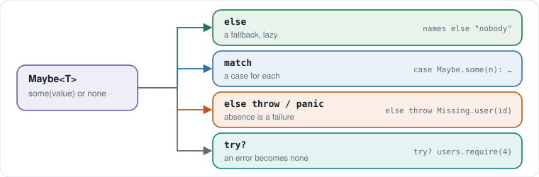

*Figure 7.1. The four ways out of a Maybe. Each names what happens when the value is absent.*

1. **`else` gives a fallback.** `users.find(3) else "nobody"` is the value if
   present, the fallback otherwise. The fallback is evaluated only when
   needed, and it may be `else throw Error...` or `else panic "..."` when
   absence is not acceptable at that point.
2. **`match`** handles each case, with the case's payload bound by name. A
   case that only computes a value fits on one line:
   `match users.find(1) { case Maybe.some(name): "hello, " + name; case Maybe.none: "hello, stranger"; }`.
   A case that needs statements takes a block, and both forms mix in one
   `match`. It must cover every case.
3. **Nesting stays readable** when each step has a name: a `match` inside a
   case is allowed, but a separate variable is usually clearer.
4. **`try?`** converts a typed error into absence: `try? users.require(4)` is
   `Maybe.some(name)` if the call returned and `Maybe.none` if it threw any
   error. Its counterpart `try!` asserts that a call cannot fail and turns a
   thrown error into a panic.

Notice what is *not* in the list: a way to take the value out without
deciding. There is no `.get()` that throws, no `!` that asserts, no implicit
unwrapping at an assignment. Every exit from a `Maybe` names what happens in
the `none` case, and that name is visible in the code.

### No automatic wrapping, no collapsing

Two rules keep `Maybe` predictable. Results are not wrapped automatically: an
action declared `is Maybe<string>` returns `Maybe.some(name)`, not `name`, so a
reader can see which return statements produce an answer and which produce its
absence. And nested `Maybe` values are never collapsed: `Maybe<Maybe<int>>`
keeps both levels, because "the cache has no entry" and "the cache has an
entry saying there is no value" are different facts. Languages that collapse
nested optionals — TypeScript's `undefined`, JavaScript's optional chaining —
lose exactly that distinction.

## 7.4 Where a `Maybe` comes from

A `Maybe` is not something a programmer meets only in their own code. The
language and the standard library answer with one wherever a question may have
no answer, and they never answer with a sentinel — no `-1` for "not found", no
empty string for "not set".

```okkama
module app v1.0.0;

import "io/stdout" take Stdout;

enum Lookup is Error = (unknown(name is string));

object Directory {
    has phones is %string:string;
    Directory(:phones);

    // A lookup that may find nothing answers a Maybe.
    phone(name is string) is Maybe<string> {
        if phones.has(name) { Maybe.some(phones[name]); } else { Maybe<string>.none; }
    }

    // The same question as an error, for callers that cannot go on without it.
    require(name is string) is string {
        self.phone(name) else throw Lookup.unknown(name);
    }
}

main() is int {
    let out = Stdout();
    let names = ["ada", "brian", "grace"];
    // Searches answer Maybe, never -1 or an empty string.
    out.writeln((names.index_of("grace") else -1).string() + " " + (names.index_of("linus") else -1).string());
    out.writeln(names.find() -> n { n.starts_with("b"); } else "nobody");
    out.writeln(("a=1;b=2".find(";") else -1).string() + " " + ("a=1".find(";") else -1).string());
    // An index or a key with a fallback; without one, a miss is a failure.
    out.writeln(names[5] else "past the end");
    let book = Directory(phones: ["ada": "555-0101"]);
    out.writeln(book.phone("ada") else "unlisted");
    // Several sources tried in order: each `else` takes the next.
    let office is Maybe<string> = Maybe<string>.none;
    out.writeln(book.phone("brian") else office else "no number");
    // try? turns an error into absence; a Maybe result is kept whole, never flattened.
    out.writeln(try? book.require("grace") else "unknown");
    let nested is Maybe<Maybe<string>> = try? book.phone("grace");
    out.writeln(if nested == Maybe.some(Maybe<string>.none) { "found the answer: no phone"; } else { "something else"; });
    0;
}
```

Output:

```text
2 -1
brian
3 -1
past the end
555-0101
no number
unknown
found the answer: no phone
```

- **Searches.** `index_of(value)` on an array, `find(part)` and
  `find_last(part)` on a string answer a `Maybe<int>`. The functional `find`
  block answers a `Maybe` of the first element that satisfies it:
  `names.find() -> n { n.starts_with("b"); } else "nobody"`.
- **Indexes and keys, with a fallback.** `names[5] else "past the end"` and
  `stock["kiwi"] else 0` read an element or an entry that may not exist. Without
  the `else`, a miss is a runtime failure: the fallback is part of the
  expression, not an afterthought. A map answers `has(key)` without looking the
  value up, so an action that wants to return absence is one `if` away from a
  `Maybe` (the `Directory.phone` action above).
- **Actions that say so.** Any action may declare `is Maybe<T>`; the standard
  library does it for every reader of optional data. The json reader's
  `maybe(name)`, `Environment.maybe(name)`, the configuration sources and a
  database row's `maybe(column)` all answer `Maybe` per kind:
  `row.maybe("nick").text()` is `Maybe.none` when the column holds SQL `NULL`.
- **`try?`.** It turns a thrown error into `Maybe.none` (§7.3).
- **Streams.** `for await` asks a stream for its next element with an
  `async next() is Maybe<T>` action, and `Maybe.none` ends the loop. Absence is
  how a stream says "no more", exactly as it is how a search says "not here"
  (Chapter 20).

A value is made with `Maybe.some(value)` and `Maybe<T>.none`. The type argument
of `none` may be left out when the context gives it — `let m is Maybe<int> =
Maybe.none;` — and must be written when nothing does, because `none` alone
carries no element type.

## 7.5 `else` in detail

`else` after a `Maybe` is the most common exit, and it has precise rules.

- **The fallback is lazy.** It is evaluated only when the value is absent.
  `Maybe.some(0) else panic "eager"` never panics; a fallback that computes,
  logs or allocates costs nothing on the present path.
- **The fallback has the type of the payload.** `Maybe<int> else 0` is an
  `int`. A fallback of another type is a compile-time error ("Fallback must be
  int, got string"), not a conversion.
- **Three kinds of fallback.** An expression of the payload type; `throw` with
  an error, when absence is a failure of the caller's contract (Chapter 10);
  `panic` with a message, when absence means the program itself is wrong. These
  are the only three: `return`, `next` and `last` cannot follow `else`, because
  a fallback is a value, and control flow that depends on presence is written
  as a `match` or an `if`, where a reader looks for it.
- **Fallbacks chain.** `book.phone("brian") else office else "no number"`
  tries each source in order: the right-hand `else` turns `office` into a
  string, the left-hand one takes it when the first lookup misses.
- **The same word in `confirm`.** `confirm port > 0 else throw ...` uses `else`
  for a condition rather than an absence (Chapter 10). The fallback is lazy
  there too: the error is built only when the condition fails.

## 7.6 A `Maybe` is a value

`Maybe<T>` is an ordinary value, and everything Chapter 16 says about variants
applies to it.

- **Equality is structural.** `Maybe.some(3) == Maybe.some(3)` is true, and so
  is `Maybe<int>.none == Maybe<int>.none`. An array of `Maybe` values answers
  `contains` and `index_of` by the same equality.
- **It can be a field.** An object may hold `has note is Maybe<string>;` for
  data that is genuinely optional, and give it a meaning in one place:
  `shown() is string { note else "(no note)"; }`. Callers ask the object, not
  the field.
- **It is not a map key.** Map keys must be scalars or key objects (Chapter
  8); a field `has index is %Maybe<int>:string;` is rejected with "Map key
  type Maybe<int> is not a scalar key type". A map that needs "no key" as a key is usually two
  structures: the map and the value for the missing case.
- **It owns what it holds.** A `Maybe` that holds an object with a `destroy`
  is that object's owner: the object is destroyed when the `Maybe` goes out of
  scope, like any other owner (Chapter 11).

## 7.7 `Presence<T>`: three states for updates

Some data needs three states, and the most common example is a partial
update. When a client sends a JSON PATCH for a user record, each field can
mean one of three things: set the field to a new value, clear the field, or
leave it as it is. JSON Merge Patch encodes these as a value, a `null`, and an
absent key [[RFC 7396](#ref-rfc7396); [RFC 8259](#ref-rfc8259)]. A language with only null cannot represent the
third state without an extra flag per field; a language with only `Maybe`
cannot represent it either.

`Presence<T>` has three cases — `some(value)`, `none` and `missing` — for
exactly this purpose.

```okkama
module bible/presence v1.0.0;

import "io/stdout" take Stdout;

// A PATCH request distinguishes three intents for a field:
// set it (some), clear it (none), or leave it alone (missing).
object NicknamePatch {
    has nickname is Presence<string>;
    NicknamePatch(:nickname);

    applied(current is string) is string {
        match nickname {
            case Presence.some(value): value;
            case Presence.none: "";
            case Presence.missing: current;
        };
    }
}

main() is int {
    let out = Stdout();
    let patches is @NicknamePatch = [
        NicknamePatch(nickname: Presence.some("ace")),
        NicknamePatch(nickname: Presence<string>.none),
        NicknamePatch(nickname: Presence<string>.missing)
    ];
    for patches -> patch {
        out.writeln("[" + patch.applied("old") + "]");
    }
    0;
}
```

Output:

```text
[ace]
[]
[old]
```

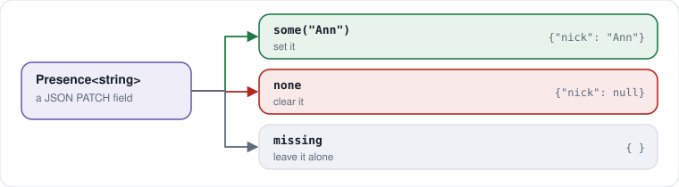

*Figure 7.2. Three states of a partial update: set, clear, leave alone.*

The patch object's `applied` action maps "set" to the new value, "clear" to
the empty string and "leave alone" to the current value. The compact choice
must name all three cases; forgetting `missing` is a compile-time error, not a
bug report from the first client that sends a partial update.

Because `Presence` carries more information than `Maybe`, Okkama does not let
it degrade silently. `else` works only on `Maybe`; on a `Presence` it is
rejected, and the program must say how to merge the two kinds of absence.

```okkama
module bible/presence_else v1.0.0;

main() is int {
    let nickname is Presence<string> = Presence<string>.missing;
    let shown = nickname else "anonymous";
    0;
}
```

The compiler answers:

```text
07-presence-rejected.ok:5:17: semantic error: Optional fallback requires Maybe<T>; fold Presence explicitly
```

`nickname.fold() else "anonymous"` is the explicit form: `fold()` turns
`missing` and `none` into `Maybe.none` — on purpose, in writing. (In the other
direction, `Maybe.as_presence()` keeps `some` and `none` and never invents
`missing`.)

## 7.8 Absence at the edges

Inside a program, absence is a type. At its edges — environment variables,
configuration files, JSON, databases — absence arrives as data, and the
standard library draws the same line everywhere: **absent is a value,
malformed is an error.** `Environment.maybe("PORT").int()` is `Maybe.none` when
the variable is not set and `Maybe.some(8080)` when it holds `8080`; when it
holds `80a0`, the read throws `InvalidEnvironmentValue` naming the variable,
because a value that is there but wrong is not the same fact as a value that is
not there. The configuration sources throw `MalformedSetting` by the same rule.
The json reader offers both views of a member: `maybe(name)` answers `Maybe`
and treats an absent key and a `null` alike, while `presence(name)` keeps them
apart as `Presence.missing` and `Presence.none`; in both, a member of the wrong
kind is `JsonError.wrong_kind`. `maybe` is literally `presence` followed by
`fold()`.

Databases are where null was born a second time. SQL's `NULL` came from Codd's
extension of the relational model [[Codd 1979](#ref-codd1979)], with a three-valued logic in
which `NULL = NULL` is neither true nor false but unknown. Codd later proposed
two kinds of missing value — "missing but applicable" and "missing and
inapplicable" — and a four-valued logic to go with them [[Codd 1990](#ref-codd1990)]; no major
system implemented it, and SQL kept one `NULL`. Okkama maps the database's
`NULL` to `Maybe.none` in both directions: `DbText(Maybe<string>.none)` binds a
`NULL` parameter, and `row.maybe("nick").text()` reads one back as
`Maybe.none`. Equality on the Okkama side stays two-valued:
`Maybe<int>.none == Maybe<int>.none` is simply true. Codd's second mark has a
counterpart too, in `Presence`: `none` is "there is no value", `missing` is
"nothing was said".

## 7.9 A worked example: settings

The same absent setting can mean three different things, and only the code
that uses the value knows which. A server reads its settings as text and
decides, per setting, what absence means.

```okkama
module app v1.0.0;

import "io/stdout" take Stdout;
import "strings/parse" take Number, InvalidInteger;

enum SettingError is Error = (malformed(name is string, text is string));

// Settings as read from a file: a name and its text, nothing more.
object Settings {
    has entries is %string:string;
    Settings(:entries);

    // Absence is an answer: the setting is not there.
    text(name is string) is Maybe<string> {
        if entries.has(name) { Maybe.some(entries[name]); } else { Maybe<string>.none; }
    }

    // Absent gives none; present but not a number is an error that names the setting.
    int(name is string) is Maybe<int> {
        match self.text(name) {
            case Maybe.some(raw): Maybe.some(try {
            Number(raw).int();
        } catch failure is InvalidInteger {
            throw SettingError.malformed(name, raw);
        });
            case Maybe.none: Maybe<int>.none;
        };
    }
}

// What the program does with each setting decides what absence means.
object Server {
    has settings is Settings;
    Server(:settings);

    port() is int { settings.int("port") else 8080; }
    certificate() is string { match settings.text("certificate") { case Maybe.some(path): "TLS with " + path; case Maybe.none: "plain HTTP"; }; }
    workers() is int { settings.int("workers") else throw SettingError.malformed("workers", "(missing)"); }
}

main() is int {
    let out = Stdout();
    let full = Server(settings: Settings(entries: ["port": "9000", "certificate": "/etc/tls/site.pem", "workers": "4"]));
    out.writeln(full.port().string() + ", " + full.certificate() + ", " + full.workers().string() + " workers");
    let sparse = Server(settings: Settings(entries: ["workers": "2"]));
    out.writeln(sparse.port().string() + ", " + sparse.certificate() + ", " + sparse.workers().string() + " workers");
    let broken = Server(settings: Settings(entries: ["port": "90o0"]));
    let port = try { broken.port().string(); } catch SettingError.malformed(name, text) { name + " is not a number: " + text; };
    out.writeln(port);
    let lean = Server(settings: Settings(entries: ["port": "80"]));
    let workers = try { lean.workers().string(); } catch SettingError.malformed(name, text) { name + " " + text; };
    out.writeln(workers);
    0;
}
```

Output:

```text
9000, TLS with /etc/tls/site.pem, 4 workers
8080, plain HTTP, 2 workers
port is not a number: 90o0
workers (missing)
```

- `port()` has a sensible default: absence means 8080.
- `certificate()` has no default, and absence is meaningful: no certificate
  means plain HTTP. The compact choice names both cases, so the meaning of
  absence is written next to the meaning of presence.
- `workers()` has no default and no meaning for absence: the program cannot
  run without it, so absence is an error, thrown with the setting's name.

The `Settings` object knows none of this. It answers `Maybe` for "not there"
and throws `SettingError.malformed` for "there but not a number", and it leaves
every decision about absence to its caller. That split — the reader reports,
the user decides — is the design the standard library's readers follow.

## 7.10 Absence in generic code

`Maybe<T>` is an ordinary generic type, so it composes with generic objects
the way any type does. A cache is the textbook case: it knows nothing about
its keys and values, and a lookup may miss.

```okkama
module app v1.0.0;

import "io/stdout" take Stdout;

// A cache from keys to values of any types. K keys a map, so it must be a key type (Chapter 17).
object Cache<K, V> {
    has entries is %K:V;
    has hits is int;
    has misses is int;
    Cache(:entries) { self.hits = 0; self.misses = 0; }

    // Absence is part of the answer: the caller decides what a miss means.
    find(key is K) is Maybe<V> {
        if entries.has(key) { Maybe.some(entries[key]); } else { Maybe.none; }
    }
    // A lookup that is counted returns the next state of the cache.
    looked_up(key is K) is ^Cache<K, V> {
        if entries.has(key) { ^hits = hits + 1; } else { ^misses = misses + 1; }
    }
    remembered(key is K, value is V) is ^Cache<K, V> {
        ^entries = entries + [key: value];
    }
    report() is string { "hits " + hits.string() + ", misses " + misses.string(); }
}

object Point {
    has x is int;
    has y is int;
    Point(:x, :y);
}

main() is int {
    let out = Stdout();
    let empty is %string:int = [:];
    let prices = Cache(entries: empty).remembered("tea", 300).remembered("cake", 450);
    // Three ways to meet a Maybe: a fallback, a compact choice, a match.
    out.writeln("tea " + (prices.find("tea") else 0).string());
    out.writeln(match prices.find("jam") { case Maybe.some(cents): "jam " + cents.string(); case Maybe.none: "no jam"; });
    let counted = prices.looked_up("tea").looked_up("jam").looked_up("cake");
    out.writeln(counted.report());
    // The same object with a value-object key and a string value.
    let nameless is %Point:string = [:];
    let names = Cache(entries: nameless).remembered(Point(x: 0, y: 0), "origin");
    match names.find(Point(x: 0, y: 0)) {
        case Maybe.some(name) { out.writeln("(0, 0) is the " + name); }
        case Maybe.none { out.writeln("(0, 0) has no name"); }
    }
    out.writeln("(1, 2) is " + (names.find(Point(x: 1, y: 2)) else "unnamed"));
    0;
}
```

Output:

```text
tea 300
no jam
hits 2, misses 1
(0, 0) is the origin
(1, 2) is unnamed
```

- **The miss belongs to the answer.** `find(key) is Maybe<V>` returns
  `Maybe.some(value)` or `Maybe.none`, whatever `V` is. The cache does not
  invent a default for a type it knows nothing about, and the caller decides
  what a miss means: a fallback with `else` or a `match` (Section 7.3).
- **No sentinel can collide with a value.** A cache of prices that returned
  `0` or `-1` for a miss would be wrong for the first item that costs
  nothing. With `Maybe`, every value of `V`, including `0`, `""` and an empty
  array, is a hit.
- **The key is a type parameter used as a map key.** `K` keys the map
  `%K:V`, so the compiler holds every specialization to the key rules of
  Section 8.3: `Cache<string, int>` and `Cache<Point, string>` compile, and a
  `Cache<@int, string>` would not (Chapter 17).
- **Counting is a successor.** `looked_up(key)` returns the next state of the
  cache with one more hit or miss; the `find` that answers the question does
  not change anything.

The design keeps two questions apart that sentinel-based caches merge: "is
it there?" and "what is it?". The cost is the same as everywhere in this
chapter, one `else` or one `match` at each call site, and in generic code it
buys more than elsewhere, because a generic object has no value it could
safely use as a sentinel for every `V`.

## 7.11 Absence with behaviour: the null object

Sometimes absence has behaviour. A service that may or may not have a logger
does not want a `Maybe<Logger>` and a choice at every call; it wants a logger
that does nothing. This is Woolf's *Null Object* pattern [[Woolf 1998](#ref-woolf1998)]: an
implementation of the role whose actions are harmless no-ops, passed where the
real one would go.

In Okkama the null object is an ordinary implementation of a role (Chapter
14), and the choice between it and `Maybe` follows one question: **does the
caller act differently when the thing is absent?** If it does — a certificate
turns TLS on, a missing phone number changes what the screen shows — absence is
data, and it is a `Maybe` that forces the caller to decide. If it does not — a
silent logger, an empty set of listeners, a clock that never ticks in a test —
absence is behaviour, and an object that implements the role keeps every call
site simple. Elegant Objects arrives at the same place from the other side:
never return null, return an object that knows what to do [[Bugayenko 2016](#ref-bugayenko2016)].

What Okkama rejects is the third option, the sentinel: `-1` for "not found",
`""` for "not set", `0` for "unknown". A sentinel is a null with a disguise —
an ordinary value of the type that the reader must remember to treat
specially. Okkama's searches answer `Maybe` precisely so that no `int` has to
mean "nothing".

## 7.12 How other languages handle absence

Okkama's approach belongs to a family that started with ML's `option` type
and Haskell's `Maybe` [[Pierce 2002](#ref-pierce2002); [Haskell 2010](#ref-haskell2010)]. The table compares the
mainstream designs.

| Language | Absence | Can a value of type T be absent? | Unwrapping without deciding |
|---|---|---|---|
| Java | `null`; `Optional<T>` in libraries | yes, every reference | `.get()` throws; null dereference throws |
| C# 8+ | `null`; nullable reference types as warnings | yes, with warnings | `!` suppresses the warning |
| Kotlin | `T?` nullable types | no, unless declared `T?` [[Kotlin specification](#ref-kotlinspec)] | `!!` throws |
| Swift | `Optional<T>`, written `T?` | no, unless declared `T?` | `!` traps |
| Rust | `Option<T>` | no [[Klabnik 2023](#ref-klabnik2023)] | `.unwrap()` panics |
| Haskell | `Maybe a` | no | `fromJust` errors |
| Go | `nil` for pointers, maps, slices, interfaces, channels and functions; zero values; `v, ok := m[k]` | yes, for those kinds [[Go specification](#ref-gospec)] | dereferencing `nil` panics |
| Okkama | `Maybe<T>`, `Presence<T>` | no | none: every exit names the `none` case |

Kotlin, Swift and Rust made the decisive move — a plain `T` cannot be absent —
and their experience shows that it removes most null-related crashes. Each of
them also kept an escape hatch for "I know it is there": `!!`, `!`,
`.unwrap()`. Okkama's only equivalent is `else panic "reason"`, which costs a
message and therefore a moment's thought. The difference is small in
characters and large in culture: the shortest way to get a value out of a
`Maybe` is to say what absence means.

## 7.13 What it costs

- **Ceremony at the boundaries.** Every lookup that may miss needs a fallback,
  a match or a `try?`. Code that reads many optional fields — configuration,
  request parameters, JSON — is longer than in a language with null. The
  standard library's answer is the json-style reading API: `maybe(name).text()
  else "default"` reads an optional field in one line (Chapter 22), and the
  library audit asks for the same style in every module that reads data.
- **Deciding what absence means.** Porting a design built on null forces a
  decision at every nullable reference: is this a `Maybe`, an error, a
  default, or a sign that the object was built wrongly? The decision is work;
  it is also the work the original design skipped.
- **Two types instead of one.** `Maybe` and `Presence` are separate types, and
  converting between them is explicit (`fold()`, `as_presence()`). This is the
  price of keeping the third state; most programs never need `Presence`.

## 7.14 Limits

- `Maybe` has no library of combinators such as `map`, `and_then` or `filter`
  in the language today; chained optional computations are written with
  `match`, often in its compact form. Whether to add them is an open question:
  each is convenient, and each is another way to say what `match` already says.
- A `Maybe` cannot be a map key, and a fallback cannot carry control flow:
  `else return` and `else next` do not exist. Both are deliberate, and both
  occasionally cost a few lines.
- Standard-library APIs are not yet uniform: some modules return `Maybe`,
  some throw a typed error for a missing value, some take an explicit
  fallback. The json module's style is the reference the library is being
  aligned with.

# Chapter 8. Collections

Okkama has three built-in collections — arrays, maps and ranges — and the
standard library adds lists, sets, deques, heaps and lazy views on top of
them. All of them are immutable. That single fact decides most of this
chapter: how collections are built, how they are changed, what they cost and
what is still missing.

## 8.1 Arrays

An array is an immutable, ordered sequence of values of one type, written
`@T`. Literals use brackets, elements are indexed from zero, and every
operation that "changes" an array returns a new one.

```okkama
module bible/collections v1.0.0;

import "io/stdout" take Stdout;
import "compare" take Comparing;     // ordering() needs the Comparing role in scope

main() is int {
    let out = Stdout();

    // Arrays: immutable, typed, indexed from zero.
    let primes = [2, 3, 5, 7, 11, 13];
    out.writeln("size " + primes.size().string()
        + ", first " + primes.first().string()
        + ", last " + primes.last().string());
    out.writeln("slice(1, 4) = " + primes.slice(1, 4).map() -> p { p.string(); }.join(" "));
    out.writeln("index 9, or 0: " + (primes[9] else 0).string());
    out.writeln("contains 7: " + (if primes.contains(7) { "yes"; } else { "no"; })
        + ", reversed " + primes.reversed().map() -> p { p.string(); }.join(" ")
        + ", take(2) " + primes.take(2).map() -> p { p.string(); }.join(" ")
        + ", drop(4) " + primes.drop(4).map() -> p { p.string(); }.join(" "));

    // Ranges expand inside literals; ordering() sorts.
    let mixed = [9, 0, 2..=4, 1];
    out.writeln("expanded " + mixed.map() -> n { n.string(); }.join(" "));
    out.writeln("sorted " + mixed.ordering().map() -> n { n.string(); }.join(" "));

    // Functional operations make new arrays; nothing is changed in place.
    let squares = (1..=5).map() -> n { n * n; };
    let odd = squares.filter() -> n { n % 2 == 1; };
    let total = squares.reduce(0) -> sum, n { sum + n; };
    out.writeln("squares " + squares.map() -> n { n.string(); }.join(" ")
        + "; odd " + odd.map() -> n { n.string(); }.join(" ")
        + "; total " + total.string());

    // Maps: keys are expressions, iteration is in sorted key order.
    let stock is %string:int = ["pear": 3, "apple": 5, "fig": 0];
    out.writeln("keys " + stock.keys().join(", "));
    out.writeln("has kiwi: " + stock.has("kiwi").string() + ", kiwi or 0: " + (stock["kiwi"] else 0).string());
    let available = stock.filter() -> name, count { count > 0; };
    out.writeln("in stock " + available.keys().join(", "));
    let units = stock.reduce(0) -> sum, name, count { sum + count; };
    out.writeln("units " + units.string());
    0;
}
```

Output:

```text
size 6, first 2, last 13
slice(1, 4) = 3 5 7
index 9, or 0: 0
contains 7: yes, reversed 13 11 7 5 3 2, take(2) 2 3, drop(4) 11 13
expanded 9 0 2 3 4 1
sorted 0 1 2 3 4 9
squares 1 4 9 16 25; odd 1 9 25; total 55
keys apple, fig, pear
has kiwi: false, kiwi or 0: 0
in stock apple, pear
units 8
```

The first lines of the program show the builtin actions of arrays: `size()`,
`first()`, `last()`, `slice(start, end)`, `join(separator)` for arrays of
strings, `ordering()` to sort, and `item(index)` — or the indexing operator
`array[index]`. An index outside the array is a runtime failure, unless the
expression supplies a fallback: `primes[9] else 0` is `0`. Like
`slice` on strings, nothing is clamped silently.

Five more builtins search and reshape (issue #211): `contains(value)` and
`index_of(value)` — a `Maybe<int>` — compare elements with `==`, so a value
object is found by its fields; `reversed()` turns an array around; and
`take(count)` and `drop(count)` keep, respectively remove, at most `count`
elements from the start. Unlike `slice`, these two are defined for any
count that is not negative — `[1, 2].take(5)` is `[1, 2]` — because "at most
`count`" is what their names promise; a negative count fails.

Two more give a copy changed at one index (issues #250, #251).
- `replaced(index, value)` is the array with `value` at `index`.
- `removed_at(index)` is the array without the element at `index`.

The receiver keeps its elements, as everywhere. An index outside the array
fails as indexing does. `value` meets the element type by the rules of a
parameter boundary: an array of a role takes an implementer, and `@any`
boxes. No other conversion applies.

Ranges expand inside array literals: `[9, 0, 2..=4, 1]` is the array
`9 0 2 3 4 1`. `a..b` excludes its end and `a..=b` includes it; bounds are
integers and the start may not exceed the end.

`ordering()` sorts an array whose elements can be compared. It compares
them through the standard role `Comparing` of the `compare` module, so the
program imports that role even to sort numbers or strings, as the example
does. Without the import the compiler names it: "compares elements through
the role Comparing, which this program does not load: add
`import "compare" take Comparing;`" (issue #233).

### Typed identity

An array remembers its element type. Once it crosses a declared boundary —
`let names is @string = ...`, a parameter, a field — it is tagged with that
type, and even an empty result of `slice` or `keys` keeps it. An untyped
empty literal `[]` has no evidence of its type, so it may cross any
compatible boundary once, and that boundary fixes its type. Inside a larger
expression its neighbours count as such evidence, at any depth and in either
order: `[[1], []]` and `[[], [1]]` are `@@int`, `["a": [1], "b": []]` is
`%string:@int`, and `[[1]] == [[]]` or `if c { [[]]; } else { [[2]]; }`
type-check. Only `never` parts are filled in this way. Two concrete types
still disagree (`[[1], ["s"]]`), and an expression that is empty all the way
down waits for a boundary. This is why empty collections sometimes need an
annotation (Chapter 4).

### Equality

Arrays compare deeply: two arrays are equal when they have the same length
and equal elements in the same order. Maps compare by keys and values,
ranges by their bounds and kind, objects by type and *all* fields. Comparing
values of different categories is an error, not `false` — the same rule as
`1 == 1.0` in Chapter 5.

## 8.2 Functional operations

Three operations — `map`, `filter` and `reduce` — work on arrays, ranges,
maps and any object that performs the `Iterating` role. They are written with
a dedicated block syntax:

```okkama
let squares = (1..=5).map() -> n { n * n; };
let odd = squares.filter() -> n { n % 2 == 1; };
let total = squares.reduce(0) -> sum, n { sum + n; };
```

The block after `->` names its bindings and computes one value. For a map,
`map` and `filter` bind `key, value`, and `reduce` binds `accumulator, key,
value`. The operations are **eager**: each produces a complete array (or, for
`filter` on a map, a map). They visit elements in order — maps in sorted key
order — exactly once, and the first failure inside a block stops the
operation.

`map`, `filter` and `reduce` cover most loops that produce a value. Their blocks are part of the call: they may use surrounding names but cannot be stored or passed on. Lazy views — `Taken`, `Filtered`, `Chunked` and friends — live in `collections/views` when materialising every step would be wasteful (Chapter 22).

There is no `last` inside a functional block: `reduce` always visits every
element. Searches therefore have their own operations, which stop at the
first decisive item: `any` (is there one?), `all` (are they all?) and `find`
(a `Maybe` of the first match) — `xs.any() -> x { x.overdue(); }` where one
would otherwise write `reduce(false) -> found, x { found || x.overdue(); }`
and walk the whole array (issue #150). A search for an equal element needs
no block at all: `xs.contains(y)`.

## 8.3 Maps

A map `%K:V` associates keys with values. Map literals use brackets with
`key: value` pairs, and the keys are *expressions*: `["apple": 5]` maps the
string `"apple"`; `[apple: 5]` would use the value of a variable named
`apple`. There is no implicit string-key shorthand, so a typo cannot quietly
turn a variable into a string or the other way round.

Keys are scalar values — integers, strings, booleans and the other scalar
categories, except `byte` and `any` — or value objects. A `rat` key is its
exact value: `rat(1, 2)` and `2 / 4` are one key (since 0.4.2). Value objects
are objects whose fields are all scalars, enums or such objects, with no
`destroy`. Because objects are
immutable, an object key is its fields: two equal cards are one key, exactly
as `==` says. The map keeps its keys **in sorted order** — objects field by
field in declaration order. `keys()` and
`values()` return arrays in that order, and every functional operation visits
entries in it. Iteration order therefore never depends on hashing, insertion
history or the memory layout of a run: the same program prints the same output
every time. Python made its dictionaries keep insertion order
in version 3.7 for the same reason — predictability — and many test suites
in languages with unordered maps contain workarounds for nondeterministic
output.

A literal names each key once. Two keys the compiler can compute and that
are one key — `["a": 1, "a": 2]`, `[rat(1, 2): 1, 2 / 4: 2]`, `[1 + 1: 1, 2:
2]` — are a compile-time error that points at the repeat and at the first.
Keys known only at run time are checked when the literal is built: every key
and value is evaluated once, left to right, and if two keys are equal by the
map's own key equality the literal fails with "Duplicate key in map literal"
instead of keeping one of them. Many languages let the later entry win;
Okkama treats a repeated key in a literal as the mistake it nearly always is
(issue #954). Replacing an entry is written as what it is, `prices + ["fig":
95]`.

A lookup of a missing key is a runtime failure unless it has a fallback:
`stock["kiwi"] else 0`. `has(key)` asks without looking up, and a `Maybe` is
one `if` away when an action wants to return absence (Chapter 7).

A generic object can key a map by its own type parameter:
`object Index<T> { has entries is %T:int; … }`. Such a `T` is a *key
parameter*, and the compiler holds every specialization to the key rule
above: `Index<string>` and `Index<Card>` compile, `Index<@int>` does not, and
neither does a `Wrap<U>` that passes its `U` on to an `Index<U>` and is given
an array (issue #242). The standard library's `KeyedSet<T>` and
`KeyedFrequencies<T>` are built this way — logarithmic membership and counts,
traversal in key order — beside `OrderedSet` and `Frequencies`, which accept
any `T` with equality, arrays included, and pay for it with a linear search.

## 8.4 Ranges

A range is a value: `1..5` and `1..=5` can be stored, passed and compared.
They are the source of most counted loops (`for 0..n -> i`), expand inside
array literals, and accept the functional operations, producing arrays.
Chained ranges such as `1..5..9` are rejected, and a range whose start is
greater than its end is an error rather than an empty range — a reversed
range is more often a bug than an intention.

## 8.5 Building and changing collections

Immutability raises the practical question: how do you build a collection
element by element, or change one entry of a map?

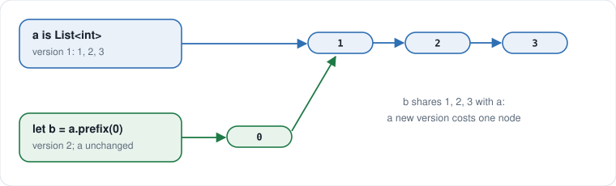

*Figure 8.1. A persistent list: a new version shares every node of the old one and adds one.*

The language's answer today has three parts.

1. **Build in one step when possible.** `map`, `filter` and range expansion
   build complete arrays in one pass. Most collections in real programs are
   transformations of other collections, and these are linear.
2. **Accumulate with `reduce` or a library collection.** The standard library
   has persistent collections — `List` (a linked list with constant-time
   prefix), `Deque`, `OrderedSet`, `KeyedSet`, `Heap` — whose "updates" return new
   versions that share structure with the old ones.
3. **Rebind a local that holds a successor-capable object.** A local may be
   rebound (`counter = counter.increment();`) only when its type is an object
   with successor actions; `let n = 1; n = 2;` is rejected. Scalar and
   collection locals cannot be rebound at all, which is why accumulation goes
   through `reduce` — or, in synchronous code, through a `Cell` from the std
   module `cell`, the one
   explicit mutable container, which the compiler keeps out of async actions
   and object fields (issue #152).

Use `+` and `-` to append array elements or set and remove map entries: `items + [item]`, `a + b + c`, `prices + ["fig": 90]`, `prices - ["pear": 0]`. A concatenation chain costs the size of its result. Inside `reduce`, a block that returns only `acc` or `acc + [item]` appends in amortized constant time; earlier observable values remain unchanged.

One idiom still copies: it builds a new array with `map` at each step. Repeating it to grow a collection gives quadratic total work:

```okkama
let following = (0..old.size() + 1).map() -> index {
    if index < old.size() { old[index]; } else { item; }
};
```

This is the clearest case in the language of the rule from Chapter 1:
removing mutation must not remove efficiency, and the cure is an operation,
not a mutable entity.

## 8.6 Iterating user collections

`for` walks arrays, ranges, maps' keys through `keys()`, and any object that
performs the standard `Iterating<T>` role from `collections/iteration`:

```okkama
role Cursor<T> {
    available() is bool;
    item() is T;
    successor() is Cursor<T>;
}

role Iterating<T> {
    cursor() is Cursor<T>;
}
```

A cursor is immutable: `successor()` returns the next cursor and leaves the
current one where it was, so two loops over the same collection never
interfere, and a cursor can be kept to resume later. Exhaustion is an
ordinary `false` from `available()` — no sentinel, no null, no exception. The
role is nominal: a collection must declare `does Iterating<T>`; having the
right method names is not enough.

A source that is consumed as it is read — a file, a socket — performs
`Batching<T>` instead, from the same module:

```okkama
role Batching<T> {
    batch() is @T;      // the next batch; [] ends the source
}
```

`for file.text() -> line { … }` asks for a batch, walks it as an array and asks again. `next`, `last` and `return` work as in any loop; `map`, `filter` and `reduce` accept such sources too. Batches amortize the cost of requesting items over several values. A source that does both roles is walked in batches.

## 8.7 Counts and positions: what happens at the edges

Array actions take two kinds of number, and they behave differently at the
edge of the array. A **count** says how many: asking for more than there is
gives what there is. A **position** names an element: a position outside
the array is a failure.

```okkama
module app v1.0.0;

import "io/stdout" take Stdout;

object Show {
    Show();
    of(xs is @int) is string { "[" + xs.map() -> x { x.string(); }.join(",") + "]"; }
}

main() is int {
    let out = Stdout();
    let show = Show();
    let xs = [10, 20, 30];
    // take and drop are counts: asking for more than there is gives what there is.
    out.writeln(show.of(xs.take(5)) + " " + show.of(xs.drop(9)));
    // slice, item, replaced and removed_at are positions: a position outside the array fails.
    out.writeln(show.of(xs.slice(1, 3)) + " " + show.of(xs.replaced(1, 99)) + " " + show.of(xs.removed_at(0)));
    out.writeln((xs[7] else -1).string() + " " + show.of(xs.reversed()));
    // `-` removes every element equal to one on the right.
    out.writeln(show.of([1, 2, 2, 3] - [2]));
    // A position outside the array is a runtime failure, not a thrown error: the program stops here.
    out.writeln(show.of(xs.slice(1, 9)));
    0;
}
```

Output:

```text
[10,20,30] []
[20,30] [10,99,30] [20,30]
-1 [30,20,10]
[1,3]
exit 1
```

| Action | Argument | Beyond the end | Negative |
|---|---|---|---|
| `take(n)` | count | the whole array | fails |
| `drop(n)` | count | `[]` | fails |
| `slice(start, end)` | positions | fails | fails; so does `start > end` |
| `item(i)`, `xs[i]` | position | fails; `xs[i] else v` gives `v` | fails; `xs[i] else v` gives `v` |
| `replaced(i, v)`, `removed_at(i)` | position | fails | fails |
| `first()`, `last()` | — | fail on an empty array | — |

Such a failure is not a thrown error a caller can catch; it is a runtime
failure that stops the program with its location, like a division by zero
(Chapter 10). `try? xs.slice(1, 9)` does not turn it into `Maybe.none`. The
asymmetry is deliberate. A count is a request — "at most three" — and
answering it with fewer is the useful answer. A position is a claim — "the
element at five exists" — and a false claim is a bug to surface, not a value
to invent. When a position may legitimately be missing, the program says
so with `else`.

## 8.8 Sorting

`ordering()` returns the array sorted in ascending order, and it is the only
sort the language has. It orders elements through the standard role
`Comparing<T>` from `compare`, so the program must import that role even to
sort integers, and an object sorts when it performs `Comparing` (Chapter
14). The sort is stable: elements that compare equal keep their original
order, so sorting by one key after another composes. Strings sort by code
point, as `order()` compares them (Chapter 6), which puts `"B"` before
`"a"`.

There is no descending variant and no sort by a key function. Descending
order is `xs.ordering().reversed()`, and sorting by a key is an object that
performs `Comparing` on that key — a small object with a name, in place of
an anonymous comparator. This is the razor's trade again: one operation and
one role instead of a family of sort methods.

The program below sorts runners by time, then by club, then slowest
first, and finally by a ranking that does not know every club.

```okkama
module bible/sorting v1.0.0;

// Sorting by a key is an object that compares by that key. The sort is
// stable, so one key after another composes; descending is a reversal; a
// comparison that throws stops the sort and leaves the array as it was.
import "io/stdout" take Stdout;
import "compare" take Comparing, Order;

enum Refused is Error = (unranked(club is string));

object Runner {
    has name is string;
    has club is string;
    has minutes is int;
    Runner(:name, :club, :minutes);
    name() is string { name; }
    club() is string { club; }
    minutes() is int { minutes; }
}

// One key per object: the finishing time.
object ByTime does Comparing<ByTime> {
    has runner is Runner;
    ByTime(:runner);
    runner() is Runner { runner; }
    order(other is ByTime) is Order { runner.minutes().order(other.runner().minutes()); }
}

// The club's name.
object ByClub does Comparing<ByClub> {
    has runner is Runner;
    ByClub(:runner);
    runner() is Runner { runner; }
    order(other is ByClub) is Order { runner.club().order(other.runner().club()); }
}

// A ranking of clubs that knows only some of them.
object ByRank does Comparing<ByRank> {
    has runner is Runner;
    ByRank(:runner);
    runner() is Runner { runner; }
    rank() is int {
        let ranks = ["South": 1, "North": 2];
        confirm ranks.has(runner.club()) else throw Refused.unranked(runner.club());
        ranks[runner.club()];
    }
    order(other is ByRank) is Order { self.rank().order(other.rank()); }
}

object Board {
    has runners is @Runner;
    Board(:runners);
    shown() is string {
        runners.map() -> r { r.name() + " " + r.club() + " " + r.minutes().string(); }.join(", ");
    }
}

main() is int {
    let out = Stdout();
    let runners is @Runner = [
        Runner(name: "Ada", club: "North", minutes: 42),
        Runner(name: "Bo", club: "South", minutes: 39),
        Runner(name: "Cy", club: "North", minutes: 39),
        Runner(name: "Di", club: "East", minutes: 45)
    ];
    let timed = runners.map() -> r { ByTime(runner: r); };
    let byTime = timed.ordering().map() -> k { k.runner(); };
    out.writeln("by time:         " + Board(runners: byTime).shown());
    let clubbed = byTime.map() -> r { ByClub(runner: r); };
    let byClub = clubbed.ordering().map() -> k { k.runner(); };
    out.writeln("by club, time:   " + Board(runners: byClub).shown());
    out.writeln("slowest first:   " + Board(runners: byTime.reversed()).shown());
    let ranked = runners.map() -> r { ByRank(runner: r); };
    let outcome = try {
        Board(runners: ranked.ordering().map() -> k { k.runner(); }).shown();
    }
    catch e is Refused {
        "refused: " + e.text();
    };
    out.writeln("by rank:         " + outcome);
    out.writeln("unchanged:       " + Board(runners: runners).shown());
    0;
}
```

Output:

```text
by time:         Bo South 39, Cy North 39, Ada North 42, Di East 45
by club, time:   Di East 45, Cy North 39, Ada North 42, Bo South 39
slowest first:   Di East 45, Ada North 42, Cy North 39, Bo South 39
by rank:         refused: Refused.unranked("East")
unchanged:       Ada North 42, Bo South 39, Cy North 39, Di East 45
```

- **A key is an object.** `ByTime` and `ByClub` each wrap a runner and
  compare one field. Sorting by a key is three steps: wrap, `ordering()`,
  unwrap. The wrapper has a name, which an anonymous comparator does not,
  and the name says what the order is.
- **Stability composes.** Bo and Cy both ran 39 minutes, and the sort by
  time keeps them in their input order. Sorting that result by club keeps
  the time order inside each club: Cy before Ada in North. To sort by
  several keys, sort by the least significant one first.
- **Reversal is not a stable descending sort.** `reversed()` turns the
  whole array around, ties included: slowest first puts Cy before Bo. When
  the order of equal elements matters, the descending key is written as an
  object of its own, whose `order` compares the other way.
- **A comparison may fail, and the sort stops.** `ByRank` throws for a
  club it has no rank for, and the first such comparison ends the sort with
  that error. There is no half-sorted array to clean up: `ordering()`
  returns a new array or fails, and `runners` is what it was.

## 8.9 A worked example: counting words

Maps, `reduce` and `ordering()` are enough for the classic exercise of
counting words, without a mutable counter anywhere.

```okkama
module app v1.0.0;

import "io/stdout" take Stdout;
import "compare" take Comparing;

main() is int {
    let out = Stdout();
    let text = "the cat and the hat and the bat";
    // Count with reduce: each step returns the map with one entry set.
    let empty is %string:int = [:];
    let counts = text.split(" ").reduce(empty) -> seen, word {
        seen + [word: (seen[word] else 0) + 1];
    };
    // Keys come back in sorted order, so the report is the same on every run.
    for counts.keys() -> word {
        out.writeln(word + " " + (counts[word] else 0).string());
    }
    // The most frequent words: filter the map, then order the keys.
    let common = counts.filter() -> word, count { count > 1; };
    out.writeln(common.keys().ordering().join(","));
    0;
}
```

Output:

```text
and 2
bat 1
cat 1
hat 1
the 3
and,the
```

The `reduce` threads a map through the words. Each step returns the map with
one entry set: `seen + [word: n]` adds or replaces the entry, and the old
map stays as it was. The empty map needs a declared type
(`let empty is %string:int = [:];`), because `[:]` alone says nothing about
its keys and values (Chapter 4). Iterating `counts.keys()` gives the words
in sorted order, `and` before `the`, whatever order they arrived in, so the
report is identical on every run and every machine. That determinism is a
property of the map, not of the program.

## 8.10 A worked example: grouping and joining

Reports are where collections earn their keep: rows arrive in one order and
must be grouped, totalled and joined with other data. Here are five sales,
grouped by customer and then by city and month.

```okkama
module app v1.0.0;

import "io/stdout" take Stdout;

object Sale {
    has customer is string;
    has month is int;
    has cents is int;
    Sale(:customer, :month, :cents);
    buyer() is string { customer; }
    period() is int { month; }
    amount() is int { cents; }
}

// A value object: its fields are scalars, so it can key a map.
object Bucket {
    has city is string;
    has month is int;
    Bucket(:city, :month);
    shown() is string { city + "/" + month.string(); }
}

main() is int {
    let out = Stdout();
    let sales = [
        Sale(customer: "ada", month: 2, cents: 1200),
        Sale(customer: "bob", month: 1, cents: 300),
        Sale(customer: "ada", month: 1, cents: 450),
        Sale(customer: "cy", month: 2, cents: 990),
        Sale(customer: "bob", month: 2, cents: 700)
    ];
    let cities = ["ada": "Oslo", "bob": "Lima"];

    // Group: each customer's sales, in the order they arrived.
    let nobody is %string:@Sale = [:];
    let by_customer = sales.reduce(nobody) -> groups, sale {
        let earlier = groups[sale.buyer()] else [];
        groups + [sale.buyer(): earlier + [sale]];
    };
    for by_customer.keys() -> name {
        let mine = by_customer[name];
        let total = mine.reduce(0) -> sum, sale { sum + sale.amount(); };
        out.writeln(name + "  sales " + mine.size().string() + "  total " + total.string());
    }

    // Join with the cities and re-key by (city, month); a customer without a city goes to "?".
    let nothing is %Bucket:int = [:];
    let by_bucket = sales.reduce(nothing) -> totals, sale {
        let key = Bucket(city: cities[sale.buyer()] else "?", month: sale.period());
        totals + [key: (totals[key] else 0) + sale.amount()];
    };
    for by_bucket.keys() -> key {
        out.writeln(key.shown() + " " + by_bucket[key].string());
    }
    0;
}
```

Output:

```text
ada  sales 2  total 1650
bob  sales 2  total 1000
cy  sales 1  total 990
?/2 990
Lima/1 300
Lima/2 700
Oslo/1 450
Oslo/2 1200
```

- **Grouping is a `reduce` into a map of arrays.** Each step looks up the
  customer's earlier sales, `groups[sale.buyer()] else []`, and returns the
  map with that entry replaced by the longer array. The fallback says what a
  first sale means, an empty history, at the one place it matters. Nothing is
  mutated: every step yields a new map, and the arrays inside it keep the
  sales in the order they arrived.
- **A join is a lookup with a fallback.** `cities[sale.buyer()] else "?"`
  joins each sale with its customer's city. `cy` has no city, and the program
  decides here, in the expression, that such a sale goes to `"?"`. In SQL
  the same question is the choice between an inner and an outer join; here it
  is one `else`, written next to the lookup it qualifies.
- **A composite key is a value object.** `Bucket` has only scalar fields, so
  it can key a map (Section 8.3), and two buckets with the same city and month
  are the same key. The map keeps its keys in order field by field: city
  first, then month. Strings compare by code point (Section 4.7), so `"?"`
  comes before `"Lima"` and `"Oslo"`.
- **The output is the same on every run.** Both loops walk `keys()`, which
  are sorted, so neither report depends on the order of the input or on
  hashing. Shuffle `sales` and the program prints the same eight lines.

In SQL this is `GROUP BY` and `JOIN`, and the join itself goes back to
Codd's relational model [[Codd 1970](#ref-codd1970)]. The operations are the same; what the
program adds is that each one is a typed expression whose result can be
named, tested and passed on.

## 8.11 Beyond arrays and maps: the library's collections

Arrays, maps and ranges are built in. Everything else is a library object,
and the library's collections follow the same rule as the built-in ones:
nothing changes, and every operation that adds or removes gives a new
collection.

```okkama
module bible/library_collections v1.0.0;

// The library's persistent collections at work: a Deque as the queue of a
// breadth-first search, an OrderedSet for the towns already reached, and a
// Heap that hands out the most urgent delivery first.
import "io/stdout" take Stdout;
import "collections/deque" take Deque;
import "collections/set" take Set, OrderedSet;
import "collections/heap" take Heap;
import "compare" take Comparing, Order;

object Search {
    has roads is %string:@string;
    has queue is Deque<string>;
    has reached is Set<string>;
    has order is @string;

    Search(:roads, :queue, :reached, :order);

    done() is bool { queue.size() == 0; }

    // The front town leaves the queue; its neighbours not reached yet join the back.
    stepped() is ^Search {
        let town = queue.first();
        let fresh = (roads[town] else []).filter() -> n { !reached.membership(n); };
        ^queue = fresh.reduce(queue.tail()) -> q, n { q.suffix(n); };
        ^reached = fresh.reduce(reached) -> s, n { s.addition(n); };
        ^order = order + fresh;
    }

    shown() is string { order.join(" > "); }
}

// A delivery is ordered by the hours left before its deadline.
object Delivery does Comparing<Delivery> {
    has town is string;
    has hours is int;
    Delivery(:town, :hours);
    town() is string { town; }
    hours() is int { hours; }
    order(other is Delivery) is Order { hours.order(other.hours()); }
}

main() is int {
    let out = Stdout();
    let roads = [
        "Kostanay": ["Astana", "Aktobe"],
        "Astana": ["Kostanay", "Karaganda", "Pavlodar"],
        "Aktobe": ["Kostanay"],
        "Karaganda": ["Astana", "Almaty"],
        "Pavlodar": ["Astana"],
        "Almaty": ["Karaganda", "Shymkent"],
        "Shymkent": ["Almaty"]
    ];
    let start is Set<string> = OrderedSet(values: ["Kostanay"]);
    let search = Search(roads: roads, queue: Deque(values: ["Kostanay"]), reached: start, order: ["Kostanay"]);
    loop {
        last if search.done();
        search = search.stepped();
    }
    out.writeln("reached: " + search.shown());

    let pending = Heap(values: [
        Delivery(town: "Almaty", hours: 48),
        Delivery(town: "Astana", hours: 12),
        Delivery(town: "Aktobe", hours: 30)
    ]);
    let later = pending.addition(Delivery(town: "Rudny", hours: 3));
    out.writeln("most urgent now: " + pending.top().town() + ", after the new order: " + later.top().town());
    out.writeln("still waiting before: " + pending.size().string() + ", after: " + later.size().string());
    0;
}
```

Output:

```text
reached: Kostanay > Astana > Aktobe > Karaganda > Pavlodar > Almaty > Shymkent
most urgent now: Astana, after the new order: Rudny
still waiting before: 3, after: 4
```

- **A `Deque` is the queue of a breadth-first search.** `first()` reads the
  front, `tail()` drops it, and `suffix(n)` adds at the back. Each returns a
  new deque, and adding at either end costs O(1) amortized. The search moves
  forward by rebinding `search` to its successor (Section 13.5), and nothing
  else in it changes.
- **An `OrderedSet` remembers what was reached.** `membership` answers in
  the time of its kind, and `addition` gives a new set. The order of
  insertion is kept, so the traversal of a set never depends on hashing.
  `KeyedSet` keeps map keys in key order instead.
- **A `Heap` hands out the least value by its own order.** `Delivery` does
  `Comparing<Delivery>` by the hours left, so `top()` is the most urgent
  delivery. `addition` gives a new heap with one more value, and
  `pending.top()` is still Astana after `later` was made from it.
- **Old versions stay valid and share their parts.** `pending` and `later`
  are both usable, and the second shares the tree nodes of the first. This
  is the persistence of Section 8.5, extended to structures the language
  does not build in.

The library also has `List` (a persistent linked list), `Frequencies`
(counts in first-occurrence order), `Sorted` and its binary-search
projections, lazy views (`Mapped`, `Filtered`, `Chunked` and others), and
combinatorial cursors. Each is an object that does some of `Iterating`,
`Sizing` and `Sequencing`, so `for`, `reduce` and the other operations of
Section 8.2 accept it as they accept an array.

One wart shows in the example. `addition` on a set returns the role
`Set<T>`, and the role cannot also promise `Iterating<T>`, because roles do
not compose yet. A set that has gone through `addition` can answer
`membership` and `size`, but `for` cannot walk it without a cast that the
language does not have. The example keeps the order in an array of its own.
The fix belongs to the language (role composition) or to the library (an
`addition` that returns the concrete set). It is listed with the other gaps
in Chapter 27.

## 8.12 Okkama among other languages

| | Default collections | Map iteration order | `map`, `filter` |
|---|---|---|---|
| Python | mutable `list` and `dict` | insertion order, guaranteed since 3.7 [[Python built-in types](#ref-pystdtypes)] | lazy iterators [[Python built-in functions](#ref-pyfunctions)] |
| Java | mutable; `List.of` and `List.copyOf` give unmodifiable lists [[Java SE 21 API](#ref-javalist)] | depends on the class: unspecified for `HashMap`, sorted for `TreeMap` | lazy streams [[Java SE 21 API](#ref-javastream)] |
| Go | mutable slices and maps | not specified, and not the same from one iteration to the next [[Go specification](#ref-gospec)] | loops |
| Rust | `Vec`, `HashMap`, changed through `mut` | arbitrary for `HashMap` [[Rust standard library](#ref-rusthashmap)], sorted for `BTreeMap` | lazy iterators [[Klabnik 2023](#ref-klabnik2023)] |
| Clojure | persistent, immutable, sharing structure [[Hickey 2008](#ref-hickey2008)] | unordered `hash-map`, ordered `sorted-map` [[Clojure Reference](#ref-clojureds)] | lazy sequences |
| Okkama | immutable arrays and maps | always sorted by key | eager; lazy views in `collections/views` |

Two columns show the choices.

- **Order.** Go goes furthest in the other direction: the specification
  promises nothing about map order, so a program that depends on it is
  wrong. Python chose insertion order. Okkama chooses sorted order for every
  map, so the order follows from the keys alone: two maps with the same
  entries iterate the same way, however they were built (Section 8.3).
- **Laziness.** Python, Java, Rust and Clojure make `map` and `filter` lazy:
  nothing runs until the result is consumed, which saves work on long
  pipelines and makes the moment of a failure harder to see. Okkama's are
  eager, so a failure inside a block happens at the call that contains it.
  When laziness pays, the program asks for it by name with a view
  (Section 8.2).

Clojure is the closest relative. Its collections are immutable values that
share structure between versions, as Okkama's persistent library
collections do (Section 8.5); the difference is that in Okkama there is no
mutable collection beside them to fall back on.

## 8.13 Limits

- **What still copies.** The `map()` idiom and `a + b` of two large arrays cost the full result.
- **A large map’s first update costs a copy.** Subsequent updates can be cheaper; do not assume every update has the same cost.
- **`ordering()` needs `import "compare" take Comparing;`**, even for
  numbers and strings; the compiler names the missing import (issue #233).

# Chapter 9. Expressions and Control Flow

Okkama's control flow fits in one sentence. It has two conditionals, `if` and
`match`, and `match` has a compact case form for one-line choices. It has two loops: `for` over a
source and an unbounded `loop`. It has three exits — `next`, `last` and
`return` — and a postfix condition. There is no `while`, no `do`, no `switch`
with fall-through, no `goto`, no labels, no `+=` and no `++`. Most of what is
left are expressions: they produce values.

This chapter covers those constructs, the operators, and the order in which an
expression is evaluated. Other chapters cover the rest:

- failure (`throw`, `try`) — Chapter 10;
- cleanup (`defer`) — Chapter 11;
- patterns over enums — Chapter 16;
- `for await` — Chapter 20.

The program below uses nearly all of it.

```okkama
module bible/expressions v1.0.0;

import "io/stdout" take Stdout;

object Gradebook {
    has scores is %string:int;
    Gradebook(:scores);

    names() is @string { scores.keys(); }
    score(name is string) is int { scores[name]; }

    // An if chain in tail position is the value of the action.
    letter(score is int) is string {
        if score >= 90 { "A" } else if score >= 75 { "B" } else if score >= 60 { "C" } else { "F" }
    }

    // `return` leaves the action from inside the loop.
    first_below(limit is int) is Maybe<string> {
        for scores.keys() -> name {
            return Maybe.some(name) if scores[name] < limit;
        }
        Maybe.none;
    }
}

main() is int {
    let out = Stdout();
    let book = Gradebook(scores: ["Grace": 58, "Ada": 97, "Edsger": 60, "Alan": 74]);

    for book.names() -> name {
        let score = book.score(name);
        let letter = book.letter(score);
        // `match` compares values; `else` takes the rest.
        let verdict = match letter {
            case "A", "B" { "good"; }
            case "C" { "pass"; }
            else { "retake"; }
        };
        // An `if` expression has two branches of one type.
        let honours = if score >= 95 { ", with honours"; } else { ""; };
        out.writeln(name + ": " + score.string() + " " + letter + ", " + verdict + honours);
    }

    // `next` and `last` take a postfix condition.
    for 1..=20 -> n {
        next if n % 3 != 0;
        last if n > 12;
        out.writeln("multiple of 3: " + n.string());
    }

    out.writeln("first below 60: " + (book.first_below(60) else "nobody"));
    out.writeln("first below 50: " + (book.first_below(50) else "nobody"));
    0;
}
```

Output:

```text
Ada: 97 A, good, with honours
Alan: 74 C, pass
Edsger: 60 C, pass
Grace: 58 F, retake
multiple of 3: 3
multiple of 3: 6
multiple of 3: 9
multiple of 3: 12
first below 60: Grace
first below 50: nobody
```

## 9.1 Blocks have values

The value of a block is the value of its last expression, so an action needs
no `return` to produce its result. `letter` above is a single `if` chain:
whichever branch runs supplies the string. The semicolon after the last
expression is optional. `{ "A" }` and `{ "A"; }` are the same block, and the
formatter keeps whichever spelling the author chose.

The idea is older than most languages in use today:

- McCarthy's LISP introduced the conditional *expression* [[McCarthy 1960](#ref-mccarthy1960)].
- Landin's "The Next 700 Programming Languages" argued for building a language
  from expressions, with a statement as the special case of an expression
  whose value nobody uses [[Landin 1966](#ref-landin1966)].
- ML, Haskell, Scala, Kotlin and Rust followed that line.

C and Java followed ALGOL 60 instead. In them `if` is a statement, and since
programs still need a conditional value, both languages added a second
construct for it, `cond ? a : b`. Two spellings of one idea are exactly the
multiplication Chapter 1 argues against.

`if`, `match`, `loop` and `try` (Chapter 10) produce values, and so does every
call. A bare block `{ … }` does not. It is a statement that opens a scope, and
`let v = { … };` is a syntax error. A scope that has to produce a value
becomes an action, which gives it a name, a type and a test.

## 9.2 Names are bound once

`let` binds a name to a value, with an optional declared type:

```okkama
let limit = 60;                 // inferred: int
let names is @string = [];      // declared: a typed boundary (Chapter 4)
```

A name cannot be declared twice in the same scope. A nested block may shadow
it, and the outer meaning returns when the block ends. A name also cannot be
pointed at a new value:

```okkama
module bible/rebind v1.0.0;

main() is int {
    let total = 0;
    for 1..=3 -> n {
        total = total + n;
    }
    total;
}
```

The compiler answers:

```text
09-rebind-rejected.ok:6:9: semantic error: Cannot rebind variable "total": type "int" has no successor actions
```

The rule comes from the manifesto (Chapter 3): a name means what it was bound
to, so a reader never has to search forward for the assignment that changed
it. Scalars and collections are values, and there is no such thing as "the
same total, now bigger". The loop above has three idiomatic replacements:

- **`reduce`**, when the loop computes one value from a collection:
  `(1..=3).reduce(0) -> sum, n { sum + n; }` (Chapter 8).
- **A successor object**, when the changing state is a thing in the program's
  domain. A local whose type declares a successor action *may* be rebound to
  its successor (section 9.5 and Chapter 13).
- **A `Cell`**, the one explicit mutable container, which is allowed only in
  synchronous code (Chapter 13).

Without reassignment, compound assignment has nothing to abbreviate. So `+=`,
`-=` and the rest do not exist, and neither do `++` and `--`.

## 9.3 Operators

Operators, loosest first:

| Operators | Meaning |
|---|---|
| `else` | fallback for a `Maybe`, a missing index or key |
| `\|\|` | boolean or |
| `&&` | boolean and |
| `<-` | write to a stream |
| `==  !=` | equality |
| `..  ..=` | range |
| `<  <=  >  >=` | ordering |
| `\|`  `^`  `&` | bitwise or, exclusive or, and (in this order) |
| `<<  >>  >>>` | shifts |
| `+  -` | addition, concatenation, collection `+` and `-` (Chapter 8) |
| `*  /  %` | multiplication, division, remainder |
| `!  -  ~` | not, negation, bitwise complement |
| postfix | calls, member access, indexing, unpacking `...` |

The table departs from C in two places:

- **Bitwise operators bind tighter than comparisons.** `flags & mask != 0`
  means `(flags & mask) != 0`, which is what the programmer meant. In C the
  same text means `flags & (mask != 0)`. Ritchie traced the C rule to B, where
  `&` also served as logical *and*, and wrote that in hindsight moving `&`
  above `==` would have been better [[Ritchie 1993](#ref-ritchie1993)].
- **Writing to a stream has its own operator**, `<-`. As a result `<<` is
  always a shift.

Every operator requires operands of the right category and converts nothing:

- `&&`, `||`, `!` and every condition take a `bool`. That includes the
  conditions of `if`, `next if` and `confirm`. `if count { … }` is an
  error, not a test for zero.
- `==` and `!=` compare values of one category. `1 == 1.0` is rejected
  (Chapter 5), and so is comparing an `int` with a range.
- `<` and the other orderings need the same numeric category on both sides.
  `1 < 2.5` is rejected; write `1.float() < 2.5`.
- `+` adds numbers, joins strings and concatenates collections, and never
  mixes them: `"n = " + 1` is an error (Chapter 6).
- `/` on two integers gives an exact `rat`. There is no `**`; powers are
  written with `pow` (Chapter 5).
- An object takes part in arithmetic and ordering only through roles it
  declares: `a + b` is `a.plus(b)` when the type of `a` does `Adding`, and
  `a < b` asks `a.order(b)` through `Comparing` (§14.7). An object without
  those roles has no operators.

## 9.4 Choosing

### `if`

The condition of `if` is a `bool`, and the braces are mandatory: there is no
`if (c) statement;`. The brace-less form is behind one of the best-known
security bugs of the last decade. In 2014 Apple's TLS code had two consecutive
`goto fail;` lines under one unbraced `if`. The second line always ran, so the
signature on the server's key exchange was never verified [[Langley 2014](#ref-langley2014)]. With
mandatory braces, indentation cannot misrepresent which lines a condition
guards.

As an expression, `if` must have an `else`:

```okkama
module bible/if_value v1.0.0;

main() is int {
    let ready = true;
    let code = if ready { 0; };
    code;
}
```

The compiler answers:

```text
09-if-rejected.ok:5:31: syntax error at ";": If expression requires else branch.
  |
5 |     let code = if ready { 0; };
  |                               ^
```

Kotlin and Rust reject this too. If the arm that is not written were allowed,
it would need a value, and Okkama has no such value to supply (Chapter 7).

An `else if` chain works in every position: as a statement, as the tail of an
action (as in `letter`) and as a value after `let x =`. Every link has its
`else`, and all branches have one type (issue #257).

### Compact `if`

When each branch is one expression, `if` can be written with colons:

```okkama
module bible/if_compact v1.0.0;

import "io/stdout" take Stdout;

object Thermostat {
    has target is int;
    Thermostat(:target);
    // A compact if as the action's value.
    mode(reading is int) is string { if reading < target: "heat" else: "idle"; }
}

main() is int {
    let out = Stdout();
    let thermostat = Thermostat(target: 20);
    out.writeln(thermostat.mode(17) + " " + thermostat.mode(23));
    let polling = false;
    let timeout = if polling: 30 else: 5;
    // else: goes to the nearest if; a branch's fallback takes parentheses.
    let readings = ["kitchen": 19];
    let shown = if timeout > 10: "slow" else: if timeout > 1: "fast" else: "instant";
    let kitchen = if polling: 0 else: (readings["hall"] else -1);
    out.writeln(timeout.string() + " " + shown + " " + kitchen.string());
    0;
}
```

Output:

```text
heat idle
5 fast -1
```

`if c: a else: b` is not a second conditional. The parser builds the block
form from it, each branch a block holding its expression, so the checker and
the runtime never learn which form was written (issue #921). Both branches are
required, a branch is an expression and never a block, and the two forms do
not mix: `if c: a else { b; }` is a syntax error. This does not reopen the
`goto fail` door. A compact branch cannot hold a statement, and the `else` is
always there, so no line can sit under a condition without its being visible.

An `else:` belongs to the nearest `if`, as in `shown`. A `value else fallback`
inside a branch needs parentheses, as in `kitchen`: `else` followed by `:` is
always the conditional's, never a fallback.

### `match`

`match` compares a subject with each case's values using `==`. A case may list
several values, and `else` takes the rest. There is no fall-through and no
`break`: each case is its own block, and cases that share a body list their
values in one `case`, as `case "A", "B"` does above.

A case value is compared, not tested. `case 1..5` compares an `int` with a
range and is rejected as such; a condition on a value belongs in `if`. A
`match` that produces a value needs an `else`, unless its cases cover every
possibility, which only enums can do (Chapter 16). All its branches must have
one type.

### Compact cases

A `match` case can give its value in one line instead of a block:
`case pattern: value;`. The two forms mix in one `match`, and `case _` stands
for the remainder, like `else`:

```okkama
let greeting = match users.find(1) {
    case Maybe.some(name): "hello, " + name;
    case Maybe.none: "hello, stranger";
};
let size = match count { case 0: "none"; case 1: "one"; case _: "many"; };
```

It is the same `match`: the subject is evaluated once, only the chosen case
runs, a binding exists only in its case, and all cases have one type. A compact
`match` nests like any other expression, though a nested one usually reads
better as a named local.

Until 0.6.0 Okkama also had `cond ?? a !! b` and `x ?? .some(v): v !! _: 0`, a
separate notation for the same choices. It was removed (issue #893): two
spellings of one idea cost more than the brevity they bought, and `??` is now a
syntax error that points to the compact case. A two-way choice on a `bool` is an
`if` expression: `if ready { "yes"; } else { "no"; }`.

Until 0.4.1 `true.string()` was `"1"` and `false.string()` was `"0"`, a rule
inherited from the first implementation, written in Perl, where truth prints
as `1` and falsehood as an empty string. It was exact, stable and surprising
to every reader of output who expected a word, so programs chose the words
themselves, as the order example below still does. Since 0.4.1 `string()`
gives `"true"` and `"false"` (issue #262); an `if` expression remains the way to
say `"yes"` and `"no"`, or `"on"` and `"off"`.

## 9.5 Loops

### `for`

`for source -> name { … }` runs its body once per element. The source can be:

- an array;
- a range;
- an object that performs `Iterating<T>` or `Batching<T>` (Chapter 8).

A map is walked through `keys()` or `values()`, in sorted key order. A string
is not a source by itself, but its characters are:
`for text.characters() -> letter` (Chapter 6). There is exactly one binding. An index comes from a range:
`for 0..names.size() -> i`.

### `loop`

`loop { … }` repeats until `last`, `return` or a failure leaves it. It is an
expression: `last value` leaves the loop with that value. Each iteration runs
in a fresh scope, and the tail value of the body is ignored. A bare `last`
gives no value, so a `loop` whose value is used must end with `last value`;
otherwise the compiler reports "Bare `last` cannot produce the value of this
loop".

```okkama
module bible/dice v1.0.0;

import "io/stdout" take Stdout;

// A deterministic die: a linear congruential generator. Rolling does not
// change the die; it returns its successor, with the next seed and one more
// roll counted.
object Die {
    has seed is int;
    has rolls is int;
    Die(:seed, :rolls);
    rolled() is ^Die {
        ^seed = (seed * 1103515245 + 12345) % 2147483648;
        ^rolls = rolls + 1;
    }
    face() is int { seed % 6 + 1; }
    count() is int { rolls; }
}

main() is int {
    let out = Stdout();
    let die = Die(seed: 2026, rolls: 0);
    // `loop` is an expression: `last value` leaves it with that value.
    let attempts = loop {
        die = die.rolled();
        out.writeln("rolled " + die.face().string());
        last die.count() if die.face() == 6;
    };
    out.writeln("a six after " + attempts.string() + " rolls");
    0;
}
```

Output:

```text
rolled 4
rolled 5
rolled 4
rolled 3
rolled 4
rolled 1
rolled 2
rolled 1
rolled 4
rolled 1
rolled 6
a six after 11 rolls
```

The die is the second replacement from section 9.2. It never changes:
`rolled()` returns its successor, and the local `die` is rebound to that
successor. The rebinding is allowed because `Die` declares a successor action
(`is ^Die`). The rebinding inside the loop body updates the `die` declared
outside it, and the loop's value is the number of rolls.

There is no `while`, because `loop` already covers it:

- `while c { body }` is `loop { last if !c; body }`;
- `do { body } while c` is `loop { body; last if !c; }`.

Knuth's survey of structured programming discussed the loop whose exit is in
the middle [[Knuth 1974](#ref-knuth1974)]. Neither `while` nor `do` can express that loop without
duplicating code; `loop` with `last if` writes it directly, and the two
classic loops become special cases of it. One construct does the work of
three.

### `next`, `last` and the postfix condition

`next` starts the next iteration and `last` leaves the loop. Both take a
postfix condition, and `last` can also carry a value. In `last value if found;`
the condition is evaluated first, and the value only if the condition holds.
A postfix `if` also works on an expression statement,
`out.writeln(line) if verbose;`, and on `return` and `throw`:
`return found if done;`, `throw Empty.list if items.size() == 0;`
(issue #258). Right after `return`, `if c;` is the bare form with a
condition, while `return if a { 1 } else { 2 };` returns an `if` expression.

`next` and `last` act on the nearest `for` or `loop`; there are no labels. To
leave two loops at once, move the inner loop into an action and `return` from
it, or make the inner loop a `loop` whose value tells the outer one what to
do.

`next` and `last` are also rejected outside a loop and directly inside a
functional block. A `map` visits every element, and searches have their own
operations, `any`, `all` and `find` (Chapter 8). These checks happen at
compile time, even in code that never runs.

### Unbounded loops and budgets

A `loop` without a `last` runs until something stops it. The step budget counts function entries and loop iterations. `okkama run --max-steps N` therefore stops an unbounded loop with a budget report.

## 9.6 `return`

`return value;` leaves the action from any depth. Most actions never need it,
because the tail value is the result. `return` is for early exits: a search
that has found its item, like `first_below` in the first example, or a guard
with nothing more to do.

A functional block is part of its call, not a function of its own
(Chapter 8). So `return` inside a `map` or `filter` block leaves the
*enclosing action*, just as a return inside a Smalltalk block leaves its home
method, or a `return` inside a Kotlin inline lambda leaves the calling
function.

## 9.7 Order of evaluation

```okkama
module bible/order v1.0.0;

import "io/stdout" take Stdout;

// Every call says that it was evaluated.
object Trace {
    has out is Stdout;
    Trace(:out);
    flag(name is string, value is bool) is bool {
        out.writeln("  " + name);
        value;
    }
    number(name is string, value is int) is int {
        out.writeln("  " + name);
        value;
    }
    sum(a is int, b is int, c is int) is int { a + b + c; }
}

main() is int {
    let out = Stdout();
    let t = Trace(out: out);

    out.writeln("arguments, left to right:");
    let total = t.sum(t.number("a", 1), t.number("b", 2), t.number("c", 3));

    out.writeln("operands, left to right:");
    let product = t.number("x", 6) * t.number("y", 7);

    out.writeln("&& stops at false:");
    let both = t.flag("left", false) && t.flag("right", true);

    out.writeln("|| stops at true:");
    let either = t.flag("left", true) || t.flag("right", false);

    out.writeln("if evaluates one branch:");
    let chosen = if t.flag("condition", true) { t.number("then", 1); } else { t.number("otherwise", 2); };

    out.writeln(total.string() + " " + product.string() + " "
        + (if both { "true"; } else { "false"; }) + " " + (if either { "true"; } else { "false"; }) + " " + chosen.string());
    0;
}
```

Output:

```text
arguments, left to right:
  a
  b
  c
operands, left to right:
  x
  y
&& stops at false:
  left
|| stops at true:
  left
if evaluates one branch:
  condition
  then
6 42 false true 1
```

An expression is evaluated by these rules:

- the receiver first, then the arguments left to right, each exactly once,
  all before the call;
- the left operand, then the right one, for every binary operator. Only `&&`
  and `||` may skip their right operand, as soon as the answer is known;
- for `if` and `match`, the condition or subject once, then one branch;
- for `else`, the fallback only when the value is missing;
- for `last value if c`, `c` first, and `value` only if `c` holds.

C leaves the order of operands and arguments unspecified. `f() + g()` may call
either function first, and a program whose output depends on the order is
legal and unpredictable. Java fixed the order as left to right [[Gosling 2023](#ref-gosling2023)],
and Okkama does the same.

## 9.8 A worked example: a small calculator

The constructs of this chapter combine into programs without loops that
mutate a variable. A reverse Polish calculator reads tokens left to right:
a number is pushed, an operator replaces the top two numbers with their
result.

```okkama
module app v1.0.0;

import "io/stdout" take Stdout;
import "strings/parse" take Number, InvalidInteger;

enum Bad is Error = (token(text is string), underflow(op is string), leftover(count is int));

// A reverse Polish calculator: each token either pushes a number or combines the top two.
object Calculator {
    Calculator();

    value(text is string) is int {
        let start is @int = [];
        let stack = text.split(" ").filter() -> t { !t.empty(); }.reduce(start) -> items, t {
            if t == "+" || t == "-" || t == "*" {
                confirm items.size() >= 2 else throw Bad.underflow(t);
                let right = items.last();
                let left = items[items.size() - 2] else 0;
                let rest = items.take(items.size() - 2);
                rest + [if t == "+" { left + right; } else { if t == "-" { left - right; } else { left * right; } }];
            } else {
                items + [try { Number(t).int(); } catch failure is InvalidInteger { throw Bad.token(t); }];
            }
        };
        confirm stack.size() == 1 else throw Bad.leftover(stack.size());
        stack.first();
    }
}

main() is int {
    let out = Stdout();
    let calc = Calculator();
    for ["3 4 +", "5 1 2 + 4 * + 3 -", "2 3", "1 +", "7 x *"] -> line {
        let shown = try {
            calc.value(line).string();
        } catch Bad.token(text) {
            "not a number: " + text;
        } catch Bad.underflow(op) {
            op + " needs two numbers";
        } catch Bad.leftover(count) {
            count.string() + " numbers left";
        };
        out.writeln(line + " => " + shown);
    }
    0;
}
```

Output:

```text
3 4 + => 7
5 1 2 + 4 * + 3 - => 14
2 3 => 2 numbers left
1 + => + needs two numbers
7 x * => not a number: x
```

- **The loop is a `reduce`.** The stack is the accumulator: each step
  returns a new array, `items + [number]` or `rest + [result]`, so no
  variable is ever reassigned (§9.2). The empty starting stack needs a
  declared type, `let start is @int = [];`, because `[]` alone has no
  element type.
- **Every branch is a value.** The operator case ends with an array built
  from a nested `if` expression; the number case ends with an array built
  from a `try` expression. Neither branch "assigns the result somewhere".
- **Failures carry their reason.** A missing operand is `confirm … else
  throw Bad.underflow(t)`; a token that is not a number turns the parser's
  `InvalidInteger` into `Bad.token(t)` inside the `try`; leftovers at the
  end are a third case. The caller's `try` matches each case of the error
  enum and prints its own message, so the calculator never decides how an
  error is shown.

The program is short not because it is clever but because there is nothing
to keep in sync: no index variable, no stack pointer, no flag for "an error
happened". Each token's effect is the value of one block.

## 9.9 A worked example: binary search

Binary search is short, classic and famously easy to get wrong. Bentley
reports that most professional programmers he asked to write it handed in a
program with a bug [[Bentley 2000](#ref-bentley2000)], and Bloch later found that the midpoint
computation `(low + high) / 2` in the Java library's binary search, and in
the version Bentley had published, overflows on very large arrays, a bug
that went unnoticed for years [[Bloch 2006](#ref-bloch2006)]. Here it is in Okkama, twice.

```okkama
module app v1.0.0;

import "io/stdout" take Stdout;

// The part of a sorted array still to search: positions low..high-1.
object Window {
    has low is int;
    has high is int;
    Window(:low, :high);

    empty() is bool { low >= high; }
    middle() is int { int((low + high) / 2); }
    above(position is int) is ^Window { ^low = position + 1; }
    below(position is int) is ^Window { ^high = position; }
}

object Sorted {
    has items is @int;
    Sorted(:items);

    // The position of `wanted`, if it is there.
    find(wanted is int) is Maybe<int> {
        let window = Window(low: 0, high: items.size());
        loop {
            last Maybe.none if window.empty();
            let middle = window.middle();
            last Maybe.some(middle) if items[middle] == wanted;
            if items[middle] < wanted {
                window = window.above(middle);
            } else {
                window = window.below(middle);
            }
        }
    }
}

// Two bounds around an answer: `yes` passes the test, `no` fails it.
object Bracket {
    has yes is int;
    has no is int;
    Bracket(:yes, :no);

    settled() is bool { no - yes == 1; }
    middle() is int { int((yes + no) / 2); }
    passed(at is int) is ^Bracket { ^yes = at; }
    failed(at is int) is ^Bracket { ^no = at; }
    answer() is int { yes; }
}

main() is int {
    let out = Stdout();
    let evens = Sorted(items: (0..100000).map() -> n { n * 2; });
    out.writeln("131072 at " + (evens.find(131072) else -1).string());
    out.writeln("131071 at " + (evens.find(131071) else -1).string());

    // The integer square root of 10^40 by bisection. yes + no exceeds 2^64 here.
    let n = (10).pow(40);
    let bracket = Bracket(yes: 0, no: n + 1);
    let root = loop {
        last bracket.answer() if bracket.settled();
        let middle = bracket.middle();
        if middle * middle <= n {
            bracket = bracket.passed(middle);
        } else {
            bracket = bracket.failed(middle);
        }
    };
    out.writeln("isqrt(10^40) = " + root.string());
    0;
}
```

Output:

```text
131072 at 65536
131071 at -1
isqrt(10^40) = 100000000000000000000
```

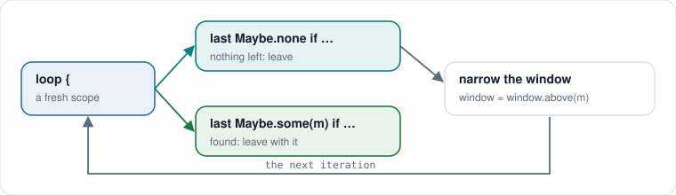

*Figure 9.1. One loop with its exits where the decision is made: the binary search of Section 9.9.*

- **The loop exits in the middle.** `find` is one `loop` with two exits:
  `last Maybe.none if window.empty()` when nothing is left to search, and
  `last Maybe.some(middle) if …` when the probe hits. The loop's value is
  the action's result, so there is no flag, no `found` variable and no code
  after the loop. This is the loop Knuth described, with its exit where the
  decision is made (Section 9.5).
- **The bounds are one value.** `Window` holds both bounds and knows the
  two facts the algorithm needs: whether it is empty and where its middle
  is. Narrowing is a successor, `above(middle)` or `below(middle)`, and
  `window = window.above(middle)` rebinds the local to it, which is allowed
  because `Window` declares successor actions (Section 13.7). The invariant
  "the answer, if any, is in `low..high-1`" lives in one object, not in two
  integers that must be updated together.
- **The midpoint cannot overflow.** `(low + high) / 2` divides two integers,
  which gives an exact rational, and `int(...)` truncates it (Chapter 5).
  The sum is an `int`, and Okkama integers grow instead of wrapping, so
  Bloch's bug has nothing to stand on. The second search makes the point
  with numbers: it finds the integer square root of 10^40, where `yes + no`
  is far beyond 2^64, with the same textbook midpoint.
- **A bracket states the invariant.** `Bracket` keeps a value known to pass
  the test (`yes`) and one known to fail it (`no`); the search is over when
  they are adjacent. The `loop` produces the answer as its value, and
  `root` is bound once.

The program is longer than the same search in C, by the two small objects.
In return each state of the search is a value with a name, the invariant has
a home, and the overflow that broke the library version cannot happen.

## 9.10 Expressions in other languages

Whether `if` is a statement or an expression looks like a matter of
syntax, but it decides how often a program declares a name before it knows
the value.

- **Statement languages add an expression form later.** C has the
  conditional operator `?:` beside `if`. Go has neither, so a value that
  depends on a condition is declared first and assigned in both branches
  [[Go specification](#ref-gospec)]. Python added a conditional expression, `a if c else b`, in
  2.5 [[PEP 308](#ref-pep308)], and an assignment expression, `:=`, in 3.8 [[PEP 572](#ref-pep572)].
  Java made `switch` usable as an expression in Java 14 [[Bierman 2020](#ref-jep361)].
- **Expression languages start from values.** In Rust a block's last
  expression is its value, and `if`, `match` and `loop` produce values;
  `break value` leaves a `loop` with one [[Klabnik 2023](#ref-klabnik2023)]. In Kotlin, `if`,
  `when` and `try` are expressions [[Kotlin specification](#ref-kotlinspec)].

Okkama is in the second group. A block has a value (Section 9.1), `if`,
`match` and `try` produce one, and a loop gives one through `last value`
(Section 9.5), much as Rust's `break value` does. What Okkama adds is the
other half of Section 9.2: the name a value is bound to is bound once, so
the pattern "declare, then assign in each branch" has nothing to assign to,
and the expression form is the only one.

## 9.11 What is not there

| Elsewhere | In Okkama |
|---|---|
| `while (c) { … }` | `loop { last if !c; … }` |
| `do { … } while (c)` | `loop { …; last if !c; }` |
| `break`, `continue` | `last`, `next` |
| `break outer` (labels) | an action and `return`, or a loop value |
| `x = x + 1`, `x += 1`, `x++` | a new name, `reduce`, a successor or a `Cell` |
| `c ? a : b` | `if c { a; } else { b; }` |
| `switch` with fall-through | `match`, several values per `case` |
| `goto` | none [[Dijkstra 1968](#ref-dijkstra1968)] |
| `if (c) statement;` | braces always |

The compiler knows this table. `while`, `do`, `+=` and its kin, `++`, `--`,
`break` and `continue` are rejected with a message that names the Okkama form
(issue #256):

```text
syntax error at "while": Okkama has no `while`: write `loop { last if !(condition); ... }`.
syntax error at "=": Okkama has no compound assignment: a name is bound once; bind a new name, or use `reduce` or a successor.
semantic error: Undefined variable "break"; Okkama leaves a loop with `last`
```

## 9.12 Limits

- **One binding per `for`.** An index comes from a range, not from a second
  binding.

Writing this chapter turned up three more: messages for `while`, `+=` and
`break` that did not name the Okkama form, `else if` that worked only where
`if` was a statement, and `return` and `throw` without a postfix condition.
All three were fixed in 0.4.1 (issues #256, #257, #258).

# Chapter 10. Failure: throw, panic, try/catch, causes, confirm

Every program meets two kinds of trouble, and they have little in common.

- **The world says no.** A file is missing, a server refuses the connection,
  a user types `sixty` where a number belongs, an account would go below
  zero. Nothing is wrong with the program: this is an outcome it must
  expect, and someone — the caller, or the caller's caller — knows what to
  do about it.
- **The program is wrong.** An index runs past the end of an array, an
  invariant the author was sure of turns out false, a divisor is zero where
  the code assumed it never would be. No caller can repair this, because
  the caller cannot know which assumption broke. The useful response is to
  stop, clean up, and report precisely where.

Okkama gives the two kinds two channels and does not let them mix. Expected
failures are **values**: cases of an *error enum*, thrown with `throw` and
caught with a typed `catch`. Bugs are **not values**: a `panic`, a failed
bare `confirm` or a runtime error ends the run after cleanup, and no
`catch` clause can see it. Everything in this chapter follows from that
split.

The program below imports a tiny ledger. Each line is `account,amount`. The
import can fail in four ways the caller cares about: a blank line, a line
of the wrong shape, an amount that is not a number, and an overdraft. Each
is a case of an error enum with the context in its payload. `report` turns
each failure into a sentence, and `try?` turns one into a fallback value.

```okkama
module bible/failure v1.0.0;

// A ledger import: every failure the import can report is a case of one
// error enum, and the context travels in the payload.
import "io/stdout" take Stdout;
import "strings/parse" take Number, InvalidInteger;

enum LineError is Error = (blank(line is int), shape(line is int, text is string), amount(line is int, cause is InvalidInteger));
enum LedgerError is Error = (line(cause is LineError), overdraft(account is string, short is int));

object Entry {
    has account is string;
    has amount is int;
    Entry(:account, :amount);
    name() is string { account; }
    value() is int { amount; }
}

object Lines {
    Lines();
    entry(number is int, text is string) is Entry {
        confirm text.length() > 0 else throw LineError.blank(number);
        let parts = text.split(",");
        confirm parts.size() == 2 else throw LineError.shape(number, text);
        let amount = try { Number(parts[1]).int(); } catch e is InvalidInteger { throw LineError.amount(number, e); };
        Entry(account: parts[0], amount: amount);
    }
}

object Ledger {
    has balance is int;
    Ledger(:balance);
    after(entry is Entry) is Ledger {
        let after = balance + entry.value();
        confirm after >= 0 else throw LedgerError.overdraft(entry.name(), 0 - after);
        Ledger(balance: after);
    }
    total() is int { balance; }
}

object Import {
    has lines is @string;
    Import(:lines);
    run(start is int) is int {
        let parser = Lines();
        let ledger = (0..lines.size()).reduce(Ledger(balance: start)) -> book, i {
            let entry = try { parser.entry(i + 1, lines[i]); } catch e is LineError { throw LedgerError.line(e); };
            book.after(entry);
        };
        ledger.total();
    }
}

main() is int {
    let out = Stdout();
    let report = (lines is @string, start is int) is string {
        try {
            "balance " + Import(lines: lines).run(start).string();
        }
        catch LedgerError.overdraft(account, short) {
            "overdraft on " + account + " by " + short.string();
        }
        catch LedgerError.line(cause) {
            match cause {
                case LineError.shape(line, text) { "line " + line.string() + " is not account,amount: " + text; }
                else { "rejected: " + cause.text(); }
            }
        }
        catch e is LedgerError {
            "rejected: " + e.text();
        }
    };
    out.writeln(report(["cash,100", "rent,-60", "food,-25"], 0));
    out.writeln(report(["cash,100", "rent,-160"], 0));
    out.writeln(report(["cash,100", "rent -60"], 0));
    out.writeln(report(["cash,100", "rent,sixty"], 0));
    out.writeln(report(["cash,100", ""], 0));
    let quick = try? Import(lines: ["cash,ten"]).run(0) else -1;
    out.writeln("quick " + quick.string());
    0;
}
```

Output:

```text
balance 15
overdraft on rent by 60
line 2 is not account,amount: rent -60
rejected: LineError.amount(2, InvalidInteger.source("sixty"))
rejected: LineError.blank(2)
quick -1
```

The rest of the chapter takes the pieces apart:

- the two channels, and why the history of error handling points at them;
- error enums and `throw`;
- `try`/`catch` and its deliberate omissions;
- causes, `confirm`, `try?` and `try!`;
- failures from the host;
- what reaches the top of the program.

Cleanup — `defer` and `destroy` — runs on these failure paths; Chapter 11 describes it. Budget stops have a separate rule (§10.13).

## 10.1 Who should hear about a failure

Before choosing a mechanism, it helps to sort failures by who can act on
them.

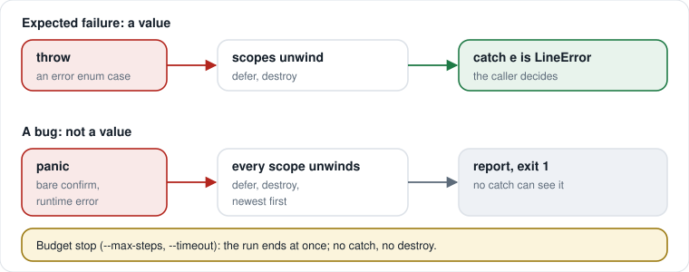

*Figure 10.1. Two channels. An expected failure is a value a caller catches; a bug ends the run after cleanup; a budget stop ends it at once.*

| Kind | Example | Who can act | Okkama |
|---|---|---|---|
| Expected failure | file not found, bad input, refused connection | the caller | error enum, `throw`, typed `catch` |
| Bug | index out of bounds, broken invariant | the developer, after reading the report | `panic`, `confirm`, runtime error: uncatchable |
| Exhaustion | step, memory or time budget spent | whoever started the run | budget stop: uncatchable, not a failure of the program |
| Cancellation | the task that awaited this work went away | the scheduler | `Cancelled` (Chapter 20) |

The first row is the only one where code *inside* the program can do
better than stop. A mechanism that treats all four rows alike — a single
`catch (Exception e)` that sees an out-of-bounds index and a missing file in
the same variable — invites code that "handles" a bug by logging it and
carrying on with corrupted state. Okkama's split is the table above turned
into syntax.

## 10.2 A short history: codes, exceptions, values

Error handling has been reinvented roughly once a decade, and each
reinvention fixed a real problem of the previous one.

**Return codes.** C reports failure through the return value and a global
`errno`. It costs nothing at run time, and nothing forces the caller to
look. Unix's `close` returns an error that almost no program ever checks,
and a full disk discovered on `close` is silently lost. The failure and the
normal result also share one channel: `-1` is both "error" and, for some
functions, a legitimate value.

**Exceptions.** John Goodenough's 1975 paper laid out the design space still
in use: how a failure is raised, how a handler is found, and whether control
*resumes* after the handler or *terminates* the failed operation
[[Goodenough 1975](#ref-goodenough1975)]. CLU, in 1979, chose termination and made each procedure
declare the exceptions it can signal; an undeclared one becomes a `failure`
[[Liskov 1979](#ref-liskov1979)]. That pair of choices — termination, and a distinction between
declared exceptions and everything else — is the ancestor of nearly every
modern design, Okkama's included.

**Exception hierarchies.** C++ and Java made exceptions objects of a class
hierarchy, caught by type [[Stroustrup 1994](#ref-stroustrup1994)]. Java went further with *checked*
exceptions: a method must declare in its signature the checked exceptions it
may throw, and the compiler verifies that each one is caught or passed on
[[Gosling 2023](#ref-gosling2023)]. Checked exceptions have been argued over ever since. The
usual complaint is that signatures fill with exception types that change with
the implementation, and callers wrap or swallow them to make the compiler
quiet. Java also kept a second, unchecked family, `RuntimeException` and
`Error`. That is CLU's distinction again, though a handler catching
`Exception` sees both.

**Errors as values.** Go returned to return values, but as a convention
rather than an accident: a function returns `(result, error)`, and the
caller checks `err != nil`. Rob Pike's "Errors are values" argues that an
error is data the program can compute with, not a special control path
[[Pike 2015](#ref-pike2015)]. The cost is repetition, and the old weakness of return codes:
nothing forces the check. Rust keeps the value approach but makes it
impossible to ignore: a fallible function returns `Result<T, E>`, which must
be unwrapped or propagated with `?`, and a separate mechanism, `panic!`, is
for bugs [[Klabnik 2023](#ref-klabnik2023)]. Two channels again.

**Let it crash.** Erlang drew the line most sharply. A process that meets a
condition it was not written for does not try to recover. It crashes, and a
supervisor that knows the larger picture restarts it in a known state
[[Armstrong 2003](#ref-armstrong2003)]. Defensive code that tries to handle every imaginable
failure locally is, in Armstrong's account, where reliability goes to die.

**Abandonment.** The design closest to Okkama's is the one Joe Duffy
describes for Midori, Microsoft's research operating system. Bugs — contract
violations, out-of-bounds indexing, arithmetic overflow — *abandon* the
whole process, with no chance for local code to intercept them.
Recoverable errors are declared in signatures and handled with a lightweight
`try` [[Duffy 2016](#ref-duffy2016)]. Duffy's argument is that the two need different
mechanisms. Code that treats a bug as recoverable continues in a state
nobody designed for, and a model without that option is both simpler and
more reliable.

The empirical record outside research systems agrees. Yuan and colleagues
studied 198 user-reported failures of five widely used distributed systems
(Cassandra, HBase, HDFS, Hadoop MapReduce and Redis). In 92% of the
catastrophic ones, the last step was the incorrect handling of a non-fatal
error the code had explicitly signalled. Many of the faulty handlers were
empty, or did nothing but log, or contained a `TODO` [[Yuan 2014](#ref-yuan2014)]. The lesson
is uncomfortable. Error handlers are code that rarely runs, so they are
rarely tested, so they are where the bugs live. A language cannot make
handlers correct, but it can make them fewer, typed and impossible to write
by accident.

Okkama takes from each step:

- From CLU and Midori: termination, and a hard line between declared
  failures and bugs.
- From Go and Rust: the declared failures are plain values.
- From Erlang: bugs are not handled locally at all.
- From Yuan et al.: no construct catches "anything".

## 10.3 Resumption: the road not taken

Goodenough's paper allowed two outcomes after a handler runs. *Termination*
abandons the failed operation; *resumption* lets the handler repair the
situation and the operation continues where it stopped [[Goodenough 1975](#ref-goodenough1975)].
PL/I's ON-conditions resumed, and so do the conditions of Common Lisp, the
most expressive error system in wide use. In Lisp, signalling a condition
does not unwind the stack: handlers run *on top of* the code that signalled,
and that code offers named *restarts* — use another value, retry, skip this
record — among which a handler higher up chooses [[Pitman 1996](#ref-hyperspec)]. The policy is
decided by the code that knows the larger picture, the mechanism by the code
that knows the details, and nothing is unwound until the choice is made.

C++ considered resumption and left it out. Stroustrup recounts that the
committee heard from people who had used resumption in large systems:
it was seldom used, and where it was used, a termination with a retry
written around it served as well [[Stroustrup 1994](#ref-stroustrup1994)]. Every widely used
language since has chosen termination.

Okkama terminates too, for two reasons of its own.

- **A resumed handler runs inside the failed scope.** Its resources are
  still owned and live, half-built objects included. Termination closes
  that scope first, and its resources are destroyed before any handler
  runs.
- **Restarts would be a second control-flow vocabulary.** What a restart
  offers can be said with what Okkama already has: a role the caller passes
  in. The low-level code asks the policy what to do, and the caller's
  policy decides.

```okkama
module bible/policy v1.0.0;

// What a Lisp restart offers, as a role: the code that meets a bad amount
// asks a policy the caller passed in, and the caller's policy decides.
import "io/stdout" take Stdout;
import "strings/parse" take Number;

enum AmountError is Error = (invalid(text is string));

role BadAmount {
    replacement(text is string) is Maybe<int>;
}

object Strict does BadAmount {
    Strict();
    replacement(text is string) is Maybe<int> { Maybe<int>.none; }
}

object Zero does BadAmount {
    Zero();
    replacement(text is string) is Maybe<int> { Maybe.some(0); }
}

object Amounts {
    has policy is BadAmount;
    Amounts(:policy);
    total(texts is @string) is int {
        texts.reduce(0) -> sum, text {
            let parsed = try? Number(text).int() else -1;
            let amount = if parsed >= 0 { parsed; } else {
                match policy.replacement(text) { case Maybe.some(n): n; case Maybe.none: throw AmountError.invalid(text); };
            };
            sum + amount;
        };
    }
}

main() is int {
    let out = Stdout();
    let texts = ["10", "x", "5"];
    out.writeln(Amounts(policy: Zero()).total(texts).string());
    out.writeln(try { Amounts(policy: Strict()).total(texts).string(); } catch e is AmountError { e.text(); });
    0;
}
```

Output:

```text
15
AmountError.invalid("x")
```

`Amounts` does not know whether a bad amount should count as zero or stop
the import. It asks its `BadAmount`, and only a `.none` answer becomes an
error. The decision stays with the caller, as with a restart. It is visible
in the type, travels as an ordinary value and can be faked in a test, and
no stack is held open while it is made.

## 10.4 Bugs are not values: panic and runtime errors

These end the run, whatever `catch` clauses surround them:

- `panic "message"` — the program's own declaration that something
  impossible happened. The message is any `string`, usually a literal
  sentence that names the assumption that broke.
- A bare `confirm condition;` whose condition is false (§10.9).
- **Runtime errors.** An index or slice out of bounds, division or modulo by
  zero, a failed narrowing of a role or `any` value. Each is detected during execution and reported as `RuntimeError: …`.

The run does not simply stop. It *unwinds*: every scope between the failure
and the top runs its `defer` blocks and destroys the resources it owns, in
reverse order (Chapter 11). The report then goes to standard error and the
process exits with status 1. Here is a withdrawal in which the program
throws an expected error for a zero amount, and panics on a case it
believes cannot happen:

```okkama
module bible/panic v1.0.0;

// A panic is not an error value: no catch clause sees it, and the run ends
// with exit status 1 after cleanup.
import "io/stdout" take Stdout;

enum Rejected is Error = (rejected);

object Account {
    has balance is int;
    Account(:balance);
    withdraw(amount is int) is Account {
        confirm amount > 0 else throw Rejected.rejected;
        confirm amount <= balance else panic "Withdrawal checked above, still overdrawn";
        Account(balance: balance - amount);
    }
    left() is int { balance; }
}

main() is int {
    let out = Stdout();
    let account = Account(balance: 50);
    out.writeln(try { account.withdraw(0).left().string(); } catch e is Rejected { "rejected: " + e.text(); });
    out.writeln(try { account.withdraw(80).left().string(); } catch e is Error { "never printed"; });
    0;
}
```

Output:

```text
rejected: Rejected.rejected
exit 1
```

The second `try` has a `catch e is Error`, the widest typed clause there is,
and it still does not run. The report names the panic, its location and the
call stack:

```text
Panic: Withdrawal checked above, still overdrawn
  --> 10-panic.ok:14:9
   |
14 |         confirm amount <= balance else panic "Withdrawal checked above, still overdrawn";
   |         ^^^^^^^^^^^^^^^^^^^^^^^^^^^^^^^^^^^^^^^^^^^^^^^^^^^^^^^^^^^^^^^^^^^^^^^^^^^^^^^^^
Stack trace (most recent call first):
  at Account.withdraw (10-panic.ok:14:9)
  at main (10-panic.ok:24:23)
```

A runtime error looks the same, with `RuntimeError:` in place of `Panic:`.
An index past the end prints `RuntimeError: Array index out of bounds`, and
`7 % d` with `d` zero prints `RuntimeError: Modulo by zero`, each with the
offending expression underlined.

Why not let the program catch these? Because a caught bug is a hidden bug.
A handler that catches an out-of-bounds index has no way to know which
assumption failed or what state the half-finished operation left behind. In
practice such a handler logs the error and lets the program carry on with
that state. That is the pattern Yuan et al. found at the root of
catastrophic failures. Stopping preserves the evidence. A long-running
service that must survive its own bugs does what Erlang does: it runs the
risky work in a separate unit (a task or a worker process) and lets the
supervising code react to the unit's death, not to the bug inside it.

## 10.5 Error enums

An expected failure is a value, and its type is an **error enum**: an enum
declared `is Error`. Its cases are the ways the component can fail, and
their payloads carry the context.

```okkama
enum LineError is Error = (
    blank(line is int),
    shape(line is int, text is string),
    amount(line is int, cause is InvalidInteger)
);
enum LedgerError is Error = (line(cause is LineError), overdraft(account is string, short is int));
```

The rules are short.

- **`is Error` is the only role an enum may declare.** An error enum is not
  generic, and it is always a *variant* enum. A `match` over it must cover
  every case or have `else`, even when no case has a payload.
- **Payloads are values.** A payload field may hold `string`, `int`, `byte`,
  `float`, `rat`, `bool` and enums whose payloads follow the same rule. That
  includes other error enums, which is how one failure carries another
  (`LedgerError.line(cause)`). Objects, roles, collections, `char`, actions
  and `any` are rejected. An error must survive the scope that raised it,
  and its owner's resources must not, so an error cannot hold a resource.
- **`text()` is generated.** It spells the case the way the source would:
  `LineError.blank(2)`, `LineError.amount(2, InvalidInteger.source("sixty"))`.
  Strings are written as Okkama string literals, escapes included: a
  payload with a quote and a line break prints back as
  `Ferr.text("a \"q\"\n")`, exactly as the source wrote it, so one payload
  never reads as two arguments and the report stays on one line (#306). Numbers
  use `string()`, booleans are `true`/`false`, and nested enums are written
  out recursively. The report of an uncaught error starts with it.

The role `Error` is built in and requires a public `text() is string`. Three
kinds of value do it:

- error enums;
- `NativeFailure`, a host failure (§10.11);
- `Cancelled`, a cancelled task (Chapter 20).

An object cannot. `object Fault does Error` is a compile error, and the
message names the fix:
``Object "Fault" cannot do Error: errors are enums, declare `enum Fault is Error = (...)` ``.

That rule is the most visible difference from Java or C#, and it is
deliberate. In those languages an exception is an object of a class
hierarchy. Callers catch a superclass to mean "any of these", the hierarchy
grows with the implementation, and fields are added to carry whatever
someone needed once. An error enum is a closed list, visible in one
declaration. Adding a case is a change every exhaustive `match` notices.
Grouping is explicit, because a component that wraps another component's
failures says so with a payload, not with a superclass. And since the value
is data, two errors compare by value and print the same.

One enum per component is the intended granularity. `LineError` is
everything the line parser can report, and `LedgerError` everything the
import can report, including "a line was bad" as a case that carries the
`LineError`.

## 10.6 throw

`throw` raises an expected failure. It takes an error enum value, an
`Error` reference — usually a caught error being passed on — or a
`NativeFailure`:

```okkama
throw LineError.blank(number);
throw LedgerError.line(e);        // a new error carrying the caught one
throw e;                          // pass on a caught error
throw;                            // rethrow the error being handled
```

Bare `throw;` exists only inside a `catch` body, and the compiler checks
that lexically. An action called from a `catch` body cannot rethrow
implicitly, because it cannot know what is being handled. Bare `throw;`
preserves the thrown value's identity and origin: the report still points
at the place where the error was first raised, not at the rethrow.

`throw` never produces a value, like `return`, so a `catch` body that throws
needs no value of its own. The parser in the opening example relies on
that:

```okkama
let amount = try { Number(parts[1]).int(); }
             catch e is InvalidInteger { throw LineError.amount(number, e); };
```

The `try` yields an `int`. The `catch` body never yields, because it throws.

`confirm condition else throw value;` (§10.9) is the guarded form, and it is
how most errors are raised in practice: a check, and the failure if the
check does not hold.

## 10.7 try and catch

`try` evaluates a block and, if the block throws, selects a `catch` clause
by the type of what was thrown:

```okkama
let message = try {
    "balance " + Import(lines: lines).run(start).string();
}
catch LedgerError.overdraft(account, short) {
    "overdraft on " + account + " by " + short.string();
}
catch e is LedgerError {
    "rejected: " + e.text();
};
```

The rules:

- **`try` is an expression and a statement.** Like `if`, it yields the value
  of the block that ran, the `try` body or the selected `catch` body. It can
  also stand alone as a statement.
- **At least one typed clause.** Each clause names its types, and the types
  must guarantee `Error`: `Error` itself, an error enum, `NativeFailure` or
  `Cancelled`. A clause can name several types, `catch e is DbError, NetError
  { … }`, and the binding then has the type `Error`.
- **Patterns instead of a binding.** A clause may list error enum cases with
  their payloads bound positionally, `_` for an ignored field:
  `catch LedgerError.overdraft(account, short) { … }`. A case of the right
  enum that does not match the pattern goes on to the next clause of the
  same `try`. Patterns are one level deep. `catch LedgerError.line(LineError.shape(line, text))`
  is rejected with `Expected a binding or _ in variant pattern`, so a nested
  cause is taken apart with a `match` in the clause body, as `report` does in
  the opening example.
- **Source order.** Clauses are tried top to bottom, and the first that fits
  wins. A failure no clause fits leaves the `try` unchanged, with its type,
  value and origin.
- **Separate scopes.** The `try` body and each `catch` body are separate
  child scopes. Names bound in the body are not visible in a clause, and the
  binding of a clause exists only in that clause.
- **Cleanup comes first.** Before a clause is selected, the `try` body's
  scope is closed: its `defer` blocks run and the resources it owns are
  destroyed, newest first. Only the thrown error's own payload survives into
  the clause. A failure during that cleanup does not replace the body's
  failure; it is attached to it (§10.8).

What `try` does not have is as important as what it has.

**No catch-all.** There is no `catch e { }` and no `catch (...)`. The
narrowest way to catch everything expected is `catch e is Error`. Even that
clause sees only thrown errors, never a panic, a runtime error or a budget
stop, and a reader sees in the source that it is the widest net. A
lowercase name alone does not compile:

```okkama
module bible/catch_all v1.0.0;

import "io/stdout" take Stdout;

main() is int {
    let text = try { "ok"; } catch e { "anything"; };
    Stdout().writeln(text);
    0;
}
```

The compiler answers:

```text
10-catchall-rejected.ok:6:38: syntax error at "{": Expect "is" after catch error name.
  |
6 |     let text = try { "ok"; } catch e { "anything"; };
  |                                      ^
```

**No `finally`.** Work that must happen whether the block succeeds or fails
is a `defer` in that block (Chapter 11). A `finally` clause would be a second
spelling of the same idea, and it would run in a different scope from the
code it cleans up after.

**No guards.** A clause cannot add a condition (`catch e is DbError if
e.retryable()`). The condition belongs in a case of the error enum, where
the thrower decides it once, not in each handler.

## 10.8 Causes

A failure often has a reason that is itself a failure. A storage error makes
an order fail, and a parse error makes a line fail. Okkama keeps the reason
in two ways.

**As a payload.** When the cause is part of what the caller needs to
decide, put it in the error:
`enum OrderError is Error = (storage(cause is StoreError), …)`. The cause is
then an ordinary value. The caller can match on it, `text()` prints it, and
it means the same.

```okkama
module bible/cause v1.0.0;

// Two ways to keep the cause of a failure: as a payload (a value the
// program can match), and as the runtime link a new error gets when it
// leaves a catch (for the report).
import "io/stdout" take Stdout;

enum StoreError is Error = (closed, full(limit is int));
enum OrderError is Error = (storage(cause is StoreError), rejected(reason is string));

object Store {
    Store();
    save(id is int) is int {
        if id > 2 { throw StoreError.full(2); }
        id;
    }
}

object Orders {
    has store is Store;
    Orders(:store);
    place(id is int) is int {
        try { store.save(id); } catch e is StoreError { throw OrderError.storage(e); }
    }
    explain(id is int) is string {
        try {
            self.place(id).string();
        }
        catch OrderError.storage(cause) {
            match cause {
                case StoreError.full(limit) { "store holds " + limit.string(); }
                case StoreError.closed { "store closed"; }
            }
        }
        catch e is OrderError { e.text(); }
    }
}

main() is int {
    let orders = Orders(store: Store());
    let out = Stdout();
    out.writeln(orders.explain(1));
    out.writeln(orders.explain(3));
    out.writeln(OrderError.storage(StoreError.full(2)).text());
    0;
}
```

Output:

```text
1
store holds 2
OrderError.storage(StoreError.full(2))
```

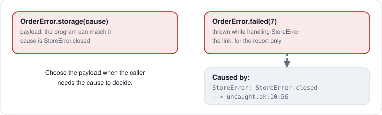

*Figure 10.2. A cause as a payload the program reads, and as a link the report prints.*

**As a runtime link.** Every new error raised while a `catch` body is
handling another one keeps the handled error as its *cause*, with its value,
origin and stack. This happens whether or not the new error mentions the old
one, so a `catch` that throws a less detailed error does not lose the
evidence. It also holds after an `await`. The link is diagnostic: the
program cannot read it, but the report of an uncaught failure prints it:

```text
OrderError: OrderError.failed(7)
Caused by:
  StoreError: StoreError.closed
  --> uncaught.ok:10:56
```

A `catch` body that completes normally leaves no link behind, so a later,
unrelated throw is not blamed on an old failure. Bare `throw;` keeps the
original carrier instead of creating a new one.

The third kind of extra failure is a **secondary**. When cleanup itself
fails while a scope unwinds from a failure, the cleanup failure does not
replace the original; it is attached to it as a secondary and reported
after it. The first failure is usually the one worth reading, and cleanup
code should not be able to hide it. Section 11.14 works through an example.

## 10.9 confirm: the contract inside the code

`confirm` states a condition the code relies on. It is Okkama's form of the
assertions of Design by Contract, in which preconditions, postconditions and
invariants are part of the program's text, not of its comments [[Meyer 1992](#ref-meyer1992)].
There are three forms, one per failure channel:

```okkama
confirm items.size() == 3;                            // a bug if false
confirm amount > 0 else throw Rejected.rejected;      // an expected failure
confirm amount <= balance else panic "Overdrawn";     // a bug, with a sentence
```

- **Bare `confirm`** is an internal invariant. If it fails, the run stops
  with `RuntimeError: confirm failed` and the location of the `confirm`.
- **`confirm … else throw`** is a precondition of a public action, checked
  against input the caller supplied. A false condition throws the given
  error, and the caller may catch it. Most errors in the standard library
  are raised this way. `Number(text).int()` starts with
  `confirm source.length() > 0 && source != "-" … else throw InvalidInteger.source(source);`.
- **`confirm … else panic`** is an invariant that deserves a sentence in the
  report.

The `else` at the top level of the condition belongs to `confirm`, even when
the condition ends in an index. `confirm size >= pair[1] else panic "short";`
runs the panic; before 0.5.6 the index took that `else` as its own fallback,
the sentence was lost and a false condition stopped with the bare `confirm
failed` (issue #521). An index or `Maybe` fallback inside a condition is
written in parentheses: `confirm size >= (pair[5] else 0) else throw …;`.

The condition must be a `bool`, and there is no way to switch `confirm` off.
A contract that disappears in production is a contract nobody tests, and a
`confirm` costs one evaluation of its condition.

## 10.10 try? and try!

Two prefix forms adapt a fallible expression to code that wants to treat
failure as a value, or as impossible:

```okkama
module bible/marks v1.0.0;

// try? turns a thrown error into Maybe.none; try! turns it into a panic.
import "io/stdout" take Stdout;
import "strings/parse" take Number;

main() is int {
    let out = Stdout();
    let port = try? Number("8080").int() else 80;
    let fallback = try? Number("http").int() else 80;
    out.writeln(port.string() + " " + fallback.string());
    let parsed = try? Number("12").int();
    out.writeln(match parsed { case Maybe.some(n): "some " + n.string(); case Maybe.none: "none"; });
    let sure = try! Number("42").int();
    out.writeln(sure.string());
    let broken = try! Number("forty-two").int();
    out.writeln(broken.string());
    0;
}
```

Output:

```text
8080 80
some 12
42
exit 1
```

- **`try? value`** has the type `Maybe<T>`. It is `Maybe.some(value)`, or
  `.none` if evaluating it throws any error. It combines with `else`, which
  supplies a fallback, and with `match` (Chapter 7). A
  void call cannot be wrapped, since there is no value to put in the
  `Maybe`, and neither can a successor result, since its must-use obligation
  would be lost.
- **`try! value`** keeps the type of the value and turns a thrown error into
  a panic, `Unexpected error: <text()>`, located at the `try!`. It says "this
  cannot fail here". When the author is wrong, the run stops with the
  original error in the report, not with a silently wrong value.

`T` is the type of the operand's successful paths. A branch that throws does
not erase it, even when a literal condition selects that branch:
`try? (if true { throw E.a; } else { 2; }) else 7` is `7`. When no path
succeeds, `T` comes from the `Maybe<T>` boundary or from the fallback after
`else`, and without either the compiler asks for one. A caught error leaves
`none`, so code after a `try?` is reachable even when its operand never
returns normally. A `throw` ends its own path, not the expression that
handles it (#307).

Both forms see thrown errors only. Panics and runtime errors pass through
them, and cleanup runs as for `try`. `try?` discards the error, so it is for
the cases where *why* something failed does not matter, such as a fallback
port or an optional setting. Where the reason matters, the error stays an
error.

## 10.11 Failures from the host

Code that reaches outside the program — files, sockets, processes,
databases, cryptography — gets the host's failures as values too. A native
provider reports a failure as a `NativeFailure` with a stable `domain`
(`core.fs`, `core.crypto`, …), a stable `code` (`not_found`,
`already_closed`, `invalid_input`, `permission_denied`, …), the canonical
`operation` that failed and a diagnostic `message`:

```okkama
try { open(path, 1, 0); }
catch failure is NativeFailure {
    failure.domain();     // "core.fs"
    failure.code();       // "not_found"
    failure.message();    // for people, never for branching
}
```

Code should branch on `domain` and `code` only. Raw `errno` values, host
exception classes and localized OS messages never become language values,
so a program behaves the same on macOS and Linux.

Most programs never see a `NativeFailure` directly. The standard library
catches it at the boundary and rethrows a typed error that belongs to the
module's own vocabulary. `crypto/error` turns a `NativeFailure` with
`invalid_input` into `InvalidCryptoInput.because(message)`, `permission_denied`
into `AuthenticationFailed.failed`, and anything else into
`CryptoUnavailable`. A program that uses `crypto/kdf` catches the crypto
errors, not the host's codes.

An *unexpected* host error, one the provider has no stable code for, is not
a `NativeFailure`. It is a runtime error and ends the run.

`Cancelled` is the failure a task sees when the work it awaited was
cancelled. Chapter 20 explains it with structured concurrency.

## 10.12 A boundary in practice

The pieces meet at module boundaries. Below is a settings loader. Reading the
file can fail in the file system's terms, and parsing can fail in the
loader's own terms. The caller should see only the loader's terms.

```okkama
module bible/config v1.0.0;

// A settings loader at a module boundary: the file system's failures arrive
// as FileError (std turned the host's NativeFailure into it), and the loader
// answers in its own vocabulary, ConfigError.
import "io/stdout" take Stdout;
import "fs/path" take Path;
import "fs/file" take File;
import "fs/error" take FileError;

enum ConfigError is Error = (missing(path is string), unreadable(path is string), syntax(line is int, text is string));

object Settings {
    has pairs is %string:string;
    Settings(:pairs);
    value(key is string, fallback is string) is string { pairs[key] else fallback; }
    size() is int { pairs.size(); }
}

object SettingsText {
    has text is string;
    SettingsText(:text);
    settings() is Settings {
        let lines = text.split("\n").filter() -> line { line.length() > 0; };
        let pairs is %string:string = (0..lines.size()).reduce([:]) -> found, i {
            let parts = lines[i].split("=");
            confirm parts.size() == 2 else throw ConfigError.syntax(i + 1, lines[i]);
            found + [parts[0]: parts[1]];
        };
        Settings(pairs: pairs);
    }
}

object SettingsFile {
    has path is string;
    SettingsFile(:path);
    settings() is Settings {
        let text = try {
            File(path: Path(path)).text().content();
        }
        catch FileError.not_found(_) {
            throw ConfigError.missing(path);
        }
        catch failure is FileError {
            throw ConfigError.unreadable(path);
        };
        SettingsText(text: text).settings();
    }
}

main() is int {
    let out = Stdout();
    let parsed = SettingsText(text: "port=8080\nhost=example.org\n").settings();
    out.writeln(parsed.value("host", "localhost") + ":" + parsed.value("port", "80"));
    let describe = (load is () is Settings) is string {
        try { "loaded " + load().size().string(); }
        catch ConfigError.missing(path) { "no file " + path + ", using defaults"; }
        catch ConfigError.syntax(line, text) { "line " + line.string() + " is not key=value: " + text; }
        catch e is ConfigError { e.text(); }
    };
    out.writeln(describe(() is Settings { SettingsFile(path: "no-such-settings.conf").settings(); }));
    out.writeln(describe(() is Settings { SettingsText(text: "port=8080\nverbose\n").settings(); }));
    0;
}
```

Output:

```text
example.org:8080
no file no-such-settings.conf, using defaults
line 2 is not key=value: verbose
```

Three things happen at the boundary.

1. `fs/file` already caught the host's `NativeFailure` and rethrew it as a
   case of `FileError`, here `FileError.not_found(path)`. The loader never
   touches a host code directly.
2. The loader translates once, in one place. A missing file becomes
   `ConfigError.missing(path)`, the case a caller is likely to handle, by
   falling back to defaults. Any other file-system failure becomes
   `ConfigError.unreadable(path)`.
3. The caller's `describe` names the cases it handles and lets
   `catch e is ConfigError` print the rest. Nothing outside the loader
   mentions `FileError`. If the loader one day reads settings from a
   database, its callers do not change.

The two `catch` clauses read in order: the one case the loader turns into
its own meaning first, then the rest of the enum. A clause binds what it
needs from the case and drops the rest with `_`.

## 10.13 Budgets are not failures

A run can be given budgets: `--max-steps`, `--max-memory`, `--max-output`
and `--timeout`. Running out of one is neither an expected failure nor a
bug in the program. It is the environment withdrawing permission to
continue. The run ends with `Execution budget exhausted: steps` (`memory`,
`output`) or `Execution interrupted` and exit status 1. No `catch` sees it,
not even `catch e is Error`, and `destroy` does not run, because the
budget would be spent again by the cleanup.

Budget stops are observed at these points:

- every step, function entry and loop iteration;
- inside a long sort;
- between the rounds of a PBKDF2 derivation.

A native that cannot look, such as an Argon2 hash or a blocking read, ends
when it ends. With `--timeout`, the command line then stops the run at most a
second after the deadline.

## 10.14 Failures across tasks

`await` passes a task's failure to the awaiting code unchanged: same type,
same value, same origin. The awaiting code catches it like any other:

```okkama
module bible/tasks v1.0.0;

// A failure crosses await unchanged: the awaiting task catches it by type.
import "io/stdout" take Stdout;

enum FetchError is Error = (timeout(host is string), refused(host is string));

object Fetcher {
    has host is string;
    Fetcher(:host);
    async body() is string {
        if host == "slow.example" { throw FetchError.timeout(host); }
        "page from " + host;
    }
}

async main() is int {
    let out = Stdout();
    let fast = spawn Fetcher(host: "fast.example").body();
    let slow = spawn Fetcher(host: "slow.example").body();
    out.writeln(await fast);
    let text = try { await slow; } catch FetchError.timeout(host) { "gave up on " + host; };
    out.writeln(text);
    0;
}
```

Output:

```text
page from fast.example
gave up on slow.example
```

Two rules make concurrent failure as strict as sequential failure.

- **A failure is never lost.** If a spawned task fails and no one awaits
  it, the run itself fails: the report is printed and the process exits
  with status 1, even when `main` returned 0. A forgotten task cannot hide
  an error. This is a deliberate choice, and the conformance suite pins it
  (`L08.shutdown.unobserved-failure`).
- **Cancellation is a failure value of its own.** When the work a task
  awaited is cancelled, the task sees `Cancelled`, which does `Error` and
  can be caught. Structured await (Chapter 20) guarantees that the task
  resumes only after the cancelled work has finished its cleanup.

Within one run, a bug in any task ends the run, as it does in sequential
code. A program that must outlive its own bugs needs a boundary a bug cannot
cross, which is Erlang's lesson again. In Okkama that boundary is a separate
process, supervised from outside (Chapter 21).

## 10.15 What reaches the top

An error that no `catch` handles unwinds the whole run like a panic: cleanup
runs scope by scope, and the process exits with status 1. The report
starts with the error's type and `text()`, then gives the location of the
`throw`, the cause chain and the call stack:

```text
OrderError: OrderError.failed(7)
Caused by:
  StoreError: StoreError.closed
  --> uncaught.ok:10:56
   |
10 |         try { self.save(id); } catch e is StoreError { throw OrderError.failed(id); }
   |                                                        ^^^^^^^^^^^^^^^^^^^^^^^^^^^^
Stack trace (most recent call first):
  at Orders.place (uncaught.ok:10:56)
  at main (uncaught.ok:14:17)
```

`main` returns the exit status of a successful run, and it must be in
0–255. A larger value is reported as `RuntimeError: main() must return an
int in 0..255, got N`, so the success channel and the failure channel stay
apart here too.

## 10.16 Designing an error vocabulary

A module's error enums are part of its public API, as much as its actions.
The standard library follows a handful of rules, and they work outside it
too.

- **One enum per kind of failure the caller tells apart.** `strings/parse`
  has `InvalidInteger`. `crypto/error` has `InvalidCryptoInput`,
  `AuthenticationFailed` and `CryptoUnavailable`, because a caller reacts
  differently to bad input, a forged message and a missing algorithm.
- **Name the case after what happened, not after who noticed.**
  `ConfigError.missing(path)`, not `ConfigError.file_system_error`. The
  caller decides from what happened. Who noticed is in the stack trace.
- **Put in the payload what the caller needs to act, and nothing else.**
  A line number for a syntax error, the missing amount for an overdraft.
  The host's message goes into a diagnostic payload at most. It is not
  stable across platforms, and code must never branch on it.
- **Translate at the boundary, once.** A module catches the failures of
  the modules it uses and rethrows them in its own terms, as the settings
  loader does. Failures that pass through many layers unchanged tie every
  caller to the bottom layer.
- **Wrap when the caller needs the cause, pass on when it does not.**
  `LedgerError.line(cause)` wraps because the caller may want to know which
  line failed and how. `throw e;` passes on when the module has nothing to
  add.
- **Do not use errors for control flow.** A lookup that may find nothing
  returns `Maybe` (Chapter 7), not an error. An error says the operation
  could not do what it promised. A missing optional value is not that.

## 10.17 Testing failures

A failure is part of an action's contract, so it gets tests like the
successful path. The test runner (`okkama run -t`) provides
`test.throws(Type) { … }`, which passes when the block throws a value of
that type and fails otherwise. When the payload matters, a `try` with a
pattern says exactly which case is expected:

```okkama
test "an overdraft is refused with the missing amount" {
    test.throws(LedgerError) { Account(balance: 50).withdraw(80); };
    let short = try { Account(balance: 50).withdraw(80).left(); }
                catch LedgerError.overdraft(missing) { missing; };
    test.is(short, 30);
}
```

A panic or a runtime error inside a test fails that test, not the whole
run: the runner isolates each test, reports `--- FAIL` with the message, and
goes on to the next one.

Error handlers are rarely exercised in production, and that is where
Yuan et al. found the catastrophic bugs. A failure path that a test has
never run is a guess. Chapter 15 returns to tests, fakes and properties.

## 10.18 Okkama among other languages

| Language | Expected failure | Bug | Forced to handle? | Catch everything | Cleanup |
|---|---|---|---|---|---|
| Java | checked exception (declared) | `RuntimeException`, `Error` | checked ones, by the compiler | `catch (Throwable t)` | `finally`, try-with-resources |
| Kotlin | exception (all unchecked); `Result` in the library | exception | no | `catch (e: Throwable)` | `finally`, `use { }` |
| Go | `error` value | `panic` | no, by convention | `recover()` in a deferred call | `defer` |
| Rust | `Result<T, E>` | `panic!` | warned if ignored (`#[must_use]`) | `catch_unwind`, discouraged | `Drop` |
| Haskell | `Either`, `Maybe`; exceptions in `IO` | `error`, exceptions | by the type, for `Either` | `catch` on `SomeException` | `bracket` |
| Okkama | error enum value, thrown | `panic`, `confirm`, runtime error | no | none (`catch e is Error` sees thrown errors only) | `defer`, `destroy` |

Two columns set Okkama apart. In the bug column it is the only language in
the table where a bug cannot be caught at all; Rust comes closest. In the
catch-everything column it is the only one where no construct catches
everything. Okkama is weaker in the "forced to handle" column: nothing makes
a caller deal with an error, and the compiler does not know which errors an
action can throw.

## 10.19 What this design costs

The two channels are a strong opinion, and opinions cost something.

- **More declarations.** Every component that can fail declares an error
  enum. A Java programmer reaches for `IllegalArgumentException`. An Okkama
  programmer writes a case.
- **No catch-all.** Code that really means "any expected failure" writes
  `catch e is Error`, and code that wants to survive bugs has to put the
  risky work in a separate task or process. That is more structure than a
  `catch (Throwable t)`. Okkama counts it as a feature; a programmer who
  needs a quick script may not.
- **Signatures do not say what an action throws.** CLU and Java's checked
  exceptions put the failures in the signature, and Midori did too. Okkama
  does not: the caller learns from the documentation and the source which
  error enums an action may throw, and the compiler does not check that a
  caller handles them. Declaring them would bring back the churn checked
  exceptions are known for; not declaring them leaves a gap a reader must
  fill.
- **Errors cannot carry objects.** An error that would naturally hold the
  request that failed must hold the request's identifying values instead.
- **Patterns are one level deep.** A nested cause is taken apart with a
  `match` in the clause body.
- **The runtime cause chain is for reports only.** A program cannot walk
  it. A cause the program must inspect has to be a payload.
- **No named handlers yet.** A handler shared by several `try` blocks has to
  be an action called from each clause. Named catch handlers were proposed
  and declined as too magical
  ([#148](https://github.com/Okkama-lang/okkama/issues/148)).

Against these costs stands what the design removes:

- handlers that swallow bugs;
- exception hierarchies that grow with the implementation;
- `finally` blocks that clean up in the wrong scope;
- error messages that differ between platforms;
- the guess, at every `catch`, about what might arrive there.

The next chapter takes up the other half of the story: what runs when a
scope ends, on success or failure.

# Chapter 11. defer and destroy: deterministic resources

Memory is not the only thing a program borrows. Files, sockets, transactions, locks, temporary directories and child processes need timely release. Okkama manages memory automatically and guarantees resource release at scope exit.

Two constructs give resources back:

- **`defer`** registers work to run when the current block ends.
- **`destroy`** declares, in an object, what releasing that object means. The
  scope that *owns* the object runs it when the scope ends.

Both run on every exit from a scope: normal completion, `return`, `last`,
`next`, a thrown error, a panic, and the cancellation of an async task. The
program below opens handles in a block, in a called action and in a loop,
and prints every open and close:

```okkama
module bible/resources v1.0.0;

// A resource is an object with destroy. The scope that owns it destroys it
// when the scope ends, newest first, after the scope's defer blocks.
import "io/stdout" take Stdout;

object Log {
    Log();
    line(text is string) is void { Stdout().writeln(text); }
}

object Handle {
    has name is string;
    has log is Log;
    Handle(:name, :log) { log.line("open " + name); }
    label() is string { name; }
    destroy { log.line("close " + name); }
}

object Opener {
    has log is Log;
    Opener(:log);
    kept(name is string) is Handle {
        let temp = Handle(name: name + ".tmp", log: log);
        Handle(name: name, log: log);
    }
}

main() is int {
    let log = Log();
    {
        let a = Handle(name: "a", log: log);
        let b = Handle(name: "b", log: log);
        defer log.line("defer 1, sees " + a.label());
        defer log.line("defer 2");
        let alias = a;
        log.line("body uses " + alias.label() + " and " + b.label());
    }
    log.line("after the block");
    let kept = Opener(log: log).kept("report");
    log.line("caller holds " + kept.label());
    for [1, 2] -> i {
        let step = Handle(name: "step" + i.string(), log: log);
    }
    log.line("end of main");
    0;
}
```

Output:

```text
open a
open b
body uses a and b
defer 2
defer 1, sees a
close b
close a
after the block
open report.tmp
open report
close report.tmp
caller holds report
open step1
close step1
open step2
close step2
end of main
close report
```

The output reads like a contract.

- The block's `defer`s run first, newest first. Then its resources are
  destroyed, newest first: `b` before `a`.
- `alias` names the same object as `a`, and `a` is closed once.
- The action `kept` closes its temporary handle when it returns, and the
  handle it returns lives on in `main` until `main` ends.
- Each loop iteration closes its own handle before the next begins.

This chapter explains those rules, their origins and their costs.

## 11.1 Memory and resources are different problems

Automatic memory management alone does not promise timely resource release. A program can exhaust file descriptors or database connections while still having plenty of memory; these resources need an explicit lifetime tied to scopes.

*Finalizers*, code the collector runs when it reclaims an object, were the
first answer, and they failed. Hans Boehm showed that a finalizer runs at
an unpredictable moment, on an unpredictable thread, possibly after other
objects it needs have been finalized, and that making finalizers correct
requires synchronization most programmers never write [[Boehm 2003](#ref-boehm2003)]. Java
deprecated `Object.finalize` and then marked finalization for removal
[[Christian 2021](#ref-jep421)]. Its replacement is explicit: `try`-with-resources, which closes
an `AutoCloseable` at the end of a block.

When a `destroy` runs is determined by the program’s scopes and ownership, independently of memory pressure.

## 11.2 The lineage

Deterministic cleanup has three ancestors, and Okkama takes from each.

- **Destructors.** C++ ties a resource to the lifetime of a scoped object:
  the constructor acquires it and the destructor releases it when the scope
  ends, whatever the exit. Stroustrup calls the idiom "resource
  acquisition is initialization" [[Stroustrup 1994](#ref-stroustrup1994)]. Rust keeps the idea,
  as `Drop`, and adds ownership checked at compile time, so a value is
  dropped exactly once by its single owner [[Klabnik 2023](#ref-klabnik2023)].
- **Block-scoped release.** Python's `with` statement [[Rossum 2005](#ref-pep343)], Java's
  `try`-with-resources and C#'s `using` release a resource at the end of a
  block. The call site must remember to use the construct; forgetting it
  compiles.
- **`defer`.** Go and Swift register a call that runs when the function
  (Go) or the block (Swift) exits. It handles work that is not about one
  object, such as an audit line, restoring a setting or removing a file.

Okkama's `destroy` is a destructor: the object says how it is released, and
callers do not have to remember. Its `defer` is Swift's: block-scoped, not
function-scoped. Ownership, the question "who runs the destructor", follows
object identity at run time, not a static borrow checker (§11.5).

## 11.3 defer

```okkama
defer log.line("defer 1, sees " + a.label());
```

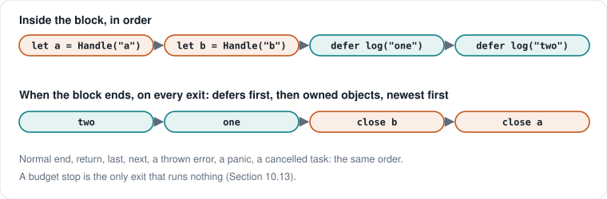

*Figure 11.1. What runs when a block ends: defers first, then the objects the block owns, newest first.*

A reached `defer` registers its expression and runs it exactly once when
the block that contains it ends.

- **The expression is evaluated at exit, not at registration.** The receiver
  and the arguments are read when the block ends. In the opening example
  the first `defer` sees `a`, which is still alive, because `defer`s run
  before the block's resources are destroyed.
- **Only reached `defer`s count.** A `defer` in a branch that did not run
  registers nothing.
- **Newest first.** The `defer`s of a block run in reverse order of
  registration, and then the block's owned resources are destroyed, also
  newest first.
- **The current block, not the function.** A `defer` inside a loop body runs
  at the end of that iteration, and one inside an inner block runs when the
  inner block ends. This is Swift's rule, not Go's.
- **Every `defer` is attempted.** If one fails, the remaining ones still run.
  An existing failure of the body has priority. The failure of a `defer`
  cancels a pending `return`, and otherwise the first `defer` failure wins.
- **A `defer` may await.** In an async action, `defer await audit.flush();`
  suspends the scope's exit until the work is done, cancellation included.
- **The discard rules still apply.** A `defer` cannot silently drop a value
  that must be used, such as the result of a successor action.

`defer` is for work that belongs to a block. Releasing a resource belongs
to the resource, and that is `destroy`.

## 11.4 destroy

```okkama
object Handle {
    has name is string;
    Handle(:name) { Stdout().writeln("open " + name); }
    destroy { Stdout().writeln("close " + name); }
}
```

An object has at most one `destroy` block. It is not an action: nothing can
call it. It runs once, when the scope that owns the object ends.
It may read `self` and the fields, and call actions. It cannot assign fields
through a successor: the object is being released, not updated.

The order of destruction is fixed:

1. Inside one scope, objects are destroyed in reverse order of construction,
   so a resource opened later, which may depend on an earlier one, is
   released first.
2. An owner is destroyed before the objects held in its fields. Its
   `destroy` still sees intact fields, and the fields are destroyed after
   it, newest first. The session in §11.7 shows the order:
   `end session`, `close s2.out`, `close s2.in`.
3. Every identity enters destruction at most once. That holds even when its
   `destroy` fails, and even when the `destroy` makes an alias of `self`.

A `destroy` that fails does not stop the others. Every remaining resource
is still destroyed, and the failure is reported. If the scope was already
unwinding from a failure, the cleanup failure is attached to that failure as
a secondary (Chapter 10), not put in its place.

The standard library's resources combine `destroy` with an explicit
`close()`. A `File` or a `TlsConnection` does `Closing`, whose `close()` is
idempotent, and its `destroy` closes it too. Code that wants to release
early calls `close()`, and code that forgets gets the same release at scope
exit.

## 11.5 Who owns what

"The scope that owns the object" needs a definition, and Okkama's is about
identities, not names.

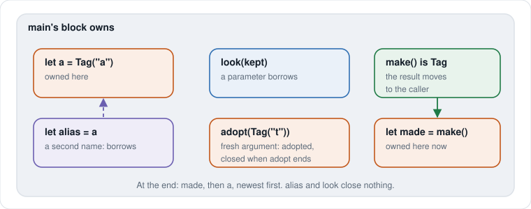

*Figure 11.2. Who owns what: a binding owns, an alias and a parameter borrow, a fresh argument is adopted, a result moves to the caller.*

- **A binding owns a fresh object.** `let a = Handle(...)` makes the block
  of the `let` the owner of the new handle.
- **An alias borrows.** `let alias = a;` creates a second name for an object
  the scope already owns. No second owner appears, so there is no double
  destroy.
- **Parameters and receivers borrow.** An action that receives an existing
  object does not own it. A *fresh* argument nobody owns yet, such as
  `use(Handle(...))`, is adopted by the called action and destroyed when it
  returns, unless the action returns it.
- **A returned object moves to the caller.** When an action ends, the
  resources reachable from its result are released from its ownership and
  taken over by the caller. In the opening example, `kept` closes
  `report.tmp` and hands `report` to `main`.
- **Aggregates carry identities.** An array, a map, the fields of an object
  and an `any` box hold the identities they contain. A fresh resource put
  into a fresh array is owned by whoever owns the array, and repeated
  references never duplicate ownership.
- **A cap is its owner.** A cap (Section 12.8) carries the object it was
  taken from. Returned from an action, it moves the object and its
  resources to the caller; taken from an object a scope owns, it borrows.
- **Successors are independent.** A successor action returns a new object
  with a new identity and its own lifetime (Chapter 13).
- **Loop iterations are scopes.** What an iteration owns is destroyed when
  the iteration ends. A value the loop produces, through `last value` or the
  result of `map`, `reduce` and the other functional operations, moves to
  the enclosing scope.
- **Branches are scopes.** An `if`, `match`, `try` or `catch` branch destroys
  what it owns when it ends, its last `let` included, in reverse order. Only
  a value the branch produces and the program uses moves out:
  `let log = if verbose { File.create(a); } else { File.create(b); };`
  (#308; before 0.4.2 the last `let` of a branch lived until the enclosing
  scope ended).

One program walks through the rules in order. Every `Tag` says when it is
destroyed, so the output shows which scope owned it:

```okkama
module bible/owners v1.0.0;

import "io/stdout" take Stdout;

object Tag {
    has name is string;

    Tag(:name);

    label() is string { name; }

    destroy { Stdout().writeln("  destroy " + name); }
}

object Desk {
    Desk();

    // A parameter borrows: the caller's tag outlives this action.
    look(tag is Tag) is int { tag.label().length(); }

    // A fresh argument is adopted, and destroyed when the action returns.
    adopt(tag is Tag) is int { tag.label().length(); }

    // A returned object moves to the caller.
    make(name is string) is Tag { Tag(name: name); }
}

main() is int {
    let out = Stdout();
    let desk = Desk();
    out.writeln("alias");
    {
        let a = Tag(name: "a");
        let alias = a;
        out.writeln("  " + alias.label() + " has one owner");
    }
    out.writeln("parameter");
    let kept = Tag(name: "kept");
    desk.look(kept);
    out.writeln("  still here: " + kept.label());
    out.writeln("fresh argument");
    desk.adopt(Tag(name: "adopted"));
    out.writeln("returned");
    {
        let made = desk.make("made");
        out.writeln("  main owns " + made.label());
    }
    out.writeln("aggregate");
    {
        let tags = [Tag(name: "first"), Tag(name: "second")];
        out.writeln("  " + tags.size().string() + " in the array");
    }
    out.writeln("loop");
    for ["x", "y"] -> name {
        let t = Tag(name: name);
        out.writeln("  iteration " + t.label());
    }
    out.writeln("branch");
    if kept.label().length() > 0 {
        let b = Tag(name: "branch");
        out.writeln("  inside " + b.label());
    }
    out.writeln("end");
    0;
}
```

Output:

```text
alias
  a has one owner
  destroy a
parameter
  still here: kept
fresh argument
  destroy adopted
returned
  main owns made
  destroy made
aggregate
  2 in the array
  destroy second
  destroy first
loop
  iteration x
  destroy x
  iteration y
  destroy y
branch
  inside branch
  destroy branch
end
  destroy kept
```

- `alias` names `a` a second time; `a` is destroyed once, when its block ends.
- `look` borrows `kept`, which is still there after the call and lives until
  `main` ends.
- `adopt` receives a tag nobody owned yet and destroys it when it returns.
- `make` returns its tag, so `main`'s block owns `made` and destroys it there.
- The array owns both tags and destroys them in reverse order of creation.
- Each loop iteration and the `if` branch destroy what they own when they end.

The conformance suite pins the same rules: alias borrowing, returned
resources, independent successors, branch scopes and resources gathered by
`reduce`.

### A role can hide a resource

A field typed by a role holds whichever implementation it was given, and
ownership follows that value, not the type. `Ledger` is done by `Account`,
which has nothing to close, and by `Vault`, which has a `destroy`. A `Record`
built with an account owns nothing to release; one built with a vault owns
the vault. Every tenth record below holds a vault, and the array of records
that `records` returns moves to the caller with the three vaults in it:

```okkama
module bible/role_resource v1.0.0;

import "io/stdout" take Stdout;

// Any ledger answers its balance; only a vault holds something to close.
role Ledger {
    balance() is int;
}

object Account does Ledger {
    has amount is int;

    Account(:amount);

    balance() is int { amount; }
}

object Vault does Ledger {
    has amount is int;

    Vault(:amount);

    balance() is int { amount * 2; }

    destroy { Stdout().writeln("  vault " + amount.string() + " closed"); }
}

object Record {
    has id is int;
    has ledger is Ledger;

    Record(:id, :ledger);

    total() is int { ledger.balance(); }
}

object Bank {
    Bank();

    // Every tenth record holds a vault; the array of records is returned.
    records(count is int) is @Record {
        (0..count).map() -> i {
            let ledger is Ledger = if i % 10 == 0 { Vault(amount: i); } else { Account(amount: i); };
            Record(id: i, ledger: ledger);
        };
    }
}

main() is int {
    let out = Stdout();
    {
        let records = Bank().records(25);
        let sum = records.reduce(0) -> total, record { total + record.total(); };
        out.writeln("main owns 25 records, total " + sum.string());
    }
    out.writeln("the block ended");
    0;
}
```

Output:

```text
main owns 25 records, total 330
  vault 20 closed
  vault 10 closed
  vault 0 closed
the block ended
```

- The vaults are made inside a `map` in `Bank.records`. The array they end
  up in is that action's result, so they move to the block in `main` with
  it.
- Nothing closes while the block reads them: `reduce` borrows every record.
- When the block ends, the three vaults close, newest first. The other
  twenty-two records hold accounts, and nothing happens to them.

A role does not make its values resources; each value decides for itself.
Code that holds a `Ledger` reads the same whether the ledger behind it has
something to close or not, and nothing is closed where nothing is held.

### An Atomic names, it does not own

`Atomic` is the mutable cell tasks share (Section 13.11), and it borrows.
Putting an object into it does not move the object, and the cell does not keep
it alive: the object is destroyed when its owner's scope ends, whatever the
cell still names.

```okkama
module bible/atomic_borrows v1.0.0;

import "io/stdout" take Stdout;
import "async/atomic" take Atomic;

object Lamp {
    has name is string;

    Lamp(:name);

    label() is string { name; }

    destroy { Stdout().writeln("  " + name + " off"); }
}

main() is int {
    let out = Stdout();
    let hall = Lamp(name: "hall");
    // The cell names a lamp; it does not own one.
    let current = Atomic(hall);
    {
        let desk = Lamp(name: "desk");
        current.replace(desk);
        out.writeln("the cell names " + current.value().label());
    }
    // desk's block has ended, and so has desk: the cell still names it.
    out.writeln("after the block the cell names " + current.value().label());
    current.replace(hall);
    out.writeln("the cell names " + current.value().label() + " again");
    0;
}
```

Output:

```text
the cell names desk
  desk off
after the block the cell names desk
the cell names hall again
  hall off
```

- `hall` is owned by `main`, and the cell starts by naming it.
- `desk` is owned by the inner block. The cell names it from the inside of the
  block, and the block still destroys it when it ends.
- After the block the cell names a lamp that is already off. Its fields can
  still be read, but whatever it held has been closed, and a call that needs
  the resource fails as a closed one does (Section 11.10).

The rule is the price of a cell that many tasks may read: if writing to it
moved ownership, the cell would become an owner that no scope closes. Put into
an `Atomic` what outlives it, an object its own scope owns, or keep the owner
in a task that lives as long as the cell (Section 20.6).

## 11.6 Resources in collections and closures

Containers do not own; they carry. A map of handles, an array of
connections and a closure that captured a socket all hold identities, and
whoever owns the container owns what it holds.

```okkama
module bible/containers v1.0.0;

// Resources inside a map, and inside a closure: the container carries their
// identities, so whoever owns the container owns them.
import "io/stdout" take Stdout;

object Handle {
    has name is string;
    Handle(:name) { Stdout().writeln("open " + name); }
    label() is string { name; }
    destroy { Stdout().writeln("close " + name); }
}

object Pool {
    Pool();
    named(names is @string) is %string:Handle {
        let first is %string:Handle = [names[0]: Handle(name: names[0])];
        (1..names.size()).reduce(first) -> found, i { found + [names[i]: Handle(name: names[i])]; };
    }
    greeter(name is string) is () is string {
        let handle = Handle(name: name);
        () is string { "hello from " + handle.label(); };
    }
}

main() is int {
    let out = Stdout();
    {
        let handles = Pool().named(["db", "cache"]);
        out.writeln("using " + handles["cache"].label());
    }
    out.writeln("map released");
    {
        let greet = Pool().greeter("socket");
        out.writeln(greet());
    }
    out.writeln("closure released");
    0;
}
```

Output:

```text
open db
open cache
using cache
close cache
close db
map released
open socket
hello from socket
close socket
closure released
```

The map built in `named` leaves the action as its result, so `main`'s inner
block owns both handles and closes them when it ends, newest first. The
closure returned by `greeter` captured `handle`. The handle therefore moves
with the closure, the closure keeps it usable, and it closes when the block
that holds the closure ends, not when `greeter` returns.

Two consequences are worth stating.

- **Removing an element does not release it.** Maps and arrays are values:
  removing a key with `-` builds a new map, while the old map, still owned,
  keeps the handle. A resource is released when its owner's scope
  ends, not when the last collection that mentions it is computed.
- **A closure is as much an owner's tool as a field.** A callback that keeps
  a connection alive keeps it alive exactly as long as the callback is
  reachable from an owning scope. That is usually what the author meant, and
  when it is not, the remedy is to pass the connection as an argument
  instead of capturing it.

## 11.7 Cleanup on the failure path

Cleanup does not depend on how a scope ends. A thrown error unwinds through
the same `defer`s and `destroy`s as a normal exit, and so do a panic and a
runtime error. A `try` closes its body's scope *before* it chooses a
`catch` clause, so a clause never runs while the failed body still holds
resources.

```okkama
module bible/unwind v1.0.0;

// On a failure the same cleanup runs: the try body's resources are closed
// before a catch clause is chosen. A constructor that fails cleans what it
// opened, and its unfinished object is never destroyed.
import "io/stdout" take Stdout;

enum Refused is Error = (refused(name is string));

object Handle {
    has name is string;
    Handle(:name) { Stdout().writeln("open " + name); }
    destroy { Stdout().writeln("close " + name); }
}

object Session {
    has input is Handle;
    has output is Handle;
    Session(name is string, allowed is bool) {
        input = Handle(name: name + ".in");
        confirm allowed else throw Refused.refused(name);
        output = Handle(name: name + ".out");
    }
    destroy { Stdout().writeln("end session"); }
}

main() is int {
    let out = Stdout();
    let result = try {
        let first = Handle(name: "first");
        defer out.writeln("defer in try");
        throw Refused.refused("body");
        "unreachable";
    }
    catch Refused.refused(name) {
        "caught " + name;
    };
    out.writeln(result);
    out.writeln(try { Session("s1", false); "made"; } catch e is Refused { "session refused: " + e.text(); });
    {
        let ok = Session("s2", true);
        out.writeln("session open");
    }
    0;
}
```

Output:

```text
open first
defer in try
close first
caught body
open s1.in
close s1.in
session refused: Refused.refused("s1")
open s2.in
open s2.out
session open
end session
close s2.out
close s2.in
```

Three rules are visible.

- In the first `try`, `defer in try` and `close first` print before
  `caught body`. The catch clause runs after the body's cleanup.
- `Session("s1", false)` opens `s1.in` and then fails its `confirm`. The
  handle it opened is closed. The session itself was never finished, so its
  `destroy` does not run: an object that did not finish construction is
  never released as if it had.
- A finished session is destroyed owner first: `end session`, then its
  fields, newest first.

The thrown error's own payload survives the cleanup: it moves into the
matching `catch` clause. It cannot hold a resource in any case
(Chapter 10), so the move releases nothing early.

## 11.8 async destroy

Some resources cannot be released instantly. A connection must flush what
it buffered, and a server must let its requests drain. Their `destroy` has
to wait, and Okkama lets it: `async destroy` (#154).

```okkama
module bible/async_destroy v1.0.0;

// A destroy that must wait is async: it is awaited where the owning scope
// of an async action ends, before the action's result is delivered.
import "io/stdout" take Stdout;

object Channel {
    has name is string;
    Channel(:name);
    async flush() is int { Stdout().writeln("flush " + name); 1; }
}

object Connection {
    has channel is Channel;
    Connection(:channel);
    send(text is string) is void { Stdout().writeln("send " + text); }
    async destroy {
        let flushed = await channel.flush();
        Stdout().writeln("closed after " + flushed.string() + " flush");
    }
}

object Client {
    Client();
    async talk() is string {
        let connection = Connection(channel: Channel(name: "c1"));
        connection.send("hello");
        "talked";
    }
}

async main() is int {
    let said = await Client().talk();
    Stdout().writeln(said);
    0;
}
```

Output:

```text
send hello
flush c1
closed after 1 flush
talked
```

- **It is awaited where the owner's scope ends**, in the same reverse
  order as other `destroy`s, on every exit, a failure included. `talk`
  delivers its result only after the connection has flushed and closed.
- **A cancellation does not interrupt it.** A task cancelled while an async
  destroy runs gets `Cancelled` at its next `await`, after the scope has
  closed. Cleanup that can be interrupted halfway is worse than no cleanup.
- **Only async code may own such an object.** A synchronous scope has
  nothing to suspend, so owning one there is a compile error:

```okkama
module bible/async_owner v1.0.0;

object Connection {
    Connection();
    async destroy { 0; }
}

object Client {
    Client();
    talk() is int {
        let connection = Connection();
        1;
    }
}

main() is int { Client().talk(); }
```

The compiler answers:

```text
11-async-owner-rejected.ok:11:26: semantic error: Connection has an async destroy; own it in an async action
```

The rule is transitive. An object that holds an async-destroy resource in a
field, an array or a map has to be owned in async code too. Borrowing one,
by passing it to a synchronous action that does not keep it, is fine.

An async destroy replaces a pattern that needed two `defer`s, a `close` and
an awaited `settled()`. In 0.4.2 the standard library dropped 33 helper
objects that existed only to await one child in cleanup, because a
structured `await` already waits for it
([#264](https://github.com/Okkama-lang/okkama/issues/264)). In 0.6.2 nine of
its remaining cleanup guards, in the HTTP client and server and in TCP,
moved from `defer await` onto `async destroy`, which costs no more than the
deferred close it replaces
([#329](https://github.com/Okkama-lang/okkama/issues/329)).

## 11.9 Resources and tasks

A task is a scope too. What an async action makes and keeps is released
when the action's task ends. What it returns moves to the scope that awaits
it, exactly as a synchronous result moves to its caller:

```okkama
module bible/task_resources v1.0.0;

// Tasks own what they make: a resource a task keeps to itself is released
// when the task ends; one it returns moves to the scope that awaits it.
import "io/stdout" take Stdout;

object Handle {
    has name is string;
    Handle(:name) { Stdout().writeln("open " + name); }
    label() is string { name; }
    destroy { Stdout().writeln("close " + name); }
}

object Worker {
    has name is string;
    Worker(:name);
    async count() is int {
        let scratch = Handle(name: name + ".scratch");
        scratch.label().length();
    }
    async opened() is Handle {
        let temp = Handle(name: name + ".tmp");
        Handle(name: name);
    }
}

async main() is int {
    let out = Stdout();
    let length = await Worker(name: "w1").count();
    out.writeln("counted " + length.string());
    {
        let handle = await Worker(name: "w2").opened();
        out.writeln("awaited " + handle.label());
    }
    out.writeln("end");
    0;
}
```

Output:

```text
open w1.scratch
close w1.scratch
counted 10
open w2.tmp
open w2
close w2.tmp
awaited w2
close w2
end
```

`w1.scratch` closes before `counted` is printed: the task that made it has
ended. `w2.tmp` closes inside `opened`, and `w2` lives in the block that
awaited it, until that block ends.

A task that is never awaited still releases what it owns when it finishes,
and a cancelled task unwinds through its scopes like a failure, async
destroys included (Chapter 20). A resource cannot outlive its owner
unnoticed by escaping into a forgotten future.

## 11.10 Close early, destroy anyway

Scope exit is the latest moment a resource is released, not the only one.
The resources of the standard library follow one pattern:

- an idempotent `close()`, part of the `Closing` role;
- `closed()`, to ask whether it already happened;
- a `destroy` that calls `close()`.

Code that knows it is done releases early. Code that forgets, or fails
halfway, still gets the release when the scope ends.

```okkama
module bible/closing v1.0.0;

// The standard library's resources pair an idempotent close() with a destroy
// that calls it: release early when you can, and the scope still releases
// whatever you forgot.
import "io/stdout" take Stdout;
import "fs/directory" take Directory;
import "fs/path" take Path;
import "fs/entry" take FileEntry;
import "fs/temp" take TemporaryDirectory;

object Workspace {
    Workspace();
    used(parent is Directory) is bool {
        let scratch = TemporaryDirectory(parent, "bible-");
        let where = scratch.path();
        let before = FileEntry(where).existence();
        scratch.close();
        scratch.close();
        before && !FileEntry(where).existence() && scratch.closed();
    }
    forgotten(parent is Directory) is Path {
        let scratch = TemporaryDirectory(parent, "bible-");
        scratch.path();
    }
}

main() is int {
    let out = Stdout();
    let parent = Directory(Path("."));
    out.writeln("closed early, twice: " + Workspace().used(parent).string());
    let left = Workspace().forgotten(parent);
    out.writeln("closed by destroy: " + (!FileEntry(left).existence()).string());
    0;
}
```

Output:

```text
closed early, twice: true
closed by destroy: true
```

`used` closes its temporary directory twice. The second call does nothing,
and the directory is gone before the action returns. `forgotten` never
calls `close()`: the directory is removed when `forgotten` ends, because
the action owned it and returned only its path, a plain value.

The pattern costs one rule for authors of resource objects: `close()` must
be idempotent, and every other action of a closed resource should fail with
a catchable `already_closed`, not misbehave.

## 11.11 Replacing a resource: rebinding keeps, folding releases

A log that rotates its file is a resource that is replaced over and over.
In Okkama the replacement is a successor, `rotated()`, which builds a new
`Log` around a new `Segment`. Where the old `Log` goes then depends on how
the program holds it, and the two usual ways give different lifetimes.

```okkama
module bible/rotation v1.0.0;

// A successor that replaces a resource: rebinding keeps every old segment
// open until the scope ends; a fold releases each one as the next is made.

import "io/stdout" take Stdout;

object Segment {
    has name is string;
    Segment(:name) { Stdout().writeln("open " + name); }
    destroy { Stdout().writeln("close " + name); }
    name() is string { name; }
}

object Log {
    has current is Segment;
    has index is int;
    Log(:index) { current = Segment(name: "log." + index.string()); }
    rotated() is ^Log {
        ^current = Segment(name: "log." + (index + 1).string());
        ^index = index + 1;
    }
    name() is string { current.name(); }
}

object Runs {
    Runs() {}
    rebound() is void {
        let log = Log(index: 0);
        for 1..=3 -> n {
            log = log.rotated();
            Stdout().writeln("writing to " + log.name());
        }
        Stdout().writeln("done rebound");
    }
    folded() is void {
        let final = (1..=3).reduce(Log(index: 0)) -> log, n { log.rotated(); };
        Stdout().writeln("writing to " + final.name());
        Stdout().writeln("done folded");
    }
}

main() is int {
    Runs().rebound();
    Stdout().writeln("--");
    Runs().folded();
    0;
}
```

Output:

```text
open log.0
open log.1
writing to log.1
open log.2
writing to log.2
open log.3
writing to log.3
done rebound
close log.3
close log.2
close log.1
close log.0
--
open log.0
open log.1
close log.0
open log.2
close log.1
open log.3
close log.2
writing to log.3
done folded
close log.3
```

- **Rebinding keeps every old value.** In `rebound`, `log = log.rotated()`
  gives the name a new value, but it does not destroy the old one early: the
  old `Log` belongs to the scope that declared `log`, and its `destroy` runs
  when that scope ends (Section 13.7). All four segments stay open until
  `done rebound`, and then close newest first. For three rotations this is
  harmless; for a server that rotates every hour and runs for a month, it is
  a file per hour held open until the action returns.
- **A fold releases each value.** In `folded`, `reduce` passes each `Log`
  to the next step and keeps only what the step returns. Each step is an
  iteration, and an iteration's scope ends with it (Section 11.5), so the
  old segment closes as soon as its successor exists: `open log.1`, then
  `close log.0`. Only the last `Log` leaves the loop.

The rule behind both is the one this chapter has used throughout: a
resource lives as long as the scope that owns it, not as long as a name
refers to it. A long-running program that replaces a resource should
therefore replace it inside a scope that ends: a fold, a loop iteration
that produces the next value, or a state owner whose request handler is
such a scope (Section 20.6). Rebinding a name in a scope that lives for the
whole program is the one shape to avoid.

## 11.12 A worked example: a connection pool

A pool is the textbook case where resources outlive the code that uses them.
In Okkama a pool is an ordinary object whose field holds its connections;
lending one out is a borrow, and nothing else is needed.

```okkama
module app v1.0.0;

import "io/stdout" take Stdout;

object Connection {
    has id is int;
    Connection(:id) { Stdout().writeln("open " + id.string()); }
    query(text is string) is string { "#" + id.string() + " " + text; }
    destroy { Stdout().writeln("close " + id.string()); }
}

// The pool owns its connections through its field; lending one only borrows it.
object Pool {
    has connections is @Connection;
    Pool(size is int) {
        self.connections = (1..=size).map() -> id { Connection(id: id); };
    }
    lend(turn is int) is Connection { connections[turn % connections.size()]; }
    destroy { Stdout().writeln("drain pool of " + connections.size().string()); }
}

object Worker {
    has pool is Pool;
    Worker(:pool);
    run(jobs is @string) is int {
        for 0..jobs.size() -> turn {
            Stdout().writeln(pool.lend(turn).query(jobs[turn] else ""));
        }
        jobs.size();
    }
}

main() is int {
    let out = Stdout();
    {
        let pool = Pool(size: 2);
        let done = Worker(pool: pool).run(["select 1", "select 2", "select 3"]);
        out.writeln(done.string() + " jobs");
    }
    out.writeln("after the block");
    0;
}
```

Output:

```text
open 1
open 2
#1 select 1
#2 select 2
#1 select 3
3 jobs
drain pool of 2
close 2
close 1
after the block
```

- **The pool owns, through its field.** The constructor builds an array of
  fresh connections with `map`, and the array becomes the pool's field, so
  the pool's owner owns every connection in it (§11.5).
- **Lending borrows.** `lend` returns a connection that the pool still owns.
  The worker queries it and never closes it: a borrower cannot destroy what
  it does not own, and no "return to pool" call exists to be forgotten.
- **One end, in a fixed order.** When the block that holds the pool ends, the
  pool's own `destroy` runs first and sees intact connections, then the
  connections close, newest first: `drain pool of 2`, `close 2`, `close 1`.
  The worker's three jobs used the connections in turn and released nothing.

What the example does not do is as telling. There is no reference counting
on the connections and no `release` in a `finally`. The worker holds the pool
it borrowed and lives inside the same block, so every connection it used is
still owned when it uses it, and released once, by the pool's owner. A pool
that must hand a connection to code that outlives it moves the connection
out instead, and that is a different, visible operation.

## 11.13 A worked example: commit or roll back

A transaction is the classic resource whose release depends on how the work
ended: if the work finished, commit; if anything went wrong, roll back. In
Okkama the rollback is the transaction's `destroy`, and the commit is an
explicit call.

```okkama
module app v1.0.0;

import "io/stdout" take Stdout;
import "async/atomic" take Atomic;

enum Rejected is Error = (amount(cents is int));

// A transaction rolls back unless it was committed before its scope ended.
object Transaction {
    has label is string;
    has committed is Atomic<bool>;
    Transaction(:label) {
        self.committed = Atomic(false);
        Stdout().writeln(label + ": begin");
    }
    commit() is void {
        committed.replace(true);
        Stdout().writeln(label + ": commit");
    }
    destroy {
        if !committed.value() {
            Stdout().writeln(label + ": rollback");
        }
    }
}

object Shop {
    Shop();
    order(label is string, cents is int) is string {
        let tx = Transaction(label: label);
        confirm cents > 0 else throw Rejected.amount(cents);
        Stdout().writeln(label + ": charge " + cents.string());
        tx.commit();
        label + " done";
    }
}

main() is int {
    let out = Stdout();
    let shop = Shop();
    out.writeln(shop.order("first", 250));
    let second = try { shop.order("second", -5); }
        catch Rejected.amount(cents) { "second refused: " + cents.string(); };
    out.writeln(second);
    0;
}
```

Output:

```text
first: begin
first: charge 250
first: commit
first done
second: begin
second: rollback
second refused: -5
```

- **The rollback cannot be skipped.** Whatever path leaves `order` — the
  `confirm` that refuses a non-positive amount, a failure further down, a
  bug — the transaction's scope ends and its `destroy` runs (§11.7). The
  second order shows it: `begin`, then `rollback`, then the caller's
  `catch`.
- **The commit is the one decision.** Without `tx.commit()` the transaction
  rolls back, so forgetting the commit loses the work instead of half-doing
  it. The commit is the last step of `order` that can change the outcome.
- **What `destroy` must see is a field it can read.** The flag is an
  `Atomic<bool>`, declared in the object, where a reader sees it. A
  successor would be the wrong tool here: `committed()` returning `^Transaction`
  would make a new identity with its own lifetime (§11.5), and the original,
  never committed, would still be destroyed and roll back.

Other languages put the same decision in different places. Python's
`sqlite3` connection, used as a context manager, commits or rolls back when
the `with` block ends [[Python sqlite3](#ref-pysqlite3)]; D's `scope(failure)` runs a block only
when the scope is left by an exception [[D specification](#ref-dscope)]. Both depend on the caller
writing the construct at every use. In Okkama the transaction carries the
rule itself: there is no way to hold one that its scope will not settle.

## 11.14 When cleanup itself fails

Releasing can fail as well. A journal that flushes its buffer when it is
released may find the disk full, and a connection may fail to send its
goodbye. Section 11.4 stated the rule in one sentence; this example shows
what it means:

```okkama
module bible/cleanupfails v1.0.0;

// A destroy that fails does not stop the others. On a normal exit the first
// cleanup failure becomes the failure; on a failing exit the original stays,
// and cleanup failures ride along as secondaries.
import "io/stdout" take Stdout;

enum Unflushed is Error = (full(name is string));
enum Rejected is Error = (empty);

// A journal flushes its buffer when it is released; a full disk refuses.
object Journal {
    has name is string;
    has disk_full is bool;

    Journal(:name, :disk_full);

    destroy {
        Stdout().writeln("flush " + name);
        confirm !disk_full else throw Unflushed.full(name);
    }
}

object Export {
    has rows is int;

    Export(:rows);

    run() is string {
        let orders = Journal(name: "orders", disk_full: true);
        let audit = Journal(name: "audit", disk_full: false);
        let metrics = Journal(name: "metrics", disk_full: true);
        confirm rows > 0 else throw Rejected.empty;
        rows.string() + " rows";
    }
}

main() is int {
    let out = Stdout();
    let quiet = try {
        Export(rows: 3).run();
    }
    catch e is Unflushed {
        "export failed: " + e.text();
    };
    out.writeln(quiet);
    out.writeln("--");
    let refused = try {
        Export(rows: 0).run();
    }
    catch e is Rejected {
        "export refused: " + e.text();
    }
    catch e is Unflushed {
        "export failed: " + e.text();
    };
    out.writeln(refused);
    0;
}
```

Output:

```text
flush metrics
flush audit
flush orders
export failed: Unflushed.full("metrics")
--
flush metrics
flush audit
flush orders
export refused: Rejected.empty
```

- **Every `destroy` runs.** Two of the three journals fail to flush, and
  `audit` and `orders` are still flushed after `metrics` fails. A failed
  release does not stop the others, so one full disk cannot leak a file
  handle.
- **On a normal exit, the first cleanup failure becomes the failure.**
  `run` would have returned "3 rows". It throws `Unflushed.full("metrics")`
  instead: `metrics` was released first, newest first, so its failure came
  first. The other failure, from `orders`, is attached to it as a
  secondary.
- **On a failing exit, the original failure stays.** With no rows, `run`
  throws `Rejected.empty`, and that is what the caller catches. Both flush
  failures happened while unwinding from it, and they ride along as
  secondaries instead of replacing it. A failure in cleanup cannot hide the
  failure that caused the cleanup.
- **Secondaries are for the reader, not the program.** A `catch` receives
  only the primary failure. A program cannot list secondaries and decide by
  them. The report of an uncaught failure prints them:

```text
Rejected: Rejected.empty
Secondary cleanup failure:
  Unflushed: Unflushed.full("metrics")
Secondary cleanup failure:
  Unflushed: Unflushed.full("orders")
  --> cleanup.ok:33:9
```

The question is old, and languages have answered it in four ways.

- **C++ forbids the failure.** A destructor that throws while the stack
  unwinds from another exception ends the program with `std::terminate`.
  Since C++11, destructors are `noexcept` unless they say otherwise.
  Stroustrup's guarantees of exception safety assume destructors that do
  not throw [[Stroustrup 2001](#ref-stroustrup2001)]. A release that can fail must therefore
  report it some other way, or not at all.
- **Python keeps both by chaining.** An exception raised while another is
  being handled keeps the first as its `__context__`, and the traceback
  shows both [[PEP 3134](#ref-pep3134)]. But the new exception is the one that propagates.
  A failing `__exit__` or `finally` replaces the original as the thing the
  caller catches.
- **Go leaves it to the programmer.** `defer f.Close()` discards the error
  unless the code captures it. Since Go 1.20, `errors.Join` combines
  several errors into one value, so the deferred close and the original
  error can travel together, if the programmer writes it [[Go 1.20 Release Notes](#ref-go120)].
- **Java suppresses.** `try`-with-resources closes resources in reverse
  order, and a close does not stop the others. An exception from the body
  propagates, and close failures are added to its suppressed list. When
  only closes fail, the failure of the resource closed first propagates,
  and the rest are suppressed on it (JLS §14.20.3 [[Gosling 2023](#ref-gosling2023)]).

Okkama's rule is Java's, with two differences. It applies to every owned
resource at every scope end, not only inside a `try` that names the
resource. And the suppressed list is not a value a program can read. Java's
`getSuppressed()` lets a handler branch on a cleanup failure that was not
the reason the code failed. Okkama keeps the handler on the reason, and it
leaves the secondaries to the person reading the report.

## 11.15 What is not promised

Deterministic cleanup has limits, and they are worth knowing.

- **A scope that never ends never cleans up.** A `loop` without an exit
  keeps its resources until the process ends.
- **A killed process runs nothing.** `kill -9`, a power failure or an
  out-of-memory kill from the operating system skip every `destroy`.
  Durable state needs a transaction or a write-ahead design, not a
  destructor.
- **A budget stop runs no `destroy`.** When `--timeout` or another budget
  ends the run, cleanup does not run, since it would spend the budget again
  (Chapter 10). The process exits, and the operating system closes what
  the process held.
- **A `destroy` cannot be retried.** It runs at most once. If it fails, the
  failure is reported and the identity is considered released.

## 11.16 What this design costs

- **Ownership is checked at run time, not at compile time.** Rust rejects a
  program that would release a value twice or use it after release. Okkama
  prevents the double release by construction (at most once per identity),
  but a program can still use a closed resource. The `Closing` objects of
  the standard library answer that with a catchable `already_closed`
  failure, not with undefined behaviour.
- **Async destroy constrains the owner.** A synchronous library cannot own
  a resource whose release must wait. It has to borrow one or become
  async.
- **Cleanup order is fixed.** Newest first, owner before fields. A program
  that needs another order must express it with `defer`, or by nesting
  scopes.

Against that stands what the design removes:

- `finally` blocks;
- forgotten `close()` calls;
- finalizers and their surprises;
- resource leaks that show up only under load.

All of it comes from two constructs and one rule: the scope that owns a
resource releases it.

# Chapter 12. Objects, fields and constructors

Part IV is about objects, and Okkama has nothing else to put behaviour in.
There are no free functions, no static methods, no classes with class-level
state and no inheritance. A program is objects calling objects, and a
`main` that creates the first of them. Chapter 2 told the history that
led here, and Chapter 3 the rules. This chapter shows what an object is in
the language: its fields, its constructors, its actions and the few things
it may not do.

```okkama
module bible/objects v1.0.0;

// An object: private fields, explicit constructors that check their input,
// public behaviour, hidden helpers. Its state never changes.
import "io/stdout" take Stdout;

enum InvalidCash is Error = (negative(cents is int));

object Cash {
    has digit is int;
    has cents is int = 0;
    has currency is string = "USD";

    Cash(digit is int, cents is int) {
        self.digit = digit;
        self.cents = cents;
        confirm digit * 100 + cents >= 0 else throw InvalidCash.negative(digit * 100 + cents);
    }
    Cash(:digit, :currency);

    total() is int { self.in_cents(digit) + cents; }
    label() is string { currency + " " + self.total().string(); }

    hidden in_cents(units is int) is int { units * 100; }
}

object Bag {
    has items is @int;
    Bag() { items = []; }
    Bag(items is ...int) { self.items = items...; }
    size() is int { items.size(); }
}

main() is int {
    let out = Stdout();
    out.writeln(Cash(3, 25).label());
    out.writeln(Cash(digit: 2, currency: "EUR").label());
    out.writeln(Bag().size().string() + " " + Bag(1, 2, 3).size().string());
    out.writeln((Cash(1, 0) == Cash(1, 0)).string());
    out.writeln(try { Cash(-1, 50).label(); } catch e is InvalidCash { e.text(); });
    0;
}
```

Output:

```text
USD 325
EUR 200
0 3
true
InvalidCash.negative(-50)
```

The rest of the chapter takes that program apart:

- `Cash` holds three fields and never changes them;
- it has two constructors, one of which checks its input;
- it exposes behaviour (`total`, `label`), never its fields;
- a helper marked `hidden` is callable only by `Cash` itself;
- two `Cash` values with the same fields are equal;
- `Bag` shows an empty and a variadic constructor side by side.

## 12.1 Declaring an object

```okkama
object Cash {
    has digit is int;
    has cents is int = 0;
    has currency is string = "USD";
    Cash(digit is int, cents is int) { … }
    total() is int { … }
    hidden in_cents(units is int) is int { … }
}
```

An object declaration has a name and a body, and nothing else: the header
takes no parameters, because state is declared only by `has`. The name is a
type name and starts with an upper-case letter. Two objects of one module
cannot share a name. The body may hold:

- `has` fields;
- constructors, at least one;
- actions, public or marked `hidden`;
- at most one `destroy` (Chapter 11);
- `cap` contracts (§12.8);
- test blocks.

The order of these parts does not matter to the compiler. The style used in
the standard library and in this book puts fields first, then constructors,
then the public actions, then the hidden ones.

An object is not a class in the Java sense. There is no `extends`, no
`super`, no `protected`, no abstract or virtual method, no static member.
Sharing behaviour between objects is done by composition: an object holds
another and calls it. Sharing a contract between objects is done with roles
(Chapter 14). The rationale is Chapter 2's: implementation inheritance
couples a subclass to every detail of its superclass, and the fragile base
class problem is the result [[Mikhajlov 1998](#ref-mikhajlov1998)]. Composition couples it only
to a contract.

## 12.2 Fields are private and permanent

`has` is the only way to declare state.

```okkama
has digit is int;                 // required: a constructor must bind it
has cents is int = 0;             // optional: a default
has given, family is string;      // several names, one type
has currency = "USD";             // the type comes from the initializer: string
```

**A field's type may come from its initializer.** `has currency = "USD";`
declares a `string` field exactly as `has currency is string = "USD";` does.
This is inference at compile time, not dynamic typing: the compiler takes
the initializer's static type once, every object keeps that one type, and
constructors and successors are checked against it as against a written
type. Only the initializer gives the type, never a constructor's
assignment, so `has digit;` is an error that asks for the type. An
initializer that settles no type, such as an empty `[]` or `[:]`, needs the
type written (`has items is @string = [];`), and nothing widens to `any`.

Two rules make fields different from fields in most languages.

**A field is private to its object.** Code outside the object cannot read
it, not even with the same type in the same module:

```okkama
module bible/private_field v1.0.0;

object Cash {
    has cents is int;
    Cash(:cents);
}

main() is int {
    Cash(cents: 1).cents;
}
```

The compiler answers:

```text
12-field-rejected.ok:9:20: semantic error: Field "cents" of object "Cash" is private; call an action instead
```

The message says what to do instead: call an action. That is the Elegant
Objects rule "no getters" turned into a compile error [[Bugayenko 2016](#ref-bugayenko2016)]. A
caller who needs something derived from the state asks the object for the
*behaviour* (`total()`, `label()`), and the object decides how to compute
it. The idea is Parnas's information hiding: a module's data
representation is the decision most likely to change, so it is the one to
hide [[Parnas 1972](#ref-parnas1972)].

**A field never changes.** Outside a constructor there is no assignment to a
field at all:

```okkama
module bible/assign v1.0.0;

object Counter {
    has count is int;
    Counter(:count);
    bump() is int {
        count = count + 1;
        count;
    }
}

main() is int { 0; }
```

The compiler answers:

```text
12-assign-rejected.ok:7:9: semantic error: Field "count" cannot be assigned after construction: objects are immutable; return a successor instead (`is ^Counter` and `^count = …`)
```

The fix the message suggests is the subject of Chapter 13: an action that
returns a *successor*, a new object with updated fields. A value is the
same value for as long as anyone holds it. Concurrent tasks can share it
without a lock, and a caller cannot be surprised by a change made behind
its back.

Inside the object, a field is read by its bare name (`cents`) or as
`self.cents`. A parameter or a local may shadow the bare name, and
`self.cents` then still means the field. Field defaults are evaluated for
each construction, before the constructor body, in the scope of the
declaration: a default may use literals, other declarations and imports,
but not the caller's locals and not other fields of the object being built.

## 12.3 Constructors are explicit

Every object declares at least one constructor, even an object without
fields. None is generated from the fields:

```okkama
object Marker {
    Marker();
}
```

An object with fields and no constructor is an error, `Object "Marker" must
declare a constructor`, even if nothing ever constructs it. The rule is
deliberate. A generated constructor would make the field list part of every
caller's code, and adding a field would silently change how the object is
made.

A **full constructor** has parameters and a body. The body binds fields, with
`field = value;` or `self.field = value;`, and may run any other statement:

```okkama
Cash(digit is int, cents is int) {
    self.digit = digit;
    self.cents = cents;
    confirm digit * 100 + cents >= 0 else throw InvalidCash.negative(digit * 100 + cents);
}
```

- A field bind is legal only inside a constructor body and its nested
  blocks, while the object is being built. A later bind of the same field
  replaces an earlier one, and once the constructor returns the field never
  changes. Outside constructors the only `name = value;` is the rebinding of
  a local to its successor (Section 13.7).
- Every field must be bound or defaulted by the end of the constructor.
  Otherwise the compiler reports `Object "Cash" field "cents" was not
  initialized`.
- Parameters may have defaults, as an action's may (Section 13.2):
  `Cash(digit is int, cents is int = 0)` is called as `Cash(3)`.
- The call uses positional or named arguments, never a mix:
  `Cash(3, 25)` or `Cash(digit: 3, cents: 25)`. Positional arguments bind to
  the constructor's *parameters*, not to the order of the fields.

## 12.4 Shorthand constructors

Most constructors only copy their arguments into fields. The shorthand says
so in one line:

```okkama
Cash(:digit, :currency);
```

`:digit` names a field, and the constructor takes an argument of the field's
name and type and binds it. The list is a closed allow-list:

- **Named arguments only.** `Cash(digit: 2, currency: "EUR")` works, and
  `Member(7)` is rejected with `Constructor of "Member" takes named
  arguments only: write Member(id: …, name: …)` before any argument is
  evaluated. A listed field that has a default may be left out of the call.
- **Unlisted fields cannot be supplied.** They take their defaults, or the
  constructor's body must bind them.
- **A bodyless shorthand must complete the object.** If an unlisted field has
  no default, the declaration is an error: `Constructor shorthand for
  "Member" cannot initialize required field "name"`.
- **A shorthand may have a body.** The listed fields are bound first, and
  then the body runs. It may bind the remaining fields and check the input:
  `Score(:value) { confirm value >= 0 else throw InvalidScore.negative(value); }`.

`Marker();` is the shorthand with no fields, the usual constructor of a
stateless object.

## 12.5 Several constructors

An object may have several constructors, and they overload like actions
(Section 13.3): by the number of parameters and their types. A shorthand's
parameter types are those of the fields it lists, in order. `Cash` has a full
constructor taking `(int, int)` and a shorthand `Cash(:digit, :currency)`
taking `(int, string)`, and each call picks the one that fits. Parameter
names and the choice between the full form and a shorthand do not tell
constructors apart: a second constructor with the same types is an error at
its declaration, `Constructor of object "Cash" has conflicting overloads with
signature Cash(int, int)`, and the first one is pointed at. Two candidates
that fit a call equally well are an ambiguity error. Declaration order never
breaks a tie.

A full constructor may end with a **variadic** parameter, as `Bag(items is
...int)` does. Its calls are positional; inside the body the parameter is
unpacked with `items...`. A fixed constructor that fits a call wins over the
variadic one, so `Bag()` takes the empty constructor and `Bag(1, 2, 3)` the
variadic one.

There is no constructor chaining, no `this(...)` call from one constructor to
another. Each constructor binds and checks on its own, and checks are not
inherited between overloads. When two constructors share logic, the shared
part is an object of its own, or a hidden action both call.

## 12.6 Validation belongs in the constructor

An object should not exist in an invalid state. The constructor is the only
place that can guarantee it, so validation goes there:

```okkama
confirm digit * 100 + cents >= 0 else throw InvalidCash.negative(digit * 100 + cents);
```

The last line of the opening example shows the result:
`Cash(-1, 50)` throws `InvalidCash.negative(-50)` and no `Cash` is ever made.
Everything after the constructor can rely on the invariant without checking
it again. This is the Elegant Objects advice "fail fast in constructors" and
Meyer's class invariant from Design by Contract, the condition every
instance satisfies between public calls [[Meyer 1997](#ref-meyer1997)]. Since Okkama objects
never change after construction, the invariant only has to be established
once.

When a constructor fails, its `defer`s run and the resources it already
owned are released. The unfinished object is never destroyed as if it were
complete (Chapter 11, §11.7).

How much work belongs in a constructor? The standard library keeps
constructors cheap: bind, normalise, check. Expensive or effectful work —
reading a file, parsing a document, opening a connection — happens in an
action, often the first one called. `ParsedIni(text)` stores the text, and
the variant that takes explicit limits checks them. Parsing happens in
`document()`, so constructing a
`ParsedIni` never fails for a syntax error in the document. This keeps
construction predictable: it validates what it was given and does nothing
else.

## 12.7 Actions and hidden actions

Public actions are the object's interface: `total() is int { … }`. Their full
treatment, with overloading, default arguments and successors, is Chapter
13. Two points belong here.

- **Calls to the object's own actions go through `self`.** Inside `Cash`,
  `self.in_cents(digit)` calls the helper. A bare `in_cents(digit)` is
  `Undefined action "in_cents"`. Okkama has no free functions, so a bare
  call would have nothing to refer to.
- **`hidden` keeps an action out of the contract.** `hidden in_cents(...)` is
  callable only by the object itself, through `self`. Each action is marked
  on its own; constructors cannot be hidden, since they are how the object is
  made. A hidden action is an implementation detail, free to change; a public
  one is a promise. The word means the same as before a hidden object or enum
  (Chapter 19): not part of the public contract.

## 12.8 Caps: a read-only view of an object

Sometimes a caller should see a few derived facts about an object and
nothing else. Passing the whole object hands over all its behaviour. A
**cap** is a named contract of computed fields that the object grants
explicitly:

```okkama
module bible/caps v1.0.0;

// A cap is a named, read-only view of an object: a few computed fields,
// acquired explicitly with `::`, and nothing else of the owner.
import "io/stdout" take Stdout;

object Customer {
    has given, family is string;
    has card_number is string;
    Customer(:given, :family, :card_number);
    cap BusinessCard {
        full_name is string { given + " " + family; }
        initials is string { given.slice(0, 1) + family.slice(0, 1); }
    }
    charge(amount is int) is string { "charged " + amount.string() + " to " + card_number.slice(card_number.length() - 4, card_number.length()); }
}

object Printer {
    Printer();
    print(card is Customer::BusinessCard) is string { card::full_name + " (" + card::initials + ")"; }
}

main() is int {
    let customer = Customer(given: "Ada", family: "Lovelace", card_number: "4000123412341234");
    Stdout().writeln(Printer().print(customer::BusinessCard));
    Stdout().writeln(customer.charge(10));
    0;
}
```

Output:

```text
Ada Lovelace (AL)
charged 10 to 1234
```

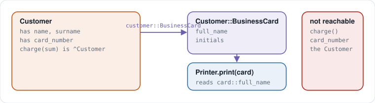

*Figure 12.1. A cap grants a named, read-only view; nothing else of the object is reachable through it.*

- `cap BusinessCard { full_name is string { … } }` declares the computed
  fields. Their bodies read the owner's fields by name, but have no `self`
  and cannot call the owner's actions.
- `customer::BusinessCard` acquires the view, and its type is
  `Customer::BusinessCard`. A function that takes that type, like
  `Printer.print`, can read `card::full_name` and `card::initials`. It cannot
  call `charge`, read `card_number`, or turn the view back into a
  `Customer`.

Caps are the object-oriented answer to "I need a getter for this one
caller". The answer is not to open the field to everyone, but to grant a
named, typed view to whoever is handed it.

### Inside the object or beside it

A cap is usually declared inside its object, as above. It can also be
declared at module scope, beside an object of the same module. Its body
then names the owner's fields through the owner type, `Box::label`:

```okkama
module bible/cap_outside v1.0.0;

// A cap declared beside its object, in the object's module: the body names
// the owner's fields through the owner type. A generic owner's cap takes the
// owner's type arguments.
import "io/stdout" take Stdout;

object Box<T> {
    has item is T;
    has label is string;
    Box(:item, :label);
}

cap Box::Tag {
    text is string { "[" + Box::label + "]"; }
}

object Shelf {
    Shelf();
    show(tag is Box<int>::Tag) is string { tag::text; }
}

main() is int {
    let box = Box(item: 42, label: "answer");
    Stdout().writeln(Shelf().show(box::Tag));
    0;
}
```

Output:

```text
[answer]
```

Both forms share one namespace, so an object cannot have two caps of the
same name. An imported object cannot be given a cap: only the module that
owns an object decides what it shows. A cap of a generic object takes the
object's type parameters. It is written `Box::Tag` where it is declared and
`Box<int>::Tag` where it is used.

### What a cap field may do

A cap field's body is an ordinary Okkama block, with local bindings,
`if`, `match`, `confirm` and errors. It reads the owner's private fields by
name. Three things are missing on purpose.

- There is no `self`, not even inside a nested anonymous action, so the
  body cannot call the owner's actions. Writing `self.norm()` in a cap is
  an error:

  ```okkama
module bible/cap_self v1.0.0;

// A cap body has no `self` and cannot call the owner's actions.
object Point {
    has x, y is int;
    Point(:x, :y);
    norm() is int { x * x + y * y; }
    cap Shown { norm is int { self.norm(); } }
}

main() is int { Point(x: 1, y: 2)::Shown::norm; }
```

The compiler answers:

```text
12-cap-self-rejected.ok:8:31: semantic error: self is not available inside a cap field
```

- A field cannot name the cap's other fields. Each field stands on the
  owner alone.
- A field is synchronous: there is no `await`. It may still return a
  Future it makes explicitly.

A cap cannot write fields or stage a successor. It may call actions of the
objects its owner holds, as `Report` below calls `hits.value()`.

### Every read computes

Acquiring a cap evaluates the owner expression once. Every read of a field
runs its body again, and nothing is cached, neither a value nor an error:

```okkama
module bible/cap_reads v1.0.0;

// A cap computes on every read: nothing is cached, neither a value nor an
// error.
import "async/atomic" take Atomic;
import "io/stdout" take Stdout;

enum NoHits is Error = (none);

object Counter {
    has hits is Atomic<int>;
    Counter() { hits = Atomic(0); }

    hit() is void { hits.replace(hits.value() + 1); }

    cap Report {
        seen is string { hits.value().string() + " hits"; }
        share is rat {
            confirm hits.value() > 0 else throw NoHits.none;
            100 / hits.value();
        }
    }
}

main() is int {
    let out = Stdout();
    let counter = Counter();
    let report = counter::Report;
    out.writeln(report::seen);
    out.writeln(try { report::share.string(); } catch e is NoHits { "no share yet"; });
    counter.hit();
    counter.hit();
    out.writeln(report::seen);
    out.writeln(report::share.string());
    0;
}
```

Output:

```text
0 hits
no share yet
2 hits
50
```

The first read of `share` throws `NoHits.none`, and the read after two hits
returns 50. A cap is a view, not a copy. A field whose answer is expensive
belongs in an action, where `once let` (Section 13.13) can keep it.

### A cap keeps its owner whole

A cap holds its owner, the whole object with everything it owns,
including resources in its fields. For ownership (Section 11.5) a cap is
its owner. A cap of a fresh object that an action returns moves the object
to the caller. A cap of an object that a scope already owns borrows it,
like an alias:

```okkama
module bible/cap_owner v1.0.0;

// For ownership a cap is its owner: a cap of a fresh object moves the
// object, resources and all, to whoever receives it; a cap of an object a
// scope already owns borrows it.

import "io/stdout" take Stdout;

object Log {
    has name is string;
    Log(:name);
    destroy { Stdout().writeln("close " + name); }
}

object Account {
    has log is Log;
    has owner is string;
    Account(:owner) { log = Log(name: owner); }
    cap Label { text is string { "account of " + owner; } }
}

object Bank {
    Bank();
    label(owner is string) is Account::Label {
        Account(owner: owner)::Label;
    }
}

main() is int {
    let out = Stdout();
    let label = Bank().label("ada");
    out.writeln("got " + label::text);
    {
        let account = Account(owner: "bob");
        let view = account::Label;
        out.writeln("inner " + view::text);
    }
    out.writeln("after inner");
    0;
}
```

Output:

```text
got account of ada
inner account of bob
close bob
after inner
close ada
```

`ada`'s log is closed when `main` ends, because her account came to `main`
inside the cap. `bob`'s log is closed when the inner block that owns his
account ends.

A cap is also bound to the version it was taken from. A successor
(Chapter 13) is a new version, with caps of its own:

```okkama
module bible/cap_snapshot v1.0.0;

// A cap stays bound to the version of the object it was taken from; a
// successor has caps of its own.
import "io/stdout" take Stdout;

object Order {
    has number is int;
    has paid is bool = false;
    Order(:number);

    settled() is ^Order { ^paid = true; }

    cap Status {
        line is string { "#" + number.string() + (if paid { " paid"; } else { " open"; }); }
    }
}

main() is int {
    let out = Stdout();
    let order = Order(number: 7);
    let before = order::Status;
    let after = order.settled();
    out.writeln(before::line);
    out.writeln(after::Status::line);
    0;
}
```

Output:

```text
#7 open
#7 paid
```

`before` still reads the open order after `settled()` made the paid one.

### What a cap is not

A cap's type is exact. Locals, parameters, results, fields, collections,
generics, closures and Futures keep `Customer::BusinessCard` as it is. Inside
`any` it is opaque. Nothing turns a cap back into its owner: there is no
conversion, and no pattern or reflection reaches the owner through it.

A cap has no equality, no ordering and no hashing, so it cannot be a map
key. It is not formatted or serialized automatically:

```okkama
module bible/cap_compare v1.0.0;

// A cap has no equality: two views are not values to compare.
object Point {
    has x, y is int;
    Point(:x, :y);
    cap Shown { text is string { x.string() + "," + y.string(); } }
}

main() is int {
    let p = Point(x: 1, y: 2);
    if p::Shown == p::Shown { 1; } else { 0; }
}
```

The compiler answers:

```text
12-cap-compare-rejected.ok:12:8: semantic error: Cannot compare Point::Shown and Point::Shown
```

A cap cannot become a role, have constructors, actions, `has` fields or
nested caps, or be constructed by hand. It is an interface boundary and
nothing more. It promises no secrecy against code that holds the full
object, no purity, since a field may call actions of objects the owner
holds, and no revocation: a cap handed out stays readable as long as it
lives.

### Cap, role or hidden action

Three tools look alike.

| Tool | Question it answers | Who decides |
|---|---|---|
| hidden action | what the object does inside | the object, for itself |
| role (Chapter 14) | what any object of the role can do | the role, for every implementation |
| cap | what this object shows to whoever it hands it | the object, for one view |

A role is behaviour that many objects provide; a caller holding a role does
not know which object it holds. A cap belongs to one object and shows its
state; the caller knows exactly whose view it reads. A hidden action is not
seen at all.

The standard library follows one rule (Chapter 22): **an object reveals
itself through a cap**. It declares about 130 caps, named for the part they
show: `page::Head::status`, `date::Calendar::year`, `range::Bounds::start`,
`duration::Span::seconds`. A cap holds facts that are already computed, or
that are trivial to compute, such as a parsed part of a URL or a date's
year. Anything that is work stays an action: `file.text()` reads a file and
`response.body()` reads a body, so neither is a cap.

### Caps elsewhere

Most languages answer "show this caller a few facts" with accessors that
everyone can call. A Java record gives every component a public accessor
[[Bierman 2021](#ref-jep395)]. A Kotlin data class and a C# record do the same with
properties [[Kotlin documentation](#ref-kotlindata); [C# language reference](#ref-csrecords)]. Narrowing the view takes an
interface. Then the caller can cast it back to the full class, unless the
designer hides the class.

TypeScript's `Pick<T, K>` and `Readonly<T>` name a narrower shape. They
are structural and erased, so any object of that shape fits, and a cast
gets the rest [[TypeScript Handbook](#ref-tscompat)].

Object-capability languages take another view of what a reference
means: holding one *is* the authority to use it, and a narrower facet is a
separate object that forwards only some requests [[Miller 2006](#ref-miller2006)]. An Okkama
cap is closer to such a facet than to a getter. It is a separate,
nominal type, the holder cannot widen it, and the owner chooses what it
shows. It is not an authority boundary, though: a cap shows state and
grants no actions.

## 12.9 Objects are values

Two `Cash` objects with the same fields are equal: `Cash(1, 0) == Cash(1, 0)`
is `true` in the opening example. Okkama compares objects structurally, field
by field, without calling any of their actions. An object has an identity
too: it decides who owns a resource (Chapter 11), and a successor gets a
new one (Chapter 13). But identity is not what `==` compares. There is no
`equals` to override and no `hashCode` to keep consistent with it.

That matches how immutable objects are used. A value that cannot change is
characterised by what it holds. Two copies of the same amount of money are
the same amount, wherever they were made. It also makes value objects usable
as map keys: a `%Card:int` keys on the card's fields, ordered by them, so
`more[Card(10, Suit.hearts)]` finds an entry made with another `Card` of
the same rank and suit. A key object must be a value through and through:
every field a scalar, an enum or another such object, and no `destroy` and
no caps. `%Tagged:int` for an object with a `tags is @string` field is
rejected: `Map key type Tagged cannot be a key: field "tags" is @string`.
Objects that should compare by something else, such as a business key,
expose an action for it, and the map keys on that action's result instead.

## 12.10 Handing `self` out of a constructor

A constructor cannot call its own actions. `self.initials()` inside the
constructor is rejected, even after the fields that `initials` reads are
bound:

```okkama
module bible/self_call v1.0.0;

object Account {
    has owner is string;
    has code is string;

    Account(owner is string) {
        self.owner = owner;
        code = self.initials() + "-1";
    }

    initials() is string { owner.slice(0, 2); }
}

main() is int { 0; }
```

The compiler answers:

```text
12-self-call-rejected.ok:9:16: semantic error: Cannot call actions on self before construction completes
```

An action may rely on everything the constructor establishes, including the
checks that have not run yet. The compiler cannot see which fields an
action reads through the actions it calls, so it forbids the call outright.

The constructor *may* pass `self` itself to a collaborator. This is the
only way two immutable objects can refer to each other: the second one is
made while the first is still being built.

```okkama
module bible/escape v1.0.0;

// A constructor may hand its unfinished `self` to a collaborator. This is the
// only way two immutable objects can refer to each other.
import "io/stdout" take Stdout;

object Leaf {
    has up is Tree;
    Leaf(:up);
    describe() is string { "leaf of " + up.name(); }
}

object Tree {
    has name is string;
    has leaf is Maybe<Leaf>;

    Tree(name is string) {
        self.name = name;
        leaf = Maybe.some(Leaf(up: self));
    }

    name() is string { name; }
    describe() is string {
        match leaf {
            case Maybe.some(l) { name + " has a " + l.describe(); }
            case Maybe.none { name; }
        }
    }
}

main() is int {
    let out = Stdout();
    out.writeln(Tree("oak").describe());
    0;
}
```

Output:

```text
oak has a leaf of oak
```

The collaborator holds an unfinished object, and the rule from the start of
this section follows it there. The specification forbids calling *any*
action on a receiver whose construction is pending, "through aliases, role
references, bound actions and collaborators", and requires the run time to
reject such a call before evaluating its arguments. `Leaf` above only
stores `up`; calling `up.describe()` in `Leaf`'s constructor would break
the rule. The compiler catches the direct `self.` call, and indirect calls are rejected at run time:

```okkama
module bible/escape_call v1.0.0;

import "io/stdout" take Stdout;

object Echo {
    Echo();
    said(text is string) is string {
        Stdout().writeln(text);
        text;
    }
}

object Leaf {
    has up is Tree;
    has seen is string = "";
    Leaf(up is Tree) {
        self.up = up;
        seen = up.greeted(Echo().said("argument"));
    }
}

object Tree {
    has name is string;
    has leaf is Maybe<Leaf>;
    Tree(name is string) {
        self.name = name;
        leaf = Maybe.some(Leaf(self));
    }
    greeted(text is string) is string { text + " " + name; }
}

main() is int {
    Tree("oak");
    0;
}
```

The compiler answers:

```text
RuntimeError: Action "greeted" on object "Tree" was called before its construction completed
```

The call fails before `Echo().said("argument")` is evaluated, also through a role or bound action. If a constructor fails after `self` escaped, the object never completes and every later call on it is rejected.

The first use of `self` may occur inside a functional block, a nested block or a conditional branch. Every collaborator receives the same object identity, including collaborators created in a loop.

The problem is old. Java lets `this` escape from a constructor and leaves
the consequences to the programmer. A non-null field of an object under
construction can still read as `null`. Fähndrich and Leino gave such
objects their own "raw" types [[Fähndrich 2003](#ref-fahndrich2003)]. Summers and Müller's
"Freedom Before Commitment" tracks which objects are fully initialised and
which may still be "free", with few annotations [[Summers 2011](#ref-summers2011)]. Okkama
takes the cheaper road: one static rule for `self`, and a run-time check
for the indirect cases.

## 12.11 When construction fails

Section 12.6 made the constructor the gate: an object that exists is valid.
This section covers the other side of the gate, the work a constructor did
before it refused, and the fields it never got to. Three rules decide both.

**Every field is bound when construction ends.** Defaults are filled before
the body runs, and then the arguments and the body bind the rest. A field
that no path of the constructor binds is a compile-time error:

```okkama
module bible/unbound_rejected v1.0.0;

// A field that no path of the constructor binds is rejected at compile time.
import "io/stdout" take Stdout;

object Ticket {
    has route is string;
    has seat is int;

    Ticket(route is string) {
        self.route = route;
    }

    shown() is string { route + ", seat " + seat.string(); }
}

main() is int {
    Stdout().writeln(Ticket("Kostanay - Astana").shown());
    0;
}
```

The compiler answers:

```text
12-unbound-rejected.ok:10:5: semantic error: Object "Ticket" field "seat" was not initialized
```

A field bound on some paths and not on others is checked when construction
ends, on the path the call actually took:

```okkama
module bible/unbound v1.0.0;

// A field bound on some paths of the constructor and not on others. The
// check runs when construction ends, on the path actually taken.
import "io/stdout" take Stdout;

object Transfer {
    has from is string;
    has via is string;

    Transfer(from is string, direct is bool) {
        self.from = from;
        if direct {
            via = "-";
        } else if from == "Kostanay" {
            via = "Astana";
        }
    }

    shown() is string { from + " via " + via; }
}

main() is int {
    let out = Stdout();
    out.writeln(Transfer("Almaty", true).shown());
    out.writeln(Transfer("Kostanay", false).shown());
    // Not an error value: a catch of the Error role does not take it.
    let shown = try {
        Transfer("Aktau", false).shown();
    }
    catch e is Error {
        "caught: " + e.text();
    };
    out.writeln(shown);
    0;
}
```

Output:

```text
Almaty via -
Kostanay via Astana
exit 1
```

- `Transfer("Almaty", true)` and `Transfer("Kostanay", false)` take paths
  that bind `via`, so they build complete objects.
- `Transfer("Aktau", false)` takes the missing `else`. Construction fails
  with `Object "Transfer" field "via" was not initialized` and points at the
  constructor.
- **This is not an error value.** It reports a defect in the program, as an
  index out of range does (Chapter 10). `catch e is Error` does not take it,
  and the run ends with the report.

The split between the two checks is the language owner's decision, recorded
as D-035 in the conformance suite's ledger:

- The compiler rejects what is certain, a field no path binds.
- The rest is checked where it happens.

The price is visible in `Transfer`: the missing branch is a mistake the
compiler could have pointed at, and it surfaces only when an input takes
that branch. A test that covers the branches (Chapter 15) finds it before a
user does.

**What was bound is released, newest first.** Section 11.7 showed the rule
on a session: a constructor that fails closes what it opened, and the
object's own `destroy` does not run. The details matter when the
constructor binds fields inside blocks:

```okkama
module bible/partial v1.0.0;

// A constructor that fails halfway. Whatever it already bound to fields is
// released, newest first, after the temporaries of its body; the object never
// existed, so its own destroy does not run.
import "io/stdout" take Stdout;

enum Refused is Error = (tooLarge(size is int));

object Area {
    has name is string;
    Area(:name) { Stdout().writeln("open " + name); }
    destroy { Stdout().writeln("close " + name); }
}

object Upload {
    has staging is Area;
    has lock is Area;
    has size is int;

    Upload(size is int) {
        staging = Area(name: "staging");
        if size > 0 {
            lock = Area(name: "lock");
        } else {
            lock = Area(name: "empty lock");
        }
        let scratch = Area(name: "scratch");
        confirm size <= 1000 else throw Refused.tooLarge(size);
        self.size = size;
    }

    size() is int { size; }

    destroy { Stdout().writeln("upload of " + size.string() + " done"); }
}

main() is int {
    let out = Stdout();
    let outcome = try {
        let upload = Upload(5000);
        "built " + upload.size().string();
    }
    catch e is Refused {
        "refused: " + e.text();
    };
    out.writeln(outcome);
    out.writeln("--");
    {
        let upload = Upload(300);
        out.writeln("built " + upload.size().string());
    }
    0;
}
```

Output:

```text
open staging
open lock
open scratch
close scratch
close lock
close staging
refused: Refused.tooLarge(5000)
--
open staging
open lock
open scratch
close scratch
built 300
upload of 300 done
close lock
close staging
```

- **A temporary of the body dies first.** `scratch` belongs to the
  constructor's block and closes when the block unwinds, before any field.
- **A field bound inside a block belongs to the construction.** `lock` is
  bound in a branch of the `if`, and it outlives the branch. That is what
  makes it a field. When the `confirm` fails, `lock` is released with the
  construction, not with the branch.
- **Fields go in reverse order of binding.** `lock` closes before `staging`,
  as locals do in a scope (Section 11.4).
- **The error reaches the caller unchanged.** The `catch` sees
  `Refused.tooLarge(5000)` after all the cleanup, so it runs with nothing
  half-open.
- **The object never existed, so its `destroy` does not run.** `upload of
  ... done` prints only for the second upload. A `destroy` may rely on
  everything the constructor establishes, the same argument Section 12.10
  made for actions, and running it on a half-built object would break that.
  The fields' own `destroy`s do run, because each field is a complete
  object.

**Nobody observes the half-built object.** No reference to an unfinished
`Upload` exists outside its constructor. The one exception is `self`
handed to a collaborator (Section 12.10), and every call through such a
reference is refused until construction completes, and forever if it
fails.

Other languages split the same three questions differently:

- **C++ has the release rule.** When a constructor throws, the destructors
  of the members and bases already constructed run in reverse order, and
  the object's own destructor does not. Stroustrup builds the basic
  exception-safety guarantee of the standard library on exactly this rule
  [[Stroustrup 2001](#ref-stroustrup2001)]. The gap is the raw resource: a pointer or file handle
  acquired in the body and not yet held by a member leaks, unless it is
  wrapped in an object first. In Okkama every resource is an object with an
  owner, so there is no raw handle to wrap.
- **Java has no unbound fields, and no release rule.** Every field starts
  as `null`, `0` or `false`, so "not initialized" cannot be told apart from
  a value. Only a `final` field must be definitely assigned by every
  constructor (JLS Chapter 16, [[Gosling 2023](#ref-gosling2023)]). A constructor that throws
  leaves a partly initialized object behind, and a subclass's finalizer can
  catch and use it. SEI CERT rule OBJ11-J, "Be wary of letting constructors
  throw exceptions", describes the attack [[SEI CERT Oracle Coding Standard for Java](#ref-certobj11)]. Nothing is closed.
- **Kotlin moves the check to the first read.** A `lateinit` property may
  stay unset after construction, and reading it before it is set throws
  `UninitializedPropertyAccessException` [[Kotlin documentation](#ref-kotlinproperties)]. The failure
  appears far from the constructor that caused it.
- **Swift checks statically.** Every stored property must have a value
  before the initializer finishes, and `self` cannot be used before then.
  A failable `init?` returns `nil` instead of an object [[The Swift Programming Language](#ref-swiftbook)].
- **Rust has no constructors.** A struct literal must name every field, so
  a half-built struct cannot be written. Values made before a failure are
  ordinary locals and are dropped as the function unwinds.

Okkama's position is between Swift's and C++'s. It is static where that is
certain and checks the path otherwise, as no other language here does, and
it releases what was bound as C++ does, without raw handles.

## 12.12 A worked domain model: money and an order

Small objects are easiest to judge in a domain everyone knows. An order has
lines; a line has an item, a quantity and a unit price; prices are money in
one currency.

```okkama
module app v1.0.0;

import "io/stdout" take Stdout;

enum Mismatch is Error = (currency(left is string, right is string));
enum Invalid is Error = (quantity(given is int), price(given is string));

// An amount of money in one currency, exact: a rat, never a float.
object Money {
    has amount is rat;
    has currency is string;
    Money(:amount, :currency) {
        confirm amount >= 0.rat() else throw Invalid.price(amount.string());
    }
    plus(other is Money) is Money {
        confirm currency == other.code() else throw Mismatch.currency(currency, other.code());
        Money(amount: amount + other.value(), currency: currency);
    }
    times(count is int) is Money { Money(amount: amount * count.rat(), currency: currency); }
    code() is string { currency; }
    value() is rat { amount; }
    string() is string { amount.string() + " " + currency; }
}

// One line of an order: what, how many, at what unit price.
object Line {
    has item is string;
    has quantity is int;
    has price is Money;
    Line(:item, :quantity, :price) {
        confirm quantity > 0 else throw Invalid.quantity(quantity);
    }
    total() is Money { price.times(quantity); }
}

// An order knows its lines and nothing else; its total is computed, never stored.
object Order {
    has lines is @Line;
    Order(:lines);
    total(currency is string) is Money {
        lines.reduce(Money(amount: 0.rat(), currency: currency)) -> sum, line { sum.plus(line.total()); };
    }
}

main() is int {
    let out = Stdout();
    let tea = Money(amount: 7.rat() / 2.rat(), currency: "EUR");
    let order = Order(lines: [
        Line(item: "tea", quantity: 3, price: tea),
        Line(item: "cup", quantity: 2, price: Money(amount: 12.rat(), currency: "EUR")),
    ]);
    out.writeln(order.total("EUR").string());
    let mixed = Order(lines: [Line(item: "tea", quantity: 1, price: Money(amount: 4.rat(), currency: "USD"))]);
    let shown = try { mixed.total("EUR").string(); } catch Mismatch.currency(left, right) { left + " cannot meet " + right; };
    out.writeln(shown);
    let refused = try { Line(item: "air", quantity: 0, price: tea).total().string(); } catch Invalid.quantity(given) {
        "quantity " + given.string() + " refused";
    };
    out.writeln(refused);
    0;
}
```

Output:

```text
69/2 EUR
EUR cannot meet USD
quantity 0 refused
```

- **One noun per idea.** `Money` is an amount and a currency, nothing else;
  `Line` is one row; `Order` is its lines. Each object answers questions
  about itself (`total()`), and none exposes its fields: `Money` offers
  `code()` and `value()` for the one comparison `plus` needs, and `string()`
  for display.
- **The constructor is the gate.** A negative amount and a zero quantity are
  refused where the object would be born, with a typed error that names the
  bad value (§12.6). An object that exists is valid, so `total()` never
  checks its own fields again.
- **Exact arithmetic is the default.** The amounts are `rat`, so three teas
  at 7/2 and two cups at 12 make exactly `69/2`, with no rounding to explain
  later. A currency mismatch is an error, not an implicit conversion.
- **Derived values are computed.** `Order.total` folds its lines with
  `reduce`; nothing stores a running total that could drift from the lines.
  Changing an order means building a new one with other lines (Chapter 13).

The model is three short objects and two error enums. A design with getters
and setters would have more code and fewer guarantees: every reader would
have to trust that nobody set a quantity to zero after construction.

## 12.13 Objects elsewhere

Most languages that took immutability seriously added a shorthand for "an
object that is its fields". Comparing them shows what Okkama chose to
leave out.

| | Okkama object | Java record | Kotlin data class | Rust struct |
|---|---|---|---|---|
| Fields readable from outside | never | via generated accessors | yes (properties) | within the module, or if `pub` |
| Constructor | written by hand; shorthand `(:x)` | generated canonical, may be compact | primary constructor | none; a `new` function by convention |
| Validation | `confirm` in each constructor | in the compact constructor | `init` block | in the `new` function |
| Equality | structural, always | generated from components | generated from the primary constructor | `#[derive(PartialEq)]` |
| Mutation | none | none (fields `final`) | `var` allowed | `mut` binding |
| Copy with changes | successor actions (Chapter 13) | none built in | `copy(x = …)` | struct update `..old` |

Java records (JEP 395) are the closest: final fields, a canonical
constructor, generated `equals`, `hashCode` and `toString`
[[Bierman 2021](#ref-jep395)]. The difference is the accessors. A record publishes every
component, so its representation *is* its API. Kotlin's data classes do
the same, and only properties of the primary constructor take part in the
generated `equals` [[Kotlin documentation](#ref-kotlindata)]. Rust hides fields behind module privacy,
which is coarser than an object: any code in the same module can read
them [[Klabnik 2023](#ref-klabnik2023)].

Okkama keeps the generated equality and drops the generated access. A
record is a tuple with names. An Okkama object is a value with behaviour,
and its fields are nobody else's business. Bloch's advice for Java,
"minimize mutability" and "favor composition over inheritance", needs no
discipline here: the language allows nothing else [[Bloch 2018](#ref-bloch2018)].

## 12.14 What this design costs

- **More objects.** Without free functions, a small computation that would
  be a function elsewhere becomes an object with one action, or an action
  on an existing object. The standard library is full of small objects:
  `Number`, `Utf8Decoded`, `HexEncoded`. Each is a noun for one
  computation. It reads well once one is used to it, and it is verbose
  until then.
- **No inheritance.** A family of similar objects shares code by
  composition and contracts by roles. The flexibility is greater, and so is
  the amount of forwarding code (Chapter 14).
- **Constructors are written by hand.** No record syntax generates them.
  Shorthands make the common case one line, and every other case is
  explicit.
- **No mutation.** An object that would naturally change — a counter, a
  buffer — becomes a chain of successors, or holds its changing part in a
  dedicated mutable cell from the library (`Atomic` in `async/atomic`).
  Chapter 13 shows the first, Chapter 20 the second.

In return:

- every object is valid from the moment it exists;
- it can be shared freely and compared by value;
- its fields can change their representation without touching a single
  caller.

# Chapter 13. Actions, successors and immutability

Chapter 12 built objects that never change. This chapter is about what they
do: actions, which answer questions about an object, and successors, which
answer the question "what would this object be after …?" with a new object.
Between them they cover everything other languages do with methods,
setters and mutable fields.

```okkama
module bible/successors v1.0.0;

// State changes are successors: `is ^Type` actions that stage new field
// values with `^field = …` and return a new object. The original stays.
import "io/stdout" take Stdout;

enum TabError is Error = (closed, over_limit(total is int));

object Tab {
    has items is int = 0;
    has total is int = 0;
    has limit is int;
    has open is bool = true;

    Tab(:limit);

    ordered(price is int) is ^Tab {
        confirm open else throw TabError.closed;
        confirm total + price <= limit else throw TabError.over_limit(total + price);
        ^items = items + 1;
        ^total = total + price;
    }

    closed() is ^Tab {
        ^open = false;
    }

    summary() is string {
        items.string() + " items, " + total.string() + (if open { " (open)"; } else { " (closed)"; });
    }
}

main() is int {
    let out = Stdout();
    let empty = Tab(limit: 100);
    let two = empty.ordered(30).ordered(25);
    out.writeln(empty.summary());
    out.writeln(two.summary());

    let tab = Tab(limit: 100);
    for [10, 20, 30] -> price {
        tab = tab.ordered(price);
    }
    out.writeln(tab.summary());

    let refused = try { tab.ordered(50).summary(); } catch e is TabError { e.text(); };
    out.writeln(refused);
    out.writeln(tab.summary());

    let done = tab.closed();
    out.writeln(done.summary());
    out.writeln(try { done.ordered(1).summary(); } catch e is TabError { e.text(); });
    0;
}
```

Output:

```text
0 items, 0 (open)
2 items, 55 (open)
3 items, 60 (open)
TabError.over_limit(110)
3 items, 60 (open)
3 items, 60 (closed)
TabError.closed
```

The program keeps a bar tab:

- `ordered` and `closed` are successors. Each returns a new `Tab` and leaves
  the one it was called on as it was;
- `empty` still has no items after `two` was made from it;
- the loop moves the name `tab` from one successor to the next;
- a refused order throws, and `tab` is unchanged after the failure;
- a closed tab refuses every order.

## 13.1 An action is a typed request

```okkama
summary() is string {
    items.string() + " items, " + total.string() + …;
}
```

An action has a name, a parameter list and a declared result. The result
declaration is mandatory: `is <type>`, or `is void` for an action called for
its effect. Leaving it out is a syntax error. There is no inference of
results across a declaration. A reader of the signature knows what comes
back without reading the body.

The value of an action is its final expression. `return value;` leaves
earlier:

```okkama
first_negative(values is @int) is int {
    for values -> value {
        if value < 0 { return value; }
    }
    return 0;
}
```

- `return` leaves the *action*, not the block it is in. Blocks, loops,
  `if`, `match` and `try` are not return boundaries. An anonymous action
  is.
- A functional iteration block (`map`, `reduce` and the like, with `->`)
  is not a boundary either. A `return` inside it returns from the
  enclosing action, not from the block.
- `return` takes exactly one expression. To return two values, return an
  array or an object.
- The value is computed before cleanup. Then the `defer`s that were reached
  run, and the owned objects are destroyed (Chapter 11). The returned object
  itself stays alive for the caller.
- `return` is not allowed directly in a constructor, a `destroy` or a test
  body.

`void` is a result marker, not a type. There is no `void` value, no `Unit`
and no `null` behind it. A field, a parameter, a variable or a collection
element cannot have it as a type. Using the absent result of a void call as
a value is a compile error. The final expression of a void body is
evaluated and discarded.

An action that returns its own receiver says so: `touch() is Cash { self; }`.
That is the only way to return `self`, and it needs both the explicit
result and the explicit `self`.

### Recursion

An action may call itself, or another action of its object, through
`self.`. Okkama has no special form for it and no limit on its depth other
than the memory of the run (`--max-memory` bounds it, Section 10.13).

```okkama
module bible/recursion v1.0.0;

import "io/stdout" take Stdout;

object Numbers {
    Numbers() { }

    // Direct recursion: the depth is the size of the input.
    factorial(n is int) is int {
        if n <= 1 { 1; } else { n * self.factorial(n - 1); }
    }

    // Mutual recursion through self.
    even(n is int) is bool { if n == 0 { true; } else { self.odd(n - 1); } }
    odd(n is int) is bool { if n == 0 { false; } else { self.even(n - 1); } }

    // A self tail call: nothing is left to do after it, so it runs in
    // constant stack, a million levels deep.
    counted(n is int, total is int) is int {
        if n == 0 { total; } else { self.counted(n - 1, total + n); }
    }
}

main() is int {
    let out = Stdout();
    let numbers = Numbers();
    out.writeln("30! = " + numbers.factorial(30).string());
    out.writeln("7 is odd: " + numbers.odd(7).string());
    out.writeln("1 + ... + 1000000 = " + numbers.counted(1000000, 0).string());
    0;
}
```

Output:

```text
30! = 265252859812191058636308480000000
7 is odd: true
1 + ... + 1000000 = 500000500000
```

- **Direct and mutual recursion are ordinary calls.** `factorial` calls
  itself, and `even` and `odd` call each other.
- **A self tail call runs in constant stack.** When the call is the last
  thing an action does, as in `counted`, nothing is kept for the return, and
  a million levels need no more stack than one.
- **Recursion that cannot end is a compile error.** An action whose every
  path calls itself before it can finish never returns, and the compiler
  says so before the program runs:

```okkama
module bible/recursion_rejected v1.0.0;

object Clock {
    Clock() { }
    ticks() is int { self.ticks() + 1; }
}

main() is int {
    Clock().ticks();
}
```

The compiler answers:

```text
13-recursion-rejected.ok:5:5: semantic error: Infinite recursion: "Clock.ticks" cannot complete without calling itself
```

The check looks for an action with no way out; it does not try to prove that
a recursion with a base case reaches it. Anonymous actions cannot call
themselves by name at all (Section 18.11): recursion is a property of a named
action of an object, where the reader can find both the call and the exit.

## 13.2 Parameters and calls

```okkama
module bible/actions v1.0.0;

// Actions: typed results, defaults, named arguments, overloads by type,
// a variadic tail and an early return.
import "io/stdout" take Stdout;

object Greeter {
    has greeting is string;
    Greeter(:greeting);

    greet(name is string, mark is string = "!") is string {
        greeting + ", " + name + mark;
    }

    describe(value is int) is string { "int " + value.string(); }
    describe(value is string) is string { "string " + value; }
    describe(value is any) is string { "something else"; }

    total(values is ...int) is int {
        let all is @int = values...;
        all.reduce(0) -> sum, value { sum + value; };
    }

    first_negative(values is @int) is int {
        for values -> value {
            if value < 0 { return value; }
        }
        return 0;
    }
}

main() is int {
    let out = Stdout();
    let hello = Greeter(greeting: "Hello");
    out.writeln(hello.greet("Ada"));
    out.writeln(hello.greet("Ada", "?"));
    out.writeln(hello.greet(mark: ".", name: "Alan"));
    out.writeln(hello.describe(7) + " / " + hello.describe("x") + " / " + hello.describe(1.5));
    out.writeln(hello.total().string() + " " + hello.total(1, 2, 3).string());
    out.writeln(hello.first_negative([3, -2, -5]).string());
    0;
}
```

Output:

```text
Hello, Ada!
Hello, Ada?
Hello, Alan.
int 7 / string x / something else
0 6
-2
```

- **Grouped names.** Names before one type share it: `full(separator,
  suffix is string)`. The grouping works in every parameter list except
  for a variadic parameter, which takes its own type.
- **Positional or named, never both.** `hello.greet("Ada", "?")` and
  `hello.greet(mark: ".", name: "Alan")` are calls; a mix of the two is an
  error. Named arguments may come in any order.
- **Defaults.** Trailing parameters may declare a default:
  `greet(name is string, mark is string = "!")`. A call leaves them out from
  the end positionally, or in any combination by name. A parameter after a
  defaulted one needs a default too.
- **Where a default is computed.** The default is evaluated at each call,
  in the *declaring* module. It sees module names, not the caller's locals
  and not `self`. Moving a call to another module never changes what a
  default means.
- **Evaluation order.** The receiver and the arguments are evaluated once,
  left to right, in the caller's scope.

Variadic actions, role signatures, natives and enum payloads have no
defaults.

## 13.3 Overloads

An object may declare several actions with one name. An overload is its
name, the number of its parameters, their types and whether the last one is
variadic. Nothing else tells two overloads apart: not parameter names, not
the result type, not `async`, `hidden` or the successor mark. Two
declarations that agree on all four are one signature declared twice, an
error at the later one: `Action "size" on object "Resizer" has conflicting
overloads with signature size(int); parameter names and return types do not
distinguish overloads`. The rule is the same for constructors (§12.5), role
signatures and fakes (§14.1), and since 0.6.4 there are no exceptions to it.
`describe(int)`, `describe(string)` and `describe(any)` in the example are
three actions. The call with `1.5` takes the `any` one, because
neither of the others accepts a float.

The rules are short, and they never guess:

1. Candidates with the wrong arity drop out, and so do those without a
   parameter of each name a named call gives. Then argument types are
   checked against declared types.
2. If a fixed candidate fits, variadic candidates are not considered.
3. Exact concrete types beat role-compatible types, and both beat `any`.
4. A candidate wins only if it is no less specific in *every* position and
   more specific in at least one.
5. Declaration order never breaks a tie. A tie is an error.
6. Overloads of one name and arity may declare different results when
   their parameter types differ. A call gets the result of the overload it
   selects: `minus(duration is Duration) is Instant` and
   `minus(other is Instant) is Duration` sit side by side (§14.7).

Rule 4 makes `(int, any)` and `(any, int)` ambiguous for a call with two
integers. Each is better in one position and worse in the other:

```okkama
module bible/ambiguous v1.0.0;

object Pairing {
    Pairing();
    joined(left is int, right is any) is string { "left"; }
    joined(left is any, right is int) is string { "right"; }
}

main() is int {
    Pairing().joined(1, 2);
    0;
}
```

The compiler answers:

```text
13-ambiguous-rejected.ok:10:5: semantic error: Ambiguous call of action "joined" on object "Pairing" with (int, int): joined(int, any) and joined(any, int) fit equally well
```

The message names the argument types and the candidates that tie, so the
fix is visible: convert one argument, or narrow one overload. Until 0.4.2
it named neither (#273). The no-match message lists the types too:
`No action "joined" on object "Pairing" accepts (string, string)`.

Overloading is resolved before execution from static types. A value typed `any` is not narrowed to its contents to choose an overload. Okkama has no dispatch on argument types at run time; dispatch on the receiver happens through roles (Chapter 14).

## 13.4 Variadic actions

`total(values is ...int)` takes zero or more integers after its fixed
prefix:

- The variadic parameter is the last one, unique, explicitly typed and has
  no default.
- Calls to it are positional. Each value in the tail is checked against the
  element type.
- Inside the body, `values` is not an array. It is an opaque binding that
  can only be unpacked with `values...`: as the whole value of a `let`, as
  the whole value of a constructor field bind, as a `for` source, or as the
  last argument of another variadic call.
- A fixed candidate that fits wins over a variadic one. `total(1)` picks
  `total(a is int)` if both exist, and `total()` or `total(1, 2)` picks the
  tail.

`hello.total()` in the example is `0`: the tail is empty, and
`reduce(0)` over an empty array returns its seed.

A `...string` tail turns the values it is given into text. A value that is
not a string reaches it through its own `string()`: `int`, `float`, `rat`,
`byte`, `bool`, `char`, and any object or role value whose type answers
`string() is string`. So `out.writeln("count: ", 5, ", ready: ", true)`
prints `count: 5, ready: true`, and `Formatted("{} version {}", id,
id.version())` fills its slots. The conversion is chosen at compile time and
only as a last resort: a signature that fits the call as written wins, so
`kind(1, "a")` still picks `kind(values is ...any)` over `kind(values is
...string)`. A value without `string()` is a compile error, and a spread
`values...` is not converted.

## 13.5 Successors

Fields never change (Chapter 12). A state change is therefore a new
object, and the language has a construct for making it: an action whose
result type is `^Type`.

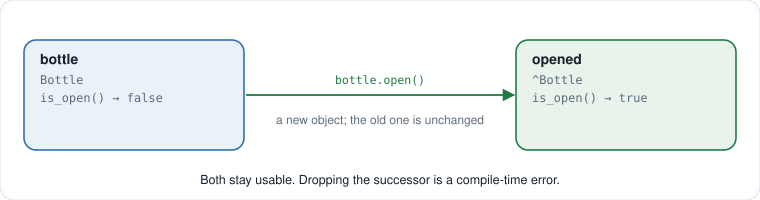

*Figure 13.1. A successor is a new object. The original stays as it was, and both can be used.*

```okkama
ordered(price is int) is ^Tab {
    confirm open else throw TabError.closed;
    confirm total + price <= limit else throw TabError.over_limit(total + price);
    ^items = items + 1;
    ^total = total + price;
}
```

- `^field = value;` *stages* a new value for a field. It is allowed only in
  a successor action. Anywhere else it is an error:

  ```okkama
module bible/staged v1.0.0;

object Counter {
    has count is int = 0;
    Counter();
    bump() is int {
        ^count = count + 1;
        count;
    }
}

main() is int { 0; }
```

The compiler answers:

```text
13-staged-rejected.ok:7:9: semantic error: `^field = value` is allowed only in successor actions
```

- When the action finishes, the result is a new object. Every field is
  copied from the receiver, and the staged fields are replaced. The receiver
  is untouched: `empty` stays at `0 items` after `two` is made from it.
- The successor is a new identity with its own lifetime (Chapter 11).
- On an object, a successor returns the object's own type. `is ^Tab` on
  `Tab` is legal; `is ^Package` is not, and a `^Role` result belongs in a
  role signature (Chapter 14).
- The body's final expression is discarded, as in a void action. Ending a
  successor with a value of its own type is an error, because it would read
  as a replacement result that is then thrown away:

  ```okkama
module bible/replacement v1.0.0;

object Counter {
    has count is int = 0;
    Counter();
    reset() is ^Counter {
        Counter();
    }
}

main() is int { 0; }
```

The compiler answers:

```text
13-replacement-rejected.ok:7:9: semantic error: A successor action cannot return a replacement value; its final expression would be discarded
```

Two details matter when a body stages several fields.

**Reads see the receiver, not the staged values.** After `^items = items + 1;`, the name `items` still means the receiver’s original field.

A successor that stages `^count = count + 1; ^twice = count * 2;` sets
`twice` from the *old* count. The order of the staging statements does not
change what the reads see.

**The last stage wins.** `^count = 10; ^count = 20;` makes a successor with
`count` 20. Each staging statement replaces the value staged before it;
there is no error.

## 13.6 The result must be used

A successor that is called and then dropped is almost always a bug: the
caller meant to change the tab and kept the old one. Okkama makes the
common form of that bug a compile error:

```okkama
module bible/unused v1.0.0;

object Bottle {
    has opened is bool = false;
    Bottle();
    open() is ^Bottle { ^opened = true; }
}

main() is int {
    let bottle = Bottle();
    bottle.open();
    0;
}
```

The compiler answers:

```text
13-unused-rejected.ok:11:5: semantic error: Successor action result must be used
```

The compiler tracks every successor result from where it is made to where
it is *consumed*. A result is consumed when it is:

- returned, explicitly or as the final expression;
- used as the receiver of another call, as in `empty.ordered(30).ordered(25)`;
- passed as an argument;
- bound to a field in a constructor or staged in a successor;
- stored in an array, a map or another aggregate;
- used in an eligible rebind (§13.7).

`let unused = bottle.open();` is not enough if `unused` then leaves its
scope without a use. Every normal path has to consume the value. A use
only inside a `try` does not count for the path through its `catch`, which
starts from what was pending when the `try` began. That is why the example
calls `done.summary()` once before the `try`. Without that line, the
compiler reports that `done` "can leave scope without consumption", at the
binding (before 0.5.0 it pointed at the first line of `main`, #272).

The check is not linear typing. A consumed successor can be used again.
Aliases share one obligation, and consuming any of them is enough. The rule
is about the result being *looked at*, not about it being used once.

## 13.7 Rebinding a name

A loop that advances a value needs a name that moves with it. A bare
`name = expr;` without `let` rebinds an existing local:

```okkama
let tab = Tab(limit: 100);
for [10, 20, 30] -> price {
    tab = tab.ordered(price);
}
```

The rule for rebinding is deliberately narrow. The local must already
exist, and its declared type must be an object with at least one real
`^`-marked successor action. A plain action that happens to return the
same type does not qualify. Neither do scalars, arrays, maps or enums:

```okkama
module bible/rebind v1.0.0;

main() is int {
    let n = 1;
    n = 2;
    n;
}
```

The compiler answers:

```text
13-rebind-rejected.ok:5:5: semantic error: Cannot rebind variable "n": type "int" has no successor actions
```

The narrowness is the point. A rebind is allowed exactly where the type's
author declared that the type has successors, so a name can only be moved
along a path of states the author designed. `n = n + 1` has no such path:
`int` is a value, not a state machine.

- The new value must satisfy the declared type of the binding.
- A rebind in a nested scope updates the scope that declared the name. That
  is what makes the loop above work: each iteration is its own scope.
- The previous value is not destroyed early. If it owns resources, its
  `destroy` runs at the normal end of its owner's scope (Chapter 11).

## 13.8 Successors and failure

A successor that fails produces nothing. If `confirm` throws in the middle
of `ordered`, no partial `Tab` exists. The staged values are dropped, the
resources the successor itself owned are destroyed, and the receiver
remains what it was:

```text
TabError.over_limit(110)
3 items, 60 (open)
```

This is what makes successors safe to call in a `try`. Nothing needs to be
rolled back, because nothing was changed. In a language with mutable
fields, a method that fails after updating two of three fields leaves the
object half-changed. The usual remedy is copying the state first and
swapping at the end. A successor does that copy-and-swap by construction.

## 13.9 Naming a transition

A successor describes a domain transition: `opened()`, `ordered(price)`,
`closed()`, `enqueued(item)`. It is not a setter in disguise. The parser
rejects the most common disguise outright:

```okkama
module bible/setter v1.0.0;

object Tab {
    has limit is int;
    Tab(:limit);
    with_limit(limit is int) is ^Tab { ^limit = limit; }
}

main() is int { 0; }
```

The compiler answers:

```text
13-with-rejected.ok:6:5: syntax error at "with_limit": Action names "with" and "with_*" are forbidden; use domain composition or an explicitly named result.
  |
6 |     with_limit(limit is int) is ^Tab { ^limit = limit; }
  |     ^^^^^^^^^^
```

Other names will compile, so the rest of the rule is a matter of design.
One successor per field, or a chain of successors that configure an object
step by step, is a public setter API with extra copies. Elegant Objects
argues that getters and setters turn an object into a data structure with
methods attached [[Bugayenko 2016](#ref-bugayenko2016)]. A `Tab` with `with_limit`,
`with_items` and `with_total` would let any caller build any combination,
including the ones `ordered` refuses.

The alternatives:

- complete state in a constructor, when the values are known together;
- a successor named after the event that changes them, which checks the
  transition (`ordered` checks the limit);
- a new composed object, when a part of the state changes independently.

Meyer's command–query separation distinguishes queries, which return a
value and change nothing, from commands, which change state and return
nothing [[Meyer 1997](#ref-meyer1997)]. Okkama keeps the separation and changes what a
command is. A query is an ordinary action. A command is a successor: it
returns the changed object instead of changing this one.

## 13.10 Composition

An object whose part changes stages a successor of that part:

```okkama
module bible/composition v1.0.0;

// A successor of an outer object stages a successor of its part. Where a
// value must change in synchronous code, a Cell holds it.
import "io/stdout" take Stdout;
import "cell" take Cell;

object Lamp {
    has on is bool = false;
    Lamp();
    switched() is ^Lamp {
        if on { ^on = false; } else { ^on = true; }
    }
    lit() is bool { on; }
    state() is string { if on { "on"; } else { "off"; } }
}

object Room {
    has name is string;
    has lamp is Lamp = Lamp();
    has visits is int = 0;
    Room(:name);

    entered() is ^Room {
        ^visits = visits + 1;
        if !lamp.lit() { ^lamp = lamp.switched(); }
    }
    left() is ^Room {
        if lamp.lit() { ^lamp = lamp.switched(); }
    }
    report() is string { name + ": lamp " + lamp.state() + ", " + visits.string() + " visits"; }
}

main() is int {
    let out = Stdout();
    let hall = Room(name: "hall");
    let busy = hall.entered().left().entered();
    out.writeln(hall.report());
    out.writeln(busy.report());

    let lengths = Cell(0);
    for ["ab", "cde", "f"] -> word {
        lengths.replace(lengths.value() + word.length());
    }
    out.writeln(lengths.value().string());
    0;
}
```

Output:

```text
hall: lamp off, 0 visits
hall: lamp on, 2 visits
6
```

`entered` stages two fields: `visits`, and `lamp` replaced by
`lamp.switched()`. The successor of a `Room` holds a successor of its
`Lamp`. The original `hall` still has its old lamp, which is off. The
change travels up the chain of owners. Each level makes a new object, and
everything the change does not touch is shared.

A successor can be hidden. Then it is a transition only the object's own
actions take through `self`:

```okkama
object Door {
    has open is bool = false;
    Door();
    toggled() is Door { if open { self.shut(); } else { self.opened(); } }

    hidden opened() is ^Door { ^open = true; }
    hidden shut() is ^Door { ^open = false; }
}
```

`toggled` is a plain action that returns a `Door`. It is not a successor,
so it cannot stage anything itself. It picks the transition and returns
its result. A hidden successor keeps the must-use rule and cannot
implement a role's action.

## 13.11 When a value must change: `Cell`

Some state really is a variable: a running total, a parser's position,
headers gathered while reading. `reduce` covers most accumulations. Where
it reads badly, the standard library has one explicit mutable container,
`Cell` from the module `cell`:

```okkama
let lengths = Cell(0);
for ["ab", "cde", "f"] -> word {
    lengths.replace(lengths.value() + word.length());
}
lengths.value();    // 6
```

A cell is a fenced exception to immutability:

- It has three operations: `Cell(value: initial)`, `value()` and
  `replace(value)`. The values it holds are ordinary immutable values.
  Cells compare by identity, not by content: two cells are equal only when
  they are the same cell (issue #956).
- It stays in synchronous code. An async action cannot create, receive or
  use one. A synchronous action that uses a cell may still be called from
  async code. Synchronous code has no suspension point, so no task can see
  a cell between a read and a write.
- An object cannot hold one:

  ```okkama
module bible/cell_field v1.0.0;

import "cell" take Cell;

object Meter {
    has reading is Cell<int>;
    Meter() { reading = Cell(0); }
}

main() is int { 0; }
```

The compiler answers:

```text
13-cell-field-rejected.ok:6:9: semantic error: Field "reading" cannot hold a Cell: a cell stays in synchronous code; state an object shares with tasks is an Atomic
```

The message points to the other exception: state shared between tasks is
`async/atomic`'s `Atomic`, with compare-and-replace and an explicit
`close()` (Chapter 20). An object's fields stay immutable even then. The
object holds the same `Atomic` for its whole life, and only what is inside
the `Atomic` changes.

## 13.12 What a successor costs

A successor keeps unchanged fields and replaces the fields named by the transition. Objects held in unchanged fields retain their identities; a transition does not duplicate everything the receiver reaches.

So the cost of a transition is proportional to the number of fields of the
object being copied, not to the size of everything it reaches. A change
deep inside a composition copies the path from the changed part up to the
outer object. Persistent data structures use the same path copying:
the new version shares every untouched branch with the old one
[[Okasaki 1998](#ref-okasaki1998)]. Clojure built its whole model of state on that sharing
[[Hickey 2008](#ref-hickey2008)].

Two consequences for design:

- **Wide objects make transitions more expensive.** Group fields that change together into a part to keep transitions small.
- **A long successor loop creates a value per step.** For a hot loop over a large count, consider `reduce` over a range or a scalar `Cell`.

## 13.13 A value computed once: `once let`

Immutability makes one kind of cache safe without any discipline. An answer
that depends only on an object's fields cannot change while the object
lives, so the object can keep it. `once let` says so in the action that
computes it:

```okkama
hidden values() is @int {
    once let kept = source.items();   // read once per object
    kept;
}
```

The first successful evaluation is remembered for that object; later calls reuse it (#491). Several actions can share a result by calling one hidden action. The following restrictions apply:

- A `once let` stands only in an object's action, as a statement of the action's body itself, not inside a nested block or branch: there is one remembered value per action and object, and a branch would make it depend on which way the first call went.
- A `once let` reads fields, `self`, constants and earlier `once let`s, never a call parameter.
- It must be free of effects: no clock, file, network, process, randomness, `Cell`, async object, `await` or `spawn`. Calls through roles rely on their contracts.
- Its value must not retain a resource. A closure or role value is allowed only when it cannot retain a resource in this program (issue #520).

The remembered result does not participate in `==`, map keys or `Dumper`. A successor computes its own result on first use. If evaluation throws, the next call tries again.

`once let` is the reason a constructor in the standard library never does
work: an object binds its input when it is made, and computes from it on
the first question.

## 13.14 Async successors

A successor that has to wait before it can build the new state is declared
`async`, and its caller awaits the new object.

```okkama
module bible/asyncsuccessor v1.0.0;

// A successor may be async: it waits before it builds the new state, and the
// caller awaits the new object. The receiver stays what it was.
import "io/stdout" take Stdout;

enum Refused is Error = (unapproved(amount is int));

object Ledger {
    Ledger() {}
    async approved(amount is int) is bool { amount <= 500; }
}

object Account {
    has balance is int;
    has ledger is Ledger;
    Account(:balance, :ledger);

    async deposited(amount is int) is ^Account {
        let ok = await ledger.approved(amount);
        confirm ok else throw Refused.unapproved(amount);
        ^balance = balance + amount;
    }

    balance() is int { balance; }
}

async main() is int {
    let out = Stdout();
    let opened = Account(balance: 100, ledger: Ledger());
    let first = await opened.deposited(200);
    let second = await first.deposited(50);
    out.writeln(opened.balance().string() + " " + first.balance().string() + " " + second.balance().string());
    let refused = try {
        (await second.deposited(900)).balance().string();
    }
    catch e is Refused {
        "refused: " + e.text();
    };
    out.writeln(refused);
    out.writeln("still " + second.balance().string());
    0;
}
```

Output:

```text
100 300 350
refused: Refused.unapproved(900)
still 350
```

- **It is still a successor.** The awaits yield `first` and `second`, and
  the receiver `opened` still has its 100. Waiting changes when the new
  object exists, not what happens to the old one.
- **A failure produces nothing.** The refused deposit throws inside the
  successor, so no new account is made and `second` stays at 350, as for a
  synchronous successor (Section 13.8).
- **The obligation follows the Future.** `await opened.deposited(200);`
  with its result thrown away is rejected, exactly like the synchronous
  call. Until it is awaited, the obligation belongs to the Future, which
  must be awaited or handed on: passed, returned, stored or spawned. A
  Future bound to a name and then dropped is rejected at the binding, and
  so is one that is only asked `done()` or `cancelled()`.
- **Cancelling is a decision.** `f.cancel()` discharges the obligation.
  The program says in its text that the transition will not happen, so
  there is nothing left to lose, and no `await` is needed just to observe
  `Cancelled`. Forgetting the Future silently is still an error. This was
  the language owner's choice when the check was made complete (#754).

## 13.15 A worked example: an order's life

Successors are how an object goes through stages without a mutable field.
An order is drafted, paid, shipped and delivered; each transition is a
successor action that checks the stage it starts from.

```okkama
module app v1.0.0;

import "io/stdout" take Stdout;

enum Stage = (draft, paid, shipped, delivered);
enum Refused is Error = (step(from is Stage, action is string));

// An order's life as successors: each transition returns the order in its next stage.
object Order {
    has id is int;
    has stage is Stage;
    has paid_cents is int;
    Order(:id) { self.stage = Stage.draft; self.paid_cents = 0; }

    pay(cents is int) is ^Order {
        confirm stage == Stage.draft else throw Refused.step(stage, "pay");
        ^stage = Stage.paid;
        ^paid_cents = cents;
    }
    ship() is ^Order {
        confirm stage == Stage.paid else throw Refused.step(stage, "ship");
        ^stage = Stage.shipped;
    }
    deliver() is ^Order {
        confirm stage == Stage.shipped else throw Refused.step(stage, "deliver");
        ^stage = Stage.delivered;
    }
    shown() is string {
        let name = match stage {
            case Stage.draft { "draft"; }
            case Stage.paid { "paid"; }
            case Stage.shipped { "shipped"; }
            case Stage.delivered { "delivered"; }
        };
        "#" + id.string() + " " + name + " (" + paid_cents.string() + ")";
    }
}

main() is int {
    let out = Stdout();
    let order = Order(id: 7);
    let done = order.pay(1250).ship().deliver();
    out.writeln(order.shown());
    out.writeln(done.shown());
    let early = try { order.ship().shown(); } catch Refused.step(from, action) { "cannot " + action + " a draft"; };
    out.writeln(early);
    0;
}
```

Output:

```text
#7 draft (0)
#7 delivered (1250)
cannot ship a draft
```

- **Each step returns the next order.** `order.pay(1250).ship().deliver()`
  is a chain of three successors. The original `order` is still a draft
  afterwards, printed as such: nothing was updated in place, and both values
  can be used side by side.
- **A transition guards its own precondition.** `ship()` on a draft is
  refused with a typed error that names the stage and the action; the caller
  decides what to do with it. There is no "status" field that some code path
  forgot to check.
- **A transition cannot be ignored.** Calling `order.pay(1250);` as a
  statement is rejected: "Successor action result must be used". A step whose
  result is dropped is almost always a bug — the programmer believed the
  order changed — so the language refuses it (§13.6).
- **Only the changed fields are written.** `pay` sets `^stage` and
  `^paid_cents`; `ship` sets only `^stage`, and the successor keeps every
  other field of its receiver.

The same life could be an enum of stages with a `match` per transition
(Chapter 16). Successors fit when the stages share most of their data and
the transitions are actions of one object; variants fit when each stage
carries different data.

## 13.16 Immutability elsewhere

| | Okkama | Java | Kotlin | Rust | Clojure |
|---|---|---|---|---|---|
| Fields can change after construction | never | unless `final` | `var` yes, `val` no | through `mut` | no (values) |
| Copy with changes | successor (`^field`) | by hand | `copy(x = …)` | `Struct { x, ..old }` | `assoc` |
| Mutable escape hatch | `Cell` (sync), `Atomic` (tasks) | any field | `var` | `Cell`, `RefCell`, `Mutex` | `atom`, `ref` |

Two things set Okkama apart. The copy is a named transition that can
check its input, rather than a generic copy of selected fields. And
dropping the new value is a compile error. Most languages say nothing about
a discarded result; Rust warns, but only for functions and types marked
`#[must_use]`. Kotlin's
`copy` and Rust's struct update syntax make any combination of fields
reachable from any caller [[Kotlin documentation](#ref-kotlindata); [Klabnik 2023](#ref-klabnik2023)]. A successor makes
reachable only what its author named.

## 13.17 What this design costs

- **More allocation.** Every state change is an object. Most are small
  and short-lived, but a design that ignores the cost of wide objects
  (§13.12) pays it on every step.
- **Ceremony for simple counters.** `^count = count + 1` in an action with
  `is ^Counter`, plus a rebind at the call site, where another language
  writes `count++`. `Cell` exists for the cases where that ceremony buys
  nothing.
- **The must-use check is conservative.** A use only inside a `try` does not
  count for the `catch` path, and loops cannot prove a use by mentioning
  the value in a body that may not run. Sometimes the fix is an extra use
  that a human can see is unnecessary.
- **No setters, by rule.** A team used to builders and `withX` methods has
  to find the domain transitions instead. That is the intent, and it is
  also work.

In return:

- an object never changes under the code that holds it;
- a failed transition leaves nothing to roll back;
- a forgotten state change is a compile error;
- every legal state change has a name the author chose.

# Chapter 14. Roles: nominal contracts and composition

Without inheritance, two things that other languages get from a base class
have to come from somewhere else. The first is a contract: "anything that
can be opened and labelled". The second is shared behaviour. Okkama
answers the first with **roles** and the second with composition. This
chapter is about both, and about the third thing a role does that most
interfaces do not: it limits what its holder may do.

```okkama
module bible/roles v1.0.0;

// A role is a named contract. Objects declare that they do it; code that
// holds a role sees only the role's actions, and successors stay successors.
import "io/stdout" take Stdout;

role Package {
    label() is string;
    opened() is ^Package;
}

object Bottle does Package {
    has open is bool = false;
    has volume is int;
    Bottle(:volume);

    label() is string { "bottle " + volume.string() + (if open { " open"; } else { " sealed"; }); }
    opened() is ^Bottle { ^open = true; }
    poured() is int { volume; }
}

object Crate does Package {
    has count is int;
    has open is bool = false;
    Crate(:count);

    label() is string { "crate of " + count.string() + (if open { " open"; } else { " sealed"; }); }
    opened() is ^Crate { ^open = true; }
}

object Shelf {
    has packages is @Package;
    Shelf(packages is ...Package) { self.packages = packages...; }

    labels() is string {
        packages.map() -> p { p.label(); }.join(", ");
    }
    unpacked() is @Package {
        packages.map() -> p { p.opened(); };
    }
}

main() is int {
    let out = Stdout();
    let shelf = Shelf(Bottle(volume: 500), Crate(count: 12));
    out.writeln(shelf.labels());
    out.writeln(Shelf(shelf.unpacked()...).labels());
    let one is Package = Bottle(volume: 330);
    let unsealed = one.opened();
    out.writeln(unsealed.label());
    0;
}
```

Output:

```text
bottle 500 sealed, crate of 12 sealed
bottle 500 open, crate of 12 open
bottle 330 open
```

- `Package` is a role: two signatures and no bodies.
- `Bottle` and `Crate` each declare `does Package` and implement both
  actions.
- `Shelf` holds `@Package`. It never knows which objects it holds.
- `opened()` is a successor on the role. Each object implements it with its
  own `^Bottle` or `^Crate`, and the caller gets a `^Package` back.
- `poured()` exists on `Bottle`, but nothing holding a `Package` can call
  it.

## 14.1 Declaring a role

```okkama
role Package {
    label() is string;
    opened() is ^Package;
}
```

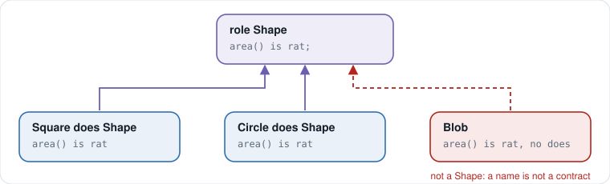

*Figure 14.1. Roles are nominal: an object performs a role only when it says does.*

A role is a list of action signatures: names, parameters and results. It
has no fields, no constructors and no bodies. (The one exception is a
`fake` block for tests, the subject of Chapter 15.) A role may declare
several signatures with one name, as long as their parameter types differ;
like the overloads of an object (Section 13.3), they may declare different
results. Parameter names alone do not make two signatures, in a role or in
its fake.

An object implements a role by saying so:

```okkama
object Bottle does Package { … }
object Wallet does Account, Labelled { … }
```

The compiler checks the claim:

- every action of the role exists on the object;
- parameter types, and the fixed or variadic shape, match *exactly*;
- result types are compatible: `^Bottle` satisfies `^Package` because
  `Bottle does Package`.

"Exactly" means exactly. A role action that takes `int` is not implemented
by one that takes `float`, even though the float version could accept every
integer:

```okkama
module bible/mismatch v1.0.0;

role Meter { reading(scale is int) is int; }

object Thermometer does Meter {
    has degrees is int;
    Thermometer(:degrees);
    reading(scale is float) is int { degrees; }
}

main() is int { 0; }
```

The compiler answers:

```text
14-mismatch-rejected.ok:5:8: semantic error: Action "reading" parameter 1 on object "Thermometer" must be int for role "Meter", got float
```

Function subtyping in type theory would allow it, since parameters are
contravariant [[Pierce 2002](#ref-pierce2002)]. Okkama keeps parameters invariant for the same
reason it keeps overloads strict (Chapter 13): a call through the role and
a direct call must select the same code, with no conversion in between.

## 14.2 Nominal, not structural

An object that has the right actions but does not declare the role does not
satisfy it:

```okkama
module bible/nominal v1.0.0;

role Presentation { label() is string; }

object Invoice {
    has number is int;
    Invoice(:number);
    label() is string { "invoice " + number.string(); }
}

main() is int {
    let shown is Presentation = Invoice(number: 7);
    0;
}
```

The compiler answers:

```text
14-nominal-rejected.ok:12:33: semantic error: Cannot initialize variable "shown" of type Presentation with Invoice
```

`Invoice` has `label() is string`, exactly what `Presentation` asks for.
It still cannot be used as one, because nobody said it was. Go makes the
opposite choice: a type satisfies an interface whenever its method set
contains the interface's methods, with no declaration at all [[Go specification](#ref-gospec)].
TypeScript does the same. Java, C# and Rust are nominal: a class
`implements` an interface, a type has an `impl Trait` [[Klabnik 2023](#ref-klabnik2023)]. Pierce
sets out the trade-off: structural typing is more flexible, while nominal
typing makes the type names carry intent and gives the checker
something to report against [[Pierce 2002](#ref-pierce2002)].

Okkama's reason is the one behind Liskov and Wing's behavioural subtyping.
A contract is more than a set of signatures. It includes what the actions
*mean*: their preconditions, their results, the states they lead to
[[Liskov 1994](#ref-liskov1994)]. Two `label()` actions with the same signature may promise
different things. `does Presentation` is the author's statement that this
object keeps the role's promises, and the compiler holds them to the parts
of it that it can check.

The cost is ceremony at the boundary between modules. An object written
before a role existed cannot satisfy it after the fact. A role can only be
implemented in the module that declares the object. To use a foreign
object as a role, wrap it in a small object that `does` the role and
forwards to it (§14.6).

## 14.3 A role reference limits what its holder can do

In Java, a variable of an interface type can be cast back to the class,
and `instanceof` tells which class it is. In Okkama a role-typed value is a
*restricted reference*. It points to the same object, nothing is copied,
and only the role's actions are reachable through it:

```okkama
module bible/restricted v1.0.0;

role Presentation { label() is string; }

object Customer does Presentation {
    has number is int;
    Customer(:number);
    label() is string { "customer " + number.string(); }
    id() is int { number; }
}

main() is int {
    let shown is Presentation = Customer(number: 7);
    shown.id();
}
```

The compiler answers:

```text
14-restricted-rejected.ok:14:11: semantic error: Role "Presentation" has no action "id"
```

An object becomes such a reference only where the role is already the
expected type: a typed `let`, a field, a parameter of an action or of a
builtin (`shapes.contains(Square(side: 2))` on a `@Shape`), a result, the
fallback of a `Maybe<Shape>` or of `find()`, and the branches of an `if`,
`match` or choice whose value has a declared role type. Okkama never looks
for a role two values happen to share. `shape == Square(side: 2)` is
rejected: the operands keep their exact types, and the comparison goes
through a role-typed binding. `if c { Rect(w: 1, h: 2); } else { Square(side: 2); }`
with no declared type is rejected too, even though both objects do `Shape`.
The conversion happens where the program states the contract, and nowhere
else.

There is no way back to the concrete type:

```okkama
module bible/downcast v1.0.0;

role Presentation { label() is string; }

object Customer does Presentation {
    has number is int;
    Customer(:number);
    label() is string { "customer " + number.string(); }
    id() is int { number; }
}

main() is int {
    let shown is Presentation = Customer(number: 7);
    let customer is Customer = shown;
    customer.id();
}
```

The compiler answers:

```text
14-downcast-rejected.ok:14:32: semantic error: Cannot initialize variable "customer" of type Customer with Presentation
```

The restriction holds through everything a reference can pass through:

- aliases, parameters, fields, results and collections;
- bound actions, `Maybe` and `Presence`, enum payloads;
- generic inference: a `T` inferred from a role reference is the role, not
  the hidden class;
- boxing into `any`. `any` never narrows, so the box keeps the
  restriction.

The implementation still runs with its full `self`. `Bottle.label` reads
`volume` and `open` as usual. The restriction is on the *holder*, not on
the object.

The restriction is shallow. A result of an allowed action is accessible
according to its own declared type. If `Package` had an action returning
`Bottle`, the holder could use that `Bottle` fully. A role restricts
exactly what its signatures expose.

This makes a role reference a capability in the sense of object-capability
security. Holding a reference is the permission to use it, and handing out
a narrower reference hands out fewer rights. That is attenuation, Mark
Miller's term for building least authority into a program
[[Miller 2006](#ref-miller2006); [Saltzer 1975](#ref-saltzer1975)]. A function that receives a `Labelled` can print
a label. It cannot learn the balance, even with a cast, because the
language has no cast to try.

A role limits what a holder may *do*. To let a holder only *see* part of
an object's state, the object grants a cap instead (Section 12.8): a named
view of computed fields, with no actions at all.

Exceptions do not reopen the restriction either. Objects cannot do `Error`:

```okkama
module bible/object_error v1.0.0;

object Failure does Error {
    Failure();
    text() is string { "failed"; }
}

main() is int { 0; }
```

The compiler answers:

```text
14-error-rejected.ok:3:21: semantic error: Object "Failure" cannot do Error: errors are enums, declare `enum Failure is Error = (...)`
```

Errors are enums (Chapter 10), so a `catch` never names an object type and
can never recover a concrete object from a role.

## 14.4 Moving between roles

A role reference may cross into another role on two conditions:

- the underlying object *nominally* does the target role;
- every action of the target role is already reachable through the current
  role.

That is narrowing: going from more rights to fewer.

```okkama
module bible/narrowing v1.0.0;

import "io/stdout" take Stdout;

role Account { label() is string; balance() is int; }
role Labelled { label() is string; }

object Wallet does Account, Labelled {
    has owner is string;
    has cents is int;
    Wallet(:owner, :cents);
    label() is string { owner; }
    balance() is int { cents; }
}

object Printer {
    Printer();
    print(item is Labelled) is string { "[" + item.label() + "]"; }
}

main() is int {
    let out = Stdout();
    let account is Account = Wallet(owner: "Ada", cents: 250);
    out.writeln(Printer().print(account));
    let tag is Labelled = account;
    out.writeln(tag.label());
    0;
}
```

Output:

```text
[Ada]
Ada
```

`Account` has `label` and `balance`; `Labelled` has only `label`. A
`Wallet` does both, so an `Account` reference passes as `Labelled` to
`Printer.print`, and binds to a `Labelled` local. The reverse is widening,
and it is rejected even though the object behind the reference does
`Account`:

```okkama
module bible/widen v1.0.0;

role Account { label() is string; balance() is int; }
role Labelled { label() is string; }

object Wallet does Account, Labelled {
    has owner is string;
    has cents is int;
    Wallet(:owner, :cents);
    label() is string { owner; }
    balance() is int { cents; }
}

main() is int {
    let tag is Labelled = Wallet(owner: "Ada", cents: 250);
    let account is Account = tag;
    account.balance();
}
```

The compiler answers:

```text
14-widen-rejected.ok:16:30: semantic error: Cannot initialize variable "account" of type Account with Labelled
```

If `Wallet` did only `Account`, the narrowing would be rejected too, with
the same message for `Labelled`. A role is a nominal contract, and a
subset of signatures is not a contract the object signed.

## 14.5 Successors through a role

A role may declare successor actions. `opened() is ^Package` says: calling
this gives the next state, and it is still a `Package`. Each implementation
returns its own type, `^Bottle` or `^Crate`. The caller holding a
`Package` receives a restricted `^Package`. The must-use rule of
Chapter 13 still applies through the role.

On an object, a successor always returns the object's own type. `is
^Package` on `Bottle` is an error. The role decides what a caller sees; the
object decides what it builds.

Successors on roles make roles into **state views**. Give each state of a
protocol its own role, exposing only what is valid in that state, and
let each transition return the role of the next state:

```okkama
module bible/states v1.0.0;

// Typestate with roles: each state is a role that exposes only what is valid
// in it, and a successor declared on a role returns the next state.
import "io/stdout" take Stdout;

role Created    { id() is string; authorize(approve is bool) is Authorization; }
role Authorized { id() is string; capture() is ^Captured; }
role Captured   { id() is string; refund() is ^Refunded; }
role Refunded   { id() is string; }
role Declined   { id() is string; reason() is string; }

enum Authorization = (approved(payment is Authorized), declined(payment is Declined));

enum Stage = (created, authorized, captured, refunded, declined(reason is string));
enum PaymentError is Error = (invalid_transition(action is string));

object Payment does Created, Authorized, Captured, Refunded, Declined {
    has key is string;
    has stage is Stage = Stage.created;
    Payment(:key);

    id() is string { key; }
    authorize(approve is bool) is Authorization {
        confirm stage == Stage.created else throw PaymentError.invalid_transition("authorize");
        if approve {
            Authorization.approved(self.approved());
        } else {
            Authorization.declined(self.rejected("card declined"));
        }
    }
    capture() is ^Payment {
        confirm stage == Stage.authorized else throw PaymentError.invalid_transition("capture");
        ^stage = Stage.captured;
    }
    refund() is ^Payment {
        confirm stage == Stage.captured else throw PaymentError.invalid_transition("refund");
        ^stage = Stage.refunded;
    }
    reason() is string {
        match stage {
            case Stage.declined(text) { text; }
            else { ""; }
        }
    }

    hidden approved() is ^Payment { ^stage = Stage.authorized; }
    hidden rejected(reason is string) is ^Payment { ^stage = Stage.declined(reason); }
}

object Payments {
    Payments();
    open(id is string) is Created { Payment(key: id); }
}

main() is int {
    let out = Stdout();
    for [true, false] -> approve {
        let result = match Payments().open("p-" + approve.string()).authorize(approve) {
            case Authorization.approved(payment) { payment.capture().refund().id() + " refunded"; }
            case Authorization.declined(payment) { payment.id() + " declined: " + payment.reason(); }
        };
        out.writeln(result);
    }
    0;
}
```

Output:

```text
p-true refunded
p-false declined: card declined
```

- `Payments.open` returns a `Created`. The only things a caller can do with
  it are `id()` and `authorize(...)`.
- `authorize` returns an enum whose two cases carry *different* views: an
  `Authorized` or a `Declined`. The `match` must handle both.
- `capture()` exists only on `Authorized`, and returns `^Captured`.
  `refund()` exists only on `Captured`.
- One immutable object, `Payment`, implements all five roles. A private
  `stage` field records the real state, and each transition checks it with
  `confirm`.

Skipping a state does not compile:

```okkama
module bible/skip_state v1.0.0;


role Created    { id() is string; authorize(approve is bool) is Authorization; }
role Authorized { id() is string; capture() is ^Captured; }
role Captured   { id() is string; refund() is ^Refunded; }
role Refunded   { id() is string; }
role Declined   { id() is string; reason() is string; }

enum Authorization = (approved(payment is Authorized), declined(payment is Declined));

enum Stage = (created, authorized, captured, refunded, declined(reason is string));
enum PaymentError is Error = (invalid_transition(action is string));

object Payment does Created, Authorized, Captured, Refunded, Declined {
    has key is string;
    has stage is Stage = Stage.created;
    Payment(:key);

    id() is string { key; }
    authorize(approve is bool) is Authorization {
        confirm stage == Stage.created else throw PaymentError.invalid_transition("authorize");
        if approve {
            Authorization.approved(self.approved());
        } else {
            Authorization.declined(self.rejected("card declined"));
        }
    }
    capture() is ^Payment {
        confirm stage == Stage.authorized else throw PaymentError.invalid_transition("capture");
        ^stage = Stage.captured;
    }
    refund() is ^Payment {
        confirm stage == Stage.captured else throw PaymentError.invalid_transition("refund");
        ^stage = Stage.refunded;
    }
    reason() is string {
        match stage {
            case Stage.declined(text) { text; }
            else { ""; }
        }
    }

    hidden approved() is ^Payment { ^stage = Stage.authorized; }
    hidden rejected(reason is string) is ^Payment { ^stage = Stage.declined(reason); }
}

object Payments {
    Payments();
    open(id is string) is Created { Payment(key: id); }
}

main() is int {
    let payment = Payments().open("p-1");
    payment.capture().id();
    0;
}
```

The compiler answers:

```text
14-state-rejected.ok:55:13: semantic error: Role "Created" has no action "capture"
```

Strom and Yemini named this idea **typestate** in 1986: the operations
allowed on a value depend on its state, and the compiler tracks the state
[[Strom 1986](#ref-strom1986)]. Typestate in Rust and similar languages relies on move
semantics, so that an old state cannot be used after the transition.
Okkama does without them. The old state is an immutable object and remains
valid: `authorized.capture()` can be called twice on the same
`Authorized`, and each call returns a `Captured`. Whether the second
capture should succeed is a question about the outside world (has the
money moved?), and it belongs in durable state with idempotency keys, not
in the type system. The `confirm` in each transition is the second line of
defence inside the module.

In a real program, `Payment` and `Stage` are declared `hidden`, so that
other modules cannot name the class at all. They only ever hold one of the
five views.

## 14.6 Composition instead of inheritance

A role is a contract; it carries no code. Shared behaviour comes from
objects that hold other objects. The **decorator** is the basic form: an
object that does a role, holds another implementation of the same role,
and adds one behaviour around it [[Gamma 1994](#ref-gamma1994)].

```okkama
module bible/decorators v1.0.0;

// Composition through a role: each decorator does the role it wraps, holds
// another implementation of it, and adds one behaviour.
import "io/stdout" take Stdout;

role Pricing {
    price(item is string) is int;
}

object Catalog does Pricing {
    has prices is %string:int;
    Catalog(:prices);
    price(item is string) is int { prices[item] else 0; }
}

object Discounted does Pricing {
    has origin is Pricing;
    has percent is int;
    Discounted(:origin, :percent);
    price(item is string) is int {
        let full = origin.price(item);
        full - (full * percent / 100).int();
    }
}

object Rounded does Pricing {
    has origin is Pricing;
    Rounded(:origin);
    price(item is string) is int {
        let exact = origin.price(item);
        exact - exact % 10;
    }
}

main() is int {
    let out = Stdout();
    let base = Catalog(prices: ["tea": 345, "cake": 520]);
    let sale is Pricing = Rounded(origin: Discounted(origin: base, percent: 15));
    for ["tea", "cake", "soup"] -> item {
        out.writeln(item + ": " + base.price(item).string() + " -> " + sale.price(item).string());
    }
    0;
}
```

Output:

```text
tea: 345 -> 290
cake: 520 -> 440
soup: 0 -> 0
```

`Catalog` knows prices. `Discounted` takes 15 percent off whatever its
`origin` says. `Rounded` rounds down to ten. Each is a few lines, each can
be tested alone, and they combine in any order. The caller holds a
`Pricing` and cannot tell how many layers it has. `sale.price("tea")` goes
through three objects: 345, then 294, then 290.

Compare a class hierarchy for the same job: `Catalog`, `DiscountedCatalog`,
`RoundedDiscountedCatalog`. Every new behaviour multiplies the classes, and
every subclass depends on the details of its parent, which is the fragile
base class problem of Chapter 12. "Favor object composition over class
inheritance" is the Gang of Four's own advice [[Gamma 1994](#ref-gamma1994)]. Okkama makes it
the only option. Elegant Objects leans on such decorators throughout:
small objects, each wrapping another behind a shared interface
[[Bugayenko 2016](#ref-bugayenko2016)].

The cost is forwarding. A role with ten actions needs ten forwarding
actions in every decorator, even when the decorator changes one of them.
Okkama has no delegation shorthand ("implement `Pricing` by forwarding to
`origin`"). The forwarding code is plain to read and tedious to write.
Keeping roles small keeps it short: a role with one or two actions is the
common case in the standard library.

## 14.7 Operators are roles

Arithmetic on objects goes through roles as well. The standard module
`operators` declares one role per operator (#215). The first type parameter
is the right operand, the second the result:

| Role | Action | Operator |
|---|---|---|
| `Adding<T, R>` | `plus(other is T) is R` | `a + b` |
| `Subtracting<T, R>` | `minus(other is T) is R` | `a - b` |
| `Multiplying<T, R>` | `times(other is T) is R` | `a * b` |
| `Dividing<T, R>` | `divided(other is T) is R` | `a / b` |
| `Remaindering<T, R>` | `remainder(other is T) is R` | `a % b` |
| `Negating<R>` | `negated() is R` | `-a` |

```okkama
module bible/operators v1.0.0;

// Arithmetic on an object is a call to a role action: a + b is a.plus(b)
// when the type does Adding<…>, and a < b asks Comparing for an Order.
import "io/stdout" take Stdout;
import "operators" take Adding, Subtracting, Multiplying, Negating;
import "compare" take Comparing, Order;

object Money does Adding<Money, Money>, Subtracting<Money, Money>, Multiplying<int, Money>,
        Negating<Money>, Comparing<Money> {
    has cents is int;
    Money(:cents);

    cents() is int { cents; }
    plus(other is Money) is Money { Money(cents: cents + other.cents()); }
    minus(other is Money) is Money { Money(cents: cents - other.cents()); }
    times(count is int) is Money { Money(cents: cents * count); }
    negated() is Money { Money(cents: -cents); }
    order(other is Money) is Order { cents.order(other.cents()); }
}

main() is int {
    let out = Stdout();
    let price = Money(cents: 1250);
    let total = price * 3 + Money(cents: 499);      // price.times(3).plus(…)
    let refund = -Money(cents: 300);                // Money(cents: 300).negated()
    out.writeln(total.cents().string() + " " + (total + refund).cents().string());
    out.writeln(if total > price && price <= price { "ordered"; } else { "not ordered"; });
    0;
}
```

Output:

```text
4249 3949
ordered
```

With an object on the left, `a + b` means `a.plus(b)` through its declared role. The right operand gets no implicit conversion. Ordering uses `compare.Comparing<T>`: `a < b` means `a.order(b) == Order.less`. `==` stays structural (Chapter 12).

The roles are nominal, like every role (§14.2). An action named `plus` does
not give an object `+`:

```okkama
module bible/undeclared v1.0.0;

object Weight {
    has grams is int;
    Weight(:grams);
    grams() is int { grams; }
    plus(other is Weight) is Weight { Weight(grams: grams + other.grams()); }
}

main() is int {
    let both = Weight(grams: 300) + Weight(grams: 200);
    0;
}
```

The compiler answers:

```text
14-operator-undeclared-rejected.ok:11:16: semantic error: Operator + cannot be applied to Weight and Weight: Weight does not do Adding
```

One role may be declared several times with different arguments. `Instant`
does `Subtracting<Duration, Instant>` and `Subtracting<Instant, Duration>`:
an instant minus a duration is an instant, an instant minus an instant is a
duration. Its two `minus` actions are overloads with different results,
which §13.3 allows because their parameter types differ. In the standard
library `BigInt` does all six roles and `Comparing`; `Duration`, `Instant`
and `MonotonicInstant` do the ones time arithmetic needs.

Other languages find operators in one of three ways. C++ and Python look
them up by name: a function `operator+` [[Stroustrup 1994](#ref-stroustrup1994)], or a method
`__add__`. Haskell puts them in a class, and `Num` bundles `+`, `-`, `*`,
`negate`, `abs`, `signum` and `fromInteger` together [[Haskell 2010](#ref-haskell2010)]. A type
that can be added but not multiplied, such as a duration, cannot be a `Num`
honestly. Rust has one trait per operator, `Add`, `Sub`, `Mul`, each with
the right operand as a parameter and the result as an associated type
[[Klabnik 2023](#ref-klabnik2023)]. Okkama is closest to Rust: a role per operator, the result
spelled out, conformance declared. Lookup by name was ruled out because
nothing in a name says that `plus` means addition, which is the argument
of §14.2. One class for all arithmetic was ruled out because a contract
should not ask for actions the object cannot keep.

## 14.8 A collection of your own: `Iterating` and `Cursor`

Generic roles are where roles meet the rest of the language. A collection
becomes usable by `for`, `map`, `filter` and `reduce` by doing one standard
role, `Iterating<T>` from `collections/iteration`, whose only action hands
out a `Cursor<T>`.

```okkama
module app v1.0.0;

import "io/stdout" take Stdout;
import "collections/iteration" take Cursor, Iterating, IterationEnded;

// A collection of your own: the days of a month that fall on a weekday.
object Weekdays does Iterating<int> {
    has days is int;
    has first is int;    // 0 = Monday, ... 6 = Sunday, for day 1
    Weekdays(:days, :first);
    cursor() is Cursor<int> { WeekdayCursor(days: days, first: first, day: 1).settled(); }
}

// A cursor is a value: successor() returns the next position and leaves this one as it was.
object WeekdayCursor does Cursor<int> {
    has days is int;
    has first is int;
    has day is int;
    WeekdayCursor(:days, :first, :day);

    // Skip forward to the first weekday at or after this day.
    settled() is WeekdayCursor {
        if day <= days && (first + day - 1) % 7 >= 5 {
            WeekdayCursor(days: days, first: first, day: day + 1).settled();
        } else {
            self;
        }
    }
    available() is bool { day <= days; }
    item() is int {
        confirm day <= days else throw IterationEnded.ended;
        day;
    }
    successor() is Cursor<int> { WeekdayCursor(days: days, first: first, day: day + 1).settled(); }
}

main() is int {
    let out = Stdout();
    // A month of 30 days whose first day is a Saturday.
    let month = Weekdays(days: 30, first: 5);
    // for, map, filter and reduce accept it like an array.
    let first_week = month.filter() -> d { d <= 7; };
    out.writeln(first_week.map() -> d { d.string(); }.join(" "));
    out.writeln(month.reduce(0) -> count, d { count + 1; }.string() + " working days");
    for month -> d {
        last if d > 4;
        out.writeln("day " + d.string());
    }
    // Two walks over one collection never interfere: each starts its own cursor.
    let start = month.cursor();
    out.writeln(start.item().string() + " " + start.successor().item().string() + " " + start.item().string());
    0;
}
```

Output:

```text
3 4 5 6 7
20 working days
day 3
day 4
3 4 3
```

The contract is small and every part of it is a value:

- **`cursor()`** returns the position of the first item. Each call starts a
  new walk, which is why the last line can read the first item, step to the
  second, and read the first again: nothing moved.
- **`available()`** answers whether there is an item here. The end is an
  ordinary `false`, not a sentinel and not an exception.
- **`item()`** returns the item, and throws `IterationEnded` if asked at the
  end; a well-behaved loop never asks.
- **`successor()`** returns the next position as a new cursor. The cursor is
  immutable, so a walk can be resumed from any position kept in a variable.

`Weekdays` holds two numbers and computes its items on demand, yet `filter`,
`reduce` and `for` with `last if` treat it exactly like an array. The role is
nominal (§14.2): a collection must say `does Iterating<int>`; having actions
with the right names is not enough, and the type argument says what the
loop's binding will be. A source that is consumed as it is read — a file, a
socket — does the other standard role, `Batching<T>` (Chapter 8).

## 14.9 Async actions in a role

A role may promise an action that waits. Exchange rates come from a slow
source in production and from a table in a test, and the code that converts
money should not know which:

```okkama
module bible/asyncrole v1.0.0;

// A role may promise an async action. Every implementation keeps the promise
// with an async action of its own, and the caller awaits through the role
// without knowing which one it holds.
import "io/stdout" take Stdout;

enum Unknown is Error = (currency(code is string));

role Rates {
    async rate(code is string) is rat;
}

// Asks a slower source, here another async object.
object Desk {
    Desk() {}
    async quote(code is string) is rat {
        confirm code == "EUR" else throw Unknown.currency(code);
        117 / 100;
    }
}

object Remote does Rates {
    has desk is Desk;
    Remote(:desk);
    async rate(code is string) is rat { await desk.quote(code); }
}

// A fixed table, for tests and for currencies the desk does not quote.
object Table does Rates {
    has known is %string:rat;
    Table(:known);
    async rate(code is string) is rat {
        confirm known.has(code) else throw Unknown.currency(code);
        known[code];
    }
}

// A decorator: the first source, and the second when the first does not know.
object Fallback does Rates {
    has first is Rates;
    has second is Rates;
    Fallback(:first, :second);
    async rate(code is string) is rat {
        try {
            await first.rate(code);
        }
        catch e is Unknown {
            await second.rate(code);
        };
    }
}

object Converter {
    has rates is Rates;
    Converter(:rates);
    async converted(amount is rat, code is string) is rat { amount * await rates.rate(code); }
}

async main() is int {
    let out = Stdout();
    let table = Table(known: ["EUR": 6 / 5, "KZT": 1 / 500]);
    let rates = Fallback(first: Remote(desk: Desk()), second: table);
    let converter = Converter(rates: rates);
    out.writeln("100 EUR = " + (await converter.converted(100.rat(), "EUR")).string());
    out.writeln("5000 KZT = " + (await converter.converted(5000.rat(), "KZT")).string());
    let missing = try {
        (await converter.converted(1.rat(), "XAU")).string();
    }
    catch e is Unknown {
        "unknown: " + e.text();
    };
    out.writeln(missing);
    out.writeln("test double: " + (await Converter(rates: table).converted(10.rat(), "EUR")).string());
    0;
}
```

Output:

```text
100 EUR = 117
5000 KZT = 10
unknown: Unknown.currency("XAU")
test double: 12
```

- **The caller awaits through the role.** `Converter` holds a `Rates` and
  writes `await rates.rate(code)`. It does not know whether a desk, a table
  or a decorator answers.
- **A decorator is an implementation like any other.** `Fallback` holds two
  `Rates`. It asks the first and, when that one throws `Unknown`, the
  second. The euro comes from the desk at 1.17. The tenge is not quoted by
  the desk, so it comes from the table. Gold is known to neither, and the
  error from the table reaches the caller.
- **The test double is a role implementation too.** `Converter(rates:
  table)` converts at the table's 1.2, and no desk is involved. Chapter 15
  builds whole suites this way.

**Async is part of the action's shape.** An implementation that answers at
once still writes `async`, as `Table` does. A synchronous `rate` does not
conform:

```okkama
module bible/async_shape_rejected v1.0.0;

// A role's async action is kept only by an async action.

import "io/stdout" take Stdout;

role Rates {
    async rate(code is string) is rat;
}

object Fixed does Rates {
    Fixed() {}
    rate(code is string) is rat { 1 / 1; }
}

async main() is int {
    Stdout().writeln((await Fixed().rate("EUR")).string());
    0;
}
```

The compiler answers:

```text
14-async-shape-rejected.ok:11:8: semantic error: Action "rate" on object "Fixed" must match async shape for role "Rates"
```

The rule is the same as for parameters (§14.1): the implementation repeats
the role's signature exactly. The colour follows the role to its callers
(Chapter 20). An action that holds a `Rates` and wants a rate must itself be
async:

```okkama
module bible/async_caller_rejected v1.0.0;

// An async action of a role is awaited only inside an async action.

import "io/stdout" take Stdout;

role Rates {
    async rate(code is string) is rat;
}

object Fixed does Rates {
    Fixed() {}
    async rate(code is string) is rat { 1 / 1; }
}

object Report {
    has rates is Rates;
    Report(:rates);
    line() is string { "EUR " + (await rates.rate("EUR")).string(); }
}

async main() is int {
    Stdout().writeln(Report(rates: Fixed()).line());
    0;
}
```

The compiler answers:

```text
14-async-caller-rejected.ok:19:34: semantic error: await is available only inside an async action
```

The languages that have both interfaces and `async` disagree about the
direction of conformance:

- **Swift.** An `async` protocol requirement may be satisfied by a
  synchronous function, but a synchronous requirement may not be satisfied by
  an `async` one [[Swift Evolution](#ref-swiftse0296)]. A synchronous answer is a special case of
  an asynchronous one.
- **Kotlin.** An override must repeat `suspend` exactly, in both
  directions, because a suspending function takes a hidden continuation
  parameter and the two are different signatures on the JVM.
- **Rust.** `async fn` in traits arrived only in Rust 1.75, at the end of
  2023 [[Rust Blog](#ref-rust175)]. An implementation may also write the desugared form, a
  function that returns `impl Future`, and do synchronous work before it
  builds the future.
- **C#, TypeScript and Java's `CompletableFuture`.** The interface returns
  a task or a promise, and `async` is an implementation detail. A method
  that returns `Task.FromResult(x)` conforms like any other.

Okkama takes Kotlin's side, and it costs `Table` one word, `async`. In
return, one rule covers parameters, results and waiting alike: an
implementation repeats the role's signature exactly. A reader who sees one
implementation knows how every call through the role looks. Section 20.11
gives the scheduler's side of the rule: an implementation cannot answer
synchronously where the role promised to wait.

## 14.10 Where roles came from

The idea of a contract separate from its implementations has a short and
traceable history.

- **CLU (1977).** Liskov's clusters gave a type a set of operations and
  hid its representation behind them [[Liskov 1977](#ref-liskov1977)]. A cluster was one
  implementation; there was not yet a way to say that two clusters offered
  the same contract.
- **Type classes (1989).** Wadler and Blott proposed type classes for
  Haskell: a class names operations, and an *instance* declares that a type
  provides them [[Wadler 1989](#ref-wadlerblott1989)]. Conformance is declared, as in Okkama,
  but an instance may be written in any module, so a type can join a class
  after the fact. Okkama does not allow that (§14.2): the object's module
  is the only place that can say what the object does.
- **Interfaces (1995).** Java made a contract a type of its own: an
  `interface` lists method signatures, and a class `implements` any number
  of them while inheriting implementation from one superclass
  [[Gosling 2023](#ref-gosling2023)]. Java 8 later let interfaces carry default methods, and
  with them part of what interfaces had been introduced to avoid.
- **Traits (2003).** Schärli, Ducasse, Nierstrasz and Black proposed traits
  as units of reusable *behaviour*: a trait supplies method bodies, a class
  composes several traits, and conflicts between them must be resolved
  explicitly [[Schärli 2003](#ref-scharli2003)]. Scala, PHP and Rust use the name; what they
  mean by it ranges from Schärli's composable behaviour to something close
  to Haskell's type classes.

Okkama's role takes the contract from this line and leaves the code. A role
has signatures, successor results and an optional fake for tests, and never
a method body. With no bodies there is nothing to compose and nothing to
resolve: the question traits answer, which of two inherited methods wins,
does not arise. Shared behaviour lives in an object that others hold
(§14.6), which is where Chapter 2 argued it belongs.

## 14.11 Roles elsewhere

| | Okkama role | Java interface | Go interface | Rust trait |
|---|---|---|---|---|
| Conformance | declared (`does`) | declared (`implements`) | implicit, by method set | declared (`impl`) |
| Default method bodies | no | yes | no | yes |
| Downcast from the contract | impossible | cast, `instanceof` | type assertion, type switch | only through `Any` |
| Parameter matching | exact | exact (overriding) | exact | exact |
| Successor (next-state) results | yes (`^Role`) | no | no | a method that consumes `self` and returns a new type |
| Conformance of a foreign type | no; wrap it | no | automatic, if the methods match | if the trait or the type is local |
| Operators on user types | through roles (`Adding`, …) | no | no | through traits (`Add`, …) |

Two rows matter most. **Default bodies**: Java and Rust let an interface
carry code, which brings back part of inheritance, including the question
of which default wins when two interfaces supply one. A role carries none;
shared code lives in an object. **Downcasting**: every other language in
the table has a way back from the contract to the concrete type. Okkama
has none, and that is what makes a role reference a capability rather than
a type annotation.

## 14.12 What this design costs

- **Forwarding code.** Decorators repeat every action of the role. No
  delegation syntax shortens it (§14.6).
- **No retroactive conformance.** A role cannot be added to an object from
  outside its module. The usual fix, an adapter object, is one more object.
- **No downcast, ever.** Code that "just needs to check what this really
  is" has to be redesigned: an action on the role that answers the
  question, or an enum that carries the alternatives.
- **Invariant parameters.** An implementation cannot accept more than the
  role asks for. Usually it does not need to.
- **Operators look only to the left.** `price * 3` works; `3 * price` does
  not, because `int` cannot be given a role. Python asks the right operand
  through `__rmul__`, and Rust allows `impl Mul<Money> for i64` in Money's
  crate. Okkama has neither (no retroactive conformance, above).

In return:

- a contract states intent, not an accident of shape;
- a reference can be narrowed, and narrowed is final;
- behaviour composes from small objects instead of growing down a
  hierarchy;
- protocols can be typed by state, with no linear types.

# Chapter 15. Fakes, tests and properties

A language that forbids mutation, setters, downcasts and inheritance also
forbids most of the tricks that testing frameworks are built on. There is
no monkey-patching, no mocking library that rewrites a class at run time,
and no way to reach into an object and set a field. Okkama's answer is
not a framework. It is three pieces of the language and a small library:

- tests are declared next to the code they test;
- every role can carry its own **fake**, a working implementation for tests;
- assertions are a binding that exists only while a test runs;
- `testing/property` checks a claim against generated inputs and shrinks
  the first counterexample.

```okkama
module bible/library v1.0.0;

import "async/atomic" take Atomic;

// A role ships its own fake. Tests use the fake; production code only ever
// sees the role.
enum Refused is Error = (because(reason is string));

role Books {
    remember(id is int, title is string) is void;
    title(id is int) is string;
    has(id is int) is bool;

    fake {
        has shelf is Atomic<%int:string> = Atomic([:]);
        remember(id is int, title is string) is void { shelf.replace(shelf.value() + [id: title]); }
        title(id is int) is string { shelf.value()[id]; }
        has(id is int) is bool { shelf.value().has(id); }
    }
}

role Door {
    opened() is ^Door;
    open() is bool;

    fake {
        has times is int = 0;
        opened() is ^Door { ^times = times + 1; }
        open() is bool { times > 0; }
    }
}

object Library {
    has books is Books;
    Library(:books);

    shelve(id is int, title is string) is string {
        confirm id > 0 else throw Refused.because("non-positive id");
        confirm !books.has(id) else throw Refused.because("id " + id.string() + " is taken");
        books.remember(id, title);
        books.title(id);
    }

    test "a shelved title can be read back" {
        let books = Books.fake();
        test.is(Library(books: books).shelve(7, "Dune"), "Dune");
        test.ok(books.has(7));
    }
}

test "a bad id is refused" {
    let refused = test.throws(Refused) { Library(books: Books.fake()).shelve(0, "x"); };
    test.is(refused, Refused.because("non-positive id"));
}

test "an id cannot be shelved twice" {
    let library = Library(books: Books.fake());
    library.shelve(3, "Emma");
    let refused = test.throws(Refused) { library.shelve(3, "Persuasion"); };
    test.is(refused, Refused.because("id 3 is taken"));
}

test "a fake keeps its state through successors" {
    let door is Door = Door.fake();
    test.ok(!door.open());
    test.ok(door.opened().open());
}

main() is int { 0; }
```

Output:

```text
=== RUN   Library :: a shelved title can be read back
--- PASS: Library :: a shelved title can be read back
=== RUN   a bad id is refused
--- PASS: a bad id is refused
=== RUN   an id cannot be shelved twice
--- PASS: an id cannot be shelved twice
=== RUN   a fake keeps its state through successors
--- PASS: a fake keeps its state through successors
PASS
```

## 15.1 Tests live next to the code

```okkama
test "a bad id is refused" {
    let refused = test.throws(Refused) { Library(books: Books.fake()).shelve(0, "x"); };
    test.is(refused, Refused.because("non-positive id"));
}
```

A `test` block has a name and a body. It may stand at module level, inside
an object or inside a role. `okkama run -t` runs the tests of the file it
is given, in declaration order, and does not call `main`:

```text
=== RUN   Library :: a shelved title can be read back
--- PASS: Library :: a shelved title can be read back
=== RUN   a bad id is refused
--- PASS: a bad id is refused
…
PASS
```

- A test inside an object or a role is shown as `Owner :: name`. That is
  only a namespace. The test gets no `self` and no access to the owner's
  hidden actions or fields; it uses the object like any other caller.
- Names are unique within a module, and per owner for object and role
  tests. A duplicate is a compile error before any test runs.
- Each test uses the imports of the file that declares it.
- In a normal run, the parser skips test and fake blocks without building
  them. Test-only code cannot affect a production program, and it costs
  nothing there.

Without `--workers`, tests run in the runner's own process (Section 15.9).
`okkama run -t --filter TEXT` runs only the tests whose names contain
`TEXT`; with several `--filter`s, those that contain any of them. A test
may stand anywhere among an object's members, between hidden actions too;
it is still a test of the object. The standard library can
render a test report as human text, TAP, JSON or JUnit (`testing/report`),
and the command line writes human text, JSON or JUnit with `--report`
(Section 15.9).

## 15.2 The `test` binding

Inside a running test, the name `test` is bound to the current case. It is
not imported and does not exist outside a test:

- `test.ok(condition)` requires an exact `bool`;
- `test.is(actual, expected)` and `test.isnt(actual, expected)` use the
  language's structural equality, deep through collections and objects;
- `test.close(actual, expected, tolerance)` compares two floats: they pass
  when equal or no further apart than the tolerance, and a NaN is never
  close;
- `test.text(actual, expected)` compares two strings and names where they
  part: the scalar, its line and column in the expected text, and the text
  around it;
- `test.bytes(actual, expected)` compares two `@byte` arrays and names the
  first offset where they differ, or their sizes;
- `test.fail("explanation")` records a failure;
- `test.skip("reason")` ends the test and reports it as skipped;
- `test.throws(Type) { … }` requires the block to throw a `Type`, and
  returns the caught error for further checks.

`test.skip` is for a test that cannot run here: a missing volume, a
service that is not configured. The code after it does not run, and no
`catch` takes it, so a helper that skips cannot be overruled by its
caller. Cleanup runs as for any failure. A skipped test does not fail the
run, unless an assertion had already failed; a skip does not erase a
failure. The example also puts a test among the hidden actions:

```okkama
module skip_tests;

object Ledger {
    has entries is int;

    Ledger(entries is int) {
        self.entries = entries;
    }

    count() is int {
        self.checked();
    }

    hidden checked() is int {
        entries;
    }

    test "a test among the hidden actions" {
        test.is(Ledger(3).count(), 3);
    }
}

test "the archive is not mounted" {
    test.skip("needs the archive volume");
    test.ok(false);
}
```

Output:

```text
=== RUN   Ledger :: a test among the hidden actions
--- PASS: Ledger :: a test among the hidden actions
=== RUN   the archive is not mounted
--- SKIP: the archive is not mounted
    needs the archive volume
PASS
```

A failed assertion does not stop the test. The remaining assertions still
run, and every failure is reported:

```text
=== RUN   a failing one
--- FAIL: a failing one
    expected 3, got 2
FAIL
```

An uncaught throw, a panic or a failure in cleanup ends only the current
case. Its `defer`s and `destroy`s run, and the next case starts. The
process exits with 0 when no case failed; a skipped case does not fail.

`test.throws(Refused) { … }` means exactly `try { …; panic …; } catch e is
Refused { e; }`. The error it returns is an ordinary enum value, so
`test.is(refused, Refused.because("non-positive id"))` compares the case
and the payload. There is no `test.panics`. A panic is a broken invariant,
not an outcome to assert (Chapter 10), and nothing catches it.

The binding follows the whole dynamic extent of the test, so a helper
object in another module can call `test.is` on behalf of the test that
called it. The checks of `testing/check` build on that (Section 15.9).

## 15.3 Why a fake and not a mock

Meszaros sorts test doubles into five kinds: dummy, stub, spy, mock and
fake [[Meszaros 2007](#ref-meszaros2007)]. A **mock** is programmed with expectations: "expect
`remember(7, "Dune")` to be called once". The test then verifies that the
calls happened. A **fake** is a working implementation that takes a
shortcut, such as keeping data in memory instead of a database. Fowler's
essay draws the consequence. Mocks make a test check *how* the code under
test talks to its collaborators, and such tests break when the
conversation changes even if the result does not [[Fowler 2007](#ref-fowler2007)].

Elegant Objects goes further: every interface should ship its own fake, so
that tests never build ad-hoc mocks [[Bugayenko 2016](#ref-bugayenko2016)]. Okkama makes that a
language feature. A role may contain one `fake` block:

```okkama
role Books {
    remember(id is int, title is string) is void;
    title(id is int) is string;
    has(id is int) is bool;

    fake {
        has shelf is Atomic<%int:string> = Atomic([:]);
        remember(id is int, title is string) is void { shelf.replace(shelf.value() + [id: title]); }
        title(id is int) is string { shelf.value()[id]; }
        has(id is int) is bool { shelf.value().has(id); }
    }
}
```

`Books.fake()` makes one. The fake is a `Books`. Code that takes a
`Books`, like `Library`, cannot tell it from the real thing, and it has no
reason to. The test then checks *results*: the title comes back, the
second shelving of an id is refused. It does not check which calls were
made in which order.

The fake lives with the role, written once by the role's author, and
every test of every user of the role shares it. When the role changes,
the compiler checks the fake against the new contract like any other
implementation.

## 15.4 Writing a fake

- A role has at most one `fake` block.
- Its actions must implement the role exactly, as an object would: names,
  parameter types, fixed or variadic shape, results.
- It may declare fields with `has`, and every field needs a default. A fake
  takes no constructor arguments, so nothing else could set them. Defaults
  are evaluated for each `Role.fake()`.
- It may stage successors with `^field`, like an object's successor
  (§15.5).

`Role.fake()` works only in test mode. Anywhere else the compiler rejects
it:

```okkama
module bible/fake_production v1.0.0;

role Clock {
    now() is int;
    fake {
        now() is int { 1700000000; }
    }
}

main() is int {
    Clock.fake().now();
    0;
}
```

The compiler answers:

```text
15-fake-production-rejected.ok:11:5: semantic error: Clock.fake() is available only in test mode
```

A production program therefore cannot reach a fake, not even by accident
in a code path that tests happen to cover. Mistakes inside the fake block
are reported when the tests are compiled, in terms of the role and at the
fake's own code: `Fake field "value" of role "Counter" needs a default: a
fake takes no constructor arguments`, `Action "count" of the fake of role
"Counter" must return int, got string`. Before 0.5.0 they named the
generated object `Counter$fake` (#276).

## 15.5 State in a fake

A fake that only returns constants is a stub. A useful fake often has to
remember something: what was stored, how many times a door was opened. It
has two places to keep it.

**Fields and successors.** A fake's fields are ordinary immutable fields,
and its successors make new fakes, exactly as for objects:

```okkama
role Door {
    opened() is ^Door;
    open() is bool;

    fake {
        has times is int = 0;
        opened() is ^Door { ^times = times + 1; }
        open() is bool { times > 0; }
    }
}
```

`Door.fake().opened().open()` is `true`; the original fake still says
`false`. This suits state that the role's own successors carry.

**A field that holds an `Atomic`.** A fake that emulates a repository
needs state that changes while the test runs, and a fake keeps it the way
production code does: in a field that holds an `Atomic` (`async/atomic`), as
`Books` above does with `shelf`. `value()` reads it and `replace(…)` puts a
new value; the map inside is an ordinary immutable value, replaced whole.

- Each `Role.fake()` gets its own `Atomic`, because a field's default is
  evaluated for each fake. Two fakes in one test never see each other's
  data.
- A successor copies the fields, and with them the reference to the same
  `Atomic`, so a fake and all its successors share one state, and data
  survives a transition without being copied.
- The field cannot be a `Cell`. A cell stays inside one piece of synchronous
  code and cannot be a field of anything (Section 25.3); a fake is an object
  like any other, and the rule is the same.
- A missing key reads as it does anywhere else: `shelf.value()[id]` on an
  absent id is a runtime error, and `has` asks first.

Until 0.6.0 the language had a separate key–value store for fakes,
`fake.storage`. It was removed (#583): it was the one place with hidden
mutable state, and a fake that keeps its state in a typed field needs no
special rules and reads like the production code it stands in for.

## 15.6 Properties

An example-based test checks the cases its author thought of. A property
states a claim about *every* input and lets the machine look for a
counterexample. Claessen and Hughes's QuickCheck made the idea practical:
generate random inputs, run the claim, and when it fails, *shrink* the
input to a minimal one before reporting it [[Claessen 2000](#ref-claessen2000)].

`testing/property` follows that design:

```okkama
module bible/properties v1.0.0;

// A property states a claim about every input; the library generates
// inputs from a seed and shrinks the first counterexample.

import "testing/generation" take IntegerGeneration;
import "testing/property" take Property;

object Cents {
    has total is int;
    Cents(:total);
    digit() is int { (total / 100).int(); }
    rest() is int { total - self.digit() * 100; }
}

test "digit and rest rebuild the amount" {
    let property is Property<int> = Property(
        IntegerGeneration(-100000, 100001), 42, 200, 1000, 64,
        (value is int) is bool {
            let cents = Cents(total: value);
            cents.digit() * 100 + cents.rest() == value;
        },
    );
    property.check();
}

test "rest is never negative" {
    let property is Property<int> = Property(
        IntegerGeneration(-100000, 100001), 42, 200, 1000, 64,
        (value is int) is bool { Cents(total: value).rest() >= 0; },
    );
    property.check();
}

main() is int { 0; }
```

Output:

```text
=== RUN   digit and rest rebuild the amount
--- PASS: digit and rest rebuild the amount
=== RUN   rest is never negative
--- FAIL: rest is never negative
    property failed: seed=42 case=1 size=5 value=-1 false condition
FAIL
exit 1
```

`Property(origin, seed, cases, maximum_size, shrink_limit, condition)`:

- `IntegerGeneration(-100000, 100001)` produces integers from −100000 up
  to, but not including, 100001.
- `42` is the seed of the property's own PCG random stream. The same seed
  produces the same inputs and every run.
- `200` cases, with a size that grows from 0 to `1000` across them, so the
  early cases are small.
- When a case fails, up to `64` reductions are tried, and the smallest
  input that still fails is reported.

The second property is false. `Cents(total: -1).rest()` is `-1`, because
`int(...)` truncates toward zero (Chapter 5): the digit of −1 cents is 0,
and the rest is −1. The report gives everything needed to reproduce it:
the seed, the case index, the size and the shrunk value. The value is
`-1`, the simplest counterexample there is.

A condition that throws a typed error counts as a failure and is reported
with the error's text. A property is a `Checking` like the other checks of
`testing/check`, and `AsyncProperty` takes an async condition.

## 15.7 A worked suite: a service with a clock and a store

A service that depends on time and on storage is the classic case for test
doubles, and the one where mocks do the most damage. Here the service
`Reminders` sees a `Clock` and a `Store` only through their roles, and each
role ships the fake its tests need.

```okkama
module bible/reminders v1.0.0;

import "async/atomic" take Atomic;

enum Unsaved is Error = (full(limit is int));

// The clock and the store are roles; each ships the fake its tests need.
role Clock {
    // Minutes since midnight.
    minute() is int;

    fake {
        minute() is int { 600; }
    }
}

role Store {
    save(at is int, text is string) is void;
    texts(until is int) is @string;

    fake {
        has items is Atomic<%int:string> = Atomic([:]);
        save(at is int, text is string) is void {
            confirm items.value().size() < 3 else throw Unsaved.full(3);
            items.replace(items.value() + [at: text]);
        }
        texts(until is int) is @string {
            let saved = items.value();
            saved.keys().filter() -> at { at <= until; }.map() -> at { saved[at] else ""; };
        }
    }
}

object Reminders {
    has clock is Clock;
    has store is Store;
    Reminders(:clock, :store);

    remind(after is int, text is string) is int {
        let at = clock.minute() + after;
        store.save(at, text);
        at;
    }

    due() is @string {
        store.texts(clock.minute());
    }
}

test "a reminder for later is not due yet" {
    let reminders = Reminders(clock: Clock.fake(), store: Store.fake());
    test.is(reminders.remind(30, "call the plumber"), 630);
    test.is(reminders.due(), []);
}

test "past and present reminders are due, in time order" {
    let store = Store.fake();
    store.save(590, "water the plants");
    store.save(540, "take the pills");
    let reminders = Reminders(clock: Clock.fake(), store: store);
    reminders.remind(0, "leave for work");
    test.is(reminders.due(), ["take the pills", "water the plants", "leave for work"]);
}

test "a full store refuses the fourth reminder and keeps the first three" {
    let store = Store.fake();
    let reminders = Reminders(clock: Clock.fake(), store: store);
    for 1..=3 -> n {
        reminders.remind(-n, "task " + n.string());
    }
    let refused = test.throws(Unsaved) { reminders.remind(-9, "one too many"); };
    test.is(refused, Unsaved.full(3));
    test.is(reminders.due().size(), 3);
}

main() is int { 0; }
```

Output:

```text
=== RUN   a reminder for later is not due yet
--- PASS: a reminder for later is not due yet
=== RUN   past and present reminders are due, in time order
--- PASS: past and present reminders are due, in time order
=== RUN   a full store refuses the fourth reminder and keeps the first three
--- PASS: a full store refuses the fourth reminder and keeps the first three
PASS
```

Three things carry the suite.

- **The clock is a constant.** `Clock.fake()` answers 10:00 every time. A
  test that needs another moment does not wind a mock; it computes its
  inputs relative to the one moment the fake defines (`remind(30, …)` is
  due at 630). Time-dependent code becomes arithmetic.
- **The store is a working store.** The fake keeps reminders in an `Atomic`
  map, answers `texts(until:)` by real filtering, and enforces a real limit.
  The second test saves two reminders directly through the fake before the
  service adds a third, and the order of the answer, by minute, comes from
  the map, not from the test's script.
- **Failures are part of the contract.** The third test fills the store,
  catches the fourth `save` with `test.throws(Unsaved)`, compares the error
  value structurally, and then checks that nothing was half-saved. A mock
  would have been told to throw; the fake throws because it is full.

No test names a call count or an argument list. If `Reminders` later caches
`due()`, or saves in a different order, the suite still passes as long as the
behaviour is the same: what the tests pin is the service's contract, not its
conversation with its collaborators.

## 15.8 Waiting without waiting: a retry policy

Some code exists to wait. A retry policy tries, waits, and tries again with
a longer wait. Section 20.11 builds a retry over a bound async action; this
one adds the waits, and this section tests them. A suite that really waits for it would take seconds per
test, and a flaky one at that. The policy below takes its clock as a
`Timing` role, so the suite replaces the clock:

```okkama
module bible/backoff v1.0.0;

// A retry policy with doubling waits, tested without waiting: the clock is a
// fake that records each wait and returns at once, and the source is a stub
// that answers from a script.
import "time/clock" take Timing, Instant, MonotonicInstant;
import "time/duration" take Duration;
import "testing/double" take RecordedCalls, Stub;

enum Down is Error = (unavailable(attempt is int));

role Source {
    async read(attempt is int) is string;
}

object Backoff {
    has timing is Timing;
    has attempts is int;

    Backoff(:timing, :attempts);

    async fetched(source is Source) is string {
        await self.attempt(source, 1, Duration(seconds: 1.rat()));
    }

    async attempt(source is Source, number is int, delay is Duration) is string {
        try {
            await source.read(number);
        }
        catch e is Down {
            confirm number < attempts else throw e;
            await timing.wait(delay);
            await self.attempt(source, number + 1, delay.plus(delay));
        };
    }
}

// The clock never waits: it writes each wait down and returns.
object Recording does Timing {
    has waits is RecordedCalls<Duration>;

    Recording(:waits);

    instant() is Instant { Instant(Duration(seconds: 0.rat())); }
    monotonic_instant() is MonotonicInstant { MonotonicInstant(origin: Duration(seconds: 0.rat())); }
    async wait(duration is Duration) is void { waits.record(duration); }
}

// The source answers from a script: "down" fails that attempt.
object Scripted does Source {
    has answers is Stub<string>;

    Scripted(:answers);

    async read(attempt is int) is string {
        let answer = answers.next();
        confirm answer != "down" else throw Down.unavailable(attempt);
        answer;
    }
}

async test "two failures cost one and then two seconds" {
    let waits is RecordedCalls<Duration> = RecordedCalls();
    let backoff = Backoff(timing: Recording(waits: waits), attempts: 4);
    let source = Scripted(answers: Stub(["down", "down", "ready"]));
    test.is(await backoff.fetched(source), "ready");
    test.is(waits.size(), 2);
    test.is(waits.records().item(0).value(), Duration(seconds: 1.rat()));
    test.is(waits.records().item(1).value(), Duration(seconds: 2.rat()));
}

async test "the first answer needs no wait" {
    let waits is RecordedCalls<Duration> = RecordedCalls();
    let backoff = Backoff(timing: Recording(waits: waits), attempts: 4);
    test.is(await backoff.fetched(Scripted(answers: Stub(["ready"]))), "ready");
    test.is(waits.size(), 0);
}

async test "after the last attempt the failure reaches the caller" {
    let waits is RecordedCalls<Duration> = RecordedCalls();
    let backoff = Backoff(timing: Recording(waits: waits), attempts: 3);
    let outcome = try {
        await backoff.fetched(Scripted(answers: Stub(["down", "down", "down", "ready"])));
    }
    catch e is Down {
        e.text();
    };
    test.is(outcome, "Down.unavailable(3)");
    test.is(waits.size(), 2);
}
```

Output:

```text
=== RUN   two failures cost one and then two seconds
--- PASS: two failures cost one and then two seconds
=== RUN   the first answer needs no wait
--- PASS: the first answer needs no wait
=== RUN   after the last attempt the failure reaches the caller
--- PASS: after the last attempt the failure reaches the caller
PASS
```

- **The clock writes waits down.** `Recording` does `Timing`, and its
  `wait` records the duration in a `RecordedCalls` and returns at once. The
  three tests run in milliseconds, and the second test proves that a first
  answer costs no wait at all.
- **The source follows a script.** `Stub(["down", "down", "ready"])` hands
  out its answers in order, and `Scripted` turns `"down"` into the typed
  failure the policy catches. A stub that runs out throws `StubExhausted`,
  so a policy that tried once too often would fail loudly instead of
  reading a stale answer.
- **The last failure is the caller's.** With three attempts the policy waits
  twice and then rethrows `Down.unavailable(3)`. The fourth answer in the
  script is never read.

This suite counts calls, which Section 15.7 avoided, and here that is
correct. A retry policy is its schedule: one second, then two. The waits
are what it promises, not a conversation with a collaborator, so recording
them is the specification and not a mock in disguise. The test still does
not say how the policy is built. It could be a loop, recursion or a table
of delays, and the suite would not change.

`Recording` returns at once, which is right for code that waits in
sequence. Code that waits *while* other tasks run, a timeout racing an
answer for example, needs a clock that holds its waiters until the test
moves it. That is `ManualClock` from `testing/time`, and Section 20.11
uses it to time out a courier after thirty seconds that never pass.

A failed comparison of two `Duration`s reports both values by their
fields, `expected Duration(origin: 2), got Duration(origin: 1)`. Before 0.6.0 it printed heap identities (#756).

## 15.9 The rest of the toolbox

The standard library adds a few more pieces, all usable only inside a
running test:

- **`testing/check`**: checks with readable failure output. `TextEquals`
  shows a diff of two texts, `SequenceEquals` compares sequences item by
  item, `CloseTo` compares floats within a tolerance, `MatchingRegex`
  matches text, and `Eventually` polls an async condition against an
  explicit clock.
- **`testing/time`**: `ManualClock`, a clock a test advances by hand. It
  does the `Timing` role, so code that takes a `Timing` instead of reading
  the host's clock can be tested without sleeping.
- **`testing/double`**: `RecordedCalls<T>` records values in order, and
  `Stub<T>` hands out configured values one by one. They are building
  blocks for fakes that need them. There are deliberately no generated
  mocks, no reset and no implicit expectations.
- **`testing/generation`**: generators for booleans, integers, finite
  floats, choices from a list, filtered values and sequences, each with
  its own shrinking.
- **`testing/snapshot`**: compares text with a stored file. Checking and
  updating snapshots are separate commands, so a test run never rewrites
  its own expectations.

Async code is tested with `async test "…" { … }`. The runner waits for the
body and its cleanup before it records the result. Tasks still pending at
the end are cancelled and drained. There is no implicit timeout, so a test
that may hang should bound itself with a budget or a deadline.

A table of cases is one test with named sub-cases. `test.case(name) { … }`
runs one row as a case of its own, in the same block shape as
`test.throws`: a failed check or a thrown error fails that sub-case, and the
rows after it still run. A panic or a runtime error cannot be caught
(Chapter 10): it fails the sub-case it happened in and ends the test, so
the rows after it do not run and are not in the report.

```okkama
test "postage at every boundary" {
    for cases -> row {
        test.case(row.name()) { test.is(row.got(tariff), row.wanted()); };
    }
}
```

The report shows each sub-case as `Test/name`, and `--filter "postage/50 g"`
runs only the matching rows.

The runner itself has three more switches:
- **`--report json` or `--report junit`** writes one report of the run for a
  machine, the tests in declaration order. What the tests print then goes to
  standard error, so the report owns standard output.
- **`--seed N`** runs the tests in a reproducible shuffled order. A
  property's generator keeps its own seed.
- **`--workers N`** runs every test in a process of its own and captures
  what it prints. **`--test-timeout SECONDS`** then stops a test that passes
  its deadline and reports it as timed out.

### Examples in documentation are tests too

A doc comment (Section 22.12) may show code in fenced examples, and
`okkama run -t` checks them with the tests:

```okkama
module bible/doc_examples v1.0.0;

import "io/stdout" take Stdout;

// A price in whole cents.
//
// ```okkama
// let price = Price(250);
// ```
//
// Run, and its output checked:
//
// ```okkama,run
// import "io/stdout" take Stdout;
// Stdout().writeln(Price(250).shown());
// ```
// ```output
// 2.50
// ```
//
// Shown, never compiled:
//
// ```okkama,ignore
// let price = Price("2.50");   // a sketch: Price takes cents, not text
// ```
object Price {
    has cents is int;
    Price(cents is int) { self.cents = cents; }
    shown() is string {
        let rest = cents % 100;
        (cents / 100).int().string() + "." + (if rest < 10 { "0"; } else { ""; }) + rest.string();
    }
    test "shown" { test.is(Price(305).shown(), "3.05"); }
}

main() is int {
    Stdout().writeln(Price(1999).shown());
    0;
}
```

Output:

```text
=== RUN   Price :: shown
--- PASS: Price :: shown
PASS
ok - doctest 15-doc-examples-tests.ok:7 (compile)
ok - doctest 15-doc-examples-tests.ok:13 (run)
```

- A fence marked `okkama` must compile, with the module's own declarations
  in scope, so an example cannot quietly rot when an action is renamed.
- A fence marked `okkama,run` runs in a process of its own, and the
  `output` fence right after it is its exact standard output. Change
  `2.50` to `2.51` and the run fails with `expected stdout "2.51\n", got
  "2.50\n"`.
- A fence marked `okkama,ignore`, and an indented or other-language block,
  only illustrates: it is shown, never compiled.

## 15.10 Okkama among other languages

Every language with a test culture answers the same four questions: where a
test lives, how the runner finds it, what stands in for a collaborator, and
whether the machine can invent inputs.

| Language | Where tests live | How they are found | Test doubles | Generated inputs |
|---|---|---|---|---|
| Java, JUnit 5 [[JUnit User Guide](#ref-junit5)] | separate test classes, by build-tool convention in a separate source tree | the `@Test` annotation | libraries outside the language | libraries |
| Go [[Go package testing](#ref-gotesting)] | `_test.go` files in the package | functions named `TestXxx` | hand-written implementations of interfaces | coverage-guided fuzzing, `FuzzXxx` |
| Rust [[Klabnik 2023](#ref-klabnik2023)] | a `#[cfg(test)]` module in the same file; integration tests in `tests/` | the `#[test]` attribute | crates outside the standard library | crates outside the standard library |
| Python [[Python doctest](#ref-pydoctest); [Python unittest.mock](#ref-pymock)] | separate modules; examples inside docstrings (`doctest`) | the runner's naming rules | `unittest.mock`, which patches objects at run time | libraries |
| D [[D specification](#ref-dunittest)] | `unittest` blocks in the module | compiled in with `-unittest` | hand-written | — |
| Okkama | `test` blocks in a module, an object or a role | `okkama run -t` | one `fake` per role, checked against the role | `testing/property`, with shrinking |

Okkama's nearest relatives are D and Rust. All three keep tests in the module
they test and leave them out of a production build: D compiles `unittest`
blocks only when asked, Rust compiles the `cfg(test)` module only for
`cargo test`, and Okkama's parser skips test and fake blocks in a normal run
(Section 15.1).

Two things in the last row have no counterpart above. The fake belongs to
the role: it is written once, next to the contract, and the compiler checks
it against that contract whenever the role changes. Elsewhere this is a
convention a team may follow [[Bugayenko 2016](#ref-bugayenko2016)]. And there is no run-time
patching: what Python's `unittest.mock.patch` does, replacing an attribute
of a module while a test runs, has nothing to act on in a language whose
objects never change. A collaborator is replaced the way it is in
production, by passing a different object that does the role.

## 15.11 What does not work yet

- TAP is not a report format, and a per-test deadline needs `--workers`:
  a test running in the runner's own process cannot be stopped from outside
  (#339, #938).

Until 0.4.1, a successor passed to `test.is` crashed the compiler and did
not count as used (#275). It is now an ordinary argument:
`test.is(bottle.open().close(), bottle)` compares the two bottles.

## 15.12 What this design costs

- **A fake must be written.** A mocking library generates a double from an
  interface in one line. A fake is code, and for a large role it is a lot
  of code. The author of the role writes it once; every user saves the
  work.
- **No interaction testing.** "Was `flush` called before `close`?" has no
  direct answer. A fake can record calls with `RecordedCalls`, and a test
  can check the record, but nothing is generated for it. Most such
  questions are better asked of the result.
- **No access to private state.** A test sees an object as its callers do.
  If something cannot be tested through the public actions, the object is
  doing too much, or the role is missing an action. That is the intended
  pressure, and sometimes it is just inconvenient.
- **Properties need thought.** A good property is harder to write than an
  example. The library makes running one cheap; it cannot invent the claim.

In return:

- tests sit beside the code and vanish from production;
- every role has a double, maintained with the role and checked by the
  compiler;
- a failed property comes back as a seed and a minimal input that
  reproduce it.

# Chapter 16. Enums and pattern matching

Some values come from a short list that is known in advance: a priority is
low, normal or urgent; an order is a draft, paid, shipped or cancelled. Some of
those alternatives carry data of their own. A paid order has an amount, a
shipped one has a carrier and a tracking number, and a draft has nothing.
Okkama covers both with one declaration, `enum`, and takes them apart with
`match`, in blocks or in compact one-line cases. The compiler knows every case, so it can
tell when code forgets one.

```okkama
module bible/enums v1.0.0;

// A payload-free enum names a closed set; a variant carries data in some of
// its cases. match takes either apart, and the compiler checks the cases.
import "io/stdout" take Stdout;

enum Priority = (low, normal, urgent);

enum Stage = (draft, paid(amount is int), shipped(carrier is string, tracking is string),
    cancelled(reason is string));

object Order {
    has number is int;
    has priority is Priority;
    has stage is Stage;
    Order(:number, :priority, :stage);

    line() is string {
        let flag = match priority { case Priority.urgent: "!"; case _: " "; };
        let state = match stage {
            case Stage.draft { "draft"; }
            case Stage.paid(amount) { "paid " + amount.string(); }
            case Stage.shipped(carrier, tracking) { "shipped by " + carrier + ", " + tracking; }
            case Stage.cancelled(reason) { "cancelled: " + reason; }
        };
        flag + " #" + number.string() + " " + state;
    }
}

main() is int {
    let out = Stdout();
    let orders is @Order = [
        Order(number: 1, priority: Priority.normal, stage: Stage.draft),
        Order(number: 2, priority: Priority.urgent, stage: Stage.paid(4250)),
        Order(number: 3, priority: Priority.low, stage: Stage.shipped("DHL", "JD0142")),
        Order(number: 4, priority: Priority.normal, stage: Stage.cancelled("out of stock"))
    ];
    for orders -> order { out.writeln(order.line()); }
    0;
}
```

Output:

```text
  #1 draft
! #2 paid 4250
  #3 shipped by DHL, JD0142
  #4 cancelled: out of stock
```

- `Priority` is a **payload-free enum**: three names and nothing else.
- `Stage` is a **variant enum**: some of its cases carry typed fields.
- `match stage` has one branch per case and binds each case's fields to
  names. Drop the `cancelled` branch and the program no longer compiles.
- `match priority { case Priority.urgent: "!"; case _: " "; }` is the one-line
  form: compact cases, and `_` for everything else.

This chapter covers enums of both kinds and the rules of matching, and then
asks the design question that enums share with roles: when should a set of
alternatives be closed, and when open?

## 16.1 A closed set of names

```okkama
enum Priority = (low, normal, urgent);
```

An enum declaration names a type and lists its cases. The type name is
capitalised, like every type; the cases are lower-case identifiers
(`enum Status = (Ready, failed)` is a syntax error: `Expect enum case
name`). A case is always written with its type, `Priority.urgent`. There is no
bare `urgent` in scope, so two enums can share a case name without conflict. A
duplicate case is an error: `Enum "Status" already has case "ready"`. A long
enum is written one case per line, and, as in any list of parameters,
arguments or literals, a trailing comma after the last case is allowed.

What an Okkama enum value *does not* have is as important as what it has:

- **No number.** A case has no ordinal you can read, and there is no
  conversion to or from `int`.
- **No order.** `Priority.low < Priority.urgent` is rejected:

```okkama
module bible/order v1.0.0;

enum Priority = (low, normal, urgent);

main() is int {
    let first = Priority.low < Priority.urgent;
    0;
}
```

The compiler answers:

```text
16-order-rejected.ok:6:17: semantic error: Operator < cannot be applied to Priority and Priority
```

- **No actions.** An enum value is not an object. `Priority.low.string()` is
  an error, `Can only call actions on objects`, and there is no `values()` that
  lists the cases. The one exception is an error enum, whose values answer
  `text()` (Chapter 10).
- **No mixing.** Two cases are equal only if they belong to the same enum and
  are the same case. `Status.ready == Other.ready` is not `false`, it is a
  compile error, `Cannot compare Status and Other`, like any comparison across
  categories (Chapter 4).

What it does have is equality, and the right to be a map key and an array
element. `[Unit.celsius: 2, Unit.kelvin: 1]` is a `%Unit:int`, and `@Status`
is an array of statuses.

Each refusal has a history. In C an enumerator is an `int` constant. It can be
added, compared, stored in any integer variable and printed as a number
[[Kernighan 1988](#ref-kernighan1988)], so an enum gives a name to a number without giving it a
type. Pascal made the enumerated type a type of its own, but an *ordinal* one:
its values are ordered, `succ` and `pred` step through them, and they index
arrays and drive `for` loops [[Wirth 1971](#ref-wirth1971)]. Java turned each case into an
object with methods, fields, an `ordinal()` and a generated `values()`
[[Gosling 2023](#ref-gosling2023)]. Bloch's advice in *Effective Java* is to use enums instead of
`int` constants and never derive anything from `ordinal()`
[[Bloch 2018](#ref-bloch2018)]. Go has no enum declaration at all: a block of constants with
`iota` numbers them [[Go specification](#ref-gospec)].

Okkama takes the type from Pascal and leaves out the arithmetic. An
ordinal invites code that depends on the order of a declaration: `if level >
Priority.normal` silently changes meaning when someone inserts `high`
between `normal` and `urgent`. If a domain does have an order, the order is a
fact about the domain, and the program states it: a `match` that maps each
case to a weight, or an object that does `Comparing` (Chapter 14). The same
goes for text. The word printed for a case is a presentation decision. It
depends on the audience and the language. A `string()` on the enum would pick
one silently. A `match` makes the choice where it is used.

Declaration order is visible in maps: enum keys sort by their position in the declaration:

```okkama
enum Unit = (celsius, kelvin, fahrenheit);
let units = [Unit.fahrenheit: 3, Unit.kelvin: 2, Unit.celsius: 1];
// units.keys(): celsius, kelvin, fahrenheit
```

That gives iteration a stable order without making the order an operator.

## 16.2 Cases that carry data

```okkama
enum Stage = (draft, paid(amount is int), shipped(carrier is string, tracking is string),
    cancelled(reason is string));
```

A case may declare fields. The enum is then a **variant**, a *tagged union*,
or what the ML family calls an algebraic data type. A value of `Stage` is
exactly one of four things, and the case decides which fields exist:

- `Stage.paid(4250)` builds a value. Payload fields are given positionally,
  in declaration order. `Stage.paid(amount: 4250)` is rejected: `Variant
  Stage.paid expects 1 positional payload field(s)`.
- Payload fields are immutable and have no accessors. `stage.amount` does not
  exist, because on a `draft` there would be nothing to return. The only way to
  read a field is a pattern that has first established the case.
- Equality compares the enum, the case and the payload, field by field.

A variant may be generic:

```okkama
module bible/variants v1.0.0;

// A variant may be generic. Equality compares the enum, the case and the
// payload; a payload-free enum is also a map key.
import "io/stdout" take Stdout;

enum Reading<T> = (missing, single(value is T), range(low is T, high is T));
enum Unit = (celsius, kelvin);

object Sensor {
    has name is string;
    has unit is Unit;
    has reading is Reading<int>;
    Sensor(:name, :unit, :reading);

    text() is string {
        let suffix = match unit { case Unit.celsius: " C"; case Unit.kelvin: " K"; };
        let shown = match reading {
            case Reading.missing { "no data"; }
            case Reading.single(value) { value.string() + suffix; }
            case Reading.range(low, high) { low.string() + ".." + high.string() + suffix; }
        };
        name + ": " + shown;
    }
}

main() is int {
    let out = Stdout();
    let sensors is @Sensor = [
        Sensor(name: "hall", unit: Unit.celsius, reading: Reading.single(21)),
        Sensor(name: "cellar", unit: Unit.celsius, reading: Reading.range(8, 11)),
        Sensor(name: "probe", unit: Unit.kelvin, reading: Reading<int>.missing)
    ];
    for sensors -> sensor { out.writeln(sensor.text()); }
    let same = Reading.single(21) == Reading.single(21);
    let other = Reading.single(21) == Reading.range(21, 21);
    out.writeln(same.string() + " " + other.string());
    let units = [Unit.celsius: 2, Unit.kelvin: 1];
    out.writeln(units.has(Unit.kelvin).string());
    0;
}
```

Output:

```text
hall: 21 C
cellar: 8..11 C
probe: no data
true false
true
```

`Reading.single(21)` infers `Reading<int>` from its argument. A case without
fields has nothing to infer from, so without an expected type it needs explicit
arguments: `Reading<int>.missing`. Writing `Reading.missing` alone is
rejected: `Cannot infer type arguments for Reading.missing; provide an expected
type or explicit type arguments`. In the `Sensor` constructor the
field type supplies the context.

Two enums of the standard prelude are variants of exactly this kind:
`Maybe<T> = (some(value), none)` and `Presence<T>`, which adds `missing`
(Chapter 7). Error enums declared `is Error` are variants too, even when no
case has a payload, and a `catch` takes them apart with the same patterns
(Chapter 10).

Pascal's variant records gave the idea wide use in an unsafe form
[[Wirth 1971](#ref-wirth1971)]. The tag was an ordinary field, and the language did not check
that a program read the fields of the variant the tag named. HOPE combined
data types defined by cases with functions defined by patterns over them
[[Burstall 1980](#ref-burstall1980)], and ML made the pair standard, with the compiler checking
the patterns [[Milner 1997](#ref-milner1997)]. Haskell kept it [[Haskell 2010](#ref-haskell2010)], and Rust brought
it to systems programming as `enum` with `match` [[Klabnik 2023](#ref-klabnik2023)]. Java reached
it in steps: records, then sealed interfaces that close a hierarchy, then
`switch` with patterns that checks the hierarchy is covered
[[Bierman 2021](#ref-jep395); [Bierman 2021](#ref-jep409); [Bierman 2023](#ref-jep441)].

Okkama's variant is the ML one with the field names of a record. Its fields
are named in the declaration and positional at use, and the compiler checks
both arity and types.

## 16.3 `match`

```okkama
let state = match stage {
    case Stage.draft { "draft"; }
    case Stage.paid(amount) { "paid " + amount.string(); }
    case Stage.shipped(carrier, tracking) { "shipped by " + carrier + ", " + tracking; }
    case Stage.cancelled(reason) { "cancelled: " + reason; }
};
```

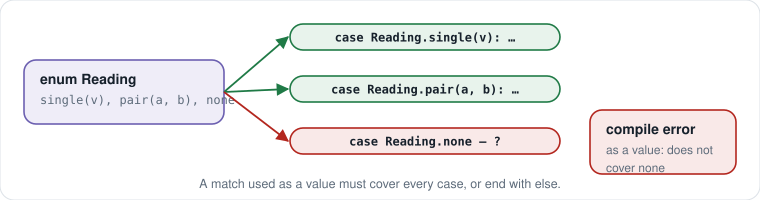

*Figure 16.1. A match used as a value covers every case of its enum, or ends with else.*

The subject is evaluated once. Each `case` lists one or more patterns, and the
first case with a matching pattern runs. There is no fall-through and no
`break`; a branch is a block, and its last value is the value of the `match`.
`else` takes whatever no case matched.

Patterns are of two kinds:

- **A value.** `case Priority.low, Priority.normal`, `case 404`, `case "GET"`.
  The subject is compared with `==`, so the rules of equality apply: the value
  must be of the subject's category, and `case 1..5` against an `int` is
  rejected rather than read as a range test (Chapter 9).
- **A variant pattern.** `case Stage.shipped(carrier, tracking)` tests the
  case and binds each field to a name, or ignores it with `_`. The number of
  bindings must equal the number of fields: `Wrong number of variant pattern
  bindings`. A binding exists only inside its branch.

All branches of a `match` that produces a value must produce one type:

```text
semantic error: Branches produce different types: int and string
```

A branch that returns, throws or panics produces no value and does not take
part in the check.

### Exhaustiveness

The compiler knows every case of an enum, so it checks that a `match` covers
them:

```okkama
module bible/missing v1.0.0;

enum Stage = (draft, paid(amount is int), cancelled(reason is string));

object Report {
    Report();
    text(stage is Stage) is string {
        match stage {
            case Stage.draft { "draft"; }
            case Stage.paid(amount) { "paid " + amount.string(); }
        }
    }
}

main() is int { 0; }
```

The compiler answers:

```text
16-missing-rejected.ok:8:9: semantic error: Non-exhaustive match: missing cancelled
```

The rule depends on the kind of enum:

- A `match` over a **variant enum** — one with a payload anywhere, an error
  enum, `Maybe`, `Presence` — must cover every case or have `else`. That holds
  for a statement `match` as well as for one that produces a value.
- A `match` over a **payload-free enum** that produces a value must cover
  every case or have `else`. Otherwise there would be no value to produce:

```okkama
module bible/value v1.0.0;

enum Priority = (low, normal, urgent);

object Queue {
    Queue();
    weight(priority is Priority) is int {
        let weight = match priority {
            case Priority.low { 1; }
            case Priority.normal { 2; }
        };
        weight;
    }
}

main() is int { 0; }
```

The compiler answers:

```text
16-value-rejected.ok:8:22: semantic error: match over enum `Priority` does not cover urgent, so it has no value here; add the cases or an `else` branch
```

The same message names the cases when the `match` is the last value of an
action. Until 0.5.0 that error named only the action ("must produce a return
value", issue #291):

```okkama
module bible/tail v1.0.0;

enum Priority = (low, normal, urgent);

object Queue {
    Queue();

    weight(priority is Priority) is int {
        match priority {
            case Priority.low { 1; }
            case Priority.normal { 2; }
        }
    }
}

main() is int { 0; }
```

The compiler answers:

```text
16-tail-rejected.ok:9:9: semantic error: match over enum `Priority` does not cover urgent, so it has no value here; add the cases or an `else` branch
```

- A *statement* `match` over a payload-free enum may leave cases out; it then
  does nothing for them. `okkama lint` reports it:

```text
warning[non-exhaustive-match]: match over enum `Status` does not handle failed, done; add the cases or an `else` branch
```

The second and third rules differ because a payload-free enum used to be
treated as a set of constants, and a statement over constants may
legitimately act on some of them only. The lint keeps the old freedom visible.
Variants never had it. A missing case of a variant is a missing piece of data
handling, and the compiler treats it as such.

Exhaustiveness pays off most when the enum changes. Add `refunded(amount is
int)` to `Stage`, and every `match` over a stage that lists cases becomes an
error that names `refunded`. The list of places to update comes from the
compiler, not from a search. This is the reason to prefer listing cases over
`else`. An `else` covers today's remaining cases and every future one, and so
it hides exactly the places that a new case should reach. Maranget describes
the two checks a compiler can make on a match: *exhaustiveness*, whether some
value is matched by no case, and *usefulness*, whether a case can never be
reached [[Maranget 2007](#ref-maranget2007)]. Okkama implements both for the cases it can compare:
a repeated case is an error (`Duplicate variant pattern`), so is a repeated
literal (`Duplicate case pattern`), and so is an `else` after cases that already
cover every value (`Unreachable else`). Until 0.6.0 only the first of those was
reported (issue #286).

## 16.4 Compact cases

A case that only computes a value fits on one line: `case pattern: value;`.
With it, a whole `match` is one expression:

```okkama
let suffix = match unit { case Unit.celsius: " C"; case Unit.kelvin: " K"; };
let flag = match priority { case Priority.urgent: "!"; case _: " "; };
let label = match reading { case Reading.single(value): value.string(); case _: "no single value"; };
```

- A compact case is a pattern, a colon, the value and a semicolon. The value
  may also be a `throw`: `case Reading.none: throw Missing.reading;`. Block
  cases and compact cases mix in one `match`.
- `case _` covers the cases not named; it is another spelling of `else`, and
  it takes either form, while `else` always takes a block.
- Patterns are written in full (`Priority.urgent`), as in any `match`, and the
  rules are the same: coverage, repeated cases, one result type.

A `match` that produces a value and misses a case names it: ``match over enum
`Priority` does not cover normal, so it has no value here; add the cases or an
`else` branch``. Until 0.6.0 the same choices had a notation of their own,
`priority ?? .urgent: "!" !! _: " "`; it was removed in favour of compact cases
(issue #893), so that one construct does one job.

## 16.5 Closed or open: enums and roles

An enum and a role are two answers to one question: how to describe a value
that can be one of several kinds.

- An **enum** lists the kinds in one place. Code that uses it switches on the
  kind. Adding a new *operation* over stages is easy: write one more function
  with a `match`, and nothing else changes. Adding a new *kind* is harder:
  every `match` must learn it, and the compiler lists them.
- A **role** leaves the kinds open. Each kind is an object that does the role
  and carries its own behaviour. Adding a new *kind* is easy: write one more
  object, and nothing else changes. Adding a new *operation* is harder: the
  role gains an action, and every object must implement it.

Reynolds described this duality in 1975, and Cook revisits it as the
difference between abstract data types and objects [[Cook 2009](#ref-cook2009)]. Wadler named it the
*expression problem*: define a data type by cases so that both new cases and
new functions can be added without recompiling existing code and without
losing static type safety [[Wadler 1998](#ref-wadler1998)]. Okkama does not solve the expression
problem; very few languages do without extra machinery. It offers both sides
and asks the programmer to choose by what is expected to change:

| The set of kinds is… | …and the operations are… | Use |
|---|---|---|
| closed, part of the domain's definition (order states, token kinds, protocol messages) | many, added over time (rendering, pricing, persistence) | an enum, with `match` |
| open, extended by other modules or by tests (storage backends, transports, clocks) | few and stable | a role, with objects |

The test is whether a newcomer must be written into one list or may be added
from outside. A stage of an order belongs to the order's definition. A new
stage is a change to the business, and every place that handles stages should
be reviewed. A storage backend does not belong to the service that uses it,
and a fake in a test is one more backend (Chapter 15). A role cannot be
matched on, because there is no downcast (Chapter 14). An enum cannot be
extended, because its declaration is the complete list. Each property is what
makes the other choice worse.

Java's sealed interfaces sit in between: a closed list of classes, each with
its own methods, which a `switch` can also take apart [[Bierman 2021](#ref-jep409); [Bierman 2023](#ref-jep441)].
Okkama has no single construct for this, but the effect is reachable: a
variant enum whose payloads are objects.

## 16.6 A worked example: a protocol and a state machine

Enums with payloads are the natural shape of a protocol. A vending machine
receives commands, has a state, and answers with replies; each of the three
is a closed set of cases, and each case carries exactly the data it needs.

```okkama
module app v1.0.0;

import "io/stdout" take Stdout;

// What a customer can do, what the machine can be, and what it answers.
enum Command = (insert(cents is int), choose(item is string, price is int), refund);
enum State = (idle, credit(cents is int));
enum Reply = (accepted(total is int), vended(item is string, change is int), refunded(cents is int),
    refused(why is string));

// One transition: the next state and the reply. Every pair is handled; a new case breaks the build here.
object Machine {
    has state is State;
    Machine(:state);

    step(command is Command) is Machine { Machine(state: self.next(command)); }

    next(command is Command) is State {
        match command {
            case Command.insert(cents) { State.credit(self.balance() + cents); }
            case Command.choose(item, price) { if self.balance() >= price { State.idle; } else { state; } }
            case Command.refund { State.idle; }
        }
    }

    reply(command is Command) is Reply {
        match command {
            case Command.insert(cents) { Reply.accepted(self.balance() + cents); }
            case Command.choose(item, price) {
                if self.balance() >= price {
                    Reply.vended(item, self.balance() - price);
                } else {
                    Reply.refused("insert " + (price - self.balance()).string() + " more");
                }
            }
            case Command.refund {
                if self.balance() > 0 { Reply.refunded(self.balance()); } else { Reply.refused("nothing to refund"); }
            }
        }
    }

    balance() is int {
        match state {
            case State.idle { 0; }
            case State.credit(cents) { cents; }
        }
    }
}

object Show {
    Show();
    of(reply is Reply) is string {
        match reply {
            case Reply.accepted(total) { "credit " + total.string(); }
            case Reply.vended(item, change) { item + ", change " + change.string(); }
            case Reply.refunded(cents) { "refund " + cents.string(); }
            case Reply.refused(why) { "refused: " + why; }
        }
    }
}

main() is int {
    let out = Stdout();
    let show = Show();
    let commands = [Command.insert(50), Command.choose("tea", 120), Command.insert(100), Command.choose("tea", 120),
        Command.refund];
    let final = commands.reduce(Machine(state: State.idle)) -> machine, command {
        out.writeln(show.of(machine.reply(command)));
        machine.step(command);
    };
    out.writeln("ends with " + final.balance().string() + " cents");
    0;
}
```

Output:

```text
credit 50
refused: insert 70 more
credit 150
tea, change 30
refused: nothing to refund
ends with 0 cents
```

- **Messages are variants.** `Command.choose(item, price)` carries what a
  choice needs and nothing else; `Command.refund` carries nothing. There is
  no "command type" string to dispatch on and no optional fields that only
  some commands fill.
- **The state is a variant too.** `State.idle` and `State.credit(cents)` make
  an impossible state unrepresentable: there is no credit field to forget to
  reset when the machine goes idle.
- **Transitions are a `match` over the command.** `next` and `reply` each
  handle every case, and the compiler checks it: adding a case
  `Command.service` stops the build with "Non-exhaustive match: missing
  service" at every `match` that must learn about it.
- **The machine is a value.** `step` returns a new machine; the run is a
  `reduce` over the commands, so the whole history is a fold and any
  intermediate machine could be kept and replayed.

This is the shape that object-oriented designs reach with the State pattern
and that functional languages write as algebraic data types. The trade-off
of §16.5 applies: a new kind of message touches every `match`, which is
exactly the list of places that must decide what the message means.

## 16.7 Where enums came from

Okkama's enum joins two lines of descent.

- **Named values.** Pascal gave programmers enumerated types: a closed set
  of names such as `(red, green, blue)`, with an order and the operations
  `succ` and `pred` [[Wirth 1971](#ref-wirth1971)]. Its variant records attached data to a
  tag, but the compiler did not check that the tag matched the data read.
  C's enumerations went the other way and are names for integers.
- **Cases that carry data.** HOPE, designed by Burstall, MacQueen and
  Sannella, declared a type by its constructors, each with its own fields,
  and defined functions by pattern matching on them [[Burstall 1980](#ref-burstall1980)]. ML
  adopted these *datatypes* [[Milner 1997](#ref-milner1997)], and through ML they reached
  Haskell, Rust and Swift as algebraic data types.
- **Checked coverage.** With a closed set of constructors, a compiler can
  tell whether a `match` covers every case and name the one it misses.
  Maranget describes how compilers do it and how to report the missing
  pattern usefully [[Maranget 2007](#ref-maranget2007)].

Okkama takes the closed set from Pascal without the order: cases have no
ordinal and no `<` (§16.1). It takes payloads from HOPE and ML, and checked
coverage for every `match` that produces a value. It does not yet take
recursive datatypes (#287) or nested patterns (#288), the two features
that make algebraic data types the natural way to write trees and
interpreters in ML and Haskell.

## 16.8 Enums elsewhere

| | Okkama | C | Pascal | Java | Rust | Haskell | Go |
|---|---|---|---|---|---|---|---|
| Case is a number | no | yes (`int`) | ordinal | `ordinal()` | `as` cast for payload-free enums | `Enum` class, if derived | yes (`iota`) |
| Ordering operators | no | yes | yes | `compareTo` | if derived | if derived | yes |
| Data per case | variants | no (unions are separate and untagged) | variant records, unchecked tag | sealed classes and records | yes | yes | no |
| Exhaustiveness checked | yes; lint only for statement matches over payload-free enums | no | no | `switch` expressions and pattern `switch` | yes | warning (`-Wincomplete-patterns`) | no |
| Recursive data | no (#287) | through pointers | through pointers | yes | through `Box` | yes | — |
| Nested patterns | no (#288) | — | — | yes | yes | yes | — |
| Actions on cases | no | — | — | yes | `impl` blocks | type classes | methods on the type |

Okkama's enum keeps the type safety of the Haskell and Rust column. It leaves
out what those languages build on top of it: nested patterns, recursion,
derived orderings and methods. The first two are missing for now. The last
two are left out on purpose, for the reasons in §16.1.

## 16.9 Limits

- **No recursive variants.** A case cannot carry its own enum, directly or
  indirectly:

```okkama
module bible/recursive v1.0.0;

enum Tree = (leaf, node(left is Tree, value is int, right is Tree));

main() is int { 0; }
```

The compiler answers:

```text
16-recursive-rejected.ok:3:1: semantic error: Recursive variant payload types are not supported
```

  Trees, lists and expression syntax trees, the classic uses of algebraic
  data types since HOPE, have to be built from objects for now (issue #287).
- **No nested patterns.** `case Pair.both(Maybe.some(x), y)` is rejected:
  `Expected a binding or _ in variant pattern`. A second `match` on the bound
  field does the same job in more lines (issue #288).
- **Variants are not map keys.** A payload-free enum is a key; a variant is
  not: `Map key type Reading is not a scalar key type` (issue #289).

## 16.10 What this design costs

- **Text and order are written out.** Printing a case or sorting by
  priority takes a `match`. A language with `toString` and
  `ordinal` would do it implicitly. The cost is a few lines per enum, paid once
  and kept in one place.
- **No list of cases.** There is no `values()`. Code that needs every case,
  for example to fill a menu, writes the array, and nothing checks that the
  array is complete.
- **Positional payloads.** Fields are named in the declaration, but a
  construction like `Stage.shipped("DHL", "JD0142")` does not show which
  string is the carrier. A case with more than two or three fields is often
  better as an object carried by a one-field case.
- **The closed world.** An enum cannot be extended from another module.
  That is what makes exhaustiveness possible, and it is why an open family of
  kinds should be a role.

In return:

- a forgotten case is a compile error, not a run-time surprise;
- a value cannot be read through the wrong case;
- equality is exact, and two enums can never be compared by accident;

# Chapter 17. Generics

A box that holds an `int` and a box that holds a `string` do the same work. So
do a sorted list of prices and a sorted list of names, a channel of jobs and a
channel of results. Without type parameters a language makes you pick one of
three bad options: write the same object once per type, give up the type and
store `any`, or check every element when it comes back out. Generics are the
fourth option. You write the object once, over a type `T`, and the compiler
makes sure each use of it has one concrete `T`.

```okkama
module bible/generics v1.0.0;

import "io/stdout" take Stdout;
import "compare" take Comparing, Order;

// Two type parameters; a successor with them swapped.
object Pair<K, V> {
    has key is K;
    has value is V;
    Pair(:key, :value);
    key() is K { key; }
    value() is V { value; }
    swapped() is Pair<V, K> { Pair(key: value, value: key); }
}

// An algorithm is an object too: the least of its values, for any T that
// orders itself.
object Least<T: Comparing<T>> {
    has first is T;
    has rest is @T;
    Least(first is T, rest is ...T) {
        self.first = first;
        self.rest = rest...;
    }
    value() is T {
        rest.reduce(first) -> best, item { if item.order(best) == Order.less { item; } else { best; }; };
    }
}

main() is int {
    let out = Stdout();
    let pair = Pair(key: "answer", value: 42);
    let back = pair.swapped();
    out.writeln(pair.key() + " = " + pair.value().string());
    out.writeln(back.key().string() + " = " + back.value());
    out.writeln(Least(3, 9, 1, 4).value().string());
    out.writeln(Least("pear", "apple", "fig").value());
    out.writeln(Least(2.5, -0.5).value().string());
    0;
}
```

Output:

```text
answer = 42
42 = answer
1
apple
-0.5
```

- `Pair<K, V>` has two type parameters. `swapped()` returns a `Pair<V, K>`, a
  different specialization of the same declaration.
- `Least<T: Comparing<T>>` is an algorithm written as an object. Its `T` must
  be able to order itself, and the compiler checks that before the
  constructor runs.
- No call names a type. `Pair(key: "answer", value: 42)` is a
  `Pair<string, int>` and `Least(3, 9, 1, 4)` is a `Least<int>`: the compiler
  works out the arguments from the values.
- `Least(2.5, -0.5)` is a third specialization, `Least<float>`. The type arguments distinguish these types.

This chapter covers what can be generic, inference, bounds, map-key parameters and specialization identity, then compares these language rules with Java, C#, Go, Rust, Haskell and OCaml.

## 17.1 Parameters on objects, roles and enums

Three kinds of declaration take type parameters: objects, roles and enums.

```okkama
object Box<T> {
    has value is T;
    Box(:value);
    get() is T { value; }
}

role Echo<T> {
    echo(value is T) is T;
}

enum Slot<T> = (vacant, full(item is T));
```

The parameters follow the declaration's name in angle brackets. They are type
names, so they are capitalised, and they must be unique and differ from the
declaration's own name. A parameter is visible everywhere inside its
declaration: in fields, constructors (full and shorthand), actions, successor
actions and `destroy` of an object, in the signatures and the `fake` block of a
role, in the payloads of an enum. Outside it the parameter does not exist; a
caller sees `Box<int>`, never `T`.

A use of a generic type gives exactly as many arguments as the declaration has
parameters, and a type without parameters takes none:

```text
Generic type "Pair" expects 2 type argument(s), got 1
Type "Coin" is not generic and cannot accept type arguments
```

A parameter stands for one concrete type. It cannot take arguments of its own,
so `T<int>` is not a type; Okkama has no higher-kinded parameters.

The enums `Maybe<T>` and `Presence<T>` of Chapter 7 are generic enums built into
the compiler. A program declares its own the same way, as `Slot<T>` above. A
case without a payload does not mention `T`, so where nothing else fixes the
type it is written with its specialization: `Slot<int>.vacant`, like
`Maybe<Shape>.none`.

### No generic actions

The list leaves something out: an action cannot take type parameters of its
own. There is no `first<T>(items is @T) is T`. This follows from the object
model of Chapter 3. Okkama has no free functions and no static methods, so a
generic function would need an object to live on, and that object would need
its own `T` anyway. The language goes the other way and makes the algorithm
the object. `Least<T>` in the example is what Java would write as
`static <T extends Comparable<T>> T least(T first, T... rest)`. It is a value
that knows its inputs and computes its answer on request, the style that
*Elegant Objects* recommends in place of static methods and utility classes
[[Bugayenko 2016](#ref-bugayenko2016)].

`Least(3, 9, 1, 4)` constructs an object before `value()` reads it, so the algorithm pays for constructing that value. Inference has one home: the constructor call, with one set of error messages.

### Where the idea comes from

Cardelli and Wegner's survey of polymorphism separates two kinds [[Cardelli 1985](#ref-cardelli1985)].
*Inclusion* polymorphism is what roles give: one value is usable as several
types, because it belongs to all of them. *Parametric* polymorphism is what
this chapter is about: one piece of code works uniformly over a type that is
supplied as a parameter. Both came into programming languages in the 1970s.
CLU let a cluster, its abstract data type, take type parameters, and checked
at compile time that the arguments offered the operations the cluster needed
[[Liskov 1977](#ref-liskov1977)]. ML inferred polymorphic types for whole functions without any
annotations [[Milner 1978](#ref-milner1978)]. Object-oriented languages took parameters much
later and with more compromises. Java added generics in version 5, in 2004,
on top of a virtual machine that knew nothing about them [[Bracha 1998](#ref-bracha1998)], and C#
added them in version 2.0, in 2005, together with a runtime that did
[[Kennedy 2001](#ref-kennedy2001)]. Go, which had shipped without generics for a decade, added
them in version 1.18 in 2022 [[Griesemer 2020](#ref-griesemer2020); [Scales 2022](#ref-scales2022)].

Okkama's generics are parametric polymorphism in CLU's sense, restricted to
objects, roles and enums, with ML's idea that a programmer should rarely have
to write type arguments, but without ML's global inference.

## 17.2 One `T`, one type

The whole model rests on one rule: **within one specialization, `T` is one
exact type.** Every occurrence of `T` must resolve to the same type, and
nothing is widened to make them agree.

```okkama
module bible/exact v1.0.0;

import "compare" take Comparing, Order;

object Least<T: Comparing<T>> {
    has first is T;
    has rest is @T;
    Least(first is T, rest is ...T) {
        self.first = first;
        self.rest = rest...;
    }
}

main() is int {
    let least = Least(1, 2.0);
    0;
}
```

The compiler answers:

```text
17-exact-rejected.ok:15:17: semantic error: Generic parameter "T" for object "Least" cannot be both int and float
```

`1` is an `int` and `2.0` is a `float`. In Okkama these are different
categories that never convert implicitly (Chapter 5), so `Least(1, 2.0)` has
no `T`. The compiler does not look for a common supertype, does not invent a
union `int | float`, and does not fall back to `any`. The program fails before
anything runs, and the fix is an explicit conversion: `Least(1.float(), 2.0)`.
Version 0.4.2 applies the same rule to collection literals: `[1, 2.0]` is
rejected unless an explicit `@any` is expected (Chapter 8).

Other languages answer the same question differently. Java's inference
computes a least upper bound. For `Arrays.asList(1, 2.0)` it finds an
intersection type of the form `Number & Comparable<…>`, a type that no
programmer wrote and whose values can barely be used: `Number` has no
arithmetic, so the list cannot be summed without casts [[Gosling 2023](#ref-gosling2023)]. Kotlin
infers a similar intersection type. TypeScript infers the union
`(string | number)[]` for `[1, "two"]`. Each answer
compiles, and each pushes the problem to the place where the values are
used.

Okkama keeps the problem where it was created. A type argument is evidence of
what the values are, and an inferred `T` that no value has would be a guess.
The rule also keeps every other part of the type system simple: once inference
succeeds, `T` is an ordinary concrete type, and the body of `Least<int>`
type-checks exactly as if it had been written for `int`.

## 17.3 Inference at construction

`Box(value: 7)` names a declaration, not a type. The specialization is worked
out at the call, from two sources.

**The arguments.** Each constructor parameter whose type mentions a parameter
gives one *equation*: `value is T` with the argument `7` gives `T = int`. The
equations go into structure: a parameter `items is @T` with an `@string`
argument gives `T = string`, a parameter `%K:V` with a `%string:int` gives two
equations, a parameter `Box<T>` with a `Box<float>` argument gives `T = float`,
and a variadic tail `rest is ...T` gives one equation per value. A shorthand
constructor `Box(:value)` uses the field's type in the same way. If two
equations disagree, the error names both answers:

```text
Generic parameter "T" for object "Least" cannot be both int and float
```

**The expected type.** When the call stands where a type is already declared,
in a typed binding, a field, an argument for a typed parameter, a result or
`return`, that type is evidence too. This is what makes an empty collection
usable:

```okkama
module bible/evidence v1.0.0;

object Bucket<T> {
    has values is @T;
    Bucket(:values);
}

main() is int {
    let empty = Bucket(values: []);
    0;
}
```

The compiler answers:

```text
17-evidence-rejected.ok:9:17: semantic error: Cannot infer generic parameter "T" for object "Bucket"
```

`[]` has no elements, so it says nothing about `T`, and without other evidence
the compiler stops. A declared target fixes it:
`let empty is Bucket<int> = Bucket(values: []);`. The declared type supplies
evidence that is *missing*. It never overrides evidence that is present: in
`let wrong is Box<int> = Box(value: "x");` the argument and the target
disagree, and that is an error, not a conversion.

The expected type reaches into nested constructions, but only through
parameters it already fixes:

```okkama
let x is Box<Empty<int>> = Box(item: Empty());
```

The target gives the outer `T = Empty<int>`. The inner `Empty()` stands where an
`Empty<int>` is expected, so it gets its `int` from there. The compiler does
not look ahead to later statements, does not try overloads to see which one
type-checks, and does not search for a type that would make a program compile.
Inference uses only what is visible at the call.

### Roles as evidence

Roles take part in both directions. A role-typed target supplies the arguments
of an object that implements the role:

```okkama
module bible/identity v1.0.0;

import "io/stdout" take Stdout;

role Echo<T> {
    echo(value is T) is T;
}

object Loud does Echo<string> {
    Loud();
    echo(value is string) is string { value.upper() + "!"; }
}

object Same<T> does Echo<T> {
    Same();
    echo(value is T) is T { value; }
}

object Bucket<T> {
    has values is @T;
    Bucket(:values);
    size() is int { values.size(); }
    plus(value is T) is Bucket<T> { Bucket(values: values + [value]); }
}

enum Slot<T> = (vacant, full(item is T));

object Slots {
    Slots();
    total(slots is @Slot<int>) is int {
        slots.reduce(0) -> sum, slot { sum + match slot { case Slot.full(item) { item; } case Slot.vacant { 0; } }; };
    }
}

main() is int {
    let out = Stdout();
    // Same() has no argument to infer from: the target Echo<string> supplies T.
    let echoes is @Echo<string> = [Loud(), Same()];
    out.writeln(echoes.map() -> echo { echo.echo("hi"); }.join(" "));
    let numbers is Echo<int> = Same();
    out.writeln(numbers.echo(7).string());
    // An empty array is no evidence; the declared type is.
    let empty is Bucket<int> = Bucket(values: []);
    out.writeln(empty.plus(5).plus(6).size().string());
    let slots = [Slot.full(3), Slot<int>.vacant, Slot.full(4)];
    out.writeln(Slots().total(slots).string());
    0;
}
```

Output:

```text
HI! hi
7
2
7
```

`Same()` has no arguments, so on its own it could not be specialized. In an
array declared `@Echo<string>` each element is expected to be an
`Echo<string>`, and `Same<T> does Echo<T>` matches that only with
`T = string`. A builtin value can be evidence for a role parameter too:
arrays are `Iterating<T>` and `Sequencing<T>`, so `Sorted([5, 3, 8])` in
Section 17.9 gets `T = int` from the array's elements.

When one equation gives a role and another gives an object that implements
it, the role stays. A `List<Json>` that has a `JsonBool` prepended is still a
`List<Json>`, not a `List<JsonBool>`. Inference never looks for a common role
of two unrelated objects, however: if one argument is a `Square` and another a
`Circle`, the program must say `Shape` somewhere.

### Several constructors

An object may have several constructors (Chapter 12), and inference runs for
each one that fits the call's shape. Fixed and shorthand constructors are
tried before variadic ones, as in overload resolution. If two constructors fit
and infer different specializations, the call is ambiguous and the compiler
says so (`Ambiguous construction of "Pair": constructors infer different
generic arguments`) instead of picking one.

### Functions as evidence

An anonymous action may declare its result type, and that result is evidence
for a generic parameter. This is how the standard library's `SortedBy<T, K>`
learns its key type:

```okkama
let quickest = SortedBy(origin: jobs, key: (job is Job) is int { job.hours(); });
```

The key's type `(Job) is int` meets the parameter `key is (T) is K`, giving
`T = Job` and `K = int`. Before 0.4.1 an anonymous action could not declare its
result, and the same call needed `let quickest is SortedBy<Job, int> = …`
(#214).

### No explicit specialization

There is no syntax to specialize at the call: `Box<int>(value: 7)` is an error
(`A type is not a value`). The way to state a specialization is to declare the
type of the place that receives the value. That keeps one way of doing it, and
the type ends up on the binding, where a reader looks for it.

## 17.4 Bounds

A parameter may be required to implement a role:

```okkama
role Comparing<T> {
    order(other is T) is Order;
}

object Least<T: Comparing<T>> { … }
```

`Comparing` is the standard library's three-way order (`std/compare`).
`T: Comparing<T>` says that a `T` can be ordered against another `T`. The bound
mentions the parameter it constrains. This is *F-bounded* polymorphism, named
by Canning, Cook, Hill, Olthoff and Mitchell, who showed that ordinary bounded
quantification cannot express "a type comparable with itself" and that a
recursive bound can [[Canning 1989](#ref-canning1989)]. Java's `<T extends Comparable<T>>` is the
same idea, and its roots go back to CLU, one of the first languages built
around parameterized abstract types, where a `where` clause required a type
argument to provide the operations a module needed [[Liskov 1977](#ref-liskov1977)].

`int`, `float`, `rat`, `byte`, `string` and `char` implement `Comparing` of
themselves, so `Least` accepts all of them. `bool` deliberately has no
natural order:

```okkama
module bible/bound v1.0.0;

import "compare" take Comparing, Order;

object Least<T: Comparing<T>> {
    has first is T;
    has rest is @T;
    Least(first is T, rest is ...T) {
        self.first = first;
        self.rest = rest...;
    }
}

main() is int {
    let least = Least(true, false);
    0;
}
```

The compiler answers:

```text
17-bound-rejected.ok:15:17: semantic error: Generic parameter "T" for object "Least" has type bool, which does not satisfy Comparing<bool>
```

The bound is checked after inference has found `T` and before the
constructor's body runs. It never takes part in inference: `T: Comparing<T>`
does not tell the compiler what `T` is, and an object whose `T` cannot be
inferred is not rescued by its bound. Nor does a bound convert anything. A
`T` either implements the role or the program is rejected.

A role-typed argument satisfies a bound when the role *narrows* to it, that
is, when it offers every action of the bound (Chapter 14). Given
`object Tagged<T: Named>`, a value of a role `Counted` that has `name()` and
`count()` satisfies `T: Named`. The specialization is then `Tagged<Counted>`,
so `get()` hands back a `Counted` with `count()` still available, not a
`Named`.

What bounds cannot do is as deliberate as what they can:

- **One bound per parameter.** There is no `T: Comparing<T> & Hashing`. A
  parameter that needs two capabilities is better served by a role that
  composes them.
- **No category bounds.** There is no `T: number`. Numbers in Okkama do not
  share a supertype, and arithmetic between categories needs explicit
  conversion. Generic arithmetic is written with the operator roles of
  Section 14.7, `Adding<T, R>` and its siblings, which an object implements per
  operand type.
- **No bounds on role parameters** yet, no defaults, no variance annotations.

## 17.5 Parameters used as map keys

A map key must be a scalar, an enum without payloads, a string or a value
object (Chapter 8).
When a generic object uses its parameter as a key, as `%T:V` in a field, a
signature or a body, or as the key of a map literal, every specialization has
to respect that:

```okkama
module bible/key v1.0.0;

// T is a map key here, so every specialization must be a key type.
object Tally<T> {
    has counts is %T:int;
    Tally() {
        let empty is %T:int = [:];
        counts = empty;
    }
    size() is int { counts.size(); }
}

main() is int {
    let words is Tally<string> = Tally();
    let rows is Tally<@int> = Tally();
    words.size() + rows.size();
}
```

The compiler answers:

```text
17-key-rejected.ok:15:31: semantic error: Generic parameter "T" for object "Tally" is a map key: Map key type @int is not a scalar key type
```

`Tally<string>` is valid; `Tally<@int>` is rejected because arrays cannot be keys. In `Wrap<U> { has inner is Tally<U>; }`, `U` must satisfy the same key rule. Violating the key rule is never a request to compare keys by identity (#242).

## 17.6 A specialization is a type

`Box<int>` and `Box<float>` are different types, as different as `Point` and
`Money`. A `Box<float>` cannot go where a `Box<int>` is expected, and that
holds for fields, parameters, results, variadic tails, successors, typed
bindings, `catch` clauses and imports. Role conformance is substituted too:
`Same<T> does Echo<T>` makes `Same<int>` an `Echo<int>` and nothing else, so
assigning it to an `Echo<string>` is rejected
(`Generic parameter "T" for object "Same" cannot be both string and int`).

There is also no variance. `Square` implements `Shape`, but a `Box<Square>` is
not a `Box<Shape>`:

```text
Cannot initialize variable "shapes" of type Box<Shape> with Box<Square>
```

That is the safe answer for a type whose `T` appears in both directions, and
Okkama does not ask the programmer to say which direction a parameter is used
in. The common case still works because inference reads the target first:
`let direct is Box<Shape> = Box(value: Square(side: 3));` builds a
`Box<Shape>` from the start, wrapping the square as a `Shape`.

### Generic fakes

A role's `fake` block (Chapter 15) is written against the role's parameters,
and it must conform *symbolically*. A fake whose `echo` takes `int` does not
implement `echo(value is T)`, even though `Echo<int>` is the only
specialization the tests use. A fake has no constructor arguments to infer
from, so its specialization comes from the target:

```okkama
let echo is Echo<int> = Echo.fake();   // test mode only
```

Without a declared target the construction fails instead of guessing.

### Reading the errors

Every generic error comes from one of a few checks, and its message says which:

| Message | What happened | Usual fix |
|---|---|---|
| `Generic parameter "T" for object "X" cannot be both A and B` | two equations disagree, or a target contradicts an argument | convert one value explicitly, or correct the declared type |
| `Cannot infer generic parameter "T" for object "X"` | no argument gives evidence (empty collections, no arguments) and no target is declared | declare the type of the binding, field or parameter |
| `… has type A, which does not satisfy R<A>` | the inferred type does not implement the bound | implement the role, or wrap the value in an object that does |
| `Generic parameter "T" for object "X" is a map key: …` | a key parameter got a type that cannot be a key | use a scalar, an enum, a string or a value object |
| `Ambiguous construction of "X": constructors infer different generic arguments` | two constructors fit with different specializations | declare the target type |
| `Generic type "X" expects N type argument(s), got M` | a written type has the wrong arity | write every argument |
| `A type is not a value` | an attempt to specialize at the call, `Box<int>(…)` | move the type to the binding |
| `The program requests a chain of more than 256 generic specializations …` | polymorphic recursion | stop growing the type in the recursive call |

## 17.7 A parameter or a role?

Roles (Chapter 14) and type parameters both let one piece of code work with
many types, and a design often has to choose between them. Compare a total of
areas written both ways:

```okkama
// A role: one Totals object for any mix of shapes.
object Totals {
    has shapes is @Shape;
    Totals(:shapes);
    area() is int { shapes.reduce(0) -> sum, shape { sum + shape.area(); }; }
}

// A parameter: one specialization per element type.
object Total<T: Shape> {
    has items is @T;
    Total(:items);
    area() is int { items.reduce(0) -> sum, item { sum + item.area(); }; }
}
```

The role version accepts `[Square(side: 2), Strip(width: 3)]`. The parameter
version accepts that array only as `Total<Shape>`, and otherwise needs every
element to have the same type: `Total(items: [Square(side: 2)])` is a
`Total<Square>`. The difference shows when the object gives values back. A
`Total<Square>` that offers `largest() is T` returns a `Square`, with all of
its actions, while `Totals` can only return a `Shape`. A type parameter keeps
the information about *which* type it holds, and a role deliberately forgets
it.

So the rule of thumb is about what flows out. If the code only consumes
values through the role's actions, a role-typed field is simpler and admits
mixtures. If it hands values back, or builds new containers of them, or uses
them as map keys, a parameter preserves their exact type for the caller.

## 17.8 A worked example: the best N

A leaderboard, a list of the most expensive orders, the three slowest
requests: keeping the best `N` items of a stream is the same algorithm for
any type that can be ordered. Here it is once, for every such type:

```okkama
module bible/top v1.0.0;

import "io/stdout" take Stdout;
import "compare" take Comparing, Order;

// The best `size` items seen so far, largest first. Offering an item returns a
// new Top: the old one is unchanged.
object Top<T: Comparing<T>> {
    has size is int;
    has items is @T;
    Top(:size, :items);
    offered(item is T) is Top<T> {
        let larger = items.filter() -> kept { kept.order(item) != Order.less; };
        let smaller = items.filter() -> kept { kept.order(item) == Order.less; };
        Top(size: size, items: (larger + [item] + smaller).take(size));
    }
    items() is @T { items; }
}

// A domain object that orders itself: higher amount first, then by name.
object Bid does Comparing<Bid> {
    has bidder is string;
    has amount is int;
    Bid(:bidder, :amount);
    amount() is int { amount; }
    bidder() is string { bidder; }
    order(other is Bid) is Order {
        if amount != other.amount() { return amount.order(other.amount()); }
        other.bidder().order(bidder);
    }
    text() is string { bidder + ":" + amount.string(); }
}

main() is int {
    let out = Stdout();
    // No item yet, so the declared type supplies T.
    let scores is Top<int> = Top(size: 3, items: []);
    let best = [12, 40, 7, 33, 40, 18].reduce(scores) -> top, score { top.offered(score); };
    out.writeln(best.items().map() -> score { score.string(); }.join(" "));
    let words is Top<string> = Top(size: 2, items: []);
    out.writeln(["kiwi", "apple", "pear", "fig"].reduce(words) -> top, word { top.offered(word); }.items().join(" "));
    let bids is Top<Bid> = Top(size: 2, items: []);
    let won = [Bid(bidder: "ann", amount: 50), Bid(bidder: "bob", amount: 70), Bid(bidder: "cy", amount: 70)]
        .reduce(bids) -> top, bid { top.offered(bid); };
    out.writeln(won.items().map() -> bid { bid.text(); }.join(" "));
    0;
}
```

Output:

```text
40 40 33
pear kiwi
bob:70 cy:70
```

The pieces of the chapter meet here.

- **The bound.** `Top<T: Comparing<T>>` needs `order()` and nothing else, so it
  works for `int`, `string` and any domain object that implements
  `Comparing` of itself. `Bid` does, with its own policy: a higher amount wins
  and equal amounts go by name.
- **The target supplies `T`.** An empty top has no items, so
  `Top(size: 3, items: [])` alone could not be specialized. Each start value
  is declared, `let scores is Top<int> = …`, and from there `reduce` carries
  the type: its accumulator is a `Top<int>`, and so is each `offered(…)`.
- **Immutability.** `offered` returns a new `Top`, so `scores` still holds the
  empty top after the loop. The successor-style value of Chapter 13 needs no
  special form here: the result type is the same specialization, `Top<T>`.
- **Three specializations.** The program uses `Top<int>`, `Top<string>` and
  `Top<Bid>`. The comparison inside `offered` follows its element type: the builtin integer order in the first, the code-point order of
  strings in the second, and `Bid.order` in the third.

A role field could not replace the parameter here. `Comparing<T>` takes the
type that an item is compared with, so a field `has items is @Comparing<…>`
would have to name that type and the object would work for one type only. The
parameter is what lets one declaration say "items that can be compared with
each other".

## 17.9 Generics in the standard library

The standard library is the largest user of generics: 185 generic object
declarations and 18 generic roles. Most of them fall into four groups.

- **Collection views and cursors.** `Taken<T>`, `Sliced<T>`, `Zipped<A, B>`,
  `Sorted<T: Comparing<T>>`, `SortedBy<T, K: Comparing<K>>` and their cursors
  implement `Iterating<T>` and `Sequencing<T>`, so they chain with each other
  and with plain arrays.
- **Containers with behaviour.** `Cell<T>` (Chapter 13), `Atomic<T>` and
  `Channel<T>` (Chapter 20).
- **Contracts.** `Comparing<T>`, the operator roles `Adding<T, R>` and its
  siblings, `Iterating<T>`, `Cursor<T>`, `List<T>`, `Set<T>`.
- **Settlements** of asynchronous steps (`FormSettlement<T>`,
  `RobotsSettlement<T>`), which hold the outcome of a step whatever its type.

```okkama
module bible/library v1.0.0;

import "io/stdout" take Stdout;
import "collections/ordering" take Sorted, SortedBy;

object Job {
    has name is string;
    has hours is int;
    Job(:name, :hours);
    name() is string { name; }
    hours() is int { hours; }
}

main() is int {
    let out = Stdout();
    // Sorted<T: Comparing<T>>: T = int and T = string, two specializations.
    out.writeln(Sorted([5, 3, 8]).first().string() + " " + Sorted(["pear", "fig"]).first());
    // SortedBy<T, K: Comparing<K>>: K comes from the key's declared result.
    let jobs = [Job(name: "paint", hours: 6), Job(name: "wire", hours: 2), Job(name: "tile", hours: 4)];
    let quickest = SortedBy(origin: jobs, key: (job is Job) is int { job.hours(); });
    out.writeln(quickest.map() -> job { job.name(); }.join(" "));
    0;
}
```

Output:

```text
3 fig
wire tile paint
```

The example uses two of them. `Sorted` is specialized twice, for `int` and for
`string`, and each specialization gets its `T` from the array it receives.
`SortedBy` gets `T = Job` from the array and `K = int` from the key's declared
result. Every element type `T` has to implement `Comparing<T>`, and every key
type `K` has to implement `Comparing<K>`, and the compiler checks both at the
call.

## 17.10 Okkama among other languages

| | What can be generic | Bounds | Variance | Type arguments |
|---|---|---|---|---|
| Java | classes, interfaces, methods | `extends`, several with `&` | at the use site, wildcards | inferred for methods, `<>` |
| C# | classes, interfaces, methods, delegates | `where`, several | declared on interfaces and delegates | inferred for methods |
| Go | functions, types | interfaces with type sets | none | inferred for functions |
| Rust | functions, types, traits | trait bounds, several | inferred; matters for lifetimes | inferred |
| Haskell | functions, types, classes | class constraints, several | none (no subtyping) | inferred (Hindley–Milner) |
| OCaml | functions, types, modules (functors) | through modules and signatures | declared (`+'a`, `-'a`) | inferred (Hindley–Milner) |
| Okkama | objects, roles, enums | one role, F-bounded allowed | none | inferred at construction, exact |

Okkama sits at the conservative end on almost every column. It infers less
than Haskell or OCaml, which find types for whole functions [[Milner 1978](#ref-milner1978)]. It
has fewer kinds of bound than C# or Rust, and no variance at all. What it gains
is predictability. Every generic argument is decided at one kind of place, a
constructor call, from the values in front of it. A reader can do the same
inference by looking at the call, and an error message names the two types
that disagree.

## 17.11 Limits

- **No generic actions.** An algorithm generic in its inputs is written as a
  generic object (Section 17.1).
- **No variance.** `Box<Square>` is not a `Box<Shape>`. Declare the target
  type at construction instead.
- **One bound, on objects only.** No multiple bounds, no bounds on role
  parameters, no category bounds such as `T: number`, no default arguments,
  no higher-kinded parameters.
- **No call-site specialization.** `Box<int>(…)` is not valid source; the
  specialization comes from the arguments or from a declared target.
- **Polymorphic recursion requiring unbounded specializations is rejected.**

```okkama
module bible/grow v1.0.0;

object Box<T> {
    has value is T;
    Box(:value);
    get() is T { value; }
}

object Grow<T> {
    has value is T;
    Grow(:value);
    deeper(depth is int) is int {
        if depth == 0 { return 0; }
        Grow(value: Box(value: value)).deeper(depth - 1) + 1;
    }
}

main() is int {
    Grow(value: 1).deeper(3);
}
```

The compiler answers:

```text
17-grow-rejected.ok:12:5: semantic error: The program requests a chain of more than 256 generic specializations, each asking for the next: Box<Box<Box<Box<Box<Box<Box<Box<Box<Box<…>>>>>>>>>>>>>>>>>>>>>>>>.new#0 <- Grow<Box<Box<Box<Box<Box<Box<Box<Box<Box…>>>>>>>>>>>>>>>>>>>>>>>.deeper <- Grow<Box<Box<Box<Box<Box<Box<Box<Box<Box…>>>>>>>>>>>>>>>>>>>>>>>.deeper <- Grow<Box<Box<Box<Box<Box<Box<Box<Box<Box…>>>>>>>>>>>>>>>>>>>>>>>.deeper <- Grow<Box<Box<Box<Box<Box<Box<Box<Box<Box…>>>>>>>>>>>>>>>>>>>>>>>.deeper <- Grow<Box<Box<Box<Box<Box<Box<Box<Box<Box…>>>>>>>>>>>>>>>>>>>>>>>.deeper <- …
```

## 17.12 What this design costs

Exact identity makes some programs longer. Mixed numbers need explicit conversions, empty collections need a declared type, and an algorithm over `T` becomes an object with a constructor. Polymorphic recursion that requires an unbounded succession of distinct specializations is rejected.

Generic code follows the ordinary object rules: `Least<int>` works with `int`, and a parameter preserves its exact type. Inference has one rule a reader can apply, and a failed inference names the types that disagree.

# Chapter 18. Anonymous actions and closures

Sometimes the piece of behaviour a caller wants to hand over is too small to
deserve a name: a key to sort by, a check to apply, one step of a pipeline.
Okkama lets an action be written where it is used, as a value, without a
name. Such an *anonymous action* remembers the values it saw when it was
created, so it can be returned, stored and called long after the code that
made it has finished. That memory is what makes it a *closure*.

```okkama
module bible/closures v1.0.0;

import "io/stdout" take Stdout;

object Apply {
    has input is int;
    Apply(:input);
    value(operation is (int) is int) is int { operation(input); }
}

object Pipeline {
    has steps is @(int) is int;
    Pipeline(:steps);
    run(value is int) is int { steps.reduce(value) -> current, step { step(current); }; }
}

main() is int {
    let out = Stdout();
    let make_adder = (amount is int) is (int) is int {
        (value is int) is int { value + amount; };
    };
    let add_ten = make_adder(10);
    let double = (value is int) is int { value * 2; };
    out.writeln(add_ten(5).string() + " " + Apply(input: 21).value(double).string());
    out.writeln(Apply(input: 4).value(operation: (value is int) is int { value * value; }).string());
    let pipeline = Pipeline(steps: [add_ten, double, make_adder(-1)]);
    out.writeln(pipeline.run(1).string());
    0;
}
```

Output:

```text
15 42
16
21
```

- `make_adder` is an anonymous action that returns another one. The inner
  action uses `amount`, a parameter of the outer one, and keeps it:
  `add_ten(5)` is 15 after `make_adder` has returned.
- `Apply.value` takes an action as a parameter, typed `(int) is int`, and
  calls it like any action.
- An anonymous action can be passed by name, `operation: (value is int) is int { … }`,
  like any other argument.
- `Pipeline` stores a list of actions of one type and applies them in order.

This chapter covers the syntax and types of anonymous actions, captures, equality, action values as data, resources, failure reports, history and comparisons with other languages.

## 18.1 Writing an anonymous action

An anonymous action uses the declaration syntax of a named action with the
name left out:

```okkama
() is int { 42; }
(value is int) is int { value * 2; }
(left is int, right is int) is int { left + right; }
(message is string) is void { log.write(message); }
```

Every parameter has a type, and the result is always declared, `void`
included. Nothing is inferred from the body: the declaration is the whole
contract. A list of parameter names followed by `is`, or an empty `()`
followed by `is`, starts an anonymous action; ordinary parentheses still
group expressions, so `(value)` and `(a + b)` mean what they always did.

The type of an anonymous action is its signature without the names:

```okkama
() is int
(int) is int
(int, int) is string
((int) is int) is (int) is int     // takes an action, returns an action
```

Such types appear wherever types do: in fields, parameters, results,
collections (`@(int) is int`) and type arguments.

An action value is called with parentheses and positional arguments, exactly
as many as its type has parameters. A named call is rejected, because the
names belong to the anonymous declaration and not to the type:

```okkama
module bible/positional v1.0.0;

main() is int {
    let add = (left is int, right is int) is int { left + right; };
    add(left: 1, right: 2);
}
```

The compiler answers:

```text
18-positional-rejected.ok:5:5: semantic error: Action values take positional arguments only
```

### Not the blocks of `map` and `for`

The arrows in `map` and `for` belong to other constructs. Their blocks cannot be stored or returned. An anonymous action is a value with its own call boundary: `next` and `last` cannot leave a surrounding loop from inside it, even when it is created there:

```okkama
module bible/escape v1.0.0;

main() is int {
    for 0..10 -> i {
        let check = () is void { last if i == 3; };
        check();
    }
    0;
}
```

The compiler answers:

```text
18-escape-rejected.ok:5:34: semantic error: `last` used outside of a loop
```

A call of an action value is a boundary for control flow, as any action call
is. A `throw` inside it travels out to the caller, and a `defer` inside it
runs when that call ends.

## 18.2 What a closure remembers

When an anonymous action is evaluated, it captures the bindings it uses from
the scope around it: locals, parameters, and `self` if it reads the
receiver. It does not capture the scope itself.

```okkama
module bible/capture v1.0.0;

import "io/stdout" take Stdout;

object Counter {
    has count is int;
    Counter(:count);
    count() is int { count; }
    bumped() is ^Counter { ^count = count + 1; }
    // A closure that reads a field keeps this receiver alive.
    reader() is () is int { () is int { count * 10; }; }
}

main() is int {
    let out = Stdout();
    let counter = Counter(count: 1);
    let early = () is int { counter.count(); };
    counter = counter.bumped();
    let late = () is int { counter.count(); };
    out.writeln(early().string() + " " + late().string());
    let read = Counter(count: 4).reader();
    out.writeln(read().string());
    let ops is @(int) is int = [(x is int) is int { x + 1; }, (x is int) is int { x * 2; }];
    out.writeln(ops.reduce(5) -> value, op { op(value); }.string());
    0;
}
```

Output:

```text
1 2
40
12
```

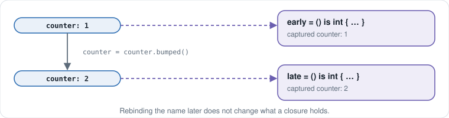

*Figure 18.1. A capture is a snapshot: rebinding the name later changes nothing inside the closure.*

The example shows the three rules.

- **A capture is a snapshot.** `early` is created while `counter` holds a
  count of 1. `counter = counter.bumped()` then rebinds the local to a
  successor (Chapter 13), and `late` captures that one. Calling `early` later
  still sees the count it captured: rebinding a name outside the action does
  not reach into it.
- **Objects keep their identity.** The snapshot holds the object, not a copy
  of it. Okkama objects are immutable, so a captured object always answers
  the same way, and nothing is lost by sharing it.
- **Reading a field captures the receiver.** `reader()` returns an action
  that reads `count`. The action keeps its `Counter` alive after `reader()`
  returns, as a closure over `self`.

Only the names the body actually uses are captured. A large local next to a
closure that never mentions it is not kept alive by the closure.

### Values, not variables

In many languages a closure captures *variables*. A JavaScript closure in a
loop over `var i` famously sees the last value of `i`, and Go before
version 1.22 shared one loop variable among all the closures made in a
loop [[Go specification](#ref-gospec)]. Kotlin and C# let a lambda assign to a captured local and
the change is visible outside. Java forbids that: a captured local must be
*effectively final*, never assigned after its declaration [[Gosling 2023](#ref-gosling2023)].

Okkama goes further than Java. Its locals are immutable to begin with, and a
rebind (Chapter 13) is the only way a name gets a new value, so there is
nothing for a closure to share but values. A closure is equivalent to a
small immutable object that holds the captured values in fields and has one
action. The equivalence is old: Landin introduced closures as a pair of a
function and the environment it was created in [[Landin 1964](#ref-landin1964)], and Scheme
made them the basis of a whole language [[Sussman 1975](#ref-sussman1975)].

Rebinding a captured name *inside* the action is an error: `Cannot rebind
captured variable "counter" inside an anonymous action`. Until 0.4.2 the
compiler accepted it, and the rebind changed a copy that lived for one call
(#321). The action's own parameters and locals, including one that shadows a
captured name, stay rebindable; state that must outlive a call goes back to
the caller as a successor.

### Closures made in a loop

The difference shows in the classic test: one closure created in each pass
of a loop.

```okkama
module bible/closure_loop v1.0.0;

import "io/stdout" take Stdout;

main() is int {
    let out = Stdout();
    // Each anonymous action is created in its own pass of the block and
    // keeps the value `n` had in that pass.
    let makers = [1, 2, 3].map() -> n { () is int { n * 10; }; };
    out.writeln(makers.map() -> make { make().string(); }.join(" "));
    0;
}
```

Output:

```text
10 20 30
```

Each pass of the `map` block binds a fresh `n`, and each anonymous action
captures the value of its own pass, so the three actions answer 10, 20 and
30. In JavaScript with `var`, the same three functions would all answer 30,
because they share one variable that ends at the last value. Go behaved the
same way for its loop variables until version 1.22 changed the rule after
years of bugs [[Go specification](#ref-gospec)]. In Okkama there is no variable to share, so the
question does not arise.

### Captured successors

The result of a successor action (Chapter 13) must be used: a binding to it
that can leave its scope unused is an error. The rule follows the successor
into closures. A closure carries the obligation of each captured successor
that its body uses on every normal path. Creating the closure, or binding it
to a name, does not use the successor; calling the closure does, and
returning it, passing it or storing it hands the obligation on with it:

```okkama
module bible/closure_successor v1.0.0;

import "io/stdout" take Stdout;

object Counter {
    has count is int;
    Counter(:count);
    count() is int { count; }
    bumped() is ^Counter { ^count = count + 1; }
}

main() is int {
    let later = Counter(count: 1).bumped();
    let show = () is int { later.count(); };
    let alias = show;
    // Calling the closure uses the successor it captured.
    Stdout().writeln(alias().string());
    0;
}
```

Output:

```text
2
```

`alias` and `show` are one closure, so one call through either name uses
`later`. A closure that is never called, returned, passed or stored keeps
the obligation, and the error names the successor and the action value that
carries it:

```okkama
module bible/closure_successor_rejected v1.0.0;

import "io/stdout" take Stdout;

object Counter {
    has count is int;
    Counter(:count);
    count() is int { count; }
    bumped() is ^Counter { ^count = count + 1; }
}

main() is int {
    let later = Counter(count: 1).bumped();
    let show = () is int { later.count(); };
    Stdout().writeln("made, never called");
    0;
}
```

The compiler answers:

```text
18-successor-rejected.ok:14:9: semantic error: Successor action result must be used; "later" is carried by action value "show", which can leave scope without being called, returned, passed or stored
```

Two refinements keep the rule honest. A body that uses the successor on one
branch only does not carry it, since a call might not use it; the successor
must then be used elsewhere. And handing a closure on is a transfer, not a
call: like a successor passed as an argument, it moves the responsibility
without proving that the receiver ever calls it. Until 0.4.2 the compiler
did not look inside closures at all, so even a called closure left its
successor unused (#322). A bound action, `later.count` without the call,
follows the same rule since 0.4.2: it carries its receiver's obligation until
it is called or handed on, while a direct call `later.count()` uses the
receiver at once (#324).

When the closure needs only what the successor knows, capturing that is
still the simpler program: `let count = later.count();` and then
`() is int { count; }` holds a number, not an object with an obligation.

## 18.3 Types are exact

An action value has exactly the type it was declared with. A `() is Square`
is not a `() is Shape`, even though every `Square` is a `Shape`:

```okkama
module bible/exact v1.0.0;

role Shape { area() is int; }

object Square does Shape {
    has side is int;
    Square(:side);
    area() is int { side * side; }
}

main() is int {
    let make = () is Square { Square(side: 2); };
    let shapes is () is Shape = make;
    0;
}
```

The compiler answers:

```text
18-exact-rejected.ok:13:33: semantic error: Cannot initialize variable "shapes" of type () is Shape with () is Square
```

This is the same rule as for generic types in Chapter 17: no variance, in
either the parameters or the result. A caller that wants a `() is Shape` has
to write one, `() is Shape { Square(side: 2); }`, and the wrap to the role
happens inside.

Action types take part in everything else types do. Generic inference reads
them (`SortedBy` learns `K` from the key's declared result, Section 17.3),
overload resolution compares them exactly, and roles may declare actions
that take or return them.

Two boundaries stay closed. An action value cannot become `any`, and it
cannot cross the native ABI:

```okkama
module bible/anyfn v1.0.0;

main() is int {
    let double = (x is int) is int { x * 2; };
    let boxed is any = double;
    0;
}
```

The compiler answers:

```text
18-any-rejected.ok:5:24: semantic error: Cannot initialize variable "boxed" of type any with (int) is int
```

`any` is a box that may only be passed and stored (Chapter 4); a function in
such a box could be neither called nor compared, and a native provider has no
way to call back into Okkama code. The second rule may relax when natives
get callbacks.

There is also no automatic conversion from an action to a role. A role with
one action, such as a `Comparing<T>`, is not satisfied by a matching
anonymous action; it needs an object that `does` it. Java's lambdas, which
become instances of any *functional interface* with one abstract method, are
the opposite choice.

### Equality is identity

Two action values are equal only when they are the same value:

```okkama
module bible/closure_identity v1.0.0;

import "io/stdout" take Stdout;

object Maker {
    Maker();
    adder(amount is int) is (int) is int { (value is int) is int { value + amount; }; }
}

main() is int {
    let maker = Maker();
    let one = maker.adder(1);
    let alias = one;
    let another_one = maker.adder(1);
    let literal = (value is int) is int { value + 1; };
    let twin = (value is int) is int { value + 1; };
    Stdout().writeln((one == alias).string() + " " + (one == another_one).string() + " " +
        (literal == twin).string() + " " + (Maker() == Maker()).string());
    0;
}
```

Output:

```text
true false false true
```

`one` and `alias` are one closure under two names, so they are equal.
`another_one` was made by the same action from the same argument, and `twin`
has the same text as `literal`, but each is a closure of its own, and
neither equals its look-alike. Objects are the opposite case: two `Maker()`
are equal, because objects compare by type and fields (Chapter 12). An
object that holds an action in a field compares that field by identity too:
two objects holding the same closure are equal, two holding different but
identical-looking closures are not.

Futures follow the same identity rule. Whether two functions return the same result for every argument is undecidable in general [[Rice 1953](#ref-rice1953)]. Action values are not map keys: keys are scalars and value objects (Chapter 8).

## 18.4 Action values as data

Action types are ordinary types, so action values go where values go: into
arrays, maps, fields, generic objects and `Maybe`, and in and out of other
actions.

```okkama
module bible/closure_table v1.0.0;

import "io/stdout" take Stdout;

object Rule {
    has accepts is (int) is bool;
    has name is string;
    Rule(:accepts, :name);
    check(value is int) is string { name + " " + accepts(value).string(); }
}

main() is int {
    let out = Stdout();
    let operations is %string:(int, int) is int = [
        "+": (left is int, right is int) is int { left + right; },
        "*": (left is int, right is int) is int { left * right; }
    ];
    let times = operations["*"];
    out.writeln(times(6, 7).string() + " " + operations.keys().join(","));
    let minus = operations["-"] else (left is int, right is int) is int { left - right; };
    out.writeln(minus(10, 3).string());
    let limit = 10;
    let small = Rule(accepts: (value is int) is bool { value < limit; }, name: "small");
    out.writeln(small.check(3) + ", " + small.check(30));
    0;
}
```

Output:

```text
42 *,+
7
small true, small false
```

- `operations` maps strings to actions of type `(int, int) is int`. The
  type is written `%string:(int, int) is int`, with the action type in place
  of the value type. Picking an action is an ordinary lookup, and a missing
  key takes the `else` branch like any map read (Chapter 8), here with a
  fallback action written in place. A table of actions is how dispatch by
  name is written without a chain of `if`s.
- `Rule` keeps a predicate in a field and calls the field like an action,
  `accepts(value)`. The predicate was created in `main` and captured
  `limit`, so the rule carries that limit with it.

Generic objects take action types the same way. A
`let box is Box<(int) is int> = Box(item: …)` holds one action, and a
`Maybe<(int) is int>` holds one or none; `chosen else (value is int) is int
{ value; }` falls back to the identity action. Inference reads the declared
signatures, as in Chapter 17.

An action can also take actions and return one:

```okkama
module bible/closure_compose v1.0.0;

import "io/stdout" take Stdout;

object Compose {
    Compose();
    // An action that takes two actions and returns a third.
    then(first is (int) is int, second is (int) is int) is (int) is int {
        (value is int) is int { second(first(value)); };
    }
}

main() is int {
    let increment = (value is int) is int { value + 1; };
    let square = (value is int) is int { value * value; };
    let compose = Compose();
    let up_then_square = compose.then(increment, square);
    let square_then_up = compose.then(square, increment);
    Stdout().writeln(up_then_square(4).string() + " " + square_then_up(4).string());
    0;
}
```

Output:

```text
25 17
```

`then` returns a closure over its two arguments. `up_then_square(4)` is
`(4 + 1)²`, 25, and `square_then_up(4)` is `4² + 1`, 17. Haskell writes
composition as one operator, `.`; in Okkama it is an action of an object
with a full signature, `((int) is int, (int) is int) is (int) is int`. That
is longer, and it leaves nothing to infer.

## 18.5 Bound actions: an object's action as a value

An action of an object can be taken as a value without calling it.
`retail.of` is a *bound action*: the action `of` together with the
receiver `retail`, so calling it later uses that object's rate.

```okkama
module bible/bound v1.0.0;

// An object's action taken as a value: `retail.of` without a call is a bound
// action. It goes wherever an action type is written, and it carries its
// receiver with it.

import "io/stdout" take Stdout;

object Price {
    has rate is int;
    Price(:rate);
    of(units is int) is int { units * rate; }
}

object Report {
    has rule is (int) is int;
    Report(:rule);
    line(units is int) is string { units.string() + " -> " + rule(units).string(); }
}

main() is int {
    let out = Stdout();
    let retail = Price(rate: 12);
    let wholesale = Price(rate: 9);
    let pick is (int) is int = retail.of;
    out.writeln(pick(3).string());
    let rules is %string:(int) is int = ["retail": retail.of, "wholesale": wholesale.of];
    out.writeln(Report(rule: rules["wholesale"] else retail.of).line(10));
    let all = [3, 5, 8].map() -> n { pick(n); };
    out.writeln(all.map() -> n { n.string(); }.join(" "));
    out.writeln((pick == retail.of).string());
    0;
}
```

Output:

```text
36
10 -> 90
36 60 96
false
```

- **It goes where an action type is written.** `pick` is declared
  `(int) is int`, the map's value type is `(int) is int`, and so is
  `Report`'s field. A bound action fits any of them, because its signature
  is the action's signature without the receiver.
- **The type must be written before it can be called.** Without the
  declared type on `pick`, the compiler refuses:

```okkama
module bible/bound_rejected v1.0.0;

// A bound action needs a written action type before it can be called.
import "io/stdout" take Stdout;

object Price {
    has rate is int;
    Price(:rate);
    of(units is int) is int { units * rate; }
}

main() is int {
    let pick = Price(rate: 12).of;
    Stdout().writeln(pick(3).string());
    0;
}
```

The compiler answers:

```text
18-bound-rejected.ok:14:22: semantic error: Bound action requires an exact action-type boundary before it can be called
```

  The rule keeps the action's full signature visible at the point where
  the value is made. The same holds for every action value in Okkama
  (Section 18.3).
- **It carries its receiver.** `rules["wholesale"]` computes with
  `wholesale`'s rate, 9, though `Report` never sees a `Price`. The receiver
  is borrowed like any capture (Section 18.2), and an action whose
  receiver must be consumed carries that obligation too (Section 18.2,
  #322).
- **Equality is identity.** `pick == retail.of` is `false`. Each `.of`
  makes a new value, and two action values are equal only when they are
  the same value (Section 18.3).
- **An async action binds the same way.** `endpoint.fetch` of an `async`
  action is a value of type `async (int) is string`. Section 20.11 passes
  one to a retry policy.

Other languages bind methods too, and differ on the points above.

- **JavaScript** detaches: `const f = obj.method` loses `this`, and calling
  `f()` reads `undefined` fields unless the code writes `obj.method.bind(obj)`.
- **Python** binds automatically: `obj.method` is a bound method object.
  Unlike Okkama, two bound methods of the same object and function compare
  equal with `==`, though they are different objects.
- **Java and Kotlin** write a method reference, `retail::of`, and need a
  target type, a functional interface or a function type, much like
  Okkama's written action type.
- **C#** converts a method group to a delegate only where a delegate type
  is expected (`Func<int, int> f = retail.Of;`).

Okkama's rule is the Java and C# one: a bound action exists only where its
type is written. Its receiver travels with it, as in Python.

## 18.6 Closures in the standard library

The library asks for behaviour in a few places, and it takes it as an
action value. The most common is a sort key.

```okkama
module bible/std_closures v1.0.0;

// Closures where the library asks for behaviour: a sort key written in place,
// a key that captures a local limit, and an object's action passed as the key.
import "io/stdout" take Stdout;
import "cell" take Cell;
import "collections/ordering" take SortedBy;
import "collections/iteration" take Iterating;

object Job {
    has name is string;
    has team is string;
    has hours is int;
    Job(:name, :team, :hours);
    name() is string { name; }
    team() is string { team; }
    hours() is int { hours; }
}

// A ranking of teams; unknown teams go last.
object Priorities {
    has rank is %string:int;
    Priorities(:rank);
    of(job is Job) is int { rank[job.team()] else 99; }
}

object Listing {
    Listing() {}
    // The names in walking order, gathered in a Cell (synchronous code).
    names(jobs is Iterating<Job>) is string {
        let shown = Cell("");
        for jobs -> job {
            shown.replace(shown.value() + " " + job.name());
        }
        shown.value();
    }
}

main() is int {
    let out = Stdout();
    let list = Listing();
    let jobs = [
        Job(name: "deploy", team: "ops", hours: 2),
        Job(name: "refund", team: "billing", hours: 1),
        Job(name: "reindex", team: "search", hours: 5),
        Job(name: "backup", team: "ops", hours: 3)
    ];
    out.writeln("by hours:" + list.names(SortedBy(origin: jobs, key: (job is Job) is int { job.hours(); })));
    let limit = 2;
    let quick = SortedBy(origin: jobs, key: (job is Job) is int { if job.hours() <= limit { 0; } else { 1; } });
    out.writeln("quick first:" + list.names(quick));
    let priorities = Priorities(rank: ["billing": 1, "ops": 2]);
    out.writeln("by team:" + list.names(SortedBy(origin: jobs, key: priorities.of)));
    0;
}
```

Output:

```text
by hours: refund deploy backup reindex
quick first: deploy refund reindex backup
by team: refund deploy backup reindex
```

- **A key written in place.** `SortedBy(origin: jobs, key: (job is Job) is
  int { job.hours(); })` sorts by hours. The key's type is written in the
  parameter, `(T) is K`, so the anonymous action needs no annotation beyond
  its own signature.
- **A key that captures.** The `quick` key compares each job's hours with
  `limit`, a local of `main`, and puts the quick jobs first. The capture is
  a snapshot (Section 18.2): changing `limit` later would not change this
  sort. The sort is stable, so jobs with equal keys keep their input order:
  `deploy` before `refund`, `reindex` before `backup`.
- **A bound action as the key.** `priorities.of` passes an object's action,
  and the parameter's written type is the boundary the bound action needs
  (Section 18.5). The ranking lives in an object with a name and a test,
  and the sort call stays one line.
- **A `Cell` gathers the names.** `Listing.names` walks any `Iterating<Job>`
  and appends to a `Cell`, the mutable value of synchronous code. `for` and
  the six functional operations (`map`, `filter`, `reduce`, `any`, `all`,
  `find`) execute blocks in the current frame; those blocks may use a Cell.

An action that captures a Cell, a collection containing one, or another such
local action is **frame-bound**. A bound action on a Cell, such as
`count.value`, has the same restriction. It may be called synchronously,
bound to a local name, or captured by another frame-bound action. Repeated
local calls are allowed:

```okkama
module bible/cell_local v1.0.0;
import "cell" take Cell;
import "io/stdout" take Stdout;

main() is int {
    let count = Cell(0);
    let step = () is int {
        count.replace(count.value() + 1);
        count.value();
    };
    let nested = () is int { step(); };
    let read is () is int = count.value;
    Stdout().writeln(step().string());
    Stdout().writeln(nested().string());
    Stdout().writeln(read().string());
    0;
}
```

Output:

```text
1
2
2
```

Every other use is rejected: returning it, passing it to any action (even a
synchronous callback), storing it in a field, enum payload or collection,
boxing it into `any` or a role, awaiting it, or spawning it. A synchronous
forwarder could return or retain its callback, so it cannot receive one:

```okkama
module bible/cell_escape v1.0.0;
import "cell" take Cell;

object Forwarder {
    Forwarder();
    forwarded(f is () is int) is () is int { f; }
}

main() is int {
    let count = Cell(0);
    let read = () is int { count.value(); };
    let escaped = Forwarder().forwarded(read);
    0;
}
```

The compiler answers:

```text
18-cell-escape-rejected.ok:12:41: semantic error: An action that retains a Cell cannot be passed to an action: a cell stays in its synchronous frame; share state between tasks with Atomic
```

The Cell itself cannot be hidden in `any`, a role or a generic parameter.
This includes inferred parameters, even those inferred from an action's
signature. `Cell<T>` itself and builtin collections keep Cell types visible;
ordinary synchronous Cell use remains valid. Object fields, enum payloads
and cached `once let` values cannot hold a Cell. For state retained by an
object or shared between tasks, use `Atomic`. Closures with ordinary
immutable captures and Atomic captures keep their usual behavior.

The same shape recurs across the library: keys in `SortedBy`, mappings
and conditions in the lazy views of `collections/views`, and the condition
a test check such as `Eventually` polls. Where the behaviour needs state, a
name or its own tests, the library takes a role instead, and Section 18.7
gives the rule for choosing.

## 18.7 Closures or objects

An anonymous action and a small object can do the same job. The pipeline of
the first example could hold `Step` objects with an `apply` action instead
of `(int) is int` values. Which one to write?

A named object costs a declaration and gives back a name, a place for
documentation, the ability to implement roles, structural equality, and a
`destroy` if it owns a resource. A closure costs nothing to declare and is
right where it is used. The guidance that falls out of the language:

- **A closure for a parameter of behaviour.** A sort key, a predicate, a
  transformation passed to one call. Its type says everything there is to
  say.
- **An object when the behaviour has a name in the domain.** A discount
  policy, a retry strategy, a parser. It will be passed around, compared,
  tested with a fake (Chapter 15), or given a second action.
- **An object when there is state over time.** A closure is a snapshot; an
  object can have successors.

*Elegant Objects* argues for objects everywhere [[Bugayenko 2016](#ref-bugayenko2016)], and Okkama
mostly agrees: there are no free functions, so a closure is always created by
some object's action and usually handed to another object. The anonymous
action is the escape hatch for behaviour too small to name.

Closures also carry authority. An action that can write to a log, created
where the log is in scope and handed to code that cannot see the log, gives
exactly that ability and no other. This is the object-capability pattern of
Miller's thesis, where a reference is the only way to an effect [[Miller 2006](#ref-miller2006)];
in Okkama a closure is one more kind of reference.

### Behaviour that waits needs an object

An anonymous action is always synchronous. It cannot be declared `async`
(since 0.4.2 the parser says so at the `async`, #323), and an `await` inside
it is rejected even when the closure is created inside an async action:

```okkama
module bible/closure_await_rejected v1.0.0;

object Source {
    Source();
    async value() is int { 1; }
}

async main() is int {
    let source = Source();
    let read = () is int { await source.value(); };
    read();
}
```

The compiler answers:

```text
18-await-rejected.ok:10:28: semantic error: await is available only inside an async action
```

The closure is an action of its own, and a synchronous one, so the `await`
has no async action around it. Behaviour that has to wait is therefore
passed as an object that does a role with an async action, and closures
stay on the synchronous side:

```okkama
module bible/closure_async v1.0.0;

import "io/stdout" take Stdout;

role Fetching {
    async fetch(id is int) is string;
}

object Table does Fetching {
    Table();
    async fetch(id is int) is string { "item " + id.string(); }
}

object Loader {
    has source is Fetching;
    has label is (string) is string;
    Loader(:source, :label);
    // The synchronous closure runs after the await, with what it captured.
    async load(id is int) is string { label(await source.fetch(id)); }
}

async main() is int {
    let prefix = "#";
    let loader = Loader(source: Table(), label: (text is string) is string { prefix + text; });
    Stdout().writeln(await loader.load(7));
    0;
}
```

Output:

```text
#item 7
```

`Loader` takes both kinds. Its source is a `Fetching`, a role with an async
`fetch`; its label is a plain `(string) is string`. In `load` the closure
runs after the `await`, with the `prefix` it captured in `main`, and nothing
it holds can have changed during the wait, because what it holds are values.
This is where the snapshot rule pays off: a closure that is called across an
`await` needs no thought about what other tasks did in the meantime.

The restriction keeps every suspension point in one kind of place: an
`await` inside a named `async` action, whose declaration says that it waits
(Chapter 20). A type such as `(int) is int` promises that calling the value
does not suspend. Kotlin draws the same line in its types with `suspend`
function types, and JavaScript with `async` functions, but both also allow
anonymous functions that suspend; Okkama does not.

## 18.8 Resources and failure reports

### Closures and resources

A closure capturing a resource carries its ownership (Chapter 11). Returning the closure moves the resource out of the creating scope; it is released when the scope that owns the closure ends. Capturing plain values does not create resources to release.

### In a failure report

A failure raised inside an anonymous action is reported like any other
(Chapter 10). Here `main` hands a checking closure to `Runner.run`, which
calls it:

```okkama
module bible/closure_report v1.0.0;

enum Bad is Error = (too_big(value is int));

object Runner {
    Runner();
    run(step is (int) is int) is int { step(3); }
}

main() is int {
    let check = (value is int) is int {
        if (value > 2) { throw Bad.too_big(value); }
        value;
    };
    Runner().run(check);
}
```

```text
Bad: Bad.too_big(3)
  --> report.ok:12:26
   |
12 |         if (value > 2) { throw Bad.too_big(value); }
   |                          ^^^^^^^^^^^^^^^^^^^^^^^^^
Stack trace (most recent call first):
  at lambda#0 (report.ok:12:26)
  at Runner.run (report.ok:7:40)
  at main (report.ok:15:5)
```

The report identifies the anonymous action as `lambda#0` and points into its body. It shows where the failure occurred, not where the closure was created; the creating call may have returned long before.

## 18.9 Where closures came from

Closures are older than objects. Church's lambda calculus of 1936 already
treated functions as values [[Church 1936](#ref-church1936)], and McCarthy built LISP on it in
1960 [[McCarthy 1960](#ref-mccarthy1960)]. LISP then met the question every language with function
values has to answer: when a function uses a name it did not declare, which
binding does it see, the one where it was created or the one where it is
called? Early LISPs looked the name up where the function was called, and a
function passed as an argument could see the wrong variable. This became
known as the *funarg problem*. Moses argued in 1970 that it should be called
the environment problem, because the cure is to give the function the
environment it was created in [[Moses 1970](#ref-moses1970)]. Landin had done exactly that in
1964: his SECD machine paired a function with that environment and called
the pair a closure [[Landin 1964](#ref-landin1964)]. Scheme made lexically scoped closures the
basis of a whole language in 1975 [[Sussman 1975](#ref-sussman1975)].

Object-oriented languages took the idea in through blocks. Smalltalk-80
blocks are closures, and the library builds every control structure on
them, conditionals and loops included [[Goldberg 1983](#ref-goldberg1983)]. A `^` inside a block
returns from the method that created the block, which is what lets a block
act as the body of a loop. The mainstream came later: C# 2.0 added anonymous
methods in 2005, and Java 8 added lambdas in 2014, typed by functional
interfaces and limited to effectively final locals [[Gosling 2023](#ref-gosling2023)].

Okkama follows Landin and Scheme in what a closure is, a function together
with what it saw, and departs from all of them in that what it saw is values
only. It also keeps apart the two jobs Smalltalk gave to blocks. The blocks
of `for` and `map` are control structures and are not values; anonymous
actions are values and are not control structures, so a `return` inside one
returns from that action, and `next` and `last` cannot reach an outer loop
(Section 18.1). Since Okkama locals are never assigned, the later form of the
funarg problem, which variable a closure shares with its creator, has no
room to arise.

## 18.10 Okkama among other languages

| | Captures | Assigning a captured name | Typing |
|---|---|---|---|
| Java | values of effectively final locals | rejected | functional interfaces, target-typed |
| Kotlin | variables (boxed `Ref` when written) | allowed, visible outside | function types, with variance |
| C# | variables (a shared display class) | allowed, visible outside | delegates, with variance |
| Go | variables (per-iteration loop variables since 1.22) | allowed, visible outside | function types, exact |
| Rust | by reference, by mutable reference, or by value (`move`) | through `FnMut`, checked by the borrow checker | `Fn`, `FnMut`, `FnOnce` traits |
| Haskell | values (everything is immutable) | not applicable | inferred function types |
| OCaml | values; `ref` cells are values too | through a `ref` cell | inferred function types |
| Okkama | values of immutable locals, and `self` | rejected (#321) | declared, exact, no variance |

Okkama sits with Haskell and OCaml on what is captured, a value and never a
variable, and with Java on the declaration being explicit. It is stricter
than all of them on types: an action value has exactly its declared
signature, and nothing converts it to a role or to a wider function type.

## 18.11 Limits

- **No recursion by name.** A `let` becomes visible only after its
  initializer, so an anonymous action cannot call itself through the `let`
  that holds it; the compiler reports an undefined action. The Book once
  promised otherwise, and 0.4.2 settled on the rule (#318). Recursion
  belongs to named actions, which get constant-stack self tail calls and the
  compiler's check for recursion that cannot end.
- **Equality by identity only**, and an action value is never a map key.
- **Positional calls only**, exactly the declared number of arguments; no
  variadic anonymous parameters, no defaults: `(n is int = 1) is int { n; }`
  is the syntax error "Anonymous action parameters cannot declare default
  values" (issue #958).
- **No currying or partial application.** `make_adder` has to be written
  out.
- **No async anonymous actions.** An action that awaits must be a named
  `async` action. It travels as a bound action of type `async (…) is R`
  (Section 18.5) or as an object that does a role.
- **No `any`, no native ABI, no conversion to a role.**

## 18.12 What this design costs

Explicit signatures make short closures longer than in languages that infer
them: `(value is int) is int { value * 2; }` where Kotlin writes `{ it * 2 }`.
Capturing values instead of variables rules out the closure that counts its
own calls in a captured local; that state has to live in an object with
successors, or in a `Cell` (Chapter 13). Exact function types without
variance sometimes need a small wrapper action.

In return, a closure is predictable. What it captures is visible at the
place it is written, nothing it holds can change behind its back, and its
type is the line that declares it. A closure is a small immutable object
that the language writes for you, and that keeps closures inside Okkama's
object model instead of opening a second, functional one beside it.

# Chapter 19. Modules, imports, packages and blade

A program of any size is several files, and every language has to answer the
same questions about them. What is the unit? How does one unit name another?
What crosses the boundary between them, and what stays inside? Where is an
imported file found, and how is a library from somebody else put next to the
program? Okkama's answers are short. A file is a module. An import names
another file by its path and lists what it takes. Only what a module declares
itself crosses its boundary, and only if it is not `hidden`. Nothing runs
because something was imported.

Here is a program made of three files. The first is a module that keeps an
amount of money in cents:

```okkama
module shop/money v1.0.0;

// An amount in cents. The rounding policy is the module's own business.
import "io/stdout" take Stdout;

const CURRENCY = "EUR";
const CENTS = 100;

hidden object Rounding {
    Rounding();
    half_up(cents is int, percent is int) is int { ((cents * percent + 50) / 100).int(); }
}

object Money {
    has cents is int;
    Money(:cents);
    plus(other is Money) is Money { Money(cents: cents + other.cents()); }
    percent(rate is int) is Money { Money(cents: Rounding().half_up(cents, rate)); }
    cents() is int { cents; }
    string() is string { (cents / CENTS).int().string() + "." + (cents % CENTS + CENTS).string().slice(1, 3) + " " + CURRENCY; }
}

// Never runs when the module is imported.
main() is int {
    Stdout().writeln("money: main");
    0;
}
```

The second keeps a basket of prices. It sits in the same directory and
imports the first by its file name:

```okkama
module shop/basket v1.0.0;

// Found beside this file: shop/money.ok, the same module the program imports.
import "money" take Money;

object Basket {
    has prices is @Money;
    Basket(:prices);
    added(price is Money) is Basket { Basket(prices: prices + [price]); }
    total() is Money { prices.reduce(Money(cents: 0)) -> sum, price { sum.plus(price); }; }
}
```

The program imports both:

```okkama
module bible/shop v1.0.0;

// Three forms of import: names taken as bare bindings, a namespace, an alias.
import "io/stdout" take Stdout;
import "shop/money" take Money, CURRENCY;
import "shop/basket";
import "shop/money" as cash;

main() is int {
    let cart = basket.Basket(prices: [Money(cents: 1250)]).added(cash.Money(cents: 399));
    let total is Money = cart.total();
    Stdout().writeln(total.string());
    Stdout().writeln(total.percent(20).string() + " of VAT in " + CURRENCY);
    Stdout().writeln(cash.CENTS.string() + " cents to the " + cash.CURRENCY);
    0;
}
```

Output:

```text
16.49 EUR
3.30 EUR of VAT in EUR
100 cents to the EUR
```

- `import "shop/money" take Money, CURRENCY;` brings two names into the
  file as they are: `Money(cents: 1250)` and `CURRENCY`.
- `import "shop/basket";` brings no bare name. It makes a namespace named
  after the last component of the path, and `basket.Basket(…)` reaches the
  declaration through it.
- `import "shop/money" as cash;` makes a namespace under a chosen name, and
  `cash.Money` and `cash.CENTS` are reached through it. The module was
  already imported by the first line; importing it again costs nothing and
  creates nothing twice.
- The basket's `Money` and the program's `Money` are one type. `basket.ok`
  imports `"money"`, which is found beside it, and that is the same file as
  the program's `"shop/money"`. One file is one module however its path is
  spelled.
- `money.ok` has a `main()` that prints `money: main`. The output does not
  contain it: an imported module's `main()` never runs.
- `Rounding` is `hidden`. `Money` uses it, and nothing outside `money.ok` can
  name it.

This chapter covers what a module is, the three forms of import, where an
import is found, what crosses a module's boundary and what does not, hidden
declarations, module constants, packages and the `blade` tool, where these
ideas came from, how they compare with other languages, and what the design
costs.

## 19.1 A module is a file

Every Okkama source file begins with a module declaration:

```okkama
module app v1.0.0;
module money/cash v1.0.0;
module money/cash;
```

The name is one or more lower-case identifiers separated by `/`. The version
is optional; when present it is `vMAJOR.MINOR.PATCH`, and a module without
one has major version 0. The declaration must be the first thing in the file,
before the imports, and the imports must come before every other
declaration. That order is fixed so that a reader learns what a file is and
what it depends on from its first lines.

An import names a file, such as `shop/money.ok`; its declaration names the module and major version. These usually agree but need not. Type identity follows the declared module, major version and type name (19.4), not the path used to find the file.

### What a version means

Only the major part of a version reaches the language. `v1.4.2` and `v1.5.0`
of `shop/money` declare the same types: a program built against one can be
rebuilt against the other, and every `Money` stays a `Money`. `v2.0.0`
declares new ones. `shop/money#2::Money` is not `shop/money#1::Money`, so
code that passes a value of the old major where the new one is expected
fails to compile, at the exact place where the two meet. That is the
compiler's reading of Semantic Versioning [[SemVer 2.0.0](#ref-semver)]: a major version is a
promise broken on purpose, and the type system makes the breakage visible
instead of letting it surface as a missing method at run time. The minor and
patch parts are for people and for `blade` (19.7), which uses them to choose
among releases.

A module's `main()` is the program's entry point when the module is the one
being run, and it is nothing at all when the module is imported. There is no
`if __name__ == "__main__"` test to write, because importing never runs
anything: not `main()`, not a static initializer, not the top level of a
file, because a file has no executable top level. The only things a module
contains are declarations. That is the first and most important difference
from scripting languages, where importing a module runs its code: an import
in Okkama is a fact about names, and adding one cannot change what a program
does.

### Multi-file modules

A module can span several files. `okkama run main.ok part.ok` (or `okkama
build` with several files) combines them into one declaration space, under
three rules.
- **One name, one version.** Every file declares the same module name and the
  same version, or every file no version; a mismatch is an error.
- **Imports stay with their file.** Each file keeps its own imports: a name
  that `part.ok` takes is not visible in `main.ok`, even though their
  declarations are visible to each other. A file states its own dependencies
  and reads correctly on its own.
- **No order.** The files are taken in name order, so the order they are given
  in changes nothing. A name declared in two of them is an error reported in
  both, and the combined module has at most one `main()`.

There is no directory-as-module rule, as in Go: the files of a module are the
files the command names, or the files `blade.toml` lists (19.7).

## 19.2 Three forms of import

An import line has one of three forms, or the last two combined.

| Form | What it brings into the file |
|---|---|
| `import "shop/basket";` | a namespace `basket`: `basket.Basket(…)`, `basket.Basket` as a type |
| `import "shop/money" as cash;` | a namespace `cash` instead of `money` |
| `import "shop/money" take Money, CURRENCY;` | the bare names `Money` and `CURRENCY`, and no namespace |
| `import "io/stdout" as out take Stdout;` | a namespace `out` that contains only `Stdout` |

A namespace works in expressions and in types alike: `basket.Basket(prices:
…)` constructs, and `amount is shop.Money` declares a parameter. Generic
types are applied through it too: `boxes.Box<int>`.

There is no fourth form. Okkama has no wildcard import: no `import "shop/money"
take *`, no Python `from money import *`, no Java `import money.*`, no
Haskell or OCaml `open`. The reason is the reader. In an Okkama file every
bare name is declared in that file or listed on an import line, so the origin
of a name is always on the same page as its use. A wildcard moves that
knowledge into another file, and changes its meaning whenever that other
file gains a declaration. Two wildcard imports can make a name ambiguous
that was not ambiguous yesterday, without a line of the importing file
changing.

The cost of the rule is long `take` lists in files that use many
declarations of one module. The usual answer is the namespace form: one
import line, and `cash.Money` at each use.

### One name, one source

A bare name is declared once in a file's scope. Taking the same name from two
modules is an error that names both:

```okkama
import "shop/money" take Money;
import "bank/money" take Money;
```

```text
semantic error: Object "Money" is already declared by module "shop/money";
this import takes another from module "bank/money"
```

The same holds for a `take` against a declaration of the file itself, and
for a namespace name bound twice. Namespaces are how two same-named
declarations live in one file: `import "shop/money" as shop;` and `import
"bank/money" as bank;` give `shop.Money` and `bank.Money`.

Importing the same module twice is not a collision. The second import
shares the first one's module: nothing is loaded or registered twice, and a
module reached through two different paths of the import graph, a
*diamond*, is still one module.

### Standard library paths

A declaration of the standard library can also be named in place, without
an import, by a path starting with the reserved word `std`:

```okkama
module bible/std_path v1.0.0;

// A standard-library declaration named in place: no import line.
main() is int {
    let out = std.io.stdout.Stdout();
    let order = std.compare.Order.less;
    out.writeln("order: " + std.runtime.debug.data_dump(order));
    0;
}
```

Output:

```text
order: Order.less
```

The segments up to the first capitalized one are the module path
(`std.io.stdout.Stdout` is `Stdout` from `io/stdout`); a path of lower-case
segments only names a native action and must be called
(`std.runtime.debug.data_dump(order)`). Such a path behaves exactly like a
namespace import of that module made by the same file, and resolves only in
the bundled standard library. It is meant for the one-off use. A file that
writes `std.io.stdout.Stdout()` in five places is better off with an import
line, so its dependencies are listed where a reader looks for them. Because
the word is reserved, `let std = 1;` is an error:

```text
semantic error: "std" is reserved for standard library paths (std.io.stdout.Stdout)
```

### Naming a module

Because a plain import names its namespace after the last component of the
path, a module's file name is read at every use: `stdout.Stdout()`,
`basket.Basket(…)`, `path.Path("/tmp")`. Three conventions follow from that,
and the standard library keeps them.
- **Paths group by area, files name the thing.** `io/stdout`, `fs/path`,
  `fs/file`, `strings/parse`, `http/client`. The directories say where to look,
  and the file name is the noun a namespace reads as.
- **One noun per module.** A module named after what it holds reads well as a
  namespace (`path.Path`, `json.Json`). A module named `utils` or `helpers`
  reads as nothing, and gathers whatever has no better home.
- **`take` for the main noun, the namespace for the rest.** A file that builds
  paths all day writes `import "fs/path" take Path;` and `Path(…)`. A file that
  touches a module once writes the namespace, or a `std.` path, and leaves its
  bare names to its own declarations.

The doubled names that result (`stdout.Stdout`, `basket.Basket`) are the
price of a namespace derived from the path. `as` shortens them where it
matters: `import "io/stdout" as out;` and `out.Stdout()`.

The module name in the declaration should match the path it is imported by.
Nothing checks it, and a mismatch is legal: the declaration decides the
types' identity, the path decides where the file is found. But a reader who
sees `import "shop/money"` expects `module shop/money`, and a module that
declares another name surprises everyone who greps for it.

## 19.3 Where an import is found

An import path is a source path, not a module name: `"money"` is `money.ok`,
`"foo/bar"` is `foo/bar.ok`, and an explicit `.ok` is accepted as written.
The file is looked up in four places, in order:


1. the directory of the importing file;
2. the root of the importing file's package, the nearest directory above it
   that holds a `blade.toml` (19.7), when there is one;
3. the directories in `OKKAMA_IMPORT_DIRS`;
4. the bundled standard library.

The directory the program is started from plays no part. A module tree
behaves the same wherever it is run from, and two modules that import the
same relative path from different directories load different files. This is
why `basket.ok` can write `import "money"`: it finds its sibling, whoever
imports the basket and from wherever.

The lookup is *local-first*. A local `json.ok` shadows the standard
library's `json` for the program's own imports, so a program can replace a
library module without editing the files that import it. The standard
library is protected in the other direction: its own imports resolve only
inside the standard library, so a local file named `io/stdout.ok` cannot
change what the library's modules see. A program that shadows a library
module cannot also name it by a `std.` path. One program has one file for one
module path.

The import graph is bounded: at most 1,024 nested imports from the root,
16,384 modules and 256 MiB of module sources. An import that crosses a bound
is an error at that import. The bounds exist because compiling an untrusted
tree must end, and no real program comes near them.

### No cycles

Two modules that import each other are rejected:

```okkama
module cycle/orders v1.0.0;

import "customers" take Customer;

object Order {
    has buyer is Customer;
    Order(:buyer);
}
```

```okkama
module cycle/customers v1.0.0;

import "orders" take Order;

object Customer {
    has orders is @Order;
    Customer(:orders);
}
```

```okkama
module bible/cycle v1.0.0;

import "io/stdout" take Stdout;
import "cycle/orders" take Order;

main() is int {
    Stdout().writeln("unreachable");
    0;
}
```

The compiler answers:

```text
cycle/customers.ok:3:1: semantic error: Import cycle detected: cycle/orders -> customers -> orders
```

The diagnostic names the chain. Some languages allow cycles and pay for it
in other ways. Python gives the second module a half-initialized first one,
which fails at a distance with an attribute error. JavaScript modules hand
out live bindings that are in a temporal dead zone until the cycle unwinds.
Java allows cycles between classes and packages, though not between its
newer modules. Go and OCaml forbid them, as Okkama does.

In a language whose modules contain only declarations, a cycle has no
initialization problem to cause, so the rule is not forced by the
implementation. It is a design rule. Two modules that need each other are one
module split in two, or two modules missing a third. A cycle-free import
graph is also a graph that can be read bottom-up, which is how a newcomer
reads a code base.

### Breaking a cycle with a contract module

Here the third module is the missing piece. An `Order` needs to know who
buys, and a `Customer` needs to know what was bought, but neither needs the
other's object: each needs a role. Those roles go into a module of their own,
which imports nothing:

```okkama
module trade/parties v1.0.0;

// The contracts both sides need: no objects, no imports.
role Buyer {
    name() is string;
}

role Purchase {
    total() is int;
}
```

```okkama
module trade/orders v1.0.0;

import "parties" take Buyer, Purchase;

object Order does Purchase {
    has buyer is Buyer;
    has cents is int;
    Order(:buyer, :cents);
    total() is int { cents; }
    line() is string { buyer.name() + " pays " + cents.string(); }
}
```

```okkama
module trade/customers v1.0.0;

import "parties" take Buyer, Purchase;

object Customer does Buyer {
    has label is string;
    has purchases is @Purchase;
    Customer(:label, :purchases);
    name() is string { label; }
    spent() is int { purchases.reduce(0) -> sum, purchase { sum + purchase.total(); }; }
}
```

```okkama
module bible/contracts v1.0.0;

// orders and customers both import parties, and neither imports the other.
import "io/stdout" take Stdout;
import "trade/orders" take Order;
import "trade/customers" take Customer;

main() is int {
    let ada = Customer(label: "Ada", purchases: []);
    let first = Order(buyer: ada, cents: 1250);
    let second = Order(buyer: ada, cents: 399);
    let regular = Customer(label: "Ada", purchases: [first, second]);
    Stdout().writeln(first.line());
    Stdout().writeln(regular.name() + " spent " + regular.spent().string());
    0;
}
```

Output:

```text
Ada pays 1250
Ada spent 1649
```

`orders` and `customers` both import `parties`, and neither imports the
other. The graph is a V instead of a loop: `parties` at the bottom, the two
object modules above it, the program on top.

The roles say exactly what each side uses of the other: a buyer's name, a
purchase's total. That is less than the objects offer, and it is all the
modules may rely on. A third kind of buyer, a company rather than a person,
can join without touching `orders`. The cycle was a symptom: two modules
that knew each other's objects instead of each other's contracts.

The standard library is layered the same way at its bottom.
- `compare` declares `Order` and `Comparing`, imports nothing, and 83 of the
  library's modules import it.
- `collections/iteration` declares `Cursor` and `Iterating`, also imports
  nothing, and 41 modules import it.

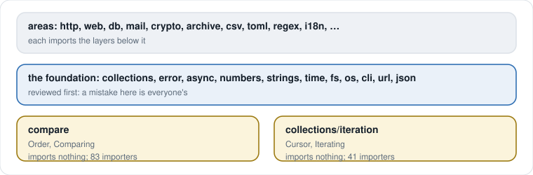

*Figure 19.1. The layers of the standard library: two contract modules at the bottom import nothing.*

A contract module is cheap: a few roles, no state, no imports. It turns a
tangle into layers.

## 19.4 What crosses the boundary

A module exports what it declares itself, and nothing else. Its imports are
its own business:

```okkama
module bible/reexport v1.0.0;

// shop/basket imports Money, but does not own it: nothing is re-exported.
import "io/stdout" take Stdout;
import "shop/basket" take Basket, Money;

main() is int {
    Stdout().writeln(Basket(prices: [Money(cents: 1)]).total().string());
    0;
}
```

The compiler answers:

```text
19-reexport-rejected.ok:5:35: semantic error: Import "shop/basket" has no declaration "Money"
```

`shop/basket` imports `Money`, and its `Basket` depends on it. But `Money` is
not declared in `basket.ok`, so `take Money` from `"shop/basket"` finds
nothing. The same holds for namespaces: `basket.Money` is not a name. There
is no re-export, no Rust `pub use`, no JavaScript `export * from`, no
OCaml `include`. A program that needs `Money` imports the module that
declares it.

Selected declarations still bring everything they need to run. `Basket`
works in the program although the program never imported `Money` through it:
constructors, actions, defaults, lifecycle blocks and role fakes resolve
names in the module that declares them, not in the module that calls them.
That *dependency closure* is private. It makes the code run, and it puts no
name in the importer's scope.

### Two names, two types

Because a type's identity includes its module, two declarations with the
same name in two modules are two types, even when they are written the same
way:

```okkama
module bank/money v2.0.0;

// The same name and the same field as shop/money, in another module.
object Money {
    has cents is int;
    Money(:cents);
    cents() is int { cents; }
}
```

```okkama
module bible/identity v1.0.0;

// Two declarations named Money, from two modules: two types.
import "io/stdout" take Stdout;
import "shop/money" as shop;
import "bank/money" as bank;

object Till {
    Till();
    count(amount is shop.Money) is int { amount.cents(); }
}

main() is int {
    Stdout().writeln(Till().count(bank.Money(cents: 500)).string());
    0;
}
```

The compiler answers:

```text
19-identity-rejected.ok:14:22: semantic error: No action "count" on object "Till" accepts (bank.Money)
Available: count(amount is shop.Money)
```

`bank.Money` has a field `cents` and an action `cents()`, like
`shop.Money`, and the call is still rejected: Okkama types are nominal
(Chapter 4), and the name a type is nominal over is
`module#major::Name`. The same is true of two major versions of one module:
`shop/money#1::Money` and `shop/money#2::Money` would be different types,
which is what a major version is for.

The diagnostic names the two types apart. A type whose name another
declaration of the program also has is written the way the file of the
diagnostic can name it: `bank.Money` through the namespace its reader wrote,
`Money` when that is the `Money` in scope, otherwise `Money from
"bank/money"`, and the same inside composite types (`@bank.Money`,
`Box<shop.Money>`). A call that fits no candidate then lists the candidates
it had, up to four, so the line under the error shows which `Money` the
action wanted. Every other name stays short: in a program whose type names
are all different, nothing changes. Until 0.5.3 the module was left out of
every message, and this one read "`Money` does not accept `Money`"
(issue #338).

This is information hiding in Parnas's sense [[Parnas 1972](#ref-parnas1972)]: a module is
the unit of a design decision, and what it exposes is a promise. A
re-export makes a module promise what it does not own. When the owner
changes, every module that re-exported the name changes its promise without
changing a line. Okkama keeps each promise in the module that can keep it.

## 19.5 Hidden declarations

Everything a module declares is public unless it says otherwise. `hidden`
before `object`, `role`, `enum` or `const` keeps a declaration inside its
module:

```okkama
module bible/hidden v1.0.0;

import "io/stdout" take Stdout;
import "shop/money" take Rounding;

main() is int {
    Stdout().writeln(Rounding().half_up(1000, 15).string());
    0;
}
```

The compiler answers:

```text
19-hidden-rejected.ok:4:26: semantic error: Import "shop/money" cannot take hidden declaration "Rounding"
```

`Rounding` is visible in every file of `shop/money`, in its tests and its
fakes, and in every body defined in the module. Outside, `take Rounding` is
rejected, and a namespace does not reveal it either (`Type
"money.Rounding" is hidden in module "shop/money"`).

Hiding is enforced at the boundary, not only at the import line. The rules:
- **Values leave only as public types.** A value of a hidden type crosses
  only under a public one: a role it does, `Error`, or `any`. A role never
  converts back (Chapter 14), so outside code holds only the view.
- **Public signatures cannot name hidden types.** Parameters and results of
  public actions, constructor parameters, role signatures, enum payloads,
  generic arguments and bounds, and cap fields are all public. Any of them
  that names a hidden type is an error at the declaration. Hidden actions,
  fields and bodies may use hidden types freely.
- **A public object cannot do a hidden role.** Its `does` list is part of its
  public contract. A hidden object may do public and hidden roles, which is
  how an implementation is hidden behind a contract: a public role, a hidden
  object that does it, and a public action that returns the role.
- **A hidden error enum stays out of reach.** It can be thrown out of the
  module, but it can then be caught only as `Error`, and `okkama lint`
  reports such throws from public actions (`hidden-error`).

### A contract and a hidden implementation

The rules support one pattern above all: a public role, a hidden object that
does it, and a public entry that hands out the role.

```okkama
module billing/payments v1.0.0;

// The contract is public; the implementation is not.
role Payment {
    id() is string;
    amount() is int;
    authorized() is Payment;
    state() is string;
}

hidden enum Stage = (created, authorized);

hidden object CardPayment does Payment {
    has key is string;
    has cents is int;
    has stage is Stage = Stage.created;
    CardPayment(:key, :cents);
    CardPayment(:key, :cents, :stage);
    id() is string { key; }
    amount() is int { cents; }
    authorized() is Payment { CardPayment(key: key, cents: cents, stage: Stage.authorized); }
    state() is string {
        match stage {
            case Stage.created { "created"; }
            case Stage.authorized { "authorized"; }
        };
    }
}

object Payments {
    Payments();
    open(id is string, cents is int) is Payment { CardPayment(key: id, cents: cents); }
}
```

```okkama
module bible/payments v1.0.0;

// Callers hold a Payment; CardPayment and its stages stay in the module.
import "io/stdout" take Stdout;
import "billing/payments" take Payments, Payment;

object Receipt {
    Receipt();
    line(payment is Payment) is string { payment.id() + " " + payment.amount().string() + " " + payment.state(); }
}

main() is int {
    let opened = Payments().open("p-1", 1250);
    let done is Payment = opened.authorized();
    Stdout().writeln(Receipt().line(opened));
    Stdout().writeln(Receipt().line(done));
    0;
}
```

Output:

```text
p-1 1250 created
p-1 1250 authorized
```

The program sees four things: `Payments`, `Payment`, and the four actions
of the role. It does not see `CardPayment`, its constructor, its fields or
the `Stage` enum. `authorized()` returns a new `Payment`, and the old one
stays `created`, as every value does (Chapter 13).

Everything the module hides it can change without telling anyone:
- split `CardPayment` into one object per stage;
- add a `Stage.refunded`;
- keep the amount as a `rat`;
- store the state in a map.

None of these changes reaches a caller, because a caller cannot have named
what changed. The compiler enforces the boundary from both sides. If
`open` were declared to return `CardPayment`, the declaration itself would
be an error, because a public action cannot name a hidden type. If the
program wrote `take CardPayment`, the import would be. The module's public
surface is exactly the role and the factory, and it cannot grow by accident.

This is the shape Chapter 14 recommends for roles in general, enforced at
the scale of a module. A role names what callers may rely on; `hidden`
makes sure they cannot rely on anything else.

`hidden` is a contextual keyword: `has hidden is int` is still a field
named `hidden`. The same word before an action keeps that action inside its
object (§12.7): in both places it means *not part of the public contract*.

Okkama's default is the opposite of Go's capitalization rule, Rust's
private-by-default and Java's package-private. Those languages make the
writer opt in to exposure. Okkama makes the writer opt out, on the grounds
that most declarations of a module are its reason to exist, and a
`hidden` marks the few that are not. Whether that is the right default is a
question of style. A module of twenty declarations with three helpers reads
better with three `hidden`s than with seventeen `pub`s. A module with one
public entry and twenty internals reads worse.

## 19.6 Module constants

A module can name values the compiler computes (issue #153):

```okkama
module bible/constants v1.0.0;

// Computed by the compiler, in any order, with the program's own arithmetic.
import "io/stdout" take Stdout;

const MB = 1024 * KB;
const KB = 1024;
const LIMITS = ["upload": 10 * MB, "header": 64 * KB];
const SIZES is @int = [KB, MB, 1024 * MB];
const HALF = 1 / 2;
const HUGE = 4294967296 * 4294967296 * 4294967296;
const NAME = "okkama-" + LANG;
const LANG = "en";
hidden const SALT = "x";

main() is int {
    Stdout().writeln(NAME + " " + LIMITS["upload"].string() + " " + SIZES.size().string());
    Stdout().writeln(HALF.string() + " " + HUGE.string());
    0;
}
```

Output:

```text
okkama-en 10485760 3
1/2 79228162514264337593543950336
```

`const NAME = value;` is made of literals, payload-free enum cases,
`rat(n, d)`, scalar casts, operators, other constants, and arrays and maps of
such values. The constants of a module may be declared in any order (`MB`
uses `KB`, declared after it). The computation has the semantics of the
running program, not of a separate constant language: `1 / 2` is the `rat`
1/2, and 2⁹⁶ is an exact integer that would overflow any machine word. A
failing computation (`1 % 0`) and a cycle between constants are compile
errors, and so is anything that would run code:

```okkama
module bible/const_call v1.0.0;

import "io/stdout" take Stdout;

const WIDTH = "okkama".length();

main() is int {
    Stdout().writeln(WIDTH.string());
    0;
}
```

The compiler answers:

```text
19-const-call-rejected.ok:5:15: semantic error: Constant "WIDTH" cannot be computed by the compiler: it calls an action or a constructor; a constant is made of literals, operators and other constants
```

A constant is public like an object: `take LANG` or `settings.LANG` reaches it, and `hidden const` keeps it in its module. Repeated uses of an array or map constant do not copy the whole collection.

Constants are not a way to share objects. There is no module-level `let`,
no static field and no singleton: an expensive object such as a compiled
regular expression or a database connection is built once where the program
starts, in `main()`, and passed to the objects that need it. Its lifetime and
its users stay visible in the code, and a test can pass another one. That is
the same rule Chapter 12 states for objects: what an object needs, it gets
through its constructor.

## 19.7 Packages and blade

`blade` is Okkama's package tool. Through 0.5.1 it was the youngest part of
the toolchain, a working core with large gaps; 0.5.3 rebuilt it around three
decisions this section explains: a package is an ordinary git repository,
the version a project gets is the *lowest* one that satisfies everyone, and
nothing blade does may lose work a programmer did by hand. Nothing in this
section is run as an example, because installing a package runs `git`, and
the book's examples run in a cage without processes.

### A project

A directory that holds a `blade.toml` is a *package root*. A file belongs to
the package of the nearest such directory above it, and a *project* is a
package that is not installed inside another project. `blade new demo`
creates one:

```toml
[module]
name = "demo"
version = "1.0.0"

[build]
entry = "src/main.ok"
output = "target/demo.spb"

[run]
args = []
env = {}

[dependencies]
```

```okkama
module demo;
import "io/stdout" take Stdout;

main() is int {

    Stdout().writeln("hello from okkama");
    0;
}
```

The module declares no version. In a package the version lives in one place,
and a module file that declares one is an error at the version. The
package's files import one another as in 19.3: beside the importing file,
then from the package root. `blade build` compiles the project as `[build]`
says; `blade run` builds when a source, `blade.toml` or `blade.lock` is newer
than the output, then runs it as `[run]` says, and the program's exit status
is blade's.

### A package is a repository

A package is a git repository with its modules in `src/`:

```
json/
  src/json.ok           module json;
  src/json/parser.ok    module json/parser;
  blade.toml            only if json has dependencies of its own
  LICENSE, examples/, tests/ …
```

Its *name* is the key a project declares it under, and its *version* is its
`vX.Y.Z` tag. Neither has to be written inside the package: a repository
that has never heard of blade, but keeps Okkama modules in `src/`, is
already a package. A `blade.toml` is needed only to declare dependencies of
its own; a `[module]` in it is optional, and when present its name and
version must agree with the key and the tag, which catches a release made
from the wrong commit. A package without `blade.toml` is installed with a
generated one, the same bytes every time, so that the compiler knows its
files belong to the package and not to the project.

Blade checks only `src/**/*.ok`, and refuses a package, naming it and its
tag, whose modules do not parse, declare a version, are named outside
`<name>` and `<name>/…`, or declare `native` actions (natives come from the
runtime, never from a package). Everything else in the repository, examples
and tests included, is copied as it is and never executed, and symbolic
links are refused anywhere. Installing a package therefore runs none of its
code: the first line of the package's that executes is one the project
calls.

`blade add NAME GIT [MIN]` declares a dependency and installs it:

```
blade add json https://example.org/okkama/json 1.4.0
```

writes

```toml
[dependencies]
json = { git = "https://example.org/okkama/json", version = "1.4.0" }
```

Without `MIN` the minimum is the repository's newest tag, so a new
dependency starts current and the manifest says which version that was.
A local directory is declared by hand, `tools = { path = "../tools" }`, and
its version is the one in its `blade.toml`, since a directory has no tags.

Dependencies land in `pkg/<name>/` of the project root, and the project
imports them by that path, `src/` included:

```okkama
import "pkg/json/src/json/parser" take Parser;
```

An import path that starts with `pkg/` resolves against the project root
only. It must name a dependency declared in the `[dependencies]` of the
importing file's own package. Transitive dependencies are not importable:
if `web` depends on `json`, the project cannot `import "pkg/json/…"` until
it declares `json` itself. This is 19.4's no-re-export rule at the scale of
packages. What a program uses, it lists.

### The lowest version that satisfies everyone

A requirement is a minimum. `version = "1.4.0"` means 1.4.0 or any later
1.x; below 1.0 the minor is the breaking part, so `"0.3.1"` means 0.3.1 or a
later 0.3.x. The version a project gets is the *lowest* one that meets every
minimum anyone in the project states for that package, and this is the whole
rule. It is Go's *minimal version selection* [[Cox 2018](#ref-cox2018)], and it has three
consequences that the other common rule, "the highest version that
satisfies all requirements", does not have.

Minimal version selection has three consequences. A release upstream changes nothing until a manifest raises a minimum. Every selected version is explicitly required by some manifest. Only dependencies reachable through the selected versions are installed; dependencies unique to a version not selected cannot cause an error.

The price is the one Go pays. An upgrade is a decision somebody makes:
`blade add json URL 1.5.0` raises the minimum, and `blade update json`
resolves `json` again while every other package keeps its locked version
unless the new one forces it up. And one version of each package per
project is still the rule, so two majors of one package are an error that
shows how each was reached:

```
no single major of "json":
  app → http 2.1.0 → json ≥ 1.2.0
  app → next 1.0.0 → json ≥ 2.0.0
```

One version per package matches the nominal identity of 19.4. Every module
of the program sees the same `json` module, so a `Json` value made by one
dependency is the `Json` type another dependency expects. The diamond across
majors is the cost: two dependencies that need different majors of one
package cannot both be installed, although the language could tell their
types apart. npm makes the opposite choice and installs a copy per
dependent, so a program can hold two incompatible `Money` types without
knowing it; Cargo allows several semver-incompatible versions of one crate
in a build and unifies compatible ones.

### The lock and sync

`blade.lock` records each installed package: version, source, the git commit
the tag pointed at, and a SHA-256 of its files. Under minimum version
selection the lock is not what makes a build reproducible, the manifests
already do that; it makes it *verifiable* and *offline*. `blade sync`
installs exactly what the lock records, and is how a fresh clone gets its
dependencies:

- a package already in `pkg/` with its locked checksum stays as it is, so a
  project that commits `pkg/` syncs with no network and no git;
- any other is fetched by its **locked commit**, not by its tag, so a tag
  deleted or moved upstream changes nothing; its files must have the locked
  checksum, and a commit that is gone is an error that names it;
- what the lock does not have leaves `pkg/`.

A sync never picks a version. When the lock does not match the manifests,
it changes nothing and says which command does:

```
blade.lock does not match blade.toml:
  json: blade.toml wants ≥ 1.5.0, blade.lock has 1.4.2 — run `blade update json`
  util: no longer required — run `blade update`
```

`blade build` and `blade run` never touch the network either: a dependency
that is not installed points to `blade sync`. The only commands that fetch
new versions are the ones that say so, `add` and `update`, and even they stop
when a tag now points at a different commit than the lock remembers, until
`blade update NAME` accepts the new state. A moved tag is how a supply
chain is attacked, and blade will not follow one silently.

### Work done by hand is never lost

Programmers patch dependencies: a `print` in a parser to see what it gets, a
fix that has not been released yet. A package manager that reinstalls over
such a change destroys work without asking, and the next run of the program
behaves as if the fix had never been made. Blade records what it installed
in `pkg/.blade-installed` and compares before it touches anything:

- a package whose files differ from the record (a changed file, an added
  one, a removed one) stops any command that would replace or remove it,
  `blade sync` included, before anything changes:

  ```
  pkg/json has local changes (src/parser.ok differs from blade.lock);
  move them away or delete pkg/json, then run the command again
  ```

- an entry of `pkg/` that blade did not install (`pkg/notes`) is never
  deleted: every install stops and names it.

There is no `--force`. Deleting `pkg/json` is how one accepts a reinstall,
and that is a decision the programmer makes with the file in front of them.
A pulled `blade.lock` with new versions is not a local change: the record
tells an old version from an edited one, so `blade sync` installs the new
versions. The files an operating system leaves in folders it shows, Finder's
`.DS_Store` and Windows' `Thumbs.db`, are neither: they stay and change
nothing.

Installation is all or nothing. The packages that change are assembled in
`pkg.blade-new/` and moved into `pkg/` only when every one was fetched and
checked; an interrupted blade is finished or undone by the next one, and
packages that do not change keep their files untouched.

### What blade does not do yet

- **No registry.** Packages come from git URLs and paths, and there is no
  index, search or `blade publish`.
- **No workspaces.** Several packages developed together each have their
  own `pkg/`.
- **Diamonds across majors fail**, as above.
- **Shallow tooling around the lock.** No `blade tree` or `blade why`.
- **No build profiles or features**, and no conditional dependencies.

These are the ordinary gaps of a young ecosystem. The design decisions are
the ones described above: a version in one place, packages as plain
repositories whose code does not run at install, imports by explicit `pkg/`
paths, one version per package, the lowest version that satisfies everyone,
and no command that overwrites what a programmer wrote.

## 19.8 A program and its dependencies

Imports are resolved before execution, following the lookup rules of 19.3. A missing file or name, a hidden declaration, a cycle or a crossed bound rejects the program before it starts. A valid program has found every module it will use.

## 19.9 Where modules came from

The word *module* in its modern sense comes from David Parnas's 1972 paper
on decomposition [[Parnas 1972](#ref-parnas1972)]. Parnas compared two ways of splitting the
same program. The first gave a module to each step of the processing. The
second gave a module to each design decision likely to change, and hid
that decision behind an interface. The second survived changes that broke
the first. Everything since is a mechanism for that idea: a boundary, a
list of what crosses it, and a promise that the rest may change.

Niklaus Wirth's Modula-2 [[Wirth 1982](#ref-wirth1982)] gave the mechanism the shape most
languages still use. Its *definition module* stated what a module exports,
and a separate *implementation module* kept the rest. Its import lists, `FROM
InOut IMPORT WriteString, WriteLn;`, named exactly what a client took,
much like Okkama's `take`. Standard ML went further [[MacQueen 1984](#ref-macqueen1984)]: modules
(structures) are checked against interfaces (signatures) and can be
parameterized by other modules (functors). OCaml inherited that, and its
`open` and `include` are the wildcard import and the re-export Okkama
leaves out.

The languages most programmers use took simpler paths. Java organized
classes into packages with a directory each, added `import p.*`, and in Java
9 added modules on top of packages [[Gosling 2023](#ref-gosling2023)]. Python and JavaScript made
a module an object built by running a file, which is why importing runs
code and cycles produce half-built modules. Go made a directory a package,
exported names by capitalization, and forbade cycles. Rust made a module
tree inside each crate, with private-by-default items and `pub use`
re-exports.

Okkama's module system is closest to Modula-2's import lists and Go's
discipline: a file of declarations, explicit lists of what is taken, no
cycles, no effects on import. It differs from both in two places: names are
public unless `hidden`, and identity includes the module and its major
version.

## 19.10 Okkama among other languages

| | Unit | Default visibility | Wildcard import | Re-export | Import runs code | Import cycles | Versions per program |
|---|---|---|---|---|---|---|---|
| **Okkama** | file (or listed files) | public; `hidden` | no | no | no | rejected | one per package |
| Go | directory | capitalized names | `import .` (discouraged) | no (aliases only) | `init()` | rejected | one per major |
| Rust | module in a crate | private; `pub` | `use m::*` | `pub use` | no | allowed in a crate | several per crate |
| Java | class in a package; modules | package-private | `import p.*` | no (modules: `requires transitive`) | static initializers | allowed | one on the class path |
| Python | file | public; `_` by convention | `from m import *` | any imported name | the whole file | allowed, half-built | one per environment |
| JavaScript | file | private; `export` | `import * as` (namespace only) | `export * from` | the whole file | allowed, live bindings | duplicates in `node_modules` |
| OCaml | file plus signature | per signature | `open M` | `include M` | top-level effects | rejected | one per build |

Two columns separate Okkama from most of the list: imports that run no code,
and boundaries that pass nothing on. Both come from the same principle as the
rest of the language. An import line is a statement about names that a
reader can trust without opening the imported file.

## 19.11 Limits

- **No re-export.** A library that wants to present one front module for many
  internal ones must wrap them: declare objects that delegate, or roles that
  its internals implement. There is no `pub use`.
- **No conditional or dynamic import.** Which modules a program uses is fixed
  when it is compiled; a plug-in system is built from roles and values passed
  in, not from loading files at run time.
- **The version lives in two places.** Outside a package, in the module line;
  inside one, never in a module: in `blade.toml` for a project or a local
  package, in the `vX.Y.Z` tag for a package from git. A module moved into a
  package must lose its version, and a module taken out of one must gain it.
- **Multi-file modules are listed, not discovered.** A module's files are the
  ones the command line or `blade.toml` names; a forgotten file is a missing
  declaration, not a smaller module.
- **A shadowed library module cannot be named with `std.`.** One module path,
  one file, per program.
- **blade's ecosystem is young.** No registry, no workspaces, no two majors of
  one package in one project (19.7).

## 19.12 What this design costs

Every rule in this chapter removes an option that other languages offer,
and each removal has a price.

No wildcard imports means long import lines. A file that uses fifteen
declarations of one module either lists fifteen names or writes a prefix
fifteen times. Okkama accepts the length: the alternative is a file whose
names have no visible origin. No re-export means libraries cannot build a
front module that renames their internals. They must wrap, which is more
code and one more call. No cycles means that two modules that grew together
must be pulled apart before they can be imported, sometimes at an
inconvenient moment. Identity by module and major version means that two
libraries which each declare `Money` cannot pass their values to each other.
They must convert, explicitly, at the boundary between them.

What the rules buy is the same thing four times over: a reader who can
trust an import line. It says exactly which names a file uses and where they
come from. It runs nothing, so a file can be imported to read its
declarations. It brings nothing the imported file does not own, so a change
in a third file cannot add a name to it. And a type it brings is the type
the imported file declares, not another type with the same name. Chapter 1
called that the razor applied to software: no entity that does not have to
exist, and no name whose origin is not in front of the reader.

# Chapter 20. Async, futures and structured concurrency

A program waits. It waits for a file, a socket, a database, a timer, another
part of itself. While one part waits, another could work, and every language
of the last twenty years has had to say how. Okkama's answer has four parts. An
`async` action returns a `Future<T>` instead of a `T`. `await` waits for a
future inside another async action, and nowhere else. `spawn` starts work that
runs beside the code that started it. And one cooperative scheduler runs one
task at a time, so the code between two `await`s of a task is never
interleaved with anybody else's.

Here is the smallest async program worth reading:

```okkama
module bible/lazy v1.0.0;

import "io/stdout" take Stdout;

object Oven {
    has name is string;

    Oven(name is string) {
        self.name = name;
    }

    async baked() is string {
        Stdout().writeln("baking " + name);
        name + " bread";
    }
}

async main() is int {
    let pending = Oven("rye").baked();
    Stdout().writeln("ordered; done: " + pending.done().string());
    let first = await pending;
    let second = await pending;
    Stdout().writeln(first + ", " + second + "; done: " + pending.done().string());
    0;
}
```

Output:

```text
ordered; done: false
baking rye
rye bread, rye bread; done: true
```

- `Oven("rye").baked()` does not bake. The call returns a future, and the
  first line of output shows that nothing has run yet: `done: false`, and no
  `baking rye`.
- The first `await pending` starts the body, which prints `baking rye` and
  produces `"rye bread"`.
- The second `await pending` does not bake again. A future runs its body at
  most once and keeps the outcome; every later `await` reads it.
- `async main()` is what makes `await` legal in `main`. A program whose `main`
  is synchronous can create futures but cannot wait for them.

## 20.1 A future is a value that is not computed yet

An action declared `async` and `is T` is checked as producing a `T`. Calling
it produces a `Future<T>`:

```text
Oven("rye").baked()          : Future<string>
await Oven("rye").baked()    : string
```

A future has exactly three public actions, and none of them reads the value:

- `done()` is `true` once the future has settled: with a value, with a
  failure, or cancelled with its cleanup finished;
- `cancel()` asks the future to stop (Section 20.5);
- `cancelled()` is `true` once cancellation has finished.

The only way to get the value is `await`. There is no `result()`, no
`value()`, no `get()` that blocks. That is deliberate: a call that blocks the
thread until a value is there would stop the one scheduler, and with it every
other task of the program.

The rules around `await` are few:

- There is no implicit await. A `Future<int>` is not an `int`, and passing one
  where the other is expected is a type error.
- `await` is legal only inside an `async` action, `async main` included.
  Awaiting in a synchronous action is a compile error, and so is awaiting
  something that is not a future.
- A failure thrown by the body is kept like a value and thrown again at every
  `await`, where an ordinary `try`/`catch` takes it.
- Locals survive suspension. The body resumes at the operand it was waiting
  for, without evaluating earlier operands or statements again.
- `await` is a unary operator: `(await reply.item()).string()` needs the
  parentheses, and `await load() + 1` means `(await load()) + 1`.
- An `async` action declared `is void` produces a future without a value. It
  is awaited for its effect, as a statement, never as an expression.

The call is lazy. That choice decides more than it seems to. A lazy future
that nobody awaits costs one object and runs no code, so returning one from an
action is free, and an action can build several and decide later which to
await. A future that starts when it is created would already be running by
then, and the caller would own a task it may not want. `spawn` is the explicit
way to start one now (Section 20.4).

## 20.2 Where futures came from

The future is older than most languages that have one. Baker and Hewitt
named it in 1977, in work on actor systems, as a value that stands for a
computation still running; their paper is about collecting the futures that
nobody will ever read [[Jr. 1977](#ref-baker1977)]. Halstead's Multilisp made it a
language construct in 1985: `(future e)` starts evaluating `e` in parallel and
returns a placeholder at once, and any strict use of the placeholder waits
for the value [[Jr. 1985](#ref-halstead1985)]. That future is eager and implicit: a program
does not say where it waits.

Liskov and Shrira's promises (1988) moved the idea to distributed calls and
made it typed: a call returns a promise, the caller continues, and claiming
the promise later yields the result or the exception the call raised
[[Liskov 1988](#ref-liskov1988)]. The two halves Okkama keeps are already there: the outcome
includes failures, and it is collected explicitly.

The `async`/`await` pair came from F#. Its asynchronous workflows (2007,
described in [[Syme 2011](#ref-syme2011)]) let a programmer write a sequential-looking body
that waits at each `let!`, and an F# `Async<T>` is a *recipe*: it
runs only when started, and it can be started more than once. C# 5 (2012)
took the syntax with a different value: its `Task<T>` is already running when
the call returns. JavaScript's promises (2015) and `async` functions (2017)
are eager in the same way. Rust's futures (2019) went back to lazy values that
do nothing until polled.

Okkama sits between them. Its future is lazy like F#'s and Rust's: a call
starts nothing. But it runs at most once and keeps its outcome, like C#'s and
JavaScript's: awaiting it twice does not run it twice. A future in Okkama is a
single computation that has not started yet, not a recipe for many.

The price of `async`/`await` in every language that has it is what Nystrom
called the colour of a function [[Nystrom 2015](#ref-nystrom2015)]: an async function can be
called from anywhere, but its result can be awaited only from another async
function, so asynchrony spreads up the call graph. Okkama pays it in full, and
on purpose. An action that can suspend says so in its signature, because a
suspension point is where other tasks run (Section 20.3), and a reader who
cannot see where that happens cannot reason about the code.

## 20.3 One scheduler, one task at a time

A run has one scheduler. `async main` drives it until the root future
settles; a synchronous `main` does not drive it at all. Async does not create
threads, and it does not make CPU-bound work faster: two tasks that compute
take turns on one core. What async gives is that a task waiting for
something does not hold up the others.

Scheduling is cooperative. One task runs at a time, until it suspends at an
`await` of a future that has not settled, or until it ends. Then the
scheduler runs the next ready task. A task becomes ready when something it
waits for happens: a future it awaits completes, an `Event` it waits on is
set, a channel hands it a value, a permit it asked for is returned, or it is
cancelled. Ready tasks run in the order they were woken.

The rule that matters most is what waking does *not* do. It does not run the
woken task. The task that called `set()` or `cancel()` keeps running until it
suspends, and only then does the woken task get its turn:

```okkama
module bible/wake v1.0.0;

import "io/stdout" take Stdout;
import "async/event" take Event;

object Waiter {
    has ready is Event;
    has started is Event;
    Waiter(:ready, :started);
    async run() is int {
        started.set();
        await ready.wait();
        Stdout().writeln("waiter: woke");
        1;
    }
}

async main() is int {
    let ready = Event();
    let started = Event();
    let waiter = spawn Waiter(ready: ready, started: started).run();
    await started.wait();
    Stdout().writeln("main: before set");
    ready.set();
    Stdout().writeln("main: after set");
    await waiter;
    0;
}
```

Output:

```text
main: before set
main: after set
waiter: woke
```

`main: after set` comes before `waiter: woke`. So the code
of a task between two suspension points is never interleaved with another
task's code. A task can read some state, decide, and write the result
without a lock, as long as it does not `await` in between. Every `await` is a
point where the world may have changed; nothing else is.

This is the guarantee asyncio, JavaScript, Trio and Kotlin's coroutines give,
and it is what makes cooperative concurrency easier to reason about than
threads.

Two kinds of start stay immediate. `spawn` runs the new task at once, until
its first suspension, before the statement after `spawn`. The first `await` of
a cold future runs its body at once too; the awaiting task is suspended
anyway. And awaiting a future that has already settled does not suspend at
all: it returns the kept outcome, and no other task runs in between.

None of this is a thread-safety guarantee. Two tasks that each read, `await`
and then write can still lose an update, because the `await` between the read
and the write lets the other task in. Cooperative scheduling tells a reader
where interleaving can happen; it does not make it impossible.

### Where the rule came from

Cooperative multitasking is older than async. Classic Mac OS ran its
applications this way from MultiFinder in 1987 to Mac OS 9, and 16-bit
Windows did the same: a program kept the processor until it called back into
the system, so one program stuck in a loop froze the machine. Okkama accepts
that cost inside one run and not across programs. A task that computes
without awaiting holds up every other task of its run, and nothing preempts
it (Section 20.15). Erlang went the other way: its processes are preempted,
so a process that keeps computing does not starve the rest. It does not need
the guarantee above, because its processes share no memory. Go started
cooperative and made goroutines asynchronously preemptible in Go 1.14, in
2020, so that "loops without function calls no longer potentially deadlock
the scheduler" [[Authors 2020](#ref-go114)].

The narrower rule, that waking never runs the woken code inside the waker,
has its own history in JavaScript. Promises/A+ requires that a promise's
callbacks "must not be called until the execution context stack contains
only platform code" [[Promises/A+](#ref-promisesaplus)], that is, never inside the call that
settled the promise. The reason was a class of bugs that Isaac Schlueter
called releasing Zalgo [[Schlueter 2013](#ref-schlueter2013)]. An API that calls its callback
sometimes at once and sometimes later runs the code after the call in two
different orders, and only one of them gets tested. His advice was to pick
one timing and keep it.

## 20.4 `spawn`: work that runs beside its starter

`spawn` takes a call of an object's action and starts it now. Its result is
the same `Future<T>` the call would have returned, so `await` collects it
later; there is no second type for a running task, and no
`Future<Future<T>>`. What `spawn` starts depends on the action:

- **An async action** becomes a task of the current run. It shares the
  scheduler with its starter and may hold objects, futures,
  channel endpoints and other values that only make sense inside one run.
  It gives concurrency, not parallelism: it runs when the others wait.
- **A synchronous action** runs in a separate worker process, in parallel
  with the program. Receiver and arguments are evaluated in the parent, left
  to right, and copied to the worker; only transferable values cross: `int`,
  `float`, `string`, `char`, `byte`, `bool`, and arrays and maps of them.
  Objects, futures, closures and native handles cannot. The worker's result
  or failure comes back into the future.

```okkama
async main() is int {
    let left is Future<int> = spawn Worker(seed: 7).calculate(input: 20);
    let right is Future<int> = spawn Worker(seed: 9).calculate(input: 6);
    (await left) + (await right);
}
```

Both workers compute at the same time, before either future is awaited. The
form is narrow on purpose: only `spawn Receiver(…).action(…)` or a bound
action value is a spawn target, not a block or an arbitrary expression, so
what crosses the process boundary is always a receiver and arguments that the
compiler has checked.

(This chapter's examples do not start worker processes; they run in a sandbox
that forbids it. The program above is the specification's.)

A spawned task must be accounted for. When `async main` returns, the
scheduler cancels every spawned task that has not finished and waits for its
cleanup. A spawned task that failed and that nobody awaited makes the whole
run fail, with that task's failure: an error is not lost because nobody was
listening.

## 20.5 Structured await and cancellation

`cancel()` asks a future to stop. Cancellation is cooperative: it is
delivered at the task's suspension point, unwinds the task like a failure
(its `defer`s and `destroy`s run), and the task's `await`s then throw the
built-in `Cancelled`. A future that never started is simply marked cancelled;
its body never runs.

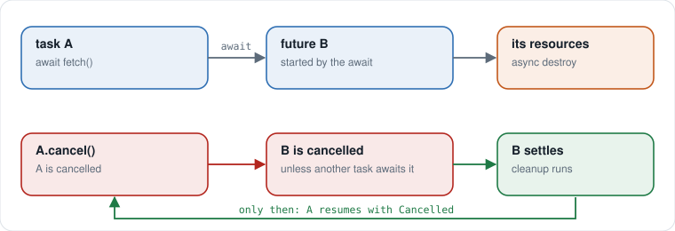

*Figure 20.1. Structured await: cancelling a task cancels the future it awaits, and the task resumes only after that future has settled.*

What happens to the future a cancelled task was waiting for? Okkama's answer
is that `await` is *structured* (issue #147). Cancelling a task cancels the
future it awaits, if that future is its own: one its `await` started, a task
it spawned, or an asynchronous operation it requested. And the cancelled
task does not finish until that future has settled, cleanup included. Only
then does its own `await` throw `Cancelled` and its own cleanup run:

```okkama
module bible/cancel v1.0.0;

import "io/stdout" take Stdout;
import "async/event" take Event;

object Delivery {
    has loaded is Event;
    has road is Event;

    Delivery(:loaded, :road);

    async run() is string {
        defer Stdout().writeln("delivery: van returned to the depot");
        loaded.set();
        await road.wait();
        "delivered";
    }
}

object Order {
    has delivery is Delivery;

    Order(:delivery);

    async run() is string {
        defer Stdout().writeln("order: closed");
        await delivery.run();
    }
}

async main() is int {
    let loaded = Event();
    let road = Event();
    let order = spawn Order(delivery: Delivery(loaded: loaded, road: road)).run();
    await loaded.wait();
    order.cancel();
    Stdout().writeln("customer: cancel");
    let outcome = try {
        await order;
    }
    catch e is Cancelled {
        "cancelled";
    };
    Stdout().writeln("outcome: " + outcome + "; cancelled: " + order.cancelled().string());
    0;
}
```

Output:

```text
customer: cancel
delivery: van returned to the depot
order: closed
outcome: cancelled; cancelled: true
```

- `order.cancel()` returns at once. It does not run the delivery's cleanup;
  that happens when `main` suspends at `await order`.
- The delivery is cancelled because the order was waiting for it, and only
  the order. Its `defer` runs first: the van returns before the order closes.
- `await order` throws `Cancelled` only after both have finished, and
  `cancelled()` is then `true`.

A future that another task also awaits is not cancelled with one of its
waiters: the cancelled task only stops waiting for it, and the others still
get its outcome.

### When the await has already finished

There is a moment between two states that the rule above does not cover. A
task's awaited future settles; the task becomes ready to resume; before its
turn comes, someone cancels it. Is the task still "waiting at a suspension
point"?

The cancellation rule is:

- An `await` is finished once its future has settled. A cancellation that
  arrives after that does not undo it; the task runs on with the value or
  the failure it was given.
- The cancellation stays requested, and the task's next `await` raises
  `Cancelled` before it starts anything.

The rule is the one that keeps information: a value that arrived is not
discarded, a failure that happened is not hidden behind `Cancelled`, and a
task that is cancelled still stops at its next suspension. A sibling of an
`AllFutures` that failed in the same turn appears among the secondary
failures, in input order.

A related rule settles what a stream of completions does after it is
cancelled (issue #548). Cancelling a pending `completion()` request
cancels the stream's unfinished inputs, waits for their cleanup and fails
with the cancellation; every later request fails the same way, with
`Cancelled` rather than `NoFutures`, because the stream was cancelled, not
exhausted.

The rule makes a common case need nothing at all. A task that awaits one
child needs no group, no supervisor and no "settle" object in a `defer`:
cancelling the task reaches the child and waits for it. Groups exist for real
fan-out, where one task owns several children at once (Section 20.7).

This is structured concurrency in Smith's sense [[Smith 2018](#ref-smith2018)]: no child
outlives the scope that is waiting for it. Smith's Trio makes the scope
explicit, as a *nursery* block that every task must be started in. Kotlin
(2018) made every coroutine a child of a scope, so that a scope does not
finish before its children and cancelling it cancels them
[[Elizarov 2018](#ref-elizarov2018)]. Okkama gets the same property from the await itself, without
a scope object: the thing a task is waiting for is its child for as long as it
waits. What it does not get is the nursery's guarantee for work that nobody
awaits. A spawned task that its starter forgets runs on until `async main`
returns and the scheduler cancels it.

### Where structured concurrency came from

Smith's argument starts from Dijkstra's letter about `goto` [[Dijkstra 1968](#ref-dijkstra1968)].
A `goto` lets control leave a block and never come back, so a reader cannot
treat the block as a unit: whatever it was supposed to finish may still be
going on elsewhere. Structured programming replaced it with constructs that
have one entry and one exit. A function that starts a thread or a goroutine
and returns does what `goto` did, Smith says: the work it started outlives the
call, and no caller can know when it ends or where its errors go. A nursery
puts concurrency back into the shape of a block.

The idea is older than the name. Erlang [[Armstrong 2003](#ref-armstrong2003)] linked processes so
that a crash travels along the links, and supervisors restart what they
started, so that a tree of processes fails and recovers as one. That tree is
built and torn down at run time, by convention and library; the language does
not stop a process from outliving its parent.

After Trio the idea went into the mainstream quickly. Kotlin made every
coroutine the child of a `CoroutineScope` in 2018 [[Elizarov 2018](#ref-elizarov2018)]. Swift
shipped task groups and `async let` with structured child tasks in 2021
[[Evolution 2021](#ref-se0304)]. Python 3.11 (2022) added `asyncio.TaskGroup`. Java 21 (2023)
previewed `StructuredTaskScope` [[OpenJDK 2023](#ref-jep453)]. All of them give the scope an
object or a block. Okkama gives it the `await`: a task that waits for a future
it started owns it while it waits, which covers the common case of one child
without any extra construct, and leaves the objects of Section 20.7 for the
cases with many.

## 20.6 Channels and the state owner

Okkama has no mutable fields. The one value tasks can share and replace is
an `Atomic` (Section 20.8), a single cell replaced whole; a counter, a cache
or a repository that several tasks update is not written to by all of them.
They send each other values. `async/channel` provides `Channel<T>`, a bounded FIFO
of values of one type, and two capabilities over it: `Sending<T>`, which can
only send, and `Receiving<T>`, which can only receive.

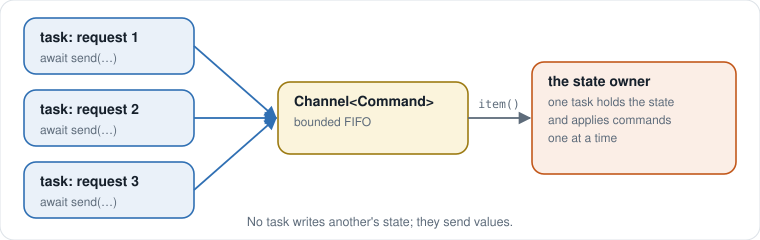

*Figure 20.2. The state owner: tasks send commands through a channel to the one task that holds the state.*

A component with state is one task that owns the state as a local binding and
changes it by rebinding that binding to a successor. Everybody else talks to
it through a channel:

```okkama
module bible/ledger v1.0.0;

import "io/stdout" take Stdout;
import "async/channel" take Channel, Sending, Receiving;

object Balance {
    has amount is int;

    Balance(:amount);

    amount() is int {
        amount;
    }

    deposited(sum is int) is ^Balance {
        ^amount = amount + sum;
    }
}

enum Command = (deposit(sum is int), report(reply is Sending<int>), stop);

object Ledger {
    has inbox is Receiving<Command>;

    Ledger(:inbox);

    async run() is int {
        let balance = Balance(amount: 0);
        let served = 0;
        loop {
            let command = await inbox.item();
            match command {
                case Command.deposit(sum) {
                    balance = balance.deposited(sum);
                }
                case Command.report(reply) {
                    await reply.send(balance.amount());
                }
                case Command.stop {
                    last;
                }
            }
        }
        balance.amount();
    }
}

async main() is int {
    let channel is Channel<Command> = Channel(capacity: 4);
    let ledger = spawn Ledger(inbox: channel.receiving()).run();
    let teller = channel.sending();
    await teller.send(Command.deposit(30));
    await teller.send(Command.deposit(12));
    let replies is Channel<int> = Channel(capacity: 1);
    await teller.send(Command.report(replies.sending()));
    Stdout().writeln("balance: " + (await replies.receiving().item()).string());
    await teller.send(Command.stop);
    Stdout().writeln("final: " + (await ledger).string());
    0;
}
```

Output:

```text
balance: 42
final: 42
```

- The ledger's balance is a local of `run()`. Nobody else can reach it, so
  nobody else can change it, and the commands that change it are handled one
  at a time, in the order they arrived.
- `balance = balance.deposited(sum)` rebinds the local to the successor that
  `deposited` returned. `Balance` itself never changes.
- A command that needs an answer carries its own reply channel of capacity 1.
  Every request has its own, so concurrent answers cannot reach the wrong
  client.
- The teller holds only a `Sending<Command>`. It can ask; it cannot read the
  ledger's inbox, close the reply channels of others or touch the balance.

This is the actor pattern of Erlang [[Armstrong 2003](#ref-armstrong2003)] built from ordinary
parts: a task, a channel and a match over commands, with no new syntax. What
Erlang's mailboxes do not have, and Okkama's channels do, is a bound. A
channel of capacity 4 holds four values; the fifth `send` suspends until the
owner takes one, so a fast producer cannot bury a slow owner under messages.
Capacity 0 is a rendezvous: a `send` finishes only when a receiver takes the
value.

The rest of a channel's contract is short:

- values, blocked senders and waiting receivers are served in FIFO order, and
  each value is received exactly once;
- either endpoint may `close()` the channel, any number of times; after it,
  sends throw `ChannelClosed`, values already buffered can still be received,
  and then `item()` throws `ChannelClosed` too;
- dropping an endpoint does not close the channel, and neither does the
  failure of a task that used it. The owner closes it, usually in a `defer`;
- cancelling a task blocked in `send` or `item()` ends its wait,
  and the next value goes to the next waiter.

There is no `try_send`, no `try_receive`, no `closed()`: a task that wants to
know whether it can proceed waits, and the scheduler runs somebody else
meanwhile.

### Several channels at once: `SelectedReceiving`

A task that serves more than one source waits on all of them and takes
whichever message comes first. `SelectedReceiving` does that over receivers
of one element type:

```okkama
module bible/select v1.0.0;

import "io/stdout" take Stdout;
import "async/channel" take Channel, Sending, SelectedReceiving, SelectedItem, ChannelClosed;

// Two sources of one kind of message: orders from the shop, orders by phone.
object Source {
    has output is Sending<string>;
    has prefix is string;
    has count is int;
    Source(output is Sending<string>, prefix is string, count is int) {
        self.output = output; self.prefix = prefix; self.count = count;
    }
    async run() is void {
        defer output.close();
        for 1..=count -> n { await output.send(prefix + " " + n.string()); }
    }
}

async main() is int {
    let out = Stdout();
    let shop is Channel<string> = Channel(capacity: 1);
    let phone is Channel<string> = Channel(capacity: 1);
    let a = spawn Source(output: shop.sending(), prefix: "shop", count: 3).run();
    let b = spawn Source(output: phone.sending(), prefix: "phone", count: 2).run();
    let names = ["shop", "phone"];
    let orders is SelectedReceiving<string> =
        SelectedReceiving(receivers: [shop.receiving(), phone.receiving()]);
    loop {
        let got = try { Maybe.some(await orders.item()); }
                  catch e is ChannelClosed { Maybe<SelectedItem<string>>.none; };
        match got {
            case Maybe.some(item) { out.writeln(names[item.source()] + ": " + item.value()); }
            case Maybe.none { last; }
        }
    }
    await a;
    await b;
    out.writeln("both sources closed");
    0;
}
```

Output:

```text
shop: shop 1
phone: phone 1
shop: shop 2
phone: phone 2
shop: shop 3
both sources closed
```

- **One message per `item()`.** `await orders.item()` commits to exactly
  one receive and answers a `SelectedItem`: `source()` is the position of
  the winning receiver in the array, `value()` the message.
- **Fair by rotation.** When several sources are ready, the first in the
  array wins the first tie, and the next tie starts from the source after
  the previous winner. Neither source starves the other, and the order of
  the output above is the same on every run.
- **Closed means exhausted.** A closed channel's buffered messages are still
  delivered. `item()` throws `ChannelClosed` only when every source is
  closed and empty, which is how the loop above ends.
- **Mistakes are typed errors.** An empty array of receivers is
  `EmptyChannelSelection`, the same channel twice is
  `DuplicateChannelReceiver`, and a second `item()` while one is pending is
  `ConcurrentChannelSelection`.
- **Cancellation withdraws every alternative.** A task cancelled while it
  waits takes nothing from any channel; a receive that already committed is
  delivered. `Within` and `Before` (Section 20.7) put a deadline on `item()`.

This is Go's `select` and CSP's guarded choice [[Hoare 1978](#ref-hoare1978)] as an object:
the choice has a name, a type and an error vocabulary, and it composes with
the deadlines the next section introduces.

## 20.7 Fan-out, races and deadlines

Structured await covers a task that waits for one thing. When a task starts
several and waits for all of them, or for the first, it needs an object that
owns them all. `async/collect` and `async/timeout` provide them:

```okkama
module bible/fanout v1.0.0;

import "io/stdout" take Stdout;
import "async/event" take Event;
import "async/collect" take AllFutures;
import "async/timeout" take Within, TimedOut;
import "time/clock" take SystemClock;
import "time/duration" take Duration;
import "collections/sequence" take Sequencing;

object Supplier {
    has name is string;
    has price is int;

    Supplier(:name, :price);

    async quote() is int {
        price;
    }
}

object Courier {
    has never is Event;

    Courier(:never);

    async eta() is int {
        defer Stdout().writeln("courier: request withdrawn");
        await never.wait();
        0;
    }
}

async main() is int {
    let quotes is @Future<int> = [
        Supplier(name: "mill", price: 40).quote(),
        Supplier(name: "farm", price: 35).quote(),
        Supplier(name: "port", price: 52).quote(),
    ];
    let all is AllFutures<int> = AllFutures(origins: quotes);
    let prices is Sequencing<int> = await all.results();
    Stdout().writeln("quotes: " + prices.size().string());
    let bounded is Within<int> = Within(
        origin: Courier(never: Event()).eta(),
        limit: Duration(seconds: rat(20, 1000)),
        clock: SystemClock(),
    );
    let eta = try {
        await bounded.outcome();
    }
    catch e is TimedOut {
        -1;
    };
    Stdout().writeln("eta: " + eta.string());
    0;
}
```

Output:

```text
quotes: 3
courier: request withdrawn
eta: -1
```

- `AllFutures(origins: quotes).results()` starts all three quotes and waits
  for all of them. The results come back in the order of the inputs, not the
  order of completion. If one fails, the others are cancelled and their
  cleanup awaited before the failure is thrown.
- `Within(origin:, limit:, clock:).outcome()` gives the courier 20 milliseconds.
  When time wins, the courier's request is cancelled and its cleanup runs
  (`courier: request withdrawn`) before `TimedOut` is thrown. `Before` is the
  same with a deadline computed once and shared by several operations.

The other collectors and the two owners of a changing set of children
follow.

### The first to finish: `Raced` and `FirstSuccessful`

```okkama
module bible/race v1.0.0;

// Raced takes the first outcome to settle and cancels the rest;
// FirstSuccessful passes over failures to the first success, and throws the
// first failure when every origin fails.
import "async/collect" take Raced, FirstSuccessful, NoFutures;
import "async/event" take Event;
import "io/stdout" take Stdout;

enum Broken is Error = (broken, again);

object Waiter {
    has event is Event;
    Waiter(:event);
    async value(v is int) is int {
        defer Stdout().writeln("waiter " + v.string() + " ends");
        await event.wait();
        v;
    }
}

object Source {
    Source();
    async value(label is string, v is int) is int {
        Stdout().writeln(label);
        v;
    }
    async broken(which is int) is int {
        Stdout().writeln("broken " + which.string());
        if which == 1 { throw Broken.broken; } else { throw Broken.again; }
    }
}

async main() is int {
    let out = Stdout();
    let never = Event();
    let race is @Future<int> = [Waiter(event: never).value(1), Source().value("fast", 2)];
    out.writeln("winner " + (await Raced(origins: race).winner()).string());
    let mixed is @Future<int> = [Source().broken(1), Source().value("ok", 3)];
    out.writeln("first success " + (await FirstSuccessful(origins: mixed).outcome()).string());
    let failing is @Future<int> = [Source().broken(1), Source().broken(2)];
    out.writeln(try { (await FirstSuccessful(origins: failing).outcome()).string(); }
        catch Broken.broken { "first failure: broken"; } catch Broken.again { "first failure: again"; });
    let nothing is @Future<int> = [];
    out.writeln(try { (await Raced(origins: nothing).winner()).string(); } catch e is NoFutures { "no futures"; });
    0;
}
```

Output:

```text
fast
waiter 1 ends
winner 2
broken 1
ok
first success 3
broken 1
broken 2
first failure: broken
no futures
```

- `Raced(origins:).winner()` starts every origin and returns the first
  outcome to settle, a success or a failure. The waiter that never wakes is
  cancelled, and its `defer` runs (`waiter 1 ends`) before `winner 2` is
  printed: the race is over only when no origin is still running.
- `FirstSuccessful(origins:).outcome()` passes over failures while a success
  is still possible. When every origin fails, the first failure is thrown,
  and the later ones travel with it as secondary failures (Section 20.13).
- With no origins at all, both throw `NoFutures`. `AllFutures` of nothing is
  an empty result instead, since all of nothing has succeeded.

### In the order they finish: `FutureCompletions`

```okkama
module bible/completions v1.0.0;

// FutureCompletions hands the futures back in the order they finish, not
// the order they were given.
import "async/collect" take FutureCompletions, NoFutures;
import "async/event" take Event;
import "io/stdout" take Stdout;

object Gate {
    has event is Event;
    Gate(:event);
    async named(name is string) is string {
        await event.wait();
        name;
    }
}

object Now {
    Now();
    async named(name is string) is string { name; }
}

async main() is int {
    let out = Stdout();
    let first = Event();
    let second = Event();
    let futures is @Future<string> = [Gate(event: second).named("slow"), Now().named("quick"),
        Gate(event: first).named("middle")];
    let completions is FutureCompletions<string> = FutureCompletions(origins: futures);
    out.writeln("remaining " + completions.remaining_count().string());
    first.set();
    out.writeln(await (await completions.completion()));
    out.writeln(await (await completions.completion()));
    second.set();
    out.writeln(await (await completions.completion()));
    out.writeln("remaining " + completions.remaining_count().string());
    out.writeln(try { await (await completions.completion()); } catch e is NoFutures { "none left"; });
    0;
}
```

Output:

```text
remaining 3
quick
middle
slow
remaining 0
none left
```

`FutureCompletions(origins:)` hands back the futures in the order they
settle, not the order they were given. Each `completion()` gives the next
one, already settled, so awaiting it costs nothing. `remaining_count()` says
how many have not been handed out. After the last one, `completion()`
throws `NoFutures`. This is the shape of a crawler that handles each page as
it arrives, or a server that answers whichever backend replies first and
keeps the rest.

### A changing set of children: `FutureGroup`

The collectors take their origins at once. A task that discovers its work
while it runs (a connection per client, a request per link found) needs an
owner it can add to:

```okkama
module bible/group v1.0.0;

// A FutureGroup owns a changing set of children: `start` registers and starts
// one (the same future twice is one child), `wait` seals the group and waits
// for every child, and a child started after that is refused.
import "async/scope" take FutureGroup, FinishedFutureGroup;
import "async/event" take Event;
import "io/stdout" take Stdout;

object Worker {
    has id is int;
    has gate is Event;
    Worker(:id, :gate);
    async run() is int {
        await gate.wait();
        Stdout().writeln("worker " + id.string());
        id;
    }
}

async main() is int {
    let out = Stdout();
    let gate = Event();
    let group is FutureGroup<int> = FutureGroup();
    let first = Worker(id: 1, gate: gate).run();
    group.start(first);
    group.start(Worker(id: 2, gate: gate).run());
    group.start(first);
    out.writeln("active " + group.active().string());
    gate.set();
    await group.wait();
    out.writeln("active " + group.active().string() + ", first gave " + (await first).string());
    let late = try { group.start(Worker(id: 3, gate: gate).run()); "started"; } catch e is FinishedFutureGroup { "refused"; };
    out.writeln("late start " + late);
    0;
}
```

Output:

```text
active 2
worker 1
worker 2
active 0, first gave 1
late start refused
```

- `start(f)` registers a future and starts it. The same future registered
  twice is one child, so `active()` counts two.
- `wait()` seals the group and waits for every child. A child's failure is
  observed there: the first in registration order is thrown, and the others
  travel with it.
- After `wait()` or `cancel()`, the group is finished, and `start` throws
  `FinishedFutureGroup`. A group cannot quietly grow after its owner stopped
  waiting for it.

### A body with its children: `FutureScope`

A `FutureGroup` passed around can be waited for by anyone, or by no one.
`FutureScope` ties the group to one body:

```okkama
module bible/scope v1.0.0;

// A FutureScope runs one body with a group it may start children in; the
// scope's outcome is the body's result once every child has finished. A
// body that fails cancels the children it started and waits for them.
import "async/scope" take FutureScope, Supervising;
import "async/event" take Event;
import "io/stdout" take Stdout;

enum Refused is Error = (refused);

object Child {
    has name is string;
    has gate is Event;
    Child(:name, :gate);
    async run() is int {
        defer Stdout().writeln(name + " done");
        await gate.wait();
        1;
    }
}

object Batch {
    has gate is Event;
    Batch(:gate);
    async run(children is Supervising<int>) is string {
        children.start(Child(name: "a", gate: gate).run());
        children.start(Child(name: "b", gate: gate).run());
        gate.set();
        "batch";
    }
    async fail(children is Supervising<int>) is string {
        children.start(Child(name: "c", gate: gate).run());
        throw Refused.refused;
    }
}

async main() is int {
    let out = Stdout();
    let scope is FutureScope<int, string> = FutureScope(action: Batch(gate: Event()).run);
    out.writeln("outcome " + await scope.outcome());
    let failing is FutureScope<int, string> = FutureScope(action: Batch(gate: Event()).fail);
    out.writeln(try { await failing.outcome(); } catch e is Refused { "refused"; });
    0;
}
```

Output:

```text
a done
b done
outcome batch
c done
refused
```

The body receives a `Supervising<int>`, a role that can start children,
count them and cancel them, but cannot wait for the group. Waiting is what
ends a group, and the scope keeps that for itself. The scope's `outcome()` is the body's
result once every child has finished (`a done`, `b done`, then `outcome
batch`). When the body fails, the scope cancels the children it started,
waits for their cleanup (`c done`), and then throws the body's failure. A
scope owns children of one result type; children of another type get a
nested scope. The Trio and Kotlin nurseries of Section 20.5 have the same
shape. Okkama's version names the capability the body gets (`Supervising`),
so the body cannot finish the scope it runs in.

Each of these objects follows the rule of Section 20.5: a child it cancels is
waited for, so when its `results()`, `winner()`, `outcome()` or `wait()`
returns or throws, no child it started is still running. The deadline uses a monotonic clock that the program passes in
(`SystemClock()` here, a manual clock in a test); a civil `Instant` is not
accepted as a deadline, so a change of the wall clock cannot fire or hold
back a timeout.

## 20.8 Waiting for each other: events, locks, semaphores, barriers

Channels carry values. The other modules of `async/` coordinate tasks without
carrying anything:

- `Event` (`async/event`) is a one-way latch. `wait()` suspends until somebody
  calls `set()`; after that, every `wait()` returns at once. `Event(true)`
  starts set. The examples of this chapter use events to hand control from
  one task to another at a point the reader can see.
- `Lock` (`async/lock`) gives one task at a time a `LockGuard`; `close()` on
  the guard releases it.
- `Semaphore` (`async/semaphore`) hands out up to *n* `Permit`s; a task that
  asks for one more waits until a permit is closed.
- `Barrier` (`async/barrier`) releases a group of tasks together, once the
  last of them has arrived.
- `Atomic<T>` (`async/atomic`) is a cell with `value()`, `replace()` and
  `compare_and_replace()`. It is the one place in the standard library where a
  value can be changed in place, and it exists for coordination, not for
  application state: a counter of active tasks, a flag that a loop polls.
- `Cancellation` (`async/cancellation`) is a token that long synchronous
  loops check between steps, because cancellation reaches a task only at a
  suspension point and a loop that never suspends would never see it.

A lock holds across a suspension:

```okkama
module bible/lock v1.0.0;

// A Lock gives one task at a time a guard; a second task asking for it waits
// until the first closes its guard, even across a suspension.
import "async/lock" take Lock;
import "async/event" take Event;
import "io/stdout" take Stdout;

object User {
    has name is string;
    has device is Lock;
    has gate is Event;
    User(:name, :device, :gate);
    async run() is void {
        let guard = await device.guard();
        defer guard.close();
        Stdout().writeln(name + " enters");
        await gate.wait();
        Stdout().writeln(name + " leaves");
    }
}

async main() is int {
    let device = Lock();
    let gate = Event();
    let a = spawn User(name: "a", device: device, gate: gate).run();
    let b = spawn User(name: "b", device: device, gate: gate).run();
    Stdout().writeln("locked " + device.locked().string());
    gate.set();
    await a;
    await b;
    Stdout().writeln("locked " + device.locked().string());
    0;
}
```

Output:

```text
a enters
locked true
a leaves
b enters
b leaves
locked false
```

`b` asks for the guard while `a` holds it, and waits. `a`'s `defer` closes
the guard when `a` leaves, and only then does `b` enter. The guard must be
closed explicitly: it is not a resource with a `destroy`, and a guard left
open keeps the lock held after its task has ended. `defer guard.close()`
right after taking it is the idiom, and the same holds for a semaphore's
permit.

A semaphore admits up to *n* at once:

```okkama
module bible/semaphore v1.0.0;

// A Semaphore hands out at most n permits: the third task waits until one
// of the first two closes its permit.
import "async/semaphore" take Semaphore;
import "async/event" take Event;
import "io/stdout" take Stdout;

object Job {
    has name is string;
    has slots is Semaphore;
    has gate is Event;
    Job(:name, :slots, :gate);
    async run() is void {
        let permit = await slots.permit();
        defer permit.close();
        Stdout().writeln(name + " runs, free " + slots.permits().string());
        await gate.wait();
    }
}

async main() is int {
    let slots = Semaphore(permits: 2);
    let gate = Event();
    let a = spawn Job(name: "a", slots: slots, gate: gate).run();
    let b = spawn Job(name: "b", slots: slots, gate: gate).run();
    let c = spawn Job(name: "c", slots: slots, gate: gate).run();
    Stdout().writeln("waiting, free " + slots.permits().string());
    gate.set();
    await a;
    await b;
    await c;
    Stdout().writeln("done, free " + slots.permits().string());
    0;
}
```

Output:

```text
a runs, free 1
b runs, free 0
waiting, free 0
c runs, free 1
done, free 2
```

The third job waits for a permit until the gate opens and the first job's
`defer` closes its own. `permits()` counts what is free.

A barrier releases its parties together:

```okkama
module bible/barrier v1.0.0;

// A Barrier releases its parties together once the last has arrived; each
// arrival gets its index, and the last one is parties - 1.
import "async/barrier" take Barrier;
import "io/stdout" take Stdout;

object Party {
    has name is string;
    has phase is Barrier;
    Party(:name, :phase);
    async step() is void {
        Stdout().writeln(name + " arrives");
        let arrival = await phase.wait();
        Stdout().writeln(name + " goes" + (if arrival == 2 { " last"; } else { ""; }));
    }
}

async main() is int {
    let phase = Barrier(parties: 3);
    let a = spawn Party(name: "a", phase: phase).step();
    let b = spawn Party(name: "b", phase: phase).step();
    let c = spawn Party(name: "c", phase: phase).step();
    await a;
    await b;
    await c;
    0;
}
```

Output:

```text
a arrives
b arrives
c arrives
c goes last
a goes
b goes
```

Each `wait()` returns the arrival's index, and the last arrival gets
`parties - 1`. The last one does not suspend, so it goes first, and the
others follow in the order they arrived. After a release the barrier starts
a new generation, ready for the next phase.

A cancellation request reaches code that checks it:

```okkama
module bible/cancellation v1.0.0;

// A Cancellation is a request that cooperating code checks: a synchronous
// loop between its steps (check throws Cancelled once it is requested), a
// task by awaiting it. Holders of the Cancelling role can observe the
// request but not issue it.
import "async/cancellation" take Cancellation, Cancelling;
import "io/stdout" take Stdout;

object Monitor {
    has cancelling is Cancelling;
    Monitor(:cancelling);
    async run() is void {
        await cancelling.wait();
        Stdout().writeln("monitor: cancellation requested");
    }
}

object Worker {
    has cancelling is Cancelling;
    Worker(:cancelling);
    process(records is @string, stop is Cancellation) is int {
        let done = (0..records.size()).reduce(0) -> count, index {
            cancelling.check();
            Stdout().writeln("processed " + records.item(index));
            if records.item(index) == "stop" { stop.cancel(); }
            count + 1;
        };
        done;
    }
}

async main() is int {
    let cancellation = Cancellation();
    let monitor = spawn Monitor(cancelling: cancellation.cancelling()).run();
    let worker = Worker(cancelling: cancellation.cancelling());
    let outcome = try { worker.process(["a", "b", "stop", "c"], cancellation).string(); }
        catch e is Cancelled { "cancelled"; };
    Stdout().writeln("worker: " + outcome);
    await monitor;
    0;
}
```

Output:

```text
processed a
processed b
processed stop
worker: cancelled
monitor: cancellation requested
```

`check()` throws the builtin `Cancelled` once the request is made. Here the
record `stop` makes it, so the next step's check throws and `c` is never
processed. The monitor waits with `wait()` and wakes when the request is
made. Both hold the restricted `Cancelling` role, which can observe a
request but not make one. Only the holder of the `Cancellation` decides.

All of them are cooperative: a task waiting on any of them is suspended, and
the scheduler runs others. Waking a waiter follows the rule of Section 20.3:
`set()`, `close()` on a guard or a permit, or the last arrival at a barrier
makes the waiters ready; they run after the current task suspends, in the
order they started waiting.

A lock in Okkama protects less than a lock in Java. The only shared mutable
memory is an `Atomic`, replaced whole in one step, so a lock serializes
*sections of work*, for
example two tasks that must not talk to the same device at once. When the
work is "update the shared state", the state owner of Section 20.6 is the
better tool: it needs no lock because nobody but the owner can reach the
state.

## 20.9 Resources across suspension

A resource held by a task must be released when the task ends, however it
ends: by returning, by failing, or by being cancelled. Chapter 11 described
`defer` and `destroy` for synchronous code. Both work unchanged across
`await`: the scope that registered them is still the scope when the task
resumes, and unwinding a cancelled task runs them like any other unwinding.

Some cleanup has to wait itself: return a connection to a pool, flush a
buffer to a socket, tell a server that a session ends. An `async destroy`
block is allowed to `await`, and the scope that owns the object awaits it
when it closes (issue #154):

```okkama
module bible/lease v1.0.0;

import "io/stdout" take Stdout;
import "async/event" take Event;

object Lease {
    has returned is Event;

    Lease(:returned);

    async destroy {
        await returned.wait();
        Stdout().writeln("lease: returned to the pool");
    }
}

object Job {
    has started is Event;
    has returned is Event;

    Job(:started, :returned);

    async run() is int {
        let lease = Lease(returned: returned);
        started.set();
        await Event().wait();
        1;
    }
}

async main() is int {
    let started = Event();
    let returned = Event();
    let job = spawn Job(started: started, returned: returned).run();
    await started.wait();
    job.cancel();
    Stdout().writeln("main: cancel requested; done: " + job.done().string());
    returned.set();
    let outcome = try {
        await job;
    }
    catch e is Cancelled {
        -1;
    };
    Stdout().writeln("main: job " + outcome.string());
    0;
}
```

Output:

```text
main: cancel requested; done: false
lease: returned to the pool
main: job -1
```

- `job.cancel()` returns before any cleanup has run: `done` is still `false`.
- The job is cancelled at its `await`. Its scope closes, and the lease's
  `async destroy` runs. It waits for `returned`, which `main` sets.
- The cleanup is *shielded*: cancellation does not interrupt it. The job's
  future settles only after the lease has been returned, so `await job`
  throws `Cancelled` after `lease: returned to the pool`, never before.

An `async destroy` can only belong to an object owned by an async scope. A
synchronous action cannot await, so it cannot own an object whose cleanup
suspends: `Lease has an async destroy; own it in an async action`. The rule
keeps "every cleanup has run" true at the end of every scope.

### What a future keeps, and for how long

A future holds the values it was given in two ways. A value it *takes*, such as
a fresh object passed straight into an async action, belongs to the task: the
body owns it and destroys it when the body ends. A value it *borrows*, a
binding or a parameter of whoever created the future, stays with its owner.
The future only reads it, so the owner must not destroy it while the future
can still run.

Two rules keep that true without anyone writing cleanup by hand:

```okkama
module bible/keeps v1.0.0;

import "io/stdout" take Stdout;
import "async/scope" take FutureGroup;
import "async/event" take Event;

object Lamp {
    has name is string;

    Lamp(:name);

    label() is string { name; }

    destroy { Stdout().writeln("off: " + name); }
}

object Reader {
    Reader();

    async read(lamp is Lamp) is int { lamp.label().length(); }

    async later(lamp is Lamp, gate is Event) is int {
        await gate.wait();
        Stdout().writeln("reads " + lamp.label());
        1;
    }
}

object Desk {
    Desk();

    // The returned future borrows `lamp`: the lamp stays with the caller.
    start(lamp is Lamp) is Future<int> { Reader().read(lamp); }

    // A child started in the caller's group keeps what it borrows.
    async lend(group is FutureGroup<int>, gate is Event) is void {
        let lamp = Lamp(name: "lent");
        let child = Reader().later(lamp, gate);
        group.start(child);
        Stdout().writeln("lend ends");
    }
}

async main() is int {
    {
        let desk = Lamp(name: "desk");
        let reading = Desk().start(desk);
        Stdout().writeln("read " + (await reading).string());
    }
    let gate = Event();
    let group is FutureGroup<int> = FutureGroup();
    await Desk().lend(group, gate);
    gate.set();
    await group.wait();
    Stdout().writeln("main ends");
    0;
}
```

Output:

```text
read 4
off: desk
lend ends
reads lent
main ends
off: lent
```

- `Desk.start(lamp)` returns a future that borrows its parameter. The lamp
  goes back to the caller beside the future, and the caller's scope destroys
  it when it closes, after the future has been awaited (`off: desk` follows
  `read 4`). A function can return such a future further in the same way: what
  it borrows travels with it to whoever receives it.
- `Desk.lend` starts a child in its caller's group and returns while the
  child still waits on the gate. The child outlives `lend`'s scope, so
  everything of `lend` the child can still use goes with it: `lent` is not
  destroyed when `lend` ends. It is destroyed when the program ends, after
  `main ends`, by the same owner that settles every task left running at the
  end.

The second rule has a price. What a running child borrows is kept until the
program ends, not until the child finishes, because two children can borrow
the same value. A server that starts one detached child per request and lets
each borrow a large value keeps all of them alive. Wait for the children
(`await group.wait()`, a `FutureScope`) when that matters.

The rule does not depend on where the child is bound or whose value it reads
(issue #882). A child created in the same expression that starts it,
`group.start(Reader().later(lamp, gate))`, leaves its starter at that moment,
so the starter keeps what the child borrows. A child bound in an inner block,
`{ let child = Reader().later(lamp, gate); group.start(child); }`, can borrow
`lamp` from the action around the block: when that action ends, the child is
still running, and `lamp` waits for the end of the program as well. Every
owner the child borrows from keeps the value, not only the one it leaves.

## 20.10 Streams: `for await`

A source that produces values one at a time, each after a wait, is consumed
with `for await`. The source is anything with an `async next()` that returns
`Maybe<T>`: `Maybe.some(value)` is the next item, `Maybe.none` the end.

```okkama
module bible/stream v1.0.0;

import "io/stdout" take Stdout;
import "async/channel" take Channel, Sending;

object Reader {
    has output is Sending<string>;

    Reader(:output);

    async run() is int {
        defer output.close();
        for ["flour", "water", "salt"] -> line {
            await output.send(line);
        }
        3;
    }
}

async main() is int {
    let channel is Channel<string> = Channel(capacity: 1);
    let reader = spawn Reader(output: channel.sending()).run();
    for await channel.receiving() -> line {
        Stdout().writeln("line: " + line);
    }
    Stdout().writeln("lines sent: " + (await reader).string());
    0;
}
```

Output:

```text
line: flour
line: water
line: salt
lines sent: 3
```

Each iteration awaits one `next()`; there is no prefetch, so the loop asks for
a value only when the body is ready for it. `last` leaves the loop without
asking again, `next` goes to the next item, and failures and cancellation
unwind as in an ordinary loop. The loop does not close its source: here the
reader closes the channel when it has sent everything, and that close is what
`next()` turns into `Maybe.none`.

A channel's receiving end is such a source since 0.5.5 (issue #199): its
`next()` gives `Maybe.none` once the channel is closed and drained. Before
that, a program wrapped the receiver in a small object of its own with that
one action, and any object with an `async next()` of that shape still works
the same way.

### What in the standard library is async

About a hundred std modules have async actions, and they are where a program
waits for the world:

- **networks**: `net/tcp`, `net/udp`, `net/unix`, `net/tls`, `net/dns`, and
  `net/tcp_racing`, which races connection attempts to several addresses;
- **HTTP**: the client and the server, about fifty modules under `http/`;
- **databases**: `db/connection`, `db/pool`, `db/transaction`, `db/query`,
  SQLite and PostgreSQL. Rows come one at a time through `for await`;
- **processes and terminals**: `os/process` and the capture of commands and
  pipelines, `terminal/session`, `terminal/prompt`;
- **the rest**: `fs/watch` (changes to files), `logging/queue` and
  `logging/syslog`, `mail` (SMTP), and `time/clock` for waiting on time.

Reading and writing ordinary files, JSON, text and everything that only
computes are synchronous: they do not wait for anything another task could
use the time for. The standard library is due to be rewritten (planned for
0.7.0), and which of its operations suspend is one of the things the rewrite
will decide again; the language rules of this chapter do not depend on it.

## 20.11 Async in roles, generics and tests

Being async is part of an action's signature, and roles keep it. A role that
declares `async load(key is string) is string` is implemented only by an
`async` action of the same shape; a synchronous `load` does not do the role:

```okkama
module bible/shape v1.0.0;

role Store {
    async load(key is string) is string;
}

object Memory does Store {
    Memory();

    load(key is string) is string {
        key;
    }
}

main() is int { 0; }
```

The compiler answers:

```text
20-shape-rejected.ok:7:8: semantic error: Action "load" on object "Memory" must match async shape for role "Store"
```

The rule goes both ways. A caller of a role's async action always gets a
future, whoever implements it, so the caller's code does not change when a
cache in memory replaces a database; and an implementation cannot quietly
block the scheduler by answering synchronously where the role promised to
wait.

`Future<T>` is an ordinary generic type, invariant like every Okkama generic:
a `Future<Money>` is not a `Future<Amount>` even if `Money` does `Amount`
(Chapter 17). `Channel<T>`, `Sending<T>` and `Receiving<T>` are the same, and
a reply channel in a command carries its own `T`.

A role's fake (Chapter 15) may have async actions too, and tests may be async:

```okkama
module bible/store v1.0.0;

role Store {
    async load(key is string) is string;

    fake {
        has prefix is string = "fake:";

        async load(key is string) is string {
            prefix + key;
        }
    }
}

object Greeter {
    has store is Store;

    Greeter(:store);

    async greeting(user is string) is string {
        "hello, " + (await store.load(user));
    }
}

async test "a greeting reads the store" {
    let greeter = Greeter(store: Store.fake());
    test.is(await greeter.greeting("ann"), "hello, fake:ann");
}

async test "two greetings run side by side" {
    let store = Store.fake();
    let first = spawn Greeter(store: store).greeting("ann");
    let second = spawn Greeter(store: store).greeting("bob");
    test.is((await first) + " / " + (await second), "hello, fake:ann / hello, fake:bob");
}
```

Output:

```text
=== RUN   a greeting reads the store
--- PASS: a greeting reads the store
=== RUN   two greetings run side by side
--- PASS: two greetings run side by side
PASS
```

The second test spawns two greeters and awaits both. `spawn` needs a call of
the form `Receiver(…).action(…)` (or a typed bound action value): the
receiver is built in the `spawn` itself, so what the task runs on is never a
local that the spawning code still uses. An async test runs on the same
scheduler as `async main`; when it ends, its spawned tasks are cancelled and
drained, and a failure nobody awaited fails the test.

### Async actions as values

A bound async action is a value of type `async (T, …) is R`. A policy that
should not know what it repeats takes one:

```okkama
module bible/retry v1.0.0;

import "io/stdout" take Stdout;

enum Busy is Error = (at(attempt is int));

object Endpoint {
    has failures is int;

    Endpoint(:failures);

    async fetch(attempt is int) is string {
        Stdout().writeln("fetch: attempt " + attempt.string());
        if attempt <= failures {
            throw Busy.at(attempt);
        }
        "200 OK";
    }
}

object Retry {
    has attempts is int;

    Retry(:attempts);

    async run(work is async (int) is string, attempt is int) is string {
        try {
            await work(attempt);
        }
        catch e is Busy {
            if attempt == attempts {
                throw e;
            }
            await self.run(work, attempt + 1);
        };
    }
}

async main() is int {
    let patient = Retry(attempts: 3);
    let body = await patient.run(Endpoint(failures: 2).fetch, 1);
    Stdout().writeln("main: " + body);
    let outcome = try {
        await patient.run(Endpoint(failures: 5).fetch, 1);
    }
    catch e is Busy {
        "gave up";
    };
    Stdout().writeln("main: " + outcome);
    0;
}
```

Output:

```text
fetch: attempt 1
fetch: attempt 2
fetch: attempt 3
main: 200 OK
fetch: attempt 1
fetch: attempt 2
fetch: attempt 3
main: gave up
```

`Retry.run` calls `work(attempt)` and gets a future, as from any async call.
It awaits the future inside `try` and, on `Busy`, runs again with the next
attempt number until the attempts run out; then it rethrows the last
failure, which `main` catches. `Endpoint(failures: 2).fetch` is the action
bound to its object, so whatever the work needs between attempts lives in
that object's fields. The attempt number is an argument because the endpoint
is immutable and has nowhere to count. One `Retry` value serves both
endpoints.

Anonymous actions cannot be async:

```okkama
module bible/closure v1.0.0;

import "io/stdout" take Stdout;

async main() is int {
    let base = 41;
    let work is async () is int = async () is int { base + 1; };
    Stdout().writeln((await work()).string());
    0;
}
```

The compiler answers:

```text
20-async-closure-rejected.ok:7:35: syntax error at "async": Anonymous actions cannot be async; declare a named async action instead.
  |
7 |     let work is async () is int = async () is int { base + 1; };
  |                                   ^^^^^
```

The compiler names the way out: a named async action. A small object with one
async action takes the place of an async closure, and its fields are what
the closure would have captured, written down where a reader sees them. A
synchronous anonymous action may still be passed to async code and called
there; only its body cannot suspend.

### Time in tests

Code that waits for time is the hardest to test: a test that really waits 30
seconds is slow, and one that waits less is flaky. `testing/time` gives a test
a `ManualClock`, which `Within`, `Before` and every other user of the
`Timing` role accept in place of the system clock. Its time moves only when
the test calls `advance`:

```okkama
module bible/deadline v1.0.0;

import "async/event" take Event;
import "async/timeout" take Within, TimedOut;
import "time/clock" take Instant;
import "time/duration" take Duration;
import "testing/time" take ManualClock;

object Courier {
    has never is Event;

    Courier(:never);

    async eta() is int {
        await never.wait();
        0;
    }
}

object Dispatch {
    has clock is ManualClock;

    Dispatch(:clock);

    async eta() is int {
        let bounded is Within<int> = Within(
            origin: Courier(never: Event()).eta(),
            limit: Duration(seconds: 30.rat()),
            clock: clock,
        );
        try {
            await bounded.outcome();
        }
        catch e is TimedOut {
            -1;
        }
    }
}

async test "a courier that never answers times out after thirty seconds" {
    let clock = ManualClock(Instant(Duration(seconds: 0.rat())));
    defer clock.close();
    let eta = spawn Dispatch(clock: clock).eta();
    test.is(clock.pending(), 1);
    clock.advance(Duration(seconds: 29.rat()));
    test.ok(!eta.done());
    clock.advance(Duration(seconds: 1.rat()));
    test.is(await eta, -1);
}
```

Output:

```text
=== RUN   a courier that never answers times out after thirty seconds
--- PASS: a courier that never answers times out after thirty seconds
PASS
```

- `spawn` runs `Dispatch.eta()` until it suspends, waiting on the clock;
  `clock.pending()` is 1.
- After 29 seconds of manual time nothing has fired, and the task is still
  waiting.
- The thirtieth second fires the deadline. The courier is cancelled, and
  `await eta` returns −1 without a second of real time passing.

The test is deterministic twice over: the clock moves only when told, and the
scheduler runs tasks in an order fixed by the rules of Section 20.3. A test of
concurrent code in Okkama does not need retries, sleeps or timeouts of its
own.

## 20.12 Worked examples: a pool and a pipeline

The pieces of this chapter fit together in a pool that lends a limited number
of connections to whoever asks. Four jobs share a pool of two:

```okkama
module bible/pool v1.0.0;

import "io/stdout" take Stdout;
import "async/event" take Event;
import "async/semaphore" take Semaphore, Permit;
import "async/collect" take AllFutures;
import "collections/sequence" take Sequencing;

object Connection {
    has permit is Permit;
    has job is int;

    Connection(:permit, :job);

    destroy {
        permit.close();
        Stdout().writeln("job " + job.string() + ": connection returned");
    }
}

object Pool {
    has slots is Semaphore;

    Pool(size is int) {
        slots = Semaphore(size);
    }

    async connection(job is int) is Connection {
        Connection(permit: await slots.permit(), job: job);
    }
}

object Job {
    has pool is Pool;
    has go is Event;
    has id is int;

    Job(:pool, :go, :id);

    async run() is int {
        let connection = await pool.connection(id);
        Stdout().writeln("job " + id.string() + ": connected");
        await go.wait();
        id * 10;
    }
}

async main() is int {
    let pool = Pool(2);
    let go = Event();
    let jobs is @Future<int> = [1, 2, 3, 4].map() -> id { spawn Job(pool: pool, go: go, id: id).run(); };
    Stdout().writeln("main: four jobs started");
    go.set();
    let all is AllFutures<int> = AllFutures(origins: jobs);
    let results is Sequencing<int> = await all.results();
    Stdout().writeln("main: " + results.size().string() + " results");
    0;
}
```

Output:

```text
job 1: connected
job 2: connected
main: four jobs started
job 1: connection returned
job 2: connection returned
job 3: connected
job 3: connection returned
job 4: connected
job 4: connection returned
main: 4 results
```

The output follows from the rules of Section 20.3, step by step:

- `spawn` runs each job at once, until it suspends. Jobs 1 and 2 get a
  permit without waiting, print `connected` and suspend at `go.wait()`. Jobs
  3 and 4 find no permit left and suspend in `permit()`, in that order.
- `main` prints its line, sets `go` and suspends at `await all.results()`.
  Setting `go` made jobs 1 and 2 ready; it ran neither.
- Job 1 resumes, returns 10 and ends. Its scope closes, so the connection's
  `destroy` runs: the permit goes back, and job 3, the first waiting for
  the semaphore, becomes ready behind job 2. Job 2 does the same and wakes
  job 4.
- Job 3 resumes inside `permit()`, connects, and its `go.wait()` returns at
  once because `go` is already set, so it ends without suspending. Then
  job 4.

Nothing in the program says "job 3 after job 2". The order comes from three
rules: a wake makes a task ready but does not run it, ready tasks run in the
order they were woken, and waiters of a semaphore are served first come,
first served. The pool itself is a dozen lines, and no line of it handles
concurrency: the `Semaphore` bounds the connections, `destroy` returns them
on every path out of a job, cancellation included, and `AllFutures` makes
`main` wait for all four.

### A pipeline with backpressure

The second classic shape is a pipeline: stages connected by channels, each a
task that reads from one channel and writes to the next.

```okkama
module bible/pipeline v1.0.0;

import "io/stdout" take Stdout;
import "async/channel" take Channel, Sending, Receiving, ChannelClosed;

object Source {
    has output is Sending<int>;

    Source(:output);

    async run() is int {
        defer output.close();
        for 1..=5 -> n {
            await output.send(n);
            Stdout().writeln("source: sent " + n.string());
        }
        5;
    }
}

object Square {
    has input is Receiving<int>;
    has output is Sending<int>;

    Square(:input, :output);

    async run() is int {
        defer output.close();
        loop {
            let n = try {
                await input.item();
            }
            catch e is ChannelClosed {
                last;
            };
            await output.send(n * n);
        }
        0;
    }
}

object Total {
    has input is Receiving<int>;

    Total(:input);

    async sum(acc is int) is int {
        let n = try {
            await input.item();
        }
        catch e is ChannelClosed {
            return acc;
        };
        Stdout().writeln("total: got " + n.string());
        await self.sum(acc + n);
    }
}

async main() is int {
    let numbers is Channel<int> = Channel(capacity: 1);
    let squares is Channel<int> = Channel(capacity: 1);
    let source = spawn Source(output: numbers.sending()).run();
    let square = spawn Square(input: numbers.receiving(), output: squares.sending()).run();
    let total = await Total(input: squares.receiving()).sum(0);
    await source;
    await square;
    Stdout().writeln("sum of squares: " + total.string());
    0;
}
```

Output:

```text
source: sent 1
total: got 1
total: got 4
source: sent 2
source: sent 3
source: sent 4
source: sent 5
total: got 9
total: got 16
total: got 25
sum of squares: 55
```

- Each stage closes its output in a `defer`, so the end of the input travels
  down the pipeline: the source finishes and closes `numbers`, `Square` sees
  `ChannelClosed`, leaves its loop and closes `squares`, and `Total` returns
  its sum.
- The channels hold one value each. The source can be at most a value or two
  ahead of the consumer; when `Total` is slow, `send` suspends the stages
  behind it. That is backpressure, and it needs no code: the bound of the
  channel is the policy.
- The interleaving of `source: sent` and `total: got` looks irregular, but it
  is fixed by the rules of Section 20.3, so it is the same on every run.

Neither shape needs a lock, a shared variable or a callback. Tasks own their
state, channels move values between them, and the scheduler decides only the
order, deterministically.

## 20.13 Failures across tasks

A failure inside a task belongs to the task's future. It is kept there, like
a value, and thrown at every `await` of that future, where an ordinary
`try`/`catch` takes it. A failure that nobody awaits is not dropped:

```okkama
module bible/lost v1.0.0;

import "io/stdout" take Stdout;

enum Refused is Error = (because(reason is string));

object Payment {
    Payment();

    async charge() is int {
        throw Refused.because("card expired");
    }
}

async main() is int {
    let payment = spawn Payment().charge();
    Stdout().writeln("main: done, without awaiting the payment");
    0;
}
```

Output:

```text
main: done, without awaiting the payment
exit 1
```

`main` finishes normally, but the run exits with status 1 and prints the
payment's failure on stderr: `Refused: Refused.because("card expired")`. When
`async main` returns, the scheduler cancels the spawned tasks still running,
waits for their cleanup, and then looks for a spawned task that failed and
was never awaited. The first one found in spawn order fails the run. A
failure cancelled away is not one of them: `Cancelled` is what the scheduler
asked for.

The rule is the asynchronous form of the one in Chapter 10: a failure is
either handled or reported, never lost on the way. A program that really does
not care whether a background task failed says so where it starts it, with a
`try` around the body of the task.

### When nothing can run

A task that waits for an event only another waiting task can set waits
forever. The scheduler notices when that has happened to the whole program:
no task is ready, and no pending timer, socket operation or
process worker could wake one.

```okkama
module bible/stuck v1.0.0;

import "io/stdout" take Stdout;
import "async/event" take Event;

object Clerk {
    has mine is Event;
    has theirs is Event;

    Clerk(:mine, :theirs);

    async sign(name is string) is int {
        Stdout().writeln(name + ": waiting for the other signature");
        await theirs.wait();
        mine.set();
        1;
    }
}

async main() is int {
    let a = Event();
    let b = Event();
    let first = spawn Clerk(mine: a, theirs: b).sign("buyer");
    let second = spawn Clerk(mine: b, theirs: a).sign("seller");
    let signed = await first + await second;
    Stdout().writeln("signed: " + signed.string());
    0;
}
```

Output:

```text
buyer: waiting for the other signature
seller: waiting for the other signature
exit 1
```

Both clerks print their line and wait; `main` waits for the first of them.
No task is ready and no pending operation can wake one, so the run ends
with status 1 and, on stderr, `RuntimeError: async main cannot complete: no
task can make progress`. The lines already printed stay printed.

The check is exact, not a guess. It never fires because something took long:
a task that waits for a timer an hour away is not stuck, and other tasks can
run while it waits. It is also global. Two tasks that wait for each other
while a third keeps a timer or a socket alive are not reported until nothing
else is pending, so a server that listens forever never trips it, and a
deadlock inside it shows up as requests that never complete, as in any other
language.

Go's runtime makes the same global check and stops with `fatal error: all
goroutines are asleep - deadlock!` [[scheduler](#ref-goruntime)]. Node.js exits with code 13
when a top-level `await` never settles [[documentation](#ref-nodeexit)]. Python's `asyncio.run`
and Rust's Tokio have no such check: the event loop waits for an event that
cannot come, and the process hangs.

## 20.14 Okkama among other languages

| | Okkama | C# | JavaScript | Python asyncio | Rust | Kotlin | Go |
|---|---|---|---|---|---|---|---|
| A call starts the work | no (lazy) | yes | yes | no (coroutine) | no (lazy) | `async {}`: yes | `go`: yes |
| Outcome kept, awaitable again | yes | yes | yes | Task: yes | no | `Deferred`: yes | — |
| Wait only in async code | yes | yes | yes | yes | yes | `suspend` only | no colour |
| Runs between suspension points without interleaving | yes | no (thread pool) | yes | yes | depends on executor | depends on dispatcher | no |
| Cancelling a waiter cancels what it waits for | yes (#147) | no | no | yes | dropping a future | yes (scope) | no |
| Children outlive their scope | spawned only | yes | yes | without TaskGroup | yes (`spawn`) | no | yes |
| Parallelism | process workers | threads | workers | processes, threads | threads | threads | threads |
| Lost failure | fails the run | unobserved-task event | `unhandledrejection`; Node.js exits | "never retrieved" log | `#[must_use]` warning | cancels the scope | a panic ends the program |

Two columns stand out. JavaScript and asyncio make the same promise as Okkama
about interleaving, and pay the same price, a colour on every function that
waits. Go makes no promise and pays no colour: any function can block, any
goroutine can run at any moment, and shared state needs locks or channels by
convention. Okkama chose the coloured side because it already makes effects
visible elsewhere (successors, `^` fields, `try`), and a suspension point is
an effect: the place where the rest of the program may change things.

## 20.15 Limits

- **Detached work.** A spawned task that its starter neither awaits nor
  cancels runs until `async main` returns. Nothing ties it to the scope that
  spawned it; only `FutureGroup` and `FutureScope` do that, explicitly.
- **No cancellation in synchronous code.** Cancellation is delivered at a
  suspension point. A long synchronous loop sees it only if it checks a
  `Cancellation` token.
- **Parts of std are still synchronous.** Since 0.5.5 a server reads rooted
  files off the program's thread (issue #121), a child process's pipes are
  asynchronous (issue #196), and CSV streams are walked with `for await`
  (issue #204). Since 0.6.2 the I/O decorators have asynchronous forms such
  as `LimitedAsyncReading` (issue #131), several channels are waited on with
  `SelectedReceiving` (issue #509), and nine cleanup guards of the HTTP and
  TCP modules are `async destroy` objects (issue #329). Other modules still
  read and write synchronously.

## 20.16 What this design costs

Laziness costs an explicit `spawn` wherever work should start now, and a
reader has to know that `Oven("rye").baked()` alone does nothing. Colour costs
async signatures all the way up from the first action that waits, and an
`async main`. The single scheduler costs parallelism inside one process: the
only way to use two cores is a worker process, which copies its arguments and
its result and cannot share objects. Structured await costs a waiting caller
the time the child takes to clean up when it is cancelled.

A suspended task holds a few hundred bytes; ten thousand waiting tasks are
cheap. The values those tasks retain still count: a task holding a large
collection keeps that collection alive while it waits.

What they buy is a program in which every point where other code can run is
written down as `await`, in which no child that a task waits for outlives it,
in which a failure cannot disappear, and in which the scheduling rules
determine the order of output.

# Chapter 21. Processes, natives and capabilities

Everything the earlier chapters built computes. An object holds values, an
action derives new ones, a future waits for a result that another part of
the program will produce. None of it reaches outside the program. The world
outside — files, sockets, clocks, other processes, the terminal — is reached
in one way only: through a *native*, a function supplied by the host and the
program declares. This chapter is about that boundary: how a native is
declared and answered, what a program holds when it holds a file or a
socket, how authority over the host is passed around as an ordinary value,
how work moves into another process, and what an embedder can deny.

## 21.1 One door to the host

An Okkama program cannot open a file by itself. `io/stdout`, `fs/file`,
`net/tcp`, `time/clock` and the rest of the library that touches the host
are written in Okkama, and each of them ends, a few calls down, in a
declaration such as this one from `runtime/time`:

```okkama
native monotonic_clock() is int;
```

A native declaration has a signature and no body. Calling it requests the provider registered for that module and name. The `runtime/*` modules are where the standard library declares natives; the layers above them are ordinary Okkama that can be read, tested and faked.

Any module may declare a native. Declaring one does not create it:

```okkama
module bible/unregistered v1.0.0;

import "io/stdout" take Stdout;

// A native declared outside the runtime's modules: nothing answers it.
native object Vault;
native vault_open(name is string) is Vault;

main() is int {
    Stdout().writeln("before the call");
    let vault = vault_open("settings");
    Stdout().writeln("after the call");
    0;
}
```

Output:

```text
before the call
exit 1
```

The program compiles and starts. `before the call` is printed; the call
fails with `RuntimeError: Native symbol "bible/unregistered@1::vault_open/1"
is not registered`, and the run ends with status 1. A native's name is its
module, the module's major version, its own name and its arity, and only a
provider registered under exactly that name answers it. A program cannot
reach the host by inventing a declaration: the set of doors is the set the host provides (Section 21.6).

The rule has a cost that the next sections pay off. Every effect a program
can have outside itself has a name in `runtime/*`, so the list of what a
program might do is short and fixed: it is the list of natives its imports
reach. That list is what the native groups of Section 21.6 restrict.

## 21.2 What a native may take and return

The native ABI is deliberately narrow. The natives of the standard library
take and return `int`, `float`, `bool`, `string`, arrays and maps of such
values (`@byte`, `@string`, `%string:int`) and *native objects*; a few
diagnostic ones take `any`. No native takes or returns an action value, so
none can call back into Okkama. A native declaration has no body, no
defaults and no variadic parameters.
What crosses is data, copied or encoded; what comes back is data or a
handle.

A native may be `async`. `runtime/network` declares thirteen of them, among
them DNS lookups and socket reads and writes:

```okkama
native async dns_addresses(host is string, port is int) is @@string;
native async udp_receive(origin is SocketState, limit is int) is @byte;
```

A call returns a future like any async action. The host operation starts without blocking the scheduler, other tasks run meanwhile, and
the future settles when the host reports (Chapter 20). The program never
sees the host's threads or callbacks.

This is narrower than most foreign-function interfaces, on purpose. A C
library called through an FFI can keep a pointer into the caller's memory,
call a function it was given at any later time, or run on a thread the
caller does not know about. None of that is possible here: when a native
returns, or its future settles, it holds nothing of the program's.

## 21.3 Native objects: handles

A file, a socket, a timer or a database connection is represented in the
program by a *native object*:

```okkama
native object FileHandle;
native open(path is @byte, flags is int, mode is int) is FileHandle;
native close(handle is FileHandle) is bool;
```

A `native object` is a type with no fields, no actions and no constructor.
Only its provider can make one. The program can store it, pass it and give
it back to the natives of the same module, and nothing else: it cannot be
compared, used as a map key, put into `any`, printed or taken apart. What
stands behind it — a file descriptor, a socket, a TLS session — never
becomes a value the program can see.

Closing a handle is idempotent, and using a closed handle fails safely:

```okkama
module bible/handle v1.0.0;

import "io/stdout" take Stdout;
import "encoding/utf" take Utf8Encoded;
import "runtime/fs" take open, write, close, path_encode;

main() is int {
    let out = Stdout();
    // write 2 | create 4 | truncate 8, mode 0644
    let handle = open(path_encode("21-handle.txt"), 14, 420);
    out.writeln("wrote " + write(handle, Utf8Encoded("hello\n").bytes()).string() + " bytes");
    out.writeln("closed: " + close(handle).string());
    out.writeln("closed again: " + close(handle).string());
    let late = try {
        write(handle, Utf8Encoded("late\n").bytes()).string();
    }
    catch failure is NativeFailure {
        failure.code();
    };
    out.writeln("write after close: " + late);
    0;
}
```

Output:

```text
wrote 6 bytes
closed: true
closed again: true
write after close: already_closed
```

- `close` returns `true` both times. Closing is idempotent, and the
  resource behind the handle is released exactly once.
- Writing through the closed handle does not reach a reused descriptor or
  crash: it fails with a `NativeFailure` whose code is `already_closed`,
  which an ordinary `catch` takes.
- If the program forgot `close`, the runtime would close every remaining
  handle when the run ends, however it ends, at the end of the run.

Programs rarely hold handles directly. std wraps each in an object with a `destroy` (Chapter 11), so files and connections close when their owner’s scope ends; the handle is a private field.

## 21.4 Authority is a value

A program run from the command line has the authority of the user who ran
it: it may read any file that user may read. Okkama does not change that
(Section 21.7). What std does is make the authority *visible*. Wherever a
library could act on an ambient, process-wide notion — the current
directory, the environment, the standard streams — it asks instead for an
object that names what it may use:


```okkama
module bible/directory v1.0.0;

import "io/stdout" take Stdout;
import "fs/directory" take DirectoryLocating, Directory;
import "fs/path" take Path;

// A report writer is given the directory it may write into; it has no way
// to name any other.
object Reports {
    has home is DirectoryLocating;

    Reports(:home);

    location(name is string) is string {
        home.path().string() + "/" + name + ".txt";
    }
}

main() is int {
    let out = Stdout();
    let nightly = Reports(home: Directory(path: Path("/srv/app/reports")));
    let scratch = Reports(home: Directory(path: Path("/tmp/run-42")));
    out.writeln(nightly.location("sales"));
    out.writeln(scratch.location("sales"));
    0;
}
```

Output:

```text
/srv/app/reports/sales.txt
/tmp/run-42/sales.txt
```

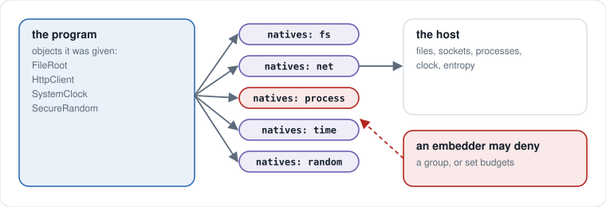

*Figure 21.1. Authority is a value: the program reaches the host only through the objects it was given, and the embedder decides which native groups exist.*

`Reports` is given a `DirectoryLocating`, a role with one action, `path()`,
and builds its file names inside that directory. It has no way to name
another one: there is no `chdir` in std, no global "current directory" that
some other code could change behind its back, and `WorkingDirectory()`, the
process's own directory, is just one more object that does the role and has
to be passed like any other. Two `Reports` with two directories are two
writers with two different authorities, side by side in one program.

`FileRoot` takes the same idea down to the operating system. It opens its
directory once, as a descriptor, and resolves every later path relative to
it, segment by segment, so a name like `../../etc/passwd` or a symbolic
link planted by another process cannot lead outside: "coordinates never
become joined ambient paths", as its module says. The children it returns
hold descriptors of their own and stay valid after the root is closed.

This is the *object-capability* discipline, named by Mark Miller in his
work on the E language [[Miller 2006](#ref-miller2006)] and older than it: Dennis and Van Horn
described capabilities as unforgeable references that carry the right to
use what they designate [[Dennis 1966](#ref-dennis1966)]. In a capability system a function
can affect only what it was given, so reading its parameters tells you what
it can do. Okkama's std follows the discipline where it costs nothing and
the language keeps it honest — objects cannot be forged, fields are
private, roles cannot be downcast (Chapter 14) — but it is a discipline of
the library, not a guarantee of the language: a program may still import
`runtime/fs` and open a path by name, as the example of Section 21.3 did.

### 21.4.1 The environment and the clock

The same discipline covers the two other things a program usually reaches
for without asking: its environment variables and the time.

`Environment` is a snapshot, not a window. `Environment()` reads the
process environment exactly once, when it is constructed, and from then on
the object answers from its own copy; nothing another part of the program
does to the process can change what it says. `Environment(values: …)` makes
one that never looked at the process at all. `addition(name, value)` and
`difference(name)` return new snapshots and leave the receiver as it was,
which is how a child process gets an environment of its own (Section 21.5)
without the parent's changing. A variable is read like a json value (#134):
`text(name)` gives it as a string and throws `MissingEnvironmentVariable`
when it is not set, `int`, `boolean` and `list` read it typed (`list`
splits `PATH`-like values at the platform's separator), and
`maybe(name).text() else "stranger"` reads an optional one in one line. A
variable that is missing and one that is empty are different answers:
`membership` asks the first question, `text` the second. A name with `=`
or NUL in it is refused before any snapshot can hold it.

Time comes through a role. `Timing` has three actions — the wall-clock
`instant()`, the `monotonic_instant()` that only moves forward, and an
`async wait` — and `SystemClock` is the object that does it with the host's
clocks. Code that measures or waits asks for a `Timing`; a test gives it the
`ManualClock` of Chapter 20, which advances only when the test says so, and
a program can write its own:

```okkama
module bible/authority v1.0.0;

import "io/stdout" take Stdout;
import "os/environment" take Environment;
import "time/clock" take Timing, Instant, MonotonicInstant;
import "time/duration" take Duration;

// A clock that always reads the same instant: what a test or a replay
// hands to code that asks for the time.
object FixedClock does Timing {
    has at is Instant;

    FixedClock(:at);

    instant() is Instant { at; }

    monotonic_instant() is MonotonicInstant {
        MonotonicInstant(origin: at.unix_duration());
    }

    async wait(duration is Duration) is void {}
}

// What a greeting may read arrives as values: it has no other way to reach
// the process environment or the system clock.
object Greeting {
    has environment is Environment;
    has clock is Timing;

    Greeting(:environment, :clock);

    text() is string {
        let name = environment.maybe("USER").text() else "stranger";
        "hello, " + name + ", at " + clock.instant().unix_duration()::Span::seconds.string() + " s";
    }
}

main() is int {
    let noon = Instant(origin: Duration(seconds: 43200.rat()));
    let clock = FixedClock(at: noon);
    Stdout().writeln(Greeting(environment: Environment(values: ["USER": "ada"]), clock: clock).text());
    Stdout().writeln(Greeting(environment: Environment(values: [:]), clock: clock).text());
    0;
}
```

Output:

```text
hello, ada, at 43200 s
hello, stranger, at 43200 s
```

`Greeting` can read exactly two things outside itself, and both are its
fields. Run it twice with two snapshots and one fixed clock, and it prints
two lines that do not depend on who runs it or when. That is the practical
payoff of authority as a value: the parameters of an object are a complete
list of what it can observe, so a test needs no mocking framework and a
replay needs no patched system calls.

The clock keeps one more promise. A monotonic instant carries the *domain*
of the clock that made it, and subtracting or comparing instants of two
domains throws `IncompatibleClock` instead of returning a number that means
nothing: a reading of the manual clock and a reading of the system clock
are not on one line, and std will not pretend they are. An instant made
directly, as `FixedClock` makes its own, belongs to the `explicit` domain.

As with directories, this is the library's discipline, and std does not yet
keep it everywhere. `Environment()` and `SystemClock()` can be constructed
anywhere, and some of std's own modules still do so where they should ask:
the HTTP client and its sessions, TLS, `async/timeout` and the cookie jar
make their own `SystemClock()`, and `os/command` reads `Environment()` to
pass it on. A test of such code cannot hand it a manual clock. Making every
module take its clock and its environment as values is one of the
principles of the standard library's review after 0.5.3 (issue #352).

## 21.5 Running other programs

A program that runs another one describes it first, as a value:

```okkama
let status is Commanding = Command(
    program: Path("/usr/bin/git"),
    arguments: ["status", "--short"],
    environment: environment,
    directory: repository,
);
```

`Command` (`os/command`) holds the program, the exact arguments, the
environment and the directory, and nothing reads the process's own state
behind its back. No shell is involved at any point: each argument reaches
the child as one string, so a file name with a space, a quote or a
semicolon is a file name and not a second command. `Path("git")` without a
directory asks the runtime to look the program up in the `PATH` of the
command's *own* environment. A program that does want to inherit says so
with `InheritedCommand`, which reads the process environment and working
directory when it runs and only then.

`Process` (`os/process`) owns the child of a command: its standard streams,
`signal`, and `async exit()`, which waits for the child without blocking
the other tasks. Constructing a `Process` does not start it; its first
operation does, exactly once. `close()` is idempotent: it stops and reaps a
running child and discards what was left unread. A process handle still
open when the run ends is closed by the runtime like any other
(Section 21.3), so no child outlives the program by accident.

The common case needs neither object spelled out. `Run` (`os/run`, issue
#197) runs a program found on `PATH` with this process's environment and
directory, and gives back what it printed:

```okkama
let branch = await Run("git", ["rev-parse", "--abbrev-ref", "HEAD"]).text();
let finished = await Run("make", ["test"]).completion();   // any exit code
```

`text()` and `bytes()` want exit code 0. Any other end is
`CommandFailed.exited(code, errors)`, carrying what the program wrote to
standard error, so a tool that failed cannot pass for one that printed
nothing. Each stream is kept up to 1 MiB; more is `CaptureLimitExceeded`,
not a silent cut. `Run` inherits the way `InheritedCommand` does, and its
documentation says so; code that must not hand the process's environment to
a child builds a `Command` and captures it with `CommandCapture`, which also
sets the input, the directory and the limit.

A child that has to be talked to rather than waited for is driven through
`Process.streams()` (issue #196). Its input does `AsyncWriting` and
`Closing`; its outputs do `AsyncReading`, with `lines()` for `for await`.
A slow child then holds up only the task that talks to it:

```okkama
let child = Process(command: InheritedCommand(program: Path("sort")));
await child.streams().input().write("pear\napple\n");
child.streams().input().close();
for await child.streams().output().lines() -> line {
    Stdout().writeln(line);    // apple, then pear
}
```

The design leaves out what the shell gives for free and what most process
APIs inherit by default: globbing, word splitting, redirection syntax, an
implicit environment. Each of them is a way for data to become code or for
one part of a program to act with another part's settings. A command
built from values carries exactly what it was given.

### 21.5.1 Process workers

Section 20.4 introduced process workers: `spawn` of a synchronous action runs it in another process, in parallel with the program. The process boundary determines what it can receive and return.

**The worker runs the same program.** It runs one action instead of `main`, with the parent’s environment and working directory. It receives a receiver and arguments but no objects, open handles or tasks from the parent.

**Only values cross.** The receiver's fields and the arguments are encoded in
the parent and decoded in the child: `int`, `float`, `string`, `char`,
`byte`, `bool`, and arrays and maps of them. An object cannot cross, because
an object is an identity (Chapter 12), and an identity does not survive a
copy into another address space; a future, a closure or a native handle is
the same kind of thing, and a `spawn` given one fails at once with
`spawn cannot transfer …`, before any process starts. A worker that
needs a file gets the path, not the open `File`. It opens the file itself,
with the authority it was started with.

**A failure comes back as text.** If the action fails, its failure is
written into the reply as a description, and `await` of the future raises a
runtime failure with that text. The failure's object stays in the worker.
`catch e is ParseError` in the parent does not match a `ParseError` thrown
in a worker. This is the same rule seen from the other side: the error
object is an identity too. A worker that should report several kinds of
outcome returns them as data, an enum of results, which does cross.

**Cancellation kills the worker.** Unlike an async task, a synchronous worker has no suspension points for cooperative cancellation. Cancelling its future kills it; the future settles as `Cancelled` only after the worker has ended. A worker cancelled before starting is never started. Its `defer`s and `destroy`s do not run. If cleanup matters, pass it a deadline and let it finish cooperatively instead.

**Output is passed on whole.** What the action prints reaches the parent's
standard output and error when the worker reports back, before its result,
so the output of one worker is never interleaved with another's line by
line. A killed worker reports nothing, and its output is dropped with it.

The narrowness is deliberate, and other languages show what the wider
designs cost. Python's `multiprocessing` pickles arbitrary objects across the
boundary, which makes an object in the child a
look-alike of one in the parent: equal-looking, separately mutable, and
silently out of date. Erlang processes share nothing and exchange only
values, as Okkama's workers do, but they live inside one runtime and are
cheap enough to create by the million [[Armstrong 2003](#ref-armstrong2003)]; an Okkama worker is
an operating-system process, costs what one costs to start, and is meant for
CPU-bound or blocking work, not for modelling every concurrent activity.
Concurrency inside a run is Chapter 20's tasks; workers are for using
another core.

### 21.5.2 The program's own streams

The streams a program is born with are handles too, and two of their
defaults changed in 0.5.5.

Standard output is buffered (issue #132). A terminal receives complete lines; pipes and files receive blocks of 64 KiB. `Stdout().flush()` writes pending output. Pending output is also flushed before writing standard error, reading terminal input, starting a child process, writing to the terminal and ending the program. Use `flush()` when a reader must see a partial line promptly.

Standard input is read by lines (issue #221):

```okkama
for Stdin() -> line {
    if line.starts_with("#") { next; }
    Stdout().writeln(line.upper());
}
```

A line loses its LF and the one CR before it. Invalid UTF-8 fails by default; `Stdin(decoding: InputDecoding.lenient)` replaces bad sequences with U+FFFD. `Stdin().chunks(size: 65536)` reads bytes. All `Stdin()` values share one input position, so a program may read a header by lines and then the remaining bytes without losing intervening data.

## 21.6 What an embedder can deny

A program run by `okkama run` may use every native. A host running plug-ins or user scripts may restrict the native groups available to a run:

| group | what it reaches |
|---|---|
| `Fs` | files, directories, file snapshots, SQLite databases |
| `Net` | sockets, TLS, PostgreSQL |
| `Process` | child processes, and the process workers of Chapter 20 |
| `Env` | environment variables, users and groups, host facts, the local time zone |
| `Clock` | wall and monotonic clocks, sleeping |
| `Random` | secure random bytes |
| `Terminal` | the controlling terminal and standard input |

Every native of `runtime/*` belongs to one group or to none. The ones in
none compute without reaching the host — UTF-8, hashing, number parsing —
or write to standard output and standard error, and they are always
allowed. A call to a native of a group the host did not allow fails the
program at that call: `Native runtime/time@1::wall_clock/0 needs the Clock
permission`. Because every
effect passes through some native (Section 21.1), the list of groups is
the whole list of what the program can do outside itself; an embedder that
allows only `Clock` has a program that can read the time and print, and
nothing else.

A host may also set step, memory and output budgets and interrupt a run. Exhaustion or interruption stops it with an uncatchable report (Chapter 10); cleanup does not run after a budget stop.

A host restricting native groups refuses unclassified natives too. Finer authority, such as access only below one directory, is expressed by passing a `FileRoot` (21.4).

## 21.7 The command line keeps the user's authority

From the command line Okkama does not sandbox anything. A program has the
authority of the user who runs it, as a Python, Perl or Go program does,
and the security model says so plainly. The native groups are an
embedding feature; there is no `--allow-read` flag.

Other systems put the boundary elsewhere. Deno runs a script with no
access at all and asks for flags such as `--allow-read=./data` and
`--allow-net=example.org` [[documentation 2024](#ref-deno)]. WebAssembly's system interface gives a
module only the directories the host pre-opens for it, as descriptors, the
way `FileRoot` works [[Interface](#ref-wasi)]. Java went the opposite way: its Security
Manager, which checked permissions on every sensitive call inside one
process, was deprecated for removal in Java 17, because few programs used
it and every library had to be written for it [[OpenJDK 2021](#ref-jep411)]. Okkama's choice
sits between them. Inside the language, std passes authority as values
(Section 21.4), and a host that embeds the runtime can cut whole groups.
Below that, the operating system does the isolating: a container, a jail,
a user without rights. The boundary is drawn there because an
interpreter-level sandbox is only as strong as its least careful native,
and each native must respect the host’s policy.

## 21.8 Limits

- **Authority is a library discipline.** `DirectoryLocating`, `FileRoot`
  and `Command` make authority explicit, but `runtime/fs` and the other
  substrate modules can be imported directly. Nothing in the language stops
  a module from reaching a native its parameters did not grant.
- **No per-call permissions.** A native group is allowed or not for the
  whole run; there is no "this directory only" at the embedding level. A
  host that needs it gives the program a `FileRoot` instead.
- **Process workers need `Process`.** A host that denies child processes
  also denies the `spawn` of a synchronous action (Chapter 20.4).
- **Natives are looked up at the call.** A program that declares a native
  nobody provides starts and fails only when it calls it (Section 21.1).

## 21.9 What this design costs

The narrow native boundary costs copies when large strings or byte arrays cross by value. Explicit authority costs parameters: code reading a file takes an object that names where it may read. The command line’s full authority leaves isolation to the host.

The design gives a short answer to “what can this program do”: the natives its imports reach, filtered by the groups its host allows.

# Chapter 22. The standard library and its style

A language is learned from its grammar and lived in through its library.
Most of the code a programmer reads in Okkama is not `match` and `once let`
but calls into `std`: a file opened, a request answered, a date printed. If
those calls disagree with each other in shape, every module has to be learned
from scratch, and the economy the language bought with its small grammar is
spent again in the library. This chapter is about the shape the Okkama
library takes, why, and what it costs.

## 22.1 Why a library needs a style

By the end of 0.5.3, `std` had grown to 537 modules and 6.7 MB of source. Of
those, 404 were ordinary code, 64 were the substrate that talks to the
runtime (`std/runtime` and the natives), and 69 were generated tables of
locale data. The library worked, and every module had tests, but its owner's
verdict before the 0.5.4 review was blunt: it was awkward to use, with
objects nested in "matryoshkas" that were hard to read and harder to find
one's way in, and it was inefficient, with odd structures and detours.

The review that followed (issue #352) did not add features. It read every
module against one written set of principles, `docs/std-principles.md`, and
kept, simplified or rewrote it in place; nothing was removed from the
library or moved into a package. The principles are the subject of this
chapter. They are not a style guide in the sense of where braces go; they
say what an object in the library is for, how it answers, and how much a
caller should have to write.

Libraries have always been where a language's ideas are tested. Smalltalk-80
shipped its class library as part of the system and taught the language
through it [[Goldberg 1983](#ref-goldberg1983)]. Java's first collections, `Vector`, `Hashtable`
and `Enumeration` in 1996, were joined two years later by a Collections
Framework designed as one piece, and the two styles have lived side by side
ever since. Python codified the tone of its library in a short list of
aphorisms [[Peters 2004](#ref-peters2004)], and the standard book on Go teaches the language
largely through its standard packages [[Donovan 2015](#ref-donovan2015)]. Okkama's principles are its own, but the problem they answer
is old: a library that grows module by module, by different hands, drifts
into many small dialects unless something holds it together.

## 22.2 The reference: `json`

Three modules were rewritten first, as exemplars for the rest: `json`,
`fs/file` and the HTTP client. `json` is the one this chapter returns to,
because it is small enough to read in full and touches every principle.

```okkama
module bible/json_reference v1.0.0;

import "io/stdout" take Stdout;
import "json" take Json, JsonField, ParsedJson, JsonError;

// An order arrives as text, is read without casts, and a reply is built and
// written by the runtime in one call.
object Line {
    has sku is string;
    has qty is int;
    Line(:sku, :qty);

    string() is string {
        sku + " x" + qty.string();
    }
}

main() is int {
    let out = Stdout();
    let order = ParsedJson("{\"id\": 4711, \"customer\": {\"name\": \"Ada\"}, \"items\": [{\"sku\": \"tea\", \"qty\": 2}, {\"sku\": \"cake\", \"qty\": 1}]}").root();
    out.writeln("order ", order.int("id"), " for ", order.get("customer").text("name"));
    out.writeln("note: ", order.maybe("note").text() else "none");
    let lines = order.list("items").map() -> item { Line(sku: item.text("sku"), qty: item.int("qty")); };
    for lines -> line {
        out.writeln("  ", line.string());
    }

    let reply = Json(JsonField("id", 4711), JsonField("state", "accepted"), JsonField("lines", lines.size()));
    out.writeln(reply.string());

    let refused = try {
        order.text("id");
    }
    catch JsonError.wrong_kind(pointer, expected, actual) {
        "wrong kind at " + pointer;
    };
    out.writeln(refused);
    0;
}
```

Output:

```text
order 4711 for Ada
note: none
  tea x2
  cake x1
{"id":4711,"state":"accepted","lines":2}
wrong kind at /id
```

Everything a caller does with a JSON document is in those twenty lines.
`ParsedJson(text).root()` parses once; the result is a `Json`, one immutable
value whatever its kind. Reading asks the value a question and gets an
Okkama value back: `order.int("id")` is an `int`, `order.get("customer")` is
another `Json`, `order.list("items")` an array of them. There is no cast and
no intermediate "node" object to unwrap. An optional member is read with
`maybe(name)`, which answers a `Maybe` for each kind, so the default is
written where the value is used: `order.maybe("note").text() else "none"`.

Writing uses the same object built in code: `Json(JsonField("id", 4711), …)` holds members in order; `string()` returns compact text and `pretty(2)` indents it. Numbers are exact, never `float`: a JSON number reads as an `int`, a `BigInt` or a `Decimal`.

Everything that goes wrong is a `JsonError`, and every case names the value
it is about by its RFC 6901 pointer [[RFC 6901](#ref-rfc6901)]. Asking for text where the
document has a number is `JsonError.wrong_kind("/id", …)`, a missing member
is `JsonError.missing`, a number that does not fit the integer asked for is
`JsonError.invalid_number`. Parsing is strict RFC 8259 [[RFC 8259](#ref-rfc8259)]: member
order is kept, a repeated name is an error rather than a silent overwrite,
and nesting stops at 128 levels unless the caller allows more.

## 22.3 Objects are mechanisms, not records

The first principle is stated in the owner's own words in the document that
governs the library: write object code, avoid accessors and mutators,
delegate to an object its own actions, and do not turn an object into a
nominal structure of data; it should be a working mechanism, a box that does
something and hands out a result.

Five rules follow from it.

- **Tell, don't ask.** Code that reads three fields of an object and
  computes something from them belongs inside that object, as an action.
  The idea is older than Okkama: it is the "Law of Demeter" of Lieberherr
  and Holland [[Lieberherr 1989](#ref-lieberherr1989)], and the core of the object style the
  language takes from Elegant Objects [[Bugayenko 2016](#ref-bugayenko2016)].
- **An object knows what it gives, and in what form.** A caller never wraps
  an answer in a decoder or a formatter to use it. A captured process
  answers its output as text through a cap, `done::Captured::output`, and
  as exact bytes through another, `done::Bytes::output`; an instant answers
  `instant.string()`; a date answers `date.days_until(other)`. Decoders and
  formatters still exist for the rare explicit case, and the object uses
  them inside its own actions.
- **An object reveals itself through a cap** (Section 12.8). What callers
  may see of an object is a cap of computed fields, named for the part it shows:
  `page::Head::status`, `date::Calendar::year`, `range::Bounds::start`. A
  cap holds only what is already computed or trivially computable; work —
  opening a stream, parsing a body — stays an action: `file.text()`,
  `response.body()`.
- **Constructors bind; actions compute.** A constructor checks its
  arguments with `confirm`, so that an invalid object never exists, and
  binds them. Sorting, parsing and counting move into a hidden action whose
  `once let` keeps the answer (Chapter 13): `Sorted(xs)` binds `xs` and
  sorts on the first question. A constructor never calls other objects or
  touches the outside world.
- **No mutators, no records.** A "with" action that changes one field is a
  mutator in disguise; the library prefers the action the change was for,
  `money.plus(other)` rather than `money.with_cents(…)`. An object whose
  actions are mostly accessors is a record with a constructor, and the
  review either gave it behaviour or folded it into the object that used it.

Data that really is data still answers questions rather than exposing
columns: a parsed `Accept-Encoding` header answers
`AcceptedContentCodings("gzip;q=0.8, br").preference([ContentCoding("gzip"),
ContentCoding("br")])` with the coding to use, `br`, not with a list of
tokens and their weights.

## 22.4 Flat, short, one way

The second principle is about how much the caller writes. A common task
takes one to three lines; if it takes more, the module is missing an entry
point. Before 0.5.4, reading an integer argument took four constructors
nested in one expression:

```okkama
Number(Utf8Arguments(ProcessArguments()).item(0)).int()
```

After the review the command-line module hands the program a parsed call,
and the same question is one action, `call.int("port")`, which answers
`Maybe<int>`. Three or more constructors nested to do one thing is what the
principles call a matryoshka, and it is treated as a missing object, not as
a style to put up with.

Several rules keep the surface flat.

- **One way to do each thing.** A second way needs a reason written in the
  module's comment. The one second way allowed everywhere is a shortcut for
  a common verb, and a shortcut builds the general form and nothing else:
  `client.get(url)` is `client.response(Request(url: url))`.
- **Fold what only forwards.** An object that only passes calls on, or a
  view with two actions, joins its neighbour, and one constructor with
  defaults replaces a family of overloads. The rule has a limit: an object
  with twenty-five actions is no improvement.
- **Named arguments and safe defaults.** Constructors in std take named
  arguments, `File(path: Path("notes.txt"), mode: FileMode.appending)`,
  except a constructor of a single value, where a name adds nothing:
  `Path("notes.txt")`. Every part with a sensible default has one, and the
  defaults are the safe ones. `HttpClient()` works as written, reaches only
  public endpoints and follows no redirects; a special case names only what
  differs.
- **Named numbers are enums.** An HTTP status with a registered name is a
  case, `Status.not_found`; the rest of 100–599 is `Status.other(418)`. One
  converter, `StatusCode`, goes to and from the wire, and it refuses `other`
  for a number that has a name, so every status has exactly one spelling.
- **`for`, not closures.** A sequence is walked with `for source -> item`.
  There is no `each(fn)`: a JSON object is walked by its names,
  `for doc.names() -> name { … }`, and rebuilt with `map`.
- **One name, one meaning.** An action never returns an iterator in one
  module and an array under the same name in another. Actions that answer
  are nouns, `lines()`, `content()`; verbs are commands that answer
  nothing, `write`, `close`. An object that computes one thing has no
  `value()` or `result()`: its action names the answer,
  `DaysBetween(left: a, right: b).count()`, `Crc32(bytes).checksum()`, or is
  an adjective when the answer is yes or no, `FileEncoding(name).supported()`.
  When the review started, 406 actions answered under a generic name; they
  were renamed module by module.
- **No dependency cycles.** A domain's errors live in a module below
  everything that throws them, such as `fs/error`, and a lower concept never
  imports a higher one.

Each of these rules alone would be a matter of taste. Together they make
the library predictable: a reader who has met `json` can guess the shape of
`http` or `time` before opening them, which is the reason to have a style at
all.

## 22.5 Readable and efficient

Two shorter principles keep the library honest about what it costs to read
and what it costs to run.

**Readable.** Every module is formatted by `okkama fmt`, so a reader never
meets a module written as one long line. Each public object carries a
comment with a short example of its common use, and the examples are
checked to compile. Names say what an object does and what an action does
to the world or returns; there is no `Manager`, `Helper` or `Util`, the
words a library reaches for when it has not decided what an object is for.
The comments are also the source of `okkama man`, described later in this
chapter, so a
module that is documented in its source is documented everywhere.

**Efficient.** The library is the code most programs spend their time in,
so its costs are everyone's costs. Four rules govern them.

- *No quadratic growth.* Build collections with builders or `reduce`; `acc + [x]` in the supported accumulator pattern has amortized constant append cost (Section 8.5).
- *Measured.* Measure hot paths on release builds.
- *Natives where needed.* Use them for host services or demonstrated performance needs; keep ordinary parsing in Okkama unless measurements justify otherwise.
- *No fixed cost per call.* Parse a table, pattern or template once when its object is built, not at every use.

## 22.6 Explicit authority, no global state

Chapter 21 showed the mechanism: a directory, an environment and a clock
are objects, and code can touch only the ones it was given. For the
library this is a rule with four parts.

- What a module may touch arrives as a value: a `DirectoryLocating` for
  where it writes, an `Environment` snapshot for what it reads from the
  process, a `Timing` for what time it is.
- No process-wide mutable state. A module keeps nothing between calls that
  another module could change: no registry of handlers, no default locale
  set from somewhere else, no cache another part of the program can fill.
- No `chdir`-like operations, nothing that changes what a relative name
  means for everyone at once.
- Tests can pass fakes and manual clocks, because nothing in a module
  reaches past its parameters for the real ones.

The common case stays short through a default, not through an ambient
source. Twenty signatures in std, across the HTTP client and server,
JWT, logging, mail, web sessions and `Now` and `Today`, take a clock as
`clock is Timing = SystemClock()`: the JWT token checks its expiry with
it, the mail message stamps its date, the HTTP client measures its
timeouts. A program writes `HttpClient()` and gets the system's clock; a
test writes `HttpClient(clock: ManualClock(…))` and gets one it controls.
The default is visible in the signature, and `okkama man` prints it, so
the authority is still a value: it is just one the caller did not have to
spell.

The rule is the library's, not the language's (Section 21.4): a program
can still construct a `SystemClock()` anywhere it likes, and so, in a few
places, does the library: some HTTP and TLS constructors still make their
own clock (Section 21.4). Those are the exceptions the rule is meant to
remove; everywhere else the clock is the caller's value.

## 22.7 Failures and asynchrony

A library speaks to its caller twice: in what it returns and in what it
throws. The second voice gets the same care as the first.

**One error type per domain.** Each domain has one error enum, declared as
`enum X is Error = (…)`, whose cases say what went wrong: a missing file is
`FileError.not_found(path)`, a JSON value of the wrong kind is
`JsonError.wrong_kind(pointer, …)`, a status number with a registered name
given as `other` is `InvalidStatus.named(code)`. The cases carry what the
caller needs to act — the path, the pointer, the refused value — and never
only a message to be parsed. The enum lives in a module below everything
that throws it, `fs/error` below `fs/file` and `fs/directory`, so throwing
it never creates an import cycle.

**Natives are translated at the border.** The runtime reports a failed
host call as a `NativeFailure` with a short code such as `"not_found"` or
`"would_block"`. That type never leaves a module: the module that called
the native catches it and throws its own domain's error, or, when the code
means something ordinary, turns it into an ordinary answer. `File.lock`
does both: `"would_block"`, another lock in the way, becomes `Maybe.none`;
anything else goes through `FileFailure`, in `fs/error`, which turns it into
the `FileError` that names the path.

**Async only where something waits.** An action is `async` when it waits
for I/O, a timer or another task, and only then; a parser or a formatter is
never `async`, however large its input. Releasing a resource at the end of
a scope where the close waits is an `async destroy` object since 0.6.2,
where that costs no more than the deferred close `defer await
guard.close()` it replaces (issue #329).

## 22.8 Tests

The library is tested where it is written. Every public object has at least one inline `test` (Chapter 15). Before a module changes, characterization tests pin its current behaviour, so a simplification that changes a public result is caught by a test.

Network and asynchronous code is tested against itself rather than against
the outside world: a test opens a `TcpListening` on 127.0.0.1, port 0, and
plays the peer in the same program. Such tests run in a container, like the
gate, so that a test that misbehaves cannot reach the machine around it.

Modules people use directly also have small task examples under `examples/`, each with expected output checked by `examples/check.py`. A test checks correctness; an example checks usability and the documented way to use the library.

## 22.9 Scope: what the library holds

The standard library of Okkama is large on purpose. It holds an HTTP client
and server, a mail stack, TLS, SQLite and PostgreSQL, templates, archives,
locales and a terminal toolkit, beside the collections and the text. A
language this young could have kept its library small and left the rest to
packages; Okkama decided the other way, for a reason specific to it. The
style of this chapter is only worth something if it holds across the code
a program actually calls, and a library that stops at `json` would leave
most of that code to be written in whatever style its authors chose.

The modules fall into two layers.

- **The foundation** is what everything stands on: `encoding`, `io`,
  `collections`, `compare`, `error`, `async`, `numbers`, `strings`, `time`,
  `fs`, `os`, `cli`, `url`, `json` and `regex`. It is imported most: in
  the release this book describes, `encoding/utf` is imported by 150 of
  std's 499 modules and `collections/sequence` by 115. A mistake here is
  everyone's mistake, so the foundation was reviewed first.
- **The domains** are the large areas built on it: `http`, `mail`, `mime`,
  `i18n`, `cli`, `testing`, `db` and the rest. Before the review they were
  in the worst shape: `http` alone had 102 modules and 543 accessors, `mail`
  236.

One decision shapes the whole review, and it was the owner's, made at its
start: nothing leaves std. No module was deleted or moved into a package;
the long tail — `mail`, `plist`, `xmlrpc`, `archive`, `xml`, `html`,
`template`, `diff`, `statistics`, `calendar` — was improved in place like
everything else. Two modules that did the same thing were merged, keeping
what each could do. A program written against std before the review finds
every capability it used still there, under the shape this chapter
describes.

## 22.10 Reading like json, everywhere

The `json` reference of Section 22.2 did more than fix one module. Its way
of reading — ask a value for a member by name, get back an Okkama value of
the kind you asked for, with `maybe(name)` for what may be absent — became
the vocabulary of every structured source in std.

| source | a required value | an optional one | when it is missing |
|---|---|---|---|
| JSON | `doc.int("id")` | `doc.maybe("note").text() else "none"` | `JsonError.missing` |
| URL query (#134) | `query.int("page")` | `query.maybe("limit").int() else 20` | `MissingQueryParameter` |
| TOML (#140) | `config.get("server").int("port")` | `config.maybe("debug").boolean() else false` | `MissingTomlMember` |
| plist (#141) | `info.text("CFBundleIdentifier")` | `info.maybe("LSUIElement").boolean() else false` | `MissingPlistMember` |
| CSV (#202) | `record.int("age")` | `record.maybe("note").text() else ""` | `MissingCsvValue` |
| environment | `env.text("HOME")` | `env.maybe("PORT").int() else 8080` | `MissingEnvironmentVariable` |

The readers have the same names and the same meanings in all six: `text`,
`int` and `boolean` read one typed value and throw the domain's own error
when it is not there or is not of that kind; `list` reads all values of a
name; `get` steps into a nested value; `maybe` turns the question into a
`Maybe`, so the default sits where the value is used. Each domain keeps
what is its own — a query parameter may be given twice and `list` reads
every occurrence, a CSV field that is empty reads as absent, TOML has
arrays of tables walked with `for config.tables("replica")` — but none of
them invents a second word for the same act.

The payoff is the one Section 22.4 promised. A reader who has seen
`doc.maybe("note").text() else "none"` reads a configuration file, a query
string and an environment the same way, without opening a manual.

## 22.11 Whole or in pieces

A source that can be read whole and in pieces says so with the same words
everywhere. A whole text file is `content()`, its lines are `lines()`, and
`for file.text() -> batch` walks it in batches; a reply is
`await page.text()`, `bytes()` or `json()` whole and `reading()` in pieces.
The words do not change from module to module, and neither do the rules
behind them.

**One loop for every stream.** A consumable source that is not an array
does the role `Batching<T>`: it hands out its items a batch at a time, an
array per batch, and an empty array ends it. `for`, `map`, `filter` and
`reduce` walk such a source as they walk an array, asking for the next
batch when one runs out (#465). A file of text, a socket and a stream of
directory entries are all walked with the same `for`, and none of them has
to allocate an object per item, as a cursor would.

**Read to the end, carry across.** Two objects in `io/transfer` replace the
read loop modules used to repeat (#130): `ReadUntilEnd(origin: reader,
limit: …)` reads a source to its end and refuses one longer than the
limit, and `Copy(from: reader, to: writer)` carries every byte across, 64
KiB at a time, and answers how many it carried. Both accept a synchronous
or an asynchronous source; neither flushes nor closes anything it was not
asked to.

**Structured data in pieces.** `json` reads a stream item by item with
bounded memory (#136): `for await JsonItems(origin: upload) -> item` walks
the elements of one top-level array or a sequence of values (NDJSON), each
item parsed whole and read as in Section 22.10, and `JsonLines` writes
values one per line. A broken stream is a `JsonError` at the byte offset
where it broke, so a log of a million records fails at the one that is
wrong, not at an offset nobody can find.

**Writing is one operator.** Anything that has bytes — a string, an
`@byte`, an encoded value — is a `ByteSource`, and `writer <- part` writes
it; a chain such as `writer <- "header: " <- payload <- "\n"` reads left
to right and stops at the first failed write. A write takes the whole
source or throws `IncompleteWrite.after(written)` with the number of bytes
taken; it never retries, flushes or closes behind the caller's back.

## 22.12 `okkama man`: the reference lives in the source

The library is documented where it is written. A module's comments are
plain `//` lines in CommonMark, placed above what they describe: the
module's opening comment explains what it is for and shows the common use,
and each public object and action carries a sentence or two of its own.
There is no second copy of the reference to keep in step. `okkama man`
reads the comments and the declarations together and prints a page (#512):

```text
$ okkama man json
NAME
    json - JSON values: one immutable Json, parsed or built in code, read
    without casts and written by the runtime in one call.

VERSION
    v1.0.0

SYNOPSIS
    import "io/stdout" take Stdout;
    let order = ParsedJson("{\"id\":4711}").root();
    Stdout().writeln(order.int("id").string());
    …
```

A page has the parts a Unix manual page has: the name and its one-line
summary, the version, a synopsis taken from the module's own example, the
description, the public API — every object, role and action with its
signature, defaults included — and the errors the module throws. `okkama
man json Json.int` narrows the page to one action; `okkama man` alone lists
std; `--format markdown` gives the same page as Markdown, and a module of
the program's own, `okkama man ./src/app.ok`, is documented the same way.
The language server shows the same text on hover, from the same comments,
so a programmer meets one description of an action whether they read the
source, the terminal or the editor.

The rule this sets for the library is short: a public name without a
comment is a defect, and an example in a comment is code that must
compile. Section 22.5 asked for both; `okkama man` is what makes the asking
worth it.

## 22.13 Other libraries, other answers

Every library answers the same few questions, and comparing the answers
shows what Okkama's are for.

*How does a caller read structured data?* Go's `encoding/json` decodes
into a struct whose fields carry tags, so the shape of the data is declared
once, as a type, before the data arrives [[Donovan 2015](#ref-donovan2015)]. Python's `json`
returns dictionaries and lists, so the shape is never declared and every
read is a lookup that may fail anywhere. Okkama sits between: `Json` is one
value of any kind, and the caller declares the shape at the point of each
read — `int("id")`, `list("items")` — with the error naming the pointer
where the shape did not hold. There is no struct to keep in step with the
data, and no untyped dictionary to cast.

*Where do defaults live?* Java's libraries long answered with overloads
and, later, builders [[Bloch 2018](#ref-bloch2018)]; Python with keyword arguments and
defaults in the signature. Okkama took Python's answer and made it the
rule: named arguments with defaults, so the common case is the empty
constructor and a special case names only what differs (Section 22.4).

*How does the library reach the world?* Most libraries reach it directly:
`time.Now()` in Go, `datetime.now()` in Python, `System.currentTimeMillis()`
in Java. Testing such code means patching the world. Okkama's library asks
for the world as a value (Section 22.6), which is the object-capability
answer, and it is the one place where std is stricter than all three.

*How many ways are there to do a thing?* "There should be one — and
preferably only one — obvious way to do it" is a line of the Zen of Python
[[Peters 2004](#ref-peters2004)], which the Python library itself does not always keep.
Okkama writes the rule into the library's principles and makes a second
way justify itself in the module's comment, which turns a slogan into a
review checklist.

*What is an object for?* Here Okkama is furthest from the mainstream and
closest to Smalltalk [[Goldberg 1983](#ref-goldberg1983)] and to Elegant Objects
[[Bugayenko 2016](#ref-bugayenko2016)]: an object is a mechanism that answers questions, not a
record with getters (Section 22.3). The mainstream libraries are full of
data carriers, and they work; Okkama's bet is that a library without them
reads better and changes more safely, and the review of 0.5.4 was the
first large test of that bet.

## 22.14 What the style costs

A style that removes accessors, overloads and second ways has costs, and
they should be named.

- **More objects.** A question that another library answers with a field
  read becomes an object with an action: `DaysBetween(left: a, right: b)`
  where Python writes `(b - a).days`. Each is small, but there are more of
  them to name and to find, and `okkama man` is part of the answer to the
  finding.
- **Less familiar shapes.** A programmer arriving from Java looks for
  `getStatus()` and finds a cap, `page::Head::status`, or an action named
  for its answer. The shape is learnt once, but it is learnt.
- **Renames have a price.** Making one name mean one thing renamed 406
  actions across std in one review. Programs written before 0.5.4 had to
  follow; the library pays this kind of cost in bursts rather than in
  small drifts, and it is why the review happened before a 1.0 that would
  have frozen the names.
- **The rules are a discipline, not a proof.** The compiler enforces the
  language — private fields, no downcasts, typed failures — but not that a
  module asks for its clock or reads like `json`. Those hold because the
  library is reviewed against written principles, and a module written
  outside std can ignore them.

None of these costs is large next to the alternative, a library that every
programmer has to learn one module at a time. But they are the reason the
principles are written down: a style that is only remembered drifts, and a
library of 499 modules drifts fast.

## 22.15 Codecs: one object per direction

The encoding modules show the style at its smallest. Every codec is two
objects, named for what they hold once the work is done:
`Base64Encoded(origin: bytes).string()` is the text, and
`Base64Decoded(origin: text).bytes()` the bytes; `Utf8Encoded`,
`Utf8Decoded`, `QuotedPrintableEncoded`, `Base85Decoded` and the rest
follow the same shape. Choices that vary — an alphabet, a byte order — are
named arguments with a default (`Base64Alphabet.url`, `ByteOrder.little`),
never a second family of objects.

Decoding is strict. Input that is not exactly the encoding fails with the
domain's error, carrying the offset of the first violation:
`InvalidBase64.at(offset)`, `InvalidUtf8.at(offset)`. Offsets count Unicode
scalars for text inputs and bytes for byte inputs, so they point at what a
person sees in the input. There is no "lenient" mode that repairs, skips or
replaces: a decoder that guesses produces data nobody asked for.

The objects are thin; the work is done by natives, and how well it is done
is not part of the API. 0.5.8 rewrote most of them without changing a
single result: base64 and base32 decode through a lookup table in one pass
instead of a linear search of the alphabet per character (64 base64
characters: 4.2 → 0.37 µs), base85 likewise (64 KiB: 3.4 → 0.29 ms),
quoted-printable encodes in one pass instead of moving every token of a
line (one 64 KiB line: 1.18 s → 0.3 ms), and the validity checks no longer
decode into a buffer they throw away. Each rewrite was first pinned by
tests that pass on the old code — the published behaviour, byte for byte,
was the specification — and then measured. That is the library's
efficiency principle at work: the surface stays put while the cost moves.

## 22.16 A worked example: time zones without the host

Time zones show the library's rules under the most pressure. The rules change
by government decree, the host's database may be out of date, and local
times can be missing or repeated. `time/zone` answers every question from a
database bundled with the toolchain and never from the machine it runs on.

```okkama
module bible/zones v1.0.0;

// Time zones from the bundled IANA database, never from the host: one call
// placed in Kostanay and read in three other cities, a wall time that a
// clock change skips, and the database version the answers depend on.
import "io/stdout" take Stdout;
import "time/zone" take Zone, ZonedDateTime, MissingLocalTime, TimeZoneDatabaseVersion;
import "time/iso" take IsoText;

main() is int {
    let out = Stdout();
    let home = Zone("Asia/Qostanay");
    let call = home.instant(IsoText("2026-12-01T19:00:00").local_date_time());
    out.writeln("the call, UTC:    " + call.string());
    for ["America/New_York", "Europe/Berlin", "Asia/Tokyo"] -> name {
        let there = ZonedDateTime(instant: call, zone: Zone(name));
        out.writeln(name + ": " + there.local_datetime().string() + " " + there.abbreviation());
    }
    let skipped = try {
        Zone("America/New_York").instant(IsoText("2026-03-08T02:30:00").local_date_time()).string();
    }
    catch e is MissingLocalTime {
        "2026-03-08 02:30 in New York: " + e.text();
    };
    out.writeln(skipped);
    out.writeln("tzdata " + TimeZoneDatabaseVersion().string());
    0;
}
```

Output:

```text
the call, UTC:    2026-12-01T14:00:00Z
America/New_York: 2026-12-01T09:00:00 EST
Europe/Berlin: 2026-12-01T15:00:00 CET
Asia/Tokyo: 2026-12-01T23:00:00 JST
2026-03-08 02:30 in New York: MissingLocalTime.zone("America/New_York")
tzdata 2026c
```

- **Deterministic answers.** `Zone("Asia/Qostanay")` reads the bundled IANA
  database (2026c) and never the host's configured zone or files. The same
  program gives the same answer on every machine, and
  `TimeZoneDatabaseVersion()` says which rules it used. That matters here:
  Kazakhstan moved Qostanay and Almaty from UTC+6 to UTC+5 on 1 March 2024,
  a change shipped in tzdata 2024a [[IANA](#ref-iana2024a)]. A host with older data
  would place the 19:00 call an hour off. With the database bundled, the
  rules change only when the toolchain does, and the change is visible.
- **The zone is a value.** Converting an instant to local time takes a
  `Zone` argument. There is no "local" default to read from an environment
  variable (Section 22.6).
- **A missing local time is a failure, not a guess.** On 8 March 2026,
  New York's clocks jump from 02:00 to 03:00, so 02:30 does not exist that
  day. `instant` throws `MissingLocalTime` instead of choosing a nearby
  moment. A repeated time in autumn takes the earlier instant unless the
  call says `fold: Fold.later`, so the choice is written in the code.

Other libraries make other choices on each of the three points.

- **Python.** `zoneinfo` reads the system database, or the `tzdata`
  package where the system has none [[PEP 615](#ref-pep615)]. A wall time in a gap is not
  an error: PEP 495's `fold` attribute picks the offset from before or
  after the transition [[PEP 495](#ref-pep495)].
- **Java.** `java.time` ships its own copy of tzdb with the runtime, updated
  with the JDK. `ZonedDateTime.of` resolves a gap by shifting the local time
  forward by the length of the gap [[Java SE documentation](#ref-javazdt)].
- **Go.** `time.LoadLocation` reads the host's zoneinfo. A program that
  imports `time/tzdata` embeds a copy instead [[Go documentation](#ref-gotzdata)].

Okkama takes Java's bundled database and refuses Java's and Python's
silent adjustment of a gap. The cost is a `try` around conversions of user
input, and a toolchain update to receive new rules. What it buys is the
library's promise in a domain where it is hardest to keep: an answer that
does not depend on where the program happens to run.

## 22.17 The families on tasks

The rules of this chapter hold across the whole library. This section shows
the families one task at a time, each with the smallest program that does
something useful with it. Every family answers in the form people use and
reports its failures as its own named errors.

### Tables: `csv`

```okkama
module bible/csv v1.0.0;

// CSV with a header: a record is read by column name, and rows are printed
// back with the quoting the format needs. The dialect (separator, quote,
// line end) is a value; the default ends lines with CRLF, this one with LF.
import "csv" take CsvDialect, CsvRecords, CsvString;
import "io/stdout" take Stdout;

main() is int {
    let out = Stdout();
    let lines = CsvDialect(",", "\"", "\n");
    let orders = CsvRecords("item,qty,note\ntea,2,\"green, loose\"\ncake,1,\n", lines);
    let total = orders.reduce(0) -> sum, record { sum + record.int("qty"); };
    for orders -> record {
        out.writeln(record.text("item") + " x" + record.int("qty").string() + " [" + record.text("note") + "]");
    }
    out.writeln("total " + total.string());
    let rows is @@string = [["item", "note"], ["tea", "green, loose"], ["quote", "say \"hi\""]];
    out.write(CsvString(rows, lines).string());
    0;
}
```

Output:

```text
tea x2 [green, loose]
cake x1 []
total 3
item,note
tea,"green, loose"
quote,"say ""hi"""
```

`CsvRecords` reads a document with a header, and each record answers by
column name (`record.int("qty")`), so the program never counts columns.
`CsvString` writes rows back and quotes only what needs quoting: the field
with a comma, and the field with a quote, whose quote doubles. The dialect
(separator, quote and line end) is a value passed to both sides. The
default ends lines with CRLF, as RFC 4180 does, so a document with bare
`\n` lines needs its own dialect. A malformed document is refused whole:
`InvalidCsv` names the offset, and no partial rows are ever handed out.

### Addresses: `url`

```okkama
module bible/url v1.0.0;

// A URL taken apart through its cap, its query read by name, and a relative
// reference resolved against it (RFC 3986).
import "url/value" take ParsedUrl;
import "url/query" take ParsedQuery;
import "io/stdout" take Stdout;

main() is int {
    let out = Stdout();
    let page = ParsedUrl("https://ada@example.org:8443/docs/guide/intro?lang=en&v=2#start").parts();
    out.writeln(page::Parts::scheme + " " + (page::Parts::host else "-") + " " + (page::Parts::port else 443).string());
    out.writeln(page::Parts::path);
    let query = ParsedQuery(page::Parts::query else "").parameters();
    out.writeln("lang " + query.text("lang") + ", v " + query.text("v"));
    out.writeln(page.resolved(ParsedUrl("../api/ref").parts()).string());
    out.writeln(page.resolved(ParsedUrl("/").parts()).string());
    0;
}
```

Output:

```text
https example.org 8443
/docs/guide/intro
lang en, v 2
https://ada@example.org:8443/docs/api/ref
https://ada@example.org:8443/
```

`ParsedUrl(text).parts()` takes a URL apart without changing it, and the
parts are read through a cap (Section 12.8): `page::Parts::host` is a
`Maybe<string>`, because a URL may have no host. The query is a separate
object, read by name. `resolved` follows RFC 3986: `../api/ref` from
`/docs/guide/intro` climbs out of `guide`, and the authority stays.

### Bytes: digests and encodings

```okkama
module bible/bytes v1.0.0;

// A digest is a value of an ordered byte history: hashing in pieces gives the
// digest of the whole. Encodings carry bytes as text and back.
import "digest/sha2" take Sha256;
import "encoding/base64" take Base64Encoded, Base64Decoded;
import "encoding/hex" take HexEncoded;
import "encoding/utf" take Utf8Encoded, Utf8Decoded;
import "io/stdout" take Stdout;

main() is int {
    let out = Stdout();
    out.writeln(Sha256("hello world").hex());
    let whole = Sha256("abc").hex();
    let pieces = Sha256().state("ab").state([99.byte()]).hex();
    out.writeln("pieces give the whole: " + (whole == pieces).string());
    let data = Utf8Encoded("Okkama!").bytes();
    let carried = Base64Encoded(origin: data).string();
    out.writeln("base64 " + carried + ", hex " + HexEncoded(origin: data).string());
    out.writeln("back: " + Utf8Decoded(Base64Decoded(origin: carried).bytes()).string());
    0;
}
```

Output:

```text
b94d27b9934d3e08a52e52d7da7dabfac484efe37a5380ee9088f7ace2efcde9
pieces give the whole: true
base64 T2trYW1hIQ==, hex 4f6b6b616d6121
back: Okkama!
```

A digest is a value over an ordered history of bytes. `state(more)` returns
a successor over the longer history and leaves the digest it came from
unchanged, so hashing in pieces gives the digest of the whole without a
mutable hasher. Text is hashed as UTF-8. The encodings come in pairs, one
object per direction (Section 22.15): `Base64Encoded` turns bytes into text
and `Base64Decoded` turns the text back into bytes. Text to bytes is itself
an explicit step (`Utf8Encoded`); no encoding guesses a character set.

### Configuration: `toml`

```okkama
module bible/toml v1.0.0;

// A configuration file read the way json is read: by name, with the type
// asked for at the point of use, and absence decided where it is allowed.
import "toml/parse" take ParsedToml, InvalidToml;
import "io/stdout" take Stdout;

main() is int {
    let out = Stdout();
    let config = ParsedToml("title = \"shop\"\n" +
        "[server]\nhost = \"0.0.0.0\"\nport = 8080\n" +
        "[[mirror]]\nurl = \"https://a.example\"\nweight = 3\n" +
        "[[mirror]]\nurl = \"https://b.example\"\n").root();
    let server = config.get("server");
    out.writeln(config.text("title") + " on " + server.text("host") + ":" + server.int("port").string());
    out.writeln("debug: " + (config.maybe("debug").boolean() else false).string());
    for config.tables("mirror") -> mirror {
        out.writeln(mirror.text("url") + " weight " + (mirror.maybe("weight").int() else 1).string());
    }
    out.writeln(try { ParsedToml("port = 80\nport = 81\n").root().int("port").string(); }
        catch e is InvalidToml { "refused: " + e.text(); });
    0;
}
```

Output:

```text
shop on 0.0.0.0:8080
debug: false
https://a.example weight 3
https://b.example weight 1
refused: InvalidToml.located(10, 2, 1, "duplicate TOML key")
```

`ParsedToml(text).root()` is a table read like a json object: `text`, `int`
and `get` name a key and the type the program wants there, and a key that
may be missing goes through `maybe`, whose answer is a `Maybe` the program
settles with `else`. An array of tables (`[[mirror]]`) is `tables(name)`, an
array of plain tables the loop takes one by one. Nothing is parsed when the
object is made; the text is read at the first question, and a mistake in it
(here a key given twice) is `InvalidToml` with the offset, line and column
of the failed read. TOML's `inf` and `nan` are values of their own
(`TomlInfinity`, `TomlNaN`), never a float, because Okkama's floats are
finite. The module only reads: the library has no TOML writer.

### Documents: `xml`

```okkama
module bible/xml v1.0.0;

// Reading a feed by element and attribute name, then writing a document
// from nodes: the tree is a value, and xml() is its text.
import "xml/parse" take ParsedXml;
import "xml/node" take XmlDocument, XmlElement, XmlText, XmlAttribute;
import "xml/name" take XmlName;
import "io/stdout" take Stdout;

main() is int {
    let out = Stdout();
    let feed = ParsedXml("<feed version=\"2\"><item><title>Tea &amp; milk</title></item>" +
        "<item><title>Bread</title></item></feed>").document().root();
    out.writeln("version " + feed.attribute("version"));
    for feed.children("item") -> item {
        out.writeln("- " + item.text("title"));
    }
    let note = XmlElement(XmlName("note"), [XmlAttribute(XmlName("lang"), "en")], [XmlText("1 < 2")]);
    out.writeln(XmlDocument(note).xml());
    0;
}
```

Output:

```text
version 2
- Tea & milk
- Bread
<?xml version="1.0" encoding="UTF-8"?><note xmlns="" lang="en">1 &lt; 2</note>
```

An element answers by name in the same way: `attribute("version")`,
`children("item")` for the elements with that name, `text("title")` for the
text of the first such child, with the entities already decoded (`&amp;`
reads as `&`). Writing goes the other way, from values: an element is a name,
its attributes and its children, and `xml()` is its text with the escaping
done. Every element's `xml()` stands on its own, so it declares its
namespace even when it has none: that is the `xmlns=""` in the output, and a
fragment cut out of a larger document keeps its meaning. Limits on depth and
on the number of parse events are constructor arguments, as for json.

### Identifiers and media types: `uuid`, `mime`

```okkama
module bible/ids v1.0.0;

// Identifiers and media types: a UUID is read, made from a name, or drawn
// from an explicit source of randomness; a media type is read into parts,
// and a file name is mapped to one by a table the program chooses.
import "uuid/value" take UuidText;
import "uuid/generation" take Uuid5, Uuid4s;
import "random/source" take SecureRandom;
import "mime/media_type" take MediaType;
import "mime/types" take StandardMediaTypes;
import "fs/path" take Path;
import "io/stdout" take Stdout;

main() is int {
    let out = Stdout();
    let given = UuidText(origin: "550E8400-E29B-41D4-A716-446655440000");
    out.writeln(given.string() + ", version " + given.version().string());
    let dns = UuidText(origin: "6ba7b810-9dad-11d1-80b4-00c04fd430c8");
    out.writeln("stable: " + Uuid5(namespace: dns, name: "example.com").string());
    out.writeln("drawn: version " + Uuid4s(random: SecureRandom()).sample().version().string());
    let page = MediaType("text/html; charset=UTF-8");
    out.writeln(page::Type::type + " / " + page::Type::subtype + ", charset " + page.parameters().first("charset"));
    let types = StandardMediaTypes();
    out.writeln("report.pdf is " + types.type(Path("report.pdf")).string());
    0;
}
```

Output:

```text
550e8400-e29b-41d4-a716-446655440000, version 4
stable: cfbff0d1-9375-5685-968c-48ce8b15ae17
drawn: version 4
text / html, charset UTF-8
report.pdf is application/pdf
```

A UUID read from text answers in canonical form, lower case, and tells its
version and variant. A name-based UUID (`Uuid5`) is a pure function of its
namespace and name, so the same name gives the same identifier on every
machine; that is the one to use for keys derived from data. A random UUID is
a distribution over a source of randomness that the program passes in
(`Uuid4s(random: SecureRandom())`): nothing in the library draws random bits
behind the program's back (Section 22.6). A media type is read into its type,
subtype and parameters; parameter values keep their case as given. Mapping a
file name to a media type is a table the program chooses:
`StandardMediaTypes` is the library's built-in table, `SystemMediaTypes`
reads the host's files and falls back to another table, and the program says
which one it trusts.

### Numbers: `math`, `statistics`, `locale`

```okkama
module bible/numbers v1.0.0;

// Exact money with Decimal and a rounding the program names, shown to people
// through a locale; a sample's summary statistics and a fitted line; and a
// float sum that keeps the small terms.
import "math/decimal" take Decimal;
import "math/rounding" take Rounding;
import "math/aggregate" take Numbers;
import "statistics" take Sample, Pairs;
import "locale/tag" take Locale;
import "locale/number" take NumberFormat, NumberNotation, NumberGrouping, NumberSign, NumberPrecision;
import "locale/currency" take Currency, CurrencyFormat, CurrencyDisplay, LocalizedCurrency;
import "io/stdout" take Stdout;

main() is int {
    let out = Stdout();
    let total = Decimal("19.99").times(Decimal(3)).plus(Decimal("0.10"));
    out.writeln("stored " + total.string() + ", split in 7: "
        + total.divided(by: Decimal(7), scale: 2, rounding: Rounding.half_even).string());
    out.writeln("2.5 to even: " + Decimal("2.5").rounded(scale: 0, rounding: Rounding.half_even).string()
        + ", away from zero: " + Decimal("2.5").rounded(scale: 0, rounding: Rounding.away_from_zero).string());
    let digits = NumberFormat(notation: NumberNotation.standard, grouping: NumberGrouping.automatic,
        sign: NumberSign.automatic, precision: NumberPrecision(minimum_integer: 1, minimum_fraction: 2,
            maximum_fraction: 2, rounding: Rounding.half_even));
    let money = CurrencyFormat(numbers: digits, display: CurrencyDisplay.symbol, accounting: false,
        currency_digits: true);
    for ["en", "de"] -> tag {
        out.writeln(tag + ": " + LocalizedCurrency(amount: total.times(Decimal(1000)), currency: Currency("EUR"),
            locale: Locale(tag), format: money).string());
    }
    let times = Sample(values: [12.0, 15.0, 11.0, 30.0, 14.0, 14.0]);
    out.writeln("mean " + times.mean().string() + ", median " + times.median().string()
        + ", deviation " + ((times.deviation() * 100.0).round() / 100.0).string());
    let fit = Pairs(left: [1.0, 2.0, 3.0, 4.0], right: [2.1, 3.9, 6.2, 7.8]).line();
    out.writeln("predicted at 5: " + ((fit.prediction(at: 5.0) * 100.0).round() / 100.0).string());
    let terms = [1.0e16, 1.0, -1.0e16];
    out.writeln("sum " + Numbers(values: terms).sum().string()
        + ", accurate " + Numbers(values: terms).accurate_sum().string());
    0;
}
```

Output:

```text
stored 6.007e1, split in 7: 8.58
2.5 to even: 2, away from zero: 3
en: €60,070.00
de: 60.070,00 €
mean 16, median 14, deviation 7.01
predicted at 5: 9.85
sum 0, accurate 1
```

Money is a `Decimal`: adding, subtracting and multiplying keep every digit,
and the two operations that must drop digits, `divided` and `rounded`, take
the scale and the `Rounding` as arguments, so no rounding mode is a hidden
default (`half_even` and `away_from_zero` part ways on `2.5`). A decimal's
`string()` is its canonical text, one spelling per value (`6.007e1`), made
for storage and comparison, not for a receipt. Showing an amount to people
is a separate step through a locale: the same number is `€60,070.00` in
English and `60.070,00 €` in German, with the grouping, the separator and the
symbol's place taken from the locale data. `Sample` gives the usual summary
of a sample (mean, median, deviation, quantiles) and `Pairs` a least-squares
line. A float has only `round()` to an integer, so the example rounds to
hundredths by hand. `Numbers.accurate_sum()` keeps the terms a plain float
sum loses: `1e16 + 1 - 1e16` is `0` in floating point and `1` exactly.

### Secrets: `crypto`

```okkama
module bible/crypto v1.0.0;

// Passwords are stored as Argon2id hashes and checked in constant time; a
// message is signed with HMAC; data is sealed with AES-GCM, and a changed
// byte is refused, not decrypted into something else. Keys are secrets.
import "crypto/password" take PasswordHash, PasswordCheck, Argon2Policy;
import "crypto/hmac" take Hmac, HmacHash;
import "crypto/aes_gcm" take AesGcm;
import "crypto/nonce" take SystemEntropy, RandomNonce;
import "crypto/secret" take SecretBytes;
import "crypto/error" take AuthenticationFailed;
import "encoding/utf" take Utf8Encoded, Utf8Decoded;
import "io/stdout" take Stdout;

main() is int {
    let out = Stdout();
    let stored = PasswordHash(SecretBytes(Utf8Encoded("correct horse").bytes()), Argon2Policy(),
        SystemEntropy()).string();
    out.writeln("stored as " + stored.slice(0, 10) + "...");
    for ["correct horse", "wrong horse"] -> attempt {
        let check = PasswordCheck(stored, SecretBytes(Utf8Encoded(attempt).bytes()));
        out.writeln(attempt + ": " + check.matches().string());
    }
    let key = SecretBytes(Utf8Encoded("a key of thirty-two bytes, exact").bytes());
    defer key.close();
    let tag = Hmac(HmacHash.sha256, key, "pay 10 to ann").bytes();
    out.writeln("signed: " + Hmac(HmacHash.sha256, key, "pay 10 to ann").matches(tag).string()
        + ", altered: " + Hmac(HmacHash.sha256, key, "pay 99 to ann").matches(tag).string());
    let cipher = AesGcm(key);
    let nonce = RandomNonce(SystemEntropy(), cipher.nonce_size()).bytes();
    let sealed = cipher.sealed(nonce, [], Utf8Encoded("meet at noon").bytes());
    out.writeln("opened: " + Utf8Decoded(cipher.opened(nonce, [], sealed)).string());
    let changed = sealed.replaced(0, (sealed[0].int() ^ 1).byte());
    out.writeln(try { Utf8Decoded(cipher.opened(nonce, [], changed)).string(); }
        catch e is AuthenticationFailed { "changed in transit: refused"; });
    0;
}
```

Output:

```text
stored as $argon2id$...
correct horse: true
wrong horse: false
signed: true, altered: false
opened: meet at noon
changed in transit: refused
```

A password is never stored, only its Argon2id hash: `PasswordHash` takes the
policy (cost in memory and iterations) and the source of the salt as
arguments, and `PasswordCheck` compares an attempt with the stored text in
constant time, so how long the check takes says nothing about how close the
attempt was. Keys and passwords travel as `SecretBytes`, a resource that
never shows its bytes when printed or compared; `close()` overwrites them,
though a copy the program exported may remain. `Hmac` signs a message with a
key, and `matches` checks a tag, again in constant time. `AesGcm` seals data
under a nonce that the program draws from an entropy source it names;
opening checks the tag first, so a single changed byte is
`AuthenticationFailed`, never a quietly different plaintext.

### Packing: `compression`, `archive`

```okkama
module bible/packing v1.0.0;

// Compression with a limit on what comes back out, and a ZIP archive written
// into memory and read again; an entry's path cannot climb out of the archive.
import "compression/gzip" take GzipCompressed, GzipDecompressed;
import "compression/state" take CompressionLimitExceeded;
import "archive/zip" take ZipWriting, ZipArchive;
import "archive/path" take UnsafeArchivePath;
import "io/buffer" take ByteBuffer;
import "encoding/utf" take Utf8Encoded, Utf8Decoded;
import "io/stdout" take Stdout;

async main() is int {
    let out = Stdout();
    let text = Utf8Encoded("tea ".repeat(250)).bytes();
    let packed = GzipCompressed(text).bytes();
    out.writeln(text.size().string() + " bytes packed into " + packed.size().string());
    out.writeln("back: " + (GzipDecompressed(origin: packed, limit: 4096).bytes() == text).string());
    out.writeln(try { GzipDecompressed(origin: packed, limit: 100).bytes().size().string(); }
        catch e is CompressionLimitExceeded { "over the limit: refused"; });
    let buffer = ByteBuffer();
    let zip = ZipWriting(destination: buffer.writing());
    zip.add(name: "notes/a.txt", bytes: Utf8Encoded("first").bytes());
    zip.add(name: "notes/b.txt", bytes: text);
    out.writeln(try { zip.add(name: "../escape.txt", bytes: []); "added"; }
        catch e is UnsafeArchivePath { "../escape.txt: refused"; });
    zip.close();
    for ZipArchive(buffer.content().bytes()).entries() -> entry {
        out.writeln(entry.name() + ": " + (await entry.bytes(limit: 4096)).size().string() + " bytes");
    }
    0;
}
```

Output:

```text
1000 bytes packed into 42
back: true
over the limit: refused
../escape.txt: refused
notes/a.txt: 5 bytes
notes/b.txt: 1000 bytes
```

Every decompressor takes a `limit` on what it may produce, so a small input
cannot unfold into gigabytes (a decompression bomb): going over the limit is
`CompressionLimitExceeded`, raised before the memory is spent. An archive
is written to any `Writing`, here a buffer in memory, and its central
directory goes out when the writer closes. Reading an entry is asynchronous
and takes a limit too. An entry's name is a path inside the archive, checked
when it is added and when it is read: `../escape.txt` is `UnsafeArchivePath`,
so unpacking cannot write outside the target directory (the "zip slip" bug).

### Languages: `i18n`, `locale`

```okkama
module bible/locale v1.0.0;

// What a user reads depends on their language: plural forms come from the
// locale's rules, lists are joined the way the language joins them, dates
// are written in its words.
import "locale/tag" take Locale;
import "i18n/plural" take PluralNumber, PluralCategory;
import "i18n/catalog" take MessageKey, MessageCatalog, PluralMessage, PluralForm;
import "locale/list" take LocalizedList, ListKind, ListStyle;
import "locale/date_time" take LocalizedDate, DateStyle;
import "time/date" take Date;
import "io/stdout" take Stdout;

main() is int {
    let out = Stdout();
    let unread = MessageKey(context: "", identity: "unread");
    let russian = MessageCatalog(locale: Locale("ru"), entries: [
        PluralMessage(key: unread, forms: [
            PluralForm(category: PluralCategory.one, text: "непрочитанное письмо"),
            PluralForm(category: PluralCategory.few, text: "непрочитанных письма"),
            PluralForm(category: PluralCategory.many, text: "непрочитанных писем"),
            PluralForm(category: PluralCategory.other, text: "непрочитанного письма")
        ])
    ]);
    for ["1", "3", "5", "21", "1.5"] -> count {
        out.writeln(count + " " + russian.plural(unread, PluralNumber(count)));
    }
    for ["en", "ru", "ja"] -> tag {
        out.writeln(LocalizedList(values: ["tea", "milk", "bread"], locale: Locale(tag),
            kind: ListKind.conjunction, style: ListStyle.long).string());
    }
    let day = Date(year: 2026, month: 11, day: 17);
    for ["en", "fr", "ru"] -> tag {
        out.writeln(LocalizedDate(origin: day, locale: Locale(tag), style: DateStyle.long).string());
    }
    0;
}
```

Output:

```text
1 непрочитанное письмо
3 непрочитанных письма
5 непрочитанных писем
21 непрочитанное письмо
1.5 непрочитанного письма
tea, milk, and bread
tea, milk и bread
tea、milk、bread
November 17, 2026
17 novembre 2026
17 ноября 2026 г.
```

A message with a number in it has as many forms as the language has plural
categories: English has two, Russian has four, and which one a number takes
is a rule of the locale, not of the program (`21` takes the same form as
`1` in Russian, and `1.5` takes a form of its own). A `MessageCatalog` holds
the forms by category, and `plural` picks one from the number given as text,
so `1.5` is not first rounded to an int. The locale data is CLDR's, pinned
in the library, so the output does not depend on the host: a list is joined
as the language joins it (an Oxford comma in English, `и` in Russian, `、`
in Japanese), and a date is written in its words. Two things do come from the
host: the system's locale, which the program asks for explicitly, and
locale-aware sorting (`CollatedString`), which needs the pinned ICU library
and says so with `UnavailableCollation` when it is missing. The words of the
list are not translated: the program translates them, through the catalog.

### Settings and logs: `config`, `logging`

```okkama
module bible/config v1.0.0;

// Settings from a file and the environment, the later layer winning, each
// value knowing where it came from; and a logger whose destination is the
// program's own object, behind a filter that hides the password field.
import "toml/parse" take ParsedToml;
import "config/source" take LayeredSettings, SettingSource, SettingSourceKind;
import "config/document" take TomlSettings;
import "config/environment" take EnvironmentSettings, EnvironmentBinding;
import "config/key" take SettingKey;
import "os/environment" take Environment;
import "logging/logger" take Logger;
import "logging/level" take LogLevel, LogLevelName;
import "logging/name" take LogName;
import "logging/record" take LogRecord;
import "logging/write" take LogWriting;
import "logging/redact" take RedactedLogs;
import "json" take JsonField;
import "io/stdout" take Stdout;

// A destination that prints the level, the logger's name, the message and
// the fields, and nothing that changes from run to run.
object Lines does LogWriting {
    Lines();
    write(origin is LogRecord) is void {
        Stdout().writeln(LogLevelName(origin::Entry::level).string() + " " + origin.context().name().string() + ": "
            + origin::Entry::message + " " + origin.context().fields().values().string());
    }
    enabled(name is LogName, level is LogLevel) is bool { true; }
}

main() is int {
    let out = Stdout();
    let file = TomlSettings(document: ParsedToml("[server]\nport = 8080\nhost = \"localhost\"\n").root(),
        source: SettingSource(kind: SettingSourceKind.document, name: "app.toml"));
    let env = EnvironmentSettings(environment: Environment(values: ["APP_PORT": "9090"]),
        names: [EnvironmentBinding(name: "APP_PORT", key: SettingKey("server", "port"))],
        source: SettingSource(kind: SettingSourceKind.environment, name: "environment"));
    let settings = LayeredSettings(file, env);
    out.writeln("port " + (settings.int("server.port") else 80).string() + " from "
        + match settings.source("server.port") { case Maybe.some(source): source::Source::name; case Maybe.none: "nowhere"; });
    out.writeln("host " + (settings.text("server.host") else "?") + ", debug "
        + (settings.bool("server.debug") else false).string());
    let log = Logger(name: "shop.auth", destination: RedactedLogs(origin: Lines(), names: ["password"]),
        level: LogLevel.info);
    log.debug("not written, not even built");
    log.info("login", JsonField("user", "ann"), JsonField("password", "hunter2"));
    0;
}
```

Output:

```text
port 9090 from environment
host localhost, debug false
INFO shop.auth: login {"user":"ann","password":"[redacted]"}
```

Settings come in layers, each a reader of one source: a document (TOML,
JSON or INI), the environment, the command line. `LayeredSettings` merges
them, later layers winning, and every value remembers its source, so a
program can say that the port came from `APP_PORT` and not from
`app.toml`. Only the environment variables bound to a key are read, and the
environment is itself a value: `Environment()` takes the process's variables
once, and `Environment(values: ...)` gives exactly the ones listed, which is
how a test or an example stays independent of the host. Every read answers a
`Maybe`, settled at the point of use.

A logger writes to a destination, and a destination is a role: the
library's text and JSON streams, a file with rotation, syslog, or, as here,
the program's own object. A record below the logger's level costs one
question and builds nothing, which is why `log.debug(...)` with costly fields
can stay in the code. Destinations wrap one another: `RedactedLogs` writes
the named fields as `[redacted]` before anything reaches the destination
it wraps, so a password passed in by mistake never reaches the log. The
example's own destination leaves out the time and the process id, so its
output is the same on every run.

### The network's formats: `mail`, `net`

```okkama
module bible/net v1.0.0;

// The network's formats without the network: a mail message read from its
// wire form, addresses tested against a network, and the registrable part
// of a host name from the public suffix list.
import "mail/message" take ParsedMail;
import "net/ip" take IpAddress, IpNetwork, IpProperty;
import "net/endpoint" take HostName;
import "net/public_suffix" take PublicSuffixList;
import "encoding/utf" take Utf8Encoded;
import "io/stdout" take Stdout;

main() is int {
    let out = Stdout();
    let wire = Utf8Encoded("From: Ada <ada@example.test>\r\nTo: grace@example.test\r\n" +
        "Subject: Lunch on Thursday?\r\nContent-Type: text/plain; charset=utf-8\r\n\r\n" +
        "Shall we try the new place?\r\n").bytes();
    let mail = ParsedMail(wire).message();
    out.writeln(mail.headers().first("From") + " asks: " + mail.headers().first("Subject"));
    let office = IpNetwork(IpAddress("10.0.0.0"), 8);
    for ["10.1.2.3", "192.168.1.10", "8.8.8.8"] -> text {
        let address = IpAddress(text);
        out.writeln(text + ": in the office " + office.membership(address).string()
            + ", private " + address.properties().membership(IpProperty.private_network).string());
    }
    let suffixes = PublicSuffixList();
    for ["www.example.co.uk", "ada.github.io", "пример.рф"] -> host {
        out.writeln(host + " belongs to " + suffixes.registrable(HostName(host)).unicode());
    }
    out.writeln("on the wire: " + HostName("пример.рф").ascii());
    0;
}
```

Output:

```text
Ada <ada@example.test> asks: Lunch on Thursday?
10.1.2.3: in the office true, private true
192.168.1.10: in the office false, private true
8.8.8.8: in the office false, private false
www.example.co.uk belongs to example.co.uk
ada.github.io belongs to ada.github.io
пример.рф belongs to пример.рф
on the wire: xn--e1afmkfd.xn--p1ai
```

The protocol families come in two halves: the formats, which are values,
and the sessions, which need a connection and authority (Chapter 21).
The formats work with no network at all, so they can be tested and used
offline. A mail message is read from its wire form, CRLF line ends
included, and its headers are read by name. Writing goes through
`MailMessage(from:, to:, subject:, text:)`, which stamps the date and a
fresh `Message-ID`; a test passes its own clock and randomness for a fixed
result. An `IpNetwork` answers whether an address is inside it, and an
address knows its properties (private, loopback, documentation and so on).
The public suffix list, pinned in the library, says which part of a host
name an organization registered: `example.co.uk` under `co.uk`, and the whole
of `ada.github.io`, because `github.io` is a suffix under which anyone may
register. A host name with letters outside ASCII keeps them for people
(`unicode()`) and travels as IDNA (`ascii()`).

# Chapter 23. Building a CLI tool

The chapters before this one describe the language a piece at a time. This
one and the next put the pieces together into programs of the kind people
actually write. The first is a command-line tool: a program started from a
shell, given arguments and perhaps a stream of text, which does one job and
reports how it went.

The tool is `tally`. It counts the lines and words of some text, either the
files named on its command line or its standard input, and lists the words
that occur most often:

```text
$ okkama run tally.ok --top 2 notes.txt
2 lines, 12 words, 8 distinct
3 the
2 on
```

The program is small, but it touches most of what a real tool has to get
right: arguments and their mistakes, files that are missing, the difference
between output and messages, exit status, help text and tests. The chapter
builds it in the order a reader would meet those questions, and each section
leans on an earlier chapter: roles (Chapter 14), failures (Chapter 10),
resources (Chapter 11) and the decide-then-do shape of Section 25.5.

## 23.1 What a tool owes its user

The conventions a command-line tool follows are older than most languages in
use today. In the foreword to the 1978 issue of the *Bell System Technical
Journal* devoted to Unix, Doug McIlroy and his co-authors summed up the style
in a few maxims: make each program do one thing well, and expect the output
of every program to become the input to another, as yet unknown, program
[[McIlroy 1978](#ref-mcilroy1978)]. POSIX later wrote down the shape of the command line itself:
options before operands, single-letter options introduced by a hyphen, and
`--` to end the options so that an operand may start with a hyphen
[[POSIX](#ref-posix2017)]. And the *Command Line Interface Guidelines* of Prasad and his
co-authors restate the old rules for programs that people use as much as
scripts do: help that is easy to reach, errors that say what to do next, and
output meant for people kept apart from output meant for programs
[[Prasad 2020](#ref-prasad2020)].

From these sources, and from the shape of the language, `tally` takes five
rules:

1. **Data goes to the standard output, messages to the standard error.** A
   script that pipes `tally` into another program must never receive a
   warning in place of a count.
2. **The exit status says how it went.** POSIX fixes only that zero means
   success. `tally` adds a common split: 1 when the work failed (a file could
   not be read), 2 when the command line was wrong.
3. **No files means the standard input.** Then `tally` works at either end of
   a pipe.
4. **`--help` is always there,** prints to the standard output and exits
   with 0, because asking for help is not an error.
5. **A wrong command line is answered with a reason and a hint,** not with a
   trace.

None of this is specific to Okkama. What Okkama changes is how much of it the
program has to do by hand.

## 23.2 The command line as data

The usual way to read a command line is a loop over the arguments with a
growing set of flags: a variable for each option, a branch for each
spelling, a counter for operands, and a hand-written usage text that slowly
drifts away from what the loop actually accepts. The standard library's
`cli/command` module turns the command line into a declaration. A command is
an object that lists its options, flags, operands and subcommands; reading
arguments is an action on that object; the usage text is another:

```okkama
let command = CliCommand(
    name: "tally",
    summary: "Count lines and words, and list the most frequent words",
    options: [Option(name: "top", short: "n", value: "N", help: "How many words to list (default 3)")],
    flags: [
        Flag(name: "ignore-case", short: "i", help: "Count Word and word as one word"),
        Flag(name: "help", short: "h", help: "Show this help"),
    ],
    operands: [Operand(name: "FILE", count: OperandCount.repeated, help: "Files to read; none reads the input")],
);
let call = command.invocation(arguments);
```

One declaration gives three things that the loop-and-flags style keeps in
three places:

- **Parsing.** `invocation(arguments)` reads an argument list into an
  `Invocation`: the selected subcommand, the operands, and every value by
  the name of its option. Reading is pure. It has no side effects, can be
  repeated, and does not look at the process, so a test can call it with any
  list it likes.
- **Help.** `usage(program:)` writes the usage text from the same
  declaration, wrapped to a width. It cannot disagree with the parser.
- **Completion.** `completion(program:, shell:)` writes a completion script
  for bash, zsh or fish, again from the same declaration.

Values come out typed and with absence spelled out. `call.text("name")` is a
`Maybe<string>`, so the default is written where the value is used,
`call.int("top") else 3`, and a value that is present but malformed, such as
`--top many`, is a `CliFailure` naming the argument's index. Flags are
`bool`. Repeated options come back as an array. Asking for a name that no
command declares, `call.flag("verbos")`, throws `UndeclaredCliName`: that is
a mistake in the program, not in the user's arguments, and the module keeps
the two kinds of error apart.

The arguments themselves come from `cli/arguments`.
`ProcessArguments().strings()` is the process's argument list as text,
without the program name, read as strict UTF-8. An argument that is not
valid UTF-8 is refused with its index and byte offset rather than guessed
at. Arguments are what the operating system passed, never shell text, so
there is no quoting to undo and no word splitting to worry about.

## 23.3 The tool

The whole of `tally` is one module. It is shown here entire and then taken
apart.

```okkama
module tally/tool v1.0.0;

// tally: counts lines and words in files or in the standard input and
// lists the most frequent words. The tool decides; main only prints.
import "io/stdin" take Stdin, Utf8Input;
import "fs/path" take Path;
import "fs/file" take File;
import "fs/error" take FileError;
import "cli/command" take CliCommand, Option, Flag, Operand, OperandCount, CliFailure;
import "compare" take Comparing, Order;

// The tool's own refusal, beside the command line's CliFailure.
enum TallyError is Error = (negative_top(value is int));

// Where text comes from: the disk and the standard input in a real run,
// prepared lines in a test.
role Sources {
    file(path is string) is @string;
    input() is @string;
}

object Disk does Sources {
    Disk();

    file(path is string) is @string {
        let file = File(path: Path(path));
        defer file.close();
        file.text().lines();
    }

    input() is @string {
        let input = Utf8Input(origin: Stdin());
        defer input.close();
        let text = input.content();
        if text.empty() { []; } else { text.chomp().split("\n"); }
    }
}

// One word and how often it occurs. More frequent words come first;
// words with the same count are in alphabetical order.
object WordCount does Comparing<WordCount> {
    has word is string;
    has count is int;

    WordCount(:word, :count);

    word() is string { word; }
    count() is int { count; }

    order(other is WordCount) is Order {
        if count > other.count() { Order.less; }
        else if count < other.count() { Order.greater; }
        else { word.order(other.word()); }
    }

    shown() is string {
        count.string() + " " + word;
    }
}

// The counts so far. Reading a line returns a successor.
object Tally {
    has lines is int = 0;
    has words is %string:int = [:];
    has fold is bool = false;

    Tally(:fold);

    read(line is string) is ^Tally {
        ^lines = lines + 1;
        ^words = line.split(" ").filter() -> part { !part.trim().empty(); }.reduce(words) -> counts, part {
            let word = if fold { part.trim().lower(); } else { part.trim(); };
            counts + [word: (counts[word] else 0) + 1];
        };
    }

    summary() is string {
        let total = words.values().reduce(0) -> sum, count { sum + count; };
        lines.string() + " lines, " + total.string() + " words, " + words.size().string() + " distinct";
    }

    top(limit is int) is @string {
        let ranked = words.keys().map() -> word { WordCount(word: word, count: words[word]); }.ordering();
        ranked.take(limit).map() -> entry { entry.shown(); };
    }
}

// What a run gives back: lines for each stream and the exit status.
object Outcome {
    has out is @string = [];
    has err is @string = [];
    has code is int = 0;

    Outcome(:out, :err, :code);

    out() is @string { out; }
    err() is @string { err; }
    code() is int { code; }
}

object Tool {
    has command is CliCommand;

    Tool() {
        command = CliCommand(
            name: "tally",
            summary: "Count lines and words, and list the most frequent words",
            options: [Option(name: "top", short: "n", value: "N", help: "How many words to list (default 3)")],
            flags: [
                Flag(name: "ignore-case", short: "i", help: "Count Word and word as one word"),
                Flag(name: "help", short: "h", help: "Show this help"),
            ],
            operands: [Operand(name: "FILE", count: OperandCount.repeated, help: "Files to read; none reads the input")],
        );
    }

    outcome(arguments is @string, sources is Sources) is Outcome {
        try {
            let call = command.invocation(arguments);
            if call.flag("help") {
                Outcome(out: command.usage(program: "tally").chomp().split("\n"));
            } else {
                let top = call.int("top") else 3;
                confirm top >= 0 else throw TallyError.negative_top(top);
                let files = call.operands();
                let texts = if files.size() == 0 { [sources.input()]; } else { files.map() -> path { sources.file(path); }; };
                let tally = texts.reduce(Tally(fold: call.flag("ignore-case"))) -> counts, text {
                    text.reduce(counts) -> current, line { current.read(line); };
                };
                Outcome(out: [tally.summary()] + tally.top(top));
            }
        }
        catch e is CliFailure {
            Outcome(err: ["tally: " + e.text(), "Try 'tally --help'."], code: 2);
        }
        catch e is TallyError {
            Outcome(err: ["tally: " + e.text(), "Try 'tally --help'."], code: 2);
        }
        catch e is FileError {
            Outcome(err: ["tally: " + e.text()], code: 1);
        };
    }
}
```

The module has five parts, and each is a pattern from an earlier chapter.

**`Sources`** is the role for "where text comes from" (Chapter 14). A real
run uses `Disk`, which reads a file through `fs/file` and closes it with
`defer` (Chapter 11), and reads the standard input through `Utf8Input`. A
test gives its own implementation with prepared lines (Section 23.6). The
role is the only place where the tool touches the outside world on the way
in. Everything after it works on arrays of strings.

**`WordCount`** is a value with an order of its own. It does
`Comparing<WordCount>`, and its `order` puts more frequent words first and
breaks ties alphabetically. With that, the built-in `ordering()` sorts an
array of counts, and no comparator object is needed (the `compare` module
advises against one).

**`Tally`** holds the counts and changes by successor (Chapter 13). `read`
returns a new `Tally` with one more line and the line's words added to the
map, so counting a whole text is a `reduce` over its lines. `top` builds the
counts, sorts them and keeps the first few. Nothing in `Tally` knows about
files, arguments or output.

**`Outcome`** is what a run decides: the lines meant for the standard output,
the lines meant for the standard error, and the exit status. It is a plain
value with three fields.

**`Tool`** connects them. Its constructor builds the command declaration
once. `outcome(arguments, sources)` reads the arguments, picks the sources,
runs the counts and returns an `Outcome`. It catches the failures it can
answer and turns them into messages and statuses (Section 23.5).

## 23.4 Deciding, then printing

`Tool.outcome` writes nothing. It returns its decisions as a value, and a
separate, very small shell carries them out. This is the decide-then-do
shape of Section 25.5, and for a command-line tool it pays off at once: the
part that has logic can be tested by comparing values, and the part that
does input and output has no logic left to test.

The program a user runs is three lines on top of the module:

```okkama
main() is int {
    Shell().printed(Tool().outcome(ProcessArguments().strings(), Disk()));
}
```

`main` returns the exit status, and the runtime hands it to the operating
system. The example below runs the same tool twice from inside a program,
with fixed arguments over a small file, `tally/sample.txt`, so that its output
can be checked:

```okkama
module bible/tally_run v1.0.0;

import "io/stdout" take Stdout, Stderr;
import "tally/tool" take Tool, Disk, Outcome;

// The shell: run the tool, print what it decided, return its status.
object Shell {
    Shell();

    printed(outcome is Outcome) is int {
        for outcome.out() -> line { Stdout().writeln(line); }
        for outcome.err() -> line { Stderr().writeln(line); }
        outcome.code();
    }
}

main() is int {
    let tool = Tool();
    let shell = Shell();
    let first = shell.printed(tool.outcome(["--top", "2", "tally/sample.txt"], Disk()));
    Stdout().writeln("exit " + first.string());
    let second = shell.printed(tool.outcome(["-i", "-n", "2", "tally/sample.txt"], Disk()));
    Stdout().writeln("exit " + second.string());
    0;
}
```

Output:

```text
2 lines, 12 words, 8 distinct
3 the
2 on
exit 0
2 lines, 12 words, 7 distinct
4 the
2 on
exit 0
```

- The first run lists the two most frequent words. "the" and "The" count
  as different words.
- The second run adds `-i`, short for `--ignore-case`, and `-n 2`, the short
  form of `--top`. The distinct count drops from 8 to 7 and "the" reaches 4.
- `Shell.printed` sends `out` to `Stdout` and `err` to `Stderr` in order, and
  returns the code. A real program returns that code from `main`.

The split between `Tool` and `Shell` also decides where a future change
goes. Coloured output for a terminal, a `--json` flag or a progress line on
the standard error are changes to how decisions are printed, and they stay
in the shell. Counting differently is a change to the decisions, and it
stays in `Tally`.

## 23.5 Failures at the edge

A tool meets three kinds of failure, and they deserve three different
answers.

**A wrong command line** is the user's mistake, made a moment ago and easy to
fix. `cli/command` reports it as `CliFailure.detailed(index, token, message)`.
`tally` adds one refusal of its own for a negative `--top`, as a case of its
own `TallyError` enum (Chapter 10). Both are answered on the standard error
with the reason and a hint, `Try 'tally --help'.`, and exit status 2. No
trace is shown: the user needs to know what to type, not where the
program was.

**A failure of the work**, here a file that does not exist or cannot be
read, is answered with the file system's own description and exit status 1.
`fs/file` has already turned the host's error into a case of `FileError`
(Section 10.11), so the tool never sees an operating-system code and behaves
the same on every platform.

**A bug in the program** is not caught at all. An index out of range, a
broken invariant or an `UndeclaredCliName` ends the run with the language's
failure report, and the exit status says the run failed. This is the
argument of Section 10.4 applied to a tool. A `catch` broad enough to turn
bugs into a friendly "something went wrong" would hide the one report that
lets someone fix the program.

The `try` in `Tool.outcome` therefore names exactly the failures the tool
can answer, `CliFailure`, `TallyError` and `FileError`, and nothing else.
Each `catch` produces an `Outcome`, so the error paths are values too and are
tested the same way as the happy path.

## 23.6 Testing a tool without a terminal

A command-line tool is often tested last and worst, by running it in a shell
and looking at the output, because its inputs and outputs are the process's
own. `tally` needs none of that. Its arguments are a parameter, its sources
are a role, and its output is a value. A test gives all three:

```okkama
module bible/tally_tests v1.0.0;

import "fs/error" take FileError;
import "tally/tool" take Tool, Sources;

// Prepared text instead of the disk and the terminal.
object Given does Sources {
    has files is %string:@string;
    has typed is @string;

    Given(:files, :typed);

    file(path is string) is @string {
        confirm files.has(path) else throw FileError.not_found(path);
        files[path];
    }

    input() is @string { typed; }
}

test "files are read in order and counted together" {
    let sources = Given(files: ["a": ["red blue"], "b": ["blue"]], typed: []);
    let outcome = Tool().outcome(["a", "b"], sources);
    test.is(outcome.code(), 0);
    test.is(outcome.out(), ["2 lines, 3 words, 2 distinct", "2 blue", "1 red"]);
}

test "no file means the standard input" {
    let sources = Given(files: [:], typed: ["one two", "two"]);
    let outcome = Tool().outcome(["-n", "1"], sources);
    test.is(outcome.out(), ["2 lines, 3 words, 2 distinct", "2 two"]);
}

test "a missing file is an error with status 1" {
    let outcome = Tool().outcome(["nowhere"], Given(files: [:], typed: []));
    test.is(outcome.code(), 1);
    test.is(outcome.err(), ["tally: FileError.not_found(\"nowhere\")"]);
    test.is(outcome.out(), []);
}

test "a bad argument is a usage error with status 2" {
    let outcome = Tool().outcome(["--top", "many"], Given(files: [:], typed: []));
    test.is(outcome.code(), 2);
    test.is(outcome.err().size(), 2);
}

test "help goes to the standard output with status 0" {
    let outcome = Tool().outcome(["--help"], Given(files: [:], typed: []));
    test.is(outcome.code(), 0);
    test.is(outcome.out().first().starts_with("Usage:"), true);
}
```

Output:

```text
=== RUN   files are read in order and counted together
--- PASS: files are read in order and counted together
=== RUN   no file means the standard input
--- PASS: no file means the standard input
=== RUN   a missing file is an error with status 1
--- PASS: a missing file is an error with status 1
=== RUN   a bad argument is a usage error with status 2
--- PASS: a bad argument is a usage error with status 2
=== RUN   help goes to the standard output with status 0
--- PASS: help goes to the standard output with status 0
PASS
```

- `Given` implements `Sources` with a map of file names to lines and a list
  of lines for the standard input. A missing name throws the same
  `FileError.not_found` the disk would throw, so the error path is real.
- Each test calls `Tool().outcome` with an argument list and compares the
  `Outcome`: the status, the output lines and the message lines. The tests
  read like a specification of the command line: what happens with two
  files, with none, with a missing one, with a bad value and with `--help`.
- Nothing is mocked inside the tool. `Tally` and `WordCount` are covered
  through the tool's own behaviour, and they could be tested directly as
  values if they grew more complex.

Code that reads the process's arguments itself, instead of taking them as a
parameter, can still be tested: `ProcessArguments(arguments: …)` builds the
same object from a prepared list. Taking arguments as a parameter is
simpler, and is the shape this chapter recommends.

## 23.7 Input: whole or streamed

`Disk` reads a file whole, `file.text().lines()`, and reads the standard
input whole too, through `Utf8Input(origin: Stdin()).content()`. For a tool
that counts, this is the simple and honest choice: the result needs every
line anyway, and the counts are much smaller than the text. Two properties
of the standard library make it safe:

- **Decoding is strict.** A file or an input that is not valid UTF-8 is
  refused with the position of the first bad byte. A tool that should read
  anything can ask for `Stdin(decoding: InputDecoding.lenient)`, which
  replaces bad bytes with U+FFFD, and say so in its help.
- **Resources close on every path.** The file is closed by `defer` whether
  `lines()` succeeds or throws, and `Utf8Input` is closed the same way
  (Chapter 11).

A tool that filters rather than counts, printing each line as it arrives the
way `grep` does, should stream instead. `for Stdin() -> line { … }` reads one
line at a time in batches, and `for file.text() -> line { … }` does the same
for a file. Streaming changes the shape of the tool more than its code:
the decisions can no longer be collected into one `Outcome` at the end.
The core then becomes a value that takes one line and returns the lines to
print for it, and the shell prints them as it goes. The decide-then-do split
survives, at the granularity of a line.

```okkama
module bible/filter v1.0.0;

import "io/stdout" take Stdout;

// A filter decides one line at a time. It keeps what the end of the run
// needs (here the number of matches) and returns what to print now.
object Matcher {
    has needle is string;
    has fold is bool = false;
    has matched is int = 0;

    Matcher(:needle, :fold);

    hit(line is string) is bool {
        if fold { line.lower().contains(needle.lower()); } else { line.contains(needle); }
    }

    // The lines to print for this input line.
    shown(line is string) is @string {
        if self.hit(line) { [line]; } else { []; }
    }

    // The matcher after this line.
    after(line is string) is ^Matcher {
        ^matched = if self.hit(line) { matched + 1; } else { matched; };
    }

    // As grep: 0 when something matched, 1 when nothing did.
    status() is int {
        if matched > 0 { 0; } else { 1; }
    }
}

// The shell: in a real tool the lines come from `for Stdin() -> line`.
object Filter {
    has input is @string;

    Filter(:input);

    run(matcher is Matcher) is int {
        let out = Stdout();
        let current = matcher;
        for input -> line {
            for current.shown(line) -> printed { out.writeln(printed); }
            current = current.after(line);
        }
        current.status();
    }
}

main() is int {
    let filter = Filter(input: ["Error: disk full", "ok", "error: retry", "ok"]);
    let first = filter.run(Matcher(needle: "error"));
    Stdout().writeln("status " + first.string());
    let second = filter.run(Matcher(needle: "error", fold: true));
    Stdout().writeln("status " + second.string());
    let third = filter.run(Matcher(needle: "panic"));
    Stdout().writeln("status " + third.string());
    0;
}
```

Output:

```text
error: retry
status 0
Error: disk full
error: retry
status 0
status 1
```

- `Matcher` is the core. `shown(line)` says what to print for one line and
  `after(line)` returns the matcher for the next one, with the count of
  matches so far. It keeps only what the end of the run needs, never the
  text.
- `Filter.run` is the shell. It walks the lines, prints what `shown` returns
  and rebinds `current` to its successor. In a real tool the loop is
  `for Stdin() -> line`, and nothing else changes.
- `status()` follows `grep`'s convention: 0 when something matched, 1 when
  nothing did. A tool's exit status is part of its contract, and scripts
  test it (`if tally-filter error log; then …`), so the convention is chosen
  once and documented in the help.

`cli/arguments` sets its own limits. By default it reads at most 4,096
arguments and 1 MiB of them, and refuses more with `ArgumentLimitExceeded`
instead of growing without bound. A tool that is meant to take huge argument
lists, for example from `xargs`, can set other limits through the
constructor that takes them.

## 23.8 Output for people and for programs

A tool's output has two readers. A person at a terminal wants alignment,
emphasis and perhaps colour. A program reading a pipe wants a stable,
parseable format and no escape codes. The *Command Line Interface
Guidelines* recommend detecting which one is there, and offering `--json`
when the output is likely to be consumed by another program [[Prasad 2020](#ref-prasad2020)].

The decision belongs at the edge, made once, from facts the program is given:

```okkama
module bible/tally_output v1.0.0;

import "io/stdout" take Stdout;
import "os/environment" take Environment;
import "terminal/capability" take DetectedTerminalCapabilities, ColorPolicy, TerminalColorDepth;
import "terminal/style" take TextStyle, StyledText, DefaultColor, TextAttribute;
import "json" take Json, JsonField;

// What the tool found, rendered for people or for programs.
object Report {
    has lines is int;
    has words is int;
    has top is @string;

    Report(:lines, :words, :top);

    text(depth is TerminalColorDepth) is @string {
        let bold = TextStyle(foreground: DefaultColor(), background: DefaultColor(), attributes: [TextAttribute.bold]);
        let header = lines.string() + " lines, " + words.string() + " words";
        [StyledText(origin: header, style: bold).rendered(depth)] + top;
    }

    json() is string {
        let words_json = top.map() -> word { Json(word); };
        Json(JsonField("lines", lines), JsonField("words", words), JsonField("top", Json(items: words_json))).string();
    }
}

// Colours are decided once, from the facts a real run reads: whether the
// output is a terminal, the environment (NO_COLOR, TERM) and a policy.
object Display {
    has depth is TerminalColorDepth;

    Display(terminal is bool, environment is Environment) {
        let detected = DetectedTerminalCapabilities(
            input: false,
            output: terminal,
            native_depth: TerminalColorDepth.basic,
            columns: 80,
            rows: 24,
            environment: environment,
            policy: ColorPolicy.automatic,
        );
        depth = detected.capabilities()::Support::colors;
    }

    depth() is TerminalColorDepth { depth; }

    named() is string {
        match depth {
            case TerminalColorDepth.disabled { "no colour"; }
            case TerminalColorDepth.basic { "8 colours"; }
            case TerminalColorDepth.indexed { "256 colours"; }
            case TerminalColorDepth.true_color { "true colour"; }
        };
    }
}

main() is int {
    let out = Stdout();
    let report = Report(lines: 2, words: 12, top: ["the", "on"]);
    let piped = Display(terminal: false, environment: Environment(values: [:]));
    let muted = Display(terminal: true, environment: Environment(values: ["NO_COLOR": "1"]));
    let shown = Display(terminal: true, environment: Environment(values: ["TERM": "xterm"]));
    for [piped, muted, shown] -> display {
        let first = report.text(display.depth()).first().replace("\u{1b}", "ESC");
        out.writeln(display.named() + ": " + first);
    }
    out.writeln(report.json());
    0;
}
```

Output:

```text
no colour: 2 lines, 12 words
no colour: 2 lines, 12 words
8 colours: ESC[1;39;49m2 lines, 12 wordsESC[0m
{"lines":2,"words":12,"top":["the","on"]}
```

- `DetectedTerminalCapabilities` decides the colour depth from whether the
  output is a terminal, the environment (`NO_COLOR`, `TERM`) and a policy
  (`automatic`, `never`, `always`). A pipe and `NO_COLOR=1` both give no
  colour. A terminal gives what it supports.
- The report is rendered for a depth, so the same `Report` gives plain text,
  coloured text or JSON. The counting code never sees any of this.
- The facts are passed in. In a real run they come from the terminal session
  and `Environment()`. In the example they are fixed, which is why the
  example can check what each case prints.

The JSON form is built with the `json` module's `Json` and `JsonField`, not by
concatenating strings, so quoting and escaping are always right. A field
added later does not break readers that ignore it, which is the usual reason
to prefer an object over an array at the top level.
## 23.9 Changing files safely

A tool that only reads cannot damage anything. A tool that rewrites files —
a formatter, a migration, a bulk rename — can, and its users expect two
things from it: a way to see what it would do before it does it, and an
original that survives if the run is interrupted halfway.

Both follow from the decide-then-do shape. The change is a value first, and
writing it is a separate step:

```okkama
module bible/tidy v1.0.0;

import "io/stdout" take Stdout;
import "fs/path" take Path;
import "fs/file" take File, FileMode;
import "fs/entry" take FileEntry;
import "fs/directory" take Directory;
import "fs/temp" take TemporaryDirectory;

// What tidying one file would do: a value, decided before anything is written.
object Change {
    has path is Path;
    has before is @string;
    has after is @string;

    Change(:path, :before, :after);

    // How many lines differ.
    edits() is int {
        (0..before.size()).filter() -> index { before[index] != after[index]; }.size();
    }

    path() is Path { path; }
    after() is @string { after; }
}

object Tidy {
    Tidy();

    // The decision: trailing spaces removed from every line.
    planned(path is Path) is Change {
        let file = File(path: path);
        defer file.close();
        let before = file.text().lines();
        Change(path: path, before: before, after: before.map() -> line { line.trim_end(); });
    }

    // Doing it safely: write a sibling file, then move it over the original
    // in one step. A failure before the move leaves the original whole.
    applied(change is Change) is void {
        let sibling = Path(change.path().string() + ".tidy");
        let file = File(path: sibling, mode: FileMode.writing);
        for change.after() -> line { file.text().writeln(line); }
        file.close();
        FileEntry(sibling).move(destination: change.path(), overwrite: true);
    }
}

main() is int {
    let out = Stdout();
    let scratch = TemporaryDirectory(parent: Directory(Path(".")), prefix: "tidy-");
    defer scratch.close();
    let notes = scratch.path().child("notes.txt");
    let seed = File(path: notes, mode: FileMode.writing);
    seed.text().writeln("buy milk   ");
    seed.text().writeln("call Ada");
    seed.text().writeln("fix the gate  ");
    seed.close();

    let tidy = Tidy();
    let change = tidy.planned(notes);
    out.writeln("--dry-run: would change " + change.edits().string() + " of 3 lines");
    tidy.applied(change);
    out.writeln("after: " + tidy.planned(notes).edits().string() + " lines to change");
    0;
}
```

Output:

```text
--dry-run: would change 2 of 3 lines
after: 0 lines to change
```

- `Tidy.planned` reads a file and returns a `Change` that holds the lines
  before and after. Nothing is written. `--dry-run` is simply "print the
  plan and stop", and costs no extra code in the core.
- `Tidy.applied` writes the new text to a sibling file and then moves it over
  the original with `FileEntry.move(destination:, overwrite: true)`, which
  replaces the destination in one step. If the run fails while writing, the
  original is untouched and only the sibling is left behind. A tool that
  must never leave even that writes through `TemporaryFile` in the same
  directory, which removes itself on close.
- The example works inside a `TemporaryDirectory` made in the current
  directory, and `defer scratch.close()` removes it with everything in it, so
  the run leaves nothing behind.

`File(path: path).text().replace(text)` does all of this in one call: it
writes a temporary file beside the original, synchronizes it, renames it
over the original and synchronizes the directory, so after a crash or a
power cut the file is the whole old text or the whole new one (#122).

A rewrite of many files should also stop cleanly when the user presses
Ctrl-C. Without help a signal ends the process at once, between two files or
in the middle of one, and no `defer` runs. An `Interruption` from `os/signal`
takes SIGINT and SIGTERM instead, and the loop decides where stopping is
safe:

```okkama
let interruption = Interruption();
for files -> file {
    interruption.check();      // throws Interrupted between two files
    Tidy(file).applied();
}
```

`interruption.status()` is then the conventional exit status, 130 after
Ctrl-C, and a second Ctrl-C during the cleanup ends the process at once
(#638).

## 23.10 Configuration and the environment

`tally` has two options and no configuration, and many tools should stay
that way. When a tool does grow settings, the *Command Line Interface
Guidelines* give the usual order of precedence: flags override environment
variables, which override a configuration file, which overrides the built-in
defaults [[Prasad 2020](#ref-prasad2020)]. Two parts of the language help to keep that order
honest.

The first is that the environment is a value, not a global (Section 21.4).
A tool takes an environment snapshot in `main` and passes it, or the one
setting it needs, to the code that uses it. Nothing deep in the program
reads a variable behind its caller's back, and a test passes a prepared
environment the same way `tally`'s tests pass prepared sources.

```okkama
module bible/tally_settings v1.0.0;

import "io/stdout" take Stdout;
import "os/environment" take Environment;
import "cli/command" take CliCommand, Option;

// The order of precedence: a flag, then the environment, then the default.
// The environment is a value given to the object, never read behind its back.
object TopSetting {
    has command is CliCommand;
    has environment is Environment;

    TopSetting(:environment) {
        command = CliCommand(name: "tally", options: [Option(name: "top", short: "n", value: "N")]);
    }

    top(arguments is @string) is int {
        let call = command.invocation(arguments);
        call.int("top") else (environment.maybe("TALLY_TOP").int() else 3);
    }
}

main() is int {
    let out = Stdout();
    let plain = TopSetting(environment: Environment(values: [:]));
    let configured = TopSetting(environment: Environment(values: ["TALLY_TOP": "10"]));
    out.writeln("default: " + plain.top([]).string());
    out.writeln("environment: " + configured.top([]).string());
    out.writeln("flag: " + configured.top(["-n", "2"]).string());
    0;
}
```

Output:

```text
default: 3
environment: 10
flag: 2
```

- `Environment(values: …)` is a snapshot that contains exactly the given
  variables and nothing of the process, so each case in the example is
  isolated. A real program passes `Environment()`, read once in `main`.
- The precedence is one expression: `call.int("top") else
  (environment.maybe("TALLY_TOP").int() else 3)`. Each `else` is the next
  layer down, and the order can be read off the line.
- A malformed value is not silently skipped. `--top many` is a
  `CliFailure`, and `TALLY_TOP=many` is an `InvalidEnvironmentValue` naming
  the variable. A layer that is present but wrong is an error, not a reason
  to fall through to the next layer.

The second is `Invocation.settings()`, which returns every value read from
the command line keyed by `SettingKey`. A configuration file read through
the `config` modules gives settings with the same keys, so the order of
precedence becomes a sequence of layers, each laid over the one before. An
option declared with an explicit `key` is stored under that key, which lets
`--top` on the command line and `top = 5` in a file mean the same setting.

## 23.11 Growing: subcommands

Tools grow by verbs. `git` has `commit` and `log`, `cargo` has `build` and
`test`, and a tool that started with one job often gains a second. In
`cli/command` a subcommand is a `CliCommand` listed in its parent's
`commands`. Each declares only the options it takes, and the root can
declare options shared by all of them. Reading the arguments selects one
command, and `call.command()` returns the declared object, so the program
compares objects rather than strings:

```okkama
module bible/tally_commands v1.0.0;

import "io/stdout" take Stdout;
import "cli/command" take CliCommand, Option, Flag, CliFailure;

// Two subcommands under one root. Each declares only what it takes.
object Commands {
    has count is CliCommand;
    has top is CliCommand;
    has root is CliCommand;

    Commands() {
        let counting = CliCommand(name: "count", summary: "Count lines and words");
        let ranking = CliCommand(
            name: "top",
            summary: "List the most frequent words",
            options: [Option(name: "n", value: "N", help: "How many words")],
        );
        count = counting;
        top = ranking;
        root = CliCommand(
            name: "tally",
            flags: [Flag(name: "help", short: "h", help: "Show this help")],
            commands: [counting, ranking],
        );
    }

    // What the arguments select, as text the example can print.
    selected(arguments is @string) is string {
        try {
            let call = root.invocation(arguments);
            if call.command() == top {
                "top, n = " + (call.int("n") else 3).string();
            } else if call.command() == count {
                "count";
            } else {
                "root only, path " + call.path().join(" ");
            }
        }
        catch e is CliFailure {
            "refused: " + e.text();
        };
    }
}

main() is int {
    let commands = Commands();
    let out = Stdout();
    out.writeln(commands.selected(["count"]));
    out.writeln(commands.selected(["top", "--n", "5"]));
    out.writeln(commands.selected(["top"]));
    out.writeln(commands.selected([]));
    out.writeln(commands.selected(["sort"]));
    0;
}
```

Output:

```text
count
top, n = 5
top, n = 3
refused: CliFailure.detailed(0, "", "child command required")
refused: CliFailure.detailed(0, "sort", "unknown child command")
```

- `top --n 5` selects `top` and reads its own option. `top` alone takes
  the default with `else`.
- A root with subcommands is a branch. It expects one of its children, so an
  empty command line and an unknown verb are both a `CliFailure` naming the
  argument, which the tool answers with status 2 as in Section 23.5.
- `call.path()` gives the names from the root to the selected command, for
  messages such as `tally top: …`. The usage text of a subcommand comes from
  its own declaration, so `tally top --help` can show only what `top` takes.

The objects in `Commands` are the same values the program later compares
against. A subcommand is renamed in one place, and a typo in a comparison is
a compile error, not a branch that is never taken.

## 23.12 Shipping it

A tool is used through its help text more than through its documentation.
`tally --help` prints `command.usage(program: "tally")`: the summary, the
usage line, and the options, flags and operands with their help, wrapped to
80 columns or to the width given. Because it is generated from the
declaration, adding an option to `CliCommand` adds it to the help.
`command.completion(program: "tally", shell: CompletionShell.zsh)` gives a
completion script for the shell, and a tool often offers it as a hidden
subcommand that users run once and save.

During development a tool runs from source, with its arguments after the
file: `okkama run tally.ok --top 5 notes.txt`. To ship it, `okkama build
tally.ok -o tally.spb` compiles it into a bytecode file that
`okkama exec` runs without recompiling (Chapter 19 covers modules, packages
and their versions). The program is the same either way. Its behaviour does
not depend on how it was started.

## 23.13 What the design costs

The tool in this chapter is longer than the shortest program that would
print the same counts. A twenty-line script with a loop over the arguments,
a mutable map and `print` calls would do the job for its author. The
difference is in what the extra lines buy:

- **The command line is declared once.** Parsing, help and completion follow
  from it, and the usage text cannot drift away from the parser.
- **Every outcome is a value.** The error paths are tested as easily as the
  normal one, and a change to output formatting cannot change what is
  counted.
- **Failures are sorted by kind.** A user mistake gets a hint and status 2, a
  failed file gets status 1, and a bug keeps its report.
- **The outside world enters through one role.** Tests need no terminal, no
  files and no process.

Two costs remain. Reading whole files holds the text in memory, which is the
right trade for a counter and the wrong one for a filter (Section 23.7). And
the successor style rebuilds a `Tally` for every line. For text in the
megabytes this is fast enough. For gigabytes, a tool would count in larger
steps or stream and keep only the counts, still without mutating anything it
shares.

# Chapter 24. Building a web service

A command-line tool runs once and exits. A web service starts and keeps
answering, many requests at a time, until someone stops it. This chapter
builds a small one: a JSON API for notes, with the four operations most
services begin with, list, read, create and delete:

```text
GET    /api/notes        a page of notes: {"items": […], "next": "…"}
POST   /api/notes        create one from {"title": "…"}; 201 and its location
GET    /api/notes/:id    one note, or 404
DELETE /api/notes/:id    remove it; 204, or 404
```

The previous chapter's habits carry over: decide in values, keep the outside
world behind a role, test without the real thing. What is new is
concurrency. Requests overlap, so state shared between them needs an owner
(Section 25.9), and every endpoint is an `async` action (Chapter 20). The
chapter builds the service over memory first, then puts PostgreSQL behind
the same role without touching a line of the API.

## 24.1 What a service is made of

HTTP is a protocol of messages. A request carries a method, a target, header
fields and perhaps a body; a response carries a status, header fields and
perhaps a body [[RFC 9110](#ref-rfc9110)]. A service is a function from requests to
responses that keeps some state between them. The standard library's
`web` modules give that function a shape with four parts, each of them a
value:

- **A route table** (`web/routing`) says which method and path reach which
  endpoint. It is declared, like `cli/command`'s commands in Chapter 23, and
  it is checked when it is built: two routes with the same shape are refused,
  a known path with the wrong method answers 405 with `Allow`, and `HEAD`
  follows `GET`.
- **An endpoint** is any bound action of type
  `async (WebRequest) is Responding`. A controller object keeps its
  dependencies in its fields and offers one action per operation.
- **A request** (`web/request`) gives the route parameters, the query, the
  header fields and a body read under a byte limit, each typed.
- **A reply** (`web/reply`) is a value that knows how to become a response:
  `JsonReply`, `CreatedReply`, `NoContentReply`, `TextReply` and others, each
  with the defaults of its kind.

The server itself (`web/app`) binds the table to an address and serves it.
It is the only part that touches the network, and the tests in this chapter
never start it.

## 24.2 The service

The notes service is one module. Its parts are shown together, then taken
one at a time.

```okkama
module notes/api v1.0.0;

// A small JSON API for notes: list, show, create, remove.
import "async/atomic" take Atomic;
import "json" take Json, JsonField;
import "http/message" take Responding;
import "web/request" take WebRequest;
import "http/status" take Status;
import "web/reply" take JsonReply, CreatedReply, NoContentReply;
import "web/exception" take Exception, ProblemReply;
import "web/routing" take WebRoutes, Scope, Resource, Get, Post, Delete, ExceptionScope;

object Note {
    has id is int;
    has title is string;

    Note(:id, :title);

    id() is int { id; }
    title() is string { title; }

    json() is Json {
        Json(JsonField("id", id), JsonField("title", title));
    }
}

// What a store refuses. The store knows the rule; the service knows the status.
enum StoreRefusal is Error = (duplicate(title is string));

// Where notes live. The API sees a role; memory and a database are two doers.
role NoteStore {
    // Up to count notes with identifiers above id, in identifier order.
    async after(id is int, count is int) is @Note;
    async find(id is int) is Maybe<Note>;
    // A new note; StoreRefusal.duplicate if the title is taken.
    async added(title is string) is Note;
    async removed(id is int) is bool;
}

// Everything the store holds, as one value: replaced whole, never edited.
object Shelf {
    has upcoming is int = 1;
    has notes is %int:Note = [:];

    Shelf(:upcoming, :notes);

    upcoming() is int { upcoming; }
    notes() is %int:Note { notes; }
}

object MemoryStore does NoteStore {
    has shelf is Atomic<Shelf>;

    MemoryStore() {
        shelf = Atomic(Shelf());
    }

    async after(id is int, count is int) is @Note {
        shelf.value().notes().values().filter() -> note { note.id() > id; }.take(count);
    }

    async find(id is int) is Maybe<Note> {
        let notes = shelf.value().notes();
        if notes.has(id) { Maybe.some(notes[id]); } else { Maybe.none; }
    }

    // Read, decide, publish only if nobody published in between.
    async added(title is string) is Note {
        loop {
            let current = shelf.value();
            let taken = current.notes().values().filter() -> note { note.title() == title; };
            confirm taken.size() == 0 else throw StoreRefusal.duplicate(title);
            let note = Note(id: current.upcoming(), title: title);
            let revised = Shelf(upcoming: current.upcoming() + 1, notes: current.notes() + [note.id(): note]);
            if shelf.compare_and_replace(expected: current, revised: revised) {
                last note;
            }
        };
    }

    async removed(id is int) is bool {
        loop {
            let current = shelf.value();
            if !current.notes().has(id) {
                last false;
            }
            let revised = Shelf(upcoming: current.upcoming(), notes: current.notes() - [id: current.notes()[id]]);
            if shelf.compare_and_replace(expected: current, revised: revised) {
                last true;
            }
        };
    }
}

object NotesApi {
    has store is NoteStore;

    NotesApi(:store);

    // One page: ?after=<id>&limit=<n>, and where the next page starts.
    async list(request is WebRequest) is Responding {
        let after = request.query().maybe("after").int() else 0;
        let limit = request.query().maybe("limit").int() else 20;
        confirm limit >= 1 && limit <= 100 else throw Exception.status(400, "limit must be from 1 to 100");
        let found = await store.after(after, limit + 1);
        let shown = found.take(limit);
        let items = JsonField("items", Json(items: shown.map() -> note { note.json(); }));
        if found.size() > limit {
            let onward = "/api/notes?after=" + shown[limit - 1].id().string() + "&limit=" + limit.string();
            JsonReply(value: Json(items, JsonField("next", onward)));
        } else {
            JsonReply(value: Json(items));
        }
    }

    async show(request is WebRequest) is Responding {
        let id = request.path().int("id");
        match await store.find(id) {
            case Maybe.some(note) { JsonReply(value: note.json()); }
            case Maybe.none { throw Exception.status(404, "no note " + id.string()); }
        };
    }

    async add(request is WebRequest) is Responding {
        let body = await request.json(4096);
        let title = body.text("title").trim();
        confirm !title.empty() else throw Exception.status(422, "title is empty");
        let note = await store.added(title);
        CreatedReply(location: "/api/notes/" + note.id().string(), value: note.json());
    }

    async remove(request is WebRequest) is Responding {
        let id = request.path().int("id");
        confirm await store.removed(id) else throw Exception.status(404, "no note " + id.string());
        NoContentReply();
    }
}

// Turns the store's refusals into statuses; any other error passes outwards.
object StoreRefusals does ExceptionScope {
    StoreRefusals();

    async scoped(request is WebRequest, endpoint is async (WebRequest) is Responding) is Responding {
        let reply is Responding = try {
            await endpoint(request);
        }
        catch StoreRefusal.duplicate(title) {
            ProblemReply(status: Status.conflict, detail: "a note titled '" + title + "' exists");
        };
        reply;
    }
}

// The route table: one place that says which URL reaches which action.
object NotesService {
    has api is NotesApi;

    NotesService(:api);

    routes() is WebRoutes {
        WebRoutes(
            Scope("/api", StoreRefusals(),
                Resource("/notes", Get(api.list), Post(api.add)),
                Resource("/notes/:id", Get(api.show), Delete(api.remove)),
            ),
        );
    }
}
```

- **`Note`** is a value with an identifier and a title, and knows its JSON
  form.
- **`NoteStore`** is the role for storage. The API depends on the role, so
  memory today and a database tomorrow are two implementations of one
  contract (Section 25.5). Its actions are `async`, because a database
  answers later; Section 24.9 shows that doer.
- **`StoreRefusal`** is what a store may refuse: a title that is already
  taken. The store knows the rule; it does not know HTTP.
- **`MemoryStore`** keeps every note in one `Shelf` value inside an `Atomic`.
  Section 24.8 explains why it is built that way.
- **`NotesApi`** is the controller. Each endpoint reads what it needs from
  the request, asks the store, and returns a reply.
- **`StoreRefusals`** is an exception scope: it turns the store's refusals
  into statuses (Section 24.6).
- **`NotesService.routes()`** is the route table: one place that says which
  URL reaches which action. `Scope("/api", …)` writes the prefix once, and
  `Resource` writes a path once for several methods.

## 24.3 Endpoints

An endpoint reads the request through typed accessors.
`request.path().int("id")` reads the `:id` of the pattern as an `int`; a value
that is not a number is answered 400 by the framework before the endpoint
continues, so `/api/notes/seven` never reaches the store. The query and the
header fields read the same way. A parameter that may be absent is read with
`maybe`, which gives a `Maybe` (Chapter 7), so a default is one `else`:
`request.query().maybe("limit").int() else 20`. Absent means the default;
present but malformed, `?limit=many`, is still a 400. The endpoint never sees
a string where it asked for a number.

The body is read with a limit: `await request.json(4096)` accepts at most
4096 bytes, requires a JSON media type and parses the document at once. A
body that is too large is a 413, a body of the wrong type a 415, a syntax
error a 400, and a member that is missing or of the wrong kind, read later
from the returned `RequestJson`, a 422 that names the JSON pointer. None of
these needs a line in the endpoint. Reading without a limit is not offered:
a service that accepts any body accepts a body larger than its memory.

Replies are values. `JsonReply(value:)` is 200 with `application/json`;
`CreatedReply(location:, value:)` is 201 with a `Location` field and the new
resource; `NoContentReply()` is 204 with no body at all. Each takes only what
differs from its defaults, so an endpoint states its outcome and not the
framing. A reply cannot be inconsistent: `TextReply(text: "", status:
Status.no_content)` is refused with `InvalidReply`, because a 204 cannot
carry a body, even an empty one. `NoContentReply` is the way to say
"nothing".

An endpoint ends with one reply or one thrown error, and nothing in between
writes to the network. `add` is typical: read the body, check the title,
ask the store, answer 201. It has no status codes for the body's own
failures, no header handling and no serialisation code, because each of
those belongs to a value that already knows it.

## 24.4 Lists come in pages

A list endpoint that returns every note works on the first day and fails
on a later one, when a client asks for a hundred thousand notes and the
service builds the whole answer in memory. A list in an API is therefore a
page: some items, and a way to ask for the ones after them.

There are two common ways to say "the ones after them". An *offset* page asks
for "items 40 to 59": `?offset=40&limit=20`. It is easy to write and has two
faults. A note created or deleted before position 40 while the client reads
shifts every later item by one, so the client sees one note twice or misses
one. And a database answers an offset by reading and throwing away the first
forty rows, so the fortieth page costs forty times the first. A *keyset* page,
also called a cursor page, asks for "items after the last one I saw":
`?after=40&limit=20`, where 40 is the identifier of the previous page's last
note. Creations and deletions elsewhere in the list do not move it, and a
database answers it from the index on the key, so every page costs the same.

`NotesApi.list` is a keyset page:

- `after` and `limit` come from the query, with defaults `0` and `20`. A
  `limit` outside 1..100 is a 400; a service sets its own upper bound,
  because a client that may ask for any number of items may ask for all of
  them.
- The endpoint asks the store for `limit + 1` notes. If it gets more than
  `limit`, there is a next page, and the extra note is not shown; this costs
  one item and saves a second query that would count.
- The answer is `{"items": […]}`, plus `"next": "/api/notes?after=2&limit=2"`
  when there is a next page. The client follows the link it was given and
  never builds one. When `next` is absent, the list is over.

The order is the store's, and it must be stable. `MemoryStore.after` filters
and takes from `notes().values()`, which is in identifier order because a map
keeps its keys sorted (Section 8.3): iteration order never depends on
hashing or on the order of insertion, so two calls with the same `after` see
the same sequence. A store over a database writes the same contract as
`ORDER BY id`.

The cursor here is the identifier itself, which is fine for a list ordered
by identifier. A list ordered by something else, a date or a title, needs a
cursor that carries every key of the order, and services usually make it
opaque (an encoded token) so that clients cannot build one by hand. The
endpoint changes; the shape, items plus a link, does not.

## 24.5 Failures become statuses

A service has the same three kinds of failure as a tool (Section 23.5), and
HTTP gives each a place.

**The client's mistakes** are 4xx statuses. An endpoint states its own with
`throw Exception.status(404, "no note 9")`, and `confirm … else throw`
turns a precondition into one (`confirm await store.removed(id) else throw
…`). The framework answers a thrown `Exception` with a problem-details body,
RFC 9457's standard JSON form for errors [[RFC 9457](#ref-rfc9457)]:

```text
HTTP/1.1 404 Not Found
Content-Type: application/problem+json

{"type":"about:blank","title":"Not Found","status":404,"detail":"no note 9"}
```

Clients get one shape for every error, and the `detail` goes to them, so it
must never carry internal diagnostics.

**Translated failures** of the layers below are the subject of the next
section: the store refuses in its own terms, and an exception scope turns
the refusal into a status.

**Bugs** are not caught. Any other error reaches the server, which answers
500 without a body. The client learns that the request failed and nothing
about why, which is both the safe answer and the honest one. A failure of
the database itself, a lost connection or a timeout, takes the same path: it
is not the client's mistake, and nothing the client could change would fix
it.

## 24.6 Exception scopes

The store refuses a duplicate title with `StoreRefusal.duplicate(title)`,
an error of its own. It could have thrown `Exception.status(409, …)`
directly, and it would have been wrong to: a store that speaks HTTP cannot
be used by a command-line import tool, and every other caller would have to
know that 409 means "taken". The refusal belongs to the store; the status
belongs to the service.

The translation is an object that does `ExceptionScope`. Its one action,
`scoped`, receives the request and the endpoint, runs the endpoint, and
answers what it throws:

```okkama
object StoreRefusals does ExceptionScope {
    StoreRefusals();

    async scoped(request is WebRequest, endpoint is async (WebRequest) is Responding) is Responding {
        let reply is Responding = try {
            await endpoint(request);
        }
        catch StoreRefusal.duplicate(title) {
            ProblemReply(status: Status.conflict, detail: "a note titled '" + title + "' exists");
        };
        reply;
    }
}
```

The table gives it a place: `Scope("/api", StoreRefusals(), …)` puts it
around every route of the scope. A scope can sit on the whole table, on a
`Scope` or on a `Resource`, at the level where its errors can occur, and the
rules are the ones of Section 10.12's boundary:

- **It catches what it knows.** `StoreRefusals` names one case of one enum.
  Every other error passes outwards unchanged, to the next scope or to the
  framework.
- **Outer before inner.** Exception scopes and arounds run outer before
  inner, and within one level in the order they are written. An error thrown
  by the endpoint meets the innermost scope first.
- **The framework is last.** After every scope has had its chance, the
  framework answers a thrown `Exception` with its problem reply, and lets
  anything else reach the server's 500.

A scope answers with a reply, `ProblemReply(status:, detail:)` here, which
gives the same RFC 9457 body as a thrown `Exception`. It could also throw
`Exception.status(409, …)` and let the framework answer; the reply is more
direct, and it lets a scope add header fields, a `Retry-After` for a quota
for example.

The test that checks it is a client's test: post the same title twice and
read a 409 with the problem's `detail`. When Section 24.9 replaces the store,
the refusal comes from a database constraint instead of a scan, and this
scope and this test stay as they are.

## 24.7 Code around endpoints

Some concerns belong to every request rather than to one endpoint: an access
log, authentication, a maintenance switch, headers that every reply carries.
`web/routing` puts them in the table with `Around`, at the level they apply
to: the whole table, a `Scope`, or a `Resource`. An around is any object that
does `Surrounding`: it receives the request and the rest of the chain as
`inner`, and may call it, work with its reply, or answer by itself.

The standard library brings `AccessLog`, `BearerAuth` and `Cors`. The example
below makes reading public and changing guarded, and adds its own around:

```okkama
module bible/notes_guarded v1.0.0;

import "async/atomic" take Atomic;
import "json" take Json, JsonField;
import "http/body" take JsonBody;
import "http/header" take Headers, Header;
import "http/message" take Responding;
import "http/status" take Status;
import "web/request" take WebRequest;
import "web/exception" take ProblemReply;
import "web/routing" take WebRoutes, Scope, Resource, Get, Post, Delete, Around, Surrounding;
import "web/around" take BearerAuth;
import "web/testing" take WebTestClient;
import "notes/api" take NotesApi, MemoryStore;

// An around that may answer by itself: while the switch is on, every request
// gets 503 and no endpoint runs.
object Maintenance does Surrounding {
    has on is Atomic<bool>;

    Maintenance(:on);

    async around(request is WebRequest, inner is async (WebRequest) is Responding) is Responding {
        if on.value() {
            ProblemReply(status: Status.service_unavailable, detail: "down for maintenance");
        } else {
            await inner(request);
        }
    }
}

// Reading is public; changing needs the token.
object Guarded {
    has api is NotesApi;
    has switch is Atomic<bool>;

    Guarded(:api, :switch);

    routes() is WebRoutes {
        WebRoutes(
            Around(Maintenance(on: switch)),
            Scope("/api",
                Resource("/notes", Get(api.list)),
                Resource("/notes/:id", Get(api.show)),
                Scope("/notes", Around(BearerAuth(token: "s3cret")),
                    Post(path: "", endpoint: api.add),
                    Delete(path: "/:id", endpoint: api.remove),
                ),
            ),
        );
    }
}

object Setup {
    has switch is Atomic<bool>;

    Setup() {
        switch = Atomic(false);
    }

    client() is WebTestClient {
        WebTestClient(Guarded(api: NotesApi(store: MemoryStore()), switch: switch).routes());
    }

    switch() is Atomic<bool> { switch; }
}

object Token {
    Token();

    headers() is Headers {
        Headers(Header(name: "Authorization", value: "Bearer s3cret"));
    }
}

async test "reading needs no token" {
    test.is((await Setup().client().get("/api/notes"))::Head::code, 200);
}

async test "changing without the token is a 401" {
    let reply = await Setup().client().post("/api/notes", JsonBody(Json(JsonField("title", "x"))));
    test.is(reply::Head::code, 401);
}

async test "changing with the token works" {
    let body = JsonBody(Json(JsonField("title", "tea")));
    let reply = await Setup().client().post(target: "/api/notes", body: body, headers: Token().headers());
    test.is(reply::Head::code, 201);
}

async test "maintenance answers before any endpoint" {
    let setup = Setup();
    let client = setup.client();
    setup.switch().replace(true);
    test.is((await client.get("/api/notes"))::Head::code, 503);
    setup.switch().replace(false);
    test.is((await client.get("/api/notes"))::Head::code, 200);
}
```

Output:

```text
=== RUN   reading needs no token
--- PASS: reading needs no token
=== RUN   changing without the token is a 401
--- PASS: changing without the token is a 401
=== RUN   changing with the token works
--- PASS: changing with the token works
=== RUN   maintenance answers before any endpoint
--- PASS: maintenance answers before any endpoint
PASS
```

- `Around(BearerAuth(token: …))` sits on the inner `Scope("/notes", …)` that
  holds only `POST` and `DELETE`, so the `GET` routes beside it are untouched.
  A request without `Authorization: Bearer s3cret` gets 401 with
  `WWW-Authenticate: Bearer`; the token is compared in constant time.
- `Maintenance` is the application's own around. While its switch is on it
  answers 503 itself and never calls `inner`, so no endpoint runs. The switch
  is an `Atomic<bool>`: an operator can flip it from another task, and every
  request sees one consistent value.
- Arounds run outer before inner, in the order they are written, so
  maintenance is decided before authentication, and authentication before
  the endpoint.

An around and an exception scope look alike and differ in what they see. An
around sees every request and every reply, including the problem reply of an
`Exception` thrown further in; an exception scope sees only the errors that
an endpoint throws, and only the ones it names. Logging and authentication
are arounds; translating a layer's errors is a scope.

An around is where cross-cutting code goes, and only there. An endpoint that
checks a token itself, or writes its own log line, is the "same `defer` around
every use" smell of Section 25.7 in HTTP form.

## 24.8 State shared between requests

Requests are served concurrently, so the store is shared by every task that
serves a request. Okkama does not let objects change in place, and a `Cell`
cannot cross into async code (Section 25.9). That leaves two shapes: an
owner task that receives messages, or an `Atomic`, one value that tasks
share and replace whole.

`MemoryStore` uses an `Atomic`, and keeps everything it owns in one value,
`Shelf`: the next identifier and the map of notes. Adding a note reads the
shelf, checks that the title is free, builds a new shelf with the note
added, and publishes it with `compare_and_replace(expected:, revised:)`,
which succeeds only if no other task published since the read. If one did,
the loop reads again and decides again. Deleting works the same way. Each
operation is one atomic publication of a complete, consistent value, so a
reader never sees a note without its identifier counted, and two concurrent
creations never get the same identifier.

The check and the publication are one decision. If `added` checked the title
against one shelf and published against another, two requests with the same
title could both pass the check. Because the check is inside the loop, a
retry checks again against the shelf it will publish over, and the rule
"titles are unique" holds for every value that is ever published.

When does the retry actually happen? Section 20.3 says that the code of a
task between two suspension points is never interleaved with another task's.
`MemoryStore.added` is `async` but never awaits, so two requests cannot
interleave inside it, and today its loop always succeeds the first time. The
loop is there for the version that waits: a store that asks a spam filter
about the title between reading the shelf and publishing has a suspension
point in the middle, other requests run there, and `compare_and_replace` is
what notices that the shelf moved. The loop costs one comparison when it
succeeds, and it keeps the store correct under a change that nobody will
remember to review for concurrency.

The owner-task shape of Section 25.9 suits stores that do slow work in
order, such as appending to a file. A store that already lives elsewhere,
a database, needs neither: it is a role whose implementation sends queries,
and the database is the owner.

## 24.9 A database behind the role

`NoteStore` was written for this moment. A store over PostgreSQL is another
doer of the same role, in a module of its own:

```okkama
module notes/postgres v1.0.0;

// The same NoteStore over PostgreSQL, with this table:
//
//     CREATE TABLE notes (id bigserial PRIMARY KEY, title text NOT NULL UNIQUE);
import "db/pool" take DbPool;
import "db/error" take DbFailure;
import "db/value" take DbInteger, DbText;
import "db/row" take Row;
import "api" take Note, NoteStore, StoreRefusal;

object PostgresStore does NoteStore {
    has pool is DbPool;

    PostgresStore(:pool);

    async after(id is int, count is int) is @Note {
        let db = await pool.connection();
        defer db.close();
        let rows = await db.query("SELECT id, title FROM notes WHERE id > $1 ORDER BY id LIMIT $2",
            DbInteger(id), DbInteger(count)).all(count);
        rows.map() -> row { self.note(row); };
    }

    async find(id is int) is Maybe<Note> {
        let db = await pool.connection();
        defer db.close();
        match await db.query("SELECT id, title FROM notes WHERE id = $1", DbInteger(id)).maybe() {
            case Maybe.some(row) { Maybe.some(self.note(row)); }
            case Maybe.none { Maybe.none; }
        };
    }

    // The UNIQUE constraint decides, and SQLSTATE 23505 says it refused.
    async added(title is string) is Note {
        let db = await pool.connection();
        defer db.close();
        let row = try {
            await db.query("INSERT INTO notes (title) VALUES ($1) RETURNING id, title", DbText(title)).one();
        }
        catch DbFailure.detailed(kind, operation, code, message) {
            if code == "23505" {
                throw StoreRefusal.duplicate(title);
            }
            throw;
        };
        self.note(row);
    }

    async removed(id is int) is bool {
        let db = await pool.connection();
        defer db.close();
        match await db.query("DELETE FROM notes WHERE id = $1 RETURNING id", DbInteger(id)).maybe() {
            case Maybe.some(row) { true; }
            case Maybe.none { false; }
        };
    }

    hidden note(row is Row) is Note {
        Note(id: row.int("id"), title: row.text("title"));
    }
}
```

- **It holds a pool, not a connection.** `DbPool` (`db/pool`) hands out
  connections and takes them back. Each action takes one, and
  `defer db.close()` returns it to the pool on every way out, a failure
  included (Chapter 11). Requests run concurrently, and one connection runs
  one statement at a time, so a store that held one connection would make
  every request wait for the others.
- **Parameters are never SQL text.** `$1` and `$2` are PostgreSQL's
  placeholders, and the values travel separately, as `DbInteger(id)` and
  `DbText(title)`. A title such as `'); DROP TABLE notes; --` is a strange
  note and nothing more.
- **The database decides uniqueness.** The table declares `title` `UNIQUE`,
  and an insert of a taken title fails with SQLSTATE 23505, which the driver
  reports as `DbFailure.detailed` with that code. `added` catches it, throws
  the role's `StoreRefusal.duplicate`, and rethrows every other failure with
  a bare `throw;` (Section 10.6). There is no read-then-write, and no race
  between two servers: the constraint is checked where the data lives.
- **Pages come from the index.** `WHERE id > $1 ORDER BY id LIMIT $2` is the
  keyset page of Section 24.4 in SQL. With the primary key's index, the
  thousandth page costs what the first does. `.all(count)` reads at most the
  rows it asked for.
- **Each read takes only what it needs.** `.maybe()` is at most one row,
  `.one()` exactly one, `.all(max_rows)` a bounded list (`db/row`). `removed`
  asks for the deleted row back, `RETURNING id`, so "was there a note" is the
  presence of a row and not a count to compare.

What did not change is the point. `NotesApi`, `StoreRefusals`, the route
table and every test of Section 24.10 are the same code. The duplicate title
is still a 409, because `StoreRefusals` translates the role's refusal,
whichever doer raised it. The role's actions became `async` once, when the
role was written, and the memory store pays little for it: an action that
never awaits runs its body to the end the first time it is awaited
(Section 20.3).

Wiring is a different `main` (Section 24.11), and it is the only place that
names PostgreSQL:

```okkama
let pool = DbPool(
    origin: PostgresConnector(PostgresDatabase(url: "postgresql://notes@127.0.0.1:5432/notes")),
    options: PoolOptions(minimum: 0, maximum: 8, idle_timeout: Duration(seconds: (5 * 60).rat()),
        lifetime: Duration(seconds: (30 * 60).rat()), acquisition_timeout: Duration(seconds: 5.rat())),
    clock: SystemClock(),
);
defer pool.close();
let service = NotesService(api: NotesApi(store: PostgresStore(pool: pool)));
```

Building the pool opens nothing; the first connection is made when the
first request needs one. `PoolOptions` bounds the pool, at most eight
connections here, replaced after five idle minutes or thirty in service, and
a request that cannot get a connection within five seconds fails with
`TimedOut`, which reaches the client as a 500, not as a hang.

The tests of this chapter run over `MemoryStore`, in the book's sandbox, with
no database. They check the HTTP contract, which is the same for both
stores. What they cannot check is that the SQL is right: that `RETURNING`
names the columns `note` reads, that the constraint has the code the store
expects. That belongs to a second run of the same tests with `Fresh`
building a `PostgresStore` over a disposable database, in CI, where a
database is part of the environment. One suite, two stores: the role is the
contract, and both doers are tested against it.

## 24.10 Testing without a network

`web/testing` gives `WebTestClient`, which calls a route table the way a real
HTTP client calls a server, without a socket. A request goes through the
routes, their arounds and exception scopes, and comes back as the same
`ClientResponse` a real client reads:

```okkama
module bible/notes_tests v1.0.0;

import "json" take Json, JsonField;
import "http/body" take JsonBody;
import "async/collect" take AllFutures;
import "web/testing" take WebTestClient;
import "notes/api" take NotesService, NotesApi, MemoryStore;

object Fresh {
    Fresh();

    client() is WebTestClient {
        WebTestClient(NotesService(api: NotesApi(store: MemoryStore())).routes());
    }
}

async test "a created note can be listed and read" {
    let client = Fresh().client();
    let created = await client.post("/api/notes", JsonBody(Json(JsonField("title", "buy tea"))));
    test.is(created::Head::code, 201);
    let page = await client.get("/api/notes/1");
    test.is(page::Head::code, 200);
    test.is((await page.json()).text("title"), "buy tea");
    let all = await client.get("/api/notes");
    test.is((await all.json()).get("items").size(), 1);
}

async test "a missing note is a 404 problem" {
    let page = await Fresh().client().get("/api/notes/9");
    test.is(page::Head::code, 404);
    test.is((await page.json()).text("detail"), "no note 9");
}

async test "an empty title is refused with 422" {
    let reply = await Fresh().client().post("/api/notes", JsonBody(Json(JsonField("title", "  "))));
    test.is(reply::Head::code, 422);
}

async test "a removed note is gone" {
    let client = Fresh().client();
    await client.post("/api/notes", JsonBody(Json(JsonField("title", "call Ada"))));
    test.is((await client.delete("/api/notes/1"))::Head::code, 204);
    test.is((await client.get("/api/notes/1"))::Head::code, 404);
    test.is((await client.delete("/api/notes/1"))::Head::code, 404);
}

async test "a non-number id is a 400" {
    test.is((await Fresh().client().get("/api/notes/seven"))::Head::code, 400);
}

async test "a page links to the next one until the end" {
    let client = Fresh().client();
    for ["tea", "milk", "bread", "eggs", "salt"] -> title {
        await client.post("/api/notes", JsonBody(Json(JsonField("title", title))));
    }
    let first = await (await client.get("/api/notes?limit=2")).json();
    test.is(first.get("items").size(), 2);
    test.is(first.text("next"), "/api/notes?after=2&limit=2");
    let second = await (await client.get(first.text("next"))).json();
    test.is(second.get("items").at(0).text("title"), "bread");
    let third = await (await client.get(second.text("next"))).json();
    test.is(third.get("items").size(), 1);
    test.is(third.has("next"), false);
}

async test "a limit out of range is a 400" {
    test.is((await Fresh().client().get("/api/notes?limit=0"))::Head::code, 400);
    test.is((await Fresh().client().get("/api/notes?limit=many"))::Head::code, 400);
}

async test "a taken title is a 409 problem" {
    let client = Fresh().client();
    await client.post("/api/notes", JsonBody(Json(JsonField("title", "buy tea"))));
    let again = await client.post("/api/notes", JsonBody(Json(JsonField("title", "buy tea"))));
    test.is(again::Head::code, 409);
    test.is((await again.json()).text("detail"), "a note titled 'buy tea' exists");
}

// One client creating one note, as a task of its own.
object Poster {
    has client is WebTestClient;
    has title is string;

    Poster(:client, :title);

    async run() is int {
        let reply = await client.post("/api/notes", JsonBody(Json(JsonField("title", title))));
        reply::Head::code;
    }
}

async test "concurrent creations all land, each with its own id" {
    let client = Fresh().client();
    let posting is @Future<int> = [
        spawn Poster(client: client, title: "one").run(),
        spawn Poster(client: client, title: "two").run(),
        spawn Poster(client: client, title: "three").run(),
        spawn Poster(client: client, title: "four").run(),
    ];
    await AllFutures(origins: posting).results();
    let page = await (await client.get("/api/notes")).json();
    let ids = page.get("items").items().map() -> item { item.int("id"); };
    test.is(ids, [1, 2, 3, 4]);
}
```

Output:

```text
=== RUN   a created note can be listed and read
--- PASS: a created note can be listed and read
=== RUN   a missing note is a 404 problem
--- PASS: a missing note is a 404 problem
=== RUN   an empty title is refused with 422
--- PASS: an empty title is refused with 422
=== RUN   a removed note is gone
--- PASS: a removed note is gone
=== RUN   a non-number id is a 400
--- PASS: a non-number id is a 400
=== RUN   a page links to the next one until the end
--- PASS: a page links to the next one until the end
=== RUN   a limit out of range is a 400
--- PASS: a limit out of range is a 400
=== RUN   a taken title is a 409 problem
--- PASS: a taken title is a 409 problem
=== RUN   concurrent creations all land, each with its own id
--- PASS: concurrent creations all land, each with its own id
PASS
```

- `Fresh().client()` builds the whole service over an empty `MemoryStore`, so
  every test starts from nothing and tests cannot see each other's notes.
- The tests check what a client sees: statuses (`::Head::code`), JSON bodies
  and the problem `detail`. They exercise the framework's own answers too, the
  400 for a non-number identifier or limit and the 404 for a missing note.
- The paging test follows `next` exactly as a client would, from the first
  page to the last, and checks that the last page has no link. It never
  builds a URL of its own after the first.
- Tests are `async test`, because endpoints are `async` actions.
- Nothing here listens on a port, so the tests run in parallel with others,
  in the book's sandbox, and in CI without a network.

The last test is about concurrency. `Poster` is one client creating one note,
and `spawn Poster(…).run()` starts it as a task of the current run
(Section 20.4); four of them run concurrently against one service, and
`AllFutures(origins:).results()` waits for all four. The test then reads the
list and expects identifiers 1 to 4. A lost update would show here: notes
are keyed by identifier, so two creations that got the same one would leave
three notes, not four.

As Section 24.8 explained, this store cannot lose an update today, because
nothing interleaves inside `added`. The test is still worth its lines. It
states the property that clients rely on, four creations make four notes,
in the terms they see it, and it keeps stating it when someone adds an
`await` to `added`. A test of concurrency that passes on correct code and
would fail on a plausible wrong change is the kind worth keeping; one that
only passes is not.

## 24.11 Running it

The program that serves the API for real is short:

```okkama
async main() is int {
    let service = NotesService(api: NotesApi(store: MemoryStore()));
    await WebApplication(service.routes()).listen(address: "127.0.0.1", port: 8000);
    0;
}
```

With PostgreSQL, `main` builds the pool and the store of Section 24.9 instead
of `MemoryStore()`, and keeps everything else.

`listen` serves until the process receives SIGTERM or SIGINT. Then the
server stops accepting connections, gives the requests in flight ten seconds
to finish, closes, and `listen` returns, so `main` can finish its own
cleanup: the `defer pool.close()` of the database version runs after the
last request has finished with its connection. A second signal ends the
process at once. A deployment that stops a service with SIGTERM therefore
gets a graceful shutdown without any code in the service.

The address is an IP literal; `web/app` does no name resolution. The port,
the address, the database URL and other settings come in the same layers as
a tool's (Section 23.10): a flag, then the environment, then a default, read
in `main` and passed down. A database password does not belong in a URL that
a log might print: `PostgresDatabase(url:, password:)` takes it separately,
as `SecretBytes`. HTTPS takes a TLS identity, `listen(address:, port:, tls:)`,
and then offers HTTP/2 and HTTP/1.1 to clients.

## 24.12 What the design costs

The service is longer than a script that would answer the same four requests
with a mutable dictionary and a handler per URL. What the extra length buys:

- **Every request is checked before it reaches the endpoint:** the route,
  the method, the path and query parameters, the media type and the body
  size. An endpoint starts with values that already make sense.
- **Errors have one shape** (RFC 9457) and the right status. A layer's
  refusals are translated in one place, and bugs are not dressed up as
  client mistakes.
- **Lists are bounded.** No request can make the service build an answer of
  every note, and pages stay correct while the list changes.
- **Shared state cannot be torn.** The store publishes whole values through
  an `Atomic`, the one thing tasks can share and replace, and an `Atomic` is
  replaced whole, never in part.
- **Storage is replaceable.** The database arrived as a new doer of the
  role, and the API, the routes and the tests did not change.
- **The service is tested as its clients see it,** without a network and
  without a running server.

The memory store pays for it with a copy of the shelf on every change, and
with a scan of every title on every creation. For a store of a few thousand
notes both are invisible; for millions, the store belongs in a database
behind the same role, where the index does the scan and there is no copy.
The `async` endpoints and the `async` role cost a little per request compared
to synchronous ones; Chapter 20 explains what that buys.

# Chapter 25. Patterns and anti-patterns

Every language comes with a second grammar that no parser checks: the shapes
experienced programmers reach for when a problem has a familiar outline. Some
of those shapes exist because the language makes the direct solution
awkward; some exist because the direct solution is wrong and the shape is
how people learned to avoid it. This chapter collects the shapes Okkama
programs take, the ones it makes unnecessary, and the ones it forbids. Most
of them have appeared already, one chapter at a time; here they are put side
by side, with the reasons that connect them.

## 25.1 What a pattern is, and what a language does to it

The word comes from architecture. Christopher Alexander and his colleagues
described a *pattern* as a problem that occurs over and over in an
environment, together with the core of a solution that can be used a
million times without being done the same way twice, and they wrote 253 of
them, from the shape of a region down to the height of a window sill
[[Alexander 1977](#ref-alexander1977)]. The idea crossed into software in 1994, when Gamma, Helm,
Johnson and Vlissides catalogued 23 patterns of object-oriented design:
Strategy, Decorator, Observer, Builder, Singleton and the rest
[[Gamma 1994](#ref-gamma1994)]. The book gave a generation of programmers a shared vocabulary.

It also gave critics a target. Two years later Peter Norvig showed that 16 of
the 23 patterns become invisible or much simpler in a language with
first-class functions, dynamic types and macros: a Strategy is a function, a
Command is a closure, a Visitor is a generic function [[Norvig 1996](#ref-norvig1996)]. His
point was not that the patterns were wrong but that a pattern is often the
shadow of a missing feature. Where the language has the feature, the
pattern disappears into it.

The opposite shadow has a name too. Andrew Koenig called an *antipattern* a
solution that looks like a pattern but makes things worse [[Koenig 1995](#ref-koenig1995)], and
Brown and his co-authors built a catalogue of them, from the Blob to Lava
Flow [[Brown 1998](#ref-brown1998)]. An antipattern is a pattern a language allows and
should not.

Okkama sits at a particular point between the two. It removes several
features whose absence creates patterns elsewhere: there is no inheritance,
no null, no mutable field, no global state, no getter syntax. And it adds
rules that turn some well-known antipatterns into compile errors. The result
is a language in which a handful of shapes are not patterns at all but the
only way to write the program, and in which the remaining judgement is
narrower than in Java or Kotlin, though not absent.

## 25.2 Behaviour by composition, not by flags

A common way to make an object do several related things is to give it
switches. A label that can be prefixed and framed gets a `prefix` field and
a `framed` flag, and its one action reads them on every call. Adding a third
option means touching the constructor, the fields and every branch of the
action; combining options means testing every combination of flags.

Okkama has no inheritance to tempt a programmer into a subclass per option,
so the alternative the language offers is the one Elegant Objects argues
for: one small object per behaviour, each holding the object it decorates,
all doing the same role [[Bugayenko 2016](#ref-bugayenko2016)]. Chapter 14 showed the technique on
prices; here it is applied to the flags it replaces.

```okkama
module bible/flags v1.0.0;

// Anti-pattern: one object that reads its flags on every call. Pattern: one
// small object per behaviour, composed through a role.
import "io/stdout" take Stdout;

object FlagLabel {
    has text is string;
    has prefix is string;
    has framed is bool;
    FlagLabel(:text, :prefix, :framed);
    shown() is string {
        let body = prefix + text;
        if framed { "[" + body + "]"; } else { body; }
    }
}

role Label {
    shown() is string;
}

object Plain does Label {
    has text is string;
    Plain(:text);
    shown() is string { text; }
}

object Prefixed does Label {
    has origin is Label;
    has prefix is string;
    Prefixed(:origin, :prefix);
    shown() is string { prefix + origin.shown(); }
}

object Framed does Label {
    has origin is Label;
    Framed(:origin);
    shown() is string { "[" + origin.shown() + "]"; }
}

main() is int {
    let out = Stdout();
    out.writeln(FlagLabel(text: "draft", prefix: "! ", framed: true).shown());
    let inner is Label = Framed(origin: Prefixed(origin: Plain(text: "draft"), prefix: "! "));
    let outer is Label = Prefixed(origin: Framed(origin: Plain(text: "draft")), prefix: "! ");
    out.writeln(inner.shown());
    out.writeln(outer.shown());
    0;
}
```

Output:

```text
[! draft]
[! draft]
! [draft]
```

The program prints:

```text
[! draft]
[! draft]
! [draft]
```

The first line comes from `FlagLabel`, whose one action decides everything.
The second and third come from compositions of three objects that each do
one thing, and they differ only in the order of composition. That order is
a decision `FlagLabel` cannot express without another flag: it hard-codes
"prefix inside the frame". With decorators, both orders are available, and a
new behaviour, a `Truncated` or an `Upper`, is a new object of a few lines
that no existing object has to know about.

The decorators pay for this freedom with one indirection per layer and with
more declarations than the flag version. For a label with two options the
flag version is shorter, and nothing in the language forbids it. The rule of
thumb that Okkama code follows is about change, not about size: as soon as
an option interacts with another, or a second caller wants a different
combination, the flags become a small interpreter of their own, and the
composition is the cheaper program to keep.

### Composite: a container that does its parts' role

The same idea covers trees. When a container does the role of the things it
holds, a caller cannot tell one item from a bundle of them, and a bundle of
bundles needs no special case. Gamma and his co-authors called this
Composite [[Gamma 1994](#ref-gamma1994)]; in Okkama it is a role, a leaf object and a
container object whose field is an array of the role.

```okkama
module bible/composite v1.0.0;

// Composite: the leaf and the container do the same role, so a bundle of
// bundles is priced the same way as one item.
import "io/stdout" take Stdout;
import "cell" take Cell;

role Priced {
    total() is int;
    label() is string;
}

object Item does Priced {
    has name is string;
    has price is int;
    Item(:name, :price);
    total() is int { price; }
    label() is string { name; }
}

object Bundle does Priced {
    has name is string;
    has parts is @Priced;
    has percent is int = 0;
    Bundle(:name, :parts);
    Bundle(:name, :parts, :percent);

    total() is int {
        let sum = Cell(0);
        for parts -> part {
            sum.replace(sum.value() + part.total());
        }
        let full = sum.value();
        full - (full * percent / 100).int();
    }

    label() is string { name + " of " + parts.size().string(); }
}

main() is int {
    let out = Stdout();
    let tea is Priced = Item(name: "tea", price: 300);
    let cups is Priced = Bundle(name: "cups", parts: [Item(name: "cup", price: 150), Item(name: "cup", price: 150)]);
    let gift is Priced = Bundle(name: "gift", parts: [tea, cups], percent: 10);
    for [tea, cups, gift] -> priced {
        out.writeln(priced.label() + ": " + priced.total().string());
    }
    0;
}
```

Output:

```text
tea: 300
cups of 2: 300
gift of 2: 540
```

`Bundle` sums its parts with a `Cell` inside one synchronous action, which is
exactly the local use cells are for, and applies its own discount on top.
The gift contains an item and a bundle and prices both the same way. Two
constructors give the discount a default without a flag that every bundle
must pass.

### Strategy: a role, or an action value

Strategy, a behaviour the caller chooses, has two forms in Okkama, and the
choice between them is the same each time. A behaviour that has a name, is
used in several places or is replaced in tests is a role with objects that
do it. A question asked once, by one caller, is an action value passed to
the call (Chapter 18).

```okkama
module bible/strategy v1.0.0;

import "io/stdout" take Stdout;

object Player {
    has name is string;
    has score is int;
    has seconds is int;

    Player(:name, :score, :seconds);

    name() is string { name; }
    score() is int { score; }
    seconds() is int { seconds; }
}

// A named policy that several places use, and that tests replace, is a role.
role Ranking {
    better(a is Player, b is Player) is bool;
}

object ByScore does Ranking {
    ByScore();

    better(a is Player, b is Player) is bool {
        a.score() > b.score();
    }
}

object Board {
    has players is @Player;
    has ranking is Ranking;

    Board(:players, :ranking);

    leader() is string {
        players.reduce(players.first()) -> best, player {
            if ranking.better(player, best) { player; } else { best; }
        }.name();
    }

    // A one-off question, asked once by one caller, takes an action value.
    first(where is (Player) is bool) is string {
        let found = players.filter() -> player { where(player); };
        if found.size() > 0 { found.first().name(); } else { "nobody"; }
    }
}

main() is int {
    let out = Stdout();
    let board = Board(
        players: [
            Player(name: "ada", score: 90, seconds: 41),
            Player(name: "alan", score: 95, seconds: 58),
            Player(name: "grace", score: 95, seconds: 37),
        ],
        ranking: ByScore(),
    );
    out.writeln("leader: " + board.leader());
    out.writeln("under 40 s: " + board.first((player is Player) is bool { player.seconds() < 40; }));
    out.writeln("over 100: " + board.first((player is Player) is bool { player.score() > 100; }));
    0;
}
```

Output:

```text
leader: alan
under 40 s: grace
over 100: nobody
```

- `Ranking` is a policy of the board. The board keeps it, every leader
  query uses it, and a test can give the board another `Ranking`. `ByScore`
  keeps the earlier player on a tie, because `better` is strict.
- `first` asks one question, with a condition the caller writes in place. A
  role for "under 40 seconds" would be a declaration used once.
- When the same anonymous action appears at a second call site, it has
  become a policy and wants a name: a role, or at least an object that holds
  the action.

## 25.3 Change as a value: successor pipelines

Builders, setters and mutable "state" objects exist in other languages
because an object there can change in place. In Okkama it cannot. A field is
bound once, by the constructor; an action that changes state is declared
`is ^Type`, stages new field values with `^field = …`, and returns a new
object, the successor (Chapter 13). The old object stays as it was.

This one rule turns several patterns into ordinary code. A builder is a
chain of successor calls. An undo stack is a list of earlier values. A
snapshot before a risky step is a variable that is not touched. The next
example takes an order through four stages and keeps all of them.

```okkama
module bible/pipeline v1.0.0;

// Pattern: each change of state is a successor, so every stage of a
// pipeline is a value that can be kept, compared and reused.
import "io/stdout" take Stdout;

enum OrderError is Error = (closed, empty);

object Order {
    has lines is int = 0;
    has total is int = 0;
    has percent is int = 0;
    has open is bool = true;
    Order();

    added(price is int) is ^Order {
        confirm open else throw OrderError.closed;
        ^lines = lines + 1;
        ^total = total + price;
    }

    discounted(by is int) is ^Order {
        confirm open else throw OrderError.closed;
        ^percent = by;
    }

    closed() is ^Order {
        confirm lines > 0 else throw OrderError.empty;
        ^open = false;
    }

    due() is int { total - (total * percent / 100).int(); }

    summary() is string {
        lines.string() + " lines, due " + self.due().string() + (if open { ", open"; } else { ", closed"; });
    }
}

main() is int {
    let out = Stdout();
    let empty = Order();
    let basket = empty.added(300).added(200);
    let offer = basket.discounted(10);
    let paid = offer.closed();
    for [empty, basket, offer, paid] -> stage {
        out.writeln(stage.summary());
    }
    let late = try { paid.added(50).summary(); } catch e is OrderError { e.text(); };
    out.writeln(late);
    0;
}
```

Output:

```text
0 lines, due 0, open
2 lines, due 500, open
2 lines, due 450, open
2 lines, due 450, closed
OrderError.closed
```

Each stage is a value. `empty`, `basket`, `offer` and `paid` can be printed,
compared, stored in a collection or passed to another task, and none of them
can be changed by a later step. The rule that a closed order accepts nothing
more is checked where the change is asked for, by `confirm` in the
successor, and the refusal is a typed error rather than a silent no-op.

Two details of the example are deliberate. The successor stages only the
fields it changes; the others carry over from the original. And the object
calls its own query through `self.due()`: inside an object, its actions are
reached through `self`, its fields by name.

The antipattern this replaces is the object with a "current state" that
every action updates, where the order of calls matters and nothing records
it. Okkama refuses it at the level of the language: assigning a field after
construction is a compile error, with a diagnostic that names the
alternative:

```text
Field "count" cannot be assigned after construction: objects are immutable; return a successor instead (`is ^Counter` and `^count = …`)
```

What the language does not refuse is a value that changes over time inside
one piece of synchronous code, such as a running total in a loop. For that
it has `Cell`, a box with `value()` and `replace()` (Chapter 13). A cell is a
local tool: it cannot be a field of an object, so it cannot become the
hidden mutable state of one.

```text
Field "reading" cannot hold a Cell: a cell stays in synchronous code; state an object shares with tasks is an Atomic
```

### Builder: options are named arguments

Bloch recommends a builder for a constructor with many parameters, most of
them optional [[Bloch 2018](#ref-bloch2018)]. A positional constructor with a dozen arguments
is unreadable where it is called, and one constructor per combination of
options multiplies. Named arguments with defaults remove both problems, and
the builder with them.

```okkama
module bible/options v1.0.0;

import "io/stdout" take Stdout;

enum BadFetch is Error = (timeout(seconds is int), retries(count is int));

// Every option has a name and a default; a call names only what differs.
object Fetch {
    has url is string;
    has timeout is int = 30;
    has retries is int = 0;
    has redirects is bool = true;

    Fetch(:url, :timeout, :retries, :redirects) {
        confirm timeout > 0 else throw BadFetch.timeout(timeout);
        confirm retries >= 0 else throw BadFetch.retries(retries);
    }

    shown() is string {
        let follow = if redirects { "follows redirects" } else { "stays put" };
        url + ": " + timeout.string() + " s, " + retries.string() + " retries, " + follow;
    }
}

main() is int {
    let out = Stdout();
    out.writeln(Fetch(url: "/status").shown());
    out.writeln(Fetch(url: "/report", retries: 3).shown());
    out.writeln(Fetch(redirects: false, url: "/login", timeout: 5).shown());
    let refused = try {
        Fetch(url: "/slow", timeout: 0).shown();
    }
    catch e is BadFetch {
        "refused: " + e.text();
    };
    out.writeln(refused);
    0;
}
```

Output:

```text
/status: 30 s, 0 retries, follows redirects
/report: 30 s, 3 retries, follows redirects
/login: 5 s, 0 retries, stays put
refused: BadFetch.timeout(0)
```

- Every option is a field with a default. A call names the ones that
  differ, in any order, and the rest keep their defaults (Section 12.4).
- The constructor body checks the combination once. A `Fetch` that exists
  is valid, which a builder guarantees only if its `build()` repeats the
  checks.
- When options are gathered in several steps, say from a file and then from
  the command line, the successor chain of this section does the gathering:
  each step returns an object with one more decision made.

### Typestate: when an invalid step should not compile

A successor chain checks at run time that a step is allowed. When a protocol
has a few well-known states, the check can move into the types. Each state
becomes a role that exposes only the actions valid in it, and each transition
returns the role of the next state. A created payment offers `authorize`; an
authorized one offers `capture`; a captured one offers `refund`; and calling
`refund` on a created payment does not type-check, because the role
`Created` has no such action. The pattern is old: Strom and Yemini called
it *typestate* in 1986 [[Strom 1986](#ref-strom1986)]. In Okkama it needs nothing beyond roles and
ordinary actions.

```okkama
module bible/typestate v1.0.0;

// Typestate: one role per state of a payment. A role offers only the steps
// valid in its state, and each step returns the role of the next state.
import "io/stdout" take Stdout;

role Created {
    id() is string;
    authorized() is Authorized;
}

role Authorized {
    id() is string;
    captured(amount is int) is Captured;
}

role Captured {
    id() is string;
    amount() is int;
    refunded() is Refunded;
}

role Refunded {
    id() is string;
}

object NewPayment does Created {
    has number is string;
    NewPayment(:number);
    id() is string { number; }
    authorized() is Authorized { AuthorizedPayment(number: number); }
}

object AuthorizedPayment does Authorized {
    has number is string;
    AuthorizedPayment(:number);
    id() is string { number; }
    captured(amount is int) is Captured { CapturedPayment(number: number, total: amount); }
}

object CapturedPayment does Captured {
    has number is string;
    has total is int;
    CapturedPayment(:number, :total);
    id() is string { number; }
    amount() is int { total; }
    refunded() is Refunded { RefundedPayment(number: number); }
}

object RefundedPayment does Refunded {
    has number is string;
    RefundedPayment(:number);
    id() is string { number; }
}

main() is int {
    let out = Stdout();
    let created is Created = NewPayment(number: "p-17");
    let captured = created.authorized().captured(250);
    out.writeln(captured.id() + " captured " + captured.amount().string());
    let refunded = captured.refunded();
    out.writeln(refunded.id() + " refunded");
    0;
}
```

Output:

```text
p-17 captured 250
p-17 refunded
```

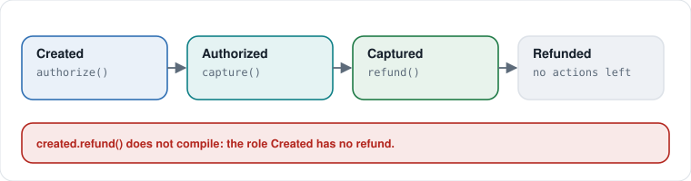

*Figure 25.1. Typestate: each state is a role, and a step the state does not offer does not compile.*

Each object does exactly one role, and a variable typed by the role sees only
the steps of that state. The guarantee holds even when the object itself
has more actions than its role exposes. In the next program `NewPayment`
does have a `refunded` action, but a value typed `Created` cannot reach it:

```okkama
module bible/typestate_rejected v1.0.0;

role Created {
    id() is string;
}

object NewPayment does Created {
    has number is string;
    NewPayment(:number);
    id() is string { number; }
    refunded() is string { "refunded " + number; }
}

main() is int {
    let created is Created = NewPayment(number: "p-17");
    created.refunded();
    0;
}
```

The compiler answers:

```text
25-typestate-rejected.ok:16:13: semantic error: Role "Created" has no action "refunded"
```

Typestate costs one role and one object per state, and transitions that
build new objects rather than successors, because the next state is a
different type. It is worth it where a wrong step is expensive: payments,
connections, documents that move through approval. Where the states are many
and the transitions few, a successor with `confirm` checks (Section 25.3's
`Order`) is the lighter tool.

### Memento: the past is a list of values

Undo is a pattern in most languages because keeping the past takes work: the
state must be copied before it changes, or every change must know how to
reverse itself [[Gamma 1994](#ref-gamma1994)]. In Okkama a successor leaves the earlier value
as it was, and nothing can change it later. Keeping the past means keeping
the earlier values.

```okkama
module bible/undo v1.0.0;

import "io/stdout" take Stdout;

enum Undo is Error = (nothing);

object Draft {
    has text is string;

    Draft(:text);

    typed(more is string) is ^Draft {
        ^text = text + more;
    }

    text() is string {
        text;
    }
}

// The past is a list of earlier values. Nothing is copied to keep it:
// a value that cannot change is its own snapshot.
object Editor {
    has draft is Draft;
    has past is @Draft;

    Editor(:draft, :past);

    typed(more is string) is ^Editor {
        ^draft = draft.typed(more);
        ^past = past + [draft];
    }

    undone() is ^Editor {
        confirm past.size() > 0 else throw Undo.nothing;
        ^draft = past.last();
        ^past = past.take(past.size() - 1);
    }

    text() is string {
        draft.text() + " (" + past.size().string() + " back)";
    }
}

main() is int {
    let out = Stdout();
    let editor = Editor(draft: Draft(text: ""), past: []);
    editor = editor.typed("Dear Ada");
    editor = editor.typed(", thanks");
    out.writeln(editor.text());
    editor = editor.undone();
    out.writeln(editor.text());
    editor = editor.typed(", welcome");
    out.writeln(editor.text());
    editor = editor.undone();
    editor = editor.undone();
    let refused = try { editor.undone().text(); } catch e is Undo { "refused: " + e.text(); };
    out.writeln(refused);
    0;
}
```

Output:

```text
Dear Ada, thanks (2 back)
Dear Ada (1 back)
Dear Ada, welcome (2 back)
refused: Undo.nothing
```

- `typed` makes a new `Draft` and keeps the old one in `past`. Nothing has
  to be copied: a value that cannot change is its own snapshot.
- `undone` takes the last kept draft back and drops it from the list. With
  nothing to undo it refuses by name, instead of returning the editor
  unchanged.
- Redo has the same shape mirrored: a second list for the drafts that undo
  dropped, emptied by the next `typed`.

## 25.4 Refusals have names

A function that cannot do what was asked has three classic ways to say so: a
special value (`-1`, `""`, `null`), an untyped exception carrying a message,
or a typed failure the caller can match. Okkama keeps only the third. There
is no null to return, an object cannot be an error, and a failure that
carries information is a case of an `Error` enum (Chapter 10):

```text
Object "Failure" cannot do Error: errors are enums, declare `enum Failure is Error = (...)`
```

The pattern built on this rule has three parts. A module names all its
refusals in one enum, with the data that explains each in its payload. Every
precondition is checked at the boundary, where the bad input arrives, with
`confirm … else throw`. And a caller catches only the refusals it can
answer, letting everything else go up.

```okkama
module bible/refusals v1.0.0;

// Pattern: the module names its refusals in one Error enum and checks them
// with confirm at the boundary; a caller catches only what it can answer.
import "io/stdout" take Stdout;

enum Refusal is Error = (non_positive(amount is int), insufficient(balance is int, amount is int));

object Account {
    has balance is int;
    Account(:balance);

    withdrawn(amount is int) is ^Account {
        confirm amount > 0 else throw Refusal.non_positive(amount);
        confirm amount <= balance else throw Refusal.insufficient(balance, amount);
        ^balance = balance - amount;
    }

    shown() is string { "balance " + balance.string(); }
}

object Teller {
    has account is Account;
    Teller(:account);

    answer(amount is int) is string {
        let reply = try { account.withdrawn(amount).shown(); } catch e is Refusal { "refused: " + e.text(); };
        reply;
    }
}

main() is int {
    let out = Stdout();
    let teller = Teller(account: Account(balance: 100));
    for [30, 0, 150] -> amount {
        out.writeln(amount.string() + " -> " + teller.answer(amount));
    }
    0;
}
```

Output:

```text
30 -> balance 70
0 -> refused: Refusal.non_positive(0)
150 -> refused: Refusal.insufficient(100, 150)
```

The teller turns refusals into a reply because replying is its job. A
`Program` failure such as a broken invariant, or a refusal from some other
module, passes through the `catch` untouched, because the clause names
`Refusal` and nothing else. A `catch` can also name a single case and bind
its payload, `catch Refusal.insufficient(balance, amount) { … }`, which is
how a caller answers one refusal and leaves the rest to someone else.

Two antipatterns are on the other side of this rule. One is the catch-all:
catching every failure to keep a loop running, which also catches the
failures that mean the program is broken. Okkama makes it hard: a typed
`catch` names a type, and panics and program failures are not typed throws
at all, so they cannot be caught as one (Chapter 10). The other is the
refusal that is not a refusal: an action that returns a default when it
cannot do its work. When absence is a legitimate answer, the language has a
type for it (Section 25.8); when it is not, the action should refuse.

At the scale of a module, the same rule makes refusals change their names at
the boundary. A layer catches the refusals of the layer below that it
understands and refuses in its own terms, so its callers never name the
layer below and do not change when it is replaced (Section 10.12).

## 25.5 Every dependency is a role, every role has a fake

Objects in Okkama reach the outside world through the objects they are given:
there is no global state and no static field (Chapter 22). An object that
sends mail holds a mailer; an object that reads time holds a clock. When the
held object's type is a role rather than a concrete object, the dependency
can be replaced, and the replacement for tests comes with the role itself:
every role may declare a `fake`, a test-only implementation that the
compiler keeps out of production code (Chapter 15).

```okkama
module bible/signup v1.0.0;

// Pattern: every dependency is a role, every role ships a fake, and the
// fake records what happened in its own fields, through successors.
import "io/stdout" take Stdout;

role Mailer {
    sent(to is string) is ^Mailer;
    count() is int;

    fake {
        has total is int = 0;
        has latest is string = "";
        sent(to is string) is ^Mailer {
            ^total = total + 1;
            ^latest = to;
        }
        count() is int { total; }
    }
}

object PrintedMailer does Mailer {
    has total is int = 0;
    PrintedMailer();
    sent(to is string) is ^PrintedMailer {
        Stdout().writeln("mail to " + to);
        ^total = total + 1;
    }
    count() is int { total; }
}

object Signup {
    has mailer is Mailer;
    has members is int = 0;
    Signup(:mailer);

    joined(name is string) is ^Signup {
        ^members = members + 1;
        ^mailer = mailer.sent(name);
    }

    mails() is int { mailer.count(); }
}

test "every member gets one welcome mail" {
    let signup = Signup(mailer: Mailer.fake()).joined("ada").joined("grace");
    test.is(signup.mails(), 2);
}

test "the first signup is untouched by its successors" {
    let first = Signup(mailer: Mailer.fake());
    let later = first.joined("ada");
    test.is(first.mails(), 0);
    test.is(later.mails(), 1);
}

main() is int {
    let signup = Signup(mailer: PrintedMailer()).joined("ada");
    Stdout().writeln(signup.mails().string() + " mail sent");
    0;
}
```

Output:

```text
=== RUN   every member gets one welcome mail
--- PASS: every member gets one welcome mail
=== RUN   the first signup is untouched by its successors
--- PASS: the first signup is untouched by its successors
PASS
```

The fake records what happened in its own fields, through successors, the
same way production objects do. A test does not configure expectations the
way a mock framework would; it uses the fake and then asks it what it saw.
This is the distinction Martin Fowler drew between state verification with
stubs and behaviour verification with mocks [[Fowler 2007](#ref-fowler2007)], and the one
Meszaros's catalogue of test doubles calls a fake object: a working
implementation, simpler than the real one [[Meszaros 2007](#ref-meszaros2007)]. Because the fake
lives next to the role, every implementation of the role and every test of
its users agree on what the role means.

The example shows one more consequence of successors. Sending mail is a
state change of the mailer, so `sent` returns a successor, and `Signup`
stages it: `^mailer = mailer.sent(name)`. A production mailer that only
prints still returns a successor of its own type, `^PrintedMailer`; the
compiler insists on that, and its diagnostic says how:

```text
Successor action "sent" on object "PrintedMailer" must return ^PrintedMailer; declare ^Mailer in a role signature and implement it as ^PrintedMailer
```

The antipattern this replaces is the hidden collaborator: an object that
creates its own database connection, reads the clock directly or writes to
a global logger, and so can be tested only by replacing the world around
it. In Okkama such an object can still be written, by constructing
`SystemClock()` or `Stdout()` itself, but nothing global can be patched in
a test to undo it. So the habit, and the standard library's rule
(Section 22.6), is to take the clock and the destination as values.

### Decide, then do

A role and its fake make a dependency replaceable. One step further takes
the dependency out of the logic altogether: the logic decides and returns
its decisions as values, and a thin outer layer carries them out. Gary
Bernhardt called this shape a functional core in an imperative shell
[[Bernhardt 2012](#ref-bernhardt2012)]. Immutable objects and enums with payloads make it the
natural shape in Okkama.

```okkama
module bible/decide v1.0.0;

import "io/stdout" take Stdout;

// What the core decided. Nothing has happened yet.
enum Effect = (
    charge(customer is string, cents is int),
    reorder(item is string, count is int),
    receipt(customer is string, text is string)
);

object Line {
    has item is string;
    has count is int;
    has price is int;
    has stock is int;

    Line(:item, :count, :price, :stock);

    cost() is int {
        count * price;
    }

    missing() is int {
        if stock < count { count - stock; } else { 0; }
    }

    item() is string {
        item;
    }
}

// The core decides and returns its decisions as values. It writes nothing,
// sends nothing and reads no clock.
object Checkout {
    has customer is string;
    has lines is @Line;

    Checkout(:customer, :lines);

    effects() is @Effect {
        let total = lines.reduce(0) -> sum, line { sum + line.cost(); };
        let short = lines.filter() -> line { line.missing() > 0; };
        let reorders = short.map() -> line { Effect.reorder(line.item(), line.missing()); };
        [Effect.charge(customer, total)] + reorders + [Effect.receipt(customer, "paid " + total.string())];
    }
}

// The shell performs decisions and makes none.
object Shell {
    has out is Stdout;

    Shell(:out);

    performed(effect is Effect) is void {
        match effect {
            case Effect.charge(customer, cents) {
                out.writeln("charge " + customer + " " + cents.string());
            }
            case Effect.reorder(item, count) {
                out.writeln("reorder " + count.string() + " x " + item);
            }
            case Effect.receipt(customer, text) {
                out.writeln("mail " + customer + ": " + text);
            }
        }
    }
}

main() is int {
    let checkout = Checkout(customer: "ada", lines: [
        Line(item: "tea", count: 2, price: 450, stock: 10),
        Line(item: "cups", count: 6, price: 120, stock: 4),
    ]);
    let effects = checkout.effects();
    let charged = effects.first() == Effect.charge("ada", 1620);
    Stdout().writeln(effects.size().string() + " effects, charge first: " + charged.string());
    let shell = Shell(out: Stdout());
    for effects -> effect {
        shell.performed(effect);
    }
    0;
}
```

Output:

```text
3 effects, charge first: true
charge ada 1620
reorder 2 x cups
mail ada: paid 1620
```

- `Checkout.effects()` reads only its own fields. It writes nothing, sends
  nothing and reads no clock, so the same order always gives the same
  decisions.
- The decisions are an enum. The shell's `match` covers every case, and a
  new kind of effect makes the compiler point at the shell.
- A test of the core compares values, as `main` does with the first effect.
  It needs no fake, because the core has no dependency to replace, and the
  shell has almost no logic left to test.

The same shape answers Observer in a language where objects do not change.
An action does not notify listeners; it returns what happened, and its
caller passes that on. Where the listeners are tasks, the values travel over
a channel to their owner (Section 25.9).

## 25.6 A table of cases

Some actions have one rule and many inputs that matter. A tariff is the
usual example: the price changes at fixed weights, and every change is a
place where an off-by-one hides. One test per weight repeats the same three
lines ten times, and the repetition hides the one thing that differs
between them. The pattern turns the cases into data: a table with one row
per case, and one loop that checks every row. Go programmers know it as
table-driven tests [[Go Wiki](#ref-gotabledriven)]. The idea is older: Ward Cunningham's
Fit let customers write business rules as tables of examples that ran as
tests [[Mugridge 2005](#ref-mugridge2005)].

```okkama
module bible/postage v1.0.0;

// Pattern: a table of cases. Each row is a value; one loop checks them all,
// and the row's input travels with its answer, so a failure names the row.
import "io/stdout" take Stdout;

enum Postage = (
    letter(cents is int),
    parcel(cents is int),
    refused(reason is string)
);

object Tariff {
    Tariff();

    priced(grams is int) is Postage {
        if grams <= 0 { Postage.refused("no weight"); }
        else if grams <= 20 { Postage.letter(85); }
        else if grams <= 100 { Postage.letter(150); }
        else if grams <= 500 { Postage.parcel(450); }
        else if grams <= 2000 { Postage.parcel(900); }
        else { Postage.refused("over 2 kg"); }
    }
}

// What a test compares: the weight and the postage, together.
object Priced {
    has grams is int;
    has postage is Postage;
    Priced(:grams, :postage);
}

// One row of the table.
object Case {
    has grams is int;
    has expected is Postage;
    Case(:grams, :expected);

    wanted() is Priced { Priced(grams: grams, postage: expected); }
    got(tariff is Tariff) is Priced { Priced(grams: grams, postage: tariff.priced(grams)); }
}

test "postage at every boundary" {
    let cases = [
        Case(grams: 0, expected: Postage.refused("no weight")),
        Case(grams: 1, expected: Postage.letter(85)),
        Case(grams: 20, expected: Postage.letter(85)),
        Case(grams: 21, expected: Postage.letter(150)),
        Case(grams: 100, expected: Postage.letter(150)),
        Case(grams: 101, expected: Postage.parcel(450)),
        Case(grams: 500, expected: Postage.parcel(450)),
        Case(grams: 501, expected: Postage.parcel(900)),
        Case(grams: 2000, expected: Postage.parcel(900)),
        Case(grams: 2001, expected: Postage.refused("over 2 kg"))
    ];
    let tariff = Tariff();
    for cases -> row {
        test.is(row.got(tariff), row.wanted());
    }
}

main() is int {
    match Tariff().priced(250) {
        case Postage.letter(cents) { Stdout().writeln("letter, " + cents.string() + " cents"); }
        case Postage.parcel(cents) { Stdout().writeln("parcel, " + cents.string() + " cents"); }
        case Postage.refused(reason) { Stdout().writeln("refused: " + reason); }
    }
    0;
}
```

Output:

```text
=== RUN   postage at every boundary
--- PASS: postage at every boundary
PASS
```

- A row is an object with named fields, so the table reads as a table:
  `Case(grams: 20, expected: Postage.letter(85))`. The named arguments are
  the column headings, repeated on every line where a reader needs them.
- The expected column holds values of the domain, here an enum with
  payloads, not strings that describe them. `test.is` compares them
  structurally (Section 15.2), so a refusal's reason and a parcel's price
  are both checked.
- One run reports every wrong row. A failed assertion does not stop the
  test, so the loop goes on after the first mismatch. In Go the same choice
  falls to the author, who must call `t.Errorf` rather than `t.Fatalf`.
- The row brings its input along with its answer. `got` and `wanted` both
  return a `Priced`, which holds the weight with the postage, and so the
  report names the row.

That last point is the one that is easy to skip. Suppose the row offered
its two fields and the loop compared only the postage:
`test.is(tariff.priced(row.grams()), row.expected())`. Then two wrong rows
report this way:

```text
--- FAIL: postage at every boundary
    expected Postage.parcel(450), got Postage.parcel(900)
    expected Postage.refused("too heavy"), got Postage.refused("over 2 kg")
```

Two rows of the table expect `Postage.parcel(450)`, and the report does
not say which of them failed. With the weight carried along, it does:

```text
--- FAIL: postage at every boundary
    expected Priced(grams: 501, postage: Postage.parcel(450)), got Priced(grams: 501, postage: Postage.parcel(900))
    expected Priced(grams: 2001, postage: Postage.refused("too heavy")), got Priced(grams: 2001, postage: Postage.refused("over 2 kg"))
```

The rows are chosen at the edges. Each tier is checked at its first and its
last weight (20 and 21, 100 and 101, 500 and 501), and the table also
holds one row on each side outside the range: 0 and 2001. This is boundary
value analysis, which Myers described as one of the most useful ways to
choose test cases, and also one of the easiest to do badly [[Myers 1979](#ref-myers1979)]. A
table makes the edges visible. An edge without a row is a missing line,
and a reviewer can see that it is missing.

A table and a property (Section 15.6) answer different questions. The
table holds the cases someone chose for a reason, and the reason is
usually an edge. A property generates the cases nobody thought of, and
checks a rule that holds for all of them: here, that the price never
falls as the weight grows. A tariff deserves both.

The report needs one more word. A table is one test, and a row gets a name
of its own only when it runs inside `test.case(name) { … }`, as in Go's
`t.Run` and JUnit's parameterized tests [[JUnit User Guide](#ref-junit5)]. Then the report lists
every row as `postage/50 g`, and `okkama run -t --filter "postage/50 g"`
runs that row alone (Section 15.9). Without `test.case`, the whole table is
one line when it passes, and a row names itself only when it fails, through
the input it carries.

## 25.7 Resources belong to scopes

A resource is an object with a `destroy` block. The scope that owns it
destroys it when the scope ends, whatever way it ends, in reverse order of
creation, after the scope's `defer` blocks have run (Chapter 11). The
pattern that follows is simple to state: open a resource where it is needed,
bind it with `let` in the narrowest block that uses it, and put its cleanup
in `destroy`, not in an action a caller must remember to call.

The antipatterns it replaces are familiar from languages with explicit
cleanup: the `close()` that is skipped on an early return, the `dispose()`
called twice, the object that is "opened" in a second step after
construction and is unusable in between. In Okkama none of them is
necessary. An object that needs a resource takes it in its constructor and
is complete when the constructor returns; the end of its scope is the only
cleanup point; and a result returned from an action carries its resources
to the caller's scope, so the caller owns what it was given (Chapter 11).

```okkama
module bible/section v1.0.0;

import "io/stdout" take Stdout;

enum Bad is Error = (row(value is int));

// The pair "begin" / "end" belongs to an object, not to every caller:
// the end is written when the section's scope ends, however it ends.
object Section {
    has name is string;

    Section(:name) {
        Stdout().writeln("begin " + name);
    }

    destroy {
        Stdout().writeln("end " + name);
    }
}

object Importer {
    Importer();

    imported(rows is @int) is int {
        let section = Section(name: "import");
        for rows -> row {
            let step = Section(name: "row " + row.string());
            confirm row >= 0 else throw Bad.row(row);
        }
        rows.size();
    }
}

main() is int {
    let out = Stdout();
    out.writeln("imported " + Importer().imported([1, 2]).string());
    let outcome = try {
        Importer().imported([3, -1, 4]).string();
    }
    catch e is Bad {
        "refused: " + e.text();
    };
    out.writeln(outcome);
    0;
}
```

Output:

```text
begin import
begin row 1
end row 1
begin row 2
end row 2
end import
imported 2
begin import
begin row 3
end row 3
begin row -1
end row -1
end import
refused: Bad.row(-1)
```

- `Section` writes `begin` in its constructor and `end` in its `destroy`.
  A caller writes one `let` and has nothing to remember.
- Each pass of the loop is a scope: one row's section ends before the next
  row's begins.
- The refusal of row −1 leaves both scopes. Both ends are written, the
  innermost first, before the caller handles the refusal. Row 4 is never
  reached.

`defer` covers the cases that are actions rather than objects: restoring a
setting, writing a final line to a log, releasing something the program did
not create. It runs at the end of the scope, reads the bindings as they are
then, and runs before the scope's resources are destroyed. A rule of thumb
from code review: if the same `defer` appears around every use of an object,
the object wants a `destroy`.

## 25.8 Absence is a type

Okkama has no null. A value that may be missing has the type `Maybe<T>`, and
the type system makes the caller decide what absence means: a fallback with
`else` or a `match` (Chapter 7). The
pattern is to put absence in the signature of the action that can produce
it, and nowhere else. A lookup that can fail to find returns `Maybe`; a
lookup that must find refuses with a typed error.

The same pattern works for a whole program: decide absence at the edge,
where data comes in, and let the objects inside hold values that are there.

```okkama
module bible/edge v1.0.0;

import "io/stdout" take Stdout;

enum Missing is Error = (setting(name is string));

// What a settings file gave: any key may be missing.
object RawSettings {
    has values is %string:string;

    RawSettings(:values);

    setting(name is string) is Maybe<string> {
        if values.has(name) { Maybe.some(values[name]); } else { Maybe.none; }
    }

    required(name is string) is string {
        confirm values.has(name) else throw Missing.setting(name);
        values[name];
    }
}

// What the program runs with: absence was decided once, at the edge.
object Settings {
    has host is string;
    has user is string;

    Settings(raw is RawSettings) {
        host = raw.setting("host") else "localhost";
        user = raw.required("user");
    }

    address() is string {
        user + "@" + host;
    }
}

main() is int {
    let out = Stdout();
    let full = Settings(RawSettings(values: ["host": "db.local", "user": "ada"]));
    out.writeln(full.address());
    let partial = Settings(RawSettings(values: ["user": "grace"]));
    out.writeln(partial.address());
    let refused = try {
        Settings(RawSettings(values: ["host": "db.local"])).address();
    }
    catch e is Missing {
        "refused: " + e.text();
    };
    out.writeln(refused);
    0;
}
```

Output:

```text
ada@db.local
grace@localhost
refused: Missing.setting("user")
```

- `RawSettings` is the edge. It answers with `Maybe` where a key may be
  missing, and refuses with a typed error where the program cannot go on
  without one.
- `Settings` makes both decisions once, in its constructor: a missing host
  falls back to `localhost`, a missing user is refused. Its fields are plain
  strings, and nothing that reads them checks for absence again.
- A refused construction produces no object. There is no half-built
  `Settings` with an empty user to pass on.

The antipatterns on the other side are the sentinel value and the "empty
object": `-1` for "not found", `""` for "no name", an object whose every
field is a default. They survive in Okkama only if a programmer writes them,
since the language provides no null to tempt anyone and an explicit type for
the honest answer. When a value is optional for a while and then becomes
required, the change is visible in the types, and the compiler finds every
caller that has to decide.

## 25.9 Shared state has one owner

Asynchronous code needs state that more than one task can see. Okkama's
answer is structural: state shared between tasks lives in one task, the
owner, and others talk to it through channels (Chapter 20). A ledger that
several workers update is one object in one task, receiving messages; the
workers hold the sending end of a channel, not the ledger. For the few
values that really are shared, such as a counter or a flag, `Atomic` gives a
small set of operations that are safe across tasks. The ledger of
Section 20.6 is the pattern in full: an enum of commands, one task that owns
the balance and serves them in a loop, and replies sent back over a channel
the caller provides. The next example has several writers instead of one.

```okkama
module bible/owner v1.0.0;

import "io/stdout" take Stdout;
import "async/channel" take Channel, Sending, Receiving;
import "async/collect" take AllFutures;
import "collections/sequence" take Sequencing;

// State that several tasks update lives in one task, its owner. The others
// hold only the sending end of the owner's inbox.
enum Visit = (page(path is string), summary(reply is Sending<string>), stop);

object Tally {
    has total is int;
    has home is int;

    Tally(:total, :home);

    counted(path is string) is ^Tally {
        ^total = total + 1;
        ^home = if path == "/" { home + 1; } else { home; };
    }

    summary() is string {
        total.string() + " pages, " + home.string() + " home";
    }

    total() is int {
        total;
    }
}

object Visits {
    has inbox is Receiving<Visit>;

    Visits(:inbox);

    async run() is int {
        let tally = Tally(total: 0, home: 0);
        loop {
            let visit = await inbox.item();
            match visit {
                case Visit.page(path) {
                    tally = tally.counted(path);
                }
                case Visit.summary(reply) {
                    await reply.send(tally.summary());
                }
                case Visit.stop {
                    last;
                }
            }
        }
        tally.total();
    }
}

object Reader {
    has paths is @string;
    has out is Sending<Visit>;

    Reader(:paths, :out);

    async read() is int {
        for paths -> path {
            await out.send(Visit.page(path));
        }
        paths.size();
    }
}

async main() is int {
    let inbox is Channel<Visit> = Channel(capacity: 4);
    let owner = spawn Visits(inbox: inbox.receiving()).run();
    let readers is @Future<int> = [
        spawn Reader(paths: ["/", "/news", "/"], out: inbox.sending()).read(),
        spawn Reader(paths: ["/about", "/"], out: inbox.sending()).read(),
    ];
    let all is AllFutures<int> = AllFutures(origins: readers);
    let sent is Sequencing<int> = await all.results();
    let replies is Channel<string> = Channel(capacity: 1);
    let desk = inbox.sending();
    await desk.send(Visit.summary(replies.sending()));
    Stdout().writeln("summary: " + (await replies.receiving().item()));
    await desk.send(Visit.stop);
    Stdout().writeln("owner: " + (await owner).string() + " pages from " + sent.size().string() + " readers");
    0;
}
```

Output:

```text
summary: 5 pages, 3 home
owner: 5 pages from 2 readers
```

- The count lives in `Tally`, a local of `Visits.run()`. The readers cannot
  reach it. Each holds a `Sending<Visit>` and nothing else.
- The owner changes its state by successor, `tally = tally.counted(path)`,
  one message at a time. Two readers never update the count at once,
  because only one task updates it.
- A question is a message too. `summary` carries the channel for the
  answer, so the reply goes to whoever asked, and the state never leaves its
  owner.

This replaces the most expensive antipattern of concurrent programming, the
object shared by many threads and guarded by locks taken in the right order
by convention. In Okkama a `Cell` cannot cross into an async context and an
object cannot hold one, so mutable state that tasks share is either inside
its owner or in an `Atomic`, by construction.

```okkama
module bible/shared_rejected v1.0.0;

import "cell" take Cell;

// A visit counter that tasks would share and mutate in place.
object Hits {
    has count is Cell<int>;

    Hits(:count);
}

main() is int {
    let hits = Hits(count: Cell(0));
    0;
}
```

The compiler answers:

```text
25-shared-rejected.ok:7:9: semantic error: Field "count" cannot hold a Cell: a cell stays in synchronous code; state an object shares with tasks is an Atomic
```

The diagnostic names the way out: state an object shares with tasks is an
`Atomic`. State that is more than a counter or a flag goes to an owner.

The structured rules of Chapter 20 add the second half of the pattern:
cancelling a task cancels what it waits for, and when `async main` returns,
the tasks still running are cancelled and their cleanup is awaited before
the run ends. Work that runs "in the background, somewhere", outliving the
program that started it, is not a shape the language provides.

## 25.10 Anti-patterns the compiler refuses

Several shapes that code review catches in other languages are diagnostics
in Okkama. The table collects the ones the earlier chapters showed, with the
compiler's words.

| Anti-pattern | Diagnostic |
|---|---|
| Setter, mutable field | `Field "count" cannot be assigned after construction: objects are immutable; return a successor instead` |
| Staging outside a successor | `` `^field = value` is allowed only in successor actions `` |
| Getter for raw state | `Field "cents" of object "Cash" is private; call an action instead` |
| Hidden mutable box in an object | `Field "reading" cannot hold a Cell: a cell stays in synchronous code; state an object shares with tasks is an Atomic` |
| Using an object before it exists | `Cannot call actions on self before construction completes` |
| Error as an object with a message | `Object "Failure" cannot do Error: errors are enums, declare `enum Failure is Error = (...)`` |
| Downcast from a role to a concrete object | `Cannot initialize variable "customer" of type Customer with Presentation` |
| Rebinding a value that has no successors | `Cannot rebind variable "n": type "int" has no successor actions` |
| Treating "present or absent" as optional with a fallback | `Optional fallback requires Maybe<T>; fold Presence explicitly` |
| Discarding a successor | must-use: a successor that is not used is an error (Chapter 13) |

Each line closes a door that an elegant-objects code review would otherwise
have to watch [[Bugayenko 2016](#ref-bugayenko2016); [Bugayenko 2017](#ref-bugayenko2017)]. The language cannot tell
good design from bad, but it can make some bad designs impossible to write,
and Okkama spends its rules there.

## 25.11 Anti-patterns the compiler allows

The rest is judgement. These are the shapes that compile and still make a
program worse, and the reasons Okkama code avoids them.

- **The flag object.** Section 25.2: an object whose actions branch on its
  own fields to choose a behaviour. Decorators through a role replace it
  once the options interact.
- **The data bag.** An object that is a list of fields and one action per
  field returning it. Fields are private, so the getters must be written by
  hand, and writing them is the warning. An object should answer questions
  about what it is for, not hand out its parts: `invoice.total()`, not
  `invoice.lines()` added up by the caller.
- **The matryoshka.** Objects nested several layers deep only to reach a
  value, `Report(Section(Table(Rows(Source(...)))))`, where each layer adds
  no behaviour. The standard library's review rejected exactly this shape
  (Chapter 22): one object that knows how to answer, with its parts as named
  arguments, reads better and runs faster.
- **The god object.** One object that holds every dependency of a program
  and offers an action for every operation. Composition through roles
  splits it naturally: an object for each responsibility, wired together
  in `main`.
- **Stringly typed protocols.** Messages, states or commands encoded as
  strings and compared with `==`. An enum names the cases, carries their
  data, and makes `match` exhaustive (Chapter 16).
- **Catching to continue.** A `catch` for a broad type around a loop body,
  so that a failure becomes a skipped iteration. If an iteration may refuse,
  the refusal has a name and the loop catches that name.
- **The cell as a field substitute.** A `Cell` threaded through many
  actions to simulate a mutable object. A successor chain says the same
  thing with values that can be inspected afterwards.
- **Spawn and forget.** Starting tasks whose results nobody awaits.
  Structured concurrency limits the damage, since tasks still running when
  `async main` returns are cancelled and their cleanup is awaited, but a
  task nobody awaits is a task whose result nobody checks.

None of these is forbidden, and some are the right answer in small
programs. They are listed because each of them was found in real Okkama
code, and each was replaced, in the standard library review or in the
examples of this book, by one of the patterns above.

## 25.12 A refactoring, step by step

The anti-patterns of the previous section rarely come alone. The next
program has three of them: a status that is a string, an urgency that is a
flag, and a ticket that hands out its fields so that the caller can decide
what to print.

```okkama
module bible/before v1.0.0;

// Before: the status is a string, urgency is a flag, and the object hands
// out its parts so that the caller can decide everything.
import "io/stdout" take Stdout;

object Ticket {
    has title is string;
    has status is string;
    has urgent is bool;
    Ticket(:title, :status, :urgent);
    title() is string { title; }
    status() is string { status; }
    urgent() is bool { urgent; }
}

main() is int {
    let out = Stdout();
    let tickets = [
        Ticket(title: "printer", status: "open", urgent: true),
        Ticket(title: "coffee", status: "closed", urgent: false),
        Ticket(title: "wifi", status: "open", urgent: false)
    ];
    for tickets -> ticket {
        if ticket.status() == "open" {
            let mark = if ticket.urgent() { "!"; } else { " "; };
            out.writeln(mark + " " + ticket.title());
        }
    }
    0;
}
```

Output:

```text
! printer
  wifi
```

It works, and it is the kind of code the rules of the language do not
prevent. The refactoring takes it apart one smell at a time, without
changing what it prints.

1. **The string becomes an enum.** `status == "open"` compiles for any
   string, including `"opne"`. `enum Status = (open, closed)` names the two
   states, and a `match` over it is exhaustive: a third state added later is
   a compile error at every place that has to decide about it (Chapter 16).
2. **The getters become a question.** The caller wanted one thing from each
   ticket: its line in the queue, if it has one. So the ticket answers that,
   `line() is Maybe<string>`, and `title()`, `status()` and `urgent()`
   disappear. Absence is in the type: a closed ticket has no line.
3. **The flag becomes a decorator.** Urgency changes how a line looks, so it
   is an object that holds a ticket and marks its line, doing the same role
   `Queued`. A ticket that stops being urgent is the ticket without the
   wrapper; no field has to be reset.

```okkama
module bible/after v1.0.0;

// After: the status is an enum, urgency is a decorator, and each ticket
// answers the one question the caller has: how it shows in the queue.
import "io/stdout" take Stdout;

enum Status = (open, closed);

role Queued {
    line() is Maybe<string>;
}

object Ticket does Queued {
    has title is string;
    has status is Status;
    Ticket(:title, :status);
    line() is Maybe<string> {
        match status {
            case Status.open { Maybe.some("  " + title); }
            case Status.closed { Maybe.none; }
        }
    }
}

object Urgent does Queued {
    has origin is Queued;
    Urgent(:origin);
    line() is Maybe<string> {
        match origin.line() { case Maybe.some(text): Maybe.some("!" + text.slice(1, text.length())); case Maybe.none: Maybe.none; };
    }
}

main() is int {
    let out = Stdout();
    let queue is @Queued = [
        Urgent(origin: Ticket(title: "printer", status: Status.open)),
        Ticket(title: "coffee", status: Status.closed),
        Ticket(title: "wifi", status: Status.open)
    ];
    for queue -> ticket {
        match ticket.line() {
            case Maybe.some(text) { out.writeln(text); }
            case Maybe.none { }
        }
    }
    0;
}
```

Output:

```text
! printer
  wifi
```

The output is the same, and the second program is longer. What it buys is
the place where each decision lives. The meaning of "open" is in the enum;
the line of a ticket is in the ticket; the mark of urgency is in `Urgent`;
`main` only prints. A new kind of mark, a new state or a different queue
format is a change in one object, and the compiler finds every place a new
state has to be handled.

## 25.13 The classic catalogue, read in Okkama

The 23 patterns of Gamma and his co-authors are a useful checklist of what a
language makes easy, hard or unnecessary [[Gamma 1994](#ref-gamma1994)]. The table goes
through the ones that change most.

| Pattern | In Okkama |
|---|---|
| Strategy | A role and the objects that do it; an anonymous action for a one-off (Section 25.2) |
| Decorator | A role, implemented by objects that hold another implementation (Section 25.2) |
| Composite | A role done by both the leaf and the container, which holds a collection of the role |
| Builder | A chain of successors, or a constructor with named and defaulted fields (Section 25.3) |
| Prototype | Unneeded: objects are immutable, so sharing one is copying it |
| Singleton | Not expressible: no global state and no static fields; one instance made in `main` and passed down |
| Factory method | Several constructors, one per form (Chapter 12), or an action that returns a role |
| Template method | No inheritance; a decorator, or an object that takes the varying step as a role |
| Observer | Events returned as values (Section 25.5); a channel to an owning task, or an event that waiters await (Chapter 20) |
| Memento | Unneeded as a mechanism: earlier values stay valid, and undo is a list of them (Section 25.3) |
| Iterator | `for` over collections, ranges and async streams (`for await`) |
| State | Typestate: a role per state, each transition returns the next state's role (Section 25.3); successors on one object (Section 14.5) |
| Command | An enum case per command, with a `match` that interprets it; or an action value |
| Visitor | `match` over an enum; across roles, the expression problem stands (Chapter 16) |
| Null object | Unneeded as a workaround: absence is `Maybe`; still useful as a real "do nothing" implementation of a role |

Norvig's observation holds in Okkama too, in its own way. Patterns that
exist to work around mutable shared state, such as Prototype and the
defensive copies of Builder, disappear because the state cannot be
mutated. Patterns that exist to work around inheritance, Template Method
first among them, are replaced by composition because there is no
inheritance to work around. And Singleton, a pattern for global state, has
no expression at all.

## 25.14 What the patterns cost

The patterns of this chapter trade size for change. A decorator chain has
more declarations than a flag object; a role and its fake are more text than
a concrete dependency; a successor allocates a new object where a setter
would write one word; a typestate needs a role per state. For a short script
these costs are real, and an Okkama programmer who writes a fifty-line tool
with two flags and one concrete dependency is not wrong.

The costs pay back as a program grows and as it is changed by people who
did not write it. Values that cannot change can be shared without fear and
reasoned about locally; dependencies that are roles can be replaced in a
test without a framework; refusals that are names can be handled exactly;
resources that belong to scopes are released on every path. The rules that
make some antipatterns into compile errors also make some useful shapes
impossible: there is no way to cache a value inside an object after
construction other than `once let` (Chapter 13), no way to share a mutable
counter between objects other than an `Atomic` or an owning task, and no way
to write the small mutable helper object other languages reach for. Those
limits are deliberate, and Chapter 27 discusses the ones that are not.

# Chapter 26. Okkama Among Languages

The earlier chapters compared Okkama with other languages one construct at a
time: numbers in Chapter 5, types in Chapter 4, collections in Chapter 8,
roles in Chapter 14, tests in Chapter 15. This chapter turns the comparison
around. It takes six languages that a reader of this book is likely to know,
Java, Kotlin, Go, Rust, Haskell and OCaml, and asks of each the same
questions the manifesto answered for Okkama (Chapter 3). Six more, Python,
Swift, Erlang, Clojure, C# and TypeScript, follow in shorter sections,
because readers come to Okkama from them as well.

A comparison of languages is easy to make unfair. Each of these languages
was designed for a purpose, by people who weighed the same trade-offs and
chose differently, and each has decades of programs behind it that Okkama
does not. The aim here is not a ranking. It is to show where Okkama's
choices sit among choices that working languages have made, so that a
reader who knows one of them can see what is familiar, what is different,
and what is missing.

## 26.1 The rules side by side

| | Java | Kotlin | Go | Rust | Haskell | OCaml | Okkama |
|---|---|---|---|---|---|---|---|
| Absence | `null` in every reference type [[Gosling 2023](#ref-gosling2023)] | nullable types `T?`, checked [[Kotlin specification](#ref-kotlinspec)] | `nil` for pointers, interfaces, maps, slices [[Go specification](#ref-gospec)] | `Option` [[Klabnik 2023](#ref-klabnik2023)] | `Maybe` [[Haskell 2010](#ref-haskell2010)] | `option` [[OCaml Manual](#ref-ocamlmanual)] | `Maybe` (Chapter 7) |
| Change | mutable fields; immutable records | `val`/`var`; `copy` on data classes [[Kotlin documentation](#ref-kotlindata)] | mutable | immutable bindings, `mut` | immutable; `IORef`, `ST` | immutable bindings; mutable fields and `ref` | successors; `Cell` in synchronous code (Chapter 13) |
| Implementation inheritance | classes, single | classes, final unless `open` [[Kotlin documentation](#ref-kotlininheritance)] | none; embedding | none | none | classes, rarely used | none (Chapter 2) |
| Contracts | interfaces, with default methods | interfaces | interfaces, structural | traits | type classes | module signatures | roles, nominal, no bodies (Chapter 14) |
| Showing state | getters; record accessors [[Bierman 2021](#ref-jep395)] | properties | exported fields and methods | `pub` fields, methods | record fields, export lists | record fields, abstract types | caps the object grants (Section 12.8) |
| Failures | checked and unchecked exceptions | unchecked exceptions [[Kotlin documentation](#ref-kotlinexceptions)] | error values, `panic` | `Result`, `panic` | `Maybe`, `Either`; exceptions in `IO` | exceptions, `result` | typed errors and panics (Chapter 10) |
| Resource release | `try`-with-resources | `use` [[Kotlin standard library](#ref-kotlinuse)] | `defer` | `Drop` | `bracket` [[Haskell base library](#ref-hsexception)] | `Fun.protect` [[OCaml Manual](#ref-ocamlfun)] | `destroy`, `defer` (Chapter 11) |
| Integers | fixed width, wrap | fixed width, wrap | fixed width, wrap | panic in debug builds, wrap in release | `Int` bounded, `Integer` unbounded | fixed width, wrap [[OCaml Manual](#ref-ocamlint)] | unbounded (Chapter 5) |
| Concurrency | threads; virtual threads [[JEP 444](#ref-jep444)]; structured concurrency in preview [[OpenJDK 2023](#ref-jep453)] | coroutines, structured [[Kotlin documentation](#ref-kotlincoroutines)] | goroutines and channels | threads; `async` with library runtimes | green threads, STM | domains [[OCaml Manual](#ref-ocamlparallel)] and libraries | structured async, process workers (Chapter 20) |

Read across a row and Okkama is rarely alone. Rust, Haskell and OCaml share
its answer to absence; Go, Rust and Haskell share its refusal of
implementation inheritance; Haskell's `Integer`, the type its integer
literals default to, is unbounded like Okkama's `int`. Read down a column and the picture changes: no other language in
the table gives all of Okkama's answers at once, and that is the design's
one new idea (Section 1.10).

## 26.2 Java

Java is the language Okkama argues with most, because *Elegant Objects*,
the discipline Okkama turns into rules, was written for Java programmers
(Section 2.7). Almost every Okkama rule is something a Java team can adopt
by convention: final fields, no setters, no `null`, composition instead of
`extends`, small interfaces with fakes. What Java cannot give is the
guarantee. A convention holds as long as every reviewer catches every
exception to it; in Okkama the compiler does.

Java answers some of the same problems with newer features. Records are
immutable carriers of data [[Gosling 2023](#ref-gosling2023)], close to what Section 27.4 calls
a shorthand for data objects. Virtual threads make blocking code cheap
[[JEP 444](#ref-jep444)], and structured concurrency, still a preview in Java 21, gives
tasks a parent scope that waits for them [[OpenJDK 2023](#ref-jep453)]. Java keeps `null`,
checked exceptions and class inheritance, and for a language with Java's
installed base, removing them is not an option. Okkama had no installed
base, which is the only reason it could start where Java's best practice
ends.

## 26.3 Kotlin

Kotlin took Java's runtime and changed its defaults: classes are final
unless declared `open` [[Kotlin documentation](#ref-kotlininheritance)], nullability is part of a type
and checked by the compiler [[Kotlin specification](#ref-kotlinspec)], data classes come with
`copy` [[Kotlin documentation](#ref-kotlindata)], and all exceptions are unchecked
[[Kotlin documentation](#ref-kotlinexceptions)]. Its coroutines are structured: a coroutine belongs to
a scope that does not complete until its children do [[Kotlin documentation](#ref-kotlincoroutines)],
which is the model of Chapter 20.

The difference from Okkama is one of degree. Kotlin makes the safer choice
the easier one, and keeps the other within reach: `var`, `open`, `!!` and
platform types from Java are all available when a programmer wants them.
Okkama removes the other choice. A Kotlin team can write Okkama-style code;
an Okkama program cannot be written any other way.

## 26.4 Go

Go and Okkama agree on more than their surfaces suggest. Neither has
classes or inheritance, both treat errors as values that a function hands
back rather than throws past its caller, both release resources with
`defer` [[Go specification](#ref-gospec)], and both keep the language small. The
disagreements are just as basic. Go's interfaces are structural, satisfied
by any type with the right methods; Okkama's roles are declared (Section
14.2). Go's values are mutable and its `nil` reaches pointers, interfaces,
maps and slices. And Go's `go` statement starts a goroutine that nothing
waits for, the unstructured concurrency that Chapter 20 argues against.

Go chose simplicity of the language and left discipline to the programmer
and to tools such as linters. Okkama chose simplicity of the *program*: a
smaller set of things that can go wrong, bought with a stricter language.

## 26.5 Rust

Rust is the closest relative in purpose. It has no `null`, no inheritance,
values immutable unless declared `mut`, errors as `Result`, and resources
released by `Drop` when their owner goes out of scope
[[Klabnik 2023](#ref-klabnik2023)]. Its traits are nominal contracts, like roles, though they
may carry default methods. Where Rust differs is in what it asks of the
programmer to get there. Ownership and borrowing are checked at compile
time and written in the program: lifetimes, `&` and `&mut`, moves. The
reward is memory safety without a garbage collector and control over every
allocation.

Okkama makes a different trade. Its memory is managed automatically, and
deterministic destruction is reserved for resources (Section 11.1), so most
programs never mention ownership, and a resource is released by the scope
that made it without annotations. Rust also overflows: integer arithmetic
panics in debug builds and wraps in release builds [[Klabnik 2023](#ref-klabnik2023)], where
Okkama's integers grow (Chapter 5). A program that needs Rust's control of
memory should be written in Rust.

## 26.6 Haskell

Haskell is the purest language in the table: values never change, effects
are confined to types such as `IO`, absence is `Maybe`, and contracts are
type classes [[Haskell 2010](#ref-haskell2010)]. Much of Okkama's vocabulary comes from this
line, through ML: enums with payloads and `match` (Chapter 16), `Maybe`,
roles that resemble type classes with declared instances (Section 14.10).

Two differences matter. Haskell infers types across a whole program, while
Okkama infers only inside bodies and asks for every declaration to be
annotated (Section 4.5). And Haskell is lazy by default: an expression is
evaluated when its value is needed, which makes some programs elegant and
the cost and the order of evaluation harder to see. Okkama is strict, and
its order of evaluation is fixed and written down (Section 9.7). Haskell's
purity is enforced by types; Okkama's immutability is enforced by the
absence of assignment, and its effects are ordinary calls on objects that
carry the authority for them (Chapter 21).

## 26.7 OCaml

OCaml is ML with objects and an industrial track record. Bindings are
immutable, absence is `option`, failures are exceptions or `result`, and
modules with signatures and functors are its main tool for abstraction
[[OCaml Manual](#ref-ocamlmanual)]. It also has a class system with inheritance, which most
OCaml code does not use, and mutable record fields and references when a
program wants them. Its integers have a fixed width and wrap on overflow
[[OCaml Manual](#ref-ocamlint)]. Since OCaml 5, domains run in parallel on several cores
[[OCaml Manual](#ref-ocamlparallel)].

OCaml shows that an expression-oriented, immutable-by-default language with
algebraic data types can be fast and practical. It keeps the escape
hatches, mutable fields and classes, that Okkama removed, and it has the
recursive variants and nested patterns that Okkama does not have yet
(Section 27.2).

## 26.8 Python

Python is the language most readers have written something in, and its
design statement says, among other things, that practicality beats purity
[[Peters 2004](#ref-peters2004)]. Some of Okkama's answers are Python's too. Its `int` has been
one unbounded type since PEP 237 [[PEP 237](#ref-pep237)], exact fractions are a standard
module (`fractions.Fraction`) [[Python fractions](#ref-pyfractions)] where Okkama has the built-in
`rat`, and `with` releases a resource when a block ends [[Rossum 2005](#ref-pep343)], the
idea behind `defer` and `destroy`. Since Python 3.11 `asyncio.TaskGroup`
awaits every task created in it when its block exits [[Python asyncio](#ref-pyasyncio)], which is
the structured await of Chapter 20 as a library object.

The differences are in where the rules live. Types are optional
annotations [[Rossum 2014](#ref-pep484)], checked by tools outside the interpreter; a program
whose annotations are wrong still runs. `None` can stand where any value is
expected, objects are mutable unless a class takes care, and a class may
inherit from several others. A call works on any object with the right
methods, the structural typing that Section 14.2 contrasts with roles.
Exceptions are unchecked, and a bare `except Exception` catches errors and
bugs alike, where Okkama separates the two channels (Chapter 10). A
`float` holds infinities and NaN (Section 5.5).

Python trades guarantees for the speed of writing a first version, and it
makes that trade on purpose. A Python program that follows Okkama's rules
by convention, with frozen dataclasses, no `None` in signatures and
annotations checked in continuous integration, is close to an Okkama program
in shape. What it lacks is the guarantee that a module someone else wrote
follows the same conventions.

## 26.9 Swift

Swift, introduced by Apple in 2014, is the industrial language closest to
Okkama in its defaults [[The Swift Programming Language](#ref-swiftbook)]. Values of `struct` and `enum` types are
copied, not shared; `let` declares a constant; absence is an optional `T?`
that the compiler checks; enumerations carry associated values and are
taken apart by `switch` with exhaustiveness checking. Integer arithmetic
traps on overflow by default, and wrapping needs explicit operators such
as `&+`. Structured concurrency, `async let` and task groups, is part of
the language [[Evolution 2021](#ref-se0304)].

Swift keeps both worlds, as Kotlin does. Beside value types it has classes
with single inheritance and shared, mutable instances. Its protocols are
nominal contracts like roles, but a protocol extension can give them
default implementations, the inheritance of behaviour that Okkama declined
(Section 1.9, #146). Memory is managed by reference counting, so a class
instance's `deinit` runs as soon as the last strong reference goes: memory
and resources are released by one mechanism, where Okkama collects memory
and gives deterministic release only to objects with `destroy` (Chapter 11).
A function that can fail is marked `throws`, and each call marks `try`; an
Okkama signature does not say that an action can fail (Section 10.19).

## 26.10 Erlang

Erlang was built at Ericsson for telephone switches that must not stop
[[Armstrong 2003](#ref-armstrong2003)]. Its data is immutable, a variable is bound once, integers
are unbounded, and functions take their arguments apart by pattern
matching. Its unit of concurrency is the process: an isolated, cheap thread
with its own heap that shares nothing and communicates only by messages
[[Erlang Reference Manual](#ref-erlangref)]. Its unit of failure handling is the process too. Instead of
handling every error where it occurs, a process that meets one is allowed
to crash, and a supervisor that is linked to it restarts it in a known
state.

Okkama shares the first half of this design: immutable values, no shared
mutable state between tasks, and the state-owner pattern of Section 20.6,
in which one task owns a piece of state and others send it requests over
a channel, which is how an Erlang process holds state. It differs in the
second half. Okkama's tasks run in one program and are structured: a
failure travels to the task that awaits, as a typed value it can handle,
and nothing restarts automatically. Isolation by memory is what process
workers give (Chapter 21), at the price of a separate program. Erlang is
also dynamically typed, with static checking left to optional tools.

## 26.11 Clojure

Clojure is a Lisp for the JVM, which Rich Hickey released in 2007 after two
years of work on his own time [[Hickey 2020](#ref-hickey2020)]. Of all the languages in this
chapter, it has thought hardest about the question Okkama answers with
successors: what changes when "nothing changes". Its answer separates
*values* from *identities*.

- A value never changes. Its vectors, maps and sets are persistent: an
  "update" returns a new collection that shares most of its structure with
  the old one, through Bagwell's hash array mapped tries [[Bagwell 2001](#ref-bagwell2001); [Clojure Reference](#ref-clojureds)].
- An identity is a reference, such as an atom, a ref or an agent, that
  holds one value after another. Each one has its own rule for how the next
  value replaces the current one.

Okkama keeps the first half and drops the second. Its values are immutable,
and its maps and arrays share structure in the same way (Chapter 8). A
successor is Clojure's `assoc` with a name and a type. Okkama has no
general reference type for identity, though. State that really changes
lives in a task that owns it (Section 20.6), or in `Atomic` and `Cell`,
which are ordinary library objects. Clojure makes the reference the central
idea, and Okkama makes it a rare tool.

The differences come from typing and from Lisp.

- **Clojure is dynamically typed.** Its data is "just maps" with keyword
  keys. Okkama data is named objects whose fields the compiler knows.
- **`nil` is everywhere in Clojure.** A missing key yields `nil`, and much
  of the core library is written to accept it. Okkama spells absence out
  as `Maybe` and `else` (Chapter 7).
- **Clojure's protocols are open.** `extend-protocol` makes a type that
  already exists, `String` for example, satisfy a new protocol after the
  fact. Okkama's roles are declared by the object itself, and it has no
  retroactive conformance (Section 14.2).
- **Resources are closed by `with-open`.** It is a macro around `try` and
  `finally`, and only code that remembers to use it gets the release.
  Okkama ties release to the owner's scope (Chapter 11).

## 26.12 C#

C# appeared in 2002 as Microsoft's answer to Java, and it has absorbed more
of the ideas in this book than any other mainstream language
[[C# documentation](#ref-csversions)]. Each of them arrived as an addition, never as a default:

- generics, iterators and nullable value types in 2005;
- LINQ, with lazy queries over sequences, in 2007;
- `async` and `await` in 2012;
- nullable reference types, switch expressions, `using` declarations and
  default interface members in 2019;
- records with value equality and `with` expressions in 2020 [[C# language reference](#ref-csrecords)];
- union types and closed hierarchies in November 2026.

Several of these look like Okkama. A record's `with` expression,
`order with { Status = Paid }`, is a successor: a new value with one field
changed. A `using` declaration disposes a resource when its scope ends, as
Okkama's `destroy` does. A switch expression over a closed hierarchy is a
`match` over a variant. The `async` model that C# introduced spread to
JavaScript, Python and Rust (Section 20.2).

The difference is the direction of the defaults.

- **Mutability is the default.** A record is immutable, but a class is
  mutable unless written otherwise.
- **`null` stays.** Nullable reference types produce warnings, and a `!`
  silences them (Section 7.12).
- **Release is opt-in.** A resource is disposed only where its user wrote
  `using`. Forgetting it leaves the object to a finalizer, if the object
  has one.
- **Behaviour is inherited.** Classes inherit implementations, and since
  2019 interfaces can carry default ones.
- **A task starts at once.** An `async` method begins as soon as it is
  called, while an Okkama future waits for its first `await`
  (Section 20.1).

C# shows how far a language can travel toward these ideas while keeping
every program that was written before. Okkama shows the language that
results when nothing has to be kept.

## 26.13 TypeScript

TypeScript adds static types to JavaScript, which it compiles to, and the
types are erased in the output. Its type system is structural by design:
"type compatibility in TypeScript is based on structural subtyping", and a
value fits an interface if it has the members, whatever it was declared to
be [[TypeScript Handbook](#ref-tscompat)]. That is the opposite of Okkama's roles, which an object
must claim by name (Section 14.2). The choice suits a language that has to
describe JavaScript written without any types.

On absence, TypeScript went where Okkama did. Under `strictNullChecks`,
`null` and `undefined` are types of their own. A `string` cannot hold
them, and a union `string | undefined` must be narrowed before use
[[TypeScript Handbook](#ref-tseveryday)]. Unions of object types with a literal tag, the
"discriminated unions", are checked by the same narrowing, which gives
TypeScript something close to Okkama's variants without a separate kind of
declaration.

The language is deliberately unsound. The handbook says so itself: the type
system "allows certain operations that can't be known at compile-time to
be safe" [[TypeScript Handbook](#ref-tscompat)]. `any` turns checking off. Function parameters were
compared bivariantly until a strict flag was added, and casts are never
checked at run time, because the types no longer exist then. TypeScript's
types describe a program they cannot fully constrain. Okkama's types are
the program's own rules, and its run time keeps them: a value has one
concrete type, and a role reference cannot be cast down to the object
behind it (Section 14.3).

## 26.14 A port, step by step

The rules are easiest to compare on one small class. Here is a bank account
in Java, written the way a Java course would write it:

```java
import java.util.HashMap;
import java.util.Map;

public class Account {
    private final String owner;
    private long cents;

    public Account(String owner, long cents) {
        if (cents < 0) throw new IllegalArgumentException("negative balance");
        this.owner = owner;
        this.cents = cents;
    }

    public void withdraw(long amount) {
        if (amount > cents) throw new IllegalStateException("overdrawn: " + cents + " < " + amount);
        cents -= amount;
    }

    public String shown() { return owner + " " + cents; }

    public static void main(String[] args) {
        Map<String, Account> accounts = new HashMap<>();
        accounts.put("ada", new Account("ada", 1000));
        Account ada = accounts.get("ada");
        ada.withdraw(300);
        System.out.println(ada.shown());
        Account bob = accounts.get("bob");
        System.out.println(bob == null ? "no bob" : bob.shown());
        try {
            ada.withdraw(5000);
        } catch (IllegalStateException e) {
            System.out.println("refused: " + e.getMessage());
        }
        System.out.println("in the map: " + accounts.get("ada").shown());
    }
}
```

Run with Java 26, it prints:

```text
ada 700
no bob
refused: overdrawn: 700 < 5000
in the map: ada 700
```

The same program in Okkama:

```okkama
module app v1.0.0;

import "io/stdout" take Stdout;

enum Refused is Error = (negative, overdrawn(balance is int, wanted is int));

object Account {
    has owner is string;
    has cents is int;
    Account(:owner, :cents) {
        confirm cents >= 0 else throw Refused.negative;
    }
    withdrawn(amount is int) is ^Account {
        confirm amount <= cents else throw Refused.overdrawn(cents, amount);
        ^cents = cents - amount;
    }
    shown() is string { owner + " " + cents.string(); }
}

main() is int {
    let out = Stdout();
    let accounts = ["ada": Account(owner: "ada", cents: 1000)];
    let ada = accounts["ada"].withdrawn(300);
    out.writeln(ada.shown());
    out.writeln(if accounts.has("bob") { accounts["bob"].shown(); } else { "no bob"; });
    let refused = try { ada.withdrawn(5000).shown(); }
        catch Refused.overdrawn(balance, wanted) {
            "refused: overdrawn: " + balance.string() + " < " + wanted.string();
        };
    out.writeln(refused);
    // The map still holds the account it was given; the new state is a new value.
    out.writeln("in the map: " + accounts["ada"].shown());
    let updated = accounts + ["ada": ada];
    out.writeln("in the updated map: " + updated["ada"].shown());
    0;
}
```

Output:

```text
ada 700
no bob
refused: overdrawn: 700 < 5000
in the map: ada 1000
in the updated map: ada 700
```

Each change in the port is a decision that the Java version left implicit.

- **The balance is no longer a mutable field.** `withdraw` becomes
  `withdrawn`, a successor (Chapter 13). The Java map shows the changed
  balance, `ada 700`, because the map and `ada` share one mutable object.
  The Okkama map still holds the account it was given, `ada 1000`, and the
  new state reaches the map only when the program puts it there:
  `accounts + ["ada": ada]`. A port has to decide, at every mutation, who
  should see the change.
- **The missing key is no longer `null`.** `accounts.get("bob")` returns
  `null`, and the code must remember to check it. In Okkama a missing key is
  a failure unless the lookup says what to do: here `accounts.has`, or
  `accounts["bob"] else …`, or a `Maybe` (Chapter 7).
- **The exceptions become a vocabulary.** `IllegalArgumentException` and
  `IllegalStateException` say that something is wrong; the enum `Refused`
  says what: `negative` and `overdrawn(balance, wanted)`. The caller catches
  the case it handles and reads its payload instead of parsing a message
  (Chapter 10).
- **The constructor keeps its check.** Java's `if … throw` becomes
  `confirm … else throw`, and in neither language can an account exist with
  a negative balance.

What the port did not need: getters (`shown()` is the one question the
program asks; a caller that needed a few facts would get a cap, Section 12.8), a `final` keyword (every field is final), and a check that
`owner` is not null (a `string` cannot be absent). The port is about as long
as the original; it says more about what can happen.

## 26.15 What the comparison shows

Three things stand out.

- **Okkama's rules are not new.** Each comes from a language in this table
  or from the literature behind it. What is new is that all of them hold at
  once, in one language, by rule rather than by convention.
- **The other languages keep exits.** Kotlin's `var`, Rust's `unsafe`
  [[Klabnik 2023](#ref-klabnik2023)],
  OCaml's mutable fields, Java's `null`: each language with a safer default
  also keeps the less safe choice for the programs that need it. Okkama
  has fewer exits: `Cell` for synchronous code, `Atomic` for state shared
  between tasks, and natives for the host. A program that needs another one
  is a program Okkama does not serve well, and Chapter 27 lists where that
  shows.
- **Maturity is the largest difference.** Every language in the table has
  libraries, tools, books and production systems built over years or
  decades. Okkama has a conformance suite, a standard library being
  rewritten, and this book. A comparison of designs is only half of a
  comparison of languages.

# Chapter 27. Weaknesses, Open Problems and the Road Ahead

Every chapter of this book ends by counting what its design costs and what
does not work yet. This chapter gathers those counts in one place and sorts
them by kind, because the kinds call for different answers:

- what was missing and has since been added, which shows how the razor's
  gaps are closed;
- what the language intends to have and does not have yet;
- what the standard library and the tools still lack;
- open questions, where both answers have a case and none is decided;
- costs accepted on purpose, which are not on any road to change.

Each item appears in one group only. Items with an issue are cited by its
number, so a reader can check the state after November 2026, when this
chapter was written; items without one point to the section that argues
them.

## 27.1 Closed while this book was written

Chapter 1 admitted that some removals were made before their replacements
were complete, and that the standard library audit of November 2026 had
asked for the operations a smaller design needs. Most of those requests were
answered within days, in 0.4.1 and 0.4.2:

| Issue | What was missing | What the language has now |
|---|---|---|
| #210 | searching, trimming and case in strings | builtins (Section 6.4) |
| #211 | searching and reshaping arrays | `contains`, `index_of`, `reversed`, `take`, `drop` (Section 8.1) |
| #231 | turning a `char` into a number or a string, and back | `code()`, `char(n)`, `string()` (Section 6.7) |
| #145, #151 | appending to arrays, updating maps | `+` and `-` on collections (Section 8.5) |
| #150 | searches that stop at the first decisive element | `any`, `all`, `find` (Section 8.2) |
| #149 | default parameter values | trailing parameters with defaults (Section 13.2) |
| #152 | a mutable value for synchronous code | `Cell` (Section 13.11) |
| #153 | named compile-time values | `const` (Section 19.6) |
| #154 | releasing a resource that must wait | `async destroy` (Section 11.8) |
| #147 | cancelling the future a task awaits | structured await (Section 20.5) |
| #214 | result types on anonymous actions | `(n is int) is int { … }` (Section 4.5) |
| #215 | operators on library number types | operator roles (Section 14.7) |
| #216 | asserting that a block throws | `test.throws` (Section 15.2) |
| #233 | a silent requirement of `ordering()` | the diagnostic names the import (Section 8.1) |
| #256–#258 | diagnostics for `while`, `+=` and `break`; `else if`; postfix `return` | Section 9.11 |

Two requests were declined, with reasons that are part of the design:
default bodies in roles (#146, Section 1.9) and chainable actions for roles
(#213), where the owner's answer was that lazy views keep composition
explicit. The table is the razor's procedure in action: a missing operation
is added as an operation, not by bringing back the entity whose removal made
it necessary.

### What writing this book found

A book whose examples must run is a test suite that reads the language the
way its users will. Writing this one turned up three gaps that no test had
caught, each where an example did something ordinary.

- **Fractions handed out text (#743, closed).** Measuring how far exact
  fractions grow (Section 5.11) showed that `rat.numerator()` and
  `rat.denominator()` returned their parts as text. The choice was made
  when `int` had a fixed width and kept after `int` became unbounded. They
  return `int` since 0.6.0.
- **A successor's future could be dropped (#754, fixed).** The Book says
  that an async successor's obligation moves into its future, which must
  be awaited or handed on (Section 13.14). The checker rejected a dropped
  call but accepted a future bound to a name and never awaited. Since 0.6.0
  the check is complete; making it complete raised one question for the
  owner, and the answer is that `cancel()` discharges the obligation.
- **A failed test could not say why (#756, fixed).** When `test.is`
  compared two objects that differ, the report printed their heap
  identities, `Duration@52e44f14340`, instead of their values
  (Section 15.8). Since 0.6.0 it prints `Duration(origin: 2)`.

The first changed what programs see, and the second settled a question
the rule had left open; both took the owner's decision. All three are
places where the implementation had fallen behind what the rules already
said, which is the kind of gap a book of running examples is good at
finding.

## 27.2 Missing from the language

Three open issues describe what the language plans to have and lacks. All
three are about enums and patterns, and together they are the largest
difference between Okkama's enums and the algebraic data types of ML, Rust
or Haskell (Section 16.7).

- **Recursive variants (#287).** A case cannot carry a value of its own
  enum, so a tree or an expression type cannot be declared directly. Today
  such a structure is an object graph built from roles, or an array of nodes
  that refer to each other by index.
- **Nested patterns (#288).** `case Pair.both(Maybe.some(x), y)` is
  rejected; the inner value is taken apart by a second `match` in the body.
- **Variants as map keys (#289).** A payload-free enum can key a map; a
  variant cannot, even when its payloads could.

The first two are the ones that matter for programs. Interpreters, parsers
and compilers are the classic programs written with recursive types and
nested patterns, and in Okkama they are written today with more objects and
more `match`es than in the languages Okkama compares itself with.

## 27.3 The library and the tools

The standard library was written quickly, before several builtins existed,
and it is to be rewritten in the style Chapter 22 describes. Most of its
open items wait for that rewrite.

- **Closed in 0.6.2.** Five items this section used to list are done: the
  library calls the string builtins instead of its old workarounds (#260),
  `LocalizedCase` gives Turkish, Azeri and Lithuanian case (#261), the I/O
  decorators have asynchronous forms (#131), nine cleanup guards are
  `async destroy` objects (#329), and `okkama run -t` has report formats,
  seeds, workers and deadlines (#339).
- **Absence is not reported uniformly.** Some modules return a `Maybe`,
  some throw a typed error for a missing value, some take a fallback
  (Section 7.14). The json module's reading style is the reference the
  library is being aligned with.
- **The test runner.** TAP is not one of its report formats, and a
  per-test deadline needs `--workers`: a test in the runner's own process
  cannot be stopped from outside (Section 15.11).
- **A set that has been added to cannot be walked (Section 8.11).**
  `addition` and `difference` return the role `Set<T>`, which cannot also
  promise `Iterating<T>` until roles compose. Either role composition or an
  `addition` that returns the concrete set closes it.
- **Packages (Section 19.11).** blade has no registry and no workspaces,
  and a program cannot depend on two major versions of one package.
- **Authority below the native groups (Section 21.8).** A host can deny a
  group of natives, but not one call; finer, per-object capabilities for
  the library are future work.

## 27.4 Open questions

These are designs that have been considered and not decided. Each has a
case on both sides, and the razor does not settle it by itself: it asks what
work the new entity would do that nothing present can.

**A shorthand for data objects.** Chapter 3 conceded that some objects are
just data: a point, a date, a row from a database. For them, an action per
field is boilerplate, and a declaration that generated the constructor and
the accessors would remove it. Against it stands the rule it would bend.
The manifesto makes "an object answers questions about itself" the default
and "an object hands out its fields" a decision written in the object; a
record syntax would turn that around for every object declared with it, and
*Elegant Objects* argues that such objects invite logic to live outside them
[[Bugayenko 2016](#ref-bugayenko2016)]. A shorthand that expands to an ordinary object, with
nothing the reader cannot see in the expansion, adds no entity; whether it
adds a habit is the open part.

**Narrowing `any`.** An `any` is opaque: code can store it and pass it on,
and only the native layer opens it (Section 4.6). Generic transports, such
as log records with fields of mixed types and database rows, would like to
look inside. A narrowing construct, a `match` over the type of the boxed
value, would let them. It would also be a downcast, which Section 14.3 says
the language never has, because a downcast turns a contract back into its
implementation. One middle position narrows only to scalar types and to
collections of them, which carry no contract to betray. It is not decided.

**A non-finite number type.** Okkama's `float` has no infinities and no
NaN, so an overflow is an error at the operation that caused it (Section
5.5). Numerical code that uses ∞ as an initial minimum, or NaN as "no
value", must be written differently. An explicit type for extended reals,
separate from `float`, would give such code its values without letting
them leak into code that assumes finite numbers. The case against is the
razor's: a fifth category of number, for a use that `Maybe` or an explicit
bound usually serves.

**Combinators on `Maybe`.** `map`, `and_then` and `filter` on a `Maybe`
shorten chains of optional steps. Each is also a second way to say what a
`match` already says (Section 7.14).

**Errors in signatures.** An Okkama signature does not list the errors an
action may throw (Section 10.19). Listing them is what CLU and Java's
checked exceptions did, and it brought churn through every layer that
merely passes an error on; not listing them leaves the reader to learn the
errors from documentation and source.

**Named catch handlers (#148).** A handler shared by several `try` blocks
must be an action called from each clause. Named handlers were proposed and
declined, because they add behaviour that is not visible at the `try`.

**Generic actions.** An algorithm generic in its inputs is written as a
generic object today (Section 17.11). Generic actions would remove that
object at the cost of a second place where type parameters live.

**A synchronous answer to an async role.** A role's async action is kept
only by an async action (Section 14.9). Swift allows the other direction:
a synchronous function satisfies an async requirement, since an answer
that comes at once is a special case of one that may wait. Tables, caches
and test doubles would drop a word, and the compiler would wrap the answer
in a settled future. Against it stands the single rule that an
implementation repeats the role's signature exactly. With the exception, a
reader could no longer tell from one implementation how the role is
called.

## 27.5 Costs accepted on purpose

The rest of the limits named in this book are not gaps. They are what the
language is, argued where they appear:

- forwarding by hand in decorators, and no default bodies in roles
  (Sections 2.12, 14.6);
- no retroactive conformance, and operators that look only to their left
  operand (Section 14.12);
- no downcast from a role, ever (Section 14.3);
- more objects and more allocation than in a language with mutation
  (Sections 12.14, 13.17);
- ceremony wherever a value may be absent (Section 7.13);
- no catch-all except `catch e is Error`, and errors that cannot carry
  objects (Section 10.19);
- a fake to write for every role a test replaces (Section 15.12);
- no list of an enum's cases and no order between them (Section 16.10);
- no module-level state, only compile-time constants (Section 19.6);
- a fixed cleanup order: newest first, owner before fields (Section 11.16);
- a field that only some paths of a constructor bind is found when such a
  path runs, not when the program compiles (Section 12.11);
- patterns without backreferences or lookaround, the price of linear-time
  matching (Section 6.11).

A reader who finds one of these intolerable has found a real disagreement
with the language, not a bug in it. The book has tried to state each one
plainly enough that the disagreement can be had before the first program,
not after the thousandth.

## 27.6 The road ahead

This book does not predict versions. The road is the list above: the
issues in Sections 27.2 and 27.3, each to be closed or declined with a
reason, and the questions in Section 27.4, each to be answered by the
procedure Section 1.9 showed. Underneath the language its implementation is
being rebuilt, and that work changes how fast programs run, not what they
mean; it belongs to another book.

The measure of progress is the one this book has used throughout. A rule
counts when the compiler or the runtime enforces it, a claim counts when an
example runs, and a gap counts as closed when the issue that names it is.

# Appendices

# Appendix A. Grammar

This appendix gives the syntax that the 0.6.2 parser accepts, written in EBNF:
`=` defines a production, `|` separates alternatives, `[ … ]` is optional,
`{ … }` repeats zero or more times, and `"…"` is a terminal. Names in
CAPITALS are lexical tokens (A.1). A program that matches the grammar can still
be rejected by the checker. The chapters give those rules; where the parser
accepts a form the checker always refuses, a note says so.

## A.1 Lexical structure

**Source text and whitespace.** Spaces, tabs, CR and LF separate tokens.
Outside literals and comments only ASCII is allowed; any other character is a
lexical error.

```text
line_comment  = "//" { any character except LF } ;
block_comment = "/*" { any character } "*/" ;      (* does not nest: the first "*/" closes it *)
```

**Words.** Identifiers and keywords share one shape. The parser enforces
case by position, with three classes.

```text
WORD       = ( letter | "_" ) { letter | digit | "_" } ;   (* ASCII only *)
LOWER_NAME = ( "a"…"z" | "_" ) { letter | digit | "_" } ;  (* fields, parameters, actions, enum cases, aliases, module segments *)
TYPE_NAME  = "A"…"Z" { letter | digit | "_" } ;            (* objects, roles, enums, caps, type parameters, constructors *)
BINDING    = WORD that is not a keyword ;                  (* let, for, catch, const and cap-field names: any case *)
```

- A member name after `.` and an action name may be a keyword: `test.ok()`,
  `xs.last()`, an action named `has(…)` or `is(…)`. A removed word may not.
- An action may not be named `with` or start with `with_`. The parser refuses
  such a name both in a declaration and after `.`.
- `<` after a type name opens type arguments only when the name contains a
  lower-case letter (`List<int>`) and what follows parses as type arguments
  closed by `>`. Otherwise `<` compares: `LIMIT < x`, and also
  `let Count = 2; Count < 3`.

**Keywords.** These words cannot be used as names (except in the member and
action positions above):

```text
as async await case catch confirm const defer destroy does else enum
false fake for has if import is last let loop match module native
next object panic return role self spawn take test throw true try
```

**Contextual words** are ordinary identifiers that mean something only in one
position:

| Word | Meaning |
|---|---|
| `hidden` | before `object`, `role`, `enum` or `const` at module scope; before an action in an object |
| `cap` | starts a cap when another identifier follows |
| `once` | only directly before `let` |
| `void` | result marker after `is` |
| `main` | the only action allowed at module scope |
| `_` | the remainder case in `case _` |

Words from other languages get a dedicated message instead of a generic one:
`class`, `struct`, `interface`, `trait` and `protocol` before a type name;
`extends`, `inherits` and `implements` after an object header; `static` and
`view` in an object; `while`, `until` and `do` as statements; `x += 1`, `x++`
and `x--`.

**Reserved (removed) syntax.** The lexer still recognises these spellings, and
the parser rejects every one of them with a message:

| Spelling | Message |
|---|---|
| `null`, `nil`, `none` | Null/none/nil values are not part of Okkama v1.0 syntax. |
| `isa`, `super` | Inheritance is not part of Okkama v1.0 syntax. |
| `abstract`, `protected`, `with`, `finally` | "…" is reserved and not part of Okkama v1.0 syntax. (`finally` after a `try`: finally is not supported.) |
| `?` | Single ? is not supported; use Maybe<T> or Presence<T> for optional types. |
| `??` | ?? / !! selection was removed; use a match with compact cases… |
| `?.` | Optional chaining is not part of Okkama v1.0 syntax. |
| `**` | Exponent operator is not part of Okkama v1.0 syntax. |

`none` is still accepted as a member name, so `Maybe.none` works.

**Literals.**

```text
INT       = DIGITS                                       (* decimal, unbounded *)
          | ( "0x" | "0X" ) HEX { HEX | "_" }            (* "_" only between digits *)
          | ( "0b" | "0B" ) BIN { BIN | "_" } ;          (* based literals at most 2^63 - 1 *)
DIGITS    = digit { digit | "_" } ;                      (* "_" only between two digits *)
FLOAT     = DIGITS "." DIGITS [ EXPONENT ]
          | DIGITS EXPONENT ;                            (* 1e5, 1.5E-3, 2e+10; no ".5", no "1." *)
EXPONENT  = ( "e" | "E" ) [ "+" | "-" ] DIGITS ;
STRING    = '"' { char | ESCAPE } '"'                    (* may span lines; newlines kept *)
          | "```" { any character } "```"                (* raw: no escapes, CR kept; first ``` closes *)
          | "endl" ;                                     (* exactly "\n" *)
CHAR      = "'" ( char | ESCAPE ) "'" ;                  (* exactly one character, no newline *)
ESCAPE    = "\n" | "\r" | "\t" | "\\" | '\"' (string) | "\'" (char)
          | "\u{" HEX [HEX] [HEX] [HEX] [HEX] [HEX] "}" ;  (* a Unicode scalar value *)
BOOL      = "true" | "false" ;
```

There are no octal literals (`0o17` is the lexical error "octal literals are not supported", #968) and no `\0` escape. Writing `1.` leaves the dot for
member access, which is why `1..3` is a range.

**Operators and punctuation.** Operators are matched by longest match.

```text
+  -  *  /  %  &  &&  |  ||  ^  ~  !  <<  >>  >>>
==  !=  <  <=  >  >=  <-  =  ->
.  ..  ..=  ...  ,  ;  :  ::  @  #
(  )  {  }  [  ]
```

When the type parser closes generic arguments, it splits `>>`, `>>>` and `>=`,
so `Box<Box<int>>` parses. `#` appears only to report the removed action
directives.

## A.2 Modules and declarations

```text
program     = module_decl { import_decl } { module_item } EOF ;
module_decl = "module" LOWER_NAME { "/" LOWER_NAME } [ version ] ";" ;
version     = "v" INT "." INT "." INT ;                  (* written v1.2.3 *)
import_decl = "import" STRING [ "as" LOWER_NAME ] [ "take" name { "," name } ] ";" ;
```

A module segment may be a keyword-shaped lower-case word (`module test/more`).
Imports must come before the first declaration ("Imports must appear before
module declarations."). A standard-library path such as
`std.io.stdout.Stdout()` is an ordinary expression (A.4), not an import form.

```text
module_item = [ "hidden" ] ( object_decl | role_decl | enum_decl | const_decl )
            | external_cap
            | test_decl
            | native_decl
            | main_decl ;
const_decl  = "const" BINDING [ "is" type ] "=" expression ";" ;
main_decl   = [ "async" ] "main" "(" ")" "is" result block ;
```

The only action allowed at module scope is `main`, and it takes no parameters:
"Only main() may be declared at module scope.", "main() cannot declare
parameters." (rejected by the checker: a result other than `int`).

### Objects

```text
object_decl   = "object" TYPE_NAME [ generic_params ] [ "does" type { "," type } ] object_body ;
object_body   = "{" { object_member } "}" ;
object_member = has_decl | constructor | action_decl | "hidden" action_decl
              | cap_decl | destroy_decl | test_decl ;
has_decl      = "has" LOWER_NAME { "," LOWER_NAME } ( "is" type [ "=" expression ] | "=" expression ) ";" ;
destroy_decl  = [ "async" ] "destroy" block ;
```

- An object header takes no parameters: "Object headers do not accept
  parameters in v1.0."
- `hidden` may stand only before an action. Before a constructor, a field, a
  cap, `destroy` or a test it is a syntax error. `hidden(` is an action named
  `hidden`, and `has(` is an action named `has`.
- A field without a type takes it from its initializer, at compile time:
  `has x = 1;` is `has x is int = 1;`. With neither a type nor an initializer
  (`has x;`) the checker asks for the type, and an initializer that settles
  no type (`[]`, `[:]`) needs it written.

```text
constructor = TYPE_NAME parameter_list block                      (* full *)
            | TYPE_NAME "(" ")" ";"                               (* zero-field shorthand *)
            | TYPE_NAME "(" ":" LOWER_NAME { "," ":" LOWER_NAME } [ "," ] ")" ( ";" | block ) ;
```

The constructor's name must match the object: "Constructor name must match
enclosing object." A shorthand cannot mix `:field` entries with typed
parameters. `Name() {}` and `Name();` are different forms. Full constructors
take parameter defaults like actions. Constructors and actions share one
overload identity, the name, the parameter count, the parameter types and the
variadic shape; a shorthand's types are those of its fields (§12.5, §13.3).

The six system type names `Error`, `Maybe`, `Presence`, `Future`,
`NativeFailure` and `Cancelled` cannot name an object, a role, an enum, a
native object or a type parameter: `"Maybe" is the name of a system enum`.
They remain free as binding names.

```text
action_decl    = [ "async" ] LOWER_NAME parameter_list "is" result block ;
result         = "void" | "^" type | type ;
parameter_list = "(" [ param_group { "," param_group } [ "," ] ] ")" ;
param_group    = LOWER_NAME { "," LOWER_NAME } "is" type          (* names share one type *)
               | parameter ;
parameter      = LOWER_NAME "is" [ "..." ] type [ "=" expression ] ;
```

- The result is mandatory: "Action requires an explicit result: "is <type>"
  or "is void"."
- `is ^T` declares a successor action.
- One variadic parameter is allowed, and it must be last. A variadic
  parameter cannot have a default, and a group of names cannot be variadic.
- In a group, only the last name takes the default: in `f(x, y is int = 5)`,
  `x` is required.
- Defaults are rejected by the checker in role signatures, enum payloads,
  natives (syntax error), and actions with a variadic parameter.

### Caps

```text
cap_decl     = "cap" TYPE_NAME "{" { cap_field } "}" ;             (* inside an object *)
external_cap = "cap" name "::" TYPE_NAME "{" { cap_field } "}" ;   (* at module scope *)
cap_field    = BINDING "is" type block ;                           (* no "^", no parameters *)
```

Inside an external cap, `Owner::field` reads a private field of the owner.

### Roles, fakes and enums

```text
role_decl   = "role" TYPE_NAME [ generic_params ] "{" { role_member } "}" ;
role_member = signature | fake_decl | test_decl ;
signature   = [ "async" ] LOWER_NAME parameter_list "is" result ";" ;
fake_decl   = "fake" object_body ;
```

Role type parameters cannot have bounds: "Generic bounds are currently
supported only on object declarations." A cap in a role or a fake is an
error. A fake body uses the object-member grammar without the
constructor-name check.

```text
enum_decl = "enum" TYPE_NAME [ generic_params ] [ "is" TYPE_NAME ] "="
            "(" [ enum_case { "," enum_case } [ "," ] ] ")" ";" ;
enum_case = LOWER_NAME [ parameter_list ] ;                        (* payload fields *)
```

- Enum type parameters cannot have bounds (syntax error).
- An upper-case case name is a syntax error: "Expect enum case name."
- An enum with no cases, `enum E = ();`, parses, and the checker rejects it:
  "Enum "E" has no cases; an enum needs at least one" (#966).
- `is Error` makes an error enum (rejected by the checker: type parameters on
  an error enum, and any role other than `Error`).

### Tests and natives

```text
test_decl   = [ "async" ] "test" STRING block ;
native_decl = "native" "object" TYPE_NAME ";"
            | "native" [ "async" ] LOWER_NAME parameter_list "is" result ";" ;
```

- A test may stand at module scope, in an object or in a role.
- In production parsing (`okkama ast --mode production`), test and fake bodies
  are skipped as balanced braces.
- Natives are allowed only at module scope. They take no defaults, no
  variadic parameter and no body, and a native object takes no type
  parameters.

### Generic parameters

```text
generic_params = "<" type_param { "," type_param } [ "," ] ">" ;
type_param     = TYPE_NAME [ ":" type ] ;                          (* bound: objects only *)
```

A parameter may not repeat or shadow the declaration's own name.

## A.3 Statements

```text
block     = "{" { statement } "}" ;
statement = let_stmt | once_let | rebind | self_bind | successor_bind
          | if_stmt | match_stmt | for_stmt | loop_stmt | try_stmt
          | next_stmt | last_stmt | return_stmt | throw_stmt
          | defer_stmt | confirm_stmt | block | expr_stmt ;
```

The final statement of a block may omit its `;` when it is an expression
statement or a compact `if`. `if`, `match`, `loop` and `try` statements take
one optional `;`.

```text
let_stmt       = "let" BINDING [ "is" type ] "=" expression ";" ;
once_let       = "once" let_stmt ;                  (* checker: only at top level of an object's action *)
rebind         = LOWER_NAME "=" expression ";" ;    (* constructor field bind, or local rebind *)
self_bind      = "self" "." LOWER_NAME "=" expression ";" ;     (* checker: constructors only *)
successor_bind = "^" LOWER_NAME "=" expression ";" ;            (* checker: successor actions only *)
```

`other.field = value;` is a syntax error: "Only "self.field" may be assigned;
object fields are not mutable." A local's name may be upper-case (`let X = 1;`).

```text
if_stmt     = "if" expression block [ "else" ( if_stmt | block ) ]
            | compact_if ;                          (* compact form is an expression statement *)
compact_if  = "if" expression ":" expression "else" ":" expression ;
```

The two forms do not mix: `if c: a else { … }` and `if c { … } else: b` are
errors. A compact branch is one expression, never a block. A fallback inside a
branch needs parentheses: `if c: (x else y) else: z`.

```text
match_stmt = "match" expression "{" { match_arm } "}" ;
match_arm  = "case" "_" case_body
           | "case" pattern { "," pattern } case_body
           | "else" block ;
case_body  = block | ":" [ "throw" ] expression ";" ;
pattern    = expression ;     (* a value, Enum.case, or Enum.case(binding | "_", …) *)
```

- `case _` and `else` both name the remainder, and a match has at most one of
  them.
- `else` always takes a block; `else:` is a syntax error.
- Patterns are parsed as expressions. The checker accepts values and variant
  patterns whose bindings are names or `_`. Nested patterns and ranges are
  rejected.

```text
for_stmt    = "for" [ "await" ] source "->" for_binding { "," for_binding } block ;
for_binding = BINDING ;                            (* one name *)
loop_stmt   = "loop" block ;
next_stmt   = "next" [ "if" expression ] ";" ;     (* never a value *)
last_stmt   = "last" [ expression ] [ "if" expression ] ";" ;
```

- An arrow at the top level of the `for` source belongs to the `for`, so a
  functional call used as the source needs parentheses.
- A `for` without a source is an error: use `loop`.
- A binding is one name. `x[64]` is a syntax error: batching belongs to the
  source (a source that does `Batching<T>` binds one `@T` per step).

```text
return_stmt  = "return" [ expression ] [ "if" expression ] ";" ;
throw_stmt   = "throw" [ expression ] [ "if" expression ] ";" ;   (* bare: rethrow *)
defer_stmt   = "defer" expression ";" ;                           (* an expression, not a block *)
confirm_stmt = "confirm" expression [ "else" ( "throw" expression | "panic" expression ) ] ";" ;
expr_stmt    = expression [ "if" expression ] ";" ;
```

- Right after `return`, `throw` or `last`, `if c;` is the bare form with a
  condition, while `if c { … } else { … }` is a value.
- In a `confirm` condition, an index's `else` belongs to the `confirm`; in
  `(xs[i] else 0)` it is a fallback.
- `panic;` is a syntax error: use `throw;`.

```text
try_stmt     = "try" block catch_clause { catch_clause } ;
catch_clause = "catch" BINDING "is" type { "," type } block
             | "catch" pattern { "," pattern } block ;   (* Enum, Enum.case, Enum.case(a, _), ns.Enum.case *)
```

A lone lower-case name without `is` is an error ("Expect "is" after catch
error name."); there is no catch-all form, and `finally` is not supported.

## A.4 Expressions

```text
expression = binary [ "else" ( "throw" expression | expression ) ] ;   (* fallback, loosest *)
binary     = unary { binary_op unary } ;                               (* by the table below *)
unary      = ( "!" | "-" | "~" ) unary
           | "await" unary
           | "spawn" unary                       (* operand must be a call *)
           | "panic" expression
           | postfix ;
postfix    = primary { "::" name | "." name | call [ functional ]
                     | "[" expression "]" [ "else" expression ] | "..." } ;
call       = "(" [ argument { "," argument } [ "," ] ] ")" ;
argument   = [ name ":" ] expression ;
```

Precedence from loosest to tightest. Every binary level is left-associative
except ranges, which do not chain ("Range expressions cannot be chained.").

| Level | Operators |
|---|---|
| fallback | `else` (right side is a whole expression) |
| or | `\|\|` |
| and | `&&` |
| stream write | `<-` |
| equality | `==` `!=` |
| range | `..` `..=` (one per expression) |
| comparison | `<` `<=` `>` `>=` |
| bitwise or | `\|` |
| bitwise xor | `^` |
| bitwise and | `&` |
| shift | `<<` `>>` `>>>` |
| additive | `+` `-` |
| multiplicative | `*` `/` `%` |
| prefix | `!` `-` `~` `await` `spawn` `panic` |
| postfix | `::name`, `.name`, call and functional block, `[i] else f`, `...` |

These levels have some consequences:

- Comparisons are looser than bitwise operators, so `a & 3 == 1` is
  `(a & 3) == 1`.
- `1..n + 1` is `1..(n + 1)`.
- `await x + 1` is `(await x) + 1`, and `!a.b()` is `!(a.b())`.
- `try? e` and `try! e` cover the operand up to an `else`: `try? f() else 0`
  is `(try? f()) else 0`.
- An `else` followed by `{` or `:` never starts a fallback.

```text
primary = literal | "self" | name
        | generic_type                            (* Maybe<int>.none; Box<int>(…) is rejected by the checker: "A type is not a value" *)
        | "(" expression ")"
        | anon_action
        | array_literal | map_literal
        | array_cast
        | if_expr | match_expr | loop_expr | try_expr ;
literal = INT | FLOAT | STRING | CHAR | "true" | "false" ;
```

```text
anon_action   = "(" [ param_group { "," param_group } ] ")" "is" ( "void" | type ) block ;
array_literal = "[" "]" | "[" expression { "," expression } [ "," ] "]" ;
map_literal   = "[" ":" "]" | "[" expression ":" expression { "," expression ":" expression } [ "," ] "]" ;
array_cast    = "@" ( "int" | "float" | "byte" | "string" ) call ;
```

- A `(` starts an anonymous action when it is followed by `)` or by
  `name is` / `a, b is`; otherwise it is a grouping.
- Anonymous actions cannot be `async`, variadic or successors, and their
  parameters take no defaults (a syntax error, #958).
- A range inside an array literal is spread: `[0, 1..=3, 9]` holds five
  numbers.
- Casts such as `int(x)`, `float(n)` and `byte(n)` are ordinary calls;
  `@int(…)` is the array cast.

```text
if_expr    = "if" expression block "else" ( if_expr | block ) | compact_if ;
match_expr = "match" expression "{" { match_arm } "}" ;
loop_expr  = "loop" block ;                       (* value from "last value;" *)
try_expr   = "try" block catch_clause { catch_clause }
           | ( "try?" | "try!" ) binary ;         (* no space before ? or ! *)
```

An `if` used as a value must have an `else`: "If expression requires else
branch."

**Functional blocks.** A member call of one of six operations may be followed
by bindings and a block:

```text
functional = "->" LOWER_NAME { "," LOWER_NAME } block ;
(* receiver.map() | .filter() | .any() | .all() | .find() take no arguments;
   receiver.reduce(initial) takes exactly one; named arguments are refused *)
```

Any other operation name before `->` is an error: `Unsupported functional
operation "each".`

**Unpack and spread.** Postfix `...` unpacks an array or a variadic
binding: `let all = values...;`, `f(first, rest...)`, `for values... -> v`.
(rejected by the checker: elsewhere, for example inside an array literal.)

**Spawn.** `spawn` needs a call operand. `spawn(` is an ordinary call of an
action named `spawn`.

**Test helpers.** Inside test code, two forms have their own syntax:

```text
test_throws = "test" "." "throws" "(" type ")" block ;        (* value: the caught error *)
test_case   = "test" "." "case" "(" expression ")" block ;    (* a named sub-case *)
```

## A.5 Types

```text
type        = "@" type                                          (* array *)
            | "%" type ":" type                                 (* map *)
            | [ "async" ] "(" [ type { "," type } ] ")" "is" ( "void" | type )   (* action type *)
            | named_type ;
named_type  = name { "." name } [ "<" type { "," type } ">" ] [ "::" name ] ;
result      = "void" | "^" type | type ;                        (* after "is" in a declaration *)
```

- `^T` exists only as a declaration result, never inside another type.
- `void` is only a result marker: "void is only allowed as an action result
  marker."
- Type arguments take no trailing comma.
- `ns.Name` names a type through an import namespace. `Owner::Cap` and
  `Box<int>::Tag` name cap types.
- The built-in names are ordinary identifiers that the checker resolves:
  `int`, `float`, `rat`, `byte`, `bool`, `string`, `char`, `any`, and the
  generics `Future<T>`, `Maybe<T>` and `Presence<T>`.
- Bounds (`T: Comparing<T>`) belong to generic parameters (A.2).

| Example | Meaning |
|---|---|
| `@string`, `@@int` | array of strings, array of arrays |
| `%string:@int` | map from string to array of int |
| `(int, int) is int` | synchronous action type |
| `async (int) is string` | async action type (a bound async action) |
| `Box<Maybe<int>>` | nested arguments (`>>` is split) |
| `Customer::BusinessCard` | cap type |

# Appendix B. Builtin Actions

The values of the built-in types answer a fixed set of actions without any
import. This appendix lists them as the compiler of version 0.6.2 knows them
(its table of builtin signatures). "Same" in a parameter list means a value
of the receiver's own type; `T`, `K` and `V` are an array's element type and
a map's key and value types. Two actions need a standard role in scope,
because their result is that role's type: `order(other)` returns the `Order`
of the module `compare` (import `Order`), and an array's `cursor()` returns
the `Cursor<T>` of `collections/iteration` (import `Cursor`). Without the
import the compiler names the import to add (issue #952).

## B.1 Numbers

| Action | `int` | `byte` | `rat` | `float` |
|---|---|---|---|---|
| `abs()` | `int` | — | `rat` | `float` |
| `sign()` | `int` | — | `int` | `int` |
| `pow(n)` | `int`; `n` is a non-negative `int` | — | `rat`; `n` is an `int`, negative inverts | `float`; `n` is a `float` |
| `sqrt()` | `float` | — | — | `float` |
| `min(same)`, `max(same)` | `int` | — | — | `float` |
| `clamp(low, high)` | `int` | — | — | `float` |
| `less`, `less_or_equal`, `greater`, `greater_or_equal` (same) | `bool` | `bool` | `bool` | `bool` |
| `order(same)` | `Order` | `Order` | `Order` | `Order` |
| `numerator()`, `denominator()` | — | — | `int` | — |
| `int()` | `int` | `int` | truncates | truncates |
| `byte()` | fails outside 0..255 | `byte` | truncates, then checks | truncates, then checks |
| `float()` | nearest | nearest | nearest | `float` |
| `rat()` | exact | exact | `rat` | the shortest decimal, exactly |
| `char()` | the code point | — | — | — |
| `string()` | canonical text | canonical text | `1/3`, or `3` | shortest round-trip text |

`float` has eleven more, each giving a `float`: `floor()`, `ceil()`,
`round()` (half away from zero), `trunc()`, `exp()`, `ln()`, `log2()`,
`log10()`, `sin()`, `cos()` and `tan()`, and `atan2(other)`, the angle of
the point `(self, other)`. `finite()` and `nan()` answer a `bool`; for an
Okkama float they are always `true` and `false` (Section 5.5). Every float
result must be finite, or the operation fails.

`int` and `byte` share seven bit actions over a fixed window, 64 bits for
an `int` and 8 for a `byte` (Section 5.3): `bit_count()`,
`leading_zeros()` and `trailing_zeros()` give an `int`; `rotate_left(n)`,
`rotate_right(n)`, `reverse_bits()` and `swap_bytes()` give a value of the
receiver's type.

Operators on numbers: `+`, `-`, `*` and `%` keep the category, two `byte`s
give an `int`, and `/` on two `int`s gives a `rat`. `==`, `!=`, `<`, `<=`,
`>` and `>=` compare two values of one category. `&`, `|`, `^`, `~`, `<<`,
`>>` and `>>>` work on `int` and `byte`. Mixing categories is a compile-time
error everywhere.

## B.2 `bool` and `char`

| Receiver | Actions |
|---|---|
| `bool` | `string()` gives `"true"` or `"false"` |
| `char` | `code()` gives the code point as an `int`; `order(char)` gives an `Order`; `string()` gives a one-character string |

`bool` takes `!`, `&&` and `||`; `char` has no `less` and no `<` (issue
#953).

## B.3 `string`

| Action | Result | Meaning |
|---|---|---|
| `length()` | `int` | code points |
| `empty()` | `bool` | `length() == 0` |
| `slice(start, end)` | `string` | code points `start..end-1`; fails out of range |
| `split(separator)` | `@string` | literal; keeps empty fields; `""` gives the code points |
| `replace(target, replacement)` | `string` | every non-overlapping occurrence |
| `replace_first(target, replacement)` | `string` | the first occurrence |
| `trim()`, `trim_start()`, `trim_end()` | `string` | whitespace at both or one edge |
| `chomp()` | `string` | one trailing line ending |
| `contains(part)`, `starts_with(part)`, `ends_with(part)` | `bool` | literal |
| `find(part)`, `find_last(part)` | `Maybe<int>` | code-point index |
| `lower()`, `upper()` | `string` | Unicode default case mapping |
| `repeat(count)` | `string` | fails for a negative count or a result over 1 GiB |
| `characters()` | `@char` | the code points |
| `less(other)`, `less_or_equal(other)` | `bool` | code-point order |
| `order(other)` | `Order` | code-point order |
| `string()` | `string` | itself |

`+` joins two strings; no other type joins a string.

## B.4 Arrays `@T`

| Action | Result | Meaning |
|---|---|---|
| `size()` | `int` | |
| `item(i)`, `xs[i]` | `T` | fails out of range; `xs[i] else v` gives `v` |
| `first()`, `last()` | `T` | fail on an empty array |
| `slice(start, end)` | `@T` | positions; fails out of range |
| `take(n)`, `drop(n)` | `@T` | at most `n`; a negative `n` fails |
| `reversed()` | `@T` | |
| `replaced(i, value)`, `removed_at(i)` | `@T` | a copy changed at one position |
| `contains(value)` | `bool` | by `==` |
| `index_of(value)` | `Maybe<int>` | by `==` |
| `join(separator)` | `string` | arrays of `string` |
| `ordering()` | `@T` | stable ascending sort through `Comparing` (import it) |
| `cursor()` | `Cursor<T>` | the first position (import `Cursor`) |

The functional operations `map`, `filter`, `reduce`, `any`, `all` and
`find` are written with a block, `xs.map() -> x { … }` (Section 8.2), and
are the only names the parser accepts after `->` in that position. `+`
concatenates two arrays of one element type, `-` removes every element equal
to one on the right (`[1, 2, 1] - [1]` is `[2]`), and ranges expand inside
an array literal: `[0, 2..=4]`. An array cast converts every element:
`@float(xs...)`, `@string(1, 2.5)`, `@byte(255, 3)` and `@int(…)` take
positional values and spreads, and fail on the first element that does not
convert.

## B.5 Maps `%K:V`

| Action | Result | Meaning |
|---|---|---|
| `size()` | `int` | |
| `has(key)` | `bool` | without looking up the value |
| `keys()` | `@K` | in key order |
| `values()` | `@V` | in key order |
| `m[key]` | `V` | fails for a missing key; `m[key] else v` gives `v` |

`map`, `filter` and `reduce` take `key, value` (`reduce` an accumulator
first), and `filter` gives a map. `m + ["k": v]` sets entries and
`m - ["k": v]` removes them by key; the values on the right are ignored.

## B.6 `Future<T>`

| Action | Result | Meaning |
|---|---|---|
| `done()` | `bool` | whether it has settled |
| `cancel()` | `Future<T>` | asks it to stop; using the result discharges the must-use rule |
| `cancelled()` | `bool` | whether it was cancelled |

The value is reached only through `await` (Chapter 20).

## B.7 Conversion functions

Five conversions are also written as functions: `int(x)`, `byte(x)`,
`float(x)`, `string(x)` and `char(n)` mean `x.int()`, `x.byte()`,
`x.float()`, `x.string()` and `n.char()`, and the functions also accept a
value that already has the target type (`string("s")`, `char('a')`), where
the method does not exist. `rat(numerator, denominator)`
takes two integers and makes the reduced fraction; a single argument is an
error, and `x.rat()` converts one value.

# Appendix C. Standard Library Index

The public modules of the standard library of version 0.6.2, by area, with
the one-line summary each module's own documentation gives. The list is
generated from `okkama man` (Section 22.12), which reads the same comments,
so `okkama man MODULE` prints the full page of any module named here. The
38 modules under an `internal` path are implementation detail and are left
out. The summaries are the library's own, in English, as the library is
documented.

### `archive`

| Module | What it is for |
|---|---|
| `archive/entry` | Immutable archive member values, with already-bound paths and metadata. |
| `archive/limits` | Immutable archive admission policy. |
| `archive/metadata` | What an archive records about a member besides its bytes: permissions, the time it was changed, its owner and a comment. |
| `archive/path` | Immutable relative archive member name, independent of fs/Path and the host. |
| `archive/stream` | Archives read or written one member at a time. |
| `archive/tar` | Complete uncompressed TAR writing: default PAX, or explicitly strict USTAR. |
| `archive/zip` | ZIP archives (#185): ZipArchive reads one from bytes, ZipWriting writes one to a Writing; members are stored or deflated, and ZIP64 is read and written. |

### `async`

| Module | What it is for |
|---|---|
| `async/atomic` | One value that tasks share and replace whole. |
| `async/barrier` | Cyclic cooperative rendezvous for a fixed number of parties. |
| `async/cancellation` | Explicit cooperative cancellation capabilities. |
| `async/channel` | Bounded typed channels for cooperative async work. |
| `async/collect` | Structured collection of futures. |
| `async/event` | One-way cooperative readiness signalling. |
| `async/lock` | Cancellation-safe cooperative mutual exclusion. |
| `async/scope` | Structured lifetime for language futures. |
| `async/semaphore` | Bounded cooperative access to a shared resource. |
| `async/timeout` | Structured monotonic deadlines for futures. |

### `checksum`

| Module | What it is for |
|---|---|
| `checksum/adler32` | Adler-32 of an immutable byte chunk continued from an unsigned 32-bit seed. |
| `checksum/crc` | Immutable CRC values over byte chunks. |
| `checksum/state` | A non-cryptographic checksum over an ordered history of bytes. |

### `cli`

| Module | What it is for |
|---|---|
| `cli/arguments` | The process's arguments, as bytes or text. |
| `cli/command` | Command lines: options, flags, operands and subcommands declared as data, read into an Invocation. |

### `collections`

| Module | What it is for |
|---|---|
| `collections/combinatorics` | Lazy combinatorial iterators over finite indexed sources. |
| `collections/combining` | Combines Iterating values without materializing them. |
| `collections/deque` | An immutable persistent double-ended queue. |
| `collections/enumeration` | Adds a stable integer index to every item of an Iterating object. |
| `collections/frequencies` | Immutable frequency counts in first-occurrence order. |
| `collections/heap` | An immutable persistent min-heap. |
| `collections/iteration` | How `for` walks a collection: an Iterating gives a Cursor, and a Batching gives batches. |
| `collections/list` | An immutable persistent linked list. |
| `collections/ordering` | Stable ordered sequences and binary-search projections. |
| `collections/repetition` | Repeats values lazily or as a finite sequence. |
| `collections/sequence` | A role for collections with a size and items by index. |
| `collections/set` | Immutable sets with deterministic traversal order. |
| `collections/views` | Lazy views transform cursor traversal without changing their origins. |

### `compression`

| Module | What it is for |
|---|---|
| `compression/brotli` | Brotli (RFC 7932): what browsers ask for as Content-Encoding: br (#184). |
| `compression/deflate` | raw DEFLATE (RFC 1951) without a header or checksum, as inside ZIP entries (#183). |
| `compression/gzip` | gzip (RFC 1952): DEFLATE with a header, a CRC-32 and the length; what .gz files and Content-Encoding: gzip hold (#183). |
| `compression/read` | Consuming byte streams over caller-owned input and codecs. |
| `compression/state` | Stateful streaming codecs: writes may produce no output until a later write or finish(). |
| `compression/zlib` | zlib (RFC 1950): DEFLATE with a two-byte header and an Adler-32; what Content-Encoding: deflate holds (#183). |
| `compression/zstd` | zstd (RFC 8878): fast compression with ratios near gzip's best, or better, as in .zst files and Content-Encoding: zstd (#184). |

### `config`

| Module | What it is for |
|---|---|
| `config/document` | Settings read from a parsed JSON, TOML or INI document. |
| `config/environment` | Settings read from environment variables, each bound to a key. |
| `config/ini` | Immutable INI bindings, sections and documents with a bounded text codec. |
| `config/key` | Setting keys: names made of parts, written `server.port`. |
| `config/source` | Settings from several sources, later ones winning. |
| `config/value` | One setting read from a SettingReading, with its source. |

### `crypto`

| Module | What it is for |
|---|---|
| `crypto/aead` | The role of authenticated encryption with associated data, played by AES-GCM, ChaCha20-Poly1305 and XChaCha20-Poly1305. |
| `crypto/aes_gcm` | AES-GCM (NIST SP 800-38D): a 16- or 32-byte key, a 12-byte nonce and a 16-byte tag. |
| `crypto/chacha20_poly1305` | ChaCha20-Poly1305 (RFC 8439) with a 12-byte nonce, and XChaCha20-Poly1305 with a 24-byte nonce, long enough to pick at random for every message. |
| `crypto/constant_time` | Equality of two byte strings whose running time does not depend on where they differ (host `subtle`). |
| `crypto/ecdsa` | ECDSA signatures on P-256 with SHA-256 and P-384 with SHA-384 (FIPS 186-5), with deterministic nonces. |
| `crypto/ed25519` | Ed25519 signatures (RFC 8032, pure, deterministic). |
| `crypto/error` | The failures of digest and crypto modules. |
| `crypto/hmac` | HMAC (RFC 2104) with an explicit hash. |
| `crypto/jwt` | JSON Web Tokens (RFC 7519) signed as JWS compact serialization (RFC 7515): HS256/384/512, RS256/384/512, ES256/384 and EdDSA (Ed25519, RFC 8037). |
| `crypto/kdf` | Key derivation. |
| `crypto/key` | The roles keys play across crypto: PublicKey, VerifyingKey and SigningKey. |
| `crypto/key_format` | Keys in PEM files: PKCS#8 `PRIVATE KEY` and SubjectPublicKeyInfo `PUBLIC KEY`. |
| `crypto/nonce` | Entropy is the explicit randomness capability of crypto/*: keys, salts, nonces and randomized signatures draw from the Entropy they are given and never from ambient state. |
| `crypto/password` | Password storage with Argon2id (RFC 9106) in PHC string format. |
| `crypto/rsa` | RSA (RFC 8017) over the host provider (aws-lc: constant-time, blinded private operations). |
| `crypto/secret` | Secret bytes kept out of sight: keys, passwords and shared secrets. |
| `crypto/x25519` | X25519 key agreement (RFC 7748): two parties reach the same shared secret. |
| `crypto/x509/certificate` | X.509 certificates read from DER: subject, issuer, validity, key, names and extensions. |
| `crypto/x509/name` | Distinguished names: the subject and issuer of a certificate, kept as their RDN groups in DER order. |
| `crypto/x509/trust` | Verifying certificate chains against trusted roots. |
| `crypto/x509/value` | Values of certificates: validity periods and basic constraints. |

### `csv`

| Module | What it is for |
|---|---|
| `csv/input` | A borrowed, bounded UTF-8 CSV document reader. |
| `csv/stream` | Explicit synchronous record consumption, default comma/quote/CRLF grammar. |

### `db`

| Module | What it is for |
|---|---|
| `db/acquisition` | What a pool gets from a connector: the connection and, when the driver has them, its preparing and transaction capabilities. |
| `db/connection` | Database connections, whatever the database. |
| `db/error` | Database errors. |
| `db/pool` | A pool of database connections. |
| `db/postgres` | PostgreSQL driver over the frontend/backend protocol 3.0, written in Okkama: framing (db/postgres/wire), SCRAM-SHA-256 and MD5 (db/postgres/auth) and the conversation below. |
| `db/postgres/auth` | PostgreSQL password authentication, written in Okkama over crypto/*. |
| `db/postgres/wire` | PostgreSQL frontend/backend protocol 3.0 framing, written in Okkama. |
| `db/prepared` | Prepared statements: SQL parsed once, run many times with new values. |
| `db/query` | Queries: run a statement and take its rows. |
| `db/read` | Reading values out of rows: one reader per column, with the conversions db/row offers, and Maybe and Presence for NULL and missing columns. |
| `db/row` | Rows and columns, read by column name. |
| `db/sqlite` | SQLite databases, in a file or in memory. |
| `db/sqlite/backup` | Online backups of a SQLite database to a file. |
| `db/sqlite/blob` | SQLite BLOBs read and written in pieces, without loading them whole. |
| `db/sqlite/script` | Running a SQL script: several statements separated by semicolons, without bound values. |
| `db/statement` | Statements: SQL text with bound values, and what running one did. |
| `db/transaction` | Transactions. |
| `db/value` | Database values: what is bound to a statement and what a row holds. |

### `debug`

| Module | What it is for |
|---|---|
| `debug/dumper` | Detailed dump of any value for debugging, after Perl's Data::Printer: its type, size and everything inside — object fields (private ones too), array elements, map pairs — indented by nesting. |

### `digest`

| Module | What it is for |
|---|---|
| `digest/blake2` | BLAKE2 digests (RFC 7693), plain and keyed. |
| `digest/blocks` | Infrastructure for digests of 64-byte blocks with a 64-bit length trailer, as MD5 and SHA-1 are built. |
| `digest/host` | Infrastructure: the runtime digest state behind digest/sha2, sha3, shake, blake2 and legacy. |
| `digest/legacy` | MD5 (RFC 1321) and SHA-1 (RFC 3174), for legacy interoperability only. |
| `digest/read` | Digests of byte streams. |
| `digest/sha2` | SHA-2 (FIPS 180-4) over the host provider. |
| `digest/sha3` | SHA-3 digests (FIPS 202) of 28, 32, 48 or 64 bytes. |
| `digest/shake` | SHAKE128 and SHAKE256 extendable-output functions (FIPS 202) over the host provider. |
| `digest/state` | An immutable digest of an ordered byte history. |

### `encoding`

| Module | What it is for |
|---|---|
| `encoding/base32` | Strict RFC 4648 Base32. |
| `encoding/base64` | Strict RFC 4648 Base64 with explicit standard and URL-safe alphabets. |
| `encoding/base85` | Strict Base85 codecs with two genuinely implemented variants. |
| `encoding/binary` | Explicit fixed-width numeric binary representations. |
| `encoding/bytes` | Parsing primitives over byte values: search and range views that read the bytes in place, without slicing them into new arrays first. |
| `encoding/hex` | Strict hexadecimal encoding. |
| `encoding/pem` | Strict textual PEM containers. |
| `encoding/quoted_printable` | Strict RFC 2045 quoted-printable over bytes. |
| `encoding/single_byte` | Immutable ASCII and ISO-8859-1 codecs. |
| `encoding/utf` | Explicit, immutable UTF codecs. |

### `fs`

| Module | What it is for |
|---|---|
| `fs/directory` | Directory is a narrow path command object. |
| `fs/entry` | A path on disk, opened or not: whether something is there, what it is, and removing, moving or copying it. |
| `fs/error` | Everything that goes wrong with a file, a directory or a path is a FileError; the cases about one path carry it. |
| `fs/file` | A file is a resource: File opens it lazily, owns the handle and closes it once (close() is idempotent; destroy closes too). |
| `fs/glob` | MatchingPaths snapshots every path below root that matches a relative glob pattern. |
| `fs/link` | SymbolicLink is a path command object. |
| `fs/lock` | Whole-file advisory locks. |
| `fs/path` | Purely lexical paths for native and foreign path grammars. |
| `fs/root` | Reads below one directory that cannot be led out of it: entries are reached by names, one at a time, and links are never followed. |
| `fs/stat` | What the disk knows about an entry: its kind, size, permissions, times and identity. |
| `fs/temp` | Temporary resources are created eagerly with unpredictable names inside an explicitly supplied directory. |
| `fs/watch` | FileWatch observes an existing file or directory without exposing blocking operating-system events through Cursor. |

### `html`

| Module | What it is for |
|---|---|
| `html/entities` | HTML escaping and unescaping of text. |
| `html/events` | A deterministic event tokenizer for one already available string. |

### `http`

| Module | What it is for |
|---|---|
| `http/auth` | Client authentication: Basic (RFC 7617) and Bearer (RFC 6750) credentials, sent only inside a scope. |
| `http/auth_challenge` | WWW-Authenticate challenges (RFC 9110 §11): the schemes a server offers. |
| `http/body` | Message bodies: what a request or response carries, read once or many times. |
| `http/body_coding` | Bodies with a content coding applied as they are read (#186, #184): what a server sends as Content-Encoding: gzip or br, and what a client gets back from it. |
| `http/cache` | A private HTTP cache around a client (RFC 9111). |
| `http/cache_admission` | One request at a time per cache key: concurrent misses for one URL wait for the first to fill the cache. |
| `http/cache_control` | Cache-Control directives (RFC 9111 §5.2). |
| `http/cache_freshness` | How old a cached response is and how long it stays fresh (RFC 9111 §4.2). |
| `http/cache_memory` | Cached responses and a cache in memory. |
| `http/cache_validation` | Revalidating a stale cached response (RFC 9111 §4.3): the conditional request, and the entry a 304 refreshes. |
| `http/client` | An HTTP client. |
| `http/client_policy` | What a client allows itself: limits, timeouts, protocols, connections and endpoints. |
| `http/client_protocols` | Which HTTP version a client speaks on a connection: what ALPN selected on TLS, or the configured one on cleartext. |
| `http/client_request` | A request checked before it leaves: an absolute http or https URL and at most one Host, matching it. |
| `http/conditional` | Conditional and range requests (RFC 9110 §13, §14): entity tags and byte ranges. |
| `http/connection` | HTTP/1 connections for a client: TCP to an address already checked, racing the candidates a little apart, then TLS when the URL is https. |
| `http/content_coding` | Content codings (RFC 9110 §8.4): the names in Content-Encoding and Accept-Encoding. |
| `http/conversation` | Conversations: one connection speaking HTTP/1.1 or HTTP/2, as a client pool holds them. |
| `http/cookie` | Cookies (RFC 6265bis): Set-Cookie on the way out, Cookie on the way in. |
| `http/cookie_client` | Sending and keeping cookies around a client. |
| `http/cookie_date` | Cookie dates: the forgiving Expires grammar of RFC 6265bis. |
| `http/cookie_jar` | Cookie jars: where a client keeps cookies between requests. |
| `http/cookie_policy` | Which cookies go where: domain and path matching (RFC 6265bis) and the context of a request. |
| `http/date` | HTTP dates (RFC 9110 §5.6.7): `Thu, 01 Jan 1970 00:00:00 GMT`. |
| `http/digest` | Digest authentication (RFC 7616) with SHA-256 and SHA-512-256, qop=auth. |
| `http/endpoint` | Which addresses a client may connect to, checked after DNS and before the socket. |
| `http/environment_proxy` | The proxy the environment names: http_proxy, https_proxy (or HTTPS_PROXY), all_proxy (or ALL_PROXY) and no_proxy (or NO_PROXY). |
| `http/exchange` | What a client sends and gets back. |
| `http/form` | Form bodies: `application/x-www-form-urlencoded` and `multipart/form-data` (RFC 7578). |
| `http/handler` | Handlers: what answers a request. |
| `http/header` | Header fields: names, values and the set of fields of a message. |
| `http/http1_body` | Reading an HTTP/1.1 body by its plan: fixed length, chunked with trailers, or until close. |
| `http/http1_body_check` | Checks a body against its framing plan before the head is written: a fixed length must match, a body must be within the limits. |
| `http/http1_body_writing` | Writing an HTTP/1.1 body by its plan: as is for a fixed length, in chunks with trailers for chunked. |
| `http/http1_chunk` | The pieces of chunked transfer coding (RFC 9112 §7.1): chunk size lines and trailer fields. |
| `http/http1_continue` | `Expect: 100-continue` on the client side: the head goes first, the body after a 100 or after a short wait. |
| `http/http1_framing` | How long an HTTP/1.1 body is (RFC 9112 §6): none, Content-Length, chunked, until the connection closes, or a tunnel or upgrade after the head. |
| `http/http1_head` | HTTP/1.1 message heads (RFC 9112): the start line and the fields, read from text and checked. |
| `http/http1_message_writing` | Writing whole HTTP/1.1 messages: head and body, in one write when the body is in memory. |
| `http/http1_reading` | Reading HTTP/1.1 heads from a stream, keeping whatever was read past them. |
| `http/http1_session` | One HTTP/1.1 client connection: one request at a time, no pipelining. |
| `http/http1_writing` | Writing HTTP/1.1 heads: checked and bounded before a single write. |
| `http/http2_connection` | Opening HTTP/2 client connections (RFC 9113): prior knowledge over cleartext, or h2 selected by ALPN over TLS. |
| `http/http2_server` | The server side of one HTTP/2 connection. |
| `http/http2_session` | The client side of one HTTP/2 connection: many requests at once on one socket, after the preface and settings. |
| `http/http2_settings` | The SETTINGS this side advertises on an HTTP/2 connection. |
| `http/http2_tls` | HTTP/2 over TLS needs `h2` selected by ALPN; the list offered is not enough. |
| `http/media_type` | Media types as HTTP uses them (RFC 9110 §8.3.1): Content-Type and the like. |
| `http/message` | Requests and responses: a head (method, target, status, fields, version) and a body. |
| `http/method` | HTTP methods: those of RFC 9110 and PATCH (RFC 5789), and `other(name)` for an extension token. |
| `http/negotiation` | Content negotiation (RFC 9110 §12): Accept, Accept-Encoding, Accept-Charset and Accept-Language. |
| `http/proxy` | A client that goes through an HTTP proxy: http requests are forwarded, https ones tunnelled with CONNECT and verified end to end. |
| `http/proxy_connection` | Connections through a proxy for one client pool. |
| `http/proxy_policy` | An HTTP proxy and its credentials. |
| `http/proxy_request` | The requests a client sends to a proxy: a forwarded request in absolute form, or CONNECT for a tunnel. |
| `http/proxy_tunnel` | A CONNECT tunnel on a proxy connection: the request, and the proxy's answer read byte by byte so that TLS can follow on the same stream. |
| `http/redirect` | Following redirects (RFC 9110 §15.4). |
| `http/request_context` | What a handler knows about a request besides the request itself. |
| `http/retry` | Sending a request once more when a reused connection closed before it answered. |
| `http/robots` | robots.txt (RFC 9309): what a crawler may fetch. |
| `http/routing` | Routing: patterns, routes and a table that picks the handler. |
| `http/selected_connection` | Select an enabled conversation from actual ALPN, or explicit cleartext policy. |
| `http/server` | An HTTP server: a listener, a handler and a policy. |
| `http/server_policy` | What a server allows itself: protocols, limits, timeouts, connections and ranges per request. |
| `http/sse` | Server-sent events (HTML Living Standard §9.2): `text/event-stream`. |
| `http/static` | Files from a directory, with validators, ranges and precompressed variants. |
| `http/status` | HTTP status codes: a case for each code of the IANA registry, and `other(code)` for the rest of 100-599. |
| `http/target` | Request targets (RFC 9112 §3.2): the four forms of the second word of a request line. |
| `http/tls_session` | HTTP/1.1 over a verified TLS connection, once ALPN agrees: `http/1.1`, or no ALPN at all. |
| `http/token` | Tokens (RFC 9110 §5.6.2): the words of HTTP. |
| `http/transport_observation` | Whether a response started to arrive on an HTTP/1 connection. |
| `http/version` | HTTP versions, and the `HTTP/1.x` text of HTTP/1 message lines. |
| `http/websocket` | WebSocket connections (RFC 6455): messages, limits and close codes. |
| `http/websocket_client` | Opening a WebSocket connection as a client. |
| `http/websocket_handshake` | The WebSocket opening handshake (RFC 6455 §4): the client's Upgrade request, the server's 101, and subprotocols. |
| `http/websocket_origin` | Whether a WebSocket upgrade may come from its Origin. |
| `http/websocket_server` | Accepting WebSocket upgrades on a server. |
| `http/websocket_session` | Dedicated upgraded transport owner. |
| `http/xmlrpc` | XML-RPC over HTTP: values, calls, a client and a handler. |

### `i18n`

| Module | What it is for |
|---|---|
| `i18n/catalog` | Message catalogs: translated text looked up by key, with plural forms. |
| `i18n/gettext` | GNU gettext catalogs: PO text and compiled MO files. |
| `i18n/operands` | The operands CLDR plural rules ask about a number (n, i, v, w, f, t, e). |
| `i18n/plural` | Plural categories CLDR: which form of a word a number takes in a language. |

### `io`

| Module | What it is for |
|---|---|
| `io/buffer` | Bytes in memory, read, written and observed through separate views. |
| `io/decorators` | Readers and writers that wrap others: read ahead, stop at a limit, read one source after another, write to several outputs, or write nowhere. |
| `io/input` | Buffered reading of an asynchronous byte stream, for protocol parsers. |
| `io/stdin` | The process input, as lines of text or as bytes (#221). |
| `io/stdout` | The process's standard output and standard error. |
| `io/stream` | The roles every byte and text stream of std plays: Reading and Writing for bytes, AsyncReading and AsyncWriting for streams that wait, ReadingText and WritingText for text, ByteSource for something that has bytes, and Closing. |
| `io/text` | Text written to any byte output as UTF-8. |
| `io/transfer` | A source read to its end, and bytes carried from a source to a destination (#130), so that modules stop repeating the read loop: |

### `locale`

| Module | What it is for |
|---|---|
| `locale/case` | Text in the case a language writes it. |
| `locale/collation` | Sorting text as a language does (Unicode Collation Algorithm, CLDR tailorings). |
| `locale/currency` | Money in a locale's way: symbol, digits, accounting brackets. |
| `locale/data` | The locale data shipped with std: its versions, and the fallback chain of a locale. |
| `locale/date_time` | Dates and times as a locale writes them (CLDR Gregorian styles). |
| `locale/likely` | Likely subtags (CLDR): the script and region a language most likely means. |
| `locale/list` | Lists in words: "tea, milk and bread", "tea, milk ou bread". |
| `locale/match` | Choosing a locale from what a user asks for (RFC 4647). |
| `locale/number` | Numbers as a locale writes them, and read back (CLDR 46.1). |
| `locale/system` | The locales a user prefers, from the operating system and the environment. |
| `locale/tag` | Locales: BCP 47 language tags (RFC 5646), checked and canonical. |

### `logging`

| Module | What it is for |
|---|---|
| `logging/enrichment` | Loggers that add fields to every record, or log under a child name. |
| `logging/field` | Structured fields of log records: JSON members. |
| `logging/file` | Log files: appended to, flushed or synced as told, reopened after outside rotation. |
| `logging/filter` | Which records pass: a level per logger name, the longest name winning. |
| `logging/level` | Log levels, from debug to critical. |
| `logging/line` | Log records as lines: text for people, JSON for machines. |
| `logging/logger` | A logger for an application (#181): text lines to standard error, info and above, unless told otherwise. |
| `logging/name` | Logger names: dotted segments, `shop.db.pool`. |
| `logging/named` | Named loggers with their clock, fixed fields and process id; Logger is the short form. |
| `logging/queue` | Writing records in the background through a bounded queue. |
| `logging/record` | Log records: when, how important, the message, the logger's context and an optional cause. |
| `logging/redact` | Hiding secrets in log records before they are written. |
| `logging/rotation` | Log files that rotate by size or by time, keeping some backups. |
| `logging/stream` | Writing records as lines to a stream or a terminal. |
| `logging/syslog` | Syslog over UDP (RFC 5424). |
| `logging/write` | Destinations of log records, and ways to combine them. |

### `mail`

| Module | What it is for |
|---|---|
| `mail/imap` | IMAP capabilities (RFC 3501, RFC 9051): what a CAPABILITY response advertises. |
| `mail/imap_command` | IMAP commands as values: a closed set, built from typed arguments and never from raw text. |
| `mail/imap_command_reading` | Reading every response of one command up to its tagged completion. |
| `mail/imap_data` | The structure of an untagged response: atoms, quoted strings, literals and parenthesized lists. |
| `mail/imap_exchange` | The command channel of an IMAP connection: tags, literals, responses in order. |
| `mail/imap_message` | What a FETCH brought back about a message. |
| `mail/imap_metadata` | Values read out of IMAP responses: response codes, LIST entries, flags, UID ranges and SEARCH results. |
| `mail/imap_name` | IMAP mailbox names and their modified UTF-7 (RFC 3501 §5.1.3). |
| `mail/imap_reading` | Reading one IMAP response from a stream, literals included, keeping the bytes read past it. |
| `mail/imap_response` | IMAP server responses: tagged, untagged or continuation, with their literals framed (RFC 9051 §7). |
| `mail/imap_search` | What to search for, as values: never as raw SEARCH text. |
| `mail/imap_session` | An IMAP session after login: mailboxes, searching, fetching, flags, copies and moves, IDLE. |
| `mail/imap_state` | What SELECT or EXAMINE reports about a mailbox, kept up to date by later responses. |
| `mail/imap_uid` | IMAP message numbers and UIDs: different types, so they cannot be mixed. |
| `mail/mailbox` | Message flags, stored messages and Maildir folders. |
| `mail/mbox` | mbox archives in the mboxrd flavour: messages one after another, each behind a `From ` line. |
| `mail/mbox_store` | An mbox file changed in place, under a lock. |
| `mail/message` | E-mail messages (RFC 5322 with MIME): built, rendered, parsed. |
| `mail/pop3` | POP3 values (RFC 1939, RFC 2449): message numbers, unique ids, listings and capabilities. |
| `mail/pop3_reading` | Reading one POP3 reply from a stream, keeping the bytes read past it. |
| `mail/pop3_reply` | POP3 replies: `+OK` or `-ERR`, and for some commands a multiline body ended by a lone dot. |
| `mail/pop3_session` | A POP3 session in the TRANSACTION state: listing, fetching and deleting messages. |
| `mail/smtp` | SMTP server capabilities: what an EHLO reply advertises (RFC 5321 §4.1.1.1). |
| `mail/smtp_data` | The DATA content of an SMTP transaction: a message made ready to send. |
| `mail/smtp_reading` | Reading one SMTP reply from a stream, keeping the bytes read past it. |
| `mail/smtp_reply` | SMTP replies (RFC 5321 §4.2): a code and lines of text. |
| `mail/smtp_session` | Sending e-mail: an SMTP submission client (RFC 5321, RFC 6409). |

### `math`

| Module | What it is for |
|---|---|
| `math/aggregate` | One-pass aggregates over Iterating values. |
| `math/constants` | Finite mathematical constants, as module constants (#153): |
| `math/decimal` | Exact immutable decimal value. |
| `math/rounding` | How a number is rounded to fewer digits. |

### `message`

| Module | What it is for |
|---|---|
| `message/header` | Header fields of Internet messages (RFC 5322): mail and MIME parts use them. |

### `mime`

| Module | What it is for |
|---|---|
| `mime/disposition` | Content-Disposition (RFC 6266, RFC 2183): inline or attachment, and a file name. |
| `mime/media_type` | Media types (RFC 2045, RFC 6838) and their parameters. |
| `mime/part` | MIME messages and parts (RFC 2045, RFC 2046): bodies, multipart bodies, parsing and writing. |
| `mime/transfer` | Content-Transfer-Encoding (RFC 2045): base64 and quoted-printable for 7-bit transports. |
| `mime/types` | Media types guessed from file name extensions. |
| `mime/word` | RFC 2047 encoded words, for non-ASCII text in mail header fields. |

### `net`

| Module | What it is for |
|---|---|
| `net/dns` | Names to addresses and back. |
| `net/endpoint` | Where to connect: a host name or an address, and a port. |
| `net/failure` | What went wrong with a connection, as one kind code takes it apart by. |
| `net/interface` | Immutable observation of one interface, supplied by a provider or a fixture. |
| `net/ip` | IP addresses and networks, IPv4 and IPv6. |
| `net/ip_registry` | The IANA special-purpose address registries, built in; IpAddress.properties() reads them. |
| `net/multicast` | Immutable multicast send-option request. |
| `net/public_suffix` | The Public Suffix List, built in: which part of a host name is a public suffix and which is the registrable domain. |
| `net/stream` | Immutable observations of the two ends of a connection. |
| `net/tcp` | TCP connections and listeners. |
| `net/tcp_racing` | Happy Eyeballs over numeric candidates (RFC 8305): attempts start a stagger apart, families interleave, and the first connection wins while the others are cancelled and closed. |
| `net/tls` | TLS 1.2 and 1.3 over a TCP connection, client and server. |
| `net/udp` | Immutable observation of one received packet: sender, retained payload and explicit truncation flag. |
| `net/unix` | Exact filesystem address for the current host. |

### `numbers`

| Module | What it is for |
|---|---|
| `numbers/bigint` | An explicit integer wrapper with validated decimal parsing and numeric algorithms. |
| `numbers/bigrational` | Canonical exact ratio: positive denominator, gcd=1, unique zero 0/1. |
| `numbers/float` | The shortest decimal that reads back as exactly a float. |

### `os`

| Module | What it is for |
|---|---|
| `os/account` | User() denotes the effective security identity of the current process. |
| `os/command` | Commanding is the immutable description accepted by process consumers. |
| `os/command_capture` | CommandCapture is the safe bounded alternative to manually coordinating ProcessInput, ProcessOutput and ProcessErrors. |
| `os/directory` | WorkingDirectory denotes the process working directory without changing it. |
| `os/environment` | Environment is an immutable snapshot. |
| `os/pipeline_capture` | PipelineCapture connects commands directly without a shell. |
| `os/platform` | Platform answers the portable runtime identity when asked. |
| `os/process` | Process owns one shared lazy runtime state. |
| `os/run` | Run a tool and read what it printed (#197): |
| `os/signal` | Stopping cleanly on Ctrl-C (SIGINT), SIGTERM or SIGHUP. |
| `os/storage` | Storage denotes the mounted filesystem or volume containing a path, not a physical disk. |

### `parallel`

| Module | What it is for |
|---|---|
| `parallel/map` | An ordered mapping performed by bounded batches of process workers. |

### `plist`

| Module | What it is for |
|---|---|
| `plist/parse` | Property lists read from XML or binary bytes. |
| `plist/value` | Immutable property-list values, independent from JSON and any wire format. |
| `plist/write` | Property lists written as XML or binary. |

### `random`

| Module | What it is for |
|---|---|
| `random/distribution` | Stateful distribution views over an injected Randomizing capability. |
| `random/source` | Stateful random sources with one compact capability. |

### `regex`

| Module | What it is for |
|---|---|
| `regex/escape` | EscapedRegex converts arbitrary text into one literal Dialect 1 expression. |
| `regex/match` | RegexMatching is the observable surface shared by mandatory search results and matches yielded by RegexMatches. |
| `regex/pattern` | Okkama Regex Dialect 1 is a locale-independent regular-language dialect implemented by a bounded Thompson NFA. |
| `regex/range` | RegexRange describes a half-open interval [start, end) inside regex input. |
| `regex/replace` | Matches of a pattern replaced in a text. |
| `regex/search` | Mandatory searches are matches themselves: read them directly. |
| `regex/split` | RegexParts is the collection itself. |

### `runtime`

| Module | What it is for |
|---|---|
| `runtime/account` | The native layer under os/account: the calls those modules make into the host runtime. |
| `runtime/application` | The native layer under terminal/mode, terminal/screen, terminal/session: the calls those modules make into the host runtime. |
| `runtime/base32` | The native layer under encoding/base32: the calls those modules make into the host runtime. |
| `runtime/base64` | The native layer under encoding/base64: the calls those modules make into the host runtime. |
| `runtime/base85` | The native layer under encoding/base85: the calls those modules make into the host runtime. |
| `runtime/bigint` | The native layer under numbers/bigint: the calls those modules make into the host runtime. |
| `runtime/binary` | The native layer under encoding/binary, http/internal/websocket_frame: the calls those modules make into the host runtime. |
| `runtime/buffer` | The native layer under http/internal/http2_body, http/internal/wire_bytes, io/buffer, io/decorators: the calls those modules make into the host runtime. |
| `runtime/bytes` | The native layer under encoding/bytes, io/input: the calls those modules make into the host runtime. |
| `runtime/checksum` | The native layer under checksum/adler32, checksum/crc: the calls those modules make into the host runtime. |
| `runtime/cldr` | The native layer under locale/internal/currencies, locale/internal/day_periods, locale/internal/gregorian, locale/internal/likely: the calls those modules make into the host runtime. |
| `runtime/collation` | The native layer under locale/collation: the calls those modules make into the host runtime. |
| `runtime/collections` | The native layer under http/robots, http/routing: the calls those modules make into the host runtime. |
| `runtime/compression` | The native layer under compression/internal/codec: the calls those modules make into the host runtime. |
| `runtime/crypto` | The native layer under http/cache_admission, http/digest: the calls those modules make into the host runtime. |
| `runtime/database` | The native layer under db/sqlite: the calls those modules make into the host runtime. |
| `runtime/db` | The native layer under db/postgres, db/read, db/row, db/sqlite: the calls those modules make into the host runtime. |
| `runtime/debug` | The native layer under debug/dumper, testing/check: the calls those modules make into the host runtime. |
| `runtime/decimal` | The native layer under i18n/gettext, math/decimal: the calls those modules make into the host runtime. |
| `runtime/diff` | The native layer under diff: the calls those modules make into the host runtime. |
| `runtime/environment` | The native layer under os/environment: the calls those modules make into the host runtime. |
| `runtime/format` | The native layer under numbers/float: the calls those modules make into the host runtime. |
| `runtime/fs` | The native layer under db/sqlite, fs/directory, fs/entry, fs/file: the calls those modules make into the host runtime. |
| `runtime/fs_root` | The native layer under fs/root: the calls those modules make into the host runtime. |
| `runtime/hex` | The native layer under encoding/hex: the calls those modules make into the host runtime. |
| `runtime/host_crypto` | The native layer under crypto/error, digest/host: the calls those modules make into the host runtime. |
| `runtime/hpack` | The native layer under http/internal/hpack_primitives: the calls those modules make into the host runtime. |
| `runtime/idna` | The native layer under net/endpoint: the calls those modules make into the host runtime. |
| `runtime/input_state` | The native layer under io/stdin: the calls those modules make into the host runtime. |
| `runtime/io_decorators` | The native layer under io/decorators: the calls those modules make into the host runtime. |
| `runtime/json` | The native layer under json: the calls those modules make into the host runtime. |
| `runtime/layout` | The native layer under text/layout: the calls those modules make into the host runtime. |
| `runtime/locale` | The native layer under locale/system: the calls those modules make into the host runtime. |
| `runtime/math_aggregate` | The native layer under math/aggregate, statistics: the calls those modules make into the host runtime. |
| `runtime/net` | The native layer under net/ip, net/multicast, net/tcp, net/udp: the calls those modules make into the host runtime. |
| `runtime/network` | The native layer under net/dns, net/multicast, net/stream, net/tcp: the calls those modules make into the host runtime. |
| `runtime/number_text` | The native layer under json, math/decimal, numbers/bigint, strings/parse: the calls those modules make into the host runtime. |
| `runtime/ordering` | The low-level bulk ordering boundary used by collections/ordering. |
| `runtime/pem` | The native layer under crypto/x509/trust, encoding/pem: the calls those modules make into the host runtime. |
| `runtime/postgres` | The native layer under db/postgres: the calls those modules make into the host runtime. |
| `runtime/process` | The native layer under cli/arguments, logging/named, os/command_capture, os/pipeline_capture: the calls those modules make into the host runtime. |
| `runtime/public_suffix` | The native layer under net/public_suffix: the calls those modules make into the host runtime. |
| `runtime/quoted_printable` | The native layer under encoding/quoted_printable: the calls those modules make into the host runtime. |
| `runtime/random` | The native layer under random/source: the calls those modules make into the host runtime. |
| `runtime/random_distribution` | The native layer under random/distribution: the calls those modules make into the host runtime. |
| `runtime/regex` | The native layer under regex/escape, regex/match, regex/pattern, regex/replace: the calls those modules make into the host runtime. |
| `runtime/secret` | The native layer under crypto/secret: the calls those modules make into the host runtime. |
| `runtime/signal` | The native layer under os/signal and web/app: the calls those modules make into the host runtime. |
| `runtime/single_byte` | The native layer under encoding/single_byte, http/http1_chunk, http/http1_head: the calls those modules make into the host runtime. |
| `runtime/snapshot` | The native layer under testing/snapshot: the calls those modules make into the host runtime. |
| `runtime/statistics` | The native layer under statistics: the calls those modules make into the host runtime. |
| `runtime/stdio` | The native layer under io/stdin, io/stdout: the calls those modules make into the host runtime. |
| `runtime/system` | The native layer under fs/path, locale/system, os/platform, os/storage: the calls those modules make into the host runtime. |
| `runtime/template` | The native layer under the template modules: the calls they make into the host runtime. |
| `runtime/testing` | The native layer under testing/context, testing/double: the calls those modules make into the host runtime. |
| `runtime/time` | The native layer under testing/time, time/clock: the calls those modules make into the host runtime. |
| `runtime/time_zone` | The native layer under time/zone: the calls those modules make into the host runtime. |
| `runtime/tls_transport` | The native layer under net/stream, net/tls: the calls those modules make into the host runtime. |
| `runtime/unicode_character` | The native layer under logging/line, terminal/width, unicode/character: the calls those modules make into the host runtime. |
| `runtime/unicode_normalization` | The native layer under unicode/normalization: the calls those modules make into the host runtime. |
| `runtime/utf` | The native layer under encoding/utf, http/sse, io/stdin, json: the calls those modules make into the host runtime. |
| `runtime/uuid` | The native layer under uuid/generation: the calls that module makes into the host runtime. |
| `runtime/x509` | The native layer under crypto/x509/certificate, crypto/x509/trust: the calls those modules make into the host runtime. |

### `strings`

| Module | What it is for |
|---|---|
| `strings/buffer` | Text built up piece by piece and kept by the runtime: a write does not copy what is already there, and string() gives the text so far. |
| `strings/format` | Exact, typed interpolation: only {} denotes a slot; other braces are literal. |
| `strings/join` | Strings joined with a separator, within limits. |
| `strings/parse` | Strict readings of numbers and truth values written as text. |

### `template`

| Module | What it is for |
|---|---|
| `template/compile` | Text templates: `{{name}}` filled from strings. |
| `template/engine` | Templates over JSON: one small language, compiled once, rendered as text. |
| `template/html` | HTML templates that escape each value for where it lands. |
| `template/html_library` | Named HTML templates, for partials. |
| `template/json` | A Json as the strings of a text template: `{{user.name}}` reads member name of member user. |
| `template/library` | Named text templates, for partials of section templates. |
| `template/model` | The strings a text template is filled with. |
| `template/path` | Template paths: `user.name` as its parts. |
| `template/render` | Writing a filled text template piece by piece to a destination, without building the whole text. |
| `template/sections` | Section templates over JSON, in the Mustache style. |
| `template/tree` | The syntax tree of a section template: literals, variables, sections, inverted sections and partials. |

### `terminal`

| Module | What it is for |
|---|---|
| `terminal/capability` | What a terminal can do: whether input and output are interactive, how many colors it shows and its size. |
| `terminal/error` | Terminal errors. |
| `terminal/mode` | Terminal input modes, applied for a while and then restored. |
| `terminal/prompt` | Asking for a line or a secret. |
| `terminal/screen` | Moving the cursor, clearing and the alternate screen; following resizes. |
| `terminal/session` | A terminal session: input, output, modes, screen and capabilities. |
| `terminal/style` | Colors and text attributes, rendered for the terminal's color depth. |
| `terminal/width` | How many columns text takes on a terminal, by grapheme cluster: wide East Asian characters and emoji take two, combining marks none. |

### `testing`

| Module | What it is for |
|---|---|
| `testing/check` | Checks for tests beyond test.is and test.ok: floats, text and sequence diffs, regexes, and conditions that become true later. |
| `testing/context` | Whether code runs inside a test. |
| `testing/double` | Test doubles: record the calls a fake receives, and stub answers. |
| `testing/error` | Checking that code throws, and what. |
| `testing/generation` | Generators of test values for property tests, with shrinking. |
| `testing/property` | Property tests: a condition checked on many generated values, the failing one shrunk to a small example. |
| `testing/report` | Test reports as text: for people, TAP, JSON or JUnit XML. |
| `testing/result` | Test results: what each test did and the report of a run. |
| `testing/runner` | Test reports read back from the test runner's recorded form. |
| `testing/signal` | Signals for tests: nothing comes until the test raises one. |
| `testing/snapshot` | Snapshot tests: output compared with a file kept next to the tests. |
| `testing/time` | A clock for tests that moves only when told. |

### `text`

| Module | What it is for |
|---|---|
| `text/layout` | Immutable text-layout values. |

### `time`

| Module | What it is for |
|---|---|
| `time/clock` | Wall-clock and monotonic time are deliberately different nominal values. |
| `time/date` | Immutable dates in the proleptic Gregorian calendar. |
| `time/day` | Immutable civil time within one nominal day. |
| `time/duration` | Exact immutable durations with nanosecond resolution. |
| `time/format` | Explicit, locale-free formatting and parsing. |
| `time/iso` | Strict ISO 8601 calendar and local-date-time representations. |
| `time/local_datetime` | A local calendar date and wall-clock time without an offset or time zone. |
| `time/rfc3339` | Strict nanosecond-resolution RFC 3339 timestamps. |
| `time/zone` | Deterministic time-zone values backed only by bundled IANA tzdata 2026c. |

### `toml`

| Module | What it is for |
|---|---|
| `toml/parse` | Immutable TOML 1.0 document representation; parsing occurs on value(). |
| `toml/value` | Immutable TOML values; not a TOML document parser or printer. |

### `unicode`

| Module | What it is for |
|---|---|
| `unicode/character` | Unicode Character Database properties for one Unicode scalar value. |
| `unicode/normalization` | Immutable Unicode 16.0.0 normalization. |

### `url`

| Module | What it is for |
|---|---|
| `url/form` | HTML forms as `application/x-www-form-urlencoded`. |
| `url/percent` | Percent-encoding of URL parts (RFC 3986). |
| `url/query` | The query of a URL as parameters, read like json. |
| `url/value` | URLs constructed, transformed and taken apart (RFC 3986). |

### `uuid`

| Module | What it is for |
|---|---|
| `uuid/generation` | RFC-compatible UUID generation that does not depend on host UUID libraries. |
| `uuid/value` | A UUID is a role: whatever makes one, it answers the same questions. |

### `web`

| Module | What it is for |
|---|---|
| `web/app` | Binds a route table to a listener: HTTP/1.1 in cleartext, or HTTPS with HTTP/2 and HTTP/1.1 offered by ALPN (#80). |
| `web/around` | Code that goes around endpoints with web/routing's Around (#77): |
| `web/exception` | An HTTP failure. |
| `web/reply` | Endpoint replies. |
| `web/request` | The request as an endpoint sees it: route parameters, query, header fields, cookies and a body read under a byte limit. |
| `web/routing` | Route tables built from controller actions. |
| `web/session` | Sessions kept on the server, found by a signed cookie (#208): |
| `web/testing` | Calls a route table the way HttpClient calls a server, without a network (#85). |

### `xml`

| Module | What it is for |
|---|---|
| `xml/name` | XML names with namespaces. |
| `xml/node` | XML trees: elements, text, comments and processing instructions. |
| `xml/parse` | XML text read into a tree (#144): |
| `xml/write` | Text escaped for XML. |

### top level

| Module | What it is for |
|---|---|
| `calendar` | Immutable Gregorian calendar views. |
| `cell` | A mutable value for synchronous code. |
| `compare` | A three-way intrinsic ordering contract. |
| `csv` | In-memory Unicode CSV representations; defaults are comma / double quote / CRLF. |
| `diff` | The differences between two lists of lines, as unified or context diffs. |
| `error` | Common argument and state failures. |
| `json` | JSON values: one immutable Json, parsed or built in code, read without casts and written by the runtime in one call. |
| `operators` | Operator roles (#215). |
| `size` | A role for things that know how many elements they hold. |
| `statistics` | Descriptive statistics over finite builtin floats. |

# Appendix D. Glossary

The terms below are used in this book in a specific sense. Each entry points
to the section that explains the term.

**action** — A named piece of an object's behaviour, with typed parameters and
a declared result (`is T` or `is void`). Okkama has no free functions: every
action belongs to an object, except the module's `main` (§13.1).

**action type** — The type of an action value, written as its signature
without names: `(int, int) is int`, or `async (int) is string` for an async
one (§18.1).

**adopt** — What a called action does with a fresh argument nobody owns yet: it
becomes the owner and destroys the object when it returns, unless it returns
it (§11.5).

**anonymous action** — An action written in place as a value,
`(value is int) is int { value * 2; }`. It captures values, not variables,
and cannot be async (§18.1).

**any** — The top type. A value put into `any` becomes an opaque box: it can
be stored and passed on, but not narrowed back to what it was (§4.6).

**async action** — An action declared `async`. Calling it returns a
`Future<T>`, and only an async action can `await` (§20.1).

**async destroy** — A `destroy` block that may `await`. The scope that owns
the object awaits it when it closes, and cancellation does not interrupt it
(§11.8).

**Atomic** — `async/atomic`'s `Atomic<T>`: one value that tasks share and
replace whole, with `compare_and_replace` for coordination (§20.8).

**authority** — What code may touch outside the program: files, the clock,
the environment, other processes. The standard library passes it as values,
such as a `DirectoryLocating`, a `Timing` or an `Environment` snapshot
(§21.4).

**await** — The unary operator that waits for a future inside an async
action. It returns the future's value or rethrows its failure (§20.1).

**blade** — Okkama's package tool. It adds, syncs and updates dependencies
from git and picks the lowest version that satisfies every manifest (§19.7).

**borrow** — A second name or a parameter that refers to an object another
scope owns. A borrow never destroys the object (§11.5).

**bound action** — An object's action taken as a value without calling it,
`retail.of`. It carries its receiver and exists only where its action type is
written (§18.5).

**budget stop** — The end of a run because a step, memory, output or time
budget ran out. It cannot be caught and is not a failure of the program
(§10.13).

**builtin action** — An action of a built-in value (`int`, `string`, arrays,
maps, `Future`) that needs no import, such as `size()` or `length()`
(Appendix B).

**Cancelled** — The built-in failure that `await` throws for a future whose
cancellation has finished (§20.5).

**cap** — A named contract of computed fields that an object grants: a
read-only view, acquired with `object::Cap` and read with `card::field`
(§12.8).

**Cell** — `cell`'s `Cell<T>`: the one mutable container for synchronous code.
It cannot be a field and cannot be used in async code (§13.11).

**channel** — `async/channel`'s bounded FIFO `Channel<T>`, used through its
`Sending<T>` and `Receiving<T>` ends (§20.6).

**compact case** — A `match` case written on one line, `case pattern: value;`
(§16.4).

**compact if** — The one-line `if`, `if condition: a else: b`, an expression
whose two branches are single expressions (§9.4).

**confirm** — The statement that checks a condition: without `else` a false
condition panics, and with `else throw …` it throws a typed error (§10.9).

**const** — A module constant: a value the compiler computes from literals,
other constants and operators. It is public unless marked `hidden` (§19.6).

**constructor** — How an object is made. Every object declares at least one
constructor, either a full one with parameters and a body or a shorthand
`Name(:field)` (§12.3, §12.4).

**defer** — An expression registered to run when its scope ends, newest
first, before the scope's objects are destroyed (§11.3).

**destroy** — An object's cleanup block, run when the scope that owns the
object ends, on every path out of it (§11.4).

**doc example** — A fenced code example in a doc comment. `okkama run -t`
compiles it, and runs it when it is marked `okkama,run` (§15.9).

**does** — The word in an object header that declares the roles the object
implements: `object Bottle does Package` (§14.1).

**else (fallback)** — `value else fallback`: the answer when a `Maybe` is
`none` or an index or key is missing (§7.5).

**enum** — A closed set of named cases, `enum Priority = (low, normal,
urgent);`. A case may carry payload fields (§16.1, §16.2).

**error enum** — An enum declared `is Error`. Only error enums are thrown and
caught as typed failures (§10.5).

**fake** — A test-only implementation of a role, written inside the role and
made with `Role.fake()` (§15.3).

**field** — State declared with `has`. A field is private to its object and
never changes after construction (§12.2).

**for await** — The loop over an asynchronous source: each pass awaits the
source's `next()` (§20.10).

**functional block** — The block after `map`, `filter`, `reduce`, `any`,
`all` or `find`: `xs.map() -> x { x * 2; }` (§8.2).

**Future** — `Future<T>`, the value an async call returns. It is lazy, runs at
most once and keeps its outcome. Its value is reached only through `await`
(§20.1).

**generic parameter** — A type parameter of an object, role or enum, such as
the `T` of `Box<T>`, inferred at construction (§17.1).

**has** — The keyword that declares fields: `has given, family is string;`
(§12.2).

**hidden** — Not part of the public contract: a `hidden` object, role, enum
or const stays inside its module (§19.5), and a `hidden` action stays inside
its object (§12.7).

**key parameter** — A generic parameter used as a map key. Every
specialization must give it a type that can be a key (§17.5).

**match** — The expression that takes a value apart by its cases, with block
or compact cases and a checked remainder (§16.3).

**Maybe** — `Maybe<T>`, a value or its absence: `Maybe.some(value)` or
`Maybe.none` (§7.3).

**module** — One source file, which begins with `module name vX.Y.Z;`. A
module may span several files listed together (§19.1).

**module path** — The slash-separated name of a module, `shop/money`, and the
path that imports it: `import "shop/money"` (§19.1, §19.3).

**must-use rule** — The rule that the result of a successor action must be
consumed: returned, passed, stored, called on or rebound (§13.6).

**native** — A function that the host provides and a module declares with
`native` and no body. It is the only way to reach outside the program
(§21.1).

**native group** — One of the groups of natives (`Fs`, `Net`, `Process`,
`Env`, `Clock`, `Random`, `Terminal`) that a host embedding the runtime can
deny (§21.6).

**native object** — A handle type, such as a file descriptor or a socket, that
only a native can make. A program stores it and passes it back to natives
(§21.3).

**nominal** — Identified by name and declaration, not by shape. Types are
nominal (§4.4), and an object implements a role only by declaring `does`
(§14.2).

**object** — The only place for behaviour: private fields, explicit
constructors and actions, with no inheritance (§12.1).

**once let** — A binding computed once per object, on first use, and kept
for that object (§13.13).

**operator role** — A standard role, such as `Adding<T, R>`, that gives an
object an operator: `a + b` means `a.plus(b)` (§14.7).

**owner** — The scope that destroys an object when it ends. A binding owns
the fresh object it is given, and a returned object moves to the caller
(§11.5).

**package** — A git repository whose `vX.Y.Z` tags are its versions and whose
modules are in `src/`, installed into `pkg/` by blade (§19.7).

**panic** — A failure that signals a broken invariant. It cannot be caught,
and it ends the run after cleanup (§10.4).

**Presence** — `Presence<T>`, which adds `missing` to `some` and `none`, for
updates where "leave it" and "clear it" differ (§7.7).

**process worker** — A synchronous action started with `spawn`. It runs in a
separate process, and only scalars, arrays and maps cross the boundary
(§20.4, §21.5.1).

**rebind** — `name = expr;` without `let`: moving a local to a successor of
its object. It is allowed only for types with successor actions (§13.7).

**role** — A nominal contract of action signatures, with no fields and no
bodies, that objects implement with `does` (§14.1).

**role reference** — A value typed by a role. Only the role's actions are
reachable through it, and nothing casts it back to the object (§14.3).

**runtime error** — A defect found while the program runs, such as an index
out of range or an unbound field. It cannot be caught, and it ends the run
after cleanup (§10.4).

**scope** — A block, a loop iteration or a branch. A scope owns what it
creates and releases it when it ends (§11.5).

**spawn** — The operator that starts a call now. An async action becomes a
task of the run, and a synchronous one becomes a process worker (§20.4).

**specialization** — A generic type with its arguments, such as `Box<int>`.
Each specialization is a type of its own, with no variance (§17.6).

**state owner** — A task that holds some state as a local and changes it
through messages that other tasks send over a channel (§20.6).

**std. path** — A standard-library declaration named in place without an
import, such as `std.io.stdout.Stdout()` (§19.2).

**structured await** — The rule that cancelling a task cancels the future it
is awaiting, if it started it, and waits for that future's cleanup (§20.5).

**successor** — An action declared `is ^T` that returns a new object: fields
staged with `^field = value` are replaced, and the rest are copied from the
receiver (§13.5).

**task** — A unit of concurrency inside one run. One scheduler runs one task
at a time, switching only at an `await` (§20.3).

**test** — A block `test "name" { … }` beside the code it tests, run by
`okkama run -t`. Inside it, the binding `test` offers the assertions (§15.1,
§15.2).

**test.case** — A named sub-case inside a test, `test.case(name) { … }`. Its
failures are reported on their own, and a filter can select it (§15.9).

**test.throws** — `test.throws(Type) { … }`, which requires the block to throw
a `Type` and returns the error caught (§15.2).

**throw** — The statement that raises a value of an error enum. A bare
`throw;` in a `catch` rethrows (§10.6).

**try? and try!** — Marks that turn a call's typed failure into a `Maybe`
(`try?`) or into a panic (`try!`) (§10.10).

**typestate** — A protocol written as one role per state, where each
transition returns the role of the next state (§14.5).

**value object** — An object whose fields are scalars, enums or other value
objects, with no `destroy` and no caps. It compares by its fields and can
be a map key (§12.9).

**variadic parameter** — A last parameter `values is ...T` that takes zero or
more positional arguments, unpacked with `values...` (§13.4).

**void** — The marker for an action that returns no value. It is not a type
(§13.1).

# Appendix E. References

- <a id="ref-alexander1977"></a>Christopher Alexander, Sara Ishikawa, Murray Silverstein (1977). *A Pattern Language: Towns, Buildings, Construction*. Oxford University Press.
- <a id="ref-amin2016"></a>Nada Amin, Ross Tate (2016). Java and Scala's Type Systems are Unsound: The Existential Crisis of Null Pointers. In *Proceedings of OOPSLA 2016*: 838–848. ACM. https://doi.org/10.1145/2983990.2984004
- <a id="ref-lions1996"></a>Jacques-Louis Lions et al. (1996). *ARIANE 5 Flight 501 Failure: Report by the Inquiry Board*. European Space Agency, Paris, 19 July 1996. https://www.esa.int/Newsroom/Press_Releases/Ariane_501_-_Presentation_of_Inquiry_Board_report
- <a id="ref-armstrong2003"></a>Joe Armstrong (2003). *Making Reliable Distributed Systems in the Presence of Software Errors*. PhD thesis, Royal Institute of Technology (KTH), Stockholm.
- <a id="ref-go14"></a>The Go Authors (2014). Go 1.4 Release Notes: Runtime ("the default starting size for a goroutine's stack in 1.4 has been reduced from 8192 bytes to 2048 bytes"). https://go.dev/doc/go1.4
- <a id="ref-go114"></a>The Go Authors (2020). Go 1.14 Release Notes: Runtime ("Goroutines are now asynchronously preemptible"). https://go.dev/doc/go1.14
- <a id="ref-aycock2003"></a>John Aycock (2003). A Brief History of Just-In-Time. *ACM Computing Surveys* 35(2): 97–113. https://doi.org/10.1145/857076.857077
- <a id="ref-bagwell2001"></a>Phil Bagwell (2001). *Ideal Hash Trees*. Technical report, École Polytechnique Fédérale de Lausanne. https://infoscience.epfl.ch/record/64398
- <a id="ref-baker-sep"></a>Alan Baker (2022). Simplicity. In *The Stanford Encyclopedia of Philosophy* (Summer 2022 edition), E. N. Zalta (ed.). https://plato.stanford.edu/entries/simplicity/
- <a id="ref-bentley2000"></a>Jon Bentley (2000). *Programming Pearls*, 2nd edition. Addison-Wesley. Column 4: Writing Correct Programs.
- <a id="ref-bernhardt2012"></a>Gary Bernhardt (2012). Boundaries. Talk at SCNA 2012. https://www.destroyallsoftware.com/talks/boundaries
- <a id="ref-bezanson2017"></a>Jeff Bezanson, Alan Edelman, Stefan Karpinski, Viral B. Shah (2017). Julia: A Fresh Approach to Numerical Computing. *SIAM Review* 59(1): 65–98. https://doi.org/10.1137/141000671
- <a id="ref-jep361"></a>Gavin Bierman (2020). JEP 361: Switch Expressions. OpenJDK. https://openjdk.org/jeps/361
- <a id="ref-jep395"></a>Gavin Bierman (2021). JEP 395: Records. OpenJDK. https://openjdk.org/jeps/395
- <a id="ref-jep409"></a>Gavin Bierman (2021). JEP 409: Sealed Classes. OpenJDK. https://openjdk.org/jeps/409
- <a id="ref-jep441"></a>Gavin Bierman (2023). JEP 441: Pattern Matching for switch. OpenJDK. https://openjdk.org/jeps/441
- <a id="ref-bloch2006"></a>Joshua Bloch (2006). Extra, Extra — Read All About It: Nearly All Binary Searches and Mergesorts are Broken. Google Research Blog, 2 June 2006. https://research.google/blog/extra-extra-read-all-about-it-nearly-all-binary-searches-and-mergesorts-are-broken/
- <a id="ref-bloch2018"></a>Joshua Bloch (2018). *Effective Java*, 3rd edition. Addison-Wesley.
- <a id="ref-nasa1999mco"></a>Mars Climate Orbiter Mishap Investigation Board (1999). *Phase I Report*. NASA, 10 November 1999. https://llis.nasa.gov/llis_lib/pdf/1009464main1_0641-mr.pdf
- <a id="ref-bobrow1988"></a>Daniel G. Bobrow, Linda G. DeMichiel, Richard P. Gabriel, Sonya E. Keene, Gregor Kiczales, David A. Moon (1988). Common Lisp Object System Specification. X3J13 Document 88-002R. *ACM SIGPLAN Notices* 23 (special issue), September 1988.
- <a id="ref-boehm2003"></a>Hans-J. Boehm (2003). Destructors, Finalizers, and Synchronization. In *Proceedings of POPL 2003*: 262–272. ACM. https://doi.org/10.1145/604131.604153
- <a id="ref-bracha1998"></a>Gilad Bracha, Martin Odersky, David Stoutamire, Philip Wadler (1998). Making the Future Safe for the Past: Adding Genericity to the Java Programming Language. In *Proceedings of OOPSLA 1998*: 183–200. ACM. https://doi.org/10.1145/286936.286957
- <a id="ref-braun2013"></a>Matthias Braun, Sebastian Buchwald, Sebastian Hack, Roland Leißa, Christoph Mallon, Andreas Zwinkau (2013). Simple and Efficient Construction of Static Single Assignment Form. In *Compiler Construction (CC 2013)*, LNCS 7791: 102–122. Springer. https://doi.org/10.1007/978-3-642-37051-9_6
- <a id="ref-brooks1987"></a>Frederick P. Brooks, Jr. (1987). No Silver Bullet — Essence and Accidents of Software Engineering. *Computer* 20(4): 10–19. https://doi.org/10.1109/MC.1987.1663532
- <a id="ref-brown1998"></a>William J. Brown, Raphael C. Malveau, Hays W. McCormick III, Thomas J. Mowbray (1998). *AntiPatterns: Refactoring Software, Architectures, and Projects in Crisis*. Wiley.
- <a id="ref-bugayenko2016"></a>Yegor Bugayenko (2016). *Elegant Objects*, Volume 1. Self-published (CreateSpace).
- <a id="ref-bugayenko2017"></a>Yegor Bugayenko (2017). *Elegant Objects*, Volume 2. Self-published (CreateSpace).
- <a id="ref-burstall1980"></a>R. M. Burstall, D. B. MacQueen, D. T. Sannella (1980). HOPE: An Experimental Applicative Language. In *Proceedings of the 1980 ACM Conference on LISP and Functional Programming*, 136–143. https://doi.org/10.1145/800087.802799
- <a id="ref-csversions"></a>Microsoft (2026). The history of C#. *C# documentation*. https://learn.microsoft.com/en-us/dotnet/csharp/whats-new/csharp-version-history
- <a id="ref-csrecords"></a>Microsoft (2026). Records (C# reference). *C# language reference*. https://learn.microsoft.com/en-us/dotnet/csharp/language-reference/builtin-types/record
- <a id="ref-canning1989"></a>Peter Canning, William Cook, Walter Hill, Walter Olthoff, John C. Mitchell (1989). F-Bounded Polymorphism for Object-Oriented Programming. In *Proceedings of FPCA 1989*: 273–280. ACM. https://doi.org/10.1145/99370.99392
- <a id="ref-cardelli1985"></a>Luca Cardelli, Peter Wegner (1985). On Understanding Types, Data Abstraction, and Polymorphism. *ACM Computing Surveys* 17(4): 471–523. https://doi.org/10.1145/6041.6042
- <a id="ref-jep421"></a>Brent Christian (2021). JEP 421: Deprecate Finalization for Removal. OpenJDK. https://openjdk.org/jeps/421
- <a id="ref-church1936"></a>Alonzo Church (1936). An Unsolvable Problem of Elementary Number Theory. *American Journal of Mathematics* 58(2): 345–363. https://doi.org/10.2307/2371045
- <a id="ref-claessen2000"></a>Koen Claessen, John Hughes (2000). QuickCheck: A Lightweight Tool for Random Testing of Haskell Programs. In *Proceedings of ICFP 2000*: 268–279. ACM. https://doi.org/10.1145/351240.351266
- <a id="ref-clojureds"></a>Rich Hickey and contributors (2026). Data Structures. *Clojure Reference*. https://clojure.org/reference/data_structures
- <a id="ref-codd1970"></a>E. F. Codd (1970). A Relational Model of Data for Large Shared Data Banks. *Communications of the ACM* 13(6): 377–387. https://doi.org/10.1145/362384.362685
- <a id="ref-codd1979"></a>E. F. Codd (1979). Extending the Database Relational Model to Capture More Meaning. *ACM Transactions on Database Systems* 4(4): 397–434. https://doi.org/10.1145/320107.320109
- <a id="ref-codd1990"></a>E. F. Codd (1990). *The Relational Model for Database Management: Version 2*. Addison-Wesley.
- <a id="ref-cook2009"></a>William R. Cook (2009). On Understanding Data Abstraction, Revisited. In *Proceedings of OOPSLA 2009*, *ACM SIGPLAN Notices* 44(10): 557–572. https://doi.org/10.1145/1640089.1640133
- <a id="ref-cox2007"></a>Russ Cox (2007). Regular Expression Matching Can Be Simple And Fast (but is slow in Java, Perl, PHP, Python, Ruby, ...). January 2007. https://swtch.com/~rsc/regexp/regexp1.html
- <a id="ref-cox2018"></a>Russ Cox (2018). Minimal Version Selection. research!rsc, 21 February 2018. https://research.swtch.com/vgo-mvs
- <a id="ref-cox2024rand"></a>Russ Cox (2024). Evolving the Go Standard Library with math/rand/v2. *The Go Blog*, 1 May 2024. https://go.dev/blog/randv2
- <a id="ref-cytron1991"></a>Ron Cytron, Jeanne Ferrante, Barry K. Rosen, Mark N. Wegman, F. Kenneth Zadeck (1991). Efficiently Computing Static Single Assignment Form and the Control Dependence Graph. *ACM TOPLAS* 13(4): 451–490. https://doi.org/10.1145/115372.115320
- <a id="ref-dscope"></a>D Language Foundation (2026). Scope Guard Statement. *D Language Specification*, Statements. https://dlang.org/spec/statement.html#scope-guard-statement
- <a id="ref-dunittest"></a>D Language Foundation (2026). Unit Tests. *D Language Specification*. https://dlang.org/spec/unittest.html
- <a id="ref-dahl1966"></a>Ole-Johan Dahl, Kristen Nygaard (1966). SIMULA — an ALGOL-Based Simulation Language. *Communications of the ACM* 9(9): 671–678. https://doi.org/10.1145/365813.365819
- <a id="ref-dennis1966"></a>Jack B. Dennis, Earl C. Van Horn (1966). Programming Semantics for Multiprogrammed Computations. *Communications of the ACM* 9(3): 143–155. https://doi.org/10.1145/365230.365252
- <a id="ref-dijkstra1968"></a>Edsger W. Dijkstra (1968). Go To Statement Considered Harmful. *Communications of the ACM* 11(3): 147–148. https://doi.org/10.1145/362929.362947
- <a id="ref-dijkstra1972"></a>Edsger W. Dijkstra (1972). The Humble Programmer. *Communications of the ACM* 15(10): 859–866. https://doi.org/10.1145/355604.361591
- <a id="ref-nodeexit"></a>OpenJS Foundation. Node.js documentation, Process: exit codes (code 13, unsettled top-level await). https://nodejs.org/api/process.html#exit-codes
- <a id="ref-deno"></a>Deno documentation (2024). Security and permissions: `--allow-read`, `--allow-net` and the other permission flags. https://docs.deno.com/runtime/fundamentals/security/
- <a id="ref-donovan2015"></a>Alan A. A. Donovan, Brian W. Kernighan (2015). *The Go Programming Language*. Addison-Wesley. ISBN 978-0134190440.
- <a id="ref-duffy2016"></a>Joe Duffy (2016). The Error Model. Blog post, 7 February 2016. http://joeduffyblog.com/2016/02/07/the-error-model/
- <a id="ref-elizarov2018"></a>Roman Elizarov (2018). Structured concurrency. Blog post, 12 September 2018. https://medium.com/@elizarov/structured-concurrency-722d765aa952
- <a id="ref-erlangref"></a>Ericsson AB (2026). *Erlang Reference Manual*. Erlang/OTP documentation. https://www.erlang.org/doc/system/reference_manual.html
- <a id="ref-evans2003"></a>Eric Evans (2003). *Domain-Driven Design: Tackling Complexity in the Heart of Software*. Addison-Wesley.
- <a id="ref-se0304"></a>Swift Evolution (2021). SE-0304: Structured Concurrency. https://github.com/swiftlang/swift-evolution/blob/main/proposals/0304-structured-concurrency.md
- <a id="ref-stackexchange2016"></a>Stack Exchange (2016). Outage Postmortem — July 20, 2016. *Stack Exchange Network Status*. https://stackstatus.tumblr.com/post/147710624694/outage-postmortem-july-20-2016
- <a id="ref-fowler2007"></a>Martin Fowler (2007). Mocks Aren't Stubs. https://martinfowler.com/articles/mocksArentStubs.html
- <a id="ref-fahndrich2003"></a>Manuel Fähndrich, K. Rustan M. Leino (2003). Declaring and Checking Non-null Types in an Object-Oriented Language. In *Proceedings of OOPSLA 2003*: 302–312. ACM. https://doi.org/10.1145/949305.949332
- <a id="ref-gabriel1991"></a>Richard P. Gabriel (1991). The Rise of "Worse is Better". In *Lisp: Good News, Bad News, How to Win Big*. https://www.dreamsongs.com/RiseOfWorseIsBetter.html
- <a id="ref-gamma1994"></a>Erich Gamma, Richard Helm, Ralph Johnson, John Vlissides (1994). *Design Patterns: Elements of Reusable Object-Oriented Software*. Addison-Wesley.
- <a id="ref-go120"></a>The Go Authors (2023). Go 1.20 Release Notes. https://go.dev/doc/go1.20
- <a id="ref-gotzdata"></a>The Go Authors (2026). Package tzdata. *Go standard library*. https://pkg.go.dev/time/tzdata
- <a id="ref-gotesting"></a>The Go Authors (2026). Package testing. *Go standard library documentation*. https://pkg.go.dev/testing
- <a id="ref-gospec"></a>The Go Authors (2026). *The Go Programming Language Specification*, language version go1.27 (26 May 2026). https://go.dev/ref/spec
- <a id="ref-gotabledriven"></a>The Go Authors. Go Wiki: TableDrivenTests. https://go.dev/wiki/TableDrivenTests
- <a id="ref-goldberg1983"></a>Adele Goldberg, David Robson (1983). *Smalltalk-80: The Language and Its Implementation*. Addison-Wesley.
- <a id="ref-goldberg1991"></a>David Goldberg (1991). What Every Computer Scientist Should Know About Floating-Point Arithmetic. *ACM Computing Surveys* 23(1): 5–48. https://doi.org/10.1145/103162.103163
- <a id="ref-goodenough1975"></a>John B. Goodenough (1975). Exception Handling: Issues and a Proposed Notation. *Communications of the ACM* 18(12): 683–696. https://doi.org/10.1145/361227.361230
- <a id="ref-gosling2023"></a>James Gosling, Bill Joy, Guy Steele, Gilad Bracha, Alex Buckley, Daniel Smith, Gavin Bierman (2023). *The Java Language Specification, Java SE 21 Edition*. Oracle. https://docs.oracle.com/javase/specs/jls/se21/html/
- <a id="ref-cloudflare2019"></a>John Graham-Cumming (2019). Details of the Cloudflare outage on July 2, 2019. *The Cloudflare Blog*, 12 July 2019. https://blog.cloudflare.com/details-of-the-cloudflare-outage-on-july-2-2019/
- <a id="ref-griesemer2020"></a>Robert Griesemer, Raymond Hu, Wen Kokke, Julien Lange, Ian Lance Taylor, Bernardo Toninho, Philip Wadler, Nobuko Yoshida (2020). Featherweight Go. *Proceedings of the ACM on Programming Languages* 4(OOPSLA): 149:1–149:29. https://doi.org/10.1145/3428217
- <a id="ref-grigore2017"></a>Radu Grigore (2017). Java Generics are Turing Complete. In *Proceedings of POPL 2017*: 73–85. ACM. https://doi.org/10.1145/3009837.3009871
- <a id="ref-haskell2010"></a>Simon Marlow (ed.) (2010). *Haskell 2010 Language Report*. https://www.haskell.org/onlinereport/haskell2010/
- <a id="ref-hsexception"></a>The GHC Team (2026). Control.Exception. *base library documentation*. https://hackage.haskell.org/package/base/docs/Control-Exception.html
- <a id="ref-hewitt1973"></a>Carl Hewitt, Peter Bishop, Richard Steiger (1973). A Universal Modular ACTOR Formalism for Artificial Intelligence. In *Proceedings of the 3rd International Joint Conference on Artificial Intelligence (IJCAI '73)*, 235–245.
- <a id="ref-hickey2008"></a>Rich Hickey (2008). The Clojure Programming Language. In *Proceedings of the 2008 Symposium on Dynamic Languages (DLS '08)*. ACM. https://doi.org/10.1145/1408681.1408682
- <a id="ref-hickey2011"></a>Rich Hickey (2011). Simple Made Easy. Talk at Strange Loop, 20 September 2011. https://www.infoq.com/presentations/Simple-Made-Easy/
- <a id="ref-hickey2020"></a>Rich Hickey (2020). A History of Clojure. *Proceedings of the ACM on Programming Languages* 4(HOPL), Article 71: 1–46. https://doi.org/10.1145/3386321
- <a id="ref-higham2002"></a>Nicholas J. Higham (2002). *Accuracy and Stability of Numerical Algorithms*, 2nd edition. Society for Industrial and Applied Mathematics. https://doi.org/10.1137/1.9780898718027
- <a id="ref-hoare1978"></a>C. A. R. Hoare (1978). Communicating Sequential Processes. *Communications of the ACM* 21(8): 666–677. https://doi.org/10.1145/359576.359585
- <a id="ref-hoare1981"></a>C. A. R. Hoare (1981). The Emperor's Old Clothes. *Communications of the ACM* 24(2): 75–83. https://doi.org/10.1145/358549.358561
- <a id="ref-hoare2009"></a>Tony Hoare (2009). Null References: The Billion Dollar Mistake. Talk at QCon London, March 2009. https://www.infoq.com/presentations/Null-References-The-Billion-Dollar-Mistake-Tony-Hoare/
- <a id="ref-iana2024a"></a>Internet Assigned Numbers Authority (2024). Time Zone Database Release 2024a. https://www.iana.org/time-zones/releases/2024a
- <a id="ref-ieee754"></a>IEEE (2019). *IEEE Standard for Floating-Point Arithmetic* (IEEE Std 754-2019). https://doi.org/10.1109/IEEESTD.2019.8766229
- <a id="ref-wasi"></a>WebAssembly System Interface (WASI): capability-based access, pre-opened directories. https://wasi.dev/
- <a id="ref-javalist"></a>Oracle (2023). Interface List<E>. *Java SE 21 API Specification*. https://docs.oracle.com/en/java/javase/21/docs/api/java.base/java/util/List.html
- <a id="ref-javastream"></a>Oracle (2023). Package java.util.stream. *Java SE 21 API Specification*. https://docs.oracle.com/en/java/javase/21/docs/api/java.base/java/util/stream/package-summary.html
- <a id="ref-javazdt"></a>Oracle (2026). Class ZonedDateTime. *Java SE API Specification*. https://docs.oracle.com/en/java/javase/21/docs/api/java.base/java/time/ZonedDateTime.html
- <a id="ref-jep444"></a>Ron Pressler, Alan Bateman (2023). JEP 444: Virtual Threads. OpenJDK. https://openjdk.org/jeps/444
- <a id="ref-jones2023"></a>Richard Jones, Antony Hosking, Eliot Moss (2023). *The Garbage Collection Handbook: The Art of Automatic Memory Management*, 2nd edition. CRC Press.
- <a id="ref-baker1977"></a>Henry C. Baker Jr. and Carl Hewitt (1977). The Incremental Garbage Collection of Processes. MIT AI Laboratory Working Paper 149; also in *Proceedings of the Symposium on Artificial Intelligence and Programming Languages*, Rochester, NY. https://hdl.handle.net/1721.1/41969
- <a id="ref-halstead1985"></a>Robert H. Halstead Jr. (1985). MULTILISP: A Language for Concurrent Symbolic Computation. *ACM Transactions on Programming Languages and Systems* 7(4): 501–538. https://doi.org/10.1145/4472.4478
- <a id="ref-junit5"></a>The JUnit Team (2026). *JUnit User Guide*. https://docs.junit.org/current/user-guide/
- <a id="ref-kahan1965"></a>William Kahan (1965). Pracniques: Further Remarks on Reducing Truncation Errors. *Communications of the ACM* 8(1): 40. https://doi.org/10.1145/363707.363723
- <a id="ref-kahan1996"></a>William Kahan (1996). *Lecture Notes on the Status of IEEE Standard 754 for Binary Floating-Point Arithmetic*. University of California, Berkeley. https://people.eecs.berkeley.edu/~wkahan/ieee754status/IEEE754.PDF
- <a id="ref-kay1993"></a>Alan C. Kay (1993). The Early History of Smalltalk. *ACM SIGPLAN Notices* 28(3): 69–95 (HOPL-II). https://doi.org/10.1145/155360.155364
- <a id="ref-kay2003"></a>Alan Kay (2003). On the Meaning of "Object-Oriented Programming". E-mail to Stefan Ram, 23 July 2003. https://www.purl.org/stefan_ram/pub/doc_kay_oop_en
- <a id="ref-kennedy2001"></a>Andrew Kennedy, Don Syme (2001). Design and Implementation of Generics for the .NET Common Language Runtime. In *Proceedings of PLDI 2001*: 1–12. ACM. https://doi.org/10.1145/378795.378797
- <a id="ref-kennedy2010"></a>Andrew Kennedy (2010). Types for Units-of-Measure: Theory and Practice. In *Central European Functional Programming School (CEFP 2009)*, LNCS 6299: 268–305. Springer. https://doi.org/10.1007/978-3-642-17685-2_8
- <a id="ref-kernighan1988"></a>Brian W. Kernighan, Dennis M. Ritchie (1988). *The C Programming Language*, 2nd edition. Prentice Hall.
- <a id="ref-king2019"></a>Alexis King (2019). Parse, Don't Validate. Blog post, 5 November 2019. https://lexi-lambda.github.io/blog/2019/11/05/parse-don-t-validate/
- <a id="ref-klabnik2023"></a>Steve Klabnik, Carol Nichols (2023). *The Rust Programming Language*, 2nd edition. No Starch Press. https://doc.rust-lang.org/book/
- <a id="ref-kleene1956"></a>Stephen Cole Kleene (1956). Representation of Events in Nerve Nets and Finite Automata. In Claude E. Shannon, John McCarthy (eds.), *Automata Studies*, Annals of Mathematics Studies 34: 3–41. Princeton University Press.
- <a id="ref-knuth1974"></a>Donald E. Knuth (1974). Structured Programming with go to Statements. *ACM Computing Surveys* 6(4): 261–301. https://doi.org/10.1145/356635.356640
- <a id="ref-knuth1997"></a>Donald E. Knuth (1997). *The Art of Computer Programming, Volume 2: Seminumerical Algorithms*, 3rd edition. Addison-Wesley.
- <a id="ref-koenig1995"></a>Andrew Koenig (1995). Patterns and Antipatterns. *Journal of Object-Oriented Programming* 8(1): 46–48.
- <a id="ref-kotlincoroutines"></a>JetBrains (2026). Coroutines basics: coroutine scope and structured concurrency. *Kotlin documentation*. https://kotlinlang.org/docs/coroutines-basics.html
- <a id="ref-kotlindata"></a>JetBrains (2024). Data classes. *Kotlin documentation*. https://kotlinlang.org/docs/data-classes.html
- <a id="ref-kotlinexceptions"></a>JetBrains (2026). Exceptions. *Kotlin documentation*. https://kotlinlang.org/docs/exceptions.html
- <a id="ref-kotlininheritance"></a>JetBrains (2026). Inheritance. *Kotlin documentation*. https://kotlinlang.org/docs/inheritance.html
- <a id="ref-kotlinproperties"></a>JetBrains (2026). Properties: late-initialized properties and variables. *Kotlin documentation*. https://kotlinlang.org/docs/properties.html#late-initialized-properties-and-variables
- <a id="ref-kotlinspec"></a>JetBrains (2024). *Kotlin Language Specification*, chapter Type System: Nullable Types. https://kotlinlang.org/spec/type-system.html
- <a id="ref-kotlinuse"></a>JetBrains (2026). use. *Kotlin standard library API*. https://kotlinlang.org/api/core/kotlin-stdlib/kotlin.io/use.html
- <a id="ref-landin1964"></a>Peter J. Landin (1964). The Mechanical Evaluation of Expressions. *The Computer Journal* 6(4): 308–320. https://doi.org/10.1093/comjnl/6.4.308
- <a id="ref-landin1966"></a>P. J. Landin (1966). The Next 700 Programming Languages. *Communications of the ACM* 9(3): 157–166. https://doi.org/10.1145/365230.365257
- <a id="ref-langley2014"></a>Adam Langley (2014). Apple's SSL/TLS bug. *ImperialViolet*, 22 February 2014. https://www.imperialviolet.org/2014/02/22/applebug.html
- <a id="ref-li2019"></a>Ming Li, Paul Vitányi (2019). *An Introduction to Kolmogorov Complexity and Its Applications*, 4th edition. Springer. https://doi.org/10.1007/978-3-030-11298-1
- <a id="ref-lieberherr1989"></a>Karl J. Lieberherr, Ian M. Holland (1989). *Assuring Good Style for Object-Oriented Programs*. IEEE Software 6(5): 38–48. https://doi.org/10.1109/52.35588
- <a id="ref-liskov1977"></a>Barbara Liskov, Alan Snyder, Russell Atkinson, Craig Schaffert (1977). Abstraction Mechanisms in CLU. *Communications of the ACM* 20(8): 564–576. https://doi.org/10.1145/359763.359789
- <a id="ref-liskov1979"></a>Barbara H. Liskov, Alan Snyder (1979). Exception Handling in CLU. *IEEE Transactions on Software Engineering* SE-5(6): 546–558. https://doi.org/10.1109/TSE.1979.230191
- <a id="ref-liskov1988"></a>Barbara Liskov and Liuba Shrira (1988). Promises: Linguistic Support for Efficient Asynchronous Procedure Calls in Distributed Systems. *Proceedings of PLDI '88*, 260–267. https://doi.org/10.1145/53990.54016
- <a id="ref-liskov1994"></a>Barbara H. Liskov, Jeannette M. Wing (1994). A Behavioral Notion of Subtyping. *ACM TOPLAS* 16(6): 1811–1841. https://doi.org/10.1145/197320.197383
- <a id="ref-mackay2003"></a>David J. C. MacKay (2003). *Information Theory, Inference, and Learning Algorithms*. Cambridge University Press. Chapter 28: Model Comparison and Occam's Razor.
- <a id="ref-macqueen1984"></a>David MacQueen (1984). Modules for Standard ML. In *Proceedings of the 1984 ACM Symposium on LISP and Functional Programming*: 198–207. ACM. https://doi.org/10.1145/800055.802036
- <a id="ref-maranget2007"></a>Luc Maranget (2007). Warnings for Pattern Matching. *Journal of Functional Programming* 17(3): 387–421. https://doi.org/10.1017/S0956796807006223
- <a id="ref-mccarthy1960"></a>John McCarthy (1960). Recursive Functions of Symbolic Expressions and Their Computation by Machine, Part I. *Communications of the ACM* 3(4): 184–195. https://doi.org/10.1145/367177.367199
- <a id="ref-mcilroy1978"></a>M. Douglas McIlroy, Elliot N. Pinson, Berkley A. Tague (1978). UNIX Time-Sharing System: Foreword. *The Bell System Technical Journal* 57(6): 1899–1904. https://archive.org/details/bstj57-6-1899
- <a id="ref-meszaros2007"></a>Gerard Meszaros (2007). *xUnit Test Patterns: Refactoring Test Code*. Addison-Wesley.
- <a id="ref-meyer1992"></a>Bertrand Meyer (1992). Applying "Design by Contract". *Computer* 25(10): 40–51. https://doi.org/10.1109/2.161279
- <a id="ref-meyer1997"></a>Bertrand Meyer (1997). *Object-Oriented Software Construction*, 2nd edition. Prentice Hall.
- <a id="ref-mikhajlov1998"></a>Leonid Mikhajlov, Emil Sekerinski (1998). A Study of the Fragile Base Class Problem. In *ECOOP'98*, LNCS 1445: 355–382. Springer. https://doi.org/10.1007/BFb0054099
- <a id="ref-miller1990"></a>Barton P. Miller, Lars Fredriksen, Bryan So (1990). An Empirical Study of the Reliability of UNIX Utilities. *Communications of the ACM* 33(12): 32–44. https://doi.org/10.1145/96267.96279
- <a id="ref-miller2006"></a>Mark S. Miller (2006). *Robust Composition: Towards a Unified Approach to Access Control and Concurrency Control*. PhD thesis, Johns Hopkins University.
- <a id="ref-milner1978"></a>Robin Milner (1978). A Theory of Type Polymorphism in Programming. *Journal of Computer and System Sciences* 17(3): 348–375. https://doi.org/10.1016/0022-0000(78)90014-4
- <a id="ref-milner1997"></a>Robin Milner, Mads Tofte, Robert Harper, David MacQueen (1997). *The Definition of Standard ML (Revised)*. MIT Press.
- <a id="ref-cwe"></a>The MITRE Corporation (2026). *Common Weakness Enumeration (CWE)*, version 5.0. https://cwe.mitre.org/
- <a id="ref-moseley2006"></a>Ben Moseley, Peter Marks (2006). Out of the Tar Pit. Software Practice Advancement (SPA) 2006. https://curtclifton.net/papers/MoseleyMarks06a.pdf
- <a id="ref-moses1970"></a>Joel Moses (1970). The Function of FUNCTION in LISP, or Why the FUNARG Problem Should Be Called the Environment Problem. *ACM SIGSAM Bulletin* 15: 13–27. https://doi.org/10.1145/1093410.1093411
- <a id="ref-mugridge2005"></a>Rick Mugridge, Ward Cunningham (2005). *Fit for Developing Software: Framework for Integrated Tests*. Prentice Hall.
- <a id="ref-myers1979"></a>Glenford J. Myers (1979). *The Art of Software Testing*. John Wiley & Sons. Chapter 4: Test-Case Design.
- <a id="ref-norvig1996"></a>Peter Norvig (1996). Design Patterns in Dynamic Programming. Presentation at Object World, Boston, May 1996. https://norvig.com/design-patterns/
- <a id="ref-nygaard1978"></a>Kristen Nygaard, Ole-Johan Dahl (1978). The Development of the SIMULA Languages. *ACM SIGPLAN Notices* 13(8): 245–272 (HOPL I). https://doi.org/10.1145/960118.808391
- <a id="ref-nystrom2015"></a>Bob Nystrom (2015). What Color is Your Function? Blog post, 1 February 2015. https://journal.stuffwithstuff.com/2015/02/01/what-color-is-your-function/
- <a id="ref-oneill2014"></a>Melissa E. O'Neill (2014). *PCG: A Family of Simple Fast Space-Efficient Statistically Good Algorithms for Random Number Generation*. Technical report HMC-CS-2014-0905, Harvey Mudd College. https://www.pcg-random.org/paper.html
- <a id="ref-ocamlfun"></a>The OCaml Development Team (2024). Module Fun. *The OCaml Manual*, version 5.2. https://ocaml.org/manual/5.2/api/Fun.html
- <a id="ref-ocamlint"></a>The OCaml Development Team (2024). Module Int. *The OCaml Manual*, version 5.2. https://ocaml.org/manual/5.2/api/Int.html
- <a id="ref-ocamlmanual"></a>The OCaml Development Team (2024). *The OCaml Manual*, version 5.2. https://ocaml.org/manual/5.2/index.html
- <a id="ref-ocamlparallel"></a>The OCaml Development Team (2024). Parallel programming. *The OCaml Manual*, version 5.2. https://ocaml.org/manual/5.2/parallelism.html
- <a id="ref-okasaki1998"></a>Chris Okasaki (1998). *Purely Functional Data Structures*. Cambridge University Press. https://doi.org/10.1017/CBO9780511530104
- <a id="ref-jep411"></a>OpenJDK (2021). JEP 411: Deprecate the Security Manager for Removal. https://openjdk.org/jeps/411
- <a id="ref-jep453"></a>OpenJDK (2023). JEP 453: Structured Concurrency (Preview). https://openjdk.org/jeps/453
- <a id="ref-ousterhout2018"></a>John Ousterhout (2018). *A Philosophy of Software Design*. Yaknyam Press.
- <a id="ref-parnas1972"></a>David L. Parnas (1972). On the Criteria To Be Used in Decomposing Systems into Modules. *Communications of the ACM* 15(12): 1053–1058. https://doi.org/10.1145/361598.361623
- <a id="ref-pep237"></a>Moshe Zadka, Guido van Rossum (2001). PEP 237 — Unifying Long Integers and Integers. Python Enhancement Proposals. https://peps.python.org/pep-0237/
- <a id="ref-pep308"></a>Guido van Rossum, Raymond Hettinger (2003). PEP 308 — Conditional Expressions. Python Enhancement Proposals. https://peps.python.org/pep-0308/
- <a id="ref-pep3134"></a>Ka-Ping Yee (2005). PEP 3134 – Exception Chaining and Embedded Tracebacks. *Python Enhancement Proposals*. https://peps.python.org/pep-3134/
- <a id="ref-pep495"></a>Alexander Belopolsky, Tim Peters (2015). PEP 495 – Local Time Disambiguation. *Python Enhancement Proposals*. https://peps.python.org/pep-0495/
- <a id="ref-pep572"></a>Chris Angelico, Tim Peters, Guido van Rossum (2018). PEP 572 — Assignment Expressions. Python Enhancement Proposals. https://peps.python.org/pep-0572/
- <a id="ref-pep615"></a>Paul Ganssle (2020). PEP 615 – Support for the IANA Time Zone Database in the Standard Library. *Python Enhancement Proposals*. https://peps.python.org/pep-0615/
- <a id="ref-peters2004"></a>Tim Peters (2004). *PEP 20 — The Zen of Python*. https://peps.python.org/pep-0020/
- <a id="ref-pierce2002"></a>Benjamin C. Pierce (2002). *Types and Programming Languages*. MIT Press.
- <a id="ref-pike2015"></a>Rob Pike (2015). Errors are values. *The Go Blog*, 12 January 2015. https://go.dev/blog/errors-are-values
- <a id="ref-hyperspec"></a>Kent M. Pitman (1996). *Common Lisp HyperSpec*, Chapter 9: Conditions. Harlequin; now LispWorks. https://www.lispworks.com/documentation/HyperSpec/Body/09_.htm
- <a id="ref-poletto1999"></a>Massimiliano Poletto, Vivek Sarkar (1999). Linear Scan Register Allocation. *ACM TOPLAS* 21(5): 895–913. https://doi.org/10.1145/330249.330250
- <a id="ref-posix2017"></a>IEEE and The Open Group (2018). Utility Conventions. In *The Open Group Base Specifications Issue 7, 2018 edition* (IEEE Std 1003.1-2017), Base Definitions, Chapter 12. https://pubs.opengroup.org/onlinepubs/9699919799/basedefs/V1_chap12.html
- <a id="ref-prasad2020"></a>Aanand Prasad, Ben Firshman, Carl Tashian, Eva Parish (2020). *Command Line Interface Guidelines*. https://clig.dev/
- <a id="ref-promisesaplus"></a>Promises/A+ organization. Promises/A+, rule 2.2.4 and note 3.1. https://promisesaplus.com/
- <a id="ref-pyasyncio"></a>Python Software Foundation (2026). Coroutines and Tasks: Task Groups. *The Python Standard Library*. https://docs.python.org/3/library/asyncio-task.html#task-groups
- <a id="ref-pyfunctions"></a>Python Software Foundation (2026). Built-in Functions: map. *The Python Standard Library*. https://docs.python.org/3/library/functions.html#map
- <a id="ref-pystdtypes"></a>Python Software Foundation (2026). Built-in Types: Mapping Types — dict. *The Python Standard Library*. https://docs.python.org/3/library/stdtypes.html#mapping-types-dict
- <a id="ref-pydoctest"></a>Python Software Foundation (2026). doctest — Test interactive Python examples. *The Python Standard Library*. https://docs.python.org/3/library/doctest.html
- <a id="ref-pyrandom"></a>Python Software Foundation (2026). random — Generate pseudo-random numbers. *The Python Standard Library*. https://docs.python.org/3/library/random.html
- <a id="ref-pyfractions"></a>Python Software Foundation (2026). fractions — Rational numbers. *The Python Standard Library*. https://docs.python.org/3/library/fractions.html
- <a id="ref-pysqlite3"></a>Python Software Foundation (2026). sqlite3 — DB-API 2.0 interface for SQLite databases: How to use the connection context manager. *The Python Standard Library*. https://docs.python.org/3/library/sqlite3.html#sqlite3-connection-context-manager
- <a id="ref-pymock"></a>Python Software Foundation (2026). unittest.mock — mock object library. *The Python Standard Library*. https://docs.python.org/3/library/unittest.mock.html
- <a id="ref-r7rs2013"></a>Alex Shinn, John Cowan, Arthur A. Gleckler (eds.) (2013). *Revised⁷ Report on the Algorithmic Language Scheme*. https://small.r7rs.org/attachment/r7rs.pdf
- <a id="ref-rfc3629"></a>François Yergeau (2003). *UTF-8, a Transformation Format of ISO 10646*. RFC 3629, Internet Engineering Task Force. https://www.rfc-editor.org/rfc/rfc3629
- <a id="ref-rfc6901"></a>Paul C. Bryan, Kris Zyp, Mark Nottingham (eds.) (2013). *JavaScript Object Notation (JSON) Pointer*. RFC 6901, IETF. https://www.rfc-editor.org/rfc/rfc6901
- <a id="ref-rfc7396"></a>Paul Hoffman, James Snell (2014). *JSON Merge Patch*. RFC 7396, Internet Engineering Task Force. https://www.rfc-editor.org/rfc/rfc7396
- <a id="ref-rfc8259"></a>Tim Bray (ed.) (2017). *The JavaScript Object Notation (JSON) Data Interchange Format*. RFC 8259, Internet Engineering Task Force. https://www.rfc-editor.org/rfc/rfc8259
- <a id="ref-rfc9110"></a>Roy T. Fielding, Mark Nottingham, Julian Reschke (eds.) (2022). *HTTP Semantics*. RFC 9110 (STD 97), IETF. https://www.rfc-editor.org/rfc/rfc9110
- <a id="ref-rfc9457"></a>Mark Nottingham, Erik Wilde, Sanjay Dalal (2023). *Problem Details for HTTP APIs*. RFC 9457, IETF. https://www.rfc-editor.org/rfc/rfc9457
- <a id="ref-rice1953"></a>H. Gordon Rice (1953). Classes of Recursively Enumerable Sets and Their Decision Problems. *Transactions of the American Mathematical Society* 74(2): 358–366. https://doi.org/10.1090/S0002-9947-1953-0053041-6
- <a id="ref-rissanen1978"></a>Jorma Rissanen (1978). Modeling by Shortest Data Description. *Automatica* 14(5): 465–471. https://doi.org/10.1016/0005-1098(78)90005-5
- <a id="ref-ritchie1993"></a>Dennis M. Ritchie (1993). The Development of the C Language. *HOPL-II: The Second ACM SIGPLAN Conference on History of Programming Languages*: 201–208. https://doi.org/10.1145/154766.155580
- <a id="ref-pep343"></a>Guido van Rossum, Nick Coghlan (2005). PEP 343 — The "with" Statement. Python Enhancement Proposals. https://peps.python.org/pep-0343/
- <a id="ref-pep484"></a>Guido van Rossum, Jukka Lehtosalo, Łukasz Langa (2014). PEP 484 — Type Hints. Python Enhancement Proposals. https://peps.python.org/pep-0484/
- <a id="ref-rust175"></a>The Rust Release Team (2023). Announcing Rust 1.75.0. *Rust Blog*, 28 December 2023. https://blog.rust-lang.org/2023/12/28/Rust-1.75.0/
- <a id="ref-rusthashmap"></a>The Rust Project Developers (2026). Struct HashMap. *The Rust Standard Library*. https://doc.rust-lang.org/std/collections/struct.HashMap.html
- <a id="ref-saltzer1975"></a>Jerome H. Saltzer, Michael D. Schroeder (1975). The Protection of Information in Computer Systems. *Proceedings of the IEEE* 63(9): 1278–1308. https://doi.org/10.1109/PROC.1975.9939
- <a id="ref-scales2022"></a>Dan Scales (2022). Go 1.18 Implementation of Generics via Dictionaries and Gcshape Stenciling. Design document, Go proposal repository, 22 February 2022. https://go.googlesource.com/proposal/+/master/design/generics-implementation-dictionaries-go1.18.md
- <a id="ref-goruntime"></a>The Go Authors. The Go runtime scheduler, src/runtime/proc.go, function checkdead. https://go.dev/src/runtime/proc.go
- <a id="ref-schlueter2013"></a>Isaac Z. Schlueter (2013). Designing APIs for Asynchrony. Blog post, 23 August 2013. https://blog.izs.me/2013/08/designing-apis-for-asynchrony/
- <a id="ref-scharli2003"></a>Nathanael Schärli, Stéphane Ducasse, Oscar Nierstrasz, Andrew P. Black (2003). Traits: Composable Units of Behaviour. In *ECOOP 2003 — Object-Oriented Programming*, LNCS 2743: 248–274. Springer. https://doi.org/10.1007/978-3-540-45070-2_12
- <a id="ref-certobj11"></a>Software Engineering Institute, Carnegie Mellon University (2026). OBJ11-J. Be wary of letting constructors throw exceptions. *SEI CERT Oracle Coding Standard for Java*. https://wiki.sei.cmu.edu/confluence/display/java/OBJ11-J.+Be+wary+of+letting+constructors+throw+exceptions
- <a id="ref-semver"></a>Tom Preston-Werner (2013). *Semantic Versioning 2.0.0*. https://semver.org/
- <a id="ref-smith2018"></a>Nathaniel J. Smith (2018). Notes on Structured Concurrency, or: Go Statement Considered Harmful. Blog post, 25 April 2018. https://vorpus.org/blog/notes-on-structured-concurrency-or-go-statement-considered-harmful/
- <a id="ref-snyder1986"></a>Alan Snyder (1986). Encapsulation and Inheritance in Object-Oriented Programming Languages. In *Proceedings of OOPSLA '86*: 38–45. ACM. https://doi.org/10.1145/28697.28702
- <a id="ref-sober2015"></a>Elliott Sober (2015). *Ockham's Razors: A User's Manual*. Cambridge University Press. https://doi.org/10.1017/CBO9781107705937
- <a id="ref-spade-sep"></a>Paul Vincent Spade, Claude Panaccio (2019). William of Ockham. In *The Stanford Encyclopedia of Philosophy* (Spring 2019 edition), E. N. Zalta (ed.). https://plato.stanford.edu/entries/ockham/
- <a id="ref-strom1986"></a>Robert E. Strom, Shaula Yemini (1986). Typestate: A Programming Language Concept for Enhancing Software Reliability. *IEEE Transactions on Software Engineering* SE-12(1): 157–171. https://doi.org/10.1109/TSE.1986.6312929
- <a id="ref-stroustrup1994"></a>Bjarne Stroustrup (1994). *The Design and Evolution of C++*. Addison-Wesley.
- <a id="ref-stroustrup2001"></a>Bjarne Stroustrup (2001). Exception Safety: Concepts and Techniques. In Alexander Romanovsky, Christophe Dony, Jørgen Lindskov Knudsen, Anand Tripathi (eds.), *Advances in Exception Handling Techniques*, LNCS 2022: 60–76. Springer. https://doi.org/10.1007/3-540-45407-1_4
- <a id="ref-summers2011"></a>Alexander J. Summers, Peter Müller (2011). Freedom Before Commitment: A Lightweight Type System for Object Initialisation. In *Proceedings of OOPSLA 2011*: 1013–1032. ACM. https://doi.org/10.1145/2048066.2048142
- <a id="ref-sussman1975"></a>Gerald Jay Sussman, Guy Lewis Steele Jr. (1975). *Scheme: An Interpreter for Extended Lambda Calculus*. AI Memo 349, MIT Artificial Intelligence Laboratory. https://dspace.mit.edu/handle/1721.1/5794
- <a id="ref-swiftse0296"></a>John McCall, Doug Gregor (2021). SE-0296: Async/await. *Swift Evolution*, implemented in Swift 5.5. https://github.com/swiftlang/swift-evolution/blob/main/proposals/0296-async-await.md
- <a id="ref-syme2011"></a>Don Syme, Tomas Petricek and Dmitry Lomov (2011). The F# Asynchronous Programming Model. *Practical Aspects of Declarative Languages (PADL 2011)*, LNCS 6539: 175–189. https://doi.org/10.1007/978-3-642-18378-2_15
- <a id="ref-swiftbook"></a>Apple Inc. (2026). *The Swift Programming Language*. https://docs.swift.org/swift-book/documentation/the-swift-programming-language/
- <a id="ref-thompson1968"></a>Ken Thompson (1968). Programming Techniques: Regular Expression Search Algorithm. *Communications of the ACM* 11(6): 419–422. https://doi.org/10.1145/363347.363387
- <a id="ref-thorburn1918"></a>W. M. Thorburn (1918). The Myth of Occam's Razor. *Mind* 27(107): 345–353. https://doi.org/10.1093/mind/XXVII.3.345
- <a id="ref-tofte1997"></a>Mads Tofte, Jean-Pierre Talpin (1997). Region-Based Memory Management. *Information and Computation* 132(2): 109–176. https://doi.org/10.1006/inco.1996.2613
- <a id="ref-tscompat"></a>Microsoft (2026). Type Compatibility. *TypeScript Handbook*. https://www.typescriptlang.org/docs/handbook/type-compatibility.html
- <a id="ref-tseveryday"></a>Microsoft (2026). Everyday Types. *TypeScript Handbook*. https://www.typescriptlang.org/docs/handbook/2/everyday-types.html
- <a id="ref-uax15"></a>The Unicode Consortium (2024). *Unicode Standard Annex #15: Unicode Normalization Forms* (for Unicode 16.0.0). https://www.unicode.org/reports/tr15/
- <a id="ref-uax29"></a>The Unicode Consortium (2024). *Unicode Standard Annex #29: Unicode Text Segmentation* (for Unicode 16.0.0). https://www.unicode.org/reports/tr29/
- <a id="ref-ungar1987"></a>David Ungar, Randall B. Smith (1987). Self: The Power of Simplicity. In *Proceedings of OOPSLA '87*, 227–242. ACM. https://doi.org/10.1145/38765.38828
- <a id="ref-unicode16"></a>The Unicode Consortium (2024). *The Unicode Standard, Version 16.0.0*. https://www.unicode.org/versions/Unicode16.0.0/
- <a id="ref-wadler1989"></a>Philip Wadler (1989). Theorems for Free! In *Proceedings of FPCA 1989*: 347–359. ACM. https://doi.org/10.1145/99370.99404
- <a id="ref-wadlerblott1989"></a>Philip Wadler, Stephen Blott (1989). How to Make Ad-hoc Polymorphism Less Ad Hoc. In *Proceedings of POPL 1989*: 60–76. ACM. https://doi.org/10.1145/75277.75283
- <a id="ref-wadler1998"></a>Philip Wadler (1998). The Expression Problem. Note to the java-genericity mailing list, 12 November 1998. https://homepages.inf.ed.ac.uk/wadler/papers/expression/expression.txt
- <a id="ref-wirfsbrock2020"></a>Allen Wirfs-Brock, Brendan Eich (2020). JavaScript: The First 20 Years. *Proceedings of the ACM on Programming Languages* 4(HOPL): 77:1–77:189. https://doi.org/10.1145/3386327
- <a id="ref-wirth1971"></a>Niklaus Wirth (1971). The Programming Language Pascal. *Acta Informatica* 1(1): 35–63. https://doi.org/10.1007/BF00264291
- <a id="ref-wirth1982"></a>Niklaus Wirth (1982). *Programming in Modula-2*. Springer-Verlag.
- <a id="ref-wirth1995"></a>Niklaus Wirth (1995). A Plea for Lean Software. *Computer* 28(2): 64–68. https://doi.org/10.1109/2.348001
- <a id="ref-woolf1998"></a>Bobby Woolf (1998). Null Object. In Robert C. Martin, Dirk Riehle, Frank Buschmann (eds.), *Pattern Languages of Program Design 3*, pp. 5–18. Addison-Wesley.
- <a id="ref-yuan2014"></a>Ding Yuan, Yu Luo, Xin Zhuang, Guilherme Renna Rodrigues, Xu Zhao, Yongle Zhang, Pranay U. Jain, Michael Stumm (2014). Simple Testing Can Prevent Most Critical Failures: An Analysis of Production Failures in Distributed Data-Intensive Systems. In *11th USENIX Symposium on Operating Systems Design and Implementation (OSDI 14)*: 249–265. USENIX. https://www.usenix.org/conference/osdi14/technical-sessions/presentation/yuan
