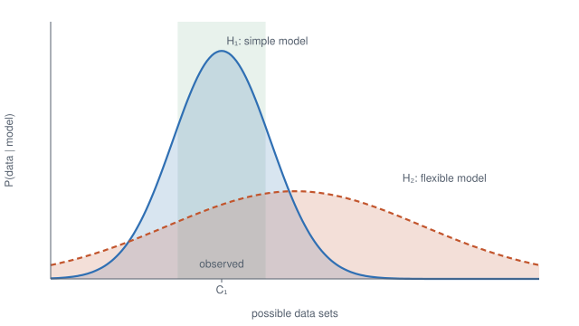
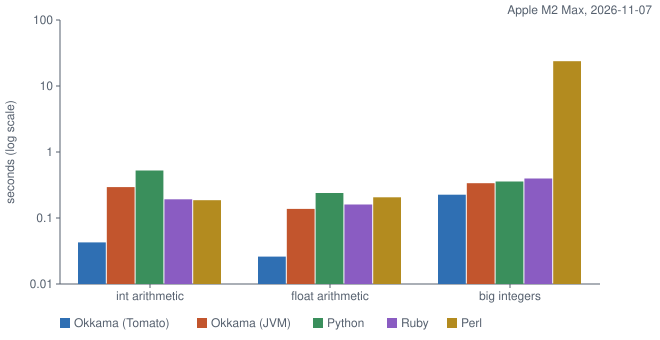
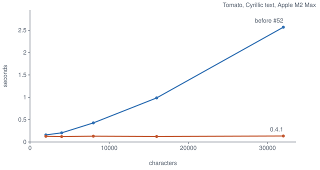
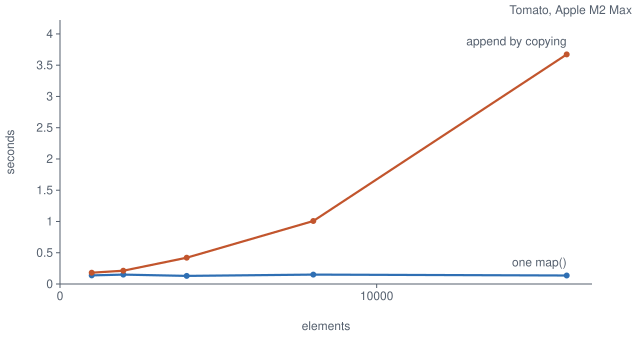

<!-- Generated by build.py from chapters/en; edit the chapters. -->
# The Okkama Bible

## Contents

- [Part I. The Razor](#part-i-the-razor)
- [Chapter 1. Entities Must Not Be Multiplied](#chapter-1-entities-must-not-be-multiplied)
  - [1.1 A Franciscan from Surrey](#11-a-franciscan-from-surrey)
  - [1.2 What the razor says, and what it does not](#12-what-the-razor-says-and-what-it-does-not)
  - [1.3 Why simple explanations predict better](#13-why-simple-explanations-predict-better)
  - [1.4 The same rule, rediscovered for software](#14-the-same-rule-rediscovered-for-software)
  - [1.5 The other side: worse is better](#15-the-other-side-worse-is-better)
  - [1.6 Okkama's razor, entity by entity](#16-okkamas-razor-entity-by-entity)
  - [1.7 A first taste](#17-a-first-taste)
  - [1.8 What the razor costs](#18-what-the-razor-costs)
  - [1.9 How to read this book](#19-how-to-read-this-book)
- [Chapter 2. A Short History of Objects](#chapter-2-a-short-history-of-objects)
  - [2.1 Simula: objects for simulation](#21-simula-objects-for-simulation)
  - [2.2 Smalltalk: everything is a message](#22-smalltalk-everything-is-a-message)
  - [2.3 C++ and Java: objects for industry](#23-c-and-java-objects-for-industry)
  - [2.4 The trouble with inheritance](#24-the-trouble-with-inheritance)
  - [2.5 The trouble with state](#25-the-trouble-with-state)
  - [2.6 Objects as behaviour](#26-objects-as-behaviour)
  - [2.7 Elegant Objects: the discipline](#27-elegant-objects-the-discipline)
  - [2.8 Composition in practice](#28-composition-in-practice)
  - [2.9 What was lost](#29-what-was-lost)
- [Chapter 3. The Manifesto, Rule by Rule](#chapter-3-the-manifesto-rule-by-rule)
  - [3.1 Rule one: objects expose behaviour, not state](#31-rule-one-objects-expose-behaviour-not-state)
  - [3.2 Rule two: state is bound at construction, and constructors guard it](#32-rule-two-state-is-bound-at-construction-and-constructors-guard-it)
  - [3.3 Rule three: change is a new object](#33-rule-three-change-is-a-new-object)
  - [3.4 Rule four: there is no null](#34-rule-four-there-is-no-null)
  - [3.5 Rule five: conditions are booleans](#35-rule-five-conditions-are-booleans)
  - [3.6 Rule six: numbers are exact, and categories never mix silently](#36-rule-six-numbers-are-exact-and-categories-never-mix-silently)
  - [3.7 Rule seven: roles instead of inheritance](#37-rule-seven-roles-instead-of-inheritance)
  - [3.8 Rule eight: failures are typed, and bugs are not exceptions](#38-rule-eight-failures-are-typed-and-bugs-are-not-exceptions)
  - [3.9 Rule nine: resources are released deterministically](#39-rule-nine-resources-are-released-deterministically)
  - [3.10 Rule ten: authority is explicit](#310-rule-ten-authority-is-explicit)
  - [3.11 Rule eleven: concurrency is structured](#311-rule-eleven-concurrency-is-structured)
  - [3.12 One design, not eleven](#312-one-design-not-eleven)
- [Part II. Values](#part-ii-values)
- [Chapter 4. Types at a Glance](#chapter-4-types-at-a-glance)
  - [4.1 What a type is for](#41-what-a-type-is-for)
  - [4.2 The inventory](#42-the-inventory)
  - [4.3 Where types are written](#43-where-types-are-written)
  - [4.4 Nominal, not structural](#44-nominal-not-structural)
  - [4.5 Inference: local and exact](#45-inference-local-and-exact)
  - [4.6 The top type `any`](#46-the-top-type-any)
  - [4.7 What the compiler checks, and what remains for run time](#47-what-the-compiler-checks-and-what-remains-for-run-time)
  - [4.8 Limits](#48-limits)
- [Chapter 5. Numbers](#chapter-5-numbers)
  - [5.1 Four categories](#51-four-categories)
  - [5.2 Exact integers](#52-exact-integers)
  - [5.3 Exact rationals](#53-exact-rationals)
  - [5.4 Floating point, kept finite](#54-floating-point-kept-finite)
  - [5.5 Bytes](#55-bytes)
  - [5.6 Conversions](#56-conversions)
  - [5.7 What exactness costs](#57-what-exactness-costs)
  - [5.8 Limits](#58-limits)
- [Chapter 6. Text](#chapter-6-text)
  - [6.1 Three layers of text](#61-three-layers-of-text)
  - [6.2 Okkama's choice: immutable code points](#62-okkamas-choice-immutable-code-points)
  - [6.3 Writing strings](#63-writing-strings)
  - [6.4 What a string can do](#64-what-a-string-can-do)
  - [6.5 Equality and normalisation](#65-equality-and-normalisation)
  - [6.6 Text and bytes](#66-text-and-bytes)
  - [6.7 Characters](#67-characters)
  - [6.8 What text costs](#68-what-text-costs)
  - [6.9 Limits](#69-limits)
- [Chapter 7. Absence Without Null](#chapter-7-absence-without-null)
  - [7.1 What null means — too many things](#71-what-null-means--too-many-things)
  - [7.2 Okkama's answer: one construct per meaning](#72-okkamas-answer-one-construct-per-meaning)
  - [7.3 `Maybe<T>`](#73-maybet)
  - [7.4 `Presence<T>`: three states for updates](#74-presencet-three-states-for-updates)
  - [7.5 How other languages handle absence](#75-how-other-languages-handle-absence)
  - [7.6 What it costs](#76-what-it-costs)
  - [7.7 Limits](#77-limits)
- [Chapter 8. Collections](#chapter-8-collections)
  - [8.1 Arrays](#81-arrays)
  - [8.2 Functional operations](#82-functional-operations)
  - [8.3 Maps](#83-maps)
  - [8.4 Ranges](#84-ranges)
  - [8.5 Building and changing collections](#85-building-and-changing-collections)
  - [8.6 Iterating user collections](#86-iterating-user-collections)
  - [8.7 Limits](#87-limits)
- [Chapter 9. Expressions and Control Flow](#chapter-9-expressions-and-control-flow)
  - [9.1 Blocks have values](#91-blocks-have-values)
  - [9.2 Names are bound once](#92-names-are-bound-once)
  - [9.3 Operators](#93-operators)
  - [9.4 Choosing](#94-choosing)
  - [9.5 Loops](#95-loops)
  - [9.6 `return`](#96-return)
  - [9.7 Order of evaluation](#97-order-of-evaluation)
  - [9.8 What is not there](#98-what-is-not-there)
  - [9.9 Limits](#99-limits)
- [Chapter 10. Failure: throw, panic, try/catch, causes, confirm](#chapter-10-failure-throw-panic-trycatch-causes-confirm)
  - [10.1 Who should hear about a failure](#101-who-should-hear-about-a-failure)
  - [10.2 A short history: codes, exceptions, values](#102-a-short-history-codes-exceptions-values)
  - [10.3 Resumption: the road not taken](#103-resumption-the-road-not-taken)
  - [10.4 Bugs are not values: panic and runtime errors](#104-bugs-are-not-values-panic-and-runtime-errors)
  - [10.5 Error enums](#105-error-enums)
  - [10.6 throw](#106-throw)
  - [10.7 try and catch](#107-try-and-catch)
  - [10.8 Causes](#108-causes)
  - [10.9 confirm: the contract inside the code](#109-confirm-the-contract-inside-the-code)
  - [10.10 try? and try!](#1010-try-and-try)
  - [10.11 Failures from the host](#1011-failures-from-the-host)
  - [10.12 A boundary in practice](#1012-a-boundary-in-practice)
  - [10.13 Budgets are not failures](#1013-budgets-are-not-failures)
  - [10.14 Failures across tasks](#1014-failures-across-tasks)
  - [10.15 What reaches the top](#1015-what-reaches-the-top)
  - [10.16 Designing an error vocabulary](#1016-designing-an-error-vocabulary)
  - [10.17 Testing failures](#1017-testing-failures)
  - [10.18 Okkama among other languages](#1018-okkama-among-other-languages)
  - [10.19 What this design costs](#1019-what-this-design-costs)

# Part I. The Razor

# Chapter 1. Entities Must Not Be Multiplied

A programming language is a theory of programs. It says which things exist —
values, objects, functions, errors, threads — and which relations between
them are allowed. Like any theory, it can explain a great deal with few
entities or explain the same with many. Okkama is named after the medieval
philosopher who gave the most famous rule for choosing between such theories,
and the name is a promise: wherever two designs do the same work, the language
keeps the one with fewer things in it.

This chapter is about that promise. It tells where the rule comes from, what
it does and does not claim, why there are good mathematical reasons to trust
it, how the best-known computer scientists arrived at the same rule for
software, and what it means concretely for Okkama — including the price.
Everything else in the book follows from it.

## 1.1 A Franciscan from Surrey

William of Ockham was born around 1287 in the village of Ockham in Surrey,
studied and taught theology at Oxford, and spent the second half of his life
in exile after a dispute with Pope John XXII about the poverty of the
Franciscan order; he died in Munich around 1347 [[Spade 2019](#ref-spade-sep)]. He was a
logician and a nominalist: he held that only individual things exist, and
that general terms such as "humanity" or "redness" are signs we use for many
individuals, not additional entities standing behind them.

His nominalism is the razor at work. Where his predecessors explained why two
white things are both white by positing a third thing — a real universal,
"whiteness" — Ockham asked whether the explanation needed it. If two white
things, our concept and the word "white" already account for everything we
observe, the universal adds nothing but itself. He wrote the principle in
several forms; one that recurs in his works is *numquam ponenda est pluralitas
sine necessitate*, "plurality is never to be posited without necessity"
[[Spade 2019](#ref-spade-sep)].

The words people usually quote — *entia non sunt multiplicanda praeter
necessitatem*, "entities must not be multiplied beyond necessity" — are not
in Ockham's writings at all. They are a later formulation, and the
attribution of the "razor" to Ockham by name is itself a product of later
centuries [[Thorburn 1918](#ref-thorburn1918)]. The principle is older than him, too: Aristotle
and many scholastics used versions of it. Ockham's name stuck because he used
it so relentlessly that it became his signature tool.

For our purposes the history teaches two things. First, the razor is a rule
about *explanations*, not about the world: it does not claim that the world is
simple, only that we should not complicate our account of it without a reason.
Second, it cuts in one direction only. It removes entities that do no work; it
says nothing against entities that do.

## 1.2 What the razor says, and what it does not

Philosophers distinguish two kinds of simplicity that the razor can mean
[[Baker 2022](#ref-baker-sep)]. **Elegance** (syntactic simplicity) is about the number and
complexity of the principles of a theory: fewer axioms, shorter laws.
**Parsimony** (ontological simplicity) is about the number and kinds of
things a theory says exist. A theory can be elegant and extravagant at once —
one short law that requires a new kind of particle — or parsimonious and
clumsy.

Both readings matter for a language. Elegance is the size of the language
definition: how many rules a programmer must hold in their head. Parsimony is
the set of things that can exist at run time: whether there is a null, a
mutable cell, a class hierarchy, a global variable, a thread. Okkama cares
about both, but it is above all a *parsimonious* language. Its specification
is not short — Okkama is careful and explicit, and careful rules take words —
but the inventory of things a program can contain is deliberately small.

The razor is also a **heuristic, not a proof**. Elliott Sober's careful study
of its uses shows that "Ockham's razor" names several different principles,
each justified — when it is justified — by a different argument, and that
none of them says "the simpler theory is true" [[Sober 2015](#ref-sober2015)]. In practice the
razor is a rule for *choosing* when the evidence does not decide, and a rule
for *burden of proof*: whoever wants to add an entity must show the work it
does.

That is exactly how Okkama uses it. Every construct that other languages have
and Okkama lacks — null, inheritance, setters, truthiness, implicit
conversions, catch-all handlers — had to answer the question "what work does
this do that the remaining constructs cannot?" Where the answer was "it saves
some typing", the construct was removed. Where the answer was "nothing else
can express this", the construct stayed, or a smaller one replaced it.

## 1.3 Why simple explanations predict better

It is tempting to treat the razor as an aesthetic preference — simpler is
prettier. There are, however, at least three independent mathematical reasons
to prefer the simpler of two theories that fit the facts equally well, and
all three translate into software.

### The Bayesian Occam factor

Suppose two models could have produced our observations: a simple one, H₁,
that can produce only a narrow range of outcomes, and a flexible one, H₂, that
can produce almost anything. Each model spreads one unit of probability over
the outcomes it can produce. The simple model concentrates its unit; the
flexible one thins it out. If the observed data fall in the narrow range both
can explain, the simple model assigned them a higher probability — and Bayes'
rule rewards it with a higher posterior, *without any prior preference for
simplicity* [[MacKay 2003](#ref-mackay2003)]. MacKay calls the ratio by which the flexible model
is penalized the *Occam factor*.



*Figure 1.1. The Bayesian Occam factor. Both models give probability 1 in total; the simple one concentrates it, so on data in C₁ it wins (after MacKay 2003, ch. 28).*

The software analogue is a type. A function whose type says `(int) is int`
"predicts" a narrow set of behaviours; a function of type `(any) is any`
predicts almost anything. When the narrow one is correct, its type tells the
reader — and the compiler — far more. Wadler made this precise for parametric
polymorphism: the more general a type, the fewer functions can have it, and
the more a reader can deduce from the type alone [[Wadler 1989](#ref-wadler1989)].

### Minimum description length

Rissanen proposed to choose the model that gives the shortest total
description of the data: the length of the model plus the length of the data
encoded with the model's help [[Rissanen 1978](#ref-rissanen1978)]. A model that is too simple
leaves much to encode; a model that is too complex costs more to state than it
saves. The best model compresses the most.

A program is such a description. Every concept a language forces you to state
— a null check, an adapter between two error conventions, a defensive copy of
a mutable object — is length added to every program, length that encodes
nothing about the problem.

### Kolmogorov complexity

The limit of this idea is the length of the shortest program that produces a
given object, its Kolmogorov complexity [[Li 2019](#ref-li2019)]. It is uncomputable, but it
gives the intuition a firm ground: an object is simple if it has a short
description, and regularity *is* compressibility. Languages differ in which
regularities they make short to state. A language with immutability by
default makes "this does not change" free and "this changes" explicit; a
language with mutability by default does the opposite. Okkama chooses which
facts are cheap to say so that the common, safe case is the short one.

## 1.4 The same rule, rediscovered for software

None of the founders of software engineering cited Ockham, yet many arrived
at his rule from the opposite direction — from the pain of maintaining
complicated programs.

**Hoare** ended his Turing Award lecture with a sentence that is now
practically the razor of software: "There are two ways of constructing a
software design: one way is to make it so simple that there are obviously no
deficiencies, and the other way is to make it so complicated that there are no
obvious deficiencies. The first method is far more difficult" [[Hoare 1981](#ref-hoare1981)].
In the same lecture he described how a language with too many features
(PL/I, and later Ada) becomes impossible to implement reliably and to learn
completely.

**Dijkstra** argued that a programmer's main limitation is the size of their
own head: "The competent programmer is fully aware of the strictly limited
size of his own skull; therefore he approaches the programming task in full
humility, and among other things he avoids clever tricks like the plague"
[[Dijkstra 1972](#ref-dijkstra1972)]. Four years earlier he had removed an entity from programming
— the unrestricted jump — on the grounds that it made the dynamic behaviour of
a program unrelated to its text [[Dijkstra 1968](#ref-dijkstra1968)].

**Brooks** separated *essential* complexity, which belongs to the problem,
from *accidental* complexity, which we add with our tools, and argued that no
single tool would remove the essential part [[Brooks 1987](#ref-brooks1987)]. A language cannot
make a tax law simpler. It can stop adding to it.

**Moseley and Marks** went further and named the main source of accidental
complexity: *state*, and in particular mutable state shared between parts of
a program, followed by control flow and code volume [[Moseley 2006](#ref-moseley2006)]. Their
paper is the most direct argument for the design of Okkama's object model:
state exists, but it is fixed at construction, and every "change" is a new
value whose existence the program text must acknowledge.

**Hickey** made the distinction that saves the razor from a common
misunderstanding [[Hickey 2011](#ref-hickey2011)]. *Simple* means "one fold": not braided
together with other concerns, an objective property. *Easy* means "near at
hand": familiar, quick to type, a property of the reader. Null is easy — every
mainstream programmer knows it — and not simple, because it braids "a value"
with "maybe no value" in every reference of the program. Okkama chooses simple
over easy wherever the two disagree, and this book will point out each time
the choice costs ease.

**Parnas** showed that the criterion for splitting a system into modules is
the hiding of design decisions likely to change [[Parnas 1972](#ref-parnas1972)], and
**Ousterhout** turned it into a measure: a good module is *deep*, offering a
simple interface over a large implementation, and complexity is what you must
know to change a system safely [[Ousterhout 2018](#ref-ousterhout2018)]. Okkama's private fields and
nominal roles are information hiding made mandatory.

**Wirth**, who designed Pascal, Modula-2 and Oberon by removing features,
warned that software grows faster than hardware improves because nobody pays
for removing things [[Wirth 1995](#ref-wirth1995)]. Each of his languages was smaller than the
one before.

## 1.5 The other side: worse is better

A fair account must give the opposing argument its full strength. In 1991
Richard Gabriel observed that the systems that spread are often not the
cleanest ones [[Gabriel 1991](#ref-gabriel1991)]. Unix and C won over Lisp machines and more
principled designs because they were *simple to implement*, even when this
made them less simple, less consistent or less correct to use. He called this
"worse is better": implementation simplicity first, then interface
simplicity, with correctness and completeness negotiable.

Gabriel's essay is not a rejection of the razor; it is a dispute about *whose*
simplicity counts. Worse-is-better shaves the implementation and lets the
user carry the complexity; the "right thing" shaves the user's model and lets
the implementation carry it. Okkama sits firmly on the second side: the
compiler, the verifier and the runtime do a great deal of work — exact
numbers that promote to big integers, precise garbage collection with
deterministic destruction, a bytecode verifier — so that the program text can
stay small and the set of things a reader must consider stays small.

The price is real. A language that refuses conveniences is harder to adopt.
Programmers arrive with habits from languages that have null, mutable fields
and inheritance, and Okkama asks them to unlearn. Gabriel's warning applies:
correctness does not guarantee adoption. This book tries to answer the warning
in the only honest way — by showing, chapter after chapter, what each refusal
buys, and by saying plainly where it costs too much.

## 1.6 Okkama's razor, entity by entity

The table below is the shortest summary of the language. Each line names an
entity that most popular languages have, what Okkama has instead, and the
chapter that argues the case.

| Removed entity | What does the work instead | Chapter |
|---|---|---|
| `null`, `nil`, implicit optionals, `?.` | `Maybe<T>` and `Presence<T>` opened with `else`, `??`, `match` | 7 |
| Truthiness (`if 1`, `if ""`) | conditions are exactly `bool` | 9 |
| Implicit numeric conversion (`1 == 1.0`) | exact categories `int`, `byte`, `rat`, `float`; explicit casts | 5 |
| Integer overflow | `int` arithmetic is exact and promotes to big integers | 5 |
| Public fields, getters and setters | private `has` fields; objects expose behaviour | 12 |
| Mutation after construction | successor actions `is ^T` return a new object | 13 |
| Inheritance, `super`, `abstract`, `protected` | roles (nominal contracts) and composition | 14 |
| Mocking frameworks | `fake` blocks shipped with every role | 15 |
| Catch-all handlers and `finally` | typed `catch`, `defer`, failure causes | 10 |
| Finalizers and "close in finally" | `destroy` blocks run when the owner leaves scope | 11 |
| Global functions and static state | behaviour lives on objects; modules export declarations | 12, 19 |
| Unstructured threads | `async`/`await` with structured cancellation; process-isolated `spawn` | 20 |
| Ambient authority of native code | natives behind declared groups and budgets | 21 |

Some of these words are not merely absent but *removed*: `null`, `nil`,
`isa`, `super`, `abstract`, `protected`, `var` and a few others are reserved
so that a program using them fails to parse with a message instead of meaning
something else. The language does not just leave the door open with nothing
behind it; it bricks the door up and puts a sign on it.

Notice what the table does *not* contain. Okkama is not a minimal language in
the sense of Scheme or Forth. It has exact rationals and big integers, a
standard library that speaks HTTP/2 and PostgreSQL, structured concurrency,
precise collection, and a JIT compiler. The razor is applied to *kinds of
entities in a program*, not to the size of the toolbox. A language may have
many tools and few kinds of things; Okkama aims to be such a language.

## 1.7 A first taste

Here is a complete program. It declares an object with one private field,
one constructor and two actions, and uses it once.

```okkama
module bible/bottle v1.0.0;

import "io/stdout" take Stdout;

// A bottle never changes: opening one gives a new, opened bottle.
object Bottle {
    has opened is bool = false;

    Bottle() {}

    open() is ^Bottle {
        confirm !opened;
        ^opened = true;
    }

    state() is string {
        if opened { "open"; } else { "closed"; }
    }
}

main() is int {
    let out = Stdout();
    let bottle = Bottle();
    let poured = bottle.open();
    out.writeln("the first bottle is " + bottle.state());
    out.writeln("its successor is " + poured.state());
    0;
}
```

Output:

```text
the first bottle is closed
its successor is open
```

Even this toy shows four of the rules from the table. The field `opened` is
private: nothing outside `Bottle` can read or write it. The object exposes
behaviour (`open`, `state`), not data. `open()` does not change the bottle — its
signature `is ^Bottle` says it returns a *successor*, a new bottle in which
`opened` is `true`, and the caller has to take that result (discarding a
successor is an error). And `confirm !opened` states an invariant: opening an
opened bottle is a failure, not a silent no-op. After `open()`, both bottles
exist, and the program can say which one it means.

A Java programmer would write this with a mutable field and a setter in fewer
characters. The Okkama version is longer by a word or two and removes a whole
category of question: "who else holds a reference to this bottle, and did they
expect it to stay closed?"

## 1.8 What the razor costs

A book that only praised its subject would not be worth reading, and the
razor itself demands that we count costs as carefully as benefits. Here are
the main ones; later chapters return to each.

- **More objects, more words.** Without setters and with successors, programs
  name more things: a new object per state, a role per capability. Okkama's
  standard library shows both sides — clear contracts, and occasionally
  constructions like `BigQuotient(left: a, right: b).value()` where a method
  would read better (issue #190 proposes exactly that).
- **Performance of immutable updates.** A new object per change costs
  allocations; collection updates without in-place mutation cost copies. The
  Sparrow core makes allocation cheap and the compiler removes much of it, but
  some idioms are quadratic today — arrays have no append, so building one
  element by element copies it each time (issue #145). The razor removed
  mutation; it must not remove efficiency, and the remedy is to add the right
  *operation*, not the mutable entity.
- **Unlearning.** Most programmers think with null, inheritance and mutable
  state. Okkama asks for a different habit of thought — the one *Elegant
  Objects* argued for in Java [[Bugayenko 2016](#ref-bugayenko2016)] — and enforces it.
- **Things that are genuinely missing.** Some removals were made before their
  replacements were complete. The standard library audit of November 2026
  filed more than a hundred issues where the language or library lacks an
  operation that a smaller design needs — string searching, hashing for
  object keys, default parameters (issues #145–#155, #210–#216). The razor is
  not an excuse for those gaps; Chapter 32 lists them openly.

## 1.9 How to read this book

The book has seven parts. Part I, which you are reading, gives the
philosophy and the history that shaped Okkama. Parts II–V teach the language
from values to whole programs; each chapter explains a construct, shows it
working in examples you can run, cites the research and practice it builds
on, and ends with its limits. Part VI opens the implementation: the compiler,
the three engines, the Sparrow core with its JIT and garbage collector, and
the machinery that keeps it safe and fast. Part VII is about judgement —
building real programs, comparing Okkama with other languages, and the open
problems.

Every program in the book is in `docs/OkkamaBible/examples`, and every one is
checked: `build.py --check` runs it on the IR interpreter and on the Sparrow
core and compares the output with the text you read. Tables of builtin
behaviour and of the standard library are generated from the code. If the
book and the implementation ever disagree, the implementation is right and
the book has a bug — please report it.

A note on citations: claims about the design are backed by references to the
work of other authors, listed in the bibliography at the end. They are there
not to borrow authority — a good argument stands on its own — but to show
where each idea comes from and where to read the full argument. Okkama
invented few of its ideas. What it adds is the decision to make them all
mandatory at once.

# Chapter 2. A Short History of Objects

Okkama calls itself an object language, and it disagrees with most other
object languages about what an object is. To see why, we have to go back to
where objects came from, follow how the idea changed as it moved from
research into industry, and look at the problems that the industrial version
created. Okkama is an attempt to keep what the original idea got right and to
remove, by rule, what the industrial version added and later regretted.

## 2.1 Simula: objects for simulation

The first object language was built to simulate ships in a harbour. At the
Norwegian Computing Center in Oslo, Ole-Johan Dahl and Kristen Nygaard needed
to describe systems made of many independent, interacting things — ships,
cranes, queues — each with its own state and its own course of action over
time [[Dahl 1966](#ref-dahl1966); [Nygaard 1978](#ref-nygaard1978)]. Simula I (1962–1965) gave each such thing a
*process*; Simula 67 generalised it into the constructs every object
language has since borrowed: the *class*, describing a kind of object; the
*object*, an instance with its own data; *subclassing* ("prefixing"), where a
class extends another; and *virtual procedures*, which a subclass may
redefine.

Two things about Simula matter for the rest of this chapter. First, objects
were invented to *model behaviour over time*: a ship is not a record of
fields but something that acts. Second, inheritance arrived together with
objects, as a way to say "a tanker is a ship with more cargo". The two ideas
were born joined, and for thirty years most languages kept them joined.

## 2.2 Smalltalk: everything is a message

Alan Kay saw Simula in 1966 and drew a different lesson from it. In his
history of Smalltalk he describes his idea of objects as being like
biological cells or computers on a network: independent units that
communicate only by sending messages, none of them able to reach into
another's insides [[Kay 1993](#ref-kay1993)]. Smalltalk, developed at Xerox PARC in the 1970s
by Kay, Dan Ingalls, Adele Goldberg and others, made this uniform:
everything is an object, and all computation is objects sending messages to
objects.

Kay later summed up what he meant in a sentence that is quoted almost as
often as Hoare's: "OOP to me means only messaging, local retention and
protection and hiding of state-process, and extreme late-binding of all
things" [[Kay 2003](#ref-kay2003)]. Notice what is *not* in the list: classes, inheritance,
types. For Kay these were implementation choices; the essence was that an
object hides its state and responds to messages.

Okkama is closer to Kay's list than to Simula's. Its objects hide their state
absolutely — there is no syntax to read another object's field — and they are
used only through their actions. It parts with Smalltalk on the last item:
Okkama binds early and checks statically, because late binding of everything
makes the program text say less about what the program does (Chapter 14).

## 2.3 C++ and Java: objects for industry

The idea reached industry through C++ and Java. Bjarne Stroustrup began "C
with Classes" at Bell Labs in 1979, bringing Simula's classes to C so that
large systems could be organised without giving up C's efficiency
[[Stroustrup 1994](#ref-stroustrup1994)]. Java, released by Sun in 1995, simplified C++ and made
classes and objects the only way to organise a program, with single
inheritance of classes, multiple inheritance of interfaces, garbage
collection — and `null` [[Gosling 2023](#ref-gosling2023)].

In these languages an object became, above all, a *type with data and
methods*, and inheritance became the main mechanism of *reuse*: to get the
behaviour of a class, extend it. Conventions grew around this model. Fields
were made private, but every field got a public getter and often a setter, so
that frameworks could fill objects from databases and forms. Objects became
mutable containers of data with procedures attached — far from Kay's cells.

The model was enormously successful, and it also produced a set of problems
so persistent that a large part of the object-oriented literature of the
1990s and 2000s is about avoiding its own core mechanisms.

## 2.4 The trouble with inheritance

Already in 1986 Alan Snyder pointed out that inheritance breaks the very
encapsulation objects were supposed to provide: a subclass depends on how its
parent is implemented, not only on what it promises, so the parent can no
longer change its insides freely [[Snyder 1986](#ref-snyder1986)]. The phenomenon got a name, the
*fragile base class problem*: an apparently safe change to a base class —
adding a method, calling one method from another — breaks subclasses its
author has never seen [[Mikhajlov 1998](#ref-mikhajlov1998)].

Barbara Liskov and Jeannette Wing gave the precise condition under which a
subtype may stand in for its supertype: it must preserve the supertype's
behaviour — its invariants, preconditions and postconditions — not only its
method signatures [[Liskov 1994](#ref-liskov1994)]. Inheritance in mainstream languages checks
the signatures and leaves the behaviour to luck. A `Square` that extends a
mutable `Rectangle` type-checks perfectly and breaks every caller that sets
the width and expects the height to stay.

The "Gang of Four" put the conclusion at the front of their catalogue of
design patterns: "Favor object composition over class inheritance", and
"Program to an interface, not an implementation" [[Gamma 1994](#ref-gamma1994)]. Most of their
patterns — Decorator, Strategy, Composite, Proxy — are ways to get the reuse
inheritance promised by composing objects instead. Joshua Bloch, who designed
much of the Java collections library, gave the same advice to Java
programmers: favour composition over inheritance, and "design and document
for inheritance or else prohibit it" [[Bloch 2018](#ref-bloch2018)].

When the most-cited books on a paradigm advise against using one of its two
founding mechanisms, the razor has an obvious candidate.

## 2.5 The trouble with state

The second problem is mutable state, and objects made it worse by hiding it
behind friendly names. A mutable object shared between two parts of a program
is a channel between them: a change made by one is seen by the other, at a
time the other did not choose. Moseley and Marks argue that this kind of
state is the largest source of accidental complexity in software
[[Moseley 2006](#ref-moseley2006)]: to understand what a method does, you must know every state
the object can be in, and every path by which it got there.

Getters and setters make the problem invisible. An object with a getter and a
setter for each field is a record with extra steps; any part of the program
can change it, and its invariants live in the heads of the people who
remember to call the setters in the right order. Bloch's advice — "minimize
mutability", make classes immutable unless there is a very good reason
[[Bloch 2018](#ref-bloch2018)] — is, again, advice to avoid what the language makes easiest.

Bertrand Meyer attacked the same problem from the side of contracts. In
Eiffel and in *Object-Oriented Software Construction*, a class states its
invariants and each routine its preconditions and postconditions, and the
runtime checks them [[Meyer 1992](#ref-meyer1992); [Meyer 1997](#ref-meyer1997)]. Meyer also proposed the
*command–query separation* principle: a routine either changes the state
(a command) or returns information (a query), never both. Okkama's successor
actions can be read as command–query separation taken to its end: there are
no commands in place; a "command" is a query that returns the next object.

## 2.6 Objects as behaviour

What, then, is an object if not data with methods? William Cook gave a
precise answer by contrasting objects with *abstract data types* [[Cook 2009](#ref-cook2009)].
An abstract data type hides a representation behind a set of operations that
all know the representation — a module can compare two of its values by
looking inside both. An object is a *procedural* abstraction: it knows only
itself, and it interacts with another object only through that object's
interface. Two objects implementing the same interface may have completely
different representations and still work together.

This is Kay's idea in a formal dress, and it is the idea Okkama keeps. An
Okkama object is defined by the actions it offers; a role names a set of
actions; any object that declares it does the role can stand in for it, and
nothing — not even an object of the same kind — can look at its fields.

## 2.7 Elegant Objects: the discipline

In 2016 and 2017 Yegor Bugayenko published *Elegant Objects*, two short and
deliberately provocative volumes that turn the criticisms above into a code of
practice for Java programmers [[Bugayenko 2016](#ref-bugayenko2016); [Bugayenko 2017](#ref-bugayenko2017)]. Its rules are
blunt: never use `null`; no getters and setters; objects must be immutable;
constructors only assign fields, and real work happens in methods; no static
methods and no utility classes; no class inheritance beyond what is
unavoidable; extend behaviour with decorators; replace mocks with fake
implementations of interfaces; name objects as things, not as "-er" doers
(a `Cash`, not a `CashFormatter`).

Many experienced programmers find the rules excessive, and in Java they are
costly to follow: the language, the libraries and the frameworks all push the
other way, and nothing checks that a team actually follows them. Code review
is the only enforcement, and code review is tired at five in the afternoon.

Okkama starts where *Elegant Objects* stops. It takes the discipline and
makes it the language, so that the compiler and the runtime enforce what a
reviewer would otherwise have to catch:

| *Elegant Objects* rule | Okkama rule |
|---|---|
| Never use `null` | there is no null; `null` and `nil` are reserved words that do not parse |
| No getters and setters | fields are private, always; there is no field access from outside and no setter syntax |
| Objects are immutable | fields are bound only during construction |
| A changed object is a new object | successor actions `is ^T` return a new object; discarding it is an error |
| No inheritance | there is no `extends`, `super`, `abstract` or `protected` |
| Program to interfaces | roles are nominal contracts implemented with `does` |
| Fakes instead of mocks | a role can carry a `fake` block, its reference test double |
| Constructors bind and validate | constructors bind fields and check invariants with `confirm` |
| Fail fast | `confirm` failures are panics or typed errors; there are no partial results |

## 2.8 Composition in practice

Here is the decorator pattern, which the Gang of Four offered as the
alternative to subclassing, written in Okkama. A role says what a price can
do; one object holds a listed amount; two decorators each wrap any price and
change one thing about it.

```okkama
module bible/decorators v1.0.0;

import "io/stdout" take Stdout;

// A price is anything that can say how many cents it is.
role Price {
    cents() is int;
}

object Listed does Price {
    has amount is int;
    Listed(amount is int) { self.amount = amount; }
    cents() is int { amount; }
}

// Decorators: each wraps another Price and adds one rule.
object Discounted does Price {
    has origin is Price;
    has percent is int;
    Discounted(:origin, :percent);
    cents() is int { origin.cents() - int(origin.cents() * percent / 100); }
}

object Taxed does Price {
    has origin is Price;
    has percent is int;
    Taxed(:origin, :percent);
    cents() is int { origin.cents() + int(origin.cents() * percent / 100); }
}

main() is int {
    let out = Stdout();
    let book is Price = Listed(2000);
    let sale is Price = Discounted(origin: book, percent: 10);
    let checkout is Price = Taxed(origin: sale, percent: 20);
    out.writeln("listed:   " + book.cents().string());
    out.writeln("on sale:  " + sale.cents().string());
    out.writeln("checkout: " + checkout.cents().string());
    0;
}
```

Output:

```text
listed:   2000
on sale:  1800
checkout: 2160
```

There is no hierarchy here. `Discounted` and `Taxed` are not kinds of
`Listed`; they are things that *have* a price and *are* prices. They can be
stacked in any order, wrapped around any present or future implementation of
`Price`, and tested with a fake price instead of a real one. Each object has
one reason to exist and is a few lines long.

Two details show the rest of the language at work. The shorthand constructor
`Discounted(:origin, :percent);` binds two fields from named arguments, and
callers must name them: `Discounted(origin: book, percent: 10)`. And the
discount is computed with an explicit `int(...)`: in Okkama, dividing two
integers gives an exact rational number, not a truncated integer, so turning
it back into cents is a decision the program must write down. Chapter 5
explains why.

## 2.9 What was lost

Removing inheritance removes real conveniences, and it would be dishonest to
pretend otherwise.

- **Implementation reuse.** A subclass inherits dozens of methods for free; a
  decorator must implement every action of its role, even those it merely
  forwards. For roles with many actions this is boilerplate. Several
  languages answer with automatic delegation; Okkama has none, and default
  action bodies in roles were considered and declined (issue #146): a role
  stays a pure contract, with no implementation to inherit through the back
  door. Forwarding is written by hand.
- **Frameworks built on hierarchies.** Many libraries — GUI toolkits, web
  frameworks, ORMs — are organised as base classes to extend. Their designs
  do not translate directly; Okkama's standard library had to be written in
  the compositional style from the start, and some of it shows the strain
  (Chapter 22).
- **A familiar vocabulary.** "Is-a" is how textbooks teach modelling. Okkama
  asks for "has-a" and "does": a tanker *has* a hull and *does* the role of a
  ship. The modelling is often clearer, but it must be learned.

The trade is the one the literature has recommended for thirty years. Okkama
simply stops offering the alternative.

# Chapter 3. The Manifesto, Rule by Rule

Chapter 1 gave the razor; Chapter 2 gave the history it cuts through. This
chapter states Okkama's rules one by one. For each rule it says what the rule
removes, why — with the strongest argument from the literature — what the
compiler answers when a program breaks it, and what the rule costs. The
later chapters teach each construct in detail; here the aim is to see the
whole design at once and to see that it is *one* design: the rules support
each other, and removing one would weaken several others.

Every rejected program in this chapter is real. `build.py --check` compiles
each one and compares the compiler's message with the text printed here.

## 3.1 Rule one: objects expose behaviour, not state

An object's fields are visible only inside the object. There is no syntax to
read another object's field, no `public` modifier to open one, and no getter
generated from a field. An object is used through its actions.

```okkama
module bible/rules v1.0.0;
object Bottle {
    has opened is bool = false;
    Bottle() {}
}
main() is int {
    let bottle = Bottle();
    if bottle.opened { return 1; }
    0;
}
```

The compiler answers:

```text
03-field-rejected.ok:8:15: semantic error: Field "opened" of object "Bottle" is private; call an action instead
```

**Why.** Information hiding is the oldest principle of modular design:
Parnas showed in 1972 that a module should hide the decisions most likely to
change, and that the representation of data is the first among them
[[Parnas 1972](#ref-parnas1972)]. Cook's analysis of objects adds that an object is defined by
its interface alone; two objects with different representations that offer
the same actions are interchangeable [[Cook 2009](#ref-cook2009)]. If a field can be read from
outside, its representation becomes part of every reader's contract, and it
can never change again.

Getters do not solve this — they restate it. A getter for every field is a
public field with a function call around it. *Elegant Objects* argues that an
object should be asked to *do* something with its data, not to give it away
[[Bugayenko 2016](#ref-bugayenko2016)]: not `invoice.total()` followed by formatting in the caller,
but `invoice.printed(format)`. Okkama does not forbid an action that returns a
field's value — `cents() is int { cents; }` is legal and common — but it makes
that a decision written in the object, not a default.

**Cost.** Some objects really are just data: a point, a date, a row from a
database. For them, actions that return fields are boilerplate. Okkama's
answer today is to write them; a future shorthand is discussed in Chapter 32.

## 3.2 Rule two: state is bound at construction, and constructors guard it

An object's state is declared with `has` and bound when the object is
constructed; after that it never changes. A constructor's job is to bind
fields and to check that together they make sense. If they do not, the
object is never created.

```okkama
module bible/invariant v1.0.0;

import "io/stdout" take Stdout;

enum InvalidPercent is Error = (out_of_range(value is int));

// The constructor is the only place a Percent can come from,
// so every Percent in the program is between 0 and 100.
object Percent {
    has value is int;
    Percent(value is int) {
        confirm value >= 0 && value <= 100 else throw InvalidPercent.out_of_range(value);
        self.value = value;
    }
    of(amount is int) is int { int(amount * value / 100); }
}

main() is int {
    let out = Stdout();
    out.writeln(Percent(15).of(2000).string());
    let refused = try { Percent(150).of(2000).string(); } catch InvalidPercent.out_of_range(value) { "refused " + value.string(); };
    out.writeln(refused);
    0;
}
```

Output:

```text
300
refused 150
```

**Why.** If an object can exist only after its constructor accepted its
state, then every object of that type in the program satisfies the
invariant — there is no window in which a half-built object is visible, and no
method has to re-check what the constructor checked. Meyer's *Design by
Contract* made class invariants the centre of object-oriented correctness
[[Meyer 1992](#ref-meyer1992)]. Alexis King's "parse, don't validate" gives the modern form of
the same advice: turn an unchecked value into a type that *cannot* hold an
invalid value, once, at the boundary, so that the rest of the program never
asks again [[King 2019](#ref-king2019)]. A `Percent` in the program above is not an `int` that
someone hopefully checked; it is a value that cannot be 150.

`confirm condition else throw Error` is the tool: without `else`, a failed
`confirm` is a *panic* — a bug in the program; with `else throw`, it is a
typed error that a caller can handle (Rule eight).

**Cost.** Validation in constructors means construction can fail, so code
that creates objects from untrusted input must be ready for a typed error.
That is the point of the rule, but it moves work to the edges of a program
where Java code would often skip it.

## 3.3 Rule three: change is a new object

An action that "changes" an object declares the successor type `^T` and
returns a new object of the same kind with some fields re-bound
(`^opened = true`). The old object is unchanged and still usable. A caller
that drops the successor has almost certainly made a mistake, so dropping it
is an error.

```okkama
module bible/rules v1.0.0;
object Bottle {
    has opened is bool = false;
    Bottle() {}
    open() is ^Bottle { ^opened = true; }
}
main() is int {
    let bottle = Bottle();
    bottle.open();
    0;
}
```

The compiler answers:

```text
03-discard-rejected.ok:9:5: semantic error: Successor action result must be used
```

**Why.** Moseley and Marks identify mutable shared state as the main source
of accidental complexity [[Moseley 2006](#ref-moseley2006)]; Bloch's first advice about classes is
to minimise mutability, because immutable objects are simple (one state),
thread-safe without locks and freely shareable [[Bloch 2018](#ref-bloch2018)]. Successors give
the convenience of "changing" an object — `cart.addition(item)` reads like a
mutation — without the aliasing: whoever held the old cart still holds the
old cart. The must-use rule closes the most common bug of immutable APIs in
other languages: calling `date.plusDays(1)` and forgetting that it returns
the answer instead of changing `date`.

Purely functional data structures show that this need not be slow: persistent
lists, trees and maps share most of their structure between versions, so a
"new" version costs logarithmic work, not a full copy [[Okasaki 1998](#ref-okasaki1998)].

**Cost.** Performance and vocabulary. A new object per change costs an
allocation; the Sparrow core makes small allocations cheap, and the compiler
removes many, but arrays and maps without efficient persistent updates make
some idioms quadratic today (issues #145 and #151). And every state a program
cares about must be named and returned, which makes long chains of updates
more verbose than assignments.

## 3.4 Rule four: there is no null

No value stands for "nothing". `null`, `nil` and `none` are not values; the
words `null` and `nil` do not even parse.

```okkama
module bible/rules v1.0.0;
main() is int {
    let name = null;
    0;
}
```

The compiler answers:

```text
03-null-rejected.ok:3:16: syntax error at "null": Null/none/nil values are not part of Okkama v1.0 syntax.
  |
3 |     let name = null;
  |                ^^^^
```

A value that may be absent has a type that says so — `Maybe<T>`, with cases
`some(value)` and `none` — and the program must open it before using the
value inside: with `else` for a fallback, with `match`, or with `??`. A map
lookup that may miss takes an explicit fallback; an action that cannot answer
throws a typed error, and `try?` turns such an error into a `Maybe` when
absence is the honest answer.

```okkama
module bible/absence v1.0.0;

import "io/stdout" take Stdout;

enum Unknown is Error = (fruit(name is string));

object Shop {
    has prices is %string:int;
    Shop(:prices);

    // A missing key is not a hidden null: the shop says what it means.
    price(name is string) is int {
        confirm prices.has(name) else throw Unknown.fruit(name);
        prices[name];
    }

    // Absence as a value the caller must open.
    maybe(name is string) is Maybe<int> {
        try? self.price(name);
    }
}

main() is int {
    let out = Stdout();
    let shop = Shop(prices: ["apple": 120, "pear": 140]);
    out.writeln("pear: " + shop.price("pear").string());
    out.writeln("fig, or 0: " + (shop.maybe("fig") else 0).string());
    let answer = try { shop.price("fig").string(); } catch Unknown.fruit(name) { "no " + name; };
    out.writeln(answer);
    0;
}
```

Output:

```text
pear: 140
fig, or 0: 0
no fig
```

**Why.** Tony Hoare, who introduced the null reference in ALGOL W in 1965,
called it his "billion-dollar mistake": it was easy to implement and has
caused innumerable errors, vulnerabilities and crashes since [[Hoare 2009](#ref-hoare2009)]. A
null reference is a value of *every* reference type that supports *none* of
that type's operations — a hole in every type of the program. Languages of the
ML family never had it: absence is a separate type, `option` or `Maybe`, and
the type checker forces the programmer to handle it [[Pierce 2002](#ref-pierce2002)]. Okkama
takes the ML answer and makes the handling syntax short, so that the honest
version costs no more typing than the dangerous one.

**Cost.** Code that ports a design built on null must decide, at each place,
what absence *means*: a default, an error, or an explicit `Maybe`. That is
work. It is work that the original design skipped, and that its users paid for
later.

## 3.5 Rule five: conditions are booleans

`if`, `match` guards, `confirm`, `&&`, `||` and `!` accept exactly `bool`.
There is no truthiness: zero, the empty string and the empty array are
present values, not "false".

```okkama
module bible/rules v1.0.0;
main() is int {
    if 1 { return 1; }
    0;
}
```

The compiler answers:

```text
03-truth-rejected.ok:3:8: semantic error: If condition must be bool, got int
```

**Why.** Truthiness merges two questions — "is it there?" and "is it true?" —
into one, and the merge is different in every language: `0` is false in C and
Python but true in Ruby; `"0"` is false in PHP and Perl and true in Python; an
empty array is false in Python and true in JavaScript. A condition should say
what it tests. `if count > 0` says it; `if count` makes the reader recall a
convention.

**Cost.** A few characters per condition, and occasionally an explicit
`.size() > 0` where other languages write the collection alone.

## 3.6 Rule six: numbers are exact, and categories never mix silently

Okkama has four numeric categories — `int`, `byte`, `rat` and `float` — and
does not convert between them implicitly. `int` arithmetic is exact: it never
overflows, because a result that does not fit 64 bits becomes a big integer.
Dividing two integers gives an exact rational (`7 / 2` is `7/2`, not `3`).
Comparing an `int` with a `float` is an error, not a guess.

```okkama
module bible/rules v1.0.0;
main() is int {
    if 1 == 1.0 { return 1; }
    0;
}
```

The compiler answers:

```text
03-mixed-rejected.ok:3:8: semantic error: Cannot compare int and float
```

**Why.** Silent overflow has caused famous failures: the Ariane 5 maiden
flight was lost in 1996 because a 64-bit floating-point value was converted to
a 16-bit integer that could not hold it [[Ariane 501 Inquiry Board 1996](#ref-lions1996)]. Silent truncation in `7 / 2 == 3`
and silent rounding in `0.1 + 0.2 != 0.3` are among the most common surprises
of new programmers, and Goldberg's classic survey shows how subtle
floating-point reasoning is even for experts [[Goldberg 1991](#ref-goldberg1991); [IEEE 754](#ref-ieee754)].
Okkama keeps `float` for when binary floating point is what the problem
wants — physics, graphics, statistics — and makes the exact categories the
default for counting and money. Mixing them is a decision the programmer
writes down: `int(x)`, `x.float()`, `x.rat()`.

**Cost.** Speed and ceremony. Exact integers need an overflow check on every
operation (the Sparrow core makes it one branch); rationals are slower than
floats; and the explicit casts that Chapter 2's decorator needed —
`int(amount * percent / 100)` — are characters other languages do not ask
for. Chapter 5 measures the cost.

## 3.7 Rule seven: roles instead of inheritance

There is no class inheritance. Behaviour is shared by *composition* — an
object holds other objects in its fields — and abstracted by *roles*: named
sets of actions that an object declares it performs with `does`. Roles are
nominal: an object that happens to have the right actions does not perform a
role unless it says so.

**Why.** Chapter 2 told the story: inheritance breaks encapsulation
[[Snyder 1986](#ref-snyder1986)], produces fragile base classes [[Mikhajlov 1998](#ref-mikhajlov1998)], and is safe
only when subclasses preserve behaviour, which compilers cannot check
[[Liskov 1994](#ref-liskov1994)]; the standard advice is to prefer composition and program to
interfaces [[Gamma 1994](#ref-gamma1994); [Bloch 2018](#ref-bloch2018)]. Okkama keeps the interface and drops the
implementation inheritance. Roles are nominal rather than structural because
a shared method name is not a shared contract: an object with `close()` that
closes a file and one with `close()` that closes a deal should not be
interchangeable by accident.

**Cost.** Forwarding. A decorator must implement every action of its role,
even the ones it only passes on. Default action bodies in roles would remove
that, and were declined on purpose (issue #146): a role with code in it is a
base class again.

## 3.8 Rule eight: failures are typed, and bugs are not exceptions

A failure the caller may handle is a *thrown error*: a value of an error
enum, caught by naming its type or case. A failure that means the program is
wrong — a failed `confirm` without `else`, an impossible state — is a
*panic*, and panics cannot be caught. There is no catch-all handler and no
`finally`; cleanup is `defer` and `destroy` (Rule nine).

**Why.** Goodenough's 1975 paper set out the questions every exception
mechanism must answer — which failures a caller sees, whether execution can
resume, how cleanup happens [[Goodenough 1975](#ref-goodenough1975)]. Forty years of practice gave
an answer that Joe Duffy summarised from the Midori project: *recoverable*
errors — a missing file, a refused connection — belong in the type of an
operation and must be handled by its callers; *bugs* — a broken invariant, an
index out of range — cannot be meaningfully handled by the code that hit them
and should stop the computation ("abandonment") [[Duffy 2016](#ref-duffy2016)]. Erlang's "let it
crash" reaches the same conclusion from fault-tolerant systems: a component in
an unknown state should stop, and a supervisor should decide what to do
[[Armstrong 2003](#ref-armstrong2003)]. A catch-all handler mixes the two kinds and tempts the
program to continue in a state nobody understands.

**Cost.** Programs must name what they catch, and wrapping errors from one
layer into another's vocabulary is explicit — sometimes repetitively so
(issue #148 proposes a construct for it).

## 3.9 Rule nine: resources are released deterministically

An object whose type declares `destroy` is a *resource*: an open file, a
socket, a database connection, a lock. Resources are owned by the scope that
created them, and `destroy` runs when that scope exits — normally, by
`return`, or by failure — in reverse order of creation. `defer` registers
cleanup for the current block. There are no finalizers and nothing to forget
in a `finally`.

**Why.** Stroustrup's RAII — resource acquisition is initialisation — made
object lifetime the lifetime of the resource it owns, so that release cannot
be forgotten [[Stroustrup 1994](#ref-stroustrup1994)]. Garbage-collected languages lost this,
because objects die whenever the collector decides, and they compensated with
`try/finally`, `using` and `with` blocks that programmers must remember to
write. Okkama has both a precise garbage collector for memory and
deterministic destruction for resources. Its ownership regions are related to
Tofte and Talpin's region-based memory management, in which the lifetimes of
groups of objects are tied to the program's block structure [[Tofte 1997](#ref-tofte1997)].

**Cost.** A resource must have a clear owner. Programs that share a resource
between independent owners must make one of them responsible, or use the
library's pools and leases; Chapter 11 explains the rules, and they take
practice.

## 3.10 Rule ten: authority is explicit

Code reaches the outside world — files, network, processes, environment,
clock, randomness, terminal — only through natives, and natives are grouped
by the authority they need. An embedding program can run Okkama code with
only some groups allowed and with budgets on steps, memory, output and time;
a native outside the allowed groups fails the program.

**Why.** Saltzer and Schroeder's principle of least privilege says every
part of a system should run with the smallest authority it needs
[[Saltzer 1975](#ref-saltzer1975)]. Capability systems, from Dennis and Van Horn's design in 1966
to Mark Miller's object-capability model, make authority something a program
must *hold* rather than something it has by default [[Dennis 1966](#ref-dennis1966); [Miller 2006](#ref-miller2006)]. Okkama's object model is close to capabilities already — an
object can only use what it was given — and the native groups extend the idea
to the boundary with the host.

**Cost.** The command-line tools still give programs the full authority of the
user who runs them; finer, per-object capabilities for the standard library
are future work (Chapter 21).

## 3.11 Rule eleven: concurrency is structured

Asynchronous work is written with `async` actions and `await`; work started
inside a scope belongs to it, and a scope does not finish until its children
have finished or been cancelled. CPU-parallel work runs in isolated worker
processes started with `spawn`, which share nothing with their parent.

**Why.** Nathaniel Smith compared unstructured `go` and `spawn` statements to
the `goto` that Dijkstra removed: once a function can start work that
outlives it, a caller can no longer reason about what the function does by
looking at its call [[Smith 2018](#ref-smith2018); [Dijkstra 1968](#ref-dijkstra1968)]. Structured concurrency
restores the block structure — every task has a parent that waits for it — so
errors propagate and cancellation reaches everything that was started.
Process isolation for parallelism follows Hoare's communicating sequential
processes: independent processes that share nothing and communicate by
messages [[Hoare 1978](#ref-hoare1978)].

**Cost.** Sharing memory between parallel workers is impossible by design, so
parallel algorithms must be expressed as messages; and the async standard
library needs more structure — groups, settlements, deadlines — than a
fire-and-forget API (issue #147 discusses how much of it the language should
absorb).

## 3.12 One design, not eleven

The rules are not a list of independent prohibitions; each makes the others
work. Immutability (Rule three) makes hiding state (Rule one) cheap, because
there is nothing to protect from concurrent writers. Constructors that guard
invariants (Rule two) are only meaningful because state cannot change later
(Rule three). The absence of null (Rule four) is what lets a constructor
promise that every field is bound. Typed failures (Rule eight) are what
constructors throw when an invariant fails. Deterministic destruction (Rule
nine) is safe because objects have one owner and no hidden aliases through
mutation. Explicit authority (Rule ten) is natural in a model where objects
use only what they were given. And structured concurrency (Rule eleven) is
the same block structure as destruction, applied to time.

Remove any one rule and several others weaken. Add null back, and
constructors can no longer promise bound fields. Add setters, and invariants
need re-checking in every method, sharing needs locks, and destruction needs
to know who else holds a reference. This is why Okkama adopts the rules as a
whole rather than as options: as *Elegant Objects* argued for Java, the
discipline works only when it is complete — and only a language can make it
complete.

# Part II. Values

# Chapter 4. Types at a Glance

Every value in an Okkama program has a type, and the compiler knows it before
the program runs. This chapter surveys the whole type system in one place —
what kinds of types there are, where they are written, how the compiler finds
the ones you do not write, and where the deliberate gaps are. The following
chapters take each kind in turn.

## 4.1 What a type is for

A type is a promise about a value: which operations it supports and what
they mean. Pierce's textbook definition is that a type system is "a tractable
syntactic method for proving the absence of certain program behaviors by
classifying phrases according to the kinds of values they compute"
[[Pierce 2002](#ref-pierce2002)]. The important words are *absence* and *tractable*: a type
checker cannot prove that a program is right, but it can prove cheaply that
certain mistakes cannot happen — adding a string to a number, calling an
action an object does not have, forgetting that a value may be absent.

Okkama uses its type system for three jobs:

- **To reject meaningless programs** before they run — the examples of Chapter 3
  were all rejected this way.
- **To document intent.** A signature such as `share(people is int) is rat`
  tells a reader what goes in and what comes out without reading the body.
- **To make the runtime fast.** The Sparrow core chooses a machine
  representation for every register from its type — a raw 64-bit integer, a
  double, a pointer the garbage collector traces — which is only safe because
  the types are checked (Chapter 25).

## 4.2 The inventory

The table lists every kind of type a program can write.

| Kind | Spelling | Examples | Chapter |
|---|---|---|---|
| Exact integer | `int` | `42`, `-7`, `9223372036854775808` | 5 |
| Octet | `byte` | `byte(255)` | 5 |
| Exact rational | `rat` | `1 / 3`, `rat(2, 6)` | 5 |
| Binary floating point | `float` | `3.14`, `0.1` | 5 |
| Truth value | `bool` | `true`, `false` | 9 |
| Text | `string` | `"Hello"` | 6 |
| One character | `char` | `'x'` | 6 |
| Array | `@T` | `@int`, `@@string` | 8 |
| Map | `%K:V` | `%string:int` | 8 |
| Object | its name | `Bottle`, `Percent` | 12 |
| Role | its name | `Price`, `Shape` | 14 |
| Enum | its name | `Unknown`, `Maybe<int>` | 16 |
| Applied generic | `Name<T>` | `Maybe<int>`, `List<string>` | 17 |
| Successor | `^T` | `^Bottle` | 13 |
| Anonymous action | `(T1, T2) is R` | `(int) is int` | 18 |
| Future | `Future<T>` | `Future<string>` | 20 |
| Top type | `any` | `any`, `@any` | 4.6 |

There are no pointer types, no reference-versus-value distinction, no
nullable variants of other types, no unsigned integers apart from `byte`, no
fixed-width integer zoo (`i8`…`u64`), and no `void` value — an action that
returns nothing is declared `is void`, and its "result" cannot be stored.

## 4.3 Where types are written

Types are written at *boundaries*: places where a value enters a name that
other code will rely on.

- `let name is T = …` — a local binding with a declared type;
- `has field is T` — a field;
- parameters and results of constructors and actions;
- `catch e is T` — what a handler accepts;
- the elements and keys of collection types.

Inside a body, most types are inferred. The program below writes types only
where they say something — the declared `rat`, the array of roles — and lets
the compiler find the rest.

```okkama
module bible/types v1.0.0;

import "io/stdout" take Stdout;

role Shape {
    area() is rat;
}

object Square does Shape {
    has side is int;
    Square(side is int) { self.side = side; }
    area() is rat { (side * side).rat(); }
}

object Triangle does Shape {
    has base, height is int;
    Triangle(base is int, height is int) { self.base = base; self.height = height; }
    area() is rat { base * height / 2; }
}

main() is int {
    let out = Stdout();
    let count = 3;                                   // inferred: int
    let ratio is rat = 1 / count;                    // declared: rat
    let names is @string = ["square", "triangle"];   // an array of strings
    let sides is %string:int = ["square": 4, "triangle": 3];
    let shapes is @Shape = [Square(3), Triangle(5, 3)];
    let total = shapes.reduce(0.rat()) -> sum, shape { sum + shape.area(); };
    out.writeln("ratio " + ratio.string());
    out.writeln(names.join(", ") + " have " + (sides["square"] + sides["triangle"]).string() + " sides");
    out.writeln("total area " + total.string());
    0;
}
```

Output:

```text
ratio 1/3
square, triangle have 7 sides
total area 33/2
```

Three details are worth noticing. `count` has no annotation, and its type is
`int` because `3` is an `int`; inference in Okkama is *local and exact* — a
binding gets exactly the type of its initialiser, never a wider one. `1 /
count` is a `rat`, because dividing integers is exact. And `shapes` holds two
different objects behind one role: `@Shape` is an array whose elements all
perform `Shape`, so the `reduce` may call `area()` on each without knowing
which object it is.

## 4.4 Nominal, not structural

Two type systems can disagree about when two types are "the same". In a
*structural* system — TypeScript, Go's interfaces, OCaml's objects — a type
is compatible with another if it has the right shape: the same fields or
methods. In a *nominal* system — Java's classes, Rust's traits, Okkama — it is
compatible only if a declaration says so [[Cardelli 1985](#ref-cardelli1985); [Pierce 2002](#ref-pierce2002)].

Okkama is nominal for objects and roles. `Triangle` performs `Shape` because
it says `does Shape`; an object with an action `area() is rat` that does not
say so is not a `Shape`. Chapter 3 gave the reason: a shared method name is
not a shared contract. Nominal roles cost a word in each declaration and buy
the certainty that every implementation of a role was written *as* an
implementation of it, by someone who could read the role's documentation.

Between objects there is no subtyping at all. `Square` is not a subtype of
`Triangle`, and no object is a subtype of another object; the only relation
is "performs a role". This removes the variance puzzles that make generic
code in languages with class hierarchies hard to write — whether a list of
squares is a list of shapes — at the price of writing `@Shape` where a
hierarchy would have inferred it.

## 4.5 Inference: local and exact

Okkama infers the types of local bindings, of the results of expressions,
and of generic type arguments, but it does so only from what is directly
visible, and it never widens.

- `let x = expression;` gives `x` the type of `expression`.
- An array literal's element type is the type of its elements: `[1, 2, 3]`
  is `@int`. A literal with mixed elements such as `[1, "two"]` keeps each
  element's own type and does not silently become `@any`; only a declared
  `@any` boundary boxes them.
- A generic object's type arguments are inferred from its constructor's
  arguments when they determine them; otherwise they must be written:
  `let empty is List<string> = EmptyList();`.

This is deliberately weaker than the Hindley–Milner inference of ML and
Haskell, which finds the most general type of a whole program without any
annotations [[Milner 1978](#ref-milner1978)]. Global inference is powerful, but its error
messages can point far from the mistake, and its results depend on code the
reader is not looking at. Okkama annotates every declaration — parameters,
results, fields — and infers inside bodies, so that a type is always found
within a few lines of where it is used.

Inference has known rough edges. Anonymous actions cannot declare their
result type, so some generic calls need an annotation on the binding that
receives them (issue #214), and empty literals need a declared type because
they contain no evidence.

## 4.6 The top type `any`

`any` is the one type that every value can enter. It exists for the places
where heterogeneity is the point: a database row of mixed columns, a log
record with fields of different kinds, a generic transport.

A value that enters `any` becomes an *opaque box*: it remembers what it is,
but the program cannot look inside. Arithmetic, comparison, member access,
indexing and `match` on an `any` are all rejected, and nothing converts an
`any` back to a concrete type implicitly.

```okkama
module bible/opaque v1.0.0;

main() is int {
    let value is any = 42;
    let larger = value + 1;
    0;
}
```

The compiler answers:

```text
04-any-rejected.ok:5:18: semantic error: Operator + cannot be applied to any and int
```

This makes `any` a *boundary*, not an escape from typing. In TypeScript `any`
switches the checker off for everything it touches; in Okkama it switches
*access* off. Code may pass, store and return boxed values, and only the
trusted native layer — which receives them unboxed — or a future explicit
narrowing construct can open them.

## 4.7 What the compiler checks, and what remains for run time

The Okkama compiler checks, before anything runs:

- that every type name refers to a declared type with the right number of
  generic arguments;
- that operators receive operands of compatible categories (`int` with
  `float` is an error, Chapter 5);
- that every action call names an action the receiver's type has, with
  arguments of the right types;
- that conditions are `bool`, successors are used, fields are not accessed
  from outside, and objects that claim a role implement all of it;
- that a `match` used as a value covers every case of its enum, so that it
  always produces one (a non-exhaustive `match` used as a statement is
  allowed, and the editor flags it with a lint).

Some checks can only happen while the program runs, because they depend on
values: an index within an array's bounds, a key present in a map, a
conversion such as `byte(256)` in range, a division by a non-zero number, a
float result that stays finite. These are *runtime failures* (Chapter 10):
precise, located errors that stop the program — or, in the case of typed
errors, that a caller may catch.

The boundary between the two lists has moved over time. The first Okkama
implementation, an interpreter in Perl, checked most types while running;
the Rust compiler checks most of them statically, and the remaining dynamic
checks are concentrated where values, not types, decide.

## 4.8 Limits

- **No union or intersection types.** A value is of one type; a choice
  between types is expressed by a role or by an enum with cases.
- **No type-level computation.** Generics take types as parameters, but there
  are no type functions, associated types or dependent types (Chapter 17).
- **Annotation of empty and anonymous things.** Empty collections and some
  anonymous actions need declared types (issue #214).
- **No explicit narrowing of `any` yet.** Opaque values can only be passed
  on (Chapter 32).

None of these is an accident. Each would add a kind of entity; the razor asks
for the work each would do, and so far the answer has been "it saves an
annotation" — which is exactly the kind of convenience Chapter 1 promised to
weigh, not to grant.

# Chapter 5. Numbers

Numbers are where programming languages lie most often. A machine integer is
not an integer: it is a residue modulo 2⁶⁴ that pretends to be one until it
overflows. A floating-point number is not a real number: it is the nearest of
a finite set of binary fractions, and `0.1` is not among them. Most languages
expose these representations directly and leave the programmer to remember
where they differ from arithmetic. Okkama does the opposite: its default
numbers *are* the mathematical objects they look like, and the machine
representations are used only where the program asks for them.

## 5.1 Four categories

Okkama has four numeric categories, and they never convert into each other
silently.

| Category | What it is | Literal | Exact? |
|---|---|---|---|
| `int` | an integer of any size | `42`, `-7`, `0xFF`, `0b1010` | yes |
| `rat` | a fraction of two integers, always reduced | `1 / 3`, `rat(2, 6)` | yes |
| `float` | an IEEE 754 binary64 number, always finite | `3.14` | no |
| `byte` | an octet, `0..255` | `byte(255)` | yes |

Arithmetic takes two operands of the same category, with one exception that
never loses information: `/` on two integers gives a `rat`. So `+`, `-`, `*`
and `%` on two `int`s give an `int`, on two `rat`s a `rat`, on two `float`s a
`float`, and two `byte`s add up to an `int`. Mixing categories is an error —
`1 == 1.0`, `1.5 + 1`, even `1 + 1 / 2` — and the program converts
explicitly: `1.rat() + 1 / 2`. The rule has no exceptions by design: even the
step from `int` to `rat`, which loses nothing, is written down (issue #230
records the decision).

```okkama
module bible/exact v1.0.0;

import "io/stdout" take Stdout;

object Factorial {
    Factorial() {}
    of(n is int) is int {
        if n <= 1 { 1; } else { n * self.of(n - 1); }
    }
}

main() is int {
    let out = Stdout();
    let largest = 9223372036854775807;                 // 2^63 - 1
    out.writeln("2^63 - 1 + 1 = " + (largest + 1).string());
    out.writeln("30! = " + Factorial().of(30).string());
    out.writeln("1/3 + 2/3 = " + (1 / 3 + 2 / 3).string());
    out.writeln("1/10 + 2/10 = " + (1 / 10 + 2 / 10).string());
    out.writeln("0.1 + 0.2 = " + (0.1 + 0.2).string());
    out.writeln("-7 % 3 = " + (-7 % 3).string());
    out.writeln("int(-3.9) = " + int(-3.9).string());
    out.writeln("0.125 as rat = " + 0.125.rat().string());
    out.writeln("1/3 as float = " + (1 / 3).float().string());
    0;
}
```

Output:

```text
2^63 - 1 + 1 = 9223372036854775808
30! = 265252859812191058636308480000000
1/3 + 2/3 = 1
1/10 + 2/10 = 3/10
0.1 + 0.2 = 0.30000000000000004
-7 % 3 = -1
int(-3.9) = -3
0.125 as rat = 1/8
1/3 as float = 0.3333333333333333
```

Every line of this output differs from at least one mainstream language. In C,
Java and Go, `9223372036854775807 + 1` wraps to a negative number; in Okkama
it is the next integer. `30!` needs more than 64 bits and is exact. `1/3 +
2/3` is exactly `1`, and `1/10 + 2/10` is exactly `3/10`, while the same sum in
`float` shows the binary rounding every programmer meets eventually. `-7 % 3`
is `-1`: the remainder has the sign of the dividend, as in C and Java (Python
gives `2`). `int(-3.9)` truncates toward zero.

## 5.2 Exact integers

An Okkama `int` behaves as a mathematical integer. Internally the
implementations keep small values in a machine word and switch to an
arbitrary-precision representation when a result does not fit; the program
cannot observe the switch except by the time it takes.

**Why.** Overflow is a correctness failure that type checking does not catch.
The loss of the first Ariane 5 in 1996 came from converting a value into a
16-bit integer too small for it [[Ariane 501 Inquiry Board 1996](#ref-lions1996)]; countless security
vulnerabilities come from a size computation that wrapped around. Languages
that care about correctness have been moving away from silent wrapping: Python
decided in 2001 to unify its integer types into one arbitrary-precision type,
a change completed in Python 3 [[PEP 237](#ref-pep237)], Scheme has long distinguished exact from inexact numbers in its
numeric tower [[R7RS](#ref-r7rs2013)], and Rust panics on overflow in debug builds. Okkama
goes all the way: there is no wrapping integer type to choose by mistake.

The algorithms behind big-integer arithmetic — schoolbook and Karatsuba
multiplication, long division, conversion to decimal — are the classical ones
of Knuth's *Seminumerical Algorithms* [[Knuth 1997](#ref-knuth1997)]. A product whose result
cannot fit in the run's memory budget is refused before it is computed, so a
program cannot exhaust memory with one multiplication (Chapter 26). Powers are
exact too: `(2).pow(100)` is `1267650600228229401496703205376`; an `int`
cannot be raised to a negative power — that result is not an integer — while
`rat.pow` takes one and inverts (issue #228).

**Cost.** Each integer operation must check for overflow. On the Sparrow core
this is one compare-and-branch after the machine instruction, taken almost
never; Figure 5.1 shows that integer-heavy code is still several times faster
than in the dynamic languages Okkama is usually compared with. Where results
do become big, they cost what big integers cost in any language.

## 5.3 Exact rationals

Dividing two integers gives a `rat`, an exact fraction kept in lowest terms
with a positive denominator. Rationals add, subtract, multiply and divide with
other rationals; an integer joins them through `.rat()`. `rat(2, 6)` and `1 / 3` are the same value and
print as `1/3`; a fraction whose denominator reduces to one prints as an
integer, so `6 / 2` prints `3`.

Rationals are the right numbers for quantities that must add up exactly:
shares, proportions, money before rounding. The program below divides a bill
between three people without losing a cent — and makes the rounding rule,
which every real system needs and most hide, an explicit line of code.

```okkama
module bible/money v1.0.0;

import "io/stdout" take Stdout;

// Split a bill of 100.00 between three people, exactly.
object Bill {
    has cents is int;
    Bill(cents is int) { self.cents = cents; }

    // Each share is a rational number of cents; nothing is lost yet.
    share(people is int) is rat { cents / people; }

    // Rounding is a decision: everyone pays the truncated share and the
    // first person pays what is left over.
    shares(people is int) is @int {
        let each = int(self.share(people));
        let rest = cents - each * people;
        (0..people).map() -> index { if index == 0 { each + rest; } else { each; } };
    }
}

main() is int {
    let out = Stdout();
    let bill = Bill(10000);
    out.writeln("exact share: " + bill.share(3).string() + " cents");
    let parts = bill.shares(3);
    out.writeln("paid: " + parts.map() -> part { part.string(); }.join(" + ")
        + " = " + parts.reduce(0) -> sum, part { sum + part; }.string());
    0;
}
```

Output:

```text
exact share: 10000/3 cents
paid: 3334 + 3333 + 3333 = 10000
```

`bill.share(3)` is `10000/3` cents, exactly. `int(...)` truncates it to 3333,
and the remainder goes to the first payer. The three payments add up to the
bill because every step before the explicit rounding was exact.

**Why.** Exact rationals are standard in Scheme and Lisp [[R7RS](#ref-r7rs2013)] and in
computer algebra systems, and absent from most industrial languages, where
`1 / 3` silently becomes `0` or `0.333…`. Okkama's choice follows from the
categories: if integer division must not lose information, its result cannot
be an integer.

**Cost.** Numerators and denominators can grow: repeatedly adding fractions
with unrelated denominators makes them large, and arithmetic slows down with
them. Programs that iterate thousands of times over rational quantities should
round deliberately at known points, as the bill example does.

## 5.4 Floating point, kept finite

`float` is an IEEE 754 binary64 number [[IEEE 754](#ref-ieee754)] — the `double` of C and
Java — with one deliberate difference: an Okkama float is always *finite*. An
operation whose result would be infinite or not a number is a runtime failure
("Float value must contain a finite number"), not a special value that
spreads through later computations.

**Why floats at all.** Binary floating point is the right tool for
measurements: physics, geometry, statistics, signal processing, where inputs
are approximate anyway and speed matters. Hardware does it in one
instruction. Goldberg's survey explains its rules and its traps
[[Goldberg 1991](#ref-goldberg1991)]: `0.1 + 0.2` is `0.30000000000000004` because neither `0.1` nor
`0.2` is representable in binary; addition is not associative; subtracting
nearly equal numbers loses precision. Okkama keeps floats for the problems
that want them and makes them a separate category so they cannot leak into
counting and money by accident.

**Why finite.** IEEE 754 defines infinities and NaN (not-a-number) so that a
long computation can continue past an exceptional operation and the program
can check the result at the end. William Kahan, the standard's principal
architect, defends this design: stopping at the first exception is often
worse than producing ∞ or NaN and letting the program decide [[Kahan 1996](#ref-kahan1996)].
Okkama takes the other side of this argument deliberately. NaN breaks
equality (NaN ≠ NaN), breaks ordering, and propagates silently into places
far from its cause; infinities turn into NaNs at the next subtraction. In a
language whose rules say that values are what they look like and failures are
reported where they happen, a value that is not equal to itself has no
place. A failure at the operation that overflowed points at the cause.

This is a trade-off, not a free win. Numerical code that relies on IEEE
special values — for example, using ∞ as an initial minimum — must be written
differently, and a single overflow stops the computation instead of letting
the program inspect a partial result. Such code can check magnitudes before
the operation; Chapter 32 discusses whether an explicit non-finite type should
exist.

**Literals.** A float literal has a fraction, an exponent or both: `3.14`,
`6.022e23`, `1.6e-19`, `2E+10`. An exponent always makes a `float` — the
exact categories have no scientific notation, because `1e3` as an `int` would
hide the difference between a count and a measurement. The literal obeys the
same rule as arithmetic: `1e400` is a compile error rather than an infinity,
and so is `1e-400`, a nonzero number that would silently become `0.0`.

## 5.5 Bytes

`byte` is an octet, `0..255`: the unit of binary data — file contents,
network packets, encoded text. It is a separate category, not a small `int`:
`byte(256)` fails rather than wrapping, `byte(255.9)` is 255 (truncation, then
the range check), and arithmetic on bytes produces `int`. Binary data is
`@byte`, an immutable array of octets; Chapter 6 shows how text and bytes meet.

## 5.6 Conversions

Every conversion between categories is written. The table lists them.

| From → to | Spelling | Meaning |
|---|---|---|
| `int` → `float` | `x.float()` or `float(x)` | nearest binary64; may lose precision above 2⁵³ |
| `float` → `int` | `int(x)` or `x.int()` | truncation toward zero |
| `int` → `rat` | `x.rat()` | exact |
| `rat` → `int` | `int(x)` or `x.int()` | truncation toward zero |
| `rat` → `float` | `x.float()` | nearest binary64 |
| `float` → `rat` | `x.rat()` | the float's shortest decimal value, as a fraction (`0.125.rat()` is `1/8`) |
| any → `byte` | `byte(x)` | truncation, then a check of `0..255` |
| number → text | `x.string()` | canonical text: `1/3`, `0.30000000000000004`, `42` |

Two choices in the table deserve a word. `float.rat()` converts the float's
shortest decimal spelling, not its exact binary value: `0.1.rat()` is
`1/10`, not the 55-digit fraction that `0.1` really stores, because the
decimal is what the programmer wrote and meant. And float-to-text produces
the shortest string that reads back as the same float, so printing never
invents digits.

## 5.7 What exactness costs

Figure 5.1 compares three numeric benchmarks of the Okkama benchmark suite —
integer arithmetic, floating-point arithmetic and big-integer arithmetic — on
the Sparrow core, on the JVM backend, and in Python, Ruby and Perl, measured
for the 0.4.0 release.



*Figure 5.1. Wall-clock time of three numeric benchmarks (logarithmic scale). Data: data/benchmarks-0.4.0.json.*

On the Sparrow core, exact integer arithmetic takes 0.043 s where Python
takes 0.52 s and Ruby 0.19 s: the overflow check costs little next to
dynamic dispatch. Floating point is fastest (0.026 s), as expected of one
machine instruction per operation. Big integers cost what big integers cost —
0.23 s on the core against 0.36 s in Python and 0.40 s in Ruby, which use
mature C libraries; Perl's pure-Perl big integers take 24 s. The lesson of the
figure is not that Okkama is the fastest — it is not, against C or Rust — but
that making the default numbers exact did not make them slow.

## 5.8 Limits

- **No non-finite floats.** Code that relies on IEEE infinities and NaN must
  be restructured (Section 5.4).
- **Decimal arithmetic lives in the library, and it is thin.** The standard
  library's `Decimal`, used for JSON numbers, has no arithmetic yet (issue
  #191), and the library's string-backed `BigInt` duplicates the language's
  own arbitrary-precision `int` (issues #189, #190).
- **Elementary functions.** `abs`, `sign`, `pow` and `sqrt` are built in;
  `exp`, logarithms and trigonometry are not yet available (issue #192).

The first two are small and fixable; the third is a stance; the last two
are gaps the standard library audit found and the next releases are meant to
close.

# Chapter 6. Text

Text looks like the simplest kind of data and is one of the hardest. A
programmer reading `"Привет".length()` expects one answer; a C programmer
counting bytes gets 12, a Java programmer counting UTF-16 units gets 6, a
Swift programmer counting what users see as characters also gets 6 — and for
`"👍🏽"` the same three programmers get 8, 4 and 1. Each answer is correct
for some definition of "length", and each language has chosen one definition
and let the others leak through its APIs. This chapter explains which
definition Okkama chose, why, and what that choice costs.

## 6.1 Three layers of text

Modern text has three layers, and most confusion about strings comes from
mixing them [[Unicode 16.0](#ref-unicode16)].

| Layer | Unit | Example: "é" written as e + combining accent |
|---|---|---|
| Bytes | an octet of an encoding | 3 bytes in UTF-8 (`65 CC 81`) |
| Code points | a Unicode scalar value | 2 code points (`U+0065 U+0301`) |
| Grapheme clusters | what a reader sees as one character | 1 cluster |

*Bytes* are what files and networks carry. Their meaning depends on an
encoding; the dominant one today is UTF-8, which encodes each code point in
one to four bytes and keeps ASCII unchanged [[RFC 3629](#ref-rfc3629)]. *Code points* are the
numbers the Unicode standard assigns to abstract characters — about 155,000 of
them in version 16.0. *Grapheme clusters* are sequences of code points that a
reader perceives as one character: a letter with combining accents, an emoji
with a skin-tone modifier, a flag made of two regional indicators. Their
boundaries are defined by rules that change between Unicode versions
[[UAX #29](#ref-uax29)].

A language must pick one layer as the meaning of "a character of a string".

- **C, Go and Rust** index bytes. This is fast and honest about memory, but
  `s[0..3]` on non-ASCII text can cut a character in half, and Rust makes
  such slices a runtime panic.
- **Java, JavaScript and C#** index UTF-16 code units, an accident of history:
  they were designed when Unicode fitted in 16 bits. Characters outside the
  Basic Multilingual Plane, including most emoji, take two units, and
  `length` counts both.
- **Swift** indexes grapheme clusters. This matches what users see, but
  indexing is no longer a number — it is an opaque position that must be
  walked to — and the answer depends on the Unicode version of the runtime.
- **Python 3 and Okkama** index code points.

## 6.2 Okkama's choice: immutable code points

An Okkama `string` is an immutable sequence of Unicode scalar values. Its
`length()` is the number of code points; `slice(start, end)` takes code
points `start..end-1`; `split`, `replace` and the rest work on code points.
Strings are values: they are never modified, and two strings with the same
code points are equal.

```okkama
module bible/text v1.0.0;

import "io/stdout" take Stdout;
import "encoding/utf" take Utf8Encoded, Utf8Decoded;
import "unicode/normalization" take Normalized, NormalizationForm;

main() is int {
    let out = Stdout();
    let word = "Привет";
    out.writeln(word + " has " + word.length().string() + " characters and "
        + Utf8Encoded(word).bytes().size().string() + " UTF-8 bytes");
    out.writeln("slice(0, 3) = " + word.slice(0, 3));
    out.writeln("split: " + "a,,b,".split(",").size().string() + " fields");
    out.writeln("replace: " + "banana".replace("na", "NA"));
    out.writeln("trim: [" + "  padded  ".trim() + "]");
    out.writeln("chomp: [" + "line\n".chomp() + "]");
    out.writeln("contains: " + (word.contains("иве") ?? "yes" !! "no"));
    out.writeln("find_last: " + ("мир и мир".find_last("мир") ?? .some(at): at.string() !! .none: "none"));
    out.writeln("upper: " + "Straße".upper());
    out.writeln("empty: " + "".empty().string());
    out.writeln("escape: caf\u{e9}");
    let raw = ```a "raw" \n string```;
    out.writeln("raw: " + raw);
    let letter is char = 'Ж';
    out.writeln("char equals itself: " + (letter == 'Ж').string());
    out.writeln("char: " + letter.string() + " is " + letter.code().string() + ", and back: " + char(1046).string());
    out.writeln("characters: " + word.characters().map() -> c { c.code().string(); }.join(" "));
    // Two spellings of "é": one code point, or "e" plus a combining accent.
    let composed = "\u{e9}";
    let decomposed = "e\u{301}";
    out.writeln("equal as written: " + (composed == decomposed).string());
    let nfc = Normalized(origin: decomposed, form: NormalizationForm.nfc).string();
    out.writeln("equal after NFC: " + (composed == nfc).string());
    out.writeln("round trip: " + Utf8Decoded(Utf8Encoded(word).bytes()).string());
    0;
}
```

Output:

```text
Привет has 6 characters and 12 UTF-8 bytes
slice(0, 3) = При
split: 4 fields
replace: baNANA
trim: [padded]
chomp: [line]
contains: yes
find_last: 6
upper: STRASSE
empty: true
escape: café
raw: a "raw" \n string
char equals itself: true
char: Ж is 1046, and back: Ж
characters: 1055 1088 1080 1074 1077 1090
equal as written: false
equal after NFC: true
round trip: Привет
```

The first line shows the difference between layers: six characters, twelve
bytes, because each Cyrillic letter takes two bytes in UTF-8. `slice(0, 3)`
gives the first three letters, never a broken byte sequence.

**Why code points.** They are the smallest unit that is stable — the same
text has the same code points in every encoding and every Unicode version —
and that cannot be cut into invalid pieces: every slice of a string is again
valid text. Bytes fail the second test, UTF-16 units fail both, and grapheme
clusters fail the first, because their rules change between versions. Code
points are not what a reader calls a character in every case, and
Section 6.8 shows the price; but they are the largest unit an operation can
rely on without consulting tables that change every year.

**Why immutable.** Every argument of Chapter 3 applies, and text adds one
more: an immutable string can be shared between objects, threads and the
garbage collector without copying, and a substring can share its parent's
storage. Java made strings immutable in 1995 for the same reasons, and
`StringBuilder` for the cases where text is assembled piece by piece
[[Gosling 2023](#ref-gosling2023)]; Okkama has the first and still lacks the second (issue #139).

## 6.3 Writing strings

String literals are written in double quotes and support a small set of
escapes:

| Escape | Meaning |
|---|---|
| `\n`, `\r`, `\t` | newline, carriage return, tab |
| `\"`, `\\` | a quote, a backslash |
| `\u{H…}` | the Unicode scalar value with 1 to 6 hexadecimal digits, e.g. `\u{e9}` for é, `\u{1b}` for ESC |

An unknown escape or a lone backslash at the end is a lexical error, not a
literal backslash — a typo cannot silently change the text.

For text that contains quotes and backslashes — JSON, regular expressions,
Windows paths, SQL — Okkama has *raw* literals fenced by three backticks:

```okkama
let document = ```{"name": "Ada", "path": "C:\new"}```;
```

Everything between the fences is kept exactly: no escapes, no interpolation,
no trimming of indentation. The first closing fence ends the literal, so a
raw literal cannot contain three backticks itself.

There is no string interpolation. Text is assembled with `+`, which accepts
only strings, so every number must be converted explicitly with `.string()`.
The rule is the same as for numbers (Chapter 5): `"n = " + 1` is an error, not
an implicit conversion. It costs some typing in output code and removes a
whole class of formatting surprises; the standard library's `strings/format`
offers positional formatting for longer templates.

## 6.4 What a string can do

The builtin actions of `string` cover measuring, cutting, searching,
trimming, case and repetition. Until 0.4.1 searching and case lived in the
standard library, which worked around their absence in about forty modules;
the most common ones are now builtins (issue #210).

| Action | Result | Note |
|---|---|---|
| `length()` | `int` | number of code points |
| `empty()` | `bool` | `length() == 0` |
| `slice(start, end)` | `string` | code points `start..end-1`; out-of-range indexes fail, never clamp |
| `split(separator)` | `@string` | literal separator; keeps empty fields; `""` splits into code points |
| `replace(target, replacement)` | `string` | every non-overlapping occurrence, left to right |
| `replace_first(target, replacement)` | `string` | the first occurrence |
| `trim()` | `string` | removes leading and trailing whitespace |
| `trim_start()`, `trim_end()` | `string` | removes it from one edge |
| `chomp()` | `string` | removes one trailing line ending |
| `contains(part)` | `bool` | literal search |
| `starts_with(part)`, `ends_with(part)` | `bool` | literal prefix and suffix |
| `find(part)`, `find_last(part)` | `Maybe<int>` | code point index of the first or last occurrence; `""` is found at the start, respectively the end |
| `lower()`, `upper()` | `string` | full Unicode case mapping, no locale: `"ß".upper()` is `"SS"` |
| `repeat(count)` | `string` | a negative count, or a result over 1 GiB, fails |
| `characters()` | `@char` | the code points, in one walk |
| `string()` | `string` | the string itself |
| `order(other)` | `Order` | code point order |

Two design decisions recur in this table. Operations are *literal*: `split`,
`replace` and `contains` never interpret their argument as a regular
expression, so `"a.b".split(".")` splits on dots; patterns go through the
`regex` module, explicitly. And operations do not guess: a `slice` past the
end fails rather than returning a shorter string, because a caller who asked
for ten characters and silently got seven has a bug that will surface far
away; a search that finds nothing says so with `Maybe.none`, not with `-1`.

Case conversion is the one place where "no guessing" needs a qualification.
`lower()` and `upper()` apply the Unicode default case mapping, which is the
same everywhere and needs no locale — but Turkish, Azeri and Lithuanian have
their own rules (in Turkish, `"I".lower()` should be the dotless `"ı"`), and
Okkama has no locale-aware case mapping yet (issue #261).

## 6.5 Equality and normalisation

Two strings are equal when they contain the same code points. That is not
always what a reader means. "é" can be written as one code point (U+00E9) or
as "e" followed by a combining acute accent (U+0065 U+0301); both look the
same, and the example above shows that Okkama — like Python, Java and Rust —
considers them different strings until they are *normalised*.

Unicode defines four normalisation forms [[UAX #15](#ref-uax15)]. NFC composes sequences
into precomposed characters where possible; NFD decomposes them; NFKC and
NFKD additionally replace *compatibility* characters — ligatures such as "ffi",
full-width letters, superscripts — by their plain equivalents. The standard
library's `unicode/normalization` implements all four for Unicode 16.0.0.

Okkama does not normalise implicitly, and the reason is the razor once more.
Implicit normalisation would make equality depend on tables that change with
Unicode versions, would make `length()` of a string differ from the length of
the text it was built from, and would hide a decision that belongs to the
program: an identifier comparison wants NFKC, a text editor wants to keep what
the user typed. The rule is: normalise at the boundary where text enters the
program, in the form the program needs, and compare normalised strings
afterwards — the same "parse, don't validate" principle as for numbers
[[King 2019](#ref-king2019)].

## 6.6 Text and bytes

Text crosses into bytes only through explicit encoders and decoders, and only
there:

```okkama
let bytes is @byte = Utf8Encoded(word).bytes();
let back is string = Utf8Decoded(bytes).string();
```

`encoding/utf` provides UTF-8, UTF-16 and UTF-32 (the last two with an
explicit byte order — serialised data never inherits the machine's), and
`encoding/single_byte` provides ASCII and Latin-1. Decoding is *strict*:
invalid input is an error naming the offset, never a silent U+FFFD
replacement character. A program that wants replacement — a log viewer, for
example — asks for it.

This separation is the lesson of two decades of encoding bugs. Python 2 let
byte strings and text mix implicitly, and code worked until it met its first
non-ASCII user; Python 3 separated them at the cost of a famously painful
migration. Okkama starts on the far side of that migration: there is no
implicit conversion in either direction, and a function's signature says
whether it takes text (`string`) or data (`@byte`).

## 6.7 Characters

`char` is a single code point, written in single quotes: `'x'`, `'Ж'`,
`'\u{1F44D}'`. A `char` literal must contain exactly one code point after
escapes, so `'é'` written with a combining accent is rejected. Characters
compare and order like strings.

A `char` converts in both directions: `letter.code()` is its code point as an
`int`, `letter.string()` (or `string(letter)`) its text, and `char(1046)`
makes one from a code point — a number that is not a Unicode scalar value
(above `0x10FFFF`, or a surrogate) is a runtime error, not a replacement
character. `text.characters()` takes a string apart into its `@char`, so a
loop over the characters of a string is `for text.characters() -> letter`.

Until 0.4.1 none of this existed: a `char` could be written and compared and
nothing else, and code — the standard library included — worked with
one-character strings (issue #231). The razor had left two half-entities
where one whole one would do; the cure was to finish the entity rather than
to remove it, because a code point and a one-code-point string are different
things — one is a number with a name, the other a sequence.

## 6.8 What text costs

Code-point indexing has a cost that byte indexing does not: finding the 1000th
code point of a UTF-8 string means walking the first 999, because code points
have different byte lengths. The Sparrow core keeps a fast path — a string
known to be ASCII has one byte per code point, so `length()` and `slice()` are
constant-time — and walks otherwise.

The walk is cheap once and expensive in a loop. A program that visits every
character of a string with `slice(i, i + 1)` walked from the start at each
visit, so its total cost was quadratic in the length of non-ASCII text.
Figure 6.1 measures that program on the Sparrow core before and after the
fix.



*Figure 6.1. Visiting each Cyrillic character with slice(i, i + 1): quadratic before issue #52, linear after it. Data: data/slice-cost.json.*

Before the fix, 32,000 Cyrillic letters took 2.6 s, and doubling the text
quadrupled the time; ASCII text was already constant per character. After
it, the same program takes 0.13 s — the process start. The fix keeps strings
indexed by code point and remembers, for the four most recently indexed long
strings, the last position reached (its code point and byte offset); every
lookup walks from the nearest of the start, the end and that position. A
sequential scan therefore walks the text once, and random access costs the
distance from the nearest known point. Every engine does the same (issue
#52).

`characters()` needs no cache at all: it walks the string once and returns
every code point. On the same 32,000 letters it also takes 0.13 s, and it is
the loop to write when the program wants characters rather than positions.

The standard library audit of November 2026 found the same pattern —
character-by-character slicing — in about forty modules, from MIME header
parsing to template compilation, and filed an issue for each hot one. It is
the best example in this book of a cost that a design choice moved from the
language to its users, and of why the choice has to be paid for with the
right operation.

## 6.9 Limits

- **No string builder.** Assembling long text from many pieces with `+` is
  quadratic; the library has no native builder yet (issue #139).
- **Case conversion has no locale.** `lower()` and `upper()` follow the
  Unicode default; Turkish, Azeri and Lithuanian rules are missing
  (issue #261).
- **The standard library still has its workarounds.** About forty modules
  search, compare prefixes and walk characters by slicing; moving them to
  the builtins is planned for 0.5 (issue #260).

# Chapter 7. Absence Without Null

"I call it my billion-dollar mistake. It was the invention of the null
reference in 1965." Tony Hoare's confession [[Hoare 2009](#ref-hoare2009)] is the most quoted
sentence about programming-language design of the last twenty years, and for
good reason: almost every program written in a mainstream language contains
code whose only purpose is to ask whether a reference is null, and almost
every such program has crashed, somewhere, because one such question was not
asked. This chapter explains what null was trying to express, how Okkama
expresses each of those things separately, and what the replacement costs.

## 7.1 What null means — too many things

Hoare added null to ALGOL W because it was easy to implement: a reference
that points nowhere costs one reserved address. The trouble is not the
implementation but the meaning. In real programs a null reference stands for
at least five different situations:

| Situation | Example |
|---|---|
| A value that may legitimately be absent | a user without a middle name |
| A lookup that found nothing | `map.get(key)` for a missing key |
| A failure | a file that could not be opened |
| A value not yet initialised | a field set later in the object's life |
| An explicit "clear this" | a JSON `null` in an update request |

A language with null uses one value for all five, so the type of a reference
cannot tell the reader which situation applies — or whether any applies at
all. Every reference of every type may be null; the type system, which is
supposed to say what operations a value supports, says nothing about the most
common way those operations fail.

## 7.2 Okkama's answer: one construct per meaning

Okkama has no null, and the reserved words `null` and `nil` do not parse
(Chapter 3). Instead, each of the five situations has its own construct.

| Situation | Okkama construct | Chapter |
|---|---|---|
| A value that may be absent | `Maybe<T>`: `some(value)` or `none` | this chapter |
| A lookup that found nothing | an explicit fallback (`map[key] else default`) or `Maybe` | 7, 8 |
| A failure | a typed error, thrown and caught by type | 10 |
| A value not yet initialised | impossible: an object exists only after its constructor bound every field | 12 |
| An explicit "clear" next to "leave alone" | `Presence<T>`: `some(value)`, `none`, `missing` | this chapter |

Two of these lines remove the problem rather than represent it. A failure is
not a value at all: it is a typed error that travels up the call stack to a
handler that names its type. And an uninitialised field cannot be observed,
because there is no moment at which an object exists with a field unbound.

The remaining cases are values that may be absent, and Okkama gives them a
type that says so.

## 7.3 `Maybe<T>`

`Maybe<T>` is an ordinary enum, available without import, with two cases:
`some(value)` and `none`. An action that may have no answer says so in its
result type, and a caller cannot use the value without first deciding what to
do when it is not there. Okkama offers four ways to decide, in increasing
order of ceremony; the program below uses all four.

```okkama
module bible/maybe v1.0.0;

import "io/stdout" take Stdout;

enum Missing is Error = (user(id is int));

object Directory {
    has names is %int:string;
    Directory(:names);

    // Absence is part of the answer, and the type says so.
    find(id is int) is Maybe<string> {
        if names.has(id) { Maybe.some(names[id]); } else { Maybe.none; }
    }

    // The caller who cannot continue without a user gets a typed error.
    require(id is int) is string {
        confirm names.has(id) else throw Missing.user(id);
        names[id];
    }
}

main() is int {
    let out = Stdout();
    let users = Directory(names: [1: "Ada", 2: "Grace"]);

    // 1. A fallback with else.
    out.writeln("user 3 is " + (users.find(3) else "nobody"));

    // 2. A compact choice over the two cases.
    let greeting = users.find(1)
        ?? .some(name): "hello, " + name
        !! .none: "hello, stranger";
    out.writeln(greeting);

    // 3. match, when each case needs more than an expression.
    match users.find(2) {
        case Maybe.some(name) { out.writeln(name + " is registered"); }
        case Maybe.none { out.writeln("not registered"); }
    }

    // 4. try? turns a typed error into absence.
    let found = try? users.require(4);
    out.writeln("require(4) gave " + (found ?? .some(name): name !! .none: "none"));
    0;
}
```

Output:

```text
user 3 is nobody
hello, Ada
Grace is registered
require(4) gave none
```

1. **`else` gives a fallback.** `users.find(3) else "nobody"` is the value if
   present, the fallback otherwise. The fallback is evaluated only when
   needed, and it may be `else throw Error...` or `else panic "..."` when
   absence is not acceptable at that point.
2. **A compact choice** `?? … !!` maps each case to a value, with the
   case's payload bound by name: `?? .some(name): "hello, " + name !! .none:
   "hello, stranger"`. It must cover every case, and it cannot be nested —
   nested choices are a known source of unreadable code, and a separate
   variable is always clearer.
3. **`match`** handles each case with a block when the cases need statements,
   not just expressions.
4. **`try?`** converts a typed error into absence: `try? users.require(4)` is
   `Maybe.some(name)` if the call returned and `Maybe.none` if it threw any
   error. Its counterpart `try!` asserts that a call cannot fail and turns a
   thrown error into a panic.

Notice what is *not* in the list: a way to take the value out without
deciding. There is no `.get()` that throws, no `!` that asserts, no implicit
unwrapping at an assignment. Every exit from a `Maybe` names what happens in
the `none` case, and that name is visible in the code.

### No automatic wrapping, no collapsing

Two rules keep `Maybe` predictable. Results are not wrapped automatically: an
action declared `is Maybe<string>` returns `Maybe.some(name)`, not `name`, so a
reader can see which return statements produce an answer and which produce its
absence. And nested `Maybe` values are never collapsed: `Maybe<Maybe<int>>`
keeps both levels, because "the cache has no entry" and "the cache has an
entry saying there is no value" are different facts. Languages that collapse
nested optionals — TypeScript's `undefined`, JavaScript's optional chaining —
lose exactly that distinction.

## 7.4 `Presence<T>`: three states for updates

Some data needs three states, and the most common example is a partial
update. When a client sends a JSON PATCH for a user record, each field can
mean one of three things: set the field to a new value, clear the field, or
leave it as it is. JSON Merge Patch encodes these as a value, a `null`, and an
absent key [[RFC 7396](#ref-rfc7396); [RFC 8259](#ref-rfc8259)]. A language with only null cannot represent the
third state without an extra flag per field; a language with only `Maybe`
cannot represent it either.

`Presence<T>` has three cases — `some(value)`, `none` and `missing` — for
exactly this purpose.

```okkama
module bible/presence v1.0.0;

import "io/stdout" take Stdout;

// A PATCH request distinguishes three intents for a field:
// set it (some), clear it (none), or leave it alone (missing).
object NicknamePatch {
    has nickname is Presence<string>;
    NicknamePatch(:nickname);

    applied(current is string) is string {
        nickname
            ?? .some(value): value
            !! .none: ""
            !! .missing: current;
    }
}

main() is int {
    let out = Stdout();
    let patches is @NicknamePatch = [
        NicknamePatch(nickname: Presence.some("ace")),
        NicknamePatch(nickname: Presence<string>.none),
        NicknamePatch(nickname: Presence<string>.missing)
    ];
    for patches -> patch {
        out.writeln("[" + patch.applied("old") + "]");
    }
    0;
}
```

Output:

```text
[ace]
[]
[old]
```

The patch object's `applied` action maps "set" to the new value, "clear" to
the empty string and "leave alone" to the current value. The compact choice
must name all three cases; forgetting `missing` is a compile-time error, not a
bug report from the first client that sends a partial update.

Because `Presence` carries more information than `Maybe`, Okkama does not let
it degrade silently. `else` works only on `Maybe`; on a `Presence` it is
rejected, and the program must say how to merge the two kinds of absence.

```okkama
module bible/presence_else v1.0.0;

main() is int {
    let nickname is Presence<string> = Presence<string>.missing;
    let shown = nickname else "anonymous";
    0;
}
```

The compiler answers:

```text
07-presence-rejected.ok:5:17: semantic error: Optional fallback requires Maybe<T>; fold Presence explicitly
```

`nickname.fold() else "anonymous"` is the explicit form: `fold()` turns
`missing` and `none` into `Maybe.none` — on purpose, in writing. (In the other
direction, `Maybe.as_presence()` keeps `some` and `none` and never invents
`missing`.)

## 7.5 How other languages handle absence

Okkama's approach belongs to a family that started with ML's `option` type
and Haskell's `Maybe` [[Pierce 2002](#ref-pierce2002); [Haskell 2010](#ref-haskell2010)]. The table compares the
mainstream designs.

| Language | Absence | Can a value of type T be absent? | Unwrapping without deciding |
|---|---|---|---|
| Java | `null`; `Optional<T>` in libraries | yes, every reference | `.get()` throws; null dereference throws |
| C# 8+ | `null`; nullable reference types as warnings | yes, with warnings | `!` suppresses the warning |
| Kotlin | `T?` nullable types | no, unless declared `T?` [[Kotlin specification](#ref-kotlinspec)] | `!!` throws |
| Swift | `Optional<T>`, written `T?` | no, unless declared `T?` | `!` traps |
| Rust | `Option<T>` | no [[Klabnik 2023](#ref-klabnik2023)] | `.unwrap()` panics |
| Haskell | `Maybe a` | no | `fromJust` errors |
| Okkama | `Maybe<T>`, `Presence<T>` | no | none: every exit names the `none` case |

Kotlin, Swift and Rust made the decisive move — a plain `T` cannot be absent —
and their experience shows that it removes most null-related crashes. Each of
them also kept an escape hatch for "I know it is there": `!!`, `!`,
`.unwrap()`. Okkama's only equivalent is `else panic "reason"`, which costs a
message and therefore a moment's thought. The difference is small in
characters and large in culture: the shortest way to get a value out of a
`Maybe` is to say what absence means.

## 7.6 What it costs

- **Ceremony at the boundaries.** Every lookup that may miss needs a fallback,
  a match or a `try?`. Code that reads many optional fields — configuration,
  request parameters, JSON — is longer than in a language with null. The
  standard library's answer is the json-style reading API: `maybe(name).text()
  else "default"` reads an optional field in one line (Chapter 22), and the
  library audit asks for the same style in every module that reads data.
- **Deciding what absence means.** Porting a design built on null forces a
  decision at every nullable reference: is this a `Maybe`, an error, a
  default, or a sign that the object was built wrongly? The decision is work;
  it is also the work the original design skipped.
- **Two types instead of one.** `Maybe` and `Presence` are separate types, and
  converting between them is explicit (`fold()`, `as_presence()`). This is the
  price of keeping the third state; most programs never need `Presence`.

## 7.7 Limits

- `Maybe` has no library of combinators such as `map`, `and_then` or `filter`
  in the language today; chained optional computations are written with
  compact choices or `match`. Whether to add them is an open question: each is
  convenient, and each is another way to say what `??` already says.
- Standard-library APIs are not yet uniform: some modules return `Maybe`,
  some throw a typed error for a missing value, some take an explicit
  fallback. The json module's style is the reference the library is being
  aligned with.

# Chapter 8. Collections

Okkama has three built-in collections — arrays, maps and ranges — and the
standard library adds lists, sets, deques, heaps and lazy views on top of
them. All of them are immutable. That single fact decides most of this
chapter: how collections are built, how they are changed, what they cost and
what is still missing.

## 8.1 Arrays

An array is an immutable, ordered sequence of values of one type, written
`@T`. Literals use brackets, elements are indexed from zero, and every
operation that "changes" an array returns a new one.

```okkama
module bible/collections v1.0.0;

import "io/stdout" take Stdout;
import "compare" take Comparing;     // ordering() needs the Comparing role in scope

main() is int {
    let out = Stdout();

    // Arrays: immutable, typed, indexed from zero.
    let primes = [2, 3, 5, 7, 11, 13];
    out.writeln("size " + primes.size().string()
        + ", first " + primes.first().string()
        + ", last " + primes.last().string());
    out.writeln("slice(1, 4) = " + primes.slice(1, 4).map() -> p { p.string(); }.join(" "));
    out.writeln("index 9, or 0: " + (primes[9] else 0).string());
    out.writeln("contains 7: " + (primes.contains(7) ?? "yes" !! "no")
        + ", reversed " + primes.reversed().map() -> p { p.string(); }.join(" ")
        + ", take(2) " + primes.take(2).map() -> p { p.string(); }.join(" ")
        + ", drop(4) " + primes.drop(4).map() -> p { p.string(); }.join(" "));

    // Ranges expand inside literals; ordering() sorts.
    let mixed = [9, 0, 2..=4, 1];
    out.writeln("expanded " + mixed.map() -> n { n.string(); }.join(" "));
    out.writeln("sorted " + mixed.ordering().map() -> n { n.string(); }.join(" "));

    // Functional operations make new arrays; nothing is changed in place.
    let squares = (1..=5).map() -> n { n * n; };
    let odd = squares.filter() -> n { n % 2 == 1; };
    let total = squares.reduce(0) -> sum, n { sum + n; };
    out.writeln("squares " + squares.map() -> n { n.string(); }.join(" ")
        + "; odd " + odd.map() -> n { n.string(); }.join(" ")
        + "; total " + total.string());

    // Maps: keys are expressions, iteration is in sorted key order.
    let stock is %string:int = ["pear": 3, "apple": 5, "fig": 0];
    out.writeln("keys " + stock.keys().join(", "));
    out.writeln("has kiwi: " + stock.has("kiwi").string() + ", kiwi or 0: " + (stock["kiwi"] else 0).string());
    let available = stock.filter() -> name, count { count > 0; };
    out.writeln("in stock " + available.keys().join(", "));
    let units = stock.reduce(0) -> sum, name, count { sum + count; };
    out.writeln("units " + units.string());
    0;
}
```

Output:

```text
size 6, first 2, last 13
slice(1, 4) = 3 5 7
index 9, or 0: 0
contains 7: yes, reversed 13 11 7 5 3 2, take(2) 2 3, drop(4) 11 13
expanded 9 0 2 3 4 1
sorted 0 1 2 3 4 9
squares 1 4 9 16 25; odd 1 9 25; total 55
keys apple, fig, pear
has kiwi: false, kiwi or 0: 0
in stock apple, pear
units 8
```

The first lines of the program show the builtin actions of arrays: `size()`,
`first()`, `last()`, `slice(start, end)`, `join(separator)` for arrays of
strings, `ordering()` to sort, and `item(index)` — or the indexing operator
`array[index]`. An index outside the array is a runtime failure, unless the
expression supplies a fallback: `primes[9] else 0` is `0`. Like
`slice` on strings, nothing is clamped silently.

Five more builtins search and reshape (issue #211): `contains(value)` and
`index_of(value)` — a `Maybe<int>` — compare elements with `==`, so a value
object is found by its fields; `reversed()` turns an array around; and
`take(count)` and `drop(count)` keep, respectively remove, at most `count`
elements from the start. Unlike `slice`, these two are defined for any
count that is not negative — `[1, 2].take(5)` is `[1, 2]` — because "at most
`count`" is what their names promise; a negative count fails.

Ranges expand inside array literals: `[9, 0, 2..=4, 1]` is the array
`9 0 2 3 4 1`. `a..b` excludes its end and `a..=b` includes it; bounds are
integers and the start may not exceed the end.

`ordering()` sorts an array whose elements can be compared. The comment in
the example records a wrinkle of the current compiler: the builtin
recognises numbers and strings as comparable only when the `Comparing` role
from the `compare` module is in scope (issue #233).

### Typed identity

An array remembers its element type. Once it crosses a declared boundary —
`let names is @string = ...`, a parameter, a field — it is tagged with that
type, and even an empty result of `slice` or `keys` keeps it. An untyped
empty literal `[]` has no evidence of its type, so it may cross any
compatible boundary once, and that boundary fixes its type. This is why empty
collections sometimes need an annotation (Chapter 4).

### Equality

Arrays compare deeply: two arrays are equal when they have the same length
and equal elements in the same order. Maps compare by keys and values,
ranges by their bounds and kind, objects by type and *all* fields. Comparing
values of different categories is an error, not `false` — the same rule as
`1 == 1.0` in Chapter 5.

## 8.2 Functional operations

Three operations — `map`, `filter` and `reduce` — work on arrays, ranges,
maps and any object that performs the `Iterating` role. They are written with
a dedicated block syntax:

```okkama
let squares = (1..=5).map() -> n { n * n; };
let odd = squares.filter() -> n { n % 2 == 1; };
let total = squares.reduce(0) -> sum, n { sum + n; };
```

The block after `->` names its bindings and computes one value. For a map,
`map` and `filter` bind `key, value`, and `reduce` binds `accumulator, key,
value`. The operations are **eager**: each produces a complete array (or, for
`filter` on a map, a map). They visit elements in order — maps in sorted key
order — exactly once, and the first failure inside a block stops the
operation.

Why only three, and why a special syntax? `map`, `filter` and `reduce` are the
classical trio from which most collection algorithms are built, and they cover
the overwhelming majority of loops that produce a value. A dedicated syntax
makes the block a part of the call rather than an ordinary argument: it may
use the surrounding names, it cannot be stored or passed on, and the compiler
can lower it to a plain loop without allocating a closure. Lazy views —
`Taken`, `Filtered`, `Chunked` and friends — live in
`collections/views` for the cases where materialising every step would be
wasteful (Chapter 22).

There is no `last` inside a functional block: `reduce` always visits every
element. Searches therefore have their own operations, which stop at the
first decisive item: `any` (is there one?), `all` (are they all?) and `find`
(a `Maybe` of the first match) — `xs.any() -> x { x.overdue(); }` where one
would otherwise write `reduce(false) -> found, x { found || x.overdue(); }`
and walk the whole array (issue #150). A search for an equal element needs
no block at all: `xs.contains(y)`.

## 8.3 Maps

A map `%K:V` associates keys with values. Map literals use brackets with
`key: value` pairs, and the keys are *expressions*: `["apple": 5]` maps the
string `"apple"`; `[apple: 5]` would use the value of a variable named
`apple`. There is no implicit string-key shorthand, so a typo cannot quietly
turn a variable into a string or the other way round.

Keys are scalar values — integers, strings, booleans and the other scalar
categories, except `byte` and `any` — or value objects: objects whose fields
are all scalars, enums or such objects, with no `destroy`. Because objects are
immutable, an object key is its fields: two equal cards are one key, exactly
as `==` says. The map keeps its keys **in sorted order** — objects field by
field in declaration order. `keys()` and
`values()` return arrays in that order, and every functional operation visits
entries in it. Iteration order therefore never depends on hashing, insertion
history or the memory layout of a run: the same program prints the same output
every time, on every engine. Python made its dictionaries keep insertion order
in version 3.7 for the same reason — predictability — and many test suites
in languages with unordered maps contain workarounds for nondeterministic
output.

A lookup of a missing key is a runtime failure unless it has a fallback:
`stock["kiwi"] else 0`. `has(key)` asks without looking up, and a `Maybe` is
one `if` away when an action wants to return absence (Chapter 7).

A generic object can key a map by its own type parameter:
`object Index<T> { has entries is %T:int; … }`. Such a `T` is a *key
parameter*, and the compiler holds every specialization to the key rule
above: `Index<string>` and `Index<Card>` compile, `Index<@int>` does not, and
neither does a `Wrap<U>` that passes its `U` on to an `Index<U>` and is given
an array (issue #242). The standard library's `KeyedSet<T>` and
`KeyedFrequencies<T>` are built this way — logarithmic membership and counts,
traversal in key order — beside `OrderedSet` and `Frequencies`, which accept
any `T` with equality, arrays included, and pay for it with a linear search.

## 8.4 Ranges

A range is a value: `1..5` and `1..=5` can be stored, passed and compared.
They are the source of most counted loops (`for 0..n -> i`), expand inside
array literals, and accept the functional operations, producing arrays.
Chained ranges such as `1..5..9` are rejected, and a range whose start is
greater than its end is an error rather than an empty range — a reversed
range is more often a bug than an intention.

## 8.5 Building and changing collections

Immutability raises the practical question: how do you build a collection
element by element, or change one entry of a map?

The language's answer today has three parts.

1. **Build in one step when possible.** `map`, `filter` and range expansion
   build complete arrays in one pass. Most collections in real programs are
   transformations of other collections, and these are linear.
2. **Accumulate with `reduce` or a library collection.** The standard library
   has persistent collections — `List` (a linked list with constant-time
   prefix), `Deque`, `OrderedSet`, `KeyedSet`, `Heap` — whose "updates" return new
   versions that share structure with the old ones.
3. **Rebind a local that holds a successor-capable object.** A local may be
   rebound (`counter = counter.increment();`) only when its type is an object
   with successor actions; `let n = 1; n = 2;` is rejected. Scalar and
   collection locals cannot be rebound at all, which is why accumulation goes
   through `reduce` — or, in synchronous code, through a `cell::Cell`, the one
   explicit mutable container, which the compiler keeps out of async actions
   and object fields (issue #152).

The most common operations — appending to an array, setting or removing one
key of a map — are `+` and `-` (issue #145): `items + [item]`, `a + b + c`,
`prices + ["fig": 90]`, `prices - ["pear": 0]`. A chain is one allocation of
the result, never a series of intermediate arrays. Inside `reduce` the
accumulator also grows in place when nothing else sees it (issue #243): a
block that only returns `acc` or `acc + [item]` appends in amortized constant
time, the way a mutable vector would, because no one can observe the
intermediate arrays. Elsewhere `+` does not share yet: the result is a fresh
copy, so code that builds an array step by step through an object's fields
or a shared cell still copies the whole array at each step, whether it writes
`old + [item]` or the idiom the standard library used before:

```okkama
let following = (0..old.size() + 1).map() -> index {
    if index < old.size() { old[index]; } else { item; }
};
```

Figure 8.1 measures the consequence.



*Figure 8.1. Building an array of n integers: one map() stays flat; appending one element at a time by copying is quadratic (issue #145). Data: data/append-cost.json.*

One `map()` builds 16,000 elements in the time it takes to start the process;
appending them one at a time by copying takes 3.7 seconds, and doubling the
size roughly quadruples it. This is the clearest case in the language of the
rule from Chapter 1: removing mutation must not remove efficiency, and the cure
is an operation, not a mutable entity.

The cure is well known. Persistent vectors and hash maps — Bagwell's hash
array mapped tries [[Bagwell 2001](#ref-bagwell2001)], as used by Clojure [[Hickey 2008](#ref-hickey2008)], and the
structures in Okasaki's book [[Okasaki 1998](#ref-okasaki1998)] — give immutable collections
effectively constant-time append and update by sharing all but a logarithmic
path of their structure between versions. The operations are already in the
language as `+` and `-`; giving them such a representation, without changing
a line of the programs that use them, is the remaining step.

## 8.6 Iterating user collections

`for` walks arrays, ranges, maps' keys through `keys()`, and any object that
performs the standard `Iterating<T>` role from `collections/iteration`:

```okkama
role Cursor<T> {
    available() is bool;
    item() is T;
    successor() is Cursor<T>;
}

role Iterating<T> {
    cursor() is Cursor<T>;
}
```

A cursor is immutable: `successor()` returns the next cursor and leaves the
current one where it was, so two loops over the same collection never
interfere, and a cursor can be kept to resume later. Exhaustion is an
ordinary `false` from `available()` — no sentinel, no null, no exception. The
role is nominal: a collection must declare `does Iterating<T>`; having the
right method names is not enough.

## 8.7 Limits

- **Building one element at a time copies outside `reduce`.** `items + [item]`
  and `a + b + c` allocate the result once per expression (issue #145), and a
  `reduce` accumulator grows in place (issue #243), but an array grown through
  successor fields or a cell is still copied at each step (Figure 8.1;
  issue #246).
- **Map updates copy.** `prices + ["fig": 90]` and `prices - ["pear": 0]`
  give a new map, but by copying the whole origin (issues #252, #253).
- **`ordering()` needs `compare.Comparing` in scope** (issue #233).

Most of these are the same gap seen from different sides (the milestone
"Persistence Operations" tracks it, one issue per operation): an immutable
language needs efficient persistent operations, and Okkama has the
immutability already and the operations not yet.

# Chapter 9. Expressions and Control Flow

Okkama's control flow fits in one sentence. It has two conditionals, `if` and
`match`, plus a compact two-way choice, `?? !!`. It has two loops: `for` over a
source and an unbounded `loop`. It has three exits — `next`, `last` and
`return` — and a postfix condition. There is no `while`, no `do`, no `switch`
with fall-through, no `goto`, no labels, no `+=` and no `++`. Most of what is
left are expressions: they produce values.

This chapter covers those constructs, the operators, and the order in which an
expression is evaluated. Other chapters cover the rest:

- failure (`throw`, `try`) — Chapter 10;
- cleanup (`defer`) — Chapter 11;
- patterns over enums — Chapter 16;
- `for await` — Chapter 20.

The program below uses nearly all of it.

```okkama
module bible/expressions v1.0.0;

import "io/stdout" take Stdout;

object Gradebook {
    has scores is %string:int;
    Gradebook(:scores);

    names() is @string { scores.keys(); }
    score(name is string) is int { scores[name]; }

    // An if chain in tail position is the value of the action.
    letter(score is int) is string {
        if score >= 90 { "A" } else if score >= 75 { "B" } else if score >= 60 { "C" } else { "F" }
    }

    // `return` leaves the action from inside the loop.
    first_below(limit is int) is Maybe<string> {
        for scores.keys() -> name {
            return Maybe.some(name) if scores[name] < limit;
        }
        Maybe.none;
    }
}

main() is int {
    let out = Stdout();
    let book = Gradebook(scores: ["Grace": 58, "Ada": 97, "Edsger": 60, "Alan": 74]);

    for book.names() -> name {
        let score = book.score(name);
        let letter = book.letter(score);
        // `match` compares values; `else` takes the rest.
        let verdict = match letter {
            case "A", "B" { "good"; }
            case "C" { "pass"; }
            else { "retake"; }
        };
        // `?? !!` is a two-way choice; both branches have one type.
        let honours = score >= 95 ?? ", with honours" !! "";
        out.writeln(name + ": " + score.string() + " " + letter + ", " + verdict + honours);
    }

    // `next` and `last` take a postfix condition.
    for 1..=20 -> n {
        next if n % 3 != 0;
        last if n > 12;
        out.writeln("multiple of 3: " + n.string());
    }

    out.writeln("first below 60: " + (book.first_below(60) else "nobody"));
    out.writeln("first below 50: " + (book.first_below(50) else "nobody"));
    0;
}
```

Output:

```text
Ada: 97 A, good, with honours
Alan: 74 C, pass
Edsger: 60 C, pass
Grace: 58 F, retake
multiple of 3: 3
multiple of 3: 6
multiple of 3: 9
multiple of 3: 12
first below 60: Grace
first below 50: nobody
```

## 9.1 Blocks have values

The value of a block is the value of its last expression, so an action needs
no `return` to produce its result. `letter` above is a single `if` chain:
whichever branch runs supplies the string. The semicolon after the last
expression is optional. `{ "A" }` and `{ "A"; }` are the same block, and the
formatter keeps whichever spelling the author chose.

The idea is older than most languages in use today:

- McCarthy's LISP introduced the conditional *expression* [[McCarthy 1960](#ref-mccarthy1960)].
- Landin's "The Next 700 Programming Languages" argued for building a language
  from expressions, with a statement as the special case of an expression
  whose value nobody uses [[Landin 1966](#ref-landin1966)].
- ML, Haskell, Scala, Kotlin and Rust followed that line.

C and Java followed ALGOL 60 instead. In them `if` is a statement, and since
programs still need a conditional value, both languages added a second
construct for it, `cond ? a : b`. Two spellings of one idea are exactly the
multiplication Chapter 1 argues against.

`if`, `match`, `loop` and `try` (Chapter 10) produce values, and so does every
call. A bare block `{ … }` does not. It is a statement that opens a scope, and
`let v = { … };` is a syntax error. A scope that has to produce a value
becomes an action, which gives it a name, a type and a test.

## 9.2 Names are bound once

`let` binds a name to a value, with an optional declared type:

```okkama
let limit = 60;                 // inferred: int
let names is @string = [];      // declared: a typed boundary (Chapter 4)
```

A name cannot be declared twice in the same scope. A nested block may shadow
it, and the outer meaning returns when the block ends. A name also cannot be
pointed at a new value:

```okkama
module bible/rebind v1.0.0;

main() is int {
    let total = 0;
    for 1..=3 -> n {
        total = total + n;
    }
    total;
}
```

The compiler answers:

```text
09-rebind-rejected.ok:6:9: semantic error: Cannot rebind variable "total": type "int" has no successor actions
```

The rule comes from the manifesto (Chapter 3): a name means what it was bound
to, so a reader never has to search forward for the assignment that changed
it. Scalars and collections are values, and there is no such thing as "the
same total, now bigger". The loop above has three idiomatic replacements:

- **`reduce`**, when the loop computes one value from a collection:
  `(1..=3).reduce(0) -> sum, n { sum + n; }` (Chapter 8).
- **A successor object**, when the changing state is a thing in the program's
  domain. A local whose type declares a successor action *may* be rebound to
  its successor (section 9.5 and Chapter 13).
- **A `Cell`**, the one explicit mutable container, which is allowed only in
  synchronous code (Chapter 13).

Without reassignment, compound assignment has nothing to abbreviate. So `+=`,
`-=` and the rest do not exist, and neither do `++` and `--`.

## 9.3 Operators

Operators, loosest first:

| Operators | Meaning |
|---|---|
| `?? … !!` | compact choice (9.4) |
| `else` | fallback for a `Maybe`, a missing index or key |
| `\|\|` | boolean or |
| `&&` | boolean and |
| `<-` | write to a stream |
| `==  !=` | equality |
| `..  ..=` | range |
| `<  <=  >  >=` | ordering |
| `\|`  `^`  `&` | bitwise or, exclusive or, and (in this order) |
| `<<  >>  >>>` | shifts |
| `+  -` | addition, concatenation, collection `+` and `-` (Chapter 8) |
| `*  /  %` | multiplication, division, remainder |
| `!  -  ~` | not, negation, bitwise complement |
| postfix | calls, member access, indexing, unpacking `...` |

The table departs from C in two places:

- **Bitwise operators bind tighter than comparisons.** `flags & mask != 0`
  means `(flags & mask) != 0`, which is what the programmer meant. In C the
  same text means `flags & (mask != 0)`. Ritchie traced the C rule to B, where
  `&` also served as logical *and*, and wrote that in hindsight moving `&`
  above `==` would have been better [[Ritchie 1993](#ref-ritchie1993)].
- **Writing to a stream has its own operator**, `<-`. As a result `<<` is
  always a shift.

Every operator requires operands of the right category and converts nothing:

- `&&`, `||`, `!` and every condition take a `bool`. That includes the
  conditions of `if`, `next if`, `confirm` and `??`. `if count { … }` is an
  error, not a test for zero.
- `==` and `!=` compare values of one category. `1 == 1.0` is rejected
  (Chapter 5), and so is comparing an `int` with a range.
- `<` and the other orderings need the same numeric category on both sides.
  `1 < 2.5` is rejected; write `1.float() < 2.5`.
- `+` adds numbers, joins strings and concatenates collections, and never
  mixes them: `"n = " + 1` is an error (Chapter 6).
- `/` on two integers gives an exact `rat`. There is no `**`; powers are
  written with `pow` (Chapter 5).

## 9.4 Choosing

### `if`

The condition of `if` is a `bool`, and the braces are mandatory: there is no
`if (c) statement;`. The brace-less form is behind one of the best-known
security bugs of the last decade. In 2014 Apple's TLS code had two consecutive
`goto fail;` lines under one unbraced `if`. The second line always ran, so the
signature on the server's key exchange was never verified [[Langley 2014](#ref-langley2014)]. With
mandatory braces, indentation cannot misrepresent which lines a condition
guards.

As an expression, `if` must have an `else`:

```okkama
module bible/if_value v1.0.0;

main() is int {
    let ready = true;
    let code = if ready { 0; };
    code;
}
```

The compiler answers:

```text
09-if-rejected.ok:5:31: syntax error at ";": If expression requires else branch.
  |
5 |     let code = if ready { 0; };
  |                               ^
```

Kotlin and Rust reject this too. If the arm that is not written were allowed,
it would need a value, and Okkama has no such value to supply (Chapter 7).

An `else if` chain works in every position: as a statement, as the tail of an
action (as in `letter`) and as a value after `let x =`. Every link has its
`else`, and all branches have one type (issue #257).

### `match`

`match` compares a subject with each case's values using `==`. A case may list
several values, and `else` takes the rest. There is no fall-through and no
`break`: each case is its own block, and cases that share a body list their
values in one `case`, as `case "A", "B"` does above.

A case value is compared, not tested. `case 1..5` compares an `int` with a
range and is rejected as such; a condition on a value belongs in `if`. A
`match` that produces a value needs an `else`, unless its cases cover every
possibility, which only enums can do (Chapter 16). All its branches must have
one type.

### `?? !!`

`cond ?? a !! b` is a typed two-way choice:

- the condition is a `bool`;
- both branches have one type;
- only the chosen branch is evaluated.

On an enum, the same operator chooses by case and binds the payload
(Chapter 7 used it on `Maybe`; Chapter 16 covers the rest):

```okkama
let greeting = users.find(1) ?? .some(name): "hello, " + name !! .none: "hello, stranger";
```

Choices cannot be nested — not inside a branch, not in the condition, not
inside parentheses:

```text
syntax error: Nested ?? / !! choices are not allowed; use a local variable or match.
```

A nested ternary is legal in C and Java and hard to read in both. Okkama turns
the usual style advice into a rule, and following it costs one named local.

Until 0.4.1 `true.string()` was `"1"` and `false.string()` was `"0"`, a rule
inherited from the first implementation, written in Perl, where truth prints
as `1` and falsehood as an empty string. It was exact, stable and surprising
to every reader of output who expected a word, so programs chose the words
with `?? !!`, as the order example below still does. Since 0.4.1 `string()`
gives `"true"` and `"false"` (issue #262); `?? !!` remains the way to say
`"yes"` and `"no"`, or `"on"` and `"off"`.

`?? !!` is the one place where Okkama keeps two spellings of one idea, and it
does so on purpose. The enum form chooses by pattern in a single expression,
which otherwise would take a full `match`. The boolean form comes along
because a language with the enum form and without the boolean one would be
stranger than a language with both.

## 9.5 Loops

### `for`

`for source -> name { … }` runs its body once per element. The source can be:

- an array;
- a range;
- an object that performs `Iterating<T>` (Chapter 8).

A map is walked through `keys()` or `values()`, in sorted key order. A string
is not a source by itself, but its characters are:
`for text.characters() -> letter` (Chapter 6). There is exactly one binding. An index comes from a range:
`for 0..names.size() -> i`.

### `loop`

`loop { … }` repeats until `last`, `return` or a failure leaves it. It is an
expression: `last value` leaves the loop with that value. Each iteration runs
in a fresh scope, and the tail value of the body is ignored. A bare `last`
gives no value, so a `loop` whose value is used must end with `last value`;
otherwise the compiler reports "Bare `last` cannot produce the value of this
loop".

```okkama
module bible/dice v1.0.0;

import "io/stdout" take Stdout;

// A deterministic die: a linear congruential generator. Rolling does not
// change the die; it returns its successor, with the next seed and one more
// roll counted.
object Die {
    has seed is int;
    has rolls is int;
    Die(:seed, :rolls);
    rolled() is ^Die {
        ^seed = (seed * 1103515245 + 12345) % 2147483648;
        ^rolls = rolls + 1;
    }
    face() is int { seed % 6 + 1; }
    count() is int { rolls; }
}

main() is int {
    let out = Stdout();
    let die = Die(seed: 2026, rolls: 0);
    // `loop` is an expression: `last value` leaves it with that value.
    let attempts = loop {
        die = die.rolled();
        out.writeln("rolled " + die.face().string());
        last die.count() if die.face() == 6;
    };
    out.writeln("a six after " + attempts.string() + " rolls");
    0;
}
```

Output:

```text
rolled 4
rolled 5
rolled 4
rolled 3
rolled 4
rolled 1
rolled 2
rolled 1
rolled 4
rolled 1
rolled 6
a six after 11 rolls
```

The die is the second replacement from section 9.2. It never changes:
`rolled()` returns its successor, and the local `die` is rebound to that
successor. The rebinding is allowed because `Die` declares a successor action
(`is ^Die`). The rebinding inside the loop body updates the `die` declared
outside it, and the loop's value is the number of rolls.

There is no `while`, because `loop` already covers it:

- `while c { body }` is `loop { last if !c; body }`;
- `do { body } while c` is `loop { body; last if !c; }`.

Knuth's survey of structured programming discussed the loop whose exit is in
the middle [[Knuth 1974](#ref-knuth1974)]. Neither `while` nor `do` can express that loop without
duplicating code; `loop` with `last if` writes it directly, and the two
classic loops become special cases of it. One construct does the work of
three.

### `next`, `last` and the postfix condition

`next` starts the next iteration and `last` leaves the loop. Both take a
postfix condition, and `last` can also carry a value. In `last value if found;`
the condition is evaluated first, and the value only if the condition holds.
A postfix `if` also works on an expression statement,
`out.writeln(line) if verbose;`, and on `return` and `throw`:
`return found if done;`, `throw Empty.list if items.size() == 0;`
(issue #258). Right after `return`, `if c;` is the bare form with a
condition, while `return if a { 1 } else { 2 };` returns an `if` expression.

`next` and `last` act on the nearest `for` or `loop`; there are no labels. To
leave two loops at once, move the inner loop into an action and `return` from
it, or make the inner loop a `loop` whose value tells the outer one what to
do.

`next` and `last` are also rejected outside a loop and directly inside a
functional block. A `map` visits every element, and searches have their own
operations, `any`, `all` and `find` (Chapter 8). These checks happen at
compile time, even in code that never runs.

### Unbounded loops and budgets

A `loop` without a `last` runs until something stops it. The step budget
(Chapter 26) counts every branch back to an earlier point of the program. So
`okkama run --max-steps N` stops any loop, on every engine, with the same
report.

## 9.6 `return`

`return value;` leaves the action from any depth. Most actions never need it,
because the tail value is the result. `return` is for early exits: a search
that has found its item, like `first_below` in the first example, or a guard
with nothing more to do.

A functional block is part of its call, not a function of its own
(Chapter 8). So `return` inside a `map` or `filter` block leaves the
*enclosing action*, just as a return inside a Smalltalk block leaves its home
method, or a `return` inside a Kotlin inline lambda leaves the calling
function.

## 9.7 Order of evaluation

```okkama
module bible/order v1.0.0;

import "io/stdout" take Stdout;

// Every call says that it was evaluated.
object Trace {
    has out is Stdout;
    Trace(:out);
    flag(name is string, value is bool) is bool {
        out.writeln("  " + name);
        value;
    }
    number(name is string, value is int) is int {
        out.writeln("  " + name);
        value;
    }
    sum(a is int, b is int, c is int) is int { a + b + c; }
}

main() is int {
    let out = Stdout();
    let t = Trace(out: out);

    out.writeln("arguments, left to right:");
    let total = t.sum(t.number("a", 1), t.number("b", 2), t.number("c", 3));

    out.writeln("operands, left to right:");
    let product = t.number("x", 6) * t.number("y", 7);

    out.writeln("&& stops at false:");
    let both = t.flag("left", false) && t.flag("right", true);

    out.writeln("|| stops at true:");
    let either = t.flag("left", true) || t.flag("right", false);

    out.writeln("?? !! evaluates one branch:");
    let chosen = t.flag("condition", true) ?? t.number("then", 1) !! t.number("otherwise", 2);

    out.writeln(total.string() + " " + product.string() + " "
        + (both ?? "true" !! "false") + " " + (either ?? "true" !! "false") + " " + chosen.string());
    0;
}
```

Output:

```text
arguments, left to right:
  a
  b
  c
operands, left to right:
  x
  y
&& stops at false:
  left
|| stops at true:
  left
?? !! evaluates one branch:
  condition
  then
6 42 false true 1
```

An expression is evaluated by these rules:

- the receiver first, then the arguments left to right, each exactly once,
  all before the call;
- the left operand, then the right one, for every binary operator. Only `&&`
  and `||` may skip their right operand, as soon as the answer is known;
- for `if`, `match` and `?? !!`, the condition or subject once, then one
  branch;
- for `else`, the fallback only when the value is missing;
- for `last value if c`, `c` first, and `value` only if `c` holds.

C leaves the order of operands and arguments unspecified. `f() + g()` may call
either function first, and a program whose output depends on the order is
legal and unpredictable. Java fixed the order as left to right [[Gosling 2023](#ref-gosling2023)],
and Okkama does the same.

Okkama has a second reason as well. Three engines run the same program — the
IR interpreter, the JVM and the Sparrow core — and the conformance suite
compares their outputs byte for byte. With an unspecified order, the expected
answer for a test would be a set of outputs instead of one.

## 9.8 What is not there

| Elsewhere | In Okkama |
|---|---|
| `while (c) { … }` | `loop { last if !c; … }` |
| `do { … } while (c)` | `loop { …; last if !c; }` |
| `break`, `continue` | `last`, `next` |
| `break outer` (labels) | an action and `return`, or a loop value |
| `x = x + 1`, `x += 1`, `x++` | a new name, `reduce`, a successor or a `Cell` |
| `c ? a : b` | `if c { a } else { b }` or `c ?? a !! b` |
| `switch` with fall-through | `match`, several values per `case` |
| `goto` | none [[Dijkstra 1968](#ref-dijkstra1968)] |
| `if (c) statement;` | braces always |

The compiler knows this table. `while`, `do`, `+=` and its kin, `++`, `--`,
`break` and `continue` are rejected with a message that names the Okkama form
(issue #256):

```text
syntax error at "while": Okkama has no `while`: write `loop { last if !(condition); ... }`.
syntax error at "=": Okkama has no compound assignment: a name is bound once; bind a new name, or use `reduce` or a successor.
semantic error: Undefined variable "break"; Okkama leaves a loop with `last`
```

## 9.9 Limits

- **One binding per `for`.** An index comes from a range, not from a second
  binding.

Writing this chapter turned up three more: messages for `while`, `+=` and
`break` that did not name the Okkama form, `else if` that worked only where
`if` was a statement, and `return` and `throw` without a postfix condition.
All three were fixed in 0.4.1 (issues #256, #257, #258).

# Chapter 10. Failure: throw, panic, try/catch, causes, confirm

Every program meets two kinds of trouble, and they have little in common.

- **The world says no.** A file is missing, a server refuses the connection,
  a user types `sixty` where a number belongs, an account would go below
  zero. Nothing is wrong with the program: this is an outcome it must
  expect, and someone — the caller, or the caller's caller — knows what to
  do about it.
- **The program is wrong.** An index runs past the end of an array, an
  invariant the author was sure of turns out false, a divisor is zero where
  the code assumed it never would be. No caller can repair this, because
  the caller cannot know which assumption broke. The useful response is to
  stop, clean up, and report precisely where.

Okkama gives the two kinds two channels and does not let them mix. Expected
failures are **values**: cases of an *error enum*, thrown with `throw` and
caught with a typed `catch`. Bugs are **not values**: a `panic`, a failed
bare `confirm` or a runtime error ends the run after cleanup, and no
`catch` clause can see it. Everything in this chapter follows from that
split.

The program below imports a tiny ledger. Each line is `account,amount`. The
import can fail in four ways the caller cares about: a blank line, a line
of the wrong shape, an amount that is not a number, and an overdraft. Each
is a case of an error enum with the context in its payload. `report` turns
each failure into a sentence, and `try?` turns one into a fallback value.

```okkama
module bible/failure v1.0.0;

// A ledger import: every failure the import can report is a case of one
// error enum, and the context travels in the payload.
import "io/stdout" take Stdout;
import "strings/parse" take ParsedInt, InvalidInteger;

enum LineError is Error = (blank(line is int), shape(line is int, text is string), amount(line is int, cause is InvalidInteger));
enum LedgerError is Error = (line(cause is LineError), overdraft(account is string, short is int));

object Entry {
    has account is string;
    has amount is int;
    Entry(:account, :amount);
    name() is string { account; }
    value() is int { amount; }
}

object Lines {
    Lines();
    entry(number is int, text is string) is Entry {
        confirm text.length() > 0 else throw LineError.blank(number);
        let parts = text.split(",");
        confirm parts.size() == 2 else throw LineError.shape(number, text);
        let amount = try { ParsedInt(parts[1]).value(); } catch e is InvalidInteger { throw LineError.amount(number, e); };
        Entry(account: parts[0], amount: amount);
    }
}

object Ledger {
    has balance is int;
    Ledger(:balance);
    after(entry is Entry) is Ledger {
        let after = balance + entry.value();
        confirm after >= 0 else throw LedgerError.overdraft(entry.name(), 0 - after);
        Ledger(balance: after);
    }
    total() is int { balance; }
}

object Import {
    has lines is @string;
    Import(:lines);
    run(start is int) is int {
        let parser = Lines();
        let ledger = (0..lines.size()).reduce(Ledger(balance: start)) -> book, i {
            let entry = try { parser.entry(i + 1, lines[i]); } catch e is LineError { throw LedgerError.line(e); };
            book.after(entry);
        };
        ledger.total();
    }
}

main() is int {
    let out = Stdout();
    let report = (lines is @string, start is int) is string {
        try {
            "balance " + Import(lines: lines).run(start).string();
        }
        catch LedgerError.overdraft(account, short) {
            "overdraft on " + account + " by " + short.string();
        }
        catch LedgerError.line(cause) {
            match cause {
                case LineError.shape(line, text) { "line " + line.string() + " is not account,amount: " + text; }
                else { "rejected: " + cause.text(); }
            }
        }
        catch e is LedgerError {
            "rejected: " + e.text();
        }
    };
    out.writeln(report(["cash,100", "rent,-60", "food,-25"], 0));
    out.writeln(report(["cash,100", "rent,-160"], 0));
    out.writeln(report(["cash,100", "rent -60"], 0));
    out.writeln(report(["cash,100", "rent,sixty"], 0));
    out.writeln(report(["cash,100", ""], 0));
    let quick = try? Import(lines: ["cash,ten"]).run(0) else -1;
    out.writeln("quick " + quick.string());
    0;
}
```

Output:

```text
balance 15
overdraft on rent by 60
line 2 is not account,amount: rent -60
rejected: LineError.amount(2, InvalidInteger.source("sixty"))
rejected: LineError.blank(2)
quick -1
```

The rest of the chapter takes the pieces apart:

- the two channels, and why the history of error handling points at them;
- error enums and `throw`;
- `try`/`catch` and its deliberate omissions;
- causes, `confirm`, `try?` and `try!`;
- failures from the host;
- what reaches the top of the program.

Cleanup — `defer`, `destroy`, regions — runs on every one of these paths;
Chapter 11 describes it.

## 10.1 Who should hear about a failure

Before choosing a mechanism, it helps to sort failures by who can act on
them.

| Kind | Example | Who can act | Okkama |
|---|---|---|---|
| Expected failure | file not found, bad input, refused connection | the caller | error enum, `throw`, typed `catch` |
| Bug | index out of bounds, broken invariant | the developer, after reading the report | `panic`, `confirm`, runtime error: uncatchable |
| Exhaustion | step, memory or time budget spent | whoever started the run | budget stop: uncatchable, not a failure of the program |
| Cancellation | the task that awaited this work went away | the scheduler | `Cancelled` (Chapter 20) |

The first row is the only one where code *inside* the program can do
better than stop. A mechanism that treats all four rows alike — a single
`catch (Exception e)` that sees an out-of-bounds index and a missing file in
the same variable — invites code that "handles" a bug by logging it and
carrying on with corrupted state. Okkama's split is the table above turned
into syntax.

## 10.2 A short history: codes, exceptions, values

Error handling has been reinvented roughly once a decade, and each
reinvention fixed a real problem of the previous one.

**Return codes.** C reports failure through the return value and a global
`errno`. It costs nothing at run time, and nothing forces the caller to
look. Unix's `close` returns an error that almost no program ever checks,
and a full disk discovered on `close` is silently lost. The failure and the
normal result also share one channel: `-1` is both "error" and, for some
functions, a legitimate value.

**Exceptions.** John Goodenough's 1975 paper laid out the design space still
in use: how a failure is raised, how a handler is found, and whether control
*resumes* after the handler or *terminates* the failed operation
[[Goodenough 1975](#ref-goodenough1975)]. CLU, in 1979, chose termination and made each procedure
declare the exceptions it can signal; an undeclared one becomes a `failure`
[[Liskov 1979](#ref-liskov1979)]. That pair of choices — termination, and a distinction between
declared exceptions and everything else — is the ancestor of nearly every
modern design, Okkama's included.

**Exception hierarchies.** C++ and Java made exceptions objects of a class
hierarchy, caught by type [[Stroustrup 1994](#ref-stroustrup1994)]. Java went further with *checked*
exceptions: a method must declare in its signature the checked exceptions it
may throw, and the compiler verifies that each one is caught or passed on
[[Gosling 2023](#ref-gosling2023)]. Checked exceptions have been argued over ever since. The
usual complaint is that signatures fill with exception types that change with
the implementation, and callers wrap or swallow them to make the compiler
quiet. Java also kept a second, unchecked family, `RuntimeException` and
`Error`. That is CLU's distinction again, though a handler catching
`Exception` sees both.

**Errors as values.** Go returned to return values, but as a convention
rather than an accident: a function returns `(result, error)`, and the
caller checks `err != nil`. Rob Pike's "Errors are values" argues that an
error is data the program can compute with, not a special control path
[[Pike 2015](#ref-pike2015)]. The cost is repetition, and the old weakness of return codes:
nothing forces the check. Rust keeps the value approach but makes it
impossible to ignore: a fallible function returns `Result<T, E>`, which must
be unwrapped or propagated with `?`, and a separate mechanism, `panic!`, is
for bugs [[Klabnik 2023](#ref-klabnik2023)]. Two channels again.

**Let it crash.** Erlang drew the line most sharply. A process that meets a
condition it was not written for does not try to recover. It crashes, and a
supervisor that knows the larger picture restarts it in a known state
[[Armstrong 2003](#ref-armstrong2003)]. Defensive code that tries to handle every imaginable
failure locally is, in Armstrong's account, where reliability goes to die.

**Abandonment.** The design closest to Okkama's is the one Joe Duffy
describes for Midori, Microsoft's research operating system. Bugs — contract
violations, out-of-bounds indexing, arithmetic overflow — *abandon* the
whole process, with no chance for local code to intercept them.
Recoverable errors are declared in signatures and handled with a lightweight
`try` [[Duffy 2016](#ref-duffy2016)]. Duffy's argument is that the two need different
mechanisms. Code that treats a bug as recoverable continues in a state
nobody designed for, and a model without that option is both simpler and
more reliable.

The empirical record outside research systems agrees. Yuan and colleagues
studied 198 user-reported failures of five widely used distributed systems
(Cassandra, HBase, HDFS, Hadoop MapReduce and Redis). In 92% of the
catastrophic ones, the last step was the incorrect handling of a non-fatal
error the code had explicitly signalled. Many of the faulty handlers were
empty, or did nothing but log, or contained a `TODO` [[Yuan 2014](#ref-yuan2014)]. The lesson
is uncomfortable. Error handlers are code that rarely runs, so they are
rarely tested, so they are where the bugs live. A language cannot make
handlers correct, but it can make them fewer, typed and impossible to write
by accident.

Okkama takes from each step:

- From CLU and Midori: termination, and a hard line between declared
  failures and bugs.
- From Go and Rust: the declared failures are plain values.
- From Erlang: bugs are not handled locally at all.
- From Yuan et al.: no construct catches "anything".

## 10.3 Resumption: the road not taken

Goodenough's paper allowed two outcomes after a handler runs. *Termination*
abandons the failed operation; *resumption* lets the handler repair the
situation and the operation continues where it stopped [[Goodenough 1975](#ref-goodenough1975)].
PL/I's ON-conditions resumed, and so do the conditions of Common Lisp, the
most expressive error system in wide use. In Lisp, signalling a condition
does not unwind the stack: handlers run *on top of* the code that signalled,
and that code offers named *restarts* — use another value, retry, skip this
record — among which a handler higher up chooses [[Pitman 1996](#ref-hyperspec)]. The policy is
decided by the code that knows the larger picture, the mechanism by the code
that knows the details, and nothing is unwound until the choice is made.

C++ considered resumption and left it out. Stroustrup recounts that the
committee heard from people who had used resumption in large systems:
it was seldom used, and where it was used, a termination with a retry
written around it served as well [[Stroustrup 1994](#ref-stroustrup1994)]. Every widely used
language since has chosen termination.

Okkama terminates too, for two reasons of its own.

- **A resumed handler runs inside the failed scope.** Its resources are
  still owned and live, half-built objects included. Termination closes
  that scope first, and its resources are destroyed before any handler
  runs.
- **Restarts would be a second control-flow vocabulary.** What a restart
  offers can be said with what Okkama already has: a role the caller passes
  in. The low-level code asks the policy what to do, and the caller's
  policy decides.

```okkama
module bible/policy v1.0.0;

// What a Lisp restart offers, as a role: the code that meets a bad amount
// asks a policy the caller passed in, and the caller's policy decides.
import "io/stdout" take Stdout;
import "strings/parse" take ParsedInt;

enum AmountError is Error = (invalid(text is string));

role BadAmount {
    replacement(text is string) is Maybe<int>;
}

object Strict does BadAmount {
    Strict();
    replacement(text is string) is Maybe<int> { Maybe<int>.none; }
}

object Zero does BadAmount {
    Zero();
    replacement(text is string) is Maybe<int> { Maybe.some(0); }
}

object Amounts {
    has policy is BadAmount;
    Amounts(:policy);
    total(texts is @string) is int {
        texts.reduce(0) -> sum, text {
            let parsed = try? ParsedInt(text).value() else -1;
            let amount = if parsed >= 0 { parsed; } else {
                policy.replacement(text) ?? .some(n): n !! .none: throw AmountError.invalid(text);
            };
            sum + amount;
        };
    }
}

main() is int {
    let out = Stdout();
    let texts = ["10", "x", "5"];
    out.writeln(Amounts(policy: Zero()).total(texts).string());
    out.writeln(try { Amounts(policy: Strict()).total(texts).string(); } catch e is AmountError { e.text(); });
    0;
}
```

Output:

```text
15
AmountError.invalid("x")
```

`Amounts` does not know whether a bad amount should count as zero or stop
the import. It asks its `BadAmount`, and only a `.none` answer becomes an
error. The decision stays with the caller, as with a restart. It is visible
in the type, travels as an ordinary value and can be faked in a test, and
no stack is held open while it is made.

## 10.4 Bugs are not values: panic and runtime errors

These end the run, whatever `catch` clauses surround them:

- `panic "message"` — the program's own declaration that something
  impossible happened. The message must be a literal string: a panic carries
  a fixed sentence, not data.
- A bare `confirm condition;` whose condition is false (§10.9).
- **Runtime errors.** An index or slice out of bounds, division or modulo by
  zero, a failed narrowing of a role or `any` value. Each is detected by the
  engine and reported as `RuntimeError: …`.

The run does not simply stop. It *unwinds*: every scope between the failure
and the top runs its `defer` blocks and destroys the resources it owns, in
reverse order (Chapter 11). The report then goes to standard error and the
process exits with status 1. Here is a withdrawal in which the program
throws an expected error for a zero amount, and panics on a case it
believes cannot happen:

```okkama
module bible/panic v1.0.0;

// A panic is not an error value: no catch clause sees it, and the run ends
// with exit status 1 after cleanup.
import "io/stdout" take Stdout;

enum Rejected is Error = (rejected);

object Account {
    has balance is int;
    Account(:balance);
    withdraw(amount is int) is Account {
        confirm amount > 0 else throw Rejected.rejected;
        confirm amount <= balance else panic "Withdrawal checked above, still overdrawn";
        Account(balance: balance - amount);
    }
    left() is int { balance; }
}

main() is int {
    let out = Stdout();
    let account = Account(balance: 50);
    out.writeln(try { account.withdraw(0).left().string(); } catch e is Rejected { "rejected: " + e.text(); });
    out.writeln(try { account.withdraw(80).left().string(); } catch e is Error { "never printed"; });
    0;
}
```

Output:

```text
rejected: Rejected.rejected
exit 1
```

The second `try` has a `catch e is Error`, the widest typed clause there is,
and it still does not run. The report names the panic, its location and the
call stack:

```text
Panic: Withdrawal checked above, still overdrawn
  --> 10-panic.ok:14:9
   |
14 |         confirm amount <= balance else panic "Withdrawal checked above, still overdrawn";
   |         ^^^^^^^^^^^^^^^^^^^^^^^^^^^^^^^^^^^^^^^^^^^^^^^^^^^^^^^^^^^^^^^^^^^^^^^^^^^^^^^^^
Stack trace (most recent call first):
  at Account.withdraw (10-panic.ok:14:9)
  at main (10-panic.ok:24:23)
```

A runtime error looks the same, with `RuntimeError:` in place of `Panic:`.
An index past the end prints `RuntimeError: Array index out of bounds`, and
`7 % d` with `d` zero prints `RuntimeError: Modulo by zero`, each with the
offending expression underlined.

Why not let the program catch these? Because a caught bug is a hidden bug.
A handler that catches an out-of-bounds index has no way to know which
assumption failed or what state the half-finished operation left behind. In
practice such a handler logs the error and lets the program carry on with
that state. That is the pattern Yuan et al. found at the root of
catastrophic failures. Stopping preserves the evidence. A long-running
service that must survive its own bugs does what Erlang does: it runs the
risky work in a separate unit (a task or a worker process) and lets the
supervising code react to the unit's death, not to the bug inside it.

## 10.5 Error enums

An expected failure is a value, and its type is an **error enum**: an enum
declared `is Error`. Its cases are the ways the component can fail, and
their payloads carry the context.

```okkama
enum LineError is Error = (
    blank(line is int),
    shape(line is int, text is string),
    amount(line is int, cause is InvalidInteger)
);
enum LedgerError is Error = (line(cause is LineError), overdraft(account is string, short is int));
```

The rules are short.

- **`is Error` is the only role an enum may declare.** An error enum is not
  generic, and it is always a *variant* enum. A `match` over it must cover
  every case or have `else`, even when no case has a payload.
- **Payloads are values.** A payload field may hold `string`, `int`, `byte`,
  `float`, `rat`, `bool` and enums whose payloads follow the same rule. That
  includes other error enums, which is how one failure carries another
  (`LedgerError.line(cause)`). Objects, roles, collections, `char`, actions
  and `any` are rejected. An error must survive the scope that raised it,
  and its owner's resources must not, so an error cannot hold a resource.
- **`text()` is generated.** It spells the case the way the source would:
  `LineError.blank(2)`, `LineError.amount(2, InvalidInteger.source("sixty"))`.
  Strings are quoted, numbers use `string()`, booleans are `true`/`false`,
  and nested enums are written out recursively. The report of an uncaught
  error starts with it.

The role `Error` is built in and requires a public `text() is string`. Three
kinds of value do it:

- error enums;
- `NativeFailure`, a host failure (§10.11);
- `Cancelled`, a cancelled task (Chapter 20).

An object cannot. `object Fault does Error` is a compile error, and the
message names the fix:
``Object "Fault" cannot do Error: errors are enums, declare `enum Fault is Error = (...)` ``.

That rule is the most visible difference from Java or C#, and it is
deliberate. In those languages an exception is an object of a class
hierarchy. Callers catch a superclass to mean "any of these", the hierarchy
grows with the implementation, and fields are added to carry whatever
someone needed once. An error enum is a closed list, visible in one
declaration. Adding a case is a change every exhaustive `match` notices.
Grouping is explicit, because a component that wraps another component's
failures says so with a payload, not with a superclass. And since the value
is data, two errors compare by value and print the same on every engine.

One enum per component is the intended granularity. `LineError` is
everything the line parser can report, and `LedgerError` everything the
import can report, including "a line was bad" as a case that carries the
`LineError`.

## 10.6 throw

`throw` raises an expected failure. It takes an error enum value, an
`Error` reference — usually a caught error being passed on — or a
`NativeFailure`:

```okkama
throw LineError.blank(number);
throw LedgerError.line(e);        // a new error carrying the caught one
throw e;                          // pass on a caught error
throw;                            // rethrow the error being handled
```

Bare `throw;` exists only inside a `catch` body, and the compiler checks
that lexically. An action called from a `catch` body cannot rethrow
implicitly, because it cannot know what is being handled. Bare `throw;`
preserves the thrown value's identity and origin: the report still points
at the place where the error was first raised, not at the rethrow.

`throw` never produces a value, like `return`, so a `catch` body that throws
needs no value of its own. The parser in the opening example relies on
that:

```okkama
let amount = try { ParsedInt(parts[1]).value(); }
             catch e is InvalidInteger { throw LineError.amount(number, e); };
```

The `try` yields an `int`. The `catch` body never yields, because it throws.

`confirm condition else throw value;` (§10.9) is the guarded form, and it is
how most errors are raised in practice: a check, and the failure if the
check does not hold.

## 10.7 try and catch

`try` evaluates a block and, if the block throws, selects a `catch` clause
by the type of what was thrown:

```okkama
let message = try {
    "balance " + Import(lines: lines).run(start).string();
}
catch LedgerError.overdraft(account, short) {
    "overdraft on " + account + " by " + short.string();
}
catch e is LedgerError {
    "rejected: " + e.text();
};
```

The rules:

- **`try` is an expression and a statement.** Like `if`, it yields the value
  of the block that ran, the `try` body or the selected `catch` body. It can
  also stand alone as a statement.
- **At least one typed clause.** Each clause names its types, and the types
  must guarantee `Error`: `Error` itself, an error enum, `NativeFailure` or
  `Cancelled`. A clause can name several types, `catch e is DbError, NetError
  { … }`, and the binding then has the type `Error`.
- **Patterns instead of a binding.** A clause may list error enum cases with
  their payloads bound positionally, `_` for an ignored field:
  `catch LedgerError.overdraft(account, short) { … }`. A case of the right
  enum that does not match the pattern goes on to the next clause of the
  same `try`. Patterns are one level deep. `catch LedgerError.line(LineError.shape(line, text))`
  is rejected with `Expected a binding or _ in variant pattern`, so a nested
  cause is taken apart with a `match` in the clause body, as `report` does in
  the opening example.
- **Source order.** Clauses are tried top to bottom, and the first that fits
  wins. A failure no clause fits leaves the `try` unchanged, with its type,
  value and origin.
- **Separate scopes.** The `try` body and each `catch` body are separate
  child scopes. Names bound in the body are not visible in a clause, and the
  binding of a clause exists only in that clause.
- **Cleanup comes first.** Before a clause is selected, the `try` body's
  scope is closed: its `defer` blocks run and the resources it owns are
  destroyed, newest first. Only the thrown error's own payload survives into
  the clause. A failure during that cleanup does not replace the body's
  failure; it is attached to it (§10.8).

What `try` does not have is as important as what it has.

**No catch-all.** There is no `catch e { }` and no `catch (...)`. The
narrowest way to catch everything expected is `catch e is Error`. Even that
clause sees only thrown errors, never a panic, a runtime error or a budget
stop, and a reader sees in the source that it is the widest net. A
lowercase name alone does not compile:

```okkama
module bible/catch_all v1.0.0;

import "io/stdout" take Stdout;

main() is int {
    let text = try { "ok"; } catch e { "anything"; };
    Stdout().writeln(text);
    0;
}
```

The compiler answers:

```text
10-catchall-rejected.ok:6:38: syntax error at "{": Expect "is" after catch error name.
  |
6 |     let text = try { "ok"; } catch e { "anything"; };
  |                                      ^
```

**No `finally`.** Work that must happen whether the block succeeds or fails
is a `defer` in that block (Chapter 11). A `finally` clause would be a second
spelling of the same idea, and it would run in a different scope from the
code it cleans up after.

**No guards.** A clause cannot add a condition (`catch e is DbError if
e.retryable()`). The condition belongs in a case of the error enum, where
the thrower decides it once, not in each handler.

## 10.8 Causes

A failure often has a reason that is itself a failure. A storage error makes
an order fail, and a parse error makes a line fail. Okkama keeps the reason
in two ways.

**As a payload.** When the cause is part of what the caller needs to
decide, put it in the error:
`enum OrderError is Error = (storage(cause is StoreError), …)`. The cause is
then an ordinary value. The caller can match on it, `text()` prints it, and
it means the same on every engine.

```okkama
module bible/cause v1.0.0;

// Two ways to keep the cause of a failure: as a payload (a value the
// program can match), and as the runtime link a new error gets when it
// leaves a catch (for the report).
import "io/stdout" take Stdout;

enum StoreError is Error = (closed, full(limit is int));
enum OrderError is Error = (storage(cause is StoreError), rejected(reason is string));

object Store {
    Store();
    save(id is int) is int {
        if id > 2 { throw StoreError.full(2); }
        id;
    }
}

object Orders {
    has store is Store;
    Orders(:store);
    place(id is int) is int {
        try { store.save(id); } catch e is StoreError { throw OrderError.storage(e); }
    }
    explain(id is int) is string {
        try {
            self.place(id).string();
        }
        catch OrderError.storage(cause) {
            match cause {
                case StoreError.full(limit) { "store holds " + limit.string(); }
                case StoreError.closed { "store closed"; }
            }
        }
        catch e is OrderError { e.text(); }
    }
}

main() is int {
    let orders = Orders(store: Store());
    let out = Stdout();
    out.writeln(orders.explain(1));
    out.writeln(orders.explain(3));
    out.writeln(OrderError.storage(StoreError.full(2)).text());
    0;
}
```

Output:

```text
1
store holds 2
OrderError.storage(StoreError.full(2))
```

**As a runtime link.** Every new error raised while a `catch` body is
handling another one keeps the handled error as its *cause*, with its value,
origin and stack. This happens whether or not the new error mentions the old
one, so a `catch` that throws a less detailed error does not lose the
evidence. It also holds after an `await`. The link is diagnostic: the
program cannot read it, but the report of an uncaught failure prints it. On
the Sparrow core:

```text
OrderError: OrderError.failed(7)
Caused by:
  StoreError: StoreError.closed
  --> uncaught.ok:10:56
```

A `catch` body that completes normally leaves no link behind, so a later,
unrelated throw is not blamed on an old failure. Bare `throw;` keeps the
original carrier instead of creating a new one.

The third kind of extra failure is a **secondary**. When cleanup itself
fails while a scope unwinds from a failure, the cleanup failure does not
replace the original; it is attached to it as a secondary and reported
after it. The first failure is usually the one worth reading, and cleanup
code should not be able to hide it.

## 10.9 confirm: the contract inside the code

`confirm` states a condition the code relies on. It is Okkama's form of the
assertions of Design by Contract, in which preconditions, postconditions and
invariants are part of the program's text, not of its comments [[Meyer 1992](#ref-meyer1992)].
There are three forms, one per failure channel:

```okkama
confirm items.size() == 3;                            // a bug if false
confirm amount > 0 else throw Rejected.rejected;      // an expected failure
confirm amount <= balance else panic "Overdrawn";     // a bug, with a sentence
```

- **Bare `confirm`** is an internal invariant. If it fails, the run stops
  with `RuntimeError: confirm failed` and the location of the `confirm`.
- **`confirm … else throw`** is a precondition of a public action, checked
  against input the caller supplied. A false condition throws the given
  error, and the caller may catch it. Most errors in the standard library
  are raised this way. `ParsedInt` starts with
  `confirm self.source.length() > 0 && self.source != "-" else throw InvalidInteger.source(self.source);`.
- **`confirm … else panic`** is an invariant that deserves a sentence in the
  report.

The condition must be a `bool`, and there is no way to switch `confirm` off.
A contract that disappears in production is a contract nobody tests, and a
`confirm` costs one evaluation of its condition.

## 10.10 try? and try!

Two prefix forms adapt a fallible expression to code that wants to treat
failure as a value, or as impossible:

```okkama
module bible/marks v1.0.0;

// try? turns a thrown error into Maybe.none; try! turns it into a panic.
import "io/stdout" take Stdout;
import "strings/parse" take ParsedInt;

main() is int {
    let out = Stdout();
    let port = try? ParsedInt("8080").value() else 80;
    let fallback = try? ParsedInt("http").value() else 80;
    out.writeln(port.string() + " " + fallback.string());
    let parsed = try? ParsedInt("12").value();
    out.writeln(parsed ?? .some(n): "some " + n.string() !! .none: "none");
    let sure = try! ParsedInt("42").value();
    out.writeln(sure.string());
    let broken = try! ParsedInt("forty-two").value();
    out.writeln(broken.string());
    0;
}
```

Output:

```text
8080 80
some 12
42
exit 1
```

- **`try? value`** has the type `Maybe<T>`. It is `Maybe.some(value)`, or
  `.none` if evaluating it throws any error. It combines with `else`, which
  supplies a fallback, and with the two-way choice `?? !!` of Chapter 7. A
  void call cannot be wrapped, since there is no value to put in the
  `Maybe`, and neither can a successor result, since its must-use obligation
  would be lost.
- **`try! value`** keeps the type of the value and turns a thrown error into
  a panic, `Unexpected error: <text()>`, located at the `try!`. It says "this
  cannot fail here". When the author is wrong, the run stops with the
  original error in the report, not with a silently wrong value.

Both forms see thrown errors only. Panics and runtime errors pass through
them, and cleanup runs as for `try`. `try?` discards the error, so it is for
the cases where *why* something failed does not matter, such as a fallback
port or an optional setting. Where the reason matters, the error stays an
error.

## 10.11 Failures from the host

Code that reaches outside the program — files, sockets, processes,
databases, cryptography — gets the host's failures as values too. A native
provider reports a failure as a `NativeFailure` with a stable `domain`
(`core.fs`, `core.crypto`, …), a stable `code` (`not_found`,
`already_closed`, `invalid_input`, `permission_denied`, …), the canonical
`operation` that failed and a diagnostic `message`:

```okkama
try { open(path, 1, 0); }
catch failure is NativeFailure {
    failure.domain();     // "core.fs"
    failure.code();       // "not_found"
    failure.message();    // for people, never for branching
}
```

Code should branch on `domain` and `code` only. Raw `errno` values, host
exception classes and localized OS messages never become language values,
so a program behaves the same on macOS, Linux and the JVM.

Most programs never see a `NativeFailure` directly. The standard library
catches it at the boundary and rethrows a typed error that belongs to the
module's own vocabulary. `crypto/error` turns a `NativeFailure` with
`invalid_input` into `InvalidCryptoInput.because(message)`, `permission_denied`
into `AuthenticationFailed.failed`, and anything else into
`CryptoUnavailable`. A program that uses `crypto/kdf` catches the crypto
errors, not the host's codes.

An *unexpected* host error, one the provider has no stable code for, is not
a `NativeFailure`. It is a runtime error and ends the run.

`Cancelled` is the failure a task sees when the work it awaited was
cancelled. Chapter 20 explains it with structured concurrency.

## 10.12 A boundary in practice

The pieces meet at module boundaries. Below is a settings loader. Reading the
file can fail in the file system's terms, and parsing can fail in the
loader's own terms. The caller should see only the loader's terms.

```okkama
module bible/config v1.0.0;

// A settings loader at a module boundary: the file system's failures arrive
// as FileSystemFailure (std turned the host's NativeFailure into it), and
// the loader answers in its own vocabulary, ConfigError.
import "io/stdout" take Stdout;
import "fs/path" take Path;
import "fs/file" take FileEntry, FileContent, FileSystemFailure;
import "encoding/utf" take Utf8Decoded;

enum ConfigError is Error = (missing(path is string), unreadable(path is string, code is string), syntax(line is int, text is string));

object Settings {
    has pairs is %string:string;
    Settings(:pairs);
    value(key is string, fallback is string) is string { pairs[key] else fallback; }
    size() is int { pairs.size(); }
}

object SettingsText {
    has text is string;
    SettingsText(:text);
    settings() is Settings {
        let lines = text.split("\n").filter() -> line { line.length() > 0; };
        let pairs is %string:string = (0..lines.size()).reduce([:]) -> found, i {
            let parts = lines[i].split("=");
            confirm parts.size() == 2 else throw ConfigError.syntax(i + 1, lines[i]);
            found + [parts[0]: parts[1]];
        };
        Settings(pairs: pairs);
    }
}

object SettingsFile {
    has path is string;
    SettingsFile(:path);
    settings() is Settings {
        let bytes = try {
            FileContent(FileEntry(Path(path))).bytes();
        }
        catch FileSystemFailure.detailed(code, message) {
            confirm code != "not_found" else throw ConfigError.missing(path);
            throw ConfigError.unreadable(path, code);
        };
        SettingsText(text: Utf8Decoded(bytes).string()).settings();
    }
}

main() is int {
    let out = Stdout();
    let parsed = SettingsText(text: "port=8080\nhost=example.org\n").settings();
    out.writeln(parsed.value("host", "localhost") + ":" + parsed.value("port", "80"));
    let describe = (load is () is Settings) is string {
        try { "loaded " + load().size().string(); }
        catch ConfigError.missing(path) { "no file " + path + ", using defaults"; }
        catch ConfigError.syntax(line, text) { "line " + line.string() + " is not key=value: " + text; }
        catch e is ConfigError { e.text(); }
    };
    out.writeln(describe(() is Settings { SettingsFile(path: "no-such-settings.conf").settings(); }));
    out.writeln(describe(() is Settings { SettingsText(text: "port=8080\nverbose\n").settings(); }));
    0;
}
```

Output:

```text
example.org:8080
no file no-such-settings.conf, using defaults
line 2 is not key=value: verbose
```

Three things happen at the boundary.

1. `fs/file` already caught the host's `NativeFailure` and rethrew it as
   `FileSystemFailure.detailed(code, message)`. The loader never touches a
   host code directly.
2. The loader translates once, in one place. A missing file becomes
   `ConfigError.missing(path)`, the case a caller is likely to handle, by
   falling back to defaults. Any other file-system failure becomes
   `ConfigError.unreadable(path, code)`, which keeps the stable code and
   drops the host's message.
3. The caller's `describe` names the cases it handles and lets
   `catch e is ConfigError` print the rest. Nothing outside the loader
   mentions `FileSystemFailure`. If the loader one day reads settings from a
   database, its callers do not change.

The `confirm … else throw` inside the `catch` body reads as a sentence:
the code must not be `not_found`, or the file is missing. A `catch` body is
ordinary code, and the guarded throw is as natural there as anywhere.

## 10.13 Budgets are not failures

A run can be given budgets: `--max-steps`, `--max-memory`, `--max-output`
and `--timeout`. Running out of one is neither an expected failure nor a
bug in the program. It is the environment withdrawing permission to
continue. The run ends with `Execution budget exhausted: steps` (`memory`,
`output`) or `Execution interrupted` and exit status 1. No `catch` sees it,
not even `catch e is Error`, and `destroy` does not run, because the
budget would be spent again by the cleanup.

The stop happens at the next point where the engine looks at the budget:

- every step, function entry and loop iteration;
- inside a long sort;
- between the rounds of a PBKDF2 derivation.

A native that cannot look, such as an Argon2 hash or a blocking read, ends
when it ends. With `--timeout`, the command line then stops the run at most a
second after the deadline.

## 10.14 Failures across tasks

`await` passes a task's failure to the awaiting code unchanged: same type,
same value, same origin. The awaiting code catches it like any other:

```okkama
module bible/tasks v1.0.0;

// A failure crosses await unchanged: the awaiting task catches it by type.
import "io/stdout" take Stdout;

enum FetchError is Error = (timeout(host is string), refused(host is string));

object Fetcher {
    has host is string;
    Fetcher(:host);
    async body() is string {
        if host == "slow.example" { throw FetchError.timeout(host); }
        "page from " + host;
    }
}

async main() is int {
    let out = Stdout();
    let fast = spawn Fetcher(host: "fast.example").body();
    let slow = spawn Fetcher(host: "slow.example").body();
    out.writeln(await fast);
    let text = try { await slow; } catch FetchError.timeout(host) { "gave up on " + host; };
    out.writeln(text);
    0;
}
```

Output:

```text
page from fast.example
gave up on slow.example
```

Two rules make concurrent failure as strict as sequential failure.

- **A failure is never lost.** If a spawned task fails and no one awaits
  it, the run itself fails: the report is printed and the process exits
  with status 1, even when `main` returned 0. A forgotten task cannot hide
  an error. This is a deliberate choice, and the conformance suite pins it
  (`ASYNC.UNOBSERVED-FAILURE`).
- **Cancellation is a failure value of its own.** When the work a task
  awaited is cancelled, the task sees `Cancelled`, which does `Error` and
  can be caught. Structured await (Chapter 20) guarantees that the task
  resumes only after the cancelled work has finished its cleanup.

Within one run, a bug in any task ends the run, as it does in sequential
code. A program that must outlive its own bugs needs a boundary a bug cannot
cross, which is Erlang's lesson again. In Okkama that boundary is a separate
process, supervised from outside (Chapter 21).

## 10.15 What reaches the top

An error that no `catch` handles unwinds the whole run like a panic: cleanup
runs scope by scope, and the process exits with status 1. The report
starts with the error's type and `text()`, then gives the location of the
`throw`, the cause chain and the call stack:

```text
OrderError: OrderError.failed(7)
Caused by:
  StoreError: StoreError.closed
  --> uncaught.ok:10:56
   |
10 |         try { self.save(id); } catch e is StoreError { throw OrderError.failed(id); }
   |                                                        ^^^^^^^^^^^^^^^^^^^^^^^^^^^^
Stack trace (most recent call first):
  at Orders.place (uncaught.ok:10:56)
  at main (uncaught.ok:14:17)
```

`main` returns the exit status of a successful run, and it must be in
0–255. A larger value is reported as `RuntimeError: main() must return an
int in 0..255, got N`, so the success channel and the failure channel stay
apart here too.

## 10.16 Designing an error vocabulary

A module's error enums are part of its public API, as much as its actions.
The standard library follows a handful of rules, and they work outside it
too.

- **One enum per kind of failure the caller tells apart.** `strings/parse`
  has `InvalidInteger`. `crypto/error` has `InvalidCryptoInput`,
  `AuthenticationFailed` and `CryptoUnavailable`, because a caller reacts
  differently to bad input, a forged message and a missing algorithm.
- **Name the case after what happened, not after who noticed.**
  `ConfigError.missing(path)`, not `ConfigError.file_system_error`. The
  caller decides from what happened. Who noticed is in the stack trace.
- **Put in the payload what the caller needs to act, and nothing else.**
  A line number for a syntax error, the missing amount for an overdraft.
  The host's message goes into a diagnostic payload at most. It is not
  stable across platforms, and code must never branch on it.
- **Translate at the boundary, once.** A module catches the failures of
  the modules it uses and rethrows them in its own terms, as the settings
  loader does. Failures that pass through many layers unchanged tie every
  caller to the bottom layer.
- **Wrap when the caller needs the cause, pass on when it does not.**
  `LedgerError.line(cause)` wraps because the caller may want to know which
  line failed and how. `throw e;` passes on when the module has nothing to
  add.
- **Do not use errors for control flow.** A lookup that may find nothing
  returns `Maybe` (Chapter 7), not an error. An error says the operation
  could not do what it promised. A missing optional value is not that.

## 10.17 Testing failures

A failure is part of an action's contract, so it gets tests like the
successful path. The test runner (`okkama run -t`) provides
`test.throws(Type) { … }`, which passes when the block throws a value of
that type and fails otherwise. When the payload matters, a `try` with a
pattern says exactly which case is expected:

```okkama
test "an overdraft is refused with the missing amount" {
    test.throws(LedgerError) { Account(balance: 50).withdraw(80); };
    let short = try { Account(balance: 50).withdraw(80).left(); }
                catch LedgerError.overdraft(missing) { missing; };
    test.is(short, 30);
}
```

A panic or a runtime error inside a test fails that test, not the whole
run: the runner isolates each test, reports `--- FAIL` with the message, and
goes on to the next one.

Error handlers are rarely exercised in production, and that is where
Yuan et al. found the catastrophic bugs. A failure path that a test has
never run is a guess. Chapter 15 returns to tests, fakes and properties.

## 10.18 Okkama among other languages

| Language | Expected failure | Bug | Forced to handle? | Catch everything | Cleanup |
|---|---|---|---|---|---|
| Java | checked exception (declared) | `RuntimeException`, `Error` | checked ones, by the compiler | `catch (Throwable t)` | `finally`, try-with-resources |
| Kotlin | exception (all unchecked); `Result` in the library | exception | no | `catch (e: Throwable)` | `finally`, `use { }` |
| Go | `error` value | `panic` | no, by convention | `recover()` in a deferred call | `defer` |
| Rust | `Result<T, E>` | `panic!` | warned if ignored (`#[must_use]`) | `catch_unwind`, discouraged | `Drop` |
| Haskell | `Either`, `Maybe`; exceptions in `IO` | `error`, exceptions | by the type, for `Either` | `catch` on `SomeException` | `bracket` |
| Okkama | error enum value, thrown | `panic`, `confirm`, runtime error | no | none (`catch e is Error` sees thrown errors only) | `defer`, `destroy` |

Two columns set Okkama apart. In the bug column it is the only language in
the table where a bug cannot be caught at all; Rust comes closest. In the
catch-everything column it is the only one where no construct catches
everything. Okkama is weaker in the "forced to handle" column: nothing makes
a caller deal with an error, and the compiler does not know which errors an
action can throw.

## 10.19 What this design costs

The two channels are a strong opinion, and opinions cost something.

- **More declarations.** Every component that can fail declares an error
  enum. A Java programmer reaches for `IllegalArgumentException`. An Okkama
  programmer writes a case.
- **No catch-all.** Code that really means "any expected failure" writes
  `catch e is Error`, and code that wants to survive bugs has to put the
  risky work in a separate task or process. That is more structure than a
  `catch (Throwable t)`. Okkama counts it as a feature; a programmer who
  needs a quick script may not.
- **Signatures do not say what an action throws.** CLU and Java's checked
  exceptions put the failures in the signature, and Midori did too. Okkama
  does not: the caller learns from the documentation and the source which
  error enums an action may throw, and the compiler does not check that a
  caller handles them. Declaring them would bring back the churn checked
  exceptions are known for; not declaring them leaves a gap a reader must
  fill.
- **Errors cannot carry objects.** An error that would naturally hold the
  request that failed must hold the request's identifying values instead.
- **Patterns are one level deep.** A nested cause is taken apart with a
  `match` in the clause body.
- **The runtime cause chain is for reports only.** A program cannot walk
  it. A cause the program must inspect has to be a payload.
- **Engines still disagree on the report.** The Sparrow core prints the
  cause chain. The IR engine leaves out `Caused by:`, and the JVM prints
  only the first line ([#270](https://github.com/shootnix/okkama/issues/270)).
  Exit status and `catch` behaviour are the same on all three.
- **No named handlers yet.** A handler shared by several `try` blocks has to
  be an action called from each clause. Named catch handlers were proposed
  and postponed as too magical for 0.4.1
  ([#148](https://github.com/shootnix/okkama/issues/148)).

Against these costs stands what the design removes:

- handlers that swallow bugs;
- exception hierarchies that grow with the implementation;
- `finally` blocks that clean up in the wrong scope;
- error messages that differ between platforms;
- the guess, at every `catch`, about what might arrive there.

The next chapter takes up the other half of the story: what runs when a
scope ends, on success or failure.

# References

- <a id="ref-lions1996"></a>Jacques-Louis Lions et al. (1996). *ARIANE 5 Flight 501 Failure: Report by the Inquiry Board*. European Space Agency, Paris, 19 July 1996. https://www.esa.int/Newsroom/Press_Releases/Ariane_501_-_Presentation_of_Inquiry_Board_report
- <a id="ref-armstrong2003"></a>Joe Armstrong (2003). *Making Reliable Distributed Systems in the Presence of Software Errors*. PhD thesis, Royal Institute of Technology (KTH), Stockholm.
- <a id="ref-aycock2003"></a>John Aycock (2003). A Brief History of Just-In-Time. *ACM Computing Surveys* 35(2): 97–113. https://doi.org/10.1145/857076.857077
- <a id="ref-bagwell2001"></a>Phil Bagwell (2001). *Ideal Hash Trees*. Technical report, École Polytechnique Fédérale de Lausanne. https://infoscience.epfl.ch/record/64398
- <a id="ref-baker-sep"></a>Alan Baker (2022). Simplicity. In *The Stanford Encyclopedia of Philosophy* (Summer 2022 edition), E. N. Zalta (ed.). https://plato.stanford.edu/entries/simplicity/
- <a id="ref-bloch2018"></a>Joshua Bloch (2018). *Effective Java*, 3rd edition. Addison-Wesley.
- <a id="ref-braun2013"></a>Matthias Braun, Sebastian Buchwald, Sebastian Hack, Roland Leißa, Christoph Mallon, Andreas Zwinkau (2013). Simple and Efficient Construction of Static Single Assignment Form. In *Compiler Construction (CC 2013)*, LNCS 7791: 102–122. Springer. https://doi.org/10.1007/978-3-642-37051-9_6
- <a id="ref-brooks1987"></a>Frederick P. Brooks, Jr. (1987). No Silver Bullet — Essence and Accidents of Software Engineering. *Computer* 20(4): 10–19. https://doi.org/10.1109/MC.1987.1663532
- <a id="ref-bugayenko2016"></a>Yegor Bugayenko (2016). *Elegant Objects*, Volume 1. Self-published (CreateSpace).
- <a id="ref-bugayenko2017"></a>Yegor Bugayenko (2017). *Elegant Objects*, Volume 2. Self-published (CreateSpace).
- <a id="ref-cardelli1985"></a>Luca Cardelli, Peter Wegner (1985). On Understanding Types, Data Abstraction, and Polymorphism. *ACM Computing Surveys* 17(4): 471–523. https://doi.org/10.1145/6041.6042
- <a id="ref-claessen2000"></a>Koen Claessen, John Hughes (2000). QuickCheck: A Lightweight Tool for Random Testing of Haskell Programs. In *Proceedings of ICFP 2000*: 268–279. ACM. https://doi.org/10.1145/351240.351266
- <a id="ref-cook2009"></a>William R. Cook (2009). On Understanding Data Abstraction, Revisited. In *Proceedings of OOPSLA 2009*, *ACM SIGPLAN Notices* 44(10): 557–572. https://doi.org/10.1145/1640089.1640133
- <a id="ref-cytron1991"></a>Ron Cytron, Jeanne Ferrante, Barry K. Rosen, Mark N. Wegman, F. Kenneth Zadeck (1991). Efficiently Computing Static Single Assignment Form and the Control Dependence Graph. *ACM TOPLAS* 13(4): 451–490. https://doi.org/10.1145/115372.115320
- <a id="ref-dahl1966"></a>Ole-Johan Dahl, Kristen Nygaard (1966). SIMULA — an ALGOL-Based Simulation Language. *Communications of the ACM* 9(9): 671–678. https://doi.org/10.1145/365813.365819
- <a id="ref-dennis1966"></a>Jack B. Dennis, Earl C. Van Horn (1966). Programming Semantics for Multiprogrammed Computations. *Communications of the ACM* 9(3): 143–155. https://doi.org/10.1145/365230.365252
- <a id="ref-dijkstra1968"></a>Edsger W. Dijkstra (1968). Go To Statement Considered Harmful. *Communications of the ACM* 11(3): 147–148. https://doi.org/10.1145/362929.362947
- <a id="ref-dijkstra1972"></a>Edsger W. Dijkstra (1972). The Humble Programmer. *Communications of the ACM* 15(10): 859–866. https://doi.org/10.1145/355604.361591
- <a id="ref-duffy2016"></a>Joe Duffy (2016). The Error Model. Blog post, 7 February 2016. http://joeduffyblog.com/2016/02/07/the-error-model/
- <a id="ref-fowler2007"></a>Martin Fowler (2007). Mocks Aren't Stubs. https://martinfowler.com/articles/mocksArentStubs.html
- <a id="ref-gabriel1991"></a>Richard P. Gabriel (1991). The Rise of "Worse is Better". In *Lisp: Good News, Bad News, How to Win Big*. https://www.dreamsongs.com/RiseOfWorseIsBetter.html
- <a id="ref-gamma1994"></a>Erich Gamma, Richard Helm, Ralph Johnson, John Vlissides (1994). *Design Patterns: Elements of Reusable Object-Oriented Software*. Addison-Wesley.
- <a id="ref-goldberg1991"></a>David Goldberg (1991). What Every Computer Scientist Should Know About Floating-Point Arithmetic. *ACM Computing Surveys* 23(1): 5–48. https://doi.org/10.1145/103162.103163
- <a id="ref-goodenough1975"></a>John B. Goodenough (1975). Exception Handling: Issues and a Proposed Notation. *Communications of the ACM* 18(12): 683–696. https://doi.org/10.1145/361227.361230
- <a id="ref-gosling2023"></a>James Gosling, Bill Joy, Guy Steele, Gilad Bracha, Alex Buckley, Daniel Smith, Gavin Bierman (2023). *The Java Language Specification, Java SE 21 Edition*. Oracle. https://docs.oracle.com/javase/specs/jls/se21/html/
- <a id="ref-haskell2010"></a>Simon Marlow (ed.) (2010). *Haskell 2010 Language Report*. https://www.haskell.org/onlinereport/haskell2010/
- <a id="ref-hickey2008"></a>Rich Hickey (2008). The Clojure Programming Language. In *Proceedings of the 2008 Symposium on Dynamic Languages (DLS '08)*. ACM. https://doi.org/10.1145/1408681.1408682
- <a id="ref-hickey2011"></a>Rich Hickey (2011). Simple Made Easy. Talk at Strange Loop, 20 September 2011. https://www.infoq.com/presentations/Simple-Made-Easy/
- <a id="ref-hoare1978"></a>C. A. R. Hoare (1978). Communicating Sequential Processes. *Communications of the ACM* 21(8): 666–677. https://doi.org/10.1145/359576.359585
- <a id="ref-hoare1981"></a>C. A. R. Hoare (1981). The Emperor's Old Clothes. *Communications of the ACM* 24(2): 75–83. https://doi.org/10.1145/358549.358561
- <a id="ref-hoare2009"></a>Tony Hoare (2009). Null References: The Billion Dollar Mistake. Talk at QCon London, March 2009. https://www.infoq.com/presentations/Null-References-The-Billion-Dollar-Mistake-Tony-Hoare/
- <a id="ref-ieee754"></a>IEEE (2019). *IEEE Standard for Floating-Point Arithmetic* (IEEE Std 754-2019). https://doi.org/10.1109/IEEESTD.2019.8766229
- <a id="ref-jones2023"></a>Richard Jones, Antony Hosking, Eliot Moss (2023). *The Garbage Collection Handbook: The Art of Automatic Memory Management*, 2nd edition. CRC Press.
- <a id="ref-kahan1996"></a>William Kahan (1996). *Lecture Notes on the Status of IEEE Standard 754 for Binary Floating-Point Arithmetic*. University of California, Berkeley. https://people.eecs.berkeley.edu/~wkahan/ieee754status/IEEE754.PDF
- <a id="ref-kay1993"></a>Alan C. Kay (1993). The Early History of Smalltalk. *ACM SIGPLAN Notices* 28(3): 69–95 (HOPL-II). https://doi.org/10.1145/155360.155364
- <a id="ref-kay2003"></a>Alan Kay (2003). On the Meaning of "Object-Oriented Programming". E-mail to Stefan Ram, 23 July 2003. https://www.purl.org/stefan_ram/pub/doc_kay_oop_en
- <a id="ref-king2019"></a>Alexis King (2019). Parse, Don't Validate. Blog post, 5 November 2019. https://lexi-lambda.github.io/blog/2019/11/05/parse-don-t-validate/
- <a id="ref-klabnik2023"></a>Steve Klabnik, Carol Nichols (2023). *The Rust Programming Language*, 2nd edition. No Starch Press. https://doc.rust-lang.org/book/
- <a id="ref-knuth1974"></a>Donald E. Knuth (1974). Structured Programming with go to Statements. *ACM Computing Surveys* 6(4): 261–301. https://doi.org/10.1145/356635.356640
- <a id="ref-knuth1997"></a>Donald E. Knuth (1997). *The Art of Computer Programming, Volume 2: Seminumerical Algorithms*, 3rd edition. Addison-Wesley.
- <a id="ref-kotlinspec"></a>JetBrains (2024). *Kotlin Language Specification*, chapter Type System: Nullable Types. https://kotlinlang.org/spec/type-system.html
- <a id="ref-landin1966"></a>P. J. Landin (1966). The Next 700 Programming Languages. *Communications of the ACM* 9(3): 157–166. https://doi.org/10.1145/365230.365257
- <a id="ref-langley2014"></a>Adam Langley (2014). Apple's SSL/TLS bug. *ImperialViolet*, 22 February 2014. https://www.imperialviolet.org/2014/02/22/applebug.html
- <a id="ref-li2019"></a>Ming Li, Paul Vitányi (2019). *An Introduction to Kolmogorov Complexity and Its Applications*, 4th edition. Springer. https://doi.org/10.1007/978-3-030-11298-1
- <a id="ref-liskov1979"></a>Barbara H. Liskov, Alan Snyder (1979). Exception Handling in CLU. *IEEE Transactions on Software Engineering* SE-5(6): 546–558. https://doi.org/10.1109/TSE.1979.230191
- <a id="ref-liskov1994"></a>Barbara H. Liskov, Jeannette M. Wing (1994). A Behavioral Notion of Subtyping. *ACM TOPLAS* 16(6): 1811–1841. https://doi.org/10.1145/197320.197383
- <a id="ref-mackay2003"></a>David J. C. MacKay (2003). *Information Theory, Inference, and Learning Algorithms*. Cambridge University Press. Chapter 28: Model Comparison and Occam's Razor.
- <a id="ref-mccarthy1960"></a>John McCarthy (1960). Recursive Functions of Symbolic Expressions and Their Computation by Machine, Part I. *Communications of the ACM* 3(4): 184–195. https://doi.org/10.1145/367177.367199
- <a id="ref-meszaros2007"></a>Gerard Meszaros (2007). *xUnit Test Patterns: Refactoring Test Code*. Addison-Wesley.
- <a id="ref-meyer1992"></a>Bertrand Meyer (1992). Applying "Design by Contract". *Computer* 25(10): 40–51. https://doi.org/10.1109/2.161279
- <a id="ref-meyer1997"></a>Bertrand Meyer (1997). *Object-Oriented Software Construction*, 2nd edition. Prentice Hall.
- <a id="ref-mikhajlov1998"></a>Leonid Mikhajlov, Emil Sekerinski (1998). A Study of the Fragile Base Class Problem. In *ECOOP'98*, LNCS 1445: 355–382. Springer. https://doi.org/10.1007/BFb0054099
- <a id="ref-miller1990"></a>Barton P. Miller, Lars Fredriksen, Bryan So (1990). An Empirical Study of the Reliability of UNIX Utilities. *Communications of the ACM* 33(12): 32–44. https://doi.org/10.1145/96267.96279
- <a id="ref-miller2006"></a>Mark S. Miller (2006). *Robust Composition: Towards a Unified Approach to Access Control and Concurrency Control*. PhD thesis, Johns Hopkins University.
- <a id="ref-milner1978"></a>Robin Milner (1978). A Theory of Type Polymorphism in Programming. *Journal of Computer and System Sciences* 17(3): 348–375. https://doi.org/10.1016/0022-0000(78)90014-4
- <a id="ref-moseley2006"></a>Ben Moseley, Peter Marks (2006). Out of the Tar Pit. Software Practice Advancement (SPA) 2006. https://curtclifton.net/papers/MoseleyMarks06a.pdf
- <a id="ref-nygaard1978"></a>Kristen Nygaard, Ole-Johan Dahl (1978). The Development of the SIMULA Languages. *ACM SIGPLAN Notices* 13(8): 245–272 (HOPL I). https://doi.org/10.1145/960118.808391
- <a id="ref-okasaki1998"></a>Chris Okasaki (1998). *Purely Functional Data Structures*. Cambridge University Press. https://doi.org/10.1017/CBO9780511530104
- <a id="ref-ousterhout2018"></a>John Ousterhout (2018). *A Philosophy of Software Design*. Yaknyam Press.
- <a id="ref-parnas1972"></a>David L. Parnas (1972). On the Criteria To Be Used in Decomposing Systems into Modules. *Communications of the ACM* 15(12): 1053–1058. https://doi.org/10.1145/361598.361623
- <a id="ref-pep237"></a>Moshe Zadka, Guido van Rossum (2001). PEP 237 — Unifying Long Integers and Integers. Python Enhancement Proposals. https://peps.python.org/pep-0237/
- <a id="ref-pierce2002"></a>Benjamin C. Pierce (2002). *Types and Programming Languages*. MIT Press.
- <a id="ref-pike2015"></a>Rob Pike (2015). Errors are values. *The Go Blog*, 12 January 2015. https://go.dev/blog/errors-are-values
- <a id="ref-hyperspec"></a>Kent M. Pitman (1996). *Common Lisp HyperSpec*, Chapter 9: Conditions. Harlequin; now LispWorks. https://www.lispworks.com/documentation/HyperSpec/Body/09_.htm
- <a id="ref-poletto1999"></a>Massimiliano Poletto, Vivek Sarkar (1999). Linear Scan Register Allocation. *ACM TOPLAS* 21(5): 895–913. https://doi.org/10.1145/330249.330250
- <a id="ref-r7rs2013"></a>Alex Shinn, John Cowan, Arthur A. Gleckler (eds.) (2013). *Revised⁷ Report on the Algorithmic Language Scheme*. https://small.r7rs.org/attachment/r7rs.pdf
- <a id="ref-rfc3629"></a>François Yergeau (2003). *UTF-8, a Transformation Format of ISO 10646*. RFC 3629, Internet Engineering Task Force. https://www.rfc-editor.org/rfc/rfc3629
- <a id="ref-rfc7396"></a>Paul Hoffman, James Snell (2014). *JSON Merge Patch*. RFC 7396, Internet Engineering Task Force. https://www.rfc-editor.org/rfc/rfc7396
- <a id="ref-rfc8259"></a>Tim Bray (ed.) (2017). *The JavaScript Object Notation (JSON) Data Interchange Format*. RFC 8259, Internet Engineering Task Force. https://www.rfc-editor.org/rfc/rfc8259
- <a id="ref-rissanen1978"></a>Jorma Rissanen (1978). Modeling by Shortest Data Description. *Automatica* 14(5): 465–471. https://doi.org/10.1016/0005-1098(78)90005-5
- <a id="ref-ritchie1993"></a>Dennis M. Ritchie (1993). The Development of the C Language. *HOPL-II: The Second ACM SIGPLAN Conference on History of Programming Languages*: 201–208. https://doi.org/10.1145/154766.155580
- <a id="ref-saltzer1975"></a>Jerome H. Saltzer, Michael D. Schroeder (1975). The Protection of Information in Computer Systems. *Proceedings of the IEEE* 63(9): 1278–1308. https://doi.org/10.1109/PROC.1975.9939
- <a id="ref-smith2018"></a>Nathaniel J. Smith (2018). Notes on Structured Concurrency, or: Go Statement Considered Harmful. Blog post, 25 April 2018. https://vorpus.org/blog/notes-on-structured-concurrency-or-go-statement-considered-harmful/
- <a id="ref-snyder1986"></a>Alan Snyder (1986). Encapsulation and Inheritance in Object-Oriented Programming Languages. In *Proceedings of OOPSLA '86*: 38–45. ACM. https://doi.org/10.1145/28697.28702
- <a id="ref-sober2015"></a>Elliott Sober (2015). *Ockham's Razors: A User's Manual*. Cambridge University Press. https://doi.org/10.1017/CBO9781107705937
- <a id="ref-spade-sep"></a>Paul Vincent Spade, Claude Panaccio (2019). William of Ockham. In *The Stanford Encyclopedia of Philosophy* (Spring 2019 edition), E. N. Zalta (ed.). https://plato.stanford.edu/entries/ockham/
- <a id="ref-strom1986"></a>Robert E. Strom, Shaula Yemini (1986). Typestate: A Programming Language Concept for Enhancing Software Reliability. *IEEE Transactions on Software Engineering* SE-12(1): 157–171. https://doi.org/10.1109/TSE.1986.6312929
- <a id="ref-stroustrup1994"></a>Bjarne Stroustrup (1994). *The Design and Evolution of C++*. Addison-Wesley.
- <a id="ref-thorburn1918"></a>W. M. Thorburn (1918). The Myth of Occam's Razor. *Mind* 27(107): 345–353. https://doi.org/10.1093/mind/XXVII.3.345
- <a id="ref-tofte1997"></a>Mads Tofte, Jean-Pierre Talpin (1997). Region-Based Memory Management. *Information and Computation* 132(2): 109–176. https://doi.org/10.1006/inco.1996.2613
- <a id="ref-uax15"></a>The Unicode Consortium (2024). *Unicode Standard Annex #15: Unicode Normalization Forms* (for Unicode 16.0.0). https://www.unicode.org/reports/tr15/
- <a id="ref-uax29"></a>The Unicode Consortium (2024). *Unicode Standard Annex #29: Unicode Text Segmentation* (for Unicode 16.0.0). https://www.unicode.org/reports/tr29/
- <a id="ref-unicode16"></a>The Unicode Consortium (2024). *The Unicode Standard, Version 16.0.0*. https://www.unicode.org/versions/Unicode16.0.0/
- <a id="ref-wadler1989"></a>Philip Wadler (1989). Theorems for Free! In *Proceedings of FPCA 1989*: 347–359. ACM. https://doi.org/10.1145/99370.99404
- <a id="ref-wirth1995"></a>Niklaus Wirth (1995). A Plea for Lean Software. *Computer* 28(2): 64–68. https://doi.org/10.1109/2.348001
- <a id="ref-yuan2014"></a>Ding Yuan, Yu Luo, Xin Zhuang, Guilherme Renna Rodrigues, Xu Zhao, Yongle Zhang, Pranay U. Jain, Michael Stumm (2014). Simple Testing Can Prevent Most Critical Failures: An Analysis of Production Failures in Distributed Data-Intensive Systems. In *11th USENIX Symposium on Operating Systems Design and Implementation (OSDI 14)*: 249–265. USENIX. https://www.usenix.org/conference/osdi14/technical-sessions/presentation/yuan
